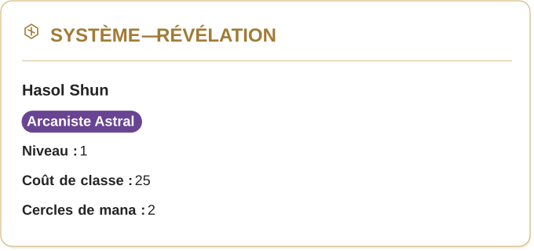

# Les Chroniques de l’Arcaniste Runique

*Livre II — Le Vertige des vies oubliées*

---

## Chapitre 1 — Une Astrale nommée Hasol

### I. Un anniversaire pas comme les autres

Une délicieuse odeur de pain chaud flottait dans les couloirs de la demeure Shun.

Hasol descendit les escaliers en prenant soin de ne pas marcher sur le bas de sa robe. Sa mère avait insisté pour qu'elle porte cette tenue aujourd'hui : un tissu blanc parcouru de broderies turquoise, dont les couleurs s'accordaient parfaitement avec celles de ses yeux.

Ses longs cheveux bruns, soigneusement attachés, retombaient derrière ses épaules.

Lorsqu'elle pénétra dans la salle à manger, son père releva immédiatement la tête.

— Ah ! Voilà enfin la jeune femme la plus attendue de cette maison !

Hasol sourit.

— Bonjour, papa.

— Bonjour, ma princesse. Et surtout, joyeux anniversaire !

Armin abandonna le registre commercial qu'il consultait et se leva pour accueillir sa fille. Il la serra dans ses bras avant de reculer légèrement pour la contempler.

— Seize ans… C'est incroyable. J'aurais pourtant juré que tu avais encore sept ans la semaine dernière.

— Tu dis la même chose chaque année.

— Et chaque année, je suis sincère !

Iseria, installée de l'autre côté de la table, leva les yeux au ciel.

— Tu pourrais commencer par laisser ta fille prendre son petit déjeuner.

— Certainement ! Il ne faudrait surtout pas qu'elle s'évanouisse devant la stèle. Imagine un peu les conversations dans la capitale !

— Papa !

Hasol éclata de rire.

Elle prit place auprès de sa mère, qui lui servit une tasse de thé. Iseria avait attaché ses longs cheveux roses en une tresse souple, et son expression était aussi douce que d'habitude.

— Comment te sens-tu, ma chérie ?

— Beaucoup mieux.

Iseria posa délicatement sa main sur celle de sa fille.

— Tu es certaine ?

Hasol acquiesça.

Le cauchemar de la nuit précédente lui paraissait déjà lointain. Elle se rappelait surtout la peur immense qui l'avait envahie à son réveil, une peur qu'elle avait été incapable d'expliquer.

Mais ce matin, auprès de ses parents, cette sensation s'estompait.

Elle avait seize ans.

Et aujourd'hui, elle allait enfin découvrir sa classe.

Armin déposa une assiette devant elle.

— Mange bien. Une future grande chasseuse ne peut pas commencer sa carrière le ventre vide.

Hasol contempla sa tartine.

Puis poussa un soupir.

— Vous savez… J'aurais vraiment préféré naître un jour plus tôt.

Armin s'immobilisa.

— Voilà une drôle de chose à dire le jour de son anniversaire !

— Mais c'est vrai !

Hasol posa sa tasse.

— La plupart des autres jeunes ont déjà fêté leurs seize ans tranquillement. Ils ont eu leurs cadeaux, leurs repas de famille, leurs journées d'anniversaire… Et après, ils peuvent venir à la Révélation.

— C'est effectivement le principe, répondit Armin avec un sérieux exagéré.

— Mais moi, c'est aujourd'hui !

Elle désigna vaguement la direction du temple.

— Mon anniversaire et ma Révélation tombent exactement le même jour !

Iseria dissimula un sourire derrière sa tasse.

— Et cela te pose un problème ?

— Évidemment !

Hasol redressa les épaules.

— Imaginez que j'obtienne une classe vraiment mauvaise…

Elle marqua une pause.

Puis déclara, avec toute la gravité dont elle était capable :

— Mon anniversaire sera complètement gâché !

Armin la contempla pendant quelques secondes.

Puis il éclata de rire.

— Dans ce cas, nous le fêterons demain !

— Mais papa ! Demain, ce ne sera plus mon anniversaire !

— Alors après-demain ?

— Ce sera encore pire !

— Je vois… Nous sommes face à un problème d'une gravité exceptionnelle.

Hasol croisa les bras.

— Tu te moques de moi.

— Un tout petit peu.

— Papa !

Iseria posa sa tasse.

— Hasol.

La jeune fille se tourna vers elle.

— Quelle que soit la classe que tu obtiendras aujourd'hui, tu resteras notre fille. Et nous serons heureux de fêter tes seize ans avec toi.

Hasol baissa légèrement les yeux.

— Je sais, maman…

— Une classe ne pourra jamais nous retirer cela.

Elle lui caressa doucement les cheveux.

— Tu as parfaitement le droit d'espérer une bonne Révélation. Mais tu n'as pas besoin de devenir légendaire pour mériter une belle journée.

Hasol esquissa un sourire.

— J'aimerais quand même avoir une bonne classe.

— Et tu as parfaitement le droit de l'espérer.

Armin se pencha vers elle.

— Et si tu deviens Astrale, je ferme mes bureaux pour la journée et j'invite toute la capitale à dîner !

Hasol éclata de rire.

— Toute la capitale ?

— Absolument !

— Armin, intervint Iseria.

— Bon… Peut-être seulement nos connaissances.

— Cela représente déjà beaucoup trop de monde.

Hasol retrouva peu à peu son enthousiasme.

— Vous pensez vraiment que je pourrais devenir légendaire ?

Armin prit un air songeur.

— Avec deux cercles de mana à ton âge ? Je pense surtout que les autres candidats ont de bonnes raisons d'être jaloux.

— Armin…

— Quoi ? Je ne fais qu'énoncer les faits !

Hasol contempla ses mains.

Elle avait longtemps rêvé de cette journée. Les livres consacrés aux grandes expéditions, les récits des chasseurs et les innombrables heures passées à s'entraîner avaient nourri son ambition depuis l'enfance.

Elle voulait explorer des donjons.

Découvrir des trésors oubliés.

Affronter des monstres dont elle ne connaissait encore que les illustrations.

Et peut-être, un jour, accomplir quelque chose d'assez extraordinaire pour que son nom apparaisse dans l'un de ces livres.

Mais derrière toutes ces ambitions se cachait une inquiétude qu'elle n'osait pas vraiment exprimer.

Et si je n'obtenais jamais les moyens de réaliser mes rêves ?

Elle jeta un regard à ses parents.

Armin plaisantait déjà sur les préparatifs d'un banquet imaginaire. Iseria tentait de le ramener à des considérations plus raisonnables.

Hasol sourit.

Au moins, j'aurai toujours eux.

Elle termina son petit déjeuner.

Puis se leva.

— Bon ! Si je continue à discuter, je vais finir par être en retard à ma propre Révélation !

— Et à ton propre anniversaire ! ajouta Armin.

— Papa !

### II. La lumière violette

Les rues de la capitale étaient particulièrement animées.

Des familles entières se dirigeaient vers le grand temple, accompagnant les jeunes gens qui, comme Hasol, allaient participer à leur Révélation.

Sur leur chemin, ils croisèrent plusieurs chasseurs équipés pour le combat. Certains portaient les emblèmes de guildes célèbres. D'autres transportaient des provisions ou discutaient autour de cartes dépliées.

Depuis l'apparition des portails, quatre années auparavant, les chasseurs occupaient une place toujours plus importante dans la société impériale.

Les guildes recrutaient.

Les artisans travaillaient davantage.

Et les jeunes gens rêvaient plus que jamais de recevoir une classe leur permettant de rejoindre les grandes expéditions.

Hasol observait tout cela avec fascination.

Bientôt, elle pourrait enfin participer à ce monde autrement qu'en lisant des livres.

Lorsqu'ils arrivèrent devant le temple, elle ralentit involontairement.

L'immense édifice dominait la place. Ses hautes colonnes projetaient leurs ombres sur les marches de pierre, tandis que des groupes de familles attendaient leur tour sous les regards attentifs des officiants.

À l'intérieur, les rayons du soleil traversaient les vitraux et se répandaient sur le sol de marbre.

Au centre du sanctuaire se dressait la stèle sacrée.

Hasol sentit son cœur accélérer.

— Je commence à avoir peur, murmura-t-elle.

Armin se pencha vers elle.

— Tu veux que je demande au prêtre de passer à ta place ?

— Tu as déjà une classe !

— Il pourrait peut-être m'en donner une meilleure.

Iseria lui adressa un regard désapprobateur.

— Laisse donc cette pauvre stèle tranquille.

Hasol dut retenir un rire.

Les noms se succédaient.

À chaque Révélation, les familles retenaient leur souffle avant de laisser éclater leur joie ou de réconforter les candidats les plus déçus.

Une classe rare provoqua quelques applaudissements particulièrement nourris.

Hasol applaudit elle aussi.

Puis vint son tour.

— Hasol Shun !

Son sourire disparut.

Elle inspira profondément.

Sa mère lui adressa un regard encourageant.

— Vas-y, ma chérie.

Hasol s'avança.

Les quelques mètres qui la séparaient de la stèle lui parurent interminables.

Elle avait beau avoir imaginé cette scène des centaines de fois, rien ne l'avait réellement préparée à cet instant.

Le prêtre lui indiqua la surface du cristal.

— Lorsque tu seras prête.

Hasol leva la main.

Ses doigts s'arrêtèrent à quelques centimètres de la pierre.

Bon…

Elle inspira.

Au pire, papa a promis qu'on pourrait fêter mon anniversaire demain.

Cette pensée lui arracha un sourire nerveux.

Même si ça ne sera plus mon anniversaire…

Elle posa finalement sa main sur la stèle.

Le cristal était froid.

Pendant un bref instant, rien ne se produisit.

Puis une chaleur se répandit dans sa poitrine, autour de ses deux cercles de mana.

La stèle s'illumina.

Une lumière blanche envahit d'abord le cristal.

Hasol retint son souffle.

L'éclat grandit.

La luminosité se renforça, gagnant progressivement toute la surface de la pierre.

Puis la couleur changea.

Ce ne fut ni la teinte habituelle d'une classe commune, ni celle d'une classe rare.

Ce ne fut même pas la lumière d'une Révélation légendaire.

Une lueur violette apparut au cœur du cristal.

Elle s'étendit lentement, parcourant les inscriptions gravées dans la pierre.

Le prêtre fronça les sourcils.

Puis recula d'un pas.

La lumière devint plus intense.

Violette.

Profondément violette.

Une colonne lumineuse jaillit de la stèle et s'éleva jusqu'aux voûtes du temple. D'innombrables particules scintillantes se dispersèrent autour de Hasol, enveloppant sa silhouette d'un éclat irréel.

Les conversations cessèrent.

Même les assistants du temple restèrent immobiles.

Hasol contempla ses mains, incapable de comprendre ce qui se produisait.

Une fenêtre apparut devant elle.

  <picture class="lit-window__github-picture">
    <source media="(max-width: 600px)" srcset="assets/fenetres-livre-2/L2-C1-F01-mobile.svg">
    
  </picture>
  

    
Version textuelle de la fenêtre

  

    <svg class="lit-window__icon" xmlns="http://www.w3.org/2000/svg" viewBox="0 0 24 24" width="24" height="24" fill="none" stroke="currentColor" stroke-width="1.6" stroke-linecap="round" stroke-linejoin="round" aria-hidden="true" focusable="false"><path d="m12 3 8 5v8l-8 5-8-5V8Z M12 7v10 M8 10l8 4"/></svg>
    SYSTÈME — RÉVÉLATION
  

  <h3>Hasol Shun</h3>
  
Arcaniste Astral

  
<strong>Rang :</strong> Astral

  
<strong>Niveau :</strong> 1

  
<strong>Coût de classe :</strong> 25

  
<strong>Cercles de mana :</strong> 2

  

Astral.

Hasol relut le mot.

Elle était persuadée d'avoir mal compris.

Elle ferma les yeux, les rouvrit et consulta de nouveau la fenêtre.

Le mot était toujours là.

— Une… Astrale ?

Sa propre voix lui parut minuscule.

Le prêtre retrouva enfin l'usage de la parole.

— Une classe astrale !

Le temple explosa.

Des exclamations jaillirent de toutes parts. Certains cherchèrent à s'approcher de la stèle, tandis que les officiants tentaient de rétablir le calme.

— Une Astrale dans la capitale !

— Quelle classe a-t-elle reçue ?

— Prévenez l'Académie !

— Qui est cette jeune fille ?

Hasol se retourna vers ses parents.

Armin semblait avoir oublié comment parler.

Il ouvrit la bouche.

La referma.

Puis leva brusquement les bras.

— C'EST MA FILLE !

— Papa !

Il traversa les quelques mètres qui les séparaient sans accorder la moindre attention aux regards braqués sur lui.

— Ma princesse est une Astrale !

Il la souleva presque du sol en la serrant contre lui.

Hasol éclata de rire, incapable de contenir davantage son bonheur.

— Tu avais promis d'inviter toute la capitale !

— Je vais devoir acheter un restaurant !

— Armin ! protesta Iseria en les rejoignant.

Hasol tourna la tête vers sa mère.

Iseria souriait elle aussi, mais son sourire semblait un peu forcé. Ses yeux paraissaient préoccupés.

— Maman… Tout va bien ?

Iseria parut surprise, puis prit doucement le visage de sa fille entre ses mains.

— C'est simplement beaucoup d'émotions d'un seul coup. Je ne m'attendais pas à une telle Révélation.

Son sourire s'adoucit.

— Je suis très fière de toi, ma chérie.

Hasol se dégagea des bras de son père pour se réfugier dans ceux de sa mère.

— Maman…

Iseria la serra contre elle.

— Félicitations, ma chérie.

Hasol enfouit son visage contre son épaule.

Elle avait tellement rêvé de cette journée.

Et pourtant, jamais elle n'aurait osé espérer un tel résultat.

Lorsqu'elle releva la tête, ses yeux brillaient.

— Finalement…

Armin se pencha vers elle.

— Oui ?

Un immense sourire illumina le visage d'Hasol.

— Je crois que mon anniversaire n'est pas gâché !

Armin partit d'un rire si sonore que plusieurs personnes se retournèrent de nouveau vers eux.

— Je pense même que tu vas t'en souvenir longtemps, ma princesse !

Et au milieu des exclamations, des félicitations et des particules violettes qui achevaient de disparaître, Hasol éclata de rire avec lui.

### III. Le secret de la maison Shun

Il leur fallut un certain temps avant de pouvoir quitter le temple.

Plusieurs représentants de guildes souhaitaient rencontrer Hasol. Des officiants lui posèrent des questions concernant sa classe, tandis que d'autres personnes tentaient simplement de lui adresser quelques mots.

Armin prit un plaisir évident à répondre aux félicitations.

Iseria, en revanche, se montra plus réservée lorsque les questions commencèrent à concerner les compétences de sa fille.

— Elle vient tout juste de découvrir sa classe, rappela-t-elle poliment. Laissez-lui au moins le temps de comprendre ce qu'elle a reçu.

Ce ne fut qu'une fois revenue dans le salon de la demeure Shun que Hasol put enfin examiner tranquillement son interface.

Elle s'installa sur le canapé, rabattit ses jambes sous elle et ouvrit sa liste de compétences.

Ses yeux s'agrandirent.

— Il y en a cinq !

Armin, qui venait de s'installer dans un fauteuil, se redressa.

— Cinq compétences dès la Révélation ?

— Oui !

Iseria rapprocha sa chaise.

— Lis-nous leurs descriptions, ma chérie.

Hasol s'empressa d'obéir.

La première s'appelait Bénédiction runique.

Elle favorisa un instant son imagination.

— Une compétence passive qui améliore les chances de réussite lors du renforcement des runes !

Armin se redressa davantage.

— Voilà qui pourrait intéresser beaucoup d'artisans !

— Tu crois que je pourrais améliorer mes propres runes avec ça ?

Iseria réfléchit quelques instants.

— Certainement. Mais n'oublie pas qu'une meilleure chance de réussite ne signifie pas que toutes tes tentatives seront couronnées de succès.

— Je sais, maman.

Hasol passa à la suivante.

Œil runique.

Son enthousiasme grandit encore.

— Je peux voir le résultat final d'une rune améliorée jusqu'à +15, à condition de réaliser moi-même les améliorations nécessaires !

Iseria lui demanda de répéter.

— Le résultat final exact ?

— Oui !

Hasol parcourut de nouveau la description.

— Et je peux aussi détecter les pièges !

Armin laissa échapper un sifflement admiratif.

— Une compétence d'artisan et une compétence d'explorateur dans le même pouvoir… C'est remarquable.

Hasol avait déjà envie de trouver une rune pour essayer.

Elle poursuivit sa lecture.

Main runique.

— Celle-ci permet d'ouvrir les coffres et les portes !

— Tu devrais peut-être éviter de la présenter trop rapidement aux employés de nos entrepôts, plaisanta Armin.

— Papa !

— Je tiens à mes serrures !

Iseria lui adressa un regard amusé.

Hasol passa à la quatrième compétence.

Aura runique.

Elle se redressa aussitôt.

— Celle-là est vraiment intéressante !

— Qu'est-ce qu'elle fait ? demanda Armin.

— Elle permet d'imprégner une arme d'une aura élémentaire !

Elle relut les informations avec impatience.

Puis son sourire se figea légèrement.

— Oh…

— Qu'y a-t-il ?

— Je peux déjà imprégner une arme, mais je dois attendre le niveau dix avant de pouvoir manier moi-même une arme imprégnée.

Hasol gonfla les joues.

— C'est dommage…

Iseria sourit.

— Tu as attendu seize ans avant de connaître ta classe. Je pense que tu peux patienter encore un peu pour manier une arme imprégnée.

— Mais maman ! C'est quand même une classe astrale !

— Justement. Cela ne signifie pas que tu maîtriseras tout dès le premier jour.

Hasol soupira.

— D'accord…

Elle contempla la liste.

Bénédiction runique.

Œil runique.

Main runique.

Aura runique.

Toutes ces compétences paraissaient incroyablement utiles. Certaines lui permettraient d'explorer des donjons. D'autres de développer son artisanat et son équipement.

Mais une inquiétude commençait à se former dans son esprit.

— Je n'ai pas de sort offensif…

Armin pencha la tête.

— Pas un seul ?

— Non.

Elle consulta encore une fois ses compétences, comme si une attaque avait pu apparaître entre deux lignes.

Rien.

— Je vais devoir me battre uniquement avec mon épée ?

Iseria lui prit doucement la main.

— Pour le moment, cela pourrait être nécessaire. Mais tu disposes de beaucoup de possibilités. Il faudra apprendre à les associer intelligemment.

Hasol hocha la tête.

Elle pouvait comprendre cela.

Une classe astrale n'était pas nécessairement une classe capable de lancer d'immenses explosions magiques dès sa Révélation.

Elle allait devoir trouver sa propre manière de combattre.

Son regard glissa vers la dernière compétence.

Croissance runique.

Elle commença à lire.

Puis ralentit.

Relut une ligne.

Et se pencha brusquement en avant.

— Maman ?

— Oui ?

— Je crois que cette dernière compétence est encore plus incroyable que les autres.

Iseria se rapprocha.

Hasol lui expliqua ce qu'elle venait de découvrir.

Croissance runique lui permettait de développer ses cercles de mana et ses emplacements runiques en accomplissant des paliers d'élimination.

Un cercle supplémentaire.

Puis un autre.

Et potentiellement beaucoup d'autres, si elle remplissait les conditions.

Elle consulta les informations complémentaires.

— Pour les monstres admissibles, il y a un palier toutes les mille éliminations…

Iseria resta silencieuse.

Armin cessa de sourire.

Hasol poursuivit :

— Cela veut dire que si je chasse énormément, je pourrais posséder bien plus de cercles que maintenant !

Elle leva la tête vers ses parents.

— Imaginez si j'en obtenais dix !

Armin ouvrit la bouche.

Mais aucun mot n'en sortit.

Hasol, emportée par son enthousiasme, continua :

— Et avec Bénédiction runique et Œil runique, je pourrais choisir les meilleures pierres que je trouve et les améliorer moi-même !

Elle serra les poings.

— Je pourrais devenir vraiment forte !

Iseria se leva.

Elle traversa lentement le salon et referma la porte.

Hasol la regarda faire.

— Maman ?

Sa mère revint s'asseoir devant elle.

Son expression avait changé.

— Hasol, écoute-moi attentivement.

Le ton employé surprit la jeune fille.

— Qu'est-ce qu'il y a ?

— Tu ne dois parler de Croissance runique à personne.

Hasol cligna des yeux.

— Personne ?

— Personne.

Armin échangea un regard avec son épouse.

Il semblait mesurer progressivement l'importance de ce qu'il venait d'entendre.

Iseria reprit :

— Les cercles de mana représentent l'une des ressources les plus précieuses dont puisse disposer un chasseur. Certaines personnes consacrent leur vie entière à essayer d'en éveiller davantage.

Elle posa une main sur celle de Hasol.

— Imagine ce que signifierait l'existence d'une compétence capable d'en accorder régulièrement.

Hasol baissa les yeux.

Elle n'avait initialement pensé qu'aux possibilités que lui offrait ce pouvoir.

À présent, elle commençait à comprendre l'inquiétude de sa mère.

— Même à Ray ?

Iseria hésita un instant.

— Pas pour le moment.

— Mais c'est mon meilleur ami…

— Je le sais, ma chérie. Il ne s'agit pas de douter de lui. Seulement, plus une information est partagée, plus il devient difficile de la protéger.

Armin posa une main sur l'épaule de sa fille.

— Ta mère a raison. Tu n'as rien à prouver aujourd'hui. Tu peux être heureuse de ta Révélation sans devoir expliquer tous tes pouvoirs à la capitale entière.

Hasol contempla la dernière compétence affichée devant elle.

Elle avait tellement envie de raconter à Ray ce qu'elle venait de découvrir.

Ils pourraient passer des heures à réfléchir aux possibilités de Croissance runique.

Ray adorerait cela.

Mais sa mère semblait véritablement inquiète.

Et Hasol savait qu'Iseria ne lui donnerait pas un tel conseil sans raison.

Elle referma son interface.

— D'accord. Je garderai le secret.

Iseria lui caressa doucement les cheveux.

— Je veux simplement que tu puisses choisir toi-même ce que tu souhaites devenir.

Hasol lui sourit.

Elle comprenait.

Et pour l'instant, cela lui suffisait.

### IV. Une Astrale à l'Académie

Les jours suivants, Hasol découvrit qu'il était particulièrement difficile de passer inaperçue lorsqu'on possédait une classe astrale.

À peine avait-elle franchi les portes de l'Académie que plusieurs élèves se retournèrent sur son passage.

— C'est elle ?

— L'Arcaniste Astral ?

— On raconte qu'elle possède déjà deux cercles !

Hasol pressa légèrement le pas.

Elle avait imaginé faire connaissance avec ses futurs camarades, découvrir les salles de cours et commencer son entraînement.

Elle n'avait pas imaginé devoir répondre à autant de questions avant même d'avoir trouvé sa salle.

— Hasol !

Une voix familière lui fit immédiatement tourner la tête.

Un jeune homme portant des lunettes s'approchait d'elle, un livre sous le bras.

— Ray !

Elle le rejoignit avec soulagement.

Ray Corvus observa les élèves qui continuaient à lui jeter des regards curieux.

— Je suppose que tu n'as pas besoin que je te félicite encore une fois.

— Tu peux quand même le faire.

— Félicitations.

— Merci !

Il ajusta ses lunettes.

— J'ai cherché des informations sur les Arcanistes Astraux.

Hasol sourit.

— Évidemment.

— Je n'ai rien trouvé.

— Oh.

— Pas une seule mention dans les ouvrages auxquels j'ai pu accéder.

Il ouvrit son livre, dans lequel dépassaient plusieurs morceaux de papier.

— J'ai même consulté un ancien registre des classes légendaires, au cas où ton intitulé serait apparenté à une autre classe.

Hasol contempla les nombreuses annotations.

— Ray… Depuis combien de temps cherches-tu ?

— Depuis que j'ai appris ta Révélation.

— Tu n'as donc rien fait d'autre ?

— J'ai dormi.

Elle éclata de rire.

Ils traversèrent ensemble une partie de l'Académie avant de s'installer dans la cour, à l'ombre d'un grand arbre.

Ray lui demanda de lui présenter ses nouvelles capacités.

Hasol hésita brièvement.

Puis elle lui expliqua le fonctionnement de Bénédiction runique, d'Œil runique et de Main runique. Elle lui parla également d'Aura runique, déjà disponible, et du niveau dix qu'elle devait atteindre avant de pouvoir manier elle-même une arme imprégnée.

Elle ne mentionna pas Croissance runique.

Ray l'écouta avec un intérêt évident.

— Tu pourrais donc devenir une excellente artisane tout en étant chasseuse.

— C'est possible.

— Et tu peux ouvrir des coffres ?

— Des portes aussi.

Il parut réfléchir sérieusement.

— Voilà qui pourrait nous être utile.

Hasol plissa les yeux.

— Pour quelle raison ?

— J'ai découvert que certaines archives de la bibliothèque étaient conservées dans une salle fermée.

— Ray !

— Je plaisantais.

Elle le contempla avec méfiance.

— Tu ne plaisantes presque jamais.

— Cela ne signifie pas que j'en suis incapable.

Hasol secoua la tête en souriant.

Il était si agréable de pouvoir discuter normalement.

Avec Ray, elle ne se sentait pas obligée de devenir immédiatement une personne extraordinaire.

Elle était simplement Hasol.

— Tu sais, reprit-elle après un moment, j'ai l'impression que tout le monde attend quelque chose de moi.

Ray referma son livre.

— C'est probablement le cas.

Elle soupira.

— Tu pourrais au moins essayer de me rassurer.

— Je préfère ne pas te mentir.

— Merci beaucoup !

Il sourit légèrement.

— Mais cela ne signifie pas que tu dois répondre à toutes ces attentes immédiatement.

Hasol contempla les élèves qui traversaient la cour.

Certains la regardaient encore.

D'autres étaient déjà occupés à leurs propres discussions.

— Tu crois vraiment ?

— Tu viens seulement de recevoir ta classe. Tu ne peux pas devenir une chasseuse expérimentée en quelques jours.

— Je sais…

— Et puis, si tu passes tout ton temps à écouter les personnes qui parlent de toi, quand trouveras-tu celui de t'entraîner ?

Hasol tourna la tête vers lui.

Un sourire apparut progressivement sur ses lèvres.

— Tu as raison !

Ray haussa les épaules.

— Cela m'arrive.

Elle éclata de rire.

L'entretien avec le directeur de l'Académie eut lieu peu après.

Hasol s'était attendue à quelques recommandations et à une présentation générale de ses futurs cours.

Elle découvrit une véritable discussion consacrée à son avenir.

Le directeur avait devant lui plusieurs documents relatifs à sa Révélation, ainsi qu'un registre de formation.

— Mademoiselle Shun, votre classe représente une occasion exceptionnelle, aussi bien pour vous que pour notre établissement.

Hasol se tenait droite sur sa chaise.

— Nous souhaitons vous offrir les meilleures conditions possibles pour développer vos capacités.

Il consulta ses notes.

— Bénédiction runique présente manifestement un intérêt considérable dans le domaine de l'artisanat. Vos compétences d'exploration méritent également un accompagnement spécialisé.

Il marqua une pause.

— Quant à Aura runique… Nous aimerions beaucoup en observer les effets lorsque vous manierez vous-même une arme imprégnée.

Hasol sourit.

— Moi aussi, monsieur.

— La compétence est déjà disponible, mais votre niveau actuel ne vous permet pas encore de manier personnellement une telle arme.

— Je sais.

— Nous allons donc adapter votre formation afin de faciliter votre progression jusqu'au niveau dix.

Il lui expliqua qu'elle bénéficierait d'un encadrement personnalisé, de séances adaptées à ses compétences et de l'accompagnement de chasseurs expérimentés.

Hasol avait du mal à croire ce qu'elle entendait.

— Tout cela… uniquement pour moi ?

— Votre classe nous oblige à revoir certaines de nos habitudes.

Le directeur lui adressa un sourire.

— Une formation ordinaire n'est pas nécessairement la plus appropriée pour une Astrale.

Hasol regarda les documents disposés devant lui.

Elle était heureuse.

Mais cette attention lui paraissait aussi un peu intimidante.

— Je ne veux pas prendre la place des autres élèves…

Le directeur sembla surpris.

Puis son expression s'adoucit.

— Vous n'avez pas à vous inquiéter de cela. Votre formation sera organisée en fonction de vos besoins, sans vous empêcher de participer aux enseignements ordinaires.

Hasol poussa un petit soupir de soulagement.

— Merci, monsieur.

Lorsqu'elle quitta son bureau, elle avait l'impression que son avenir venait de s'accélérer.

Elle ne savait pas encore à quoi ressembleraient ses journées.

Mais une chose était certaine.

L'Académie avait décidé de ne pas perdre de temps.

### V. Elric Arowell, le Porte-bouclier

Hasol aperçut son futur mentor sur l'un des terrains d'entraînement de l'Académie.

L'homme discutait avec un enseignant, son grand bouclier appuyé contre sa jambe.

Il portait une armure noire aux reflets argentés, composée d'épaisses plaques de métal. Des étoffes claires descendaient le long de sa taille, contrastant avec la couleur sombre de son équipement.

Une longue épée droite reposait dans son fourreau.

Ses cheveux noirs, légèrement ébouriffés, encadraient un visage aux traits affirmés. Lorsqu'il tourna la tête vers Hasol, elle remarqua immédiatement ses yeux bleus.

— Hasol Shun, je suppose ?

— Oui, monsieur.

Il lui tendit la main.

— Elric Arowell. L'Académie m'a demandé de superviser votre formation de chasseuse.

Hasol lui serra la main.

— Enchantée !

— De même.

Il récupéra son bouclier avant de lui indiquer un banc à proximité.

— Commençons par discuter un peu.

Hasol s'installa auprès de lui.

Elric lui présenta brièvement son parcours.

Il avait quarante-deux ans et possédait une classe commune de Porte-bouclier.

Il était également niveau quarante-cinq.

Hasol ouvrit grand les yeux.

— Niveau quarante-cinq !

Elric eut un léger sourire.

— Cela fait quelques années que je chasse.

— Vous avez déjà affronté des dragons ?

— Nous ne nous connaissons que depuis cinq minutes et tu veux déjà parler de dragons ?

Hasol rougit.

— Désolée.

Il éclata de rire.

— Ce n'est pas un reproche. J'ai simplement l'impression que l'Académie m'a confié une élève impatiente.

Il lui demanda ensuite de lui parler de ses ambitions.

Hasol répondit avec enthousiasme.

Elle voulait découvrir les donjons, devenir suffisamment forte pour participer aux grandes opérations et apprendre à utiliser toutes les capacités de sa classe.

Elric l'écouta jusqu'au bout.

— Et si je te demandais de passer les prochains jours à perfectionner les mouvements les plus simples à l'épée ?

Hasol cligna des yeux.

— Seulement les mouvements simples ?

— Oui.

— Mais…

Elle hésita.

Elric attendit patiemment.

— Je pensais que nous allions commencer à combattre rapidement.

— Nous combattrons. Mais avant cela, j'aimerais savoir comment tu tiens ton arme, comment tu te déplaces et surtout comment tu réagis lorsque quelque chose ne se déroule pas comme prévu.

Il posa la main sur son bouclier.

— Une classe astrale ne te permettra pas d'éviter un coup que tu n'as pas vu venir.

Hasol baissa légèrement la tête.

— Je comprends.

— Bien. Montre-moi donc ce que tu sais faire.

Ils se dirigèrent vers les mannequins d'entraînement.

Hasol exécuta les mouvements qu'elle avait appris durant son enfance.

Elric observa attentivement sa posture, lui demanda de recommencer plusieurs attaques et corrigea la position de ses pieds.

Il ne se montra ni particulièrement impressionné ni déçu.

Il enseignait.

Tout simplement.

À plusieurs reprises, Hasol commit des erreurs qu'elle aurait préféré dissimuler.

Chaque fois, Elric les lui expliqua sans jamais se moquer d'elle.

— Ne cherche pas à frapper plus fort si cela te fait perdre ton équilibre.

Elle recommença.

— Mieux.

Quelques exercices plus tard, il lui fit signe de s'arrêter.

Hasol avait déjà chaud et ses bras commençaient à lui faire mal.

— Je pensais être un peu meilleure que ça, avoua-t-elle.

— Tu es une débutante.

Elle grimaça.

— Dit comme ça…

— Une débutante prometteuse, si tu préfères.

Hasol sourit.

Elric lui tendit de l'eau.

— Il n'y a aucune honte à commencer au début. Ceux qui prétendent avoir tout appris avant leur premier véritable combat sont généralement ceux que je dois surveiller le plus attentivement.

Elle but quelques gorgées.

— Mais vous, avec votre niveau, vous devez être capable de battre énormément de monstres !

Elric contempla son bouclier.

— Je peux en affronter certains que tu ne pourrais pas encore approcher. Mais mon travail consiste surtout à protéger ceux qui combattent à mes côtés.

Hasol l'observa avec curiosité.

— C'est pour cela que vous êtes Porte-bouclier ?

— En partie.

Il lui expliqua brièvement sa manière de combattre.

Son épée lui permettait de participer aux affrontements, tandis que son bouclier et ses compétences lui servaient principalement à contrôler les ennemis et à protéger son équipe.

— Je ne suis pas toujours celui qui inflige les plus gros dégâts, poursuivit-il. Mais lorsqu'un monstre décide de s'attaquer à un compagnon plus fragile, je dois être capable d'intervenir.

Hasol réfléchit.

— Alors vous êtes celui qui empêche les autres de mourir ?

Elric resta silencieux un instant.

Puis son expression s'adoucit.

— J'essaie.

Ce simple mot surprit Hasol.

Elle aurait imaginé qu'un chasseur aussi expérimenté répondrait avec davantage d'assurance.

Mais Elric ne semblait pas considérer sa puissance comme une garantie de victoire.

Et, d'une certaine manière, cela lui inspira encore plus de respect.

— Vous pensez que je pourrai devenir une bonne chasseuse ?

— Je pense que tu en as les moyens.

Elle sourit.

— Vraiment ?

— Mais cela dépendra beaucoup de ce que tu décideras d'en faire.

Hasol baissa les yeux vers son épée.

Puis elle redressa les épaules.

— Alors je vais travailler dur !

Elric éclata de rire.

— Voilà une réponse qui me plaît.

### VI. Zéphyr Claire et la fille aux cheveux argentés

La formation particulière d'Hasol ne se limitait pas au combat.

Quelques jours après sa rencontre avec Elric, l'Académie lui demanda de rejoindre une salle consacrée aux exercices d'exploration.

Elle y découvrit plusieurs coffres, des mécanismes démontés et différentes installations destinées à reproduire les pièges rencontrés dans les donjons.

Un homme se tenait près d'une table.

Il avait des cheveux blonds, des yeux verts et une barbe courte soigneusement entretenue. Une cape vert sombre reposait sur ses épaules, retenue par des attaches de cuir. Son arc et son carquois avaient été déposés à proximité.

Lorsqu'il aperçut Hasol, il lui adressa un large sourire.

— Voilà donc notre fameuse Astrale !

Hasol s'inclina légèrement.

— Bonjour, monsieur.

— Zéphyr Claire. Ranger.

Il lui serra la main avec chaleur.

— On m'a expliqué que tu possédais une compétence particulièrement intéressante pour détecter les pièges.

— Oui. Œil runique.

— Excellent ! Nous allons voir ce que tu arrives à en faire.

Hasol remarqua rapidement que Zéphyr était niveau cinquante-trois.

Elle en resta impressionnée.

Entre Elric et lui, l'Académie semblait déterminée à lui faire rencontrer des chasseurs particulièrement expérimentés.

Zéphyr lui présenta un premier coffre.

— Que vois-tu ?

Hasol se pencha.

Elle distingua les ferrures, la serrure et les attaches du couvercle.

Mais autre chose attirait également son attention.

Elle désigna une petite partie du mécanisme.

— Il y a un piège, ici.

Le Ranger haussa les sourcils.

— Déjà ?

— Oui.

Il examina l'endroit qu'elle lui indiquait.

Puis sourit.

— C'est exact. Maintenant, peux-tu me dire comment il fonctionne ?

Hasol observa de nouveau le coffre.

Elle distinguait le piège.

Elle savait qu'il était là.

Mais elle n'avait aucune idée de ce qui se produirait si quelqu'un ouvrait le couvercle.

— Non…

— Voilà pourquoi nous allons travailler ensemble.

Zéphyr entreprit de lui expliquer le mécanisme.

Il lui montra les différents éléments, la manière dont ils étaient reliés et les précautions qu'un chasseur devait prendre avant d'intervenir.

Hasol l'écoutait avec fascination.

Elle posa de nombreuses questions.

Certaines étaient suffisamment précises pour surprendre le Ranger. D'autres lui firent comprendre qu'elle possédait encore d'importantes lacunes.

— Œil runique t'apporte un avantage exceptionnel, lui expliqua Zéphyr. Mais lorsqu'un danger est détecté, encore faut-il savoir quoi en faire.

— Je comprends.

— Imagine que tu repères un piège au milieu d'un couloir. Tu peux avertir ton groupe. C'est déjà formidable. Mais cela ne signifie pas que tu sais comment le neutraliser.

Hasol acquiesça.

— Donc je dois apprendre à comprendre ce que je vois.

Zéphyr lui adressa un sourire satisfait.

— Exactement !

Après plusieurs exercices, il lui présenta un coffre dont l'absence de piège avait été vérifiée.

— L'Académie m'a également parlé de Main runique.

Hasol acquiesça.

— Je devrais pouvoir l'ouvrir.

— Essaie donc.

Elle s'approcha du coffre, concentra son attention et utilisa sa compétence.

Le verrou céda.

Hasol ouvrit délicatement le couvercle.

Il était vide.

Zéphyr contempla la serrure.

— Eh bien…

Il se pencha pour l'examiner.

— C'est une compétence dont beaucoup de Rangers aimeraient disposer.

Hasol sourit fièrement.

— C'était assez simple.

— Et c'est précisément pour cela que tu devras rester prudente. Ouvrir un coffre et le rendre inoffensif sont deux choses différentes.

Elle hocha la tête.

Zéphyr lui fit ensuite répéter plusieurs exercices d'observation.

Au fil de la séance, Hasol commença à mieux comprendre la différence entre détecter un danger et savoir comment y réagir.

Elle appréciait la manière dont le Ranger enseignait.

Il était patient, précis et généralement de bonne humeur.

À la fin de leur séance, la porte de la salle s'ouvrit.

— Papa ?

Zéphyr releva la tête.

— Ah ! Viens donc !

Une jeune fille entra.

Hasol remarqua tout de suite sa chevelure argentée. Elle était trois ans plus jeune qu'elle et semblait parfaitement à l'aise parmi les différents équipements disposés dans la salle.

Zéphyr posa une main affectueuse sur son épaule.

— Hasol, je te présente ma fille, Samia.

La jeune fille lui adressa un sourire.

— Bonjour.

— Bonjour !

— Elle est encore jeune, poursuivit Zéphyr, mais elle est déjà bien plus talentueuse que moi. Elle rejoindra l'Académie lorsqu'elle aura seize ans.

— Papa…

Samia baissa légèrement la tête, embarrassée.

— Quoi ? Je ne fais que dire la vérité !

Hasol sourit.

Elle observa successivement le père et la fille.

Leurs expressions présentaient une certaine ressemblance. Pourtant, leurs cheveux étaient de couleurs complètement différentes.

Sa curiosité finit par l'emporter.

— Vous êtes blond, monsieur Claire, mais Samia a les cheveux argentés…

Zéphyr éclata d'un petit rire.

— Elle était blonde, elle aussi.

Hasol pencha la tête.

— Autrefois ?

— Oui. Ils ont changé de couleur il y a quelques années.

Il passa doucement la main sur les cheveux de sa fille.

— Le jour où les premiers portails sont apparus, Samia a éveillé son deuxième cercle de mana. Au cours de la semaine qui a suivi, ses cheveux sont passés du blond à l'argenté.

Hasol resta immobile.

Elle avait parfaitement entendu ce que Zéphyr venait de dire.

Pourtant, elle eut besoin de plusieurs secondes pour en comprendre le sens.

— Son… deuxième cercle ?

— Exactement.

Elle tourna brusquement la tête vers Samia.

— Tu possèdes deux cercles de mana ?!

Samia acquiesça.

— Oui.

Hasol ouvrit la bouche.

Puis la referma.

Elle connaissait évidemment l'existence de personnes possédant plusieurs cercles de mana. Sa propre mère lui avait longuement expliqué le sujet.

Mais durant toute son enfance, son développement précoce lui avait valu d'être considérée comme une exception.

Et devant elle se trouvait une fille trois ans plus jeune, qui possédait déjà autant de cercles qu'elle.

— Tu pourrais me les montrer ?

Samia regarda son père.

Zéphyr acquiesça.

La jeune fille ferma les yeux.

Hasol observa le mana se manifester autour d'elle.

Un premier cercle.

Puis un deuxième.

Deux.

Il y en avait véritablement deux.

— Incroyable…

Hasol s'approcha légèrement.

Elle ne pouvait détacher son regard des deux structures lumineuses.

— Moi aussi, j'en possède deux !

Samia rouvrit les yeux.

— Vraiment ?

— Oui !

Hasol fit apparaître ses propres cercles avec enthousiasme.

Les deux jeunes filles se contemplèrent.

Puis elles regardèrent leurs cercles respectifs.

Zéphyr croisa les bras, visiblement amusé.

— Je sens que vous allez avoir beaucoup de choses à vous raconter.

Hasol éclata de rire.

— Je pensais être la seule à en avoir deux aussi jeune !

— Eh bien, répondit Samia avec un sourire, apparemment non.

Quelque chose dans cette réponse plut immédiatement à Hasol.

Elle avait passé une grande partie des derniers jours à entendre combien elle était différente des autres.

Pour une fois, elle venait de rencontrer quelqu'un qui lui ressemblait sur un point qu'elle avait toujours cru exceptionnel.

— Tu as déjà essayé de comprendre pourquoi tes cheveux avaient changé ?

Samia attrapa une mèche argentée entre ses doigts.

— Un peu. Mais je les aime bien comme ça.

— Ils sont très beaux !

— Merci !

Hasol sourit.

Elles commencèrent à discuter de leurs cercles, de leurs entraînements et de leur intérêt commun pour les activités de chasse.

Samia se montrait particulièrement curieuse au sujet de l'Académie.

Hasol lui raconta ses premières séances avec Elric, sans oublier les nombreuses corrections qu'il avait apportées à sa manière de tenir une épée.

— Il m'a fait recommencer le même mouvement tellement de fois que je crois pouvoir le reproduire dans mon sommeil.

— Papa fait pareil avec l'arc, répondit Samia.

Zéphyr protesta aussitôt.

— C'est ainsi qu'on apprend correctement !

Les deux jeunes filles échangèrent un regard.

Puis éclatèrent de rire.

Le Ranger leva les mains.

— Très bien. Je vois que je viens de perdre toute autorité dans cette salle.

Lorsqu'il fut temps pour Hasol de partir, Samia l'accompagna jusqu'à la porte.

— On se reverra ?

— Bien sûr ! Ton père doit encore m'apprendre beaucoup de choses.

— Alors à bientôt, Hasol.

— À bientôt, Samia !

Hasol quitta la salle avec un immense sourire.

Elle venait de découvrir qu'une classe astrale n'était pas la seule chose extraordinaire susceptible de lui arriver cette semaine.

### VII. Une autre manière de devenir forte

— Le niveau dix ?

Elric déplia une carte devant Hasol.

— C'est effectivement l'objectif que l'Académie souhaite privilégier.

Ils étaient installés dans une petite salle, à l'écart des terrains d'entraînement.

Cette fois, Elric portait une tenue civile : un long manteau sombre, une chemise claire et des bottes de cuir. Sans son imposante armure, il paraissait presque moins intimidant.

— Nous commencerons par des créatures adaptées à tes capacités, expliqua-t-il. Puis nous augmenterons progressivement la difficulté.

Hasol examina les différents secteurs indiqués.

— Et qu'est-ce qui permet de gagner le plus rapidement de l'expérience ?

— Cela dépend des monstres que tu es capable d'affronter. Vaincre davantage de créatures n'est pas toujours la méthode la plus rapide. Un adversaire plus puissant peut représenter un gain d'expérience bien plus intéressant.

Hasol fronça les sourcils.

Elle repensa à son passif.

— Donc… Je pourrais atteindre un niveau élevé sans avoir éliminé énormément de monstres ?

— Absolument.

Elric désigna plusieurs secteurs de la carte.

— Lorsque tu seras suffisamment préparée, les donjons deviendront particulièrement intéressants pour ta progression.

Hasol resta silencieuse.

Les explications de son mentor étaient parfaitement logiques.

Pourtant, quelque chose la dérangeait.

Elle consulta discrètement sa compétence Croissance runique.

Mille éliminations admissibles.

Mille monstres pour un cercle supplémentaire.

Un adversaire puissant pouvait lui rapporter beaucoup d'expérience, mais cela ne signifiait pas qu'il représentait davantage d'éliminations.

Elle réfléchit longuement.

— Monsieur Arowell ?

— Oui ?

— Est-ce qu'un chasseur peut volontairement privilégier des monstres plus faibles, même s'il est capable d'en vaincre de plus puissants ?

— Bien entendu.

— Et en éliminer énormément ?

Elric releva les yeux de la carte.

— Pour quelle raison ?

Hasol hésita.

— Pour s'entraîner ?

— Cela peut être intéressant pendant un certain temps. Mais si ton objectif est de progresser rapidement en niveau, il faudra ensuite chercher des adversaires plus exigeants.

Hasol baissa les yeux.

Voilà précisément le problème.

L'Académie souhaitait qu'elle progresse rapidement.

Elle aussi voulait atteindre le niveau dix. Elle désirait manier elle-même une arme imprégnée par Aura runique et commencer à explorer les possibilités de sa classe.

Mais Croissance runique lui offrait une seconde manière de devenir plus forte.

Une manière qui ne dépendait pas uniquement de son niveau.

Elle imagina une chasseuse possédant de nombreux cercles de mana supplémentaires.

Chaque cercle représenterait un emplacement runique de plus.

Et avec Bénédiction runique et Œil runique, elle pourrait sélectionner et améliorer elle-même les pierres qu'elle placerait dans ces emplacements.

Les différentes compétences de sa classe s'accordaient d'une manière remarquable.

Plus elle y réfléchissait, plus elle comprenait qu'une progression exclusivement fondée sur l'expérience risquait de lui faire perdre une partie de ce potentiel.

Elric remarqua son silence.

— Quelque chose te préoccupe ?

— Un peu.

— Tu n'es pas convaincue par notre programme ?

Hasol joua nerveusement avec le bord de sa manche.

— Ce n'est pas exactement ça.

Le mentor replia légèrement sa carte.

— Hasol, on m'a demandé de construire une formation adaptée à tes capacités. Si tu penses que nous faisons fausse route, j'aimerais que tu me le dises.

Elle leva les yeux vers lui.

Durant leurs premières séances, Elric avait toujours pris le temps de répondre à ses questions.

Il ne lui avait jamais demandé de prouver qu'elle méritait sa classe.

Il ne s'était jamais montré impatient lorsqu'elle commettait une erreur.

Mais pouvait-elle réellement lui confier ce que sa mère lui avait demandé de garder secret ?

— Si je vous disais quelque chose d'important… Est-ce que vous pourriez le garder pour vous ?

Elric ne répondit pas immédiatement.

— Cela dépend de ce dont il s'agit. Je ne vais pas te promettre de garder un secret sans en connaître la nature.

Il marqua une pause.

— En revanche, je peux te promettre de t'écouter sérieusement et de ne pas utiliser ta confiance à la légère.

Hasol apprécia cette réponse.

Elle aurait probablement été moins rassurée par une promesse faite sans la moindre hésitation.

Elle inspira profondément.

— J'ai une autre compétence.

Elric releva légèrement les sourcils.

— Une compétence dont tu n'as pas parlé à l'Académie ?

— Oui. Ma mère m'a conseillé de la garder secrète.

Il attendit.

Hasol prit quelques instants pour rassembler ses pensées.

— Elle s'appelle Croissance runique.

Elle commença à lui expliquer son fonctionnement.

Les éliminations.

Les paliers de mille monstres admissibles.

Les cercles supplémentaires.

Les emplacements runiques.

À mesure qu'elle parlait, l'expression d'Elric devenait plus sérieuse.

Lorsqu'elle termina, il resta silencieux.

Hasol commençait à regretter d'avoir parlé.

— Monsieur Arowell ?

— Attends une seconde.

Il prit une feuille vierge.

Y inscrivit quelques mots.

Puis releva la tête.

— Tu me dis qu'en accomplissant chacun de ces paliers, tu pourrais obtenir un cercle supplémentaire ?

— Oui.

— Et pas simplement davantage de mana ?

— Un véritable cercle. Avec un emplacement runique.

Elric posa sa plume.

— Je comprends mieux les inquiétudes de ta mère.

Hasol baissa la tête.

— Vous pensez que j'ai eu tort de vous le dire ?

— Je pense surtout que tu viens de m'expliquer pourquoi le programme envisagé par l'Académie n'est pas suffisant.

Elle releva brusquement les yeux.

Elric reprit la carte.

— Nous commencions à réfléchir comme si ton principal objectif devait être le niveau dix. Mais pour toi, la quantité de monstres éliminés possède une valeur particulière.

— C'est ce que je pensais !

Elle se pencha vers la table avec enthousiasme.

— Si j'élimine des créatures faibles, je monterai peut-être moins vite en niveau. Mais je pourrai continuer à développer mes cercles !

— À condition que les créatures restent admissibles à ton passif.

— Oui !

Elric sourit.

— Voilà une réflexion intéressante.

Hasol sentit une immense satisfaction l'envahir.

Elle n'avait pas simplement reçu une classe extraordinaire.

Elle commençait à comprendre comment l'utiliser.

— Nous devons revoir ton programme, conclut Elric.

— Alors… Vous allez m'aider ?

— Évidemment.

Il replia la carte.

— Mais il y a une personne à qui nous devrions expliquer tout cela.

Hasol devina immédiatement de qui il parlait.

— Le directeur ?

Elric acquiesça.

— C'est lui qui doit organiser ta formation. Il ne pourra pas prendre les bonnes décisions s'il ignore ce dont tu as réellement besoin.

Hasol contempla ses mains.

Elle savait qu'il avait raison.

Garder Croissance runique entièrement secret l'empêcherait d'obtenir l'entraînement nécessaire pour l'exploiter pleinement.

— D'accord, murmura-t-elle.

Puis elle releva les yeux.

— Mais je ne veux pas que tous les enseignants soient au courant.

— Sur ce point, nous sommes parfaitement d'accord.

### VIII. Le véritable potentiel d'une Astrale

Le directeur reçut Hasol et Elric dans son bureau.

Il regarda les documents apportés par le Porte-bouclier, puis les invita à s'installer.

— Vous souhaitiez me parler d'une modification du programme ?

— Oui, monsieur, répondit Elric. Mais avant cela, Hasol a quelque chose à vous expliquer.

Le directeur tourna son attention vers elle.

Hasol prit une inspiration.

— Il existe une compétence dont je ne vous ai pas parlé lors de notre premier entretien.

Elle lui expliqua Croissance runique.

Pour la deuxième fois de la journée, elle assista à un changement particulièrement spectaculaire dans l'expression de son interlocuteur.

Le directeur lui demanda plusieurs précisions.

Puis il resta un long moment silencieux, assis derrière son bureau.

— Un cercle supplémentaire à chaque palier…

Il prononça ces mots comme s'il cherchait encore à en mesurer la portée.

— Je comprends pourquoi vous avez préféré garder cette information confidentielle.

Hasol acquiesça.

— C'était une recommandation de ma mère.

— Une recommandation raisonnable.

Il se tourna vers Elric.

— Quelle approche proposez-vous ?

Le mentor déplia sa carte.

— Nous devons privilégier le volume d'éliminations plutôt que de chercher systématiquement les créatures offrant le meilleur rendement en expérience.

Il présenta les différentes possibilités de chasse accessibles à Hasol.

— La progression en niveau reste importante. Mais nous devons également tenir compte des conditions de Croissance runique.

Le directeur réfléchit.

— Nous souhaitons toujours découvrir les possibilités d'Aura runique lorsqu'Hasol manie elle-même une arme imprégnée.

— Et nous pourrons le faire lorsqu'elle atteindra le niveau dix, répondit Elric. L'imprégnation est déjà possible, mais pas cet usage personnel. Toutefois, se précipiter sans considérer ses autres compétences serait une erreur.

Hasol suivait attentivement leur conversation.

Le directeur se tourna de nouveau vers elle.

— Quel est votre avis, mademoiselle Shun ?

La question la surprit.

— Le mien ?

— Il s'agit de votre formation.

Elle réfléchit quelques instants.

— Je veux atteindre le niveau dix rapidement. Mais je veux aussi obtenir autant de cercles que possible.

Elle marqua une pause.

— Si mes compétences me permettent de développer davantage mes cercles et d'améliorer les runes que je placerai dedans, alors je pense que je devrais travailler sur les deux.

Le directeur esquissa un sourire.

— Une ambition parfaitement compréhensible.

Il consulta les notes d'Elric.

La combinaison de ses compétences méritait effectivement une attention particulière.

Bénédiction runique favorisait ses améliorations.

Œil runique lui permettait d'identifier le potentiel final des pierres.

Croissance runique augmentait ses possibilités d'équipement.

Et Aura runique restait encore à expérimenter.

Considérées séparément, ces compétences étaient déjà remarquables.

Ensemble, elles ouvraient des perspectives bien plus vastes.

— Très bien, déclara finalement le directeur. Nous allons construire un programme adapté à cette particularité.

Hasol se redressa.

— Vraiment ?

— Nous n'avons aucun intérêt à vous imposer une méthode qui négligerait l'une de vos capacités les plus précieuses.

Il ajouta cependant :

— La confidentialité devra être préservée. Cette information devra rester réservée à un nombre extrêmement limité de personnes.

Hasol poussa un soupir de soulagement.

— Merci, monsieur.

Elric lui adressa un signe de tête.

Le directeur referma le registre qui se trouvait devant lui.

— Nous espérons beaucoup de vous, mademoiselle Shun.

Ces paroles firent légèrement accélérer le cœur d'Hasol.

Puis Elric intervint.

— Elle a également besoin de temps pour apprendre.

Le directeur acquiesça.

— Naturellement.

Hasol regarda son mentor.

Un sourire apparut sur ses lèvres.

Elle commençait à être heureuse que l'Académie ait choisi cet homme pour l'accompagner.

Lorsqu'elle rentra chez elle ce soir-là, Hasol trouva sa mère dans le salon.

— Maman ?

Iseria referma le livre qu'elle consultait.

— Oui, ma chérie ?

Hasol vint s'asseoir près d'elle.

— Il faut que je te raconte quelque chose.

Elle lui expliqua sa conversation avec Elric, les problèmes que posait le programme initial et la réunion avec le directeur.

Iseria l'écouta sans l'interrompre.

Lorsque Hasol termina, elle baissa légèrement les yeux.

— Je sais que tu m'avais demandé de ne rien dire…

Sa mère resta silencieuse quelques instants.

— As-tu expliqué à ces deux hommes pourquoi tu souhaitais préserver ce secret ?

— Oui.

— Et se sont-ils engagés à respecter ta décision ?

— Oui.

Iseria observa le visage de sa fille.

Hasol semblait sincèrement inquiète de l'avoir déçue.

Elle lui prit doucement la main.

— Mon conseil avait pour but de te protéger, Hasol. Pas de t'empêcher de faire tes propres choix.

La jeune fille releva les yeux.

— Tu n'es pas fâchée ?

— J'aurais préféré que tu m'en parles auparavant.

Hasol baissa la tête.

— Désolée…

— Mais je comprends ton raisonnement.

Iseria lui sourit.

— Tu as choisi de faire confiance à ces personnes parce que tu avais besoin de leur aide. J'espère simplement qu'elles sauront se montrer dignes de cette confiance.

Hasol se rapprocha d'elle.

— Elric est vraiment gentil, tu sais.

— C'est ce que tu me répètes depuis plusieurs jours.

— Et très fort !

— Cela aussi.

— Il est niveau quarante-cinq !

Iseria éclata de rire.

— Oui, ma chérie. Je crois que je ne risque plus de l'oublier.

Hasol se blottit contre sa mère.

Elle lui raconta ensuite sa rencontre avec Zéphyr et Samia.

— Et tu sais quoi ? Elle possède deux cercles ! Comme moi !

L'enthousiasme avec lequel elle prononça ces mots arracha un nouveau sourire à Iseria.

La conversation se poursuivit jusqu'à l'arrivée d'Armin, qui voulut à son tour connaître les exploits de sa fille.

Hasol lui raconta ses entraînements.

Ses nouvelles compétences.

Ses premières rencontres.

Et les projets que l'Académie préparait pour elle.

Armin l'écoutait avec une fierté qu'il ne prenait même pas la peine de dissimuler.

— Et alors ? demanda-t-il finalement.

Hasol pencha la tête.

— Quoi ?

— Tu es toujours contente d'être devenue Astrale ?

Elle le contempla, surprise.

Puis un immense sourire illumina son visage.

— Évidemment !

— Excellent !

Il se frotta les mains.

— Dans ce cas, j'espère que ton prochain anniversaire sera aussi intéressant.

Hasol éclata de rire.

— Papa ! Je crois que j'ai déjà eu assez d'émotions pour plusieurs anniversaires !

La soirée s'acheva dans les rires.

### IX. L'Astrale et les slimes

Le vent faisait onduler les hautes herbes de la prairie.

Quelques nuages traversaient le ciel, et la lumière du soleil se reflétait sur les petites créatures gélatineuses qui peuplaient les environs.

Hasol tenait son épée à deux mains.

Devant elle, un slime avançait lentement dans l'herbe.

Elle ajusta sa position, attendit le bon moment et frappa.

La créature s'effondra.

Hasol reprit son souffle avant de chercher sa prochaine cible.

Un peu plus loin, Elric observait son entraînement.

— Pense à tes appuis !

— Oui !

Elle repéra un nouveau slime.

Puis un autre.

Cette méthode correspondait parfaitement à l'approche qu'ils avaient définie ensemble.

Des combats simples.

Répétés.

Une progression régulière, construite autour des particularités de sa classe.

Hasol s'y consacrait avec enthousiasme.

Au bout d'un moment, plusieurs élèves de l'Académie traversèrent le secteur.

L'un d'eux ralentit en l'apercevant.

— Attendez… Ce n'est pas Hasol Shun ?

— L'Astrale ?

— Oui, regardez !

Hasol aperçut le petit groupe du coin de l'œil.

— Elle chasse des slimes ?

— Je croyais que l'Académie lui préparait un entraînement exceptionnel.

— Avec une classe astrale, elle pourrait faire bien mieux que ça.

— Peut-être qu'elle ne sait rien faire d'autre.

Quelques rires accompagnèrent cette dernière remarque.

Hasol s'immobilisa.

Elle tourna légèrement la tête vers les élèves.

Elle aurait pu leur expliquer pourquoi elle se trouvait ici.

Leur parler de ses objectifs.

Leur démontrer que ces combats, aussi insignifiants qu'ils puissent paraître, occupaient une place importante dans sa progression.

Mais elle n'en fit rien.

Ce qui la surprit davantage fut de constater qu'elle n'en ressentait même pas véritablement l'envie.

Elle contempla son épée.

C'est bizarre…

Quelques jours auparavant, de tels commérages l'auraient probablement blessée.

Elle aurait passé une partie de la soirée à repenser aux paroles de ces élèves, à se demander ce qu'ils pensaient d'elle et à chercher comment leur prouver qu'ils avaient tort.

Mais aujourd'hui…

J'ai l'impression d'y être déjà habituée.

Hasol fronça légèrement les sourcils.

Elle ne comprenait pas pourquoi.

Les élèves poursuivirent leur chemin.

Un nouveau slime apparut entre deux touffes d'herbe.

Hasol le contempla.

Puis elle sourit.

— Enfin, ce n'est pas comme si j'avais besoin de leur permission.

Elle leva son épée.

— Encore un !

La créature bondit maladroitement dans sa direction.

Hasol l'évita et frappa.

Quelques instants plus tard, un rire s'éleva au milieu de la prairie.

L'Arcaniste Astral venait de trouver un autre slime.
