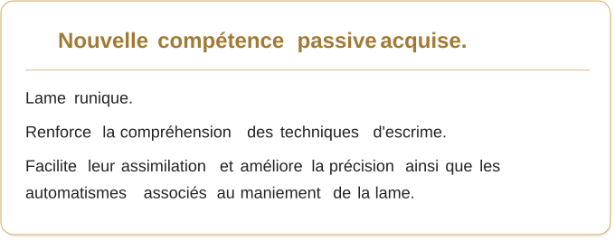
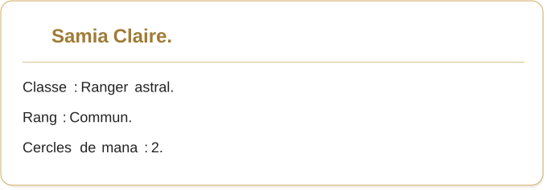
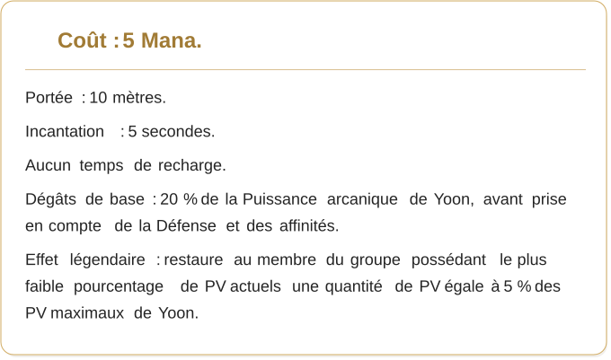
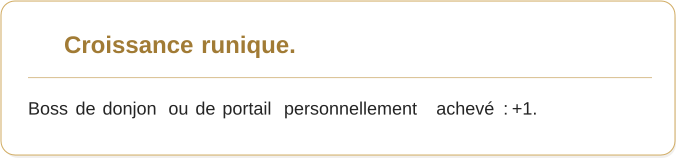

# Les Chroniques de l’Arcaniste Runique

*Livre II — Le Vertige des vies oubliées*

## Sommaire

1. [Chapitre 1 — Une Astrale nommée Hasol](#chapitre-1)
2. [Chapitre 2 — Les prodiges de l'Académie](#chapitre-2)

---

## Chapitre 1 — Une Astrale nommée Hasol

### I. Un anniversaire pas comme les autres

Une délicieuse odeur de pain chaud flottait dans les couloirs de la demeure Shun.

Hasol descendit les escaliers en prenant soin de ne pas marcher sur le bas de sa robe. Sa mère avait insisté pour qu'elle porte cette tenue aujourd'hui : un tissu blanc parcouru de broderies turquoise, dont les couleurs s'accordaient parfaitement avec celles de ses yeux.

Ses longs cheveux bruns, soigneusement attachés, retombaient derrière ses épaules.

Lorsqu'elle pénétra dans la salle à manger, son père releva immédiatement la tête.

— Ah ! Voilà enfin la jeune femme la plus attendue de cette maison !

Hasol sourit.

— Bonjour, papa.

— Bonjour, ma princesse. Et surtout, joyeux anniversaire !

Armin abandonna le registre commercial qu'il consultait et se leva pour accueillir sa fille. Il la serra dans ses bras avant de reculer légèrement pour la contempler.

— Seize ans… C'est incroyable. J'aurais pourtant juré que tu avais encore sept ans la semaine dernière.

— Tu dis la même chose chaque année.

— Et chaque année, je suis sincère !

Iseria, installée de l'autre côté de la table, leva les yeux au ciel.

— Tu pourrais commencer par laisser ta fille prendre son petit déjeuner.

— Certainement ! Il ne faudrait surtout pas qu'elle s'évanouisse devant la stèle. Imagine un peu les conversations dans la capitale !

— Papa !

Hasol éclata de rire.

Elle prit place auprès de sa mère, qui lui servit une tasse de thé. Iseria avait attaché ses longs cheveux roses en une tresse souple, et son expression était aussi douce que d'habitude.

— Comment te sens-tu, ma chérie ?

— Beaucoup mieux.

Iseria posa délicatement sa main sur celle de sa fille.

— Tu es certaine ?

Hasol acquiesça.

Le cauchemar de la nuit précédente lui paraissait déjà lointain. Elle se rappelait surtout la peur immense qui l'avait envahie à son réveil, une peur qu'elle avait été incapable d'expliquer.

Mais ce matin, auprès de ses parents, cette sensation s'estompait.

Elle avait seize ans.

Et aujourd'hui, elle allait enfin découvrir sa classe.

Armin déposa une assiette devant elle.

— Mange bien. Une future grande chasseuse ne peut pas commencer sa carrière le ventre vide.

Hasol contempla sa tartine.

Puis poussa un soupir.

— Vous savez… J'aurais vraiment préféré naître un jour plus tôt.

Armin s'immobilisa.

— Voilà une drôle de chose à dire le jour de son anniversaire !

— Mais c'est vrai !

Hasol posa sa tasse.

— La plupart des autres jeunes ont déjà fêté leurs seize ans tranquillement. Ils ont eu leurs cadeaux, leurs repas de famille, leurs journées d'anniversaire… Et après, ils peuvent venir à la Révélation.

— C'est effectivement le principe, répondit Armin avec un sérieux exagéré.

— Mais moi, c'est aujourd'hui !

Elle désigna vaguement la direction du temple.

— Mon anniversaire et ma Révélation tombent exactement le même jour !

Iseria dissimula un sourire derrière sa tasse.

— Et cela te pose un problème ?

— Évidemment !

Hasol redressa les épaules.

— Imaginez que j'obtienne une classe vraiment mauvaise…

Elle marqua une pause.

Puis déclara, avec toute la gravité dont elle était capable :

— Mon anniversaire sera complètement gâché !

Armin la contempla pendant quelques secondes.

Puis il éclata de rire.

— Dans ce cas, nous le fêterons demain !

— Mais papa ! Demain, ce ne sera plus mon anniversaire !

— Alors après-demain ?

— Ce sera encore pire !

— Je vois… Nous sommes face à un problème d'une gravité exceptionnelle.

Hasol croisa les bras.

— Tu te moques de moi.

— Un tout petit peu.

— Papa !

Iseria posa sa tasse.

— Hasol.

La jeune fille se tourna vers elle.

— Quelle que soit la classe que tu obtiendras aujourd'hui, tu resteras notre fille. Et nous serons heureux de fêter tes seize ans avec toi.

Hasol baissa légèrement les yeux.

— Je sais, maman…

— Une classe ne pourra jamais nous retirer cela.

Elle lui caressa doucement les cheveux.

— Tu as parfaitement le droit d'espérer une bonne Révélation. Mais tu n'as pas besoin de devenir légendaire pour mériter une belle journée.

Hasol esquissa un sourire.

— J'aimerais quand même avoir une bonne classe.

— Et tu as parfaitement le droit de l'espérer.

Armin se pencha vers elle.

— Et si tu deviens Astrale, je ferme mes bureaux pour la journée et j'invite toute la capitale à dîner !

Hasol éclata de rire.

— Toute la capitale ?

— Absolument !

— Armin, intervint Iseria.

— Bon… Peut-être seulement nos connaissances.

— Cela représente déjà beaucoup trop de monde.

Hasol retrouva peu à peu son enthousiasme.

— Vous pensez vraiment que je pourrais devenir légendaire ?

Armin prit un air songeur.

— Avec deux cercles de mana à ton âge ? Je pense surtout que les autres candidats ont de bonnes raisons d'être jaloux.

— Armin…

— Quoi ? Je ne fais qu'énoncer les faits !

Hasol contempla ses mains.

Elle avait longtemps rêvé de cette journée. Les livres consacrés aux grandes expéditions, les récits des chasseurs et les innombrables heures passées à s'entraîner avaient nourri son ambition depuis l'enfance.

Elle voulait explorer des donjons.

Découvrir des trésors oubliés.

Affronter des monstres dont elle ne connaissait encore que les illustrations.

Et peut-être, un jour, accomplir quelque chose d'assez extraordinaire pour que son nom apparaisse dans l'un de ces livres.

Mais derrière toutes ces ambitions se cachait une inquiétude qu'elle n'osait pas vraiment exprimer.

Et si je n'obtenais jamais les moyens de réaliser mes rêves ?

Elle jeta un regard à ses parents.

Armin plaisantait déjà sur les préparatifs d'un banquet imaginaire. Iseria tentait de le ramener à des considérations plus raisonnables.

Hasol sourit.

Au moins, j'aurai toujours eux.

Elle termina son petit déjeuner.

Puis se leva.

— Bon ! Si je continue à discuter, je vais finir par être en retard à ma propre Révélation !

— Et à ton propre anniversaire ! ajouta Armin.

— Papa !

### II. La lumière violette

Les rues de la capitale étaient particulièrement animées.

Des familles entières se dirigeaient vers le grand temple, accompagnant les jeunes gens qui, comme Hasol, allaient participer à leur Révélation.

Sur leur chemin, ils croisèrent plusieurs chasseurs équipés pour le combat. Certains portaient les emblèmes de guildes célèbres. D'autres transportaient des provisions ou discutaient autour de cartes dépliées.

Depuis l'apparition des portails, quatre années auparavant, les chasseurs occupaient une place toujours plus importante dans la société impériale.

Les guildes recrutaient.

Les artisans travaillaient davantage.

Et les jeunes gens rêvaient plus que jamais de recevoir une classe leur permettant de rejoindre les grandes expéditions.

Hasol observait tout cela avec fascination.

Bientôt, elle pourrait enfin participer à ce monde autrement qu'en lisant des livres.

Lorsqu'ils arrivèrent devant le temple, elle ralentit involontairement.

L'immense édifice dominait la place. Ses hautes colonnes projetaient leurs ombres sur les marches de pierre, tandis que des groupes de familles attendaient leur tour sous les regards attentifs des officiants.

À l'intérieur, les rayons du soleil traversaient les vitraux et se répandaient sur le sol de marbre.

Au centre du sanctuaire se dressait la stèle sacrée.

Hasol sentit son cœur accélérer.

— Je commence à avoir peur, murmura-t-elle.

Armin se pencha vers elle.

— Tu veux que je demande au prêtre de passer à ta place ?

— Tu as déjà une classe !

— Il pourrait peut-être m'en donner une meilleure.

Iseria lui adressa un regard désapprobateur.

— Laisse donc cette pauvre stèle tranquille.

Hasol dut retenir un rire.

Les noms se succédaient.

À chaque Révélation, les familles retenaient leur souffle avant de laisser éclater leur joie ou de réconforter les candidats les plus déçus.

Une classe rare provoqua quelques applaudissements particulièrement nourris.

Hasol applaudit elle aussi.

Puis vint son tour.

— Hasol Shun !

Son sourire disparut.

Elle inspira profondément.

Sa mère lui adressa un regard encourageant.

— Vas-y, ma chérie.

Hasol s'avança.

Les quelques mètres qui la séparaient de la stèle lui parurent interminables.

Elle avait beau avoir imaginé cette scène des centaines de fois, rien ne l'avait réellement préparée à cet instant.

Le prêtre lui indiqua la surface du cristal.

— Lorsque tu seras prête.

Hasol leva la main.

Ses doigts s'arrêtèrent à quelques centimètres de la pierre.

Bon…

Elle inspira.

Au pire, papa a promis qu'on pourrait fêter mon anniversaire demain.

Cette pensée lui arracha un sourire nerveux.

Même si ça ne sera plus mon anniversaire…

Elle posa finalement sa main sur la stèle.

Le cristal était froid.

Pendant un bref instant, rien ne se produisit.

Puis une chaleur se répandit dans sa poitrine, autour de ses deux cercles de mana.

La stèle s'illumina.

Une lumière blanche envahit d'abord le cristal.

Hasol retint son souffle.

L'éclat grandit.

La luminosité se renforça, gagnant progressivement toute la surface de la pierre.

Puis la couleur changea.

Ce ne fut ni la teinte habituelle d'une classe commune, ni celle d'une classe rare.

Ce ne fut même pas la lumière d'une Révélation légendaire.

Une lueur violette apparut au cœur du cristal.

Elle s'étendit lentement, parcourant les inscriptions gravées dans la pierre.

Le prêtre fronça les sourcils.

Puis recula d'un pas.

La lumière devint plus intense.

Violette.

Profondément violette.

Une colonne lumineuse jaillit de la stèle et s'éleva jusqu'aux voûtes du temple. D'innombrables particules scintillantes se dispersèrent autour de Hasol, enveloppant sa silhouette d'un éclat irréel.

Les conversations cessèrent.

Même les assistants du temple restèrent immobiles.

Hasol contempla ses mains, incapable de comprendre ce qui se produisait.

Une fenêtre apparut devant elle.

  <picture class="lit-window__github-picture">
    <source media="(max-width: 600px)" srcset="assets/fenetres-livre-2/L2-C1-F01-mobile.svg">
    
  </picture>
  

    
Version textuelle de la fenêtre

  

    <svg class="lit-window__icon" xmlns="http://www.w3.org/2000/svg" viewBox="0 0 24 24" width="24" height="24" fill="none" stroke="currentColor" stroke-width="1.6" stroke-linecap="round" stroke-linejoin="round" aria-hidden="true" focusable="false"><path d="m12 3 8 5v8l-8 5-8-5V8Z M12 7v10 M8 10l8 4"/></svg>
    SYSTÈME — RÉVÉLATION
  

  <h3>Hasol Shun</h3>
  
Arcaniste Astral

  
<strong>Rang :</strong> Astral

  
<strong>Niveau :</strong> 1

  
<strong>Coût de classe :</strong> 25

  
<strong>Cercles de mana :</strong> 2

  

Astral.

Hasol relut le mot.

Elle était persuadée d'avoir mal compris.

Elle ferma les yeux, les rouvrit et consulta de nouveau la fenêtre.

Le mot était toujours là.

— Une… Astrale ?

Sa propre voix lui parut minuscule.

Le prêtre retrouva enfin l'usage de la parole.

— Une classe astrale !

Le temple explosa.

Des exclamations jaillirent de toutes parts. Certains cherchèrent à s'approcher de la stèle, tandis que les officiants tentaient de rétablir le calme.

— Une Astrale dans la capitale !

— Quelle classe a-t-elle reçue ?

— Prévenez l'Académie !

— Qui est cette jeune fille ?

Hasol se retourna vers ses parents.

Armin semblait avoir oublié comment parler.

Il ouvrit la bouche.

La referma.

Puis leva brusquement les bras.

— C'EST MA FILLE !

— Papa !

Il traversa les quelques mètres qui les séparaient sans accorder la moindre attention aux regards braqués sur lui.

— Ma princesse est une Astrale !

Il la souleva presque du sol en la serrant contre lui.

Hasol éclata de rire, incapable de contenir davantage son bonheur.

— Tu avais promis d'inviter toute la capitale !

— Je vais devoir acheter un restaurant !

— Armin ! protesta Iseria en les rejoignant.

Hasol tourna la tête vers sa mère.

Iseria souriait elle aussi, mais son sourire semblait un peu forcé. Ses yeux paraissaient préoccupés.

— Maman… Tout va bien ?

Iseria parut surprise, puis prit doucement le visage de sa fille entre ses mains.

— C'est simplement beaucoup d'émotions d'un seul coup. Je ne m'attendais pas à une telle Révélation.

Son sourire s'adoucit.

— Je suis très fière de toi, ma chérie.

Hasol se dégagea des bras de son père pour se réfugier dans ceux de sa mère.

— Maman…

Iseria la serra contre elle.

— Félicitations, ma chérie.

Hasol enfouit son visage contre son épaule.

Elle avait tellement rêvé de cette journée.

Et pourtant, jamais elle n'aurait osé espérer un tel résultat.

Lorsqu'elle releva la tête, ses yeux brillaient.

— Finalement…

Armin se pencha vers elle.

— Oui ?

Un immense sourire illumina le visage d'Hasol.

— Je crois que mon anniversaire n'est pas gâché !

Armin partit d'un rire si sonore que plusieurs personnes se retournèrent de nouveau vers eux.

— Je pense même que tu vas t'en souvenir longtemps, ma princesse !

Et au milieu des exclamations, des félicitations et des particules violettes qui achevaient de disparaître, Hasol éclata de rire avec lui.

### III. Le secret de la maison Shun

Il leur fallut un certain temps avant de pouvoir quitter le temple.

Plusieurs représentants de guildes souhaitaient rencontrer Hasol. Des officiants lui posèrent des questions concernant sa classe, tandis que d'autres personnes tentaient simplement de lui adresser quelques mots.

Armin prit un plaisir évident à répondre aux félicitations.

Iseria, en revanche, se montra plus réservée lorsque les questions commencèrent à concerner les compétences de sa fille.

— Elle vient tout juste de découvrir sa classe, rappela-t-elle poliment. Laissez-lui au moins le temps de comprendre ce qu'elle a reçu.

Ce ne fut qu'une fois revenue dans le salon de la demeure Shun que Hasol put enfin examiner tranquillement son interface.

Elle s'installa sur le canapé, rabattit ses jambes sous elle et ouvrit sa liste de compétences.

Ses yeux s'agrandirent.

— Il y en a cinq !

Armin, qui venait de s'installer dans un fauteuil, se redressa.

— Cinq compétences dès la Révélation ?

— Oui !

Iseria rapprocha sa chaise.

— Lis-nous leurs descriptions, ma chérie.

Hasol s'empressa d'obéir.

La première s'appelait Bénédiction runique.

Elle favorisa un instant son imagination.

— Une compétence passive qui améliore les chances de réussite lors du renforcement des runes !

Armin se redressa davantage.

— Voilà qui pourrait intéresser beaucoup d'artisans !

— Tu crois que je pourrais améliorer mes propres runes avec ça ?

Iseria réfléchit quelques instants.

— Certainement. Mais n'oublie pas qu'une meilleure chance de réussite ne signifie pas que toutes tes tentatives seront couronnées de succès.

— Je sais, maman.

Hasol passa à la suivante.

Œil runique.

Son enthousiasme grandit encore.

— Je peux voir le résultat final d'une rune améliorée jusqu'à +15, à condition de réaliser moi-même les améliorations nécessaires !

Iseria lui demanda de répéter.

— Le résultat final exact ?

— Oui !

Hasol parcourut de nouveau la description.

— Et je peux aussi détecter les pièges !

Armin laissa échapper un sifflement admiratif.

— Une compétence d'artisan et une compétence d'explorateur dans le même pouvoir… C'est remarquable.

Hasol avait déjà envie de trouver une rune pour essayer.

Elle poursuivit sa lecture.

Main runique.

— Celle-ci permet d'ouvrir les coffres et les portes !

— Tu devrais peut-être éviter de la présenter trop rapidement aux employés de nos entrepôts, plaisanta Armin.

— Papa !

— Je tiens à mes serrures !

Iseria lui adressa un regard amusé.

Hasol passa à la quatrième compétence.

Aura runique.

Elle se redressa aussitôt.

— Celle-là est vraiment intéressante !

— Qu'est-ce qu'elle fait ? demanda Armin.

— Elle permet d'imprégner une arme d'une aura élémentaire !

Elle relut les informations avec impatience.

Puis son sourire se figea légèrement.

— Oh…

— Qu'y a-t-il ?

— Je peux déjà imprégner une arme, mais je dois attendre le niveau dix avant de pouvoir manier moi-même une arme imprégnée.

Hasol gonfla les joues.

— C'est dommage…

Iseria sourit.

— Tu as attendu seize ans avant de connaître ta classe. Je pense que tu peux patienter encore un peu pour manier une arme imprégnée.

— Mais maman ! C'est quand même une classe astrale !

— Justement. Cela ne signifie pas que tu maîtriseras tout dès le premier jour.

Hasol soupira.

— D'accord…

Elle contempla la liste.

Bénédiction runique.

Œil runique.

Main runique.

Aura runique.

Toutes ces compétences paraissaient incroyablement utiles. Certaines lui permettraient d'explorer des donjons. D'autres de développer son artisanat et son équipement.

Mais une inquiétude commençait à se former dans son esprit.

— Je n'ai pas de sort offensif…

Armin pencha la tête.

— Pas un seul ?

— Non.

Elle consulta encore une fois ses compétences, comme si une attaque avait pu apparaître entre deux lignes.

Rien.

— Je vais devoir me battre uniquement avec mon épée ?

Iseria lui prit doucement la main.

— Pour le moment, cela pourrait être nécessaire. Mais tu disposes de beaucoup de possibilités. Il faudra apprendre à les associer intelligemment.

Hasol hocha la tête.

Elle pouvait comprendre cela.

Une classe astrale n'était pas nécessairement une classe capable de lancer d'immenses explosions magiques dès sa Révélation.

Elle allait devoir trouver sa propre manière de combattre.

Son regard glissa vers la dernière compétence.

Croissance runique.

Elle commença à lire.

Puis ralentit.

Relut une ligne.

Et se pencha brusquement en avant.

— Maman ?

— Oui ?

— Je crois que cette dernière compétence est encore plus incroyable que les autres.

Iseria se rapprocha.

Hasol lui expliqua ce qu'elle venait de découvrir.

Croissance runique lui permettait de développer ses cercles de mana et ses emplacements runiques en accomplissant des paliers d'élimination.

Un cercle supplémentaire.

Puis un autre.

Et potentiellement beaucoup d'autres, si elle remplissait les conditions.

Elle consulta les informations complémentaires.

— Pour les monstres admissibles, il y a un palier toutes les mille éliminations…

Hasol remarqua alors deux autres compteurs.

— Oh ! Il y en a aussi un pour les boss de donjon… Cent boss achevés personnellement !

Elle parcourut la dernière ligne.

— Et un autre pour les démons des portails. Cinq mille éliminations personnelles…

Les trois suivis étaient distincts. Les démons des portails n'alimentaient pas le compteur des mille monstres ordinaires hors portails. Seul ce dernier imposait des prérequis de niveau aux créatures éliminées ; les boss de donjon et les démons de portails n'en avaient pas.

Hasol resta quelques instants silencieuse. Les possibilités semblaient incroyables, mais elle connaissait aussi la réputation de ces adversaires. Pour une chasseuse qui venait seulement de recevoir sa classe, cela paraissait encore terriblement dangereux.

Iseria resta silencieuse.

Armin cessa de sourire.

Hasol poursuivit :

— Cela veut dire que si je chasse énormément, je pourrais posséder bien plus de cercles que maintenant !

Elle leva la tête vers ses parents.

— Imaginez si j'en obtenais dix !

Armin ouvrit la bouche.

Mais aucun mot n'en sortit.

Hasol, emportée par son enthousiasme, continua :

— Et avec Bénédiction runique et Œil runique, je pourrais choisir les meilleures pierres que je trouve et les améliorer moi-même !

Elle serra les poings.

— Je pourrais devenir vraiment forte !

Iseria se leva.

Elle traversa lentement le salon et referma la porte.

Hasol la regarda faire.

— Maman ?

Sa mère revint s'asseoir devant elle.

Son expression avait changé.

— Hasol, écoute-moi attentivement.

Le ton employé surprit la jeune fille.

— Qu'est-ce qu'il y a ?

— Tu ne dois parler de Croissance runique à personne.

Hasol cligna des yeux.

— Personne ?

— Personne.

Armin échangea un regard avec son épouse.

Il semblait mesurer progressivement l'importance de ce qu'il venait d'entendre.

Iseria reprit :

— Les cercles de mana représentent l'une des ressources les plus précieuses dont puisse disposer un chasseur. Certaines personnes consacrent leur vie entière à essayer d'en éveiller davantage.

Elle posa une main sur celle de Hasol.

— Imagine ce que signifierait l'existence d'une compétence capable d'en accorder régulièrement.

Hasol baissa les yeux.

Elle n'avait initialement pensé qu'aux possibilités que lui offrait ce pouvoir.

À présent, elle commençait à comprendre l'inquiétude de sa mère.

— Même à Ray ?

Iseria hésita un instant.

— Pas pour le moment.

— Mais c'est mon meilleur ami…

— Je le sais, ma chérie. Il ne s'agit pas de douter de lui. Seulement, plus une information est partagée, plus il devient difficile de la protéger.

Armin posa une main sur l'épaule de sa fille.

— Ta mère a raison. Tu n'as rien à prouver aujourd'hui. Tu peux être heureuse de ta Révélation sans devoir expliquer tous tes pouvoirs à la capitale entière.

Hasol contempla la dernière compétence affichée devant elle.

Elle avait tellement envie de raconter à Ray ce qu'elle venait de découvrir.

Ils pourraient passer des heures à réfléchir aux possibilités de Croissance runique.

Ray adorerait cela.

Mais sa mère semblait véritablement inquiète.

Et Hasol savait qu'Iseria ne lui donnerait pas un tel conseil sans raison.

Elle referma son interface.

— D'accord. Je garderai le secret.

Iseria lui caressa doucement les cheveux.

— Je veux simplement que tu puisses choisir toi-même ce que tu souhaites devenir.

Hasol lui sourit.

Elle comprenait.

Et pour l'instant, cela lui suffisait.

### IV. Une Astrale à l'Académie

Les jours suivants, Hasol découvrit qu'il était particulièrement difficile de passer inaperçue lorsqu'on possédait une classe astrale.

À peine avait-elle franchi les portes de l'Académie que plusieurs élèves se retournèrent sur son passage.

— C'est elle ?

— L'Arcaniste Astral ?

— On raconte qu'elle possède déjà deux cercles !

Hasol pressa légèrement le pas.

Elle avait imaginé faire connaissance avec ses futurs camarades, découvrir les salles de cours et commencer son entraînement.

Elle n'avait pas imaginé devoir répondre à autant de questions avant même d'avoir trouvé sa salle.

— Hasol !

Une voix familière lui fit immédiatement tourner la tête.

Un jeune homme portant des lunettes s'approchait d'elle, un livre sous le bras.

— Ray !

Elle le rejoignit avec soulagement.

Ray Corvus observa les élèves qui continuaient à lui jeter des regards curieux.

— Je suppose que tu n'as pas besoin que je te félicite encore une fois.

— Tu peux quand même le faire.

— Félicitations.

— Merci !

Il ajusta ses lunettes.

— J'ai cherché des informations sur les Arcanistes Astraux.

Hasol sourit.

— Évidemment.

— Je n'ai rien trouvé.

— Oh.

— Pas une seule mention dans les ouvrages auxquels j'ai pu accéder.

Il ouvrit son livre, dans lequel dépassaient plusieurs morceaux de papier.

— J'ai même consulté un ancien registre des classes légendaires, au cas où ton intitulé serait apparenté à une autre classe.

Hasol contempla les nombreuses annotations.

— Ray… Depuis combien de temps cherches-tu ?

— Depuis que j'ai appris ta Révélation.

— Tu n'as donc rien fait d'autre ?

— J'ai dormi.

Elle éclata de rire.

Ils traversèrent ensemble une partie de l'Académie avant de s'installer dans la cour, à l'ombre d'un grand arbre.

Ray lui demanda de lui présenter ses nouvelles capacités.

Hasol hésita brièvement.

Puis elle lui expliqua le fonctionnement de Bénédiction runique, d'Œil runique et de Main runique. Elle lui parla également d'Aura runique, déjà disponible, et du niveau dix qu'elle devait atteindre avant de pouvoir manier elle-même une arme imprégnée.

Elle ne mentionna pas Croissance runique.

Ray l'écouta avec un intérêt évident.

— Tu pourrais donc devenir une excellente artisane tout en étant chasseuse.

— C'est possible.

— Et tu peux ouvrir des coffres ?

— Des portes aussi.

Il parut réfléchir sérieusement.

— Voilà qui pourrait nous être utile.

Hasol plissa les yeux.

— Pour quelle raison ?

— J'ai découvert que certaines archives de la bibliothèque étaient conservées dans une salle fermée.

— Ray !

— Je plaisantais.

Elle le contempla avec méfiance.

— Tu ne plaisantes presque jamais.

— Cela ne signifie pas que j'en suis incapable.

Hasol secoua la tête en souriant.

Il était si agréable de pouvoir discuter normalement.

Avec Ray, elle ne se sentait pas obligée de devenir immédiatement une personne extraordinaire.

Elle était simplement Hasol.

— Tu sais, reprit-elle après un moment, j'ai l'impression que tout le monde attend quelque chose de moi.

Ray referma son livre.

— C'est probablement le cas.

Elle soupira.

— Tu pourrais au moins essayer de me rassurer.

— Je préfère ne pas te mentir.

— Merci beaucoup !

Il sourit légèrement.

— Mais cela ne signifie pas que tu dois répondre à toutes ces attentes immédiatement.

Hasol contempla les élèves qui traversaient la cour.

Certains la regardaient encore.

D'autres étaient déjà occupés à leurs propres discussions.

— Tu crois vraiment ?

— Tu viens seulement de recevoir ta classe. Tu ne peux pas devenir une chasseuse expérimentée en quelques jours.

— Je sais…

— Et puis, si tu passes tout ton temps à écouter les personnes qui parlent de toi, quand trouveras-tu celui de t'entraîner ?

Hasol tourna la tête vers lui.

Un sourire apparut progressivement sur ses lèvres.

— Tu as raison !

Ray haussa les épaules.

— Cela m'arrive.

Elle éclata de rire.

L'entretien avec le directeur de l'Académie eut lieu peu après.

Hasol s'était attendue à quelques recommandations et à une présentation générale de ses futurs cours.

Elle découvrit une véritable discussion consacrée à son avenir.

Le directeur avait devant lui plusieurs documents relatifs à sa Révélation, ainsi qu'un registre de formation.

— Mademoiselle Shun, votre classe représente une occasion exceptionnelle, aussi bien pour vous que pour notre établissement.

Hasol se tenait droite sur sa chaise.

— Nous souhaitons vous offrir les meilleures conditions possibles pour développer vos capacités.

Il consulta ses notes.

— Bénédiction runique présente manifestement un intérêt considérable dans le domaine de l'artisanat. Vos compétences d'exploration méritent également un accompagnement spécialisé.

Il marqua une pause.

— Quant à Aura runique… Nous aimerions beaucoup en observer les effets lorsque vous manierez vous-même une arme imprégnée.

Hasol sourit.

— Moi aussi, monsieur.

— La compétence est déjà disponible, mais votre niveau actuel ne vous permet pas encore de manier personnellement une telle arme.

— Je sais.

— Nous allons donc adapter votre formation afin de faciliter votre progression jusqu'au niveau dix.

Il lui expliqua qu'elle bénéficierait d'un encadrement personnalisé, de séances adaptées à ses compétences et de l'accompagnement de chasseurs expérimentés.

Hasol avait du mal à croire ce qu'elle entendait.

— Tout cela… uniquement pour moi ?

— Votre classe nous oblige à revoir certaines de nos habitudes.

Le directeur lui adressa un sourire.

— Une formation ordinaire n'est pas nécessairement la plus appropriée pour une Astrale.

Hasol regarda les documents disposés devant lui.

Elle était heureuse.

Mais cette attention lui paraissait aussi un peu intimidante.

— Je ne veux pas prendre la place des autres élèves…

Le directeur sembla surpris.

Puis son expression s'adoucit.

— Vous n'avez pas à vous inquiéter de cela. Votre formation sera organisée en fonction de vos besoins, sans vous empêcher de participer aux enseignements ordinaires.

Hasol poussa un petit soupir de soulagement.

— Merci, monsieur.

Lorsqu'elle quitta son bureau, elle avait l'impression que son avenir venait de s'accélérer.

Elle ne savait pas encore à quoi ressembleraient ses journées.

Mais une chose était certaine.

L'Académie avait décidé de ne pas perdre de temps.

### V. Elric Arowell, le Porte-bouclier

Hasol aperçut son futur mentor sur l'un des terrains d'entraînement de l'Académie.

L'homme discutait avec un enseignant, son grand bouclier appuyé contre sa jambe.

Il portait une armure noire aux reflets argentés, composée d'épaisses plaques de métal. Des étoffes claires descendaient le long de sa taille, contrastant avec la couleur sombre de son équipement.

Une longue épée droite reposait dans son fourreau.

Ses cheveux noirs, légèrement ébouriffés, encadraient un visage aux traits affirmés. Lorsqu'il tourna la tête vers Hasol, elle remarqua immédiatement ses yeux bleus.

— Hasol Shun, je suppose ?

— Oui, monsieur.

Il lui tendit la main.

— Elric Arowell. L'Académie m'a demandé de superviser votre formation de chasseuse.

Hasol lui serra la main.

— Enchantée !

— De même.

Il récupéra son bouclier avant de lui indiquer un banc à proximité.

— Commençons par discuter un peu.

Hasol s'installa auprès de lui.

Elric lui présenta brièvement son parcours.

Il avait quarante-deux ans et possédait une classe commune de Porte-bouclier.

Il était également niveau quarante-cinq.

Hasol ouvrit grand les yeux.

— Niveau quarante-cinq ! répéta Hasol avec admiration.

Elric eut un léger sourire.

— Cela fait quelques années que je chasse.

— Vous avez déjà pris part à des raids de portails ?

— Plus d'une fois.

Les yeux d'Hasol s'illuminèrent.

— C'était comment ?

— Dangereux. Beaucoup plus que tu ne l'imagines.

— Vous pourriez m'y emmener un jour ?

Elric éclata de rire.

— Nous ne nous connaissons que depuis cinq minutes et tu veux déjà participer à un raid ?

Hasol rougit.

— Désolée…

— Ce n'est pas un reproche. J'ai simplement l'impression que l'Académie m'a confié une élève impatiente.

Il lui demanda ensuite de lui parler de ses ambitions.

Hasol répondit avec enthousiasme.

Elle voulait découvrir les donjons, devenir suffisamment forte pour participer aux grandes opérations et apprendre à utiliser toutes les capacités de sa classe.

Elric l'écouta jusqu'au bout.

— Et si je te demandais de passer les prochains jours à perfectionner les mouvements les plus simples à l'épée ?

Hasol cligna des yeux.

— Seulement les mouvements simples ?

— Oui.

— Mais…

Elle hésita.

Elric attendit patiemment.

— Je pensais que nous allions commencer à combattre rapidement.

— Nous combattrons. Mais avant cela, j'aimerais savoir comment tu tiens ton arme, comment tu te déplaces et surtout comment tu réagis lorsque quelque chose ne se déroule pas comme prévu.

Il posa la main sur son bouclier.

— Une classe astrale ne te permettra pas d'éviter un coup que tu n'as pas vu venir.

Hasol baissa légèrement la tête.

— Je comprends.

— Bien. Montre-moi donc ce que tu sais faire.

Ils se dirigèrent vers les mannequins d'entraînement.

Hasol exécuta les mouvements qu'elle avait appris durant son enfance.

Elric observa attentivement sa posture, lui demanda de recommencer plusieurs attaques et corrigea la position de ses pieds.

Il ne se montra ni particulièrement impressionné ni déçu.

Il enseignait.

Tout simplement.

À plusieurs reprises, Hasol commit des erreurs qu'elle aurait préféré dissimuler.

Chaque fois, Elric les lui expliqua sans jamais se moquer d'elle.

— Ne cherche pas à frapper plus fort si cela te fait perdre ton équilibre.

Elle recommença.

— Mieux.

Quelques exercices plus tard, il lui fit signe de s'arrêter.

Hasol avait déjà chaud et ses bras commençaient à lui faire mal.

— Je pensais être un peu meilleure que ça, avoua-t-elle.

— Tu es une débutante.

Elle grimaça.

— Dit comme ça…

— Une débutante prometteuse, si tu préfères.

Hasol sourit.

Elric lui tendit de l'eau.

— Il n'y a aucune honte à commencer au début. Ceux qui prétendent avoir tout appris avant leur premier véritable combat sont généralement ceux que je dois surveiller le plus attentivement.

Elle but quelques gorgées.

— Mais vous, avec votre niveau, vous devez être capable de battre énormément de monstres !

Elric contempla son bouclier.

— Je peux en affronter certains que tu ne pourrais pas encore approcher. Mais mon travail consiste surtout à protéger ceux qui combattent à mes côtés.

Hasol l'observa avec curiosité.

— C'est pour cela que vous êtes Porte-bouclier ?

— En partie.

Il lui expliqua brièvement sa manière de combattre.

Son épée lui permettait de participer aux affrontements, tandis que son bouclier et ses compétences lui servaient principalement à contrôler les ennemis et à protéger son équipe.

— Je ne suis pas toujours celui qui inflige les plus gros dégâts, poursuivit-il. Mais lorsqu'un monstre décide de s'attaquer à un compagnon plus fragile, je dois être capable d'intervenir.

Hasol réfléchit.

— Alors vous êtes celui qui empêche les autres de mourir ?

Elric resta silencieux un instant.

Puis son expression s'adoucit.

— J'essaie.

Ce simple mot surprit Hasol.

Elle aurait imaginé qu'un chasseur aussi expérimenté répondrait avec davantage d'assurance.

Mais Elric ne semblait pas considérer sa puissance comme une garantie de victoire.

Et, d'une certaine manière, cela lui inspira encore plus de respect.

— Vous pensez que je pourrai devenir une bonne chasseuse ?

— Je pense que tu en as les moyens.

Elle sourit.

— Vraiment ?

— Mais cela dépendra beaucoup de ce que tu décideras d'en faire.

Hasol baissa les yeux vers son épée.

Puis elle redressa les épaules.

— Alors je vais travailler dur !

Elric éclata de rire.

— Voilà une réponse qui me plaît.

### VI. Zéphyr Claire et la fille aux cheveux argentés

La formation particulière d'Hasol ne se limitait pas au combat.

Quelques jours après sa rencontre avec Elric, l'Académie lui demanda de rejoindre une salle consacrée aux exercices d'exploration.

Elle y découvrit plusieurs coffres, des mécanismes démontés et différentes installations destinées à reproduire les pièges rencontrés dans les donjons.

Un homme se tenait près d'une table.

Il avait des cheveux blonds, des yeux verts et une barbe courte soigneusement entretenue. Une cape vert sombre reposait sur ses épaules, retenue par des attaches de cuir. Son arc et son carquois avaient été déposés à proximité.

Lorsqu'il aperçut Hasol, il lui adressa un large sourire.

— Voilà donc notre fameuse Astrale !

Hasol s'inclina légèrement.

— Bonjour, monsieur.

— Zéphyr Claire. Ranger.

Il lui serra la main avec chaleur.

— On m'a expliqué que tu possédais une compétence particulièrement intéressante pour détecter les pièges.

— Oui. Œil runique.

— Excellent ! Nous allons voir ce que tu arrives à en faire.

Hasol remarqua rapidement que Zéphyr était niveau cinquante-trois.

Elle en resta impressionnée.

Entre Elric et lui, l'Académie semblait déterminée à lui faire rencontrer des chasseurs particulièrement expérimentés.

Zéphyr lui présenta un premier coffre.

— Que vois-tu ?

Hasol se pencha.

Elle distingua les ferrures, la serrure et les attaches du couvercle.

Mais autre chose attirait également son attention.

Elle désigna une petite partie du mécanisme.

— Il y a un piège, ici.

Le Ranger haussa les sourcils.

— Déjà ?

— Oui.

Il examina l'endroit qu'elle lui indiquait.

Puis sourit.

— C'est exact. Maintenant, peux-tu me dire comment il fonctionne ?

Hasol observa de nouveau le coffre.

Elle distinguait le piège.

Elle savait qu'il était là.

Mais elle n'avait aucune idée de ce qui se produirait si quelqu'un ouvrait le couvercle.

— Non…

— Voilà pourquoi nous allons travailler ensemble.

Zéphyr entreprit de lui expliquer le mécanisme.

Il lui montra les différents éléments, la manière dont ils étaient reliés et les précautions qu'un chasseur devait prendre avant d'intervenir.

Hasol l'écoutait avec fascination.

Elle posa de nombreuses questions.

Certaines étaient suffisamment précises pour surprendre le Ranger. D'autres lui firent comprendre qu'elle possédait encore d'importantes lacunes.

— Œil runique t'apporte un avantage exceptionnel, lui expliqua Zéphyr. Mais lorsqu'un danger est détecté, encore faut-il savoir quoi en faire.

— Je comprends.

— Imagine que tu repères un piège au milieu d'un couloir. Tu peux avertir ton groupe. C'est déjà formidable. Mais cela ne signifie pas que tu sais comment le neutraliser.

Hasol acquiesça.

— Donc je dois apprendre à comprendre ce que je vois.

Zéphyr lui adressa un sourire satisfait.

— Exactement !

Après plusieurs exercices, il lui présenta un coffre dont l'absence de piège avait été vérifiée.

— L'Académie m'a également parlé de Main runique.

Hasol acquiesça.

— Je devrais pouvoir l'ouvrir.

— Essaie donc.

Elle s'approcha du coffre, concentra son attention et utilisa sa compétence.

Le verrou céda.

Hasol ouvrit délicatement le couvercle.

Il était vide.

Zéphyr contempla la serrure.

— Eh bien…

Il se pencha pour l'examiner.

— C'est une compétence dont beaucoup de Rangers aimeraient disposer.

Hasol sourit fièrement.

— C'était assez simple.

— Et c'est précisément pour cela que tu devras rester prudente. Ouvrir un coffre et le rendre inoffensif sont deux choses différentes.

Elle hocha la tête.

Zéphyr lui fit ensuite répéter plusieurs exercices d'observation.

Au fil de la séance, Hasol commença à mieux comprendre la différence entre détecter un danger et savoir comment y réagir.

Elle appréciait la manière dont le Ranger enseignait.

Il était patient, précis et généralement de bonne humeur.

À la fin de leur séance, la porte de la salle s'ouvrit.

— Papa ?

Zéphyr releva la tête.

— Ah ! Viens donc !

Une jeune fille entra.

Hasol remarqua tout de suite sa chevelure argentée. Elle était trois ans plus jeune qu'elle et semblait parfaitement à l'aise parmi les différents équipements disposés dans la salle.

Zéphyr posa une main affectueuse sur son épaule.

— Hasol, je te présente ma fille, Samia.

La jeune fille lui adressa un sourire.

— Bonjour.

— Bonjour !

— Elle est encore jeune, poursuivit Zéphyr, mais elle est déjà bien plus talentueuse que moi. Elle rejoindra l'Académie lorsqu'elle aura seize ans.

— Papa…

Samia baissa légèrement la tête, embarrassée.

— Quoi ? Je ne fais que dire la vérité !

Hasol sourit.

Elle observa successivement le père et la fille.

Leurs expressions présentaient une certaine ressemblance. Pourtant, leurs cheveux étaient de couleurs complètement différentes.

Sa curiosité finit par l'emporter.

— Vous êtes blond, monsieur Claire, mais Samia a les cheveux argentés…

Zéphyr éclata d'un petit rire.

— Elle était blonde, elle aussi.

Hasol pencha la tête.

— Autrefois ?

— Oui. Ils ont changé de couleur il y a quelques années.

Il passa doucement la main sur les cheveux de sa fille.

— Le jour où les premiers portails sont apparus, Samia a éveillé son deuxième cercle de mana. Au cours de la semaine qui a suivi, ses cheveux sont passés du blond à l'argenté.

Hasol resta immobile.

Elle avait parfaitement entendu ce que Zéphyr venait de dire.

Pourtant, elle eut besoin de plusieurs secondes pour en comprendre le sens.

— Son… deuxième cercle ?

— Exactement.

Elle tourna brusquement la tête vers Samia.

— Tu possèdes deux cercles de mana ?!

Samia acquiesça.

— Oui.

Hasol ouvrit la bouche.

Puis la referma.

Elle connaissait évidemment l'existence de personnes possédant plusieurs cercles de mana. Sa propre mère lui avait longuement expliqué le sujet.

Mais durant toute son enfance, son développement précoce lui avait valu d'être considérée comme une exception.

Et devant elle se trouvait une fille trois ans plus jeune, qui possédait déjà autant de cercles qu'elle.

— Tu pourrais me les montrer ?

Samia regarda son père.

Zéphyr acquiesça.

La jeune fille ferma les yeux.

Hasol observa le mana se manifester autour d'elle.

Un premier cercle.

Puis un deuxième.

Deux.

Il y en avait véritablement deux.

— Incroyable…

Hasol s'approcha légèrement.

Elle ne pouvait détacher son regard des deux structures lumineuses.

— Moi aussi, j'en possède deux !

Samia rouvrit les yeux.

— Vraiment ?

— Oui !

Hasol fit apparaître ses propres cercles avec enthousiasme.

Les deux jeunes filles se contemplèrent.

Puis elles regardèrent leurs cercles respectifs.

Zéphyr croisa les bras, visiblement amusé.

— Je sens que vous allez avoir beaucoup de choses à vous raconter.

Hasol éclata de rire.

— Je pensais être la seule à en avoir deux aussi jeune !

— Eh bien, répondit Samia avec un sourire, apparemment non.

Quelque chose dans cette réponse plut immédiatement à Hasol.

Elle avait passé une grande partie des derniers jours à entendre combien elle était différente des autres.

Pour une fois, elle venait de rencontrer quelqu'un qui lui ressemblait sur un point qu'elle avait toujours cru exceptionnel.

— Tu as déjà essayé de comprendre pourquoi tes cheveux avaient changé ?

Samia attrapa une mèche argentée entre ses doigts.

— Un peu. Mais je les aime bien comme ça.

— Ils sont très beaux !

— Merci !

Hasol sourit.

Elles commencèrent à discuter de leurs cercles, de leurs entraînements et de leur intérêt commun pour les activités de chasse.

Samia se montrait particulièrement curieuse au sujet de l'Académie.

Hasol lui raconta ses premières séances avec Elric, sans oublier les nombreuses corrections qu'il avait apportées à sa manière de tenir une épée.

— Il m'a fait recommencer le même mouvement tellement de fois que je crois pouvoir le reproduire dans mon sommeil.

— Papa fait pareil avec l'arc, répondit Samia.

Zéphyr protesta aussitôt.

— C'est ainsi qu'on apprend correctement !

Les deux jeunes filles échangèrent un regard.

Puis éclatèrent de rire.

Le Ranger leva les mains.

— Très bien. Je vois que je viens de perdre toute autorité dans cette salle.

Lorsqu'il fut temps pour Hasol de partir, Samia l'accompagna jusqu'à la porte.

— On se reverra ?

— Bien sûr ! Ton père doit encore m'apprendre beaucoup de choses.

— Alors à bientôt, Hasol.

— À bientôt, Samia !

Hasol quitta la salle avec un immense sourire.

Elle venait de découvrir qu'une classe astrale n'était pas la seule chose extraordinaire susceptible de lui arriver cette semaine.

### VII. Une autre manière de devenir forte

— Le niveau dix ?

Elric déplia une carte devant Hasol.

— C'est effectivement l'objectif que l'Académie souhaite privilégier.

Ils étaient installés dans une petite salle, à l'écart des terrains d'entraînement.

Cette fois, Elric portait une tenue civile : un long manteau sombre, une chemise claire et des bottes de cuir. Sans son imposante armure, il paraissait presque moins intimidant.

— Nous commencerons par des créatures adaptées à tes capacités, expliqua-t-il. Puis nous augmenterons progressivement la difficulté.

Hasol examina les différents secteurs indiqués.

— Et qu'est-ce qui permet de gagner le plus rapidement de l'expérience ?

— Cela dépend des monstres que tu es capable d'affronter. Vaincre davantage de créatures n'est pas toujours la méthode la plus rapide. Un adversaire plus puissant peut représenter un gain d'expérience bien plus intéressant.

Hasol fronça les sourcils.

Elle repensa à son passif.

— Donc… Je pourrais atteindre un niveau élevé sans avoir éliminé énormément de monstres ?

— Absolument.

Elric désigna plusieurs secteurs de la carte.

— Lorsque tu seras suffisamment préparée, les donjons deviendront particulièrement intéressants pour ta progression.

Hasol resta silencieuse.

Les explications de son mentor étaient parfaitement logiques.

Pourtant, quelque chose la dérangeait.

Elle consulta discrètement sa compétence Croissance runique.

Mille éliminations admissibles.

Mille monstres pour un cercle supplémentaire.

Un adversaire puissant pouvait lui rapporter beaucoup d'expérience, mais cela ne signifiait pas qu'il représentait davantage d'éliminations.

Elle réfléchit longuement.

— Monsieur Arowell ?

— Oui ?

— Est-ce qu'un chasseur peut volontairement privilégier des monstres plus faibles, même s'il est capable d'en vaincre de plus puissants ?

— Bien entendu.

— Et en éliminer énormément ?

Elric releva les yeux de la carte.

— Pour quelle raison ?

Hasol hésita.

— Pour s'entraîner ?

— Cela peut être intéressant pendant un certain temps. Mais si ton objectif est de progresser rapidement en niveau, il faudra ensuite chercher des adversaires plus exigeants.

Hasol baissa les yeux.

Voilà précisément le problème.

L'Académie souhaitait qu'elle progresse rapidement.

Elle aussi voulait atteindre le niveau dix. Elle désirait manier elle-même une arme imprégnée par Aura runique et commencer à explorer les possibilités de sa classe.

Mais Croissance runique lui offrait une seconde manière de devenir plus forte.

Une manière qui ne dépendait pas uniquement de son niveau.

Elle imagina une chasseuse possédant de nombreux cercles de mana supplémentaires.

Chaque cercle représenterait un emplacement runique de plus.

Et avec Bénédiction runique et Œil runique, elle pourrait sélectionner et améliorer elle-même les pierres qu'elle placerait dans ces emplacements.

Les différentes compétences de sa classe s'accordaient d'une manière remarquable.

Plus elle y réfléchissait, plus elle comprenait qu'une progression exclusivement fondée sur l'expérience risquait de lui faire perdre une partie de ce potentiel.

Elric remarqua son silence.

— Quelque chose te préoccupe ?

— Un peu.

— Tu n'es pas convaincue par notre programme ?

Hasol joua nerveusement avec le bord de sa manche.

— Ce n'est pas exactement ça.

Le mentor replia légèrement sa carte.

— Hasol, on m'a demandé de construire une formation adaptée à tes capacités. Si tu penses que nous faisons fausse route, j'aimerais que tu me le dises.

Elle leva les yeux vers lui.

Durant leurs premières séances, Elric avait toujours pris le temps de répondre à ses questions.

Il ne lui avait jamais demandé de prouver qu'elle méritait sa classe.

Il ne s'était jamais montré impatient lorsqu'elle commettait une erreur.

Mais pouvait-elle réellement lui confier ce que sa mère lui avait demandé de garder secret ?

— Si je vous disais quelque chose d'important… Est-ce que vous pourriez le garder pour vous ?

Elric ne répondit pas immédiatement.

— Cela dépend de ce dont il s'agit. Je ne vais pas te promettre de garder un secret sans en connaître la nature.

Il marqua une pause.

— En revanche, je peux te promettre de t'écouter sérieusement et de ne pas utiliser ta confiance à la légère.

Hasol apprécia cette réponse.

Elle aurait probablement été moins rassurée par une promesse faite sans la moindre hésitation.

Elle inspira profondément.

— J'ai une autre compétence.

Elric releva légèrement les sourcils.

— Une compétence dont tu n'as pas parlé à l'Académie ?

— Oui. Ma mère m'a conseillé de la garder secrète.

Il attendit.

Hasol prit quelques instants pour rassembler ses pensées.

— Elle s'appelle Croissance runique.

Elle commença à lui expliquer son fonctionnement.

Les éliminations.

Les paliers de mille monstres admissibles.

Le compteur distinct des cent boss de donjon achevés personnellement.

Celui des cinq mille démons de portails éliminés personnellement, sans alimenter le suivi des monstres ordinaires.

Elle précisa que les prérequis de niveau des ennemis ne concernaient que les mille monstres ordinaires hors portails.

Les cercles supplémentaires.

Les emplacements runiques.

À mesure qu'elle parlait, l'expression d'Elric devenait plus sérieuse.

Lorsqu'elle termina, il resta silencieux.

Hasol commençait à regretter d'avoir parlé.

— Monsieur Arowell ?

— Attends une seconde.

Il prit une feuille vierge.

Y inscrivit quelques mots.

Puis releva la tête.

— Tu me dis qu'en accomplissant chacun de ces paliers, tu pourrais obtenir un cercle supplémentaire ?

— Oui.

— Et pas simplement davantage de mana ?

— Un véritable cercle. Avec un emplacement runique.

Elric posa sa plume.

— Je comprends mieux les inquiétudes de ta mère.

Hasol baissa la tête.

— Vous pensez que j'ai eu tort de vous le dire ?

— Je pense surtout que tu viens de m'expliquer pourquoi le programme envisagé par l'Académie n'est pas suffisant.

Elle releva brusquement les yeux.

Elric reprit la carte.

— Nous commencions à réfléchir comme si ton principal objectif devait être le niveau dix. Mais pour toi, la quantité de monstres éliminés possède une valeur particulière.

— C'est ce que je pensais !

Elle se pencha vers la table avec enthousiasme.

— Si j'élimine des créatures faibles, je monterai peut-être moins vite en niveau. Mais je pourrai continuer à développer mes cercles !

— À condition que les créatures restent admissibles à ton passif.

— Oui !

Elric sourit.

— Voilà une réflexion intéressante.

Hasol sentit une immense satisfaction l'envahir.

Elle n'avait pas simplement reçu une classe extraordinaire.

Elle commençait à comprendre comment l'utiliser.

— Nous devons revoir ton programme, conclut Elric.

— Alors… Vous allez m'aider ?

— Évidemment.

Il replia la carte.

— Mais il y a une personne à qui nous devrions expliquer tout cela.

Hasol devina immédiatement de qui il parlait.

— Le directeur ?

Elric acquiesça.

— C'est lui qui doit organiser ta formation. Il ne pourra pas prendre les bonnes décisions s'il ignore ce dont tu as réellement besoin.

Hasol contempla ses mains.

Elle savait qu'il avait raison.

Garder Croissance runique entièrement secret l'empêcherait d'obtenir l'entraînement nécessaire pour l'exploiter pleinement.

— D'accord, murmura-t-elle.

Puis elle releva les yeux.

— Mais je ne veux pas que tous les enseignants soient au courant.

— Sur ce point, nous sommes parfaitement d'accord.

### VIII. Le véritable potentiel d'une Astrale

Le directeur reçut Hasol et Elric dans son bureau.

Il regarda les documents apportés par le Porte-bouclier, puis les invita à s'installer.

— Vous souhaitiez me parler d'une modification du programme ?

— Oui, monsieur, répondit Elric. Mais avant cela, Hasol a quelque chose à vous expliquer.

Le directeur tourna son attention vers elle.

Hasol prit une inspiration.

— Il existe une compétence dont je ne vous ai pas parlé lors de notre premier entretien.

Elle lui expliqua Croissance runique.

Pour la deuxième fois de la journée, elle assista à un changement particulièrement spectaculaire dans l'expression de son interlocuteur.

Le directeur lui demanda plusieurs précisions.

Puis il resta un long moment silencieux, assis derrière son bureau.

— Un cercle supplémentaire à chaque palier…

Il prononça ces mots comme s'il cherchait encore à en mesurer la portée.

— Je comprends pourquoi vous avez préféré garder cette information confidentielle.

Hasol acquiesça.

— C'était une recommandation de ma mère.

— Une recommandation raisonnable.

Il se tourna vers Elric.

— Quelle approche proposez-vous ?

Le mentor déplia sa carte.

— Nous devons privilégier le volume d'éliminations plutôt que de chercher systématiquement les créatures offrant le meilleur rendement en expérience.

Il présenta les différentes possibilités de chasse accessibles à Hasol.

— La progression en niveau reste importante. Mais nous devons également tenir compte des conditions de Croissance runique.

Le directeur réfléchit.

— Nous souhaitons toujours découvrir les possibilités d'Aura runique lorsqu'Hasol manie elle-même une arme imprégnée.

— Et nous pourrons le faire lorsqu'elle atteindra le niveau dix, répondit Elric. L'imprégnation est déjà possible, mais pas cet usage personnel. Toutefois, se précipiter sans considérer ses autres compétences serait une erreur.

Hasol suivait attentivement leur conversation.

Le directeur se tourna de nouveau vers elle.

— Quel est votre avis, mademoiselle Shun ?

La question la surprit.

— Le mien ?

— Il s'agit de votre formation.

Elle réfléchit quelques instants.

— Je veux atteindre le niveau dix rapidement. Mais je veux aussi obtenir autant de cercles que possible.

Elle marqua une pause.

— Si mes compétences me permettent de développer davantage mes cercles et d'améliorer les runes que je placerai dedans, alors je pense que je devrais travailler sur les deux.

Le directeur esquissa un sourire.

— Une ambition parfaitement compréhensible.

Il consulta les notes d'Elric.

La combinaison de ses compétences méritait effectivement une attention particulière.

Bénédiction runique favorisait ses améliorations.

Œil runique lui permettait d'identifier le potentiel final des pierres.

Croissance runique augmentait ses possibilités d'équipement.

Et Aura runique restait encore à expérimenter.

Considérées séparément, ces compétences étaient déjà remarquables.

Ensemble, elles ouvraient des perspectives bien plus vastes.

— Très bien, déclara finalement le directeur. Nous allons construire un programme adapté à cette particularité.

Hasol se redressa.

— Vraiment ?

— Nous n'avons aucun intérêt à vous imposer une méthode qui négligerait l'une de vos capacités les plus précieuses.

Il ajouta cependant :

— La confidentialité devra être préservée. Cette information devra rester réservée à un nombre extrêmement limité de personnes.

Hasol poussa un soupir de soulagement.

— Merci, monsieur.

Elric lui adressa un signe de tête.

Le directeur referma le registre qui se trouvait devant lui.

— Nous espérons beaucoup de vous, mademoiselle Shun.

Ces paroles firent légèrement accélérer le cœur d'Hasol.

Puis Elric intervint.

— Elle a également besoin de temps pour apprendre.

Le directeur acquiesça.

— Naturellement.

Hasol regarda son mentor.

Un sourire apparut sur ses lèvres.

Elle commençait à être heureuse que l'Académie ait choisi cet homme pour l'accompagner.

Lorsqu'elle rentra chez elle ce soir-là, Hasol trouva sa mère dans le salon.

— Maman ?

Iseria referma le livre qu'elle consultait.

— Oui, ma chérie ?

Hasol vint s'asseoir près d'elle.

— Il faut que je te raconte quelque chose.

Elle lui expliqua sa conversation avec Elric, les problèmes que posait le programme initial et la réunion avec le directeur.

Iseria l'écouta sans l'interrompre.

Lorsque Hasol termina, elle baissa légèrement les yeux.

— Je sais que tu m'avais demandé de ne rien dire…

Sa mère resta silencieuse quelques instants.

— As-tu expliqué à ces deux hommes pourquoi tu souhaitais préserver ce secret ?

— Oui.

— Et se sont-ils engagés à respecter ta décision ?

— Oui.

Iseria observa le visage de sa fille.

Hasol semblait sincèrement inquiète de l'avoir déçue.

Elle lui prit doucement la main.

— Mon conseil avait pour but de te protéger, Hasol. Pas de t'empêcher de faire tes propres choix.

La jeune fille releva les yeux.

— Tu n'es pas fâchée ?

— J'aurais préféré que tu m'en parles auparavant.

Hasol baissa la tête.

— Désolée…

— Mais je comprends ton raisonnement.

Iseria lui sourit.

— Tu as choisi de faire confiance à ces personnes parce que tu avais besoin de leur aide. J'espère simplement qu'elles sauront se montrer dignes de cette confiance.

Hasol se rapprocha d'elle.

— Elric est vraiment gentil, tu sais.

— C'est ce que tu me répètes depuis plusieurs jours.

— Et très fort !

— Cela aussi.

— Il est niveau quarante-cinq !

Iseria éclata de rire.

— Oui, ma chérie. Je crois que je ne risque plus de l'oublier.

Hasol se blottit contre sa mère.

Elle lui raconta ensuite sa rencontre avec Zéphyr et Samia.

— Et tu sais quoi ? Elle possède deux cercles ! Comme moi !

L'enthousiasme avec lequel elle prononça ces mots arracha un nouveau sourire à Iseria.

La conversation se poursuivit jusqu'à l'arrivée d'Armin, qui voulut à son tour connaître les exploits de sa fille.

Hasol lui raconta ses entraînements.

Ses nouvelles compétences.

Ses premières rencontres.

Et les projets que l'Académie préparait pour elle.

Armin l'écoutait avec une fierté qu'il ne prenait même pas la peine de dissimuler.

— Et alors ? demanda-t-il finalement.

Hasol pencha la tête.

— Quoi ?

— Tu es toujours contente d'être devenue Astrale ?

Elle le contempla, surprise.

Puis un immense sourire illumina son visage.

— Évidemment !

— Excellent !

Il se frotta les mains.

— Dans ce cas, j'espère que ton prochain anniversaire sera aussi intéressant.

Hasol éclata de rire.

— Papa ! Je crois que j'ai déjà eu assez d'émotions pour plusieurs anniversaires !

La soirée s'acheva dans les rires.

### IX. L'Astrale et les slimes

Le vent faisait onduler les hautes herbes de la prairie.

Quelques nuages traversaient le ciel, et la lumière du soleil se reflétait sur les petites créatures gélatineuses qui peuplaient les environs.

Hasol tenait son épée à deux mains.

Devant elle, un slime avançait lentement dans l'herbe.

Elle ajusta sa position, attendit le bon moment et frappa.

La créature s'effondra.

Hasol reprit son souffle avant de chercher sa prochaine cible.

Un peu plus loin, Elric observait son entraînement.

— Pense à tes appuis !

— Oui !

Elle repéra un nouveau slime.

Puis un autre.

Cette méthode correspondait parfaitement à l'approche qu'ils avaient définie ensemble.

Des combats simples.

Répétés.

Une progression régulière, construite autour des particularités de sa classe.

Hasol s'y consacrait avec enthousiasme.

Au bout d'un moment, plusieurs élèves de l'Académie traversèrent le secteur.

L'un d'eux ralentit en l'apercevant.

— Attendez… Ce n'est pas Hasol Shun ?

— L'Astrale ?

— Oui, regardez !

Hasol aperçut le petit groupe du coin de l'œil.

— Elle chasse des slimes ?

— Je croyais que l'Académie lui préparait un entraînement exceptionnel.

— Avec une classe astrale, elle pourrait faire bien mieux que ça.

— Peut-être qu'elle ne sait rien faire d'autre.

Quelques rires accompagnèrent cette dernière remarque.

Hasol s'immobilisa.

Elle tourna légèrement la tête vers les élèves.

Elle aurait pu leur expliquer pourquoi elle se trouvait ici.

Leur parler de ses objectifs.

Leur démontrer que ces combats, aussi insignifiants qu'ils puissent paraître, occupaient une place importante dans sa progression.

Mais elle n'en fit rien.

Ce qui la surprit davantage fut de constater qu'elle n'en ressentait même pas véritablement l'envie.

Elle contempla son épée.

C'est bizarre…

Quelques jours auparavant, de tels commérages l'auraient probablement blessée.

Elle aurait passé une partie de la soirée à repenser aux paroles de ces élèves, à se demander ce qu'ils pensaient d'elle et à chercher comment leur prouver qu'ils avaient tort.

Mais aujourd'hui…

J'ai l'impression d'y être déjà habituée.

Hasol fronça légèrement les sourcils.

Elle ne comprenait pas pourquoi.

Les élèves poursuivirent leur chemin.

Un nouveau slime apparut entre deux touffes d'herbe.

Hasol le contempla.

Puis elle sourit.

— Enfin, ce n'est pas comme si j'avais besoin de leur permission.

Elle leva son épée.

— Encore un !

La créature bondit maladroitement dans sa direction.

Hasol l'évita et frappa.

Quelques instants plus tard, un rire s'éleva au milieu de la prairie.

L'Arcaniste Astral venait de trouver un autre slime.

---

## Chapitre 2 — Les prodiges de l'Académie

### I. Une réserve pour l'avenir

— Ton pied gauche, Hasol !

La jeune fille interrompit son mouvement.

Son épée venait de traverser un slime, mais son mentor ne semblait guère impressionné par cette victoire.

Elle baissa les yeux.

— Qu'est-ce qu'il a encore, mon pied gauche ?

— Tu l'as avancé trop tôt.

— Mais j'ai touché le monstre !

Elric Arowell croisa les bras.

— Et si ton adversaire avait été capable de riposter ?

Hasol contempla la petite flaque laissée par la créature.

Puis elle soupira.

— D'accord…

— Recommence.

La jeune Astrale fit la moue.

Depuis le début de son entraînement, elle avait découvert qu'Elric possédait une capacité étonnante à remarquer les moindres imperfections de ses mouvements.

Un pied trop avancé.

Une garde légèrement ouverte.

Une attaque déclenchée une fraction de seconde trop tôt.

Rien ne lui échappait.

Elle aurait parfois préféré recevoir quelques félicitations supplémentaires.

Mais elle devait reconnaître que ses conseils fonctionnaient.

Chaque jour, ses mouvements devenaient plus précis.

Et les slimes tombaient avec une facilité grandissante.

Hasol reprit sa garde.

Un autre monstre bondit vers elle.

Elle attendit.

Déplaça légèrement son pied.

Puis frappa.

Cette fois, son équilibre resta parfaitement stable.

Elric acquiesça.

— Bien.

Le visage d'Hasol s'illumina.

— Vraiment ?

— Oui.

Elle sourit jusqu'aux oreilles.

— Alors je peux passer à des monstres plus puissants ?

Le Porte-bouclier éclata de rire.

— Nous allons d'abord terminer cet exercice.

Hasol gonfla les joues.

— Vous dites toujours ça !

— Parce que tu poses toujours la même question.

Elle finit par rire elle aussi.

À la fin de la matinée, ils s'installèrent à l'ombre d'un arbre.

Hasol consulta son compteur de Croissance runique.

Les éliminations admissibles s'accumulaient progressivement.

Chaque tranche de mille monstres ordinaires remplissant les conditions du passif, personnellement éliminés hors des portails, lui permettrait d'obtenir un cercle de mana supplémentaire.

Elle appréciait énormément cette perspective.

Mais Elric lui avait déjà expliqué qu'il ne suffisait pas de tuer n'importe quelle créature.

Les conditions liées au niveau des ennemis devaient être respectées.

Et les autres compteurs de Croissance runique obéissaient à des règles différentes.

Cent boss de donjon achevés personnellement.

Cinq mille démons de portail éliminés personnellement.

Trois chemins distincts.

Trois occasions de progresser.

Pour l'instant, Elric lui avait interdit de s'intéresser sérieusement aux deux derniers.

Hasol avait accepté.

À contrecœur.

— Monsieur Arowell ?

— Oui ?

— Quand est-ce qu'on commencera à utiliser Aura runique ?

Le Porte-bouclier tourna la tête.

— Tu es impatiente de l'essayer ?

Elle acquiesça vivement.

— Évidemment !

Puis elle réfléchit.

— Mais je ne peux pas encore manier moi-même une arme imprégnée.

— Pas avant le niveau dix, confirma Elric.

Hasol soupira.

— C'est dommage…

Son mentor sourit.

— Cela ne nous empêche pas de préparer son utilisation.

La jeune fille releva les yeux.

— Comment ça ?

— Rappelle-moi son coût.

Elle ouvrit immédiatement la description de sa compétence.

— Deux cents points de mana et une rune sacrifiée définitivement.

— Et sa durée ?

— Jusqu'à vingt-quatre heures.

Elric acquiesça.

— Très bien.

Il observa son épée posée près de lui.

— Le coût en mana demandera une réserve suffisante. Mais il y a autre chose que nous pouvons anticiper dès maintenant.

Hasol pencha la tête.

— Quoi ?

— Les runes.

Elle cligna des yeux.

— Les runes ?

— Chaque utilisation détruit une pierre. Si nous voulons expérimenter régulièrement, il serait absurde de sacrifier des runes de bonne qualité.

Hasol se redressa brusquement.

Son regard descendit vers les deux pierres que son père lui avait offertes.

Une Fatal et une Gardien.

Toutes deux rares, bleues, six étoiles et déjà améliorées à +6.

Elle posa immédiatement les mains sur ses emplacements.

— Je ne vais certainement pas utiliser celles de papa !

Elric éclata de rire.

— Je n'en avais pas l'intention.

Elle parut soulagée.

— Alors comment faire ?

— Tu rencontreras bientôt Maître Orven, n'est-ce pas ?

— Oui !

— Demande-lui s'il possède des runes de très faible valeur.

Hasol réfléchit.

— Des runes que personne ne voudrait équiper ?

— Exactement. Des pierres dont les caractéristiques sont mauvaises, mais qui restent suffisamment intactes pour être utilisées par Aura runique.

Elle se redressa.

— Des runes poubelles !

Elric haussa légèrement les sourcils.

Puis il éclata de rire.

— Si tu veux les appeler ainsi.

Hasol contempla son statut.

L'idée lui plaisait énormément.

Elle pourrait mettre des pierres de côté avant même de disposer du mana nécessaire pour lancer régulièrement Aura runique.

Et lorsqu'elle serait prête, elle n'aurait pas besoin de chercher précipitamment des sacrifices.

— On pourrait en acheter plusieurs à l'avance !

— C'est précisément ce que je te propose.

Elle sourit.

— Et vous pourriez utiliser une arme imprégnée avant mon niveau dix !

— Oui. Je possède déjà le niveau nécessaire.

Hasol serra les poings.

— Formidable !

Elric leva cependant un doigt.

— Nous devrons d'abord vérifier le fonctionnement de ta compétence, choisir les bonnes conditions d'essai et prévoir les ressources nécessaires.

— Évidemment !

Il la contempla avec méfiance.

— Tu as répondu un peu trop vite.

Hasol éclata de rire.

— Mais j'ai compris !

Le Porte-bouclier sourit.

— Alors nous avons un plan.

Elle regarda ses notes.

Puis ajouta immédiatement une nouvelle ligne.

*Demander à Orven des runes poubelles.*

Elric observa son carnet.

— Tu comptes vraiment conserver cette expression ?

Hasol releva les yeux.

— Elle est très claire !

Il secoua la tête avec amusement.

Il commençait à comprendre que son rôle de mentor ne consisterait pas seulement à enseigner à Hasol comment combattre.

Il devrait également l'aider à canaliser un enthousiasme qui semblait ne connaître aucune limite.

### II. L'atelier de Maître Orven

Le lendemain, Hasol se présenta à l'atelier avec Iseria.

Les grandes fenêtres laissaient entrer une lumière généreuse.

Des armoires bordaient les murs.

Plusieurs établis étaient couverts d'instruments soigneusement rangés.

Et des coffrets de runes occupaient une longue étagère derrière le comptoir.

Hasol s'immobilisa sur le seuil.

Ses yeux brillaient.

— C'est magnifique…

Iseria sourit.

— Je pensais que cet endroit te plairait.

Un homme s'approcha depuis le fond de la pièce.

— Iseria ! Quel plaisir de te revoir !

Il salua chaleureusement sa mère.

Puis se tourna vers elle.

— Et voici donc Hasol.

La jeune Astrale s'inclina.

— Bonjour, Maître Orven !

— Bonjour, jeune fille. Ta mère m'a beaucoup parlé de toi.

Il lui adressa un sourire.

— J'avoue être particulièrement curieux de découvrir Bénédiction runique.

Hasol acquiesça avec enthousiasme.

— Moi aussi, j'ai hâte de l'utiliser !

Puis son regard glissa vers les coffrets.

Elle hésita à peine.

— Maître Orven ?

— Oui ?

— Est-ce que vous avez des runes poubelles ?

L'artisan s'immobilisa.

Iseria tourna lentement la tête vers sa fille.

Un silence suivit.

— Des… quoi ? demanda finalement Orven.

Hasol sourit.

— Des runes poubelles !

L'artisan contempla Iseria.

— Ta fille vient vraiment de me demander des déchets runiques ?

Sa mère dissimula un sourire derrière sa main.

— Apparemment.

Hasol se redressa.

— C'est monsieur Arowell qui m'a donné l'idée !

Orven cligna des yeux.

— Elric ?

— Oui !

Elle ouvrit son interface.

— C'est pour Aura runique.

L'artisan examina la description qu'elle lui présenta.

Son expression changea.

— Deux cents points de mana…

Il poursuivit sa lecture.

— Et une rune détruite à chaque activation.

Hasol acquiesça.

— Exactement !

Orven lut la durée maximale de l'imprégnation.

Puis la condition de niveau nécessaire pour manier une arme imprégnée.

— Je vois. Tu ne peux pas encore profiter toi-même de l'arme enchantée, mais Elric le peut.

— Oui !

— Et il t'a conseillé de commencer à réunir les pierres qui serviront de sacrifices.

Hasol sourit.

— C'est ça !

Orven croisa les bras.

Puis il éclata de rire.

— Voilà une excellente idée.

La jeune fille ouvrit grand les yeux.

— Vraiment ?

— Bien entendu. Un artisan doit toujours tenir compte du coût de ses compétences.

Il désigna les armoires.

— Si une rune doit disparaître définitivement, autant choisir une pierre dont la perte n'aura presque aucune conséquence.

Hasol acquiesça vivement.

— C'est exactement ce que monsieur Arowell a dit !

Orven sourit.

— Il a toujours été prudent.

Il s'approcha d'une armoire.

Puis récupéra un petit coffret.

— Nous possédons quelques runes de faible qualité que nous conservons pour les exercices ou que nous revendons à prix réduit.

Hasol le suivit avec enthousiasme.

L'artisan ouvrit le coffret.

Plusieurs pierres blanches et vertes reposaient à l'intérieur.

Certaines n'avaient reçu aucune amélioration.

D'autres avaient déjà été examinées et écartées pour diverses raisons.

— Elles ne sont pas toutes inutiles, précisa Orven. Certaines peuvent encore convenir à des chasseurs débutants.

Hasol acquiesça.

— Alors il faut choisir les moins bonnes !

— Exactement.

Il posa plusieurs pierres sur l'établi.

— Commençons par celles-ci.

Hasol s'approcha.

Puis activa Œil runique.

Les informations apparurent devant elle.

Elle examina la première pierre.

Puis la deuxième.

Et la troisième.

Son expression changea.

— Oh…

Orven leva les yeux.

— Qu'y a-t-il ?

Hasol prit délicatement une rune blanche.

— Celle-ci n'est pas une rune poubelle.

L'artisan haussa un sourcil.

— Vraiment ?

— Oui !

Elle lui tendit la pierre.

— Elle aura de bonnes caractéristiques secondaires après amélioration.

Orven la contempla.

— Elle n'en possède pourtant aucune actuellement.

— Je sais !

Hasol sourit.

— Mais je peux voir celles qui apparaîtront.

L'artisan resta immobile.

— Tu peux voir quoi ?

— Les futures caractéristiques secondaires !

Orven regarda la pierre.

Puis la jeune fille.

— Attends…

Il posa lentement son coffret.

— Tu veux dire que tu peux connaître les caractéristiques qu'une rune découvrira avant de l'améliorer ?

Hasol acquiesça.

— Oui !

L'artisan se pencha vers elle.

— Même celles qui n'existent pas encore ?

— Oui !

— Et jusqu'à quel palier ?

— Jusqu'à +15 !

Orven resta silencieux.

Hasol poursuivit naturellement :

— Je peux même connaître le résultat final exact si j'effectue moi-même les améliorations.

L'artisan ouvrit grand les yeux.

— Le résultat exact ?

— Oui !

Il contempla son élève.

Puis les pierres.

— Les valeurs finales des caractéristiques secondaires également ?

— Oui.

Orven s'assit lentement sur son tabouret.

Il avait consacré plus de vingt-cinq ans à l'artisanat runique.

Et une jeune fille de seize ans venait de lui annoncer, presque innocemment, qu'elle pouvait connaître des informations dont les artisans ignoraient normalement l'existence jusqu'aux améliorations successives.

— Hasol…

Il inspira profondément.

— Tu comprends ce que tu viens de me dire ?

Elle pencha la tête.

— Que cette rune est meilleure qu'elle en a l'air ?

Orven éclata d'un rire incrédule.

— Bien davantage !

L'artisan récupéra une rune Énergie commune (blanche), 1★, +0, de faible valeur.

— Regarde celle-ci.

Hasol activa de nouveau Œil runique.

Elle consulta les informations.

— Sa première caractéristique secondaire sera la Vitesse.

Orven prit une plume.

Il nota soigneusement la prédiction.

Puis demanda :

— Et si c'est moi qui améliore cette pierre ?

Hasol réfléchit un instant.

— La caractéristique découverte sera la même.

L'artisan s'immobilisa.

— Tu en es certaine ?

— Oui !

Elle lui montra la rune.

— Les caractéristiques secondaires qui doivent apparaître ne changent pas selon l'artisan.

— Et les valeurs ?

— Là, c'est différent.

Hasol désigna sa propre fenêtre.

— Je peux voir les valeurs finales exactes à +15 si je réalise les améliorations moi-même et que j'atteins ce palier. Mais si quelqu'un d'autre améliore la pierre, je ne peux pas garantir les mêmes valeurs.

Orven resta silencieux plusieurs secondes.

Puis il se leva brusquement.

— Nous allons vérifier cela.

Hasol ouvrit grand les yeux.

— Maintenant ?

— Maintenant.

Il rassembla les matériaux nécessaires.

Puis prépara la pierre sur son établi.

— Tu m'as annoncé de la Vitesse. Je vais effectuer les améliorations moi-même.

Hasol sourit.

— D'accord !

La première tentative réussit.

Puis la deuxième.

À la troisième amélioration réussie, la rune atteignit +3.

Une nouvelle caractéristique secondaire apparut.

Orven examina immédiatement les informations.

Son souffle se coupa.

  <picture class="lit-window__github-picture">
    <source media="(max-width: 600px)" srcset="assets/fenetres-livre-2/L2-C2-F01-mobile.svg">
    
  </picture>
  

    
Version textuelle de la fenêtre

  
RUNE AMÉLIORÉE

  <h3>Rune Énergie</h3>
  
Grade actuel : Peu commun (Vert)

  
Grade natif : Commun (Blanc)

  
Rang : 1★

  
Amélioration : +3

  

  
Caractéristique principale : Résistance +4 %

  
Caractéristique secondaire : <strong>Vitesse +1</strong>

  

Exactement comme Hasol l'avait annoncé.

Il regarda son registre.

Puis la rune.

Puis son apprentie.

— Incroyable…

Hasol sourit.

— Je vous l'avais dit !

Orven éclata de rire.

— Oui. Tu me l'avais dit.

Il récupéra une seconde pierre.

— Nous allons recommencer.

La deuxième expérience fut réalisée sur une rune verte.

Cette fois, la pierre possédait déjà une caractéristique secondaire.

Hasol annonça celle qui apparaîtrait lors d'un prochain palier de découverte.

Orven nota sa prédiction.

Puis réalisa lui-même les améliorations nécessaires.

Plusieurs tentatives consommèrent du mana et des pierres de mana.

L'une d'elles échoua.

La rune conserva son niveau d'amélioration.

Hasol observa attentivement.

— Même quand on connaît les caractéristiques futures, on peut toujours échouer…

Orven acquiesça.

— Exactement. Ta compétence ne supprime pas le coût ni le risque du travail.

Il reprit les améliorations.

Lorsque le palier attendu fut atteint, une nouvelle caractéristique apparut.

Celle annoncée par Hasol.

Une seconde fois.

Orven contempla les résultats.

Puis il reposa lentement ses outils.

— C'est une révolution.

Hasol cligna des yeux.

— À ce point ?

L'artisan la regarda avec une expression qu'elle ne lui connaissait pas encore.

— Hasol, nous consacrons parfois des fortunes à améliorer des runes dont nous ignorons le potentiel réel.

Il prit deux pierres d'apparence semblable.

— Ces deux runes peuvent sembler équivalentes aujourd'hui. Pourtant, après plusieurs améliorations, l'une pourrait posséder les caractéristiques idéales pour un chasseur et l'autre devenir presque inutilisable pour lui.

Il désigna Œil runique.

— Toi, tu peux identifier cette différence avant de dépenser les ressources nécessaires.

Hasol acquiesça.

— Oui !

Orven poursuivit :

— Et les caractéristiques découvertes restent les mêmes si un autre artisan réalise les améliorations !

Il se leva.

— Cela signifie que tu pourrais examiner des centaines de runes, sélectionner celles qui méritent un investissement et laisser ensuite d'autres artisans travailler sur les pierres choisies.

Il s'interrompit.

Puis sourit.

— Sans même parler de la précision de tes propres résultats à +15.

Hasol contempla les runes.

Elle n'avait pas encore envisagé toutes ces possibilités.

Orven posa une main sur le coffret.

— Tu ne possèdes pas simplement une compétence utile.

Il la regarda.

— Tu détiens une capacité susceptible de transformer profondément notre métier.

La jeune Astrale rougit légèrement.

— Vous exagérez peut-être…

— Pas du tout.

Il lui montra les pierres.

— Nous venons de vérifier que tes prédictions des caractéristiques à découvrir fonctionnent même lorsque je réalise les améliorations.

Puis son expression devint plus sérieuse.

— Mais attention. Cela ne signifie pas que toutes les valeurs que tu prévois pour tes propres améliorations seraient identiques si je travaillais à ta place.

Hasol acquiesça.

— Je sais.

— Et connaître le résultat final d'une rune ne garantit jamais d'atteindre +15.

— Oui !

Orven sourit.

— Bien.

Il contempla les pierres.

Puis un rire lui échappa.

— Dire que nous avons découvert tout cela parce que tu cherchais des runes poubelles…

Hasol regarda le coffret.

Puis releva les yeux.

— Justement…

L'artisan la contempla.

— Quoi encore ?

Elle désigna une rune.

— Maintenant qu'on sait lesquelles ne valent vraiment pas la peine d'être améliorées…

Orven leva les yeux au ciel.

Hasol sourit.

— Est-ce que je peux les acheter ?

L'artisan éclata de rire.

— Tu es décidément incroyable !

Ils passèrent le reste de la matinée à trier les pierres de faible valeur.

Certaines furent immédiatement écartées de la réserve sacrificielle.

Œil runique révélait qu'elles possédaient un potentiel intéressant pour certains équipements.

D'autres étaient simplement médiocres pour le besoin initialement envisagé, mais pouvaient convenir à une autre classe.

Orven expliqua à Hasol pourquoi il ne fallait pas confondre une mauvaise rune pour soi et une rune sans valeur pour tout le monde.

Enfin, ils sélectionnèrent les pierres qui présentaient le moins d'intérêt.

Des runes encore intactes et utilisables, mais dont les caractéristiques et le potentiel ne justifiaient pas d'investissement important.

Orven les rassembla dans un petit coffret.

— Voilà une première réserve.

Hasol contempla son contenu avec satisfaction.

— Pour Aura runique !

— Exactement.

L'artisan nota leur destination dans son registre.

— Je te les céderai à leur valeur de récupération.

Elle sourit.

— Merci, Maître Orven !

Il leva un doigt.

— À une condition.

Hasol s'immobilisa.

— Laquelle ?

— Tu ne sacrifieras aucune pierre sans avoir vérifié qu'elle ne mérite pas d'être conservée.

Elle acquiesça immédiatement.

— Promis !

Orven sourit.

— Et tu suivras les consignes d'Elric pour les premiers essais.

— Bien sûr !

Il contempla la jeune Astrale.

Puis le coffret.

Grâce à son maître d'armes, Hasol était venue chercher de quoi détruire des runes.

Grâce à Œil runique, elle venait de lui montrer comment en sauver certaines qui auraient été injustement écartées.

Orven éclata doucement de rire.

Cette apprentie promettait décidément de bouleverser ses habitudes.

### III. Deux talents, une même énigme

Les semaines suivantes confirmèrent les premières impressions d'Orven.

Hasol possédait une facilité déconcertante pour l'artisanat.

Elle retenait les explications presque immédiatement.

Comprenait rapidement comment guider son mana.

Et parvenait à reproduire des gestes techniques après un nombre étonnamment faible de tentatives.

Mais Orven découvrit aussi les limites de son jeune prodige.

Une amélioration pouvait échouer malgré une préparation parfaite.

Les pierres de mana étaient consommées.

La réserve personnelle d'Hasol diminuait.

Et sa fatigue finissait par compromettre sa concentration.

Un après-midi, elle observa avec déception une rune dont l'amélioration venait d'échouer.

— Pourtant, j'avais tout préparé correctement…

Orven examina la pierre.

— C'est vrai.

— Alors pourquoi ça n'a pas fonctionné ?

— Parce que la réussite n'est jamais garantie.

Il lui montra les ressources consommées.

— Tu disposes d'avantages extraordinaires, Hasol. Mais ils ne suppriment pas toutes les difficultés de l'artisanat.

La jeune fille contempla son registre.

Puis acquiesça.

— Alors je recommencerai après m'être reposée.

Orven sourit.

— Voilà une bonne décision.

Elle rangea soigneusement son matériel.

Puis récupéra le coffret contenant ses premières runes sacrificielles.

— Je peux le montrer à monsieur Arowell ?

— Bien entendu.

Il lui adressa un sourire amusé.

— Tu pourras même lui dire que son idée nous a permis de faire une découverte remarquable.

Hasol éclata de rire.

— Je vais lui raconter !

Elric écouta le récit avec un intérêt grandissant.

La jeune Astrale lui expliqua les expériences réalisées par Orven.

Les caractéristiques secondaires prédites.

Leur apparition identique lorsque l'artisan travaillait lui-même.

Et la différence concernant les valeurs finales à +15.

Le Porte-bouclier contempla le coffret.

— Alors nous avons des runes pour Aura runique.

Hasol acquiesça.

— Oui !

Puis elle sourit.

— Et Orven a dit qu'Œil runique pourrait révolutionner l'artisanat !

Elric croisa les bras.

— Je commence à comprendre pourquoi.

Il prit une pierre entre ses doigts.

— Vous avez aussi pensé à conserver celles qui possèdent un potentiel intéressant ?

Hasol acquiesça vivement.

— Évidemment ! On ne va pas sacrifier une bonne rune !

Son mentor sourit.

— Excellent.

Puis il reposa la pierre.

— Il ne nous reste qu'à poursuivre ta progression jusqu'à ce que nous puissions organiser les essais dans de bonnes conditions.

Hasol contempla le coffret.

— Je pourrais continuer à en acheter d'autres ?

— Oui, si leur prix est raisonnable et si Orven valide leur intérêt limité pour l'artisanat.

Il ajouta :

— Mais n'oublie pas que tu dois aussi financer tes propres améliorations.

La jeune Astrale fit la moue.

— Vous êtes aussi prudent avec l'argent qu'avec les combats !

Elric éclata de rire.

— Je considère cela comme un compliment.

Un autre phénomène attira bientôt l'attention du Porte-bouclier.

Hasol progressait à l'épée presque aussi rapidement qu'à l'atelier.

Elle assimilait les techniques avec une facilité étonnante.

Un mouvement qu'il aurait normalement dû lui faire répéter pendant des semaines pouvait devenir naturel en quelques jours.

Parfois, il avait même l'impression qu'elle comprenait la logique d'un enchaînement avant d'en avoir reçu toutes les explications.

Un matin, il décida de la mettre à l'épreuve.

Il installa plusieurs mannequins sur un terrain irrégulier.

— Aujourd'hui, nous allons travailler les transitions.

Hasol observa les cibles.

— Entre les attaques ?

— Entre l'attaque, la défense et le déplacement.

Il lui montra un enchaînement complexe.

Puis lui demanda de le reproduire.

Hasol commença.

Son premier pivot fut trop large.

Elle corrigea immédiatement le mouvement.

Puis poursuivit.

Au troisième mannequin, elle dut interrompre son attaque pour retrouver son équilibre.

Elric lui indiqua son erreur.

— Encore.

Elle recommença.

Une fois.

Deux fois.

Puis plusieurs autres.

Ses mouvements gagnaient progressivement en fluidité.

Le Porte-bouclier observa ses progrès.

— Tu as déjà appris cette technique ?

Hasol secoua la tête.

— Non !

— Tu en es certaine ?

Elle éclata de rire.

— Maître Orven me pose exactement les mêmes questions !

Elric haussa un sourcil.

— Vraiment ?

— Oui ! Il dit que je manipule les outils comme si j'avais déjà travaillé dans un atelier !

Le mentor resta silencieux.

Hasol poursuivit :

— Mais je ne comprends pas pourquoi. Je n'ai jamais appris tout ça avant !

Elle contempla son épée.

— Certains mouvements me semblent simplement… naturels.

Elric réfléchit.

Puis lui désigna les mannequins.

— Recommence.

La jeune Astrale obéit.

Cette fois, elle cessa de réfléchir séparément à chaque attaque.

Elle observa les distances.

Les angles.

Les possibilités de déplacement.

Puis elle s'élança.

Sa lame fendit l'air.

Elle pivota.

Changea de direction.

Et termina l'enchaînement dans une garde presque parfaite.

Une sensation étrange parcourut son corps.

Pendant un instant, chaque mouvement lui parut évident.

Les gestes se succédaient avec une fluidité qu'elle n'avait jamais ressentie auparavant.

Puis une fenêtre apparut.

  <picture class="lit-window__github-picture">
    <source media="(max-width: 600px)" srcset="assets/fenetres-livre-2/L2-C2-F02-mobile.svg">
    
  </picture>
  

    
Version textuelle de la fenêtre

  
Nouvelle compétence passive acquise.

  
Lame runique.

  
Renforce la compréhension des techniques d'escrime.

  
Facilite leur assimilation et améliore la précision ainsi que les automatismes associés au maniement de la lame.

  

Hasol s'immobilisa.

— Monsieur Arowell !

Elric s'approcha immédiatement.

— Qu'y a-t-il ?

— J'ai obtenu une nouvelle compétence !

Il fronça les sourcils.

— Tu viens de gagner un niveau ?

Elle consulta son statut.

— Non !

— Un nouveau cercle ?

— Non plus !

Hasol lui présenta la description.

Lame runique renforçait sa compréhension des techniques d'escrime.

Elle facilitait leur assimilation et améliorait la précision ainsi que les automatismes associés au maniement de la lame.

Elric resta silencieux.

Puis il sourit.

— Voilà qui est remarquable.

Hasol contempla son épée.

— C'est grâce à tous nos entraînements ?

— Je n'en doute pas.

Elle releva les yeux.

— Alors je peux encore progresser plus vite !

Elric éclata de rire.

— Probablement.

Puis il ajouta :

— Mais cela ne signifie pas que tu es devenue invincible.

Hasol fit la moue.

— Vous dites toujours ça !

— Parce que tu sembles toujours prête à l'oublier.

Elle rit.

Puis reprit sa garde.

— On continue ?

Le Porte-bouclier contempla son élève.

Il avait désormais une certitude.

Cette jeune fille possédait un talent extraordinaire.

Et ses capacités semblaient encore loin d'avoir révélé toutes leurs possibilités.

### IV. Le huitième cercle

Les mois passèrent.

Hasol continua de partager ses journées entre l'Académie, les chasses et l'atelier d'Orven.

Ses progrès étaient considérables.

Mais Croissance runique demeurait au centre de son organisation.

Elle cherchait régulièrement des zones où les monstres ordinaires restaient admissibles à son passif.

Elric l'accompagnait dans ses choix.

Il refusait qu'elle se mette inutilement en danger pour accélérer son compteur.

Mais il reconnaissait volontiers que les cercles supplémentaires représentaient un avantage exceptionnel.

Chaque nouveau cercle augmentait sa capacité à employer le mana.

Et lui ouvrait un nouvel emplacement runique.

Hasol avait commencé sa seconde vie avec deux cercles.

Elle en obtint un troisième.

Puis un quatrième.

Et progressivement, les suivants.

Avec sept cercles, elle portait déjà sept runes, choisies avec Orven et Ray : quatre Fatal, dont celle offerte par son père, deux Gardien, dont son autre cadeau, et une Énergie.

Avec eux, elle avait aussi préparé une seconde Énergie, gardée en réserve pour équiper son prochain emplacement dès l'obtention d'un nouveau cercle.

Un jour, au terme d'une nouvelle chasse, son compteur franchit encore un palier.

Une notification apparut.

  <picture class="lit-window__github-picture">
    <source media="(max-width: 600px)" srcset="assets/fenetres-livre-2/L2-C2-F03-mobile.svg">
    
  </picture>
  

    
Version textuelle de la fenêtre

  
Croissance runique — Seuil atteint.

  
Un cercle de mana supplémentaire a été obtenu.

  
Cercles de mana : 7 → 8

  
Emplacements runiques : 8

  

Hasol s'immobilisa.

Elle sortit aussitôt la seconde Énergie préparée avec Orven et Ray et l'équipa dans le nouvel emplacement.

Elle ouvrit son statut.

Puis compta.

Une fois.

Deux fois.

— Huit…

Son sourire s'élargit.

— HUIT !

Elle leva les bras.

— Monsieur Arowell ! J'ai huit cercles !

Elric, qui s'était approché, consulta les informations.

Puis il sourit.

— Félicitations, Hasol.

Elle contempla ses emplacements.

Huit cercles.

Huit runes équipées.

Quatre Fatal, deux Gardien et deux Énergie : ses huit emplacements étaient occupés, et la paire Énergie était désormais active. Ses ensembles s'équilibraient.

Elric l'observa avec amusement.

— Je crois savoir à quoi tu penses.

Hasol releva les yeux.

— À quoi ?

— Aux runes.

Elle éclata de rire.

— Évidemment !

— Ce soir, je vais devoir aller voir Orven pour améliorer mes runes et préparer les prochains ensembles.

— Attends, ne sois pas trop pressée. L'Académie te réserve une surprise. Tu verras.

À son retour à l'Académie, un employé l'attendait près de l'entrée.

— Mademoiselle Shun ?

Hasol se retourna.

— Oui ?

— Le directeur souhaite vous recevoir dans son bureau.

La jeune Astrale cligna des yeux.

— Maintenant ?

— Dès que vous serez disponible.

Elle regarda sa tenue poussiéreuse.

— Je peux au moins me changer ?

L'employé sourit.

— Bien entendu.

Hasol le remercia.

Puis se dirigea vers les vestiaires.

Elle se demandait pourquoi le directeur avait besoin de la voir aussi rapidement.

Dans le bureau de ce dernier, un coffret de bois sombre reposait sur la table.

Elric en examinait le contenu.

Huit runes bleues étaient disposées sur un coussin.

— Deux ensembles complets de Vol de vie, observa-t-il.

Il prit l'une des pierres.

— Toutes rares, quatre étoiles, améliorées à +6.

Le directeur acquiesça.

— Elles correspondent à la configuration souhaitée.

Elric examina les caractéristiques.

— Attaque, Puissance arcanique et Vitesse.

Il sourit.

— Elles conviendront très bien à son style de combat.

Près de la fenêtre, Iseria écoutait silencieusement.

Ses longs cheveux roses retombaient sur ses épaules.

Lorsque les deux hommes eurent terminé, elle posa doucement sa tasse.

— Les dispositions convenues lors de son admission sont toujours respectées ?

Le directeur tourna la tête vers elle.

Un dossier reposait à côté du coffret.

Sur sa couverture figurait le nom d'Hasol Shun.

Un cachet rouge indiquait :

*Accès restreint.*

— Naturellement, madame Shun.

Iseria acquiesça.

— Et les personnes concernées ?

— Elles respectent leurs engagements.

Le directeur referma le dossier.

Puis le rangea dans un tiroir verrouillé.

Elric, qui avait terminé son examen, redressa la tête.

— Je pense que nous pouvons maintenant recevoir Hasol.

On frappa à la porte.

— Entrez !

La jeune Astrale apparut.

— Bonjour, monsieur le directeur ! Vous m'avez fait dem…

Elle s'interrompit.

Son regard venait de se poser sur Iseria.

— Maman ?!

Sa mère lui sourit.

— Bonjour, ma chérie.

Hasol regarda successivement les trois adultes.

— Qu'est-ce qui se passe ?

Elle se raidit.

— Il y a un problème ?

— Aucun, la rassura le directeur.

Hasol poussa un soupir de soulagement.

Puis son visage s'illumina.

— Alors j'ai une grande nouvelle !

Elric croisa les bras.

— Ah bon ?

— J'ai obtenu mon huitième cercle !

Le Porte-bouclier prit un air faussement surpris.

— Vraiment ?

Hasol fit la moue.

— Vous étiez avec moi !

Il éclata de rire.

Le directeur lui désigna une chaise.

— Installez-vous, mademoiselle Shun. Votre progression est justement la raison de cette réunion.

Hasol s'assit.

Puis remarqua le coffret.

Son regard s'y arrêta.

— Qu'est-ce que c'est ?

Le directeur le fit glisser vers elle.

— Ouvrez-le.

Elle souleva délicatement le couvercle.

Son souffle se coupa.

Huit runes bleues reposaient devant elle.

Hasol en prit une.

Activa Œil runique.

Puis ouvrit grand les yeux.

— Rare…

Elle examina une deuxième pierre.

— Quatre étoiles…

Son regard descendit vers le renforcement.

— Elles sont toutes à +6 ?!

Elric sourit.

— Exactement.

Hasol consulta les autres pierres.

Puis elle découvrit leur type.

— Vol de vie…

Elle releva brusquement la tête.

— Deux ensembles complets ?

— Oui, répondit le directeur.

La jeune Astrale resta bouche bée.

Elric s'approcha.

— Chaque ensemble comporte quatre pièces. Avec tes huit cercles, tu peux désormais en porter deux.

Il désigna les runes.

— Leurs caractéristiques ont été choisies principalement pour renforcer ton Attaque, ta Puissance arcanique et ta Vitesse.

Hasol examina les pierres.

Les bonus individuels étaient déjà très intéressants.

Mais l'ensemble complet apporterait également du vol de vie.

Elle pourrait récupérer une partie de ses PV en infligeant des dégâts.

Et avec deux ensembles, cet avantage deviendrait particulièrement précieux pour une combattante utilisant principalement l'épée.

Hasol contempla les huit runes.

Puis elle activa successivement Œil runique sur chacune d'elles.

Leurs caractéristiques futures lui apparurent.

Elle sourit.

La sélection était particulièrement intéressante.

Ce n'étaient pas simplement huit pierres choisies pour former deux ensembles.

Elles avaient été préparées pour accompagner sa progression.

— Elles sont magnifiques…

Le directeur lui adressa un sourire.

— L'Académie souhaite vous donner les moyens de développer vos capacités.

Hasol releva les yeux.

— Elles sont vraiment pour moi ?

— Oui.

Elle resta silencieuse.

Puis elle s'inclina profondément.

— Merci, monsieur le directeur !

Elle se tourna vers Elric.

— Merci à vous aussi !

Le Porte-bouclier sourit.

— Tu pourras me remercier en continuant à travailler sérieusement.

— Promis !

Hasol regarda ensuite sa mère.

Iseria lui adressa simplement un sourire affectueux.

La jeune Astrale ne comprenait toujours pas pourquoi elle avait assisté à cette réunion.

Mais elle était heureuse de la voir.

Puis son regard descendit vers les deux runes de son père, parmi les huit qu'elle portait.

Son sourire hésita.

— Il y a juste une chose…

Elric pencha la tête.

— Laquelle ?

Hasol effleura ses emplacements.

— J'aimerais attendre ce soir avant d'équiper les nouvelles runes.

Le directeur sembla surpris.

— Pourquoi ?

Elle baissa légèrement les yeux.

— Je voudrais d'abord en parler à papa.

Iseria acquiesça doucement.

— Bien sûr, ma chérie.

Le directeur referma le coffret.

— Prenez tout le temps nécessaire.

Hasol le récupéra avec précaution.

Elle avait rarement été aussi pressée de rentrer chez elle.

Armin trouva sa fille assise dans le salon.

Deux coffrets étaient ouverts devant elle.

Il s'approcha.

— Voilà une réunion qui semble particulièrement importante.

Hasol se retourna.

— Papa !

Elle lui raconta tout.

Le huitième cercle.

La convocation.

La présence inattendue d'Iseria.

Et les huit runes Vol de vie.

Armin les examina avec fascination.

— Huit runes pareilles…

Il éclata de rire.

— Ma princesse devient une véritable collectionneuse !

Hasol sourit.

Puis son expression s'assombrit.

— Mais j'ai un problème.

Son père s'assit auprès d'elle.

— Lequel ?

Elle désigna les deux pierres qu'il lui avait offertes.

La Fatal.

Et la Gardien.

— Si j'équipe mes huit nouvelles runes, je vais devoir retirer les tiennes.

Armin cligna des yeux.

— Et alors ?

Hasol baissa la tête.

— Tu ne seras pas déçu ?

Son père resta silencieux un instant.

Puis il éclata de rire.

— Déçu ? Mais pourquoi ?

Elle contempla ses cadeaux.

— Elles sont très précieuses…

— C'est vrai.

— Et tu les as choisies pour moi…

Armin prit doucement la rune Fatal entre ses doigts.

— Hasol, pourquoi crois-tu que je te les ai offertes ?

Elle réfléchit.

— Pour m'aider à devenir plus forte.

— Exactement !

Il lui montra les huit nouvelles pierres.

— Et aujourd'hui, tu possèdes un équipement qui te convient encore mieux.

Hasol releva les yeux.

Armin sourit.

— Je serais surtout contrarié d'apprendre que ma fille refuse de progresser parce qu'elle a peur de me décevoir.

La jeune Astrale sentit ses yeux devenir humides.

— Alors… Je peux les ranger ?

— Évidemment !

Il se leva.

— D'ailleurs, nous allons leur trouver un endroit digne d'elles.

Quelques minutes plus tard, il revint avec un petit coffre doublé de tissu.

Hasol installa soigneusement les deux pierres dans des compartiments séparés.

Puis referma le couvercle.

— Je les remettrai lorsque j'aurai suffisamment de cercles !

Armin éclata de rire.

— Voilà une excellente motivation !

Hasol se jeta dans ses bras.

— Merci, papa.

Il lui caressa doucement les cheveux.

— De rien, ma princesse.

Ce soir-là, Hasol retira aussi les six autres runes et les rangea à part, puis équipa ses huit nouvelles runes.

Deux ensembles Vol de vie complets.

Elle consulta son statut.

Son Attaque avait progressé.

Sa Puissance arcanique également.

Et plusieurs caractéristiques amélioraient sa Vitesse.

Les deux bonus d'ensemble étaient désormais actifs.

Hasol contempla les informations avec émerveillement.

Elle avait commencé sa formation avec deux cercles.

Aujourd'hui, elle en possédait huit.

Mais surtout, elle comprenait enfin à quel point des runes soigneusement sélectionnées pouvaient transformer les capacités d'un chasseur.

Elle sourit.

Puis son regard glissa vers le petit coffre où reposaient les cadeaux de son père.

Ces pierres attendaient simplement leur tour.

Et elle comptait bien avoir un jour suffisamment d'emplacements pour les porter de nouveau.

### V. L'épée imprégnée

La réserve de runes préparée avec Orven trouva bientôt sa première utilité.

Hasol avait progressé suffisamment pour réunir le mana nécessaire à un lancement d'Aura runique.

Elric décida donc d'organiser un essai.

Orven accepta d'y assister.

Ils se retrouvèrent sur un terrain réservé aux expérimentations magiques.

Une rune de faible valeur reposait sur une petite table.

Hasol l'avait examinée plusieurs fois.

Œil runique n'avait révélé aucun potentiel justifiant un investissement.

La pierre était parfaitement utilisable.

Mais sa disparition ne représenterait pas une perte importante pour l'atelier.

Elric dégaina son épée.

Puis la tendit à son élève.

— Nous allons commencer par une imprégnation simple.

Hasol acquiesça.

— D'accord !

Orven désigna la rune.

— Tu es certaine de vouloir sacrifier celle-ci ?

Elle sourit.

— Absolument !

Il lui adressa un regard amusé.

— Voilà bien la première fois que je rencontre une apprentie aussi heureuse de détruire une pierre.

Elric éclata de rire.

Hasol fit la moue.

— Mais c'est pour une expérience !

— Je sais, répondit Orven. Je voulais simplement te taquiner.

La jeune Astrale plaça la rune près de l'épée.

Puis activa Aura runique.

Deux cents points de mana furent consommés.

La pierre s'illumina.

De fines inscriptions lumineuses apparurent à sa surface.

Puis elles commencèrent à se désagréger.

Une énergie élémentaire se propagea le long de la lame.

Lorsque le phénomène s'acheva, la rune avait complètement disparu.

Hasol recula.

Ses yeux brillaient.

— Ça a fonctionné !

Elric récupéra son épée.

Il examina la lumière qui enveloppait le métal.

Puis effectua quelques mouvements.

L'aura suivait naturellement la trajectoire de son arme.

Le Porte-bouclier s'approcha d'un mannequin.

Il frappa.

L'énergie élémentaire accompagna son attaque.

Puis il recommença.

Orven nota soigneusement les observations.

Elric abaissa finalement sa lame.

— Impressionnant.

Hasol rayonnait.

— Vous avez vu ?

— Oui.

Il contempla son arme.

— Et l'effet peut durer jusqu'à vingt-quatre heures.

— Exactement !

Orven acquiesça.

— Une capacité qui pourrait être très utile lors d'une expédition préparée à l'avance.

Il montra le registre.

— Mais son coût interdit de l'utiliser sans réfléchir.

Hasol acquiesça.

— C'est pour ça qu'on a préparé nos runes poubelles !

Elric sourit.

— En effet.

Elle contempla l'épée.

Puis demanda :

— Vous pourrez l'utiliser pendant votre prochain entraînement ?

— Certainement.

Hasol ouvrit grand les yeux.

— Formidable !

Elric la regarda.

Puis ajouta :

— Mais toi, tu continueras avec ton arme ordinaire jusqu'au niveau dix.

La jeune Astrale soupira.

— Je sais…

Orven éclata de rire.

Les essais suivants furent organisés avec prudence.

Hasol ne pouvait pas multiplier les imprégnations à volonté.

Chaque lancement exigeait du mana.

Et chaque rune sacrifiée était définitivement perdue.

Cependant, la petite réserve constituée grâce au conseil d'Elric lui permit de réaliser plusieurs expériences sans toucher à son équipement personnel.

Orven commença même à conserver certaines pierres spécialement pour cet usage.

Lorsqu'un lot présentait des runes de très faible valeur, il demandait à Hasol de les examiner.

Elle utilisait Œil runique.

Écartait les pierres qui possédaient un potentiel intéressant.

Puis sélectionnait celles qui ne méritaient pas d'être améliorées.

Progressivement, cette activité devint une habitude.

Orven laissa un compartiment réservé aux pierres destinées à Aura runique.

Il lui donna une étiquette.

*Réserve sacrificielle.*

Hasol la contempla.

Puis sourit.

— C'est beaucoup plus élégant que « runes poubelles ».

L'artisan acquiesça avec satisfaction.

— Merci.

Elle réfléchit.

Puis ajouta :

— Mais je préfère toujours « runes poubelles ».

Orven leva les yeux au ciel.

Elric éclata de rire.

Le niveau dix apporta une nouvelle surprise.

Hasol venait de terminer une chasse lorsqu'une notification apparut devant elle.

  <picture class="lit-window__github-picture">
    <source media="(max-width: 600px)" srcset="assets/fenetres-livre-2/L2-C2-F04-mobile.svg">
    
  </picture>
  

    
Version textuelle de la fenêtre

  
Niveau supérieur.

  
Niveau 10 atteint.

  

La jeune Astrale ouvrit immédiatement son statut.

Elle pouvait enfin manier personnellement une arme imprégnée par Aura runique.

Mais une autre information attira son attention.

Un effet supplémentaire venait d'apparaître dans la description.

  <picture class="lit-window__github-picture">
    <source media="(max-width: 600px)" srcset="assets/fenetres-livre-2/L2-C2-F05-mobile.svg">
    
  </picture>
  

    
Version textuelle de la fenêtre

  
Infiltration runique.

  

Hasol relut le texte.

Puis elle ouvrit grand les yeux.

Lorsqu'un lancement d'Aura runique était critique, les attaques de l'arme imprégnée bénéficiaient pendant trente secondes d'un minimum de dégâts déterminé par sa Puissance arcanique effective.

La Défense de l'adversaire ne pouvait pas réduire les dégâts sous ce seuil.

Hasol resta immobile.

Puis elle se précipita vers l'Académie.

— Monsieur Arowell !

Elric se retourna.

— Hasol ?

— J'ai atteint le niveau dix !

Il sourit.

— Félicitations !

— Et Aura runique vient de révéler quelque chose !

Elle lui présenta la description.

Le Porte-bouclier l'examina attentivement.

— Attends. L'effet dépend d'une activation critique de la compétence ?

Hasol acquiesça.

— Oui !

— Pas d'un coup critique porté ensuite avec l'épée ?

— Non. C'est le lancement d'Aura runique qui doit être critique.

Elric réfléchit.

— Voilà une distinction essentielle.

Il relut le passage.

— Et l'effet ne dure que trente secondes.

— Oui. L'imprégnation élémentaire normale continue ensuite jusqu'à sa disparition.

Le Porte-bouclier acquiesça.

— Cela signifie que nous devrons préparer les activations critiques particulièrement soigneusement.

Hasol sourit.

— Et je peux maintenant utiliser moi-même mon épée imprégnée !

— En effet.

Elle se redressa.

— Alors on essaie ?

Elric éclata de rire.

— Tu ne perds décidément jamais de temps.

Lors d'un nouvel essai, Aura runique produisit enfin une activation critique.

Une notification apparut.

  <picture class="lit-window__github-picture">
    <source media="(max-width: 600px)" srcset="assets/fenetres-livre-2/L2-C2-F06-mobile.svg">
    
  </picture>
  

    
Version textuelle de la fenêtre

  
Infiltration runique activée.

  
Durée : 30 secondes.

  

Hasol saisit immédiatement son épée.

Elle s'élança vers le dispositif d'entraînement.

Sa lame atteignit le premier mannequin.

Puis un second, protégé par une défense plus élevée.

Les résultats confirmèrent la propriété annoncée.

Pendant Infiltration runique, les dégâts des attaques réussies ne pouvaient pas être abaissés sous le minimum imposé par la Puissance arcanique effective d'Hasol du seul fait de la Défense de la cible.

La jeune Astrale attaqua encore.

Puis les trente secondes s'achevèrent.

L'effet particulier disparut.

L'imprégnation élémentaire normale demeura.

Hasol reprit son souffle.

— C'est incroyable…

Elric examina les observations.

— Oui.

Il leva ensuite les yeux.

— Mais ces trente secondes commencent dès l'activation, pas au premier coup porté.

Hasol acquiesça.

— Donc si je perds du temps à rejoindre mon adversaire…

— Tu perds une partie de la durée.

Orven intervint :

— Et une activation critique n'est pas garantie.

Il désigna le registre.

— Chaque nouveau lancement consomme toujours une rune et deux cents points de mana.

Hasol soupira.

— Vous pensez toujours aux dépenses !

L'artisan sourit.

— Heureusement pour toi.

Elric éclata de rire.

Hasol contempla son épée.

Elle comprenait désormais que ses compétences ne devaient pas être utilisées séparément.

Œil runique lui permettait de sélectionner les pierres intéressantes.

Bénédiction runique l'aidait à les améliorer.

Aura runique transformait les mauvaises runes en imprégnations élémentaires.

Et Infiltration runique pouvait renforcer momentanément ses attaques lorsque l'activation était critique.

Sa classe possédait une logique qui lui plaisait énormément.

Chaque compétence offrait de nouvelles possibilités aux autres.

Et elle était encore loin de les avoir toutes explorées.

### VI. Les trois premières années

À dix-sept ans, Hasol passait déjà une grande partie de son temps entre l'Académie et l'atelier d'Orven.

Ses progrès étaient si rapides que l'artisan avait dû modifier plusieurs fois son programme.

Mais il lui rappelait régulièrement qu'une bonne prédiction ne suffisait pas à faire une bonne artisane.

Un jour, il lui présenta deux runes.

La première possédait un excellent potentiel offensif.

La seconde était moins spectaculaire, mais correspondait parfaitement aux besoins d'un client recherchant de la protection.

— Laquelle choisirais-tu ? demanda-t-il.

Hasol examina les pierres.

— La première donnera de meilleures valeurs à +15.

Orven acquiesça.

— C'est vrai.

Puis il lui montra le dossier du client.

— Mais laquelle lui conseillerais-tu ?

Elle réfléchit.

Puis désigna la seconde.

— Celle-ci.

— Pourquoi ?

— Parce que ses caractéristiques lui seront plus utiles.

L'artisan sourit.

— Exactement.

Hasol acquiesça.

Grâce à Œil runique, elle pouvait reconnaître le potentiel des pierres.

Mais elle devait également apprendre à comprendre les besoins des chasseurs.

Cette distinction devint progressivement l'une des bases de son travail.

Orven lui confia ses premières commandes rémunérées.

Les bénéfices étaient modestes au début.

Puis ils augmentèrent avec son expérience.

Hasol apprit à examiner les lots avant d'acheter les pierres.

À éviter les améliorations inutilement coûteuses.

À sélectionner les runes adaptées aux besoins des clients.

Et à distinguer une pierre réellement médiocre d'une pierre simplement mal comprise.

Son expertise devint de plus en plus précieuse.

Même lorsqu'un autre artisan réalisait les améliorations, les caractéristiques secondaires découvertes correspondaient aux prédictions d'Hasol.

Cela permettait à Orven de mieux organiser certains travaux de l'atelier.

Les commandes confiées personnellement à Hasol bénéficiaient en outre de Bénédiction runique.

Mais ses échecs restaient possibles.

Le mana et les matériaux étaient consommés.

Et la fatigue limitait toujours son rythme.

Orven refusait qu'elle se laisse emporter par son enthousiasme.

— Tu t'arrêtes pour aujourd'hui.

Hasol levait les yeux.

— Mais il me reste du mana !

— Et tu commences à manquer de concentration.

Elle regardait alors la pierre devant elle.

Puis soupirait.

— D'accord…

L'artisan souriait.

— Demain, tu travailleras mieux.

Et le lendemain, elle revenait généralement avant lui.

Ray Corvus avait pris l'habitude de retrouver Hasol à la bibliothèque.

Il arrivait avec plusieurs ouvrages sous le bras.

La jeune Astrale, elle, arrivait souvent directement de l'atelier.

— Tu es en retard, constata Ray un après-midi.

Hasol s'immobilisa.

— Seulement un peu !

— Douze minutes.

— Maître Orven avait besoin de moi !

Ray ajusta ses lunettes.

— C'est ce que tu as dit la semaine dernière.

— Et c'était déjà vrai !

Il sourit légèrement.

Puis lui tendit un livre.

Hasol ouvrit grand les yeux.

— Tu l'as trouvé !

— Il était dans une section rarement consultée.

Elle récupéra immédiatement l'ouvrage.

— Tu es formidable !

Ray sourit.

— Je sais.

Elle lui donna un léger coup de coude.

Puis commença à feuilleter les pages.

L'ouvrage présentait différentes configurations d'ensembles runiques.

Hasol s'attarda sur plusieurs descriptions.

Puis elle releva la tête.

— Ray ?

— Oui ?

— Quand j'aurai davantage de cercles, tu choisirais quel ensemble pour moi ?

Il réfléchit.

— Tu portes toujours tes deux ensembles Vol de vie ?

— Oui !

— Et tu souhaites les conserver ?

Hasol acquiesça.

— Ils me conviennent très bien.

Ray parcourut quelques pages.

— Dans ce cas, je privilégierais probablement Arcanique.

La jeune Astrale pencha la tête.

— Même si je combats principalement à l'épée ?

— Justement.

Il lui montra un passage.

— Ta classe ne dépend pas uniquement de ton Attaque. Plusieurs de tes compétences utilisent aussi ta Puissance arcanique.

Hasol réfléchit.

— Elric me conseille plutôt Vitesse.

— Ce n'est pas un mauvais choix.

Elle fit la moue.

— Vous ne pourriez pas vous mettre d'accord ?

Ray éclata de rire.

— Nous ne réfléchissons simplement pas à la même priorité.

Il désigna les informations.

— Elric veut améliorer ta mobilité. Moi, je pense aux effets de tes compétences.

Hasol contempla la page.

Puis sourit.

— Alors je pourrais faire les deux !

Ray acquiesça.

— Lorsque tu disposeras d'assez d'emplacements et de ressources.

La jeune Astrale sourit jusqu'aux oreilles.

— Ça, je peux essayer de l'obtenir !

Ray éclata de rire.

Il n'avait aucune idée de l'ampleur de ses ambitions.

Quelques jours plus tard, Hasol présenta son projet à Elric.

Le Porte-bouclier parcourut ses notes.

— Arcanique avant Vitesse ?

Elle sourit timidement.

— Oui…

Il leva les yeux.

— Ray ?

Hasol cligna des yeux.

— Comment vous avez deviné ?

Elric éclata de rire.

— Je commence à connaître ton meilleur ami.

Il contempla les documents.

— Son raisonnement se défend.

Hasol se redressa.

— Vraiment ?

— Oui. Mais je maintiens que la Vitesse te sera très utile.

Elle sourit.

— Alors je ferai les deux !

Elric secoua la tête avec amusement.

— Lorsque tes cercles le permettront.

La jeune Astrale acquiesça.

Ses deux ensembles Vol de vie constitueraient sa base.

Elle ajouterait ensuite Arcanique.

Puis Vitesse.

Et plus tard, lorsqu'elle disposerait de davantage d'emplacements, elle envisagerait Énergie, Gardien et des runes Fatal pour compléter sa configuration.

Mais elle savait que ces projets demanderaient du temps.

Elle ne pouvait pas équiper plusieurs ensembles complets simplement parce qu'elle possédait quelques pierres du bon type.

Il lui fallait respecter le nombre de pièces nécessaire à chaque bonus.

Et les nouveaux cercles n'arrivaient pas sans travail.

Cette perspective ne la décourageait pas.

Au contraire.

Elle aimait construire progressivement son équipement.

Hasol continuait également de retrouver Zéphyr Claire pour ses exercices d'exploration.

La fille du Ranger, Samia, participait souvent aux séances.

Elle possédait deux cercles de mana depuis ses neuf ans.

Ses longs cheveux argentés attiraient parfois les regards curieux.

Mais Hasol s'était rapidement habituée à cette particularité.

Elle connaissait surtout Samia comme une jeune fille sérieuse et passionnée par les mécanismes.

Un jour, Zéphyr plaça plusieurs coffres devant elles.

— Hasol, lesquels sont piégés ?

La jeune Astrale activa Œil runique.

Elle identifia immédiatement les mécanismes dangereux.

Zéphyr acquiesça.

Puis se tourna vers Samia.

— Et comment pourrais-tu expliquer leur fonctionnement ?

La jeune fille s'approcha.

Elle observa les serrures.

Les attaches.

Les petites plaques dissimulées sous les couvercles.

Puis elle désigna un mécanisme.

— Celui-ci se déclencherait si on soulevait le couvercle sans bloquer cette pièce.

Zéphyr sourit.

— Excellent.

Samia baissa les yeux.

— Mais Hasol les a trouvés beaucoup plus vite…

La jeune Astrale éclata de rire.

— Parce que j'ai une compétence pour ça !

Samia releva la tête.

Hasol désigna le coffre.

— Moi, je sais qu'il est piégé. Toi, tu comprends comment il fonctionne.

Zéphyr acquiesça.

— Voilà précisément pourquoi nous apprenons aussi à observer.

Samia sourit timidement.

Hasol lui donna un petit coup d'épaule.

— Tu es vraiment douée !

Lorsque Samia approcha de ses seize ans, elle devint plus nerveuse.

Un après-midi, alors qu'elles rangeaient leur matériel, elle posa une question.

— Hasol ?

— Oui ?

— Tu crois que je vais recevoir une bonne classe ?

La jeune Astrale se retourna.

— Bien sûr !

Samia baissa les yeux.

— Tu n'en sais rien…

Hasol resta silencieuse quelques instants.

Puis elle sourit.

— Tu sais, avant ma Révélation, j'avais très peur.

Samia ouvrit grand les yeux.

— Toi ?

— Oui !

Hasol lui raconta son seizième anniversaire.

Sa peur d'obtenir une classe décevante.

Son souhait d'être née un jour plus tôt.

Et les plaisanteries d'Armin lorsqu'elle avait expliqué que sa Révélation pourrait gâcher son anniversaire.

Samia éclata de rire.

— Tu as vraiment dit ça ?

— Oui !

— C'est ridicule !

— Merci beaucoup !

Elles rirent ensemble.

Puis Hasol reprit plus doucement :

— Ma mère m'a dit quelque chose ce jour-là.

Samia l'écouta.

— Quelle que soit la classe que tu recevras, tu resteras la même personne.

Hasol sourit.

— Et moi, je t'apprécie déjà énormément.

Samia baissa légèrement les yeux.

Puis murmura :

— Merci.

Hasol lui adressa un sourire.

Elle ne savait pas encore à quel point cette conversation allait devenir importante.

### VII. Deux lumières, deux destins

Hasol avait dix-neuf ans lorsque Samia atteignit enfin ses seize ans.

Trois années s'étaient écoulées depuis sa propre Révélation.

Elle avait gagné des niveaux, développé ses cercles et acquis une expérience considérable.

Mais ce matin-là, elle n'avait prévu aucun entraînement.

Elle accompagnait Zéphyr au temple.

— Vous êtes nerveux ? demanda-t-elle.

Le Ranger lui adressa un sourire.

— Absolument pas.

Hasol observa la manière dont il ajustait pour la troisième fois une attache de son équipement.

— Vous êtes certain ?

— Parfaitement.

Elle éclata de rire.

— Monsieur Claire, vous êtes encore plus nerveux que Samia !

Zéphyr soupira.

— C'est possible.

Il contempla les portes du temple.

— Elle attend cette journée depuis tellement longtemps…

Hasol sourit.

— Elle sera formidable.

Ils entrèrent ensemble.

Le temple n'avait presque pas changé.

Les hautes colonnes.

Les vitraux.

La stèle dressée au centre du sanctuaire.

Hasol ressentit une légère émotion en retrouvant le lieu de sa propre Révélation.

Elle se souvenait encore de la lumière violette.

Des applaudissements.

Et de la joie immense de ses parents.

Elle aperçut Samia parmi les candidats.

La jeune fille lui adressa un petit signe.

Hasol répondit avec enthousiasme.

Zéphyr l'imita, si énergiquement que plusieurs spectateurs se retournèrent.

— Vous allez lui faire honte, murmura Hasol.

— C'est mon devoir de père.

Elle éclata de rire.

La cérémonie commença.

Plusieurs candidats se succédèrent.

Puis le prêtre appela :

— Samia Claire !

Zéphyr se redressa immédiatement.

Hasol sentit son cœur accélérer.

Samia s'avança vers la stèle.

Ses cheveux argentés reflétaient la lumière du temple.

Elle inspira profondément.

Puis posa la main sur le cristal.

Pendant quelques instants, rien ne se produisit.

Une petite lueur apparut.

Si faible que certains spectateurs ne la remarquèrent même pas.

Puis elle prit une teinte particulière.

Violette.

Hasol se figea.

— Attendez…

La lumière était extrêmement discrète.

Elle ne formait aucune colonne éclatante.

Elle ne remplissait pas le sanctuaire.

Mais sa couleur était indéniable.

Le prêtre recula d'un pas.

— Une… Astrale ?

Un murmure parcourut la foule.

Puis les exclamations commencèrent.

— Une autre Astrale ?!

— Regardez !

— C'est violet !

Zéphyr semblait incapable de parler.

Hasol retint son souffle.

Samia, elle, contemplait la stèle avec des yeux immenses.

La lumière vacilla.

Puis disparut.

Le prêtre se pencha vers les informations affichées.

Il fronça les sourcils.

Relut le résultat.

Puis resta silencieux.

La foule attendait.

— Alors ?

— Quelle classe ?

Le prêtre releva lentement la tête.

— Samia Claire. Classe : Ranger astral.

Plusieurs spectateurs se penchèrent en avant.

— Rang : Commun.

Un silence tomba sur le temple.

Puis les murmures reprirent.

— Commune ?

— Mais la lumière était violette !

— Le prêtre s'est trompé ?

— Tout ça pour une Ranger…

Samia resta immobile.

Elle regardait toujours la stèle.

Sa fenêtre indiquait clairement :

  <picture class="lit-window__github-picture">
    <source media="(max-width: 600px)" srcset="assets/fenetres-livre-2/L2-C2-F07-mobile.svg">
    
  </picture>
  

    
Version textuelle de la fenêtre

  
Samia Claire.

  
Classe : Ranger astral.

  
Rang : Commun.

  
Cercles de mana : 2.

  

Le prêtre paraissait aussi déconcerté que les spectateurs.

— Le phénomène lumineux était inhabituel, reconnut-il. Mais le résultat est sans ambiguïté.

Samia acquiesça.

— Je comprends.

Sa voix était presque inaudible.

Elle retira sa main.

Puis descendit lentement les marches.

Zéphyr se précipita vers elle.

— Samia !

La jeune fille releva les yeux.

— Papa…

Il posa les mains sur ses épaules.

— Félicitations !

Samia baissa la tête.

— Mais je n'ai reçu qu'une classe commune…

Zéphyr fronça les sourcils.

— Et alors ?

Elle le contempla.

— Tu pensais que je pourrais devenir…

— Je pensais que ma fille allait découvrir sa classe aujourd'hui.

Il sourit.

— Et c'est exactement ce qui s'est passé.

Samia pinça les lèvres.

— Tout le monde croyait que j'allais être Astrale…

Zéphyr jeta un regard vers les spectateurs.

Puis reporta son attention sur elle.

— La foule ne te connaît pas.

Il lui caressa doucement les cheveux.

— Moi, si.

Hasol les rejoignit.

— Et moi aussi !

Samia releva les yeux.

— Hasol…

La jeune Astrale lui prit les mains.

— Tu te souviens de ce qu'on s'est dit ?

Samia hésita.

Puis acquiesça.

Hasol sourit.

— Tu es toujours Samia.

La jeune Ranger baissa les yeux.

Puis se rapprocha d'elle.

Hasol la serra doucement dans ses bras.

Pendant quelques instants, elles restèrent silencieuses.

Une nouvelle candidate fut appelée.

— Yoon Notos !

Hasol tourna la tête.

Une jeune fille aux cheveux violets tirant vers le rose s'avança vers la stèle.

Elle semblait nerveuse, mais déterminée.

Parmi les spectateurs, un jeune homme lui adressa un sourire encourageant.

Yoon posa la main sur le cristal.

La réaction fut immédiate.

Une immense lumière dorée jaillit de la stèle.

Le sanctuaire s'illumina.

Le prêtre recula brusquement.

— Une classe légendaire !

Les applaudissements éclatèrent.

La foule se leva presque d'un seul mouvement.

— Une Légendaire !

— Incroyable !

— Quelle journée !

Hasol ouvrit grand les yeux.

Elle était impressionnée.

Elle applaudit avec enthousiasme.

Puis tourna légèrement la tête.

Samia regardait la scène.

Quelques minutes auparavant, les spectateurs avaient espéré assister à sa propre Révélation Astrale.

Ils avaient applaudi.

Crié.

Puis exprimé leur déception lorsqu'ils avaient découvert sa classe commune.

À présent, ils célébraient Yoon.

Samia baissa les yeux.

Hasol sentit son sourire s'adoucir.

Elle lui prit doucement la main.

— Viens.

Samia cligna des yeux.

— Où ?

— On va manger quelque chose.

— Maintenant ?

— Oui !

Hasol sourit.

— Mon père voulait organiser un immense banquet pour ma Révélation. Je pense que tu mérites au moins un très bon déjeuner !

Zéphyr éclata de rire.

— Excellente idée !

Samia regarda une dernière fois la stèle.

Puis sourit timidement.

— D'accord.

Ils quittèrent le temple pendant que la foule continuait d'acclamer Yoon.

Hasol était heureuse pour la nouvelle Légendaire.

Mais elle avait compris une chose ce matin-là.

Une lumière éclatante ne rendait pas nécessairement une personne plus précieuse.

Et une lumière presque invisible ne retirait rien à celle qu'elle révélait.

### VIII. Une Ranger pas comme les autres

L'évaluation de Samia fut organisée quelques jours plus tard.

Le directeur de l'Académie souhaitait comprendre les circonstances inhabituelles de sa Révélation.

Mais il s'intéressait également aux compétences qu'elle avait reçues.

Hasol avait obtenu l'autorisation d'assister à une partie des exercices.

Elle attendait son amie devant la salle.

— Prête ?

Samia lui adressa un sourire nerveux.

— Je crois…

— Tu vas voir, tout se passera bien !

La jeune Ranger contempla les enseignants réunis.

— Il y a beaucoup de monde…

Hasol suivit son regard.

Puis sourit.

— C'est parce qu'ils sont curieux !

Samia soupira.

— Ce n'est pas très rassurant…

Elles entrèrent ensemble.

Le directeur invita Samia à présenter sa première aptitude.

**Cartographie des portails.**

La jeune Ranger expliqua qu'elle pouvait percevoir l'emplacement et la couleur de certains portails avant leur manifestation.

— Combien de temps à l'avance ? demanda le directeur.

— Dix heures.

Un silence suivit.

— Dix heures avant qu'ils deviennent visibles ?

Samia acquiesça.

— Oui.

— Et vous connaissez déjà leur couleur ?

— Oui.

Les enseignants échangèrent des regards.

Zéphyr contempla sa fille avec surprise.

Hasol, de son côté, ouvrit grand les yeux.

Le directeur poursuivit :

— Pourriez-vous nous montrer cette carte ?

Samia hésita.

Puis se concentra.

Une représentation magique des environs apparut devant elle.

Sa portée était encore limitée.

Mais une marque y brillait déjà.

Samia désigna l'emplacement.

— Là.

Le directeur observa la carte.

— Et la couleur ?

Elle la lui indiqua.

L'homme réfléchit quelques instants.

Puis se tourna vers un collaborateur.

— Faites préparer une vérification.

Samia baissa les yeux.

— J'ai fait quelque chose de mal ?

Zéphyr posa doucement une main sur son épaule.

— Pas du tout.

Le directeur sourit.

— Mademoiselle Claire, si cette compétence fonctionne comme vous venez de nous le montrer, elle pourrait être extrêmement précieuse.

Samia releva la tête.

— Vraiment ?

— Naturellement.

Il désigna la carte.

— Lorsqu'un portail se manifeste, il reste normalement quarante-huit heures avant son ouverture. Mais votre aptitude pourrait nous permettre de connaître certaines manifestations dix heures plus tôt encore.

Samia réfléchit.

— Donc les guildes pourraient commencer à se préparer avant l'apparition du portail ?

— Exactement.

Hasol sourit.

— C'est formidable !

La jeune Ranger contempla son pouvoir.

Puis un petit sourire apparut sur son visage.

Dix heures plus tard, la manifestation annoncée fut confirmée.

L'emplacement correspondait.

La couleur également.

L'Académie organisa aussitôt plusieurs nouvelles évaluations pour déterminer la portée et les limites du passif.

Samia pouvait annoncer certaines manifestations avant que les autorités aient la moindre raison de soupçonner leur arrivée.

Une Ranger astral commune venait d'obtenir une compétence susceptible de modifier profondément la préparation des raids.

Le directeur lui proposa donc un programme particulier.

Samia ouvrit grand les yeux.

— Un programme comme celui d'Hasol ?

— Adapté à votre propre classe, répondit-il.

Zéphyr sourit.

Hasol adressa un clin d'œil à son amie.

Samia rougit légèrement.

Mais elle semblait heureuse.

La deuxième compétence inhabituelle de Samia suscita un intérêt différent.

**Coup astral.**

Il s'agissait d'une attaque monocible de Ténèbres.

Son coût en mana était relativement faible.

Ses dégâts étaient modestes.

Mais elle possédait une propriété exceptionnelle.

Elle pouvait blesser une cible bénéficiant d'un statut d'invulnérabilité.

À condition que l'attaque atteigne réellement cette cible.

— Cela ne supprime pas l'invulnérabilité ? demanda un enseignant.

Samia secoua la tête.

— Non.

— Et si votre projectile est intercepté avant d'atteindre l'ennemi ?

— Alors il ne peut pas infliger de dégâts à la cible.

Le directeur réfléchit.

— Cela pourrait être intéressant contre certains démons de soutien des portails bleus.

Hasol pencha la tête.

— Pourquoi ?

— Certaines créatures rendent leurs alliés invulnérables. Une attaque capable de blesser la cible malgré cette protection pourrait devenir très utile.

Il regarda Samia.

— Mais il faudra apprendre à atteindre vos adversaires dans les bonnes circonstances.

La jeune Ranger acquiesça.

Ses premiers entraînements commencèrent à l'arc.

Samia connaissait déjà bien cette arme grâce à Zéphyr.

Elle apprit progressivement à associer Coup astral à ses tirs.

Mais une difficulté apparut rapidement.

Lors d'un exercice, une protection intercepta sa flèche avant qu'elle puisse atteindre le mannequin placé derrière.

Samia fronça les sourcils.

— Pourtant, le sort peut infliger des dégâts à une cible invulnérable…

Zéphyr acquiesça.

— Oui. Mais ton attaque n'a jamais atteint le mannequin.

Il lui montra la flèche arrêtée par le dispositif.

— Être capable d'endommager une cible invulnérable ne signifie pas que ton projectile traverse automatiquement tous les obstacles.

Samia resta silencieuse.

Puis son regard se posa sur les dagues utilisées pour les exercices rapprochés.

Elle s'en approcha.

En prit une.

Et réfléchit.

— Papa ?

Zéphyr tourna la tête.

— Oui ?

— Est-ce que je pourrais utiliser Coup astral directement avec une lame ?

Le Ranger contempla la dague.

Puis sa fille.

— Nous pouvons le vérifier.

Ils préparèrent un nouvel exercice.

Samia s'approcha d'une cible.

Elle concentra l'énergie de Ténèbres dans la dague.

Puis frappa.

Cette fois, l'attaque atteignit directement le mannequin.

Samia recula.

Ses yeux brillaient.

— Ça fonctionne !

Zéphyr acquiesça.

— Oui.

Puis il ajouta aussitôt :

— Mais le combat rapproché présente des dangers supplémentaires.

Samia contempla la lame.

— Alors il faudra que j'apprenne à m'en servir correctement.

Hasol, qui observait l'exercice, sourit.

— Je connais quelqu'un qui pourrait t'aider !

Zéphyr leva un sourcil.

— Elric ?

— Et moi !

Samia éclata de rire.

Hasol se redressa fièrement.

— Je me débrouille plutôt bien avec les lames !

Zéphyr sourit.

— Dans ce cas, nous organiserons quelques séances communes.

Samia regarda son arc.

Puis la dague qu'elle tenait.

Elle n'avait aucune intention d'abandonner l'arme que son père lui avait enseignée.

Mais elle comprenait désormais qu'elle pouvait développer un second style de combat.

L'arc pour les affrontements à distance.

Les dagues lorsque ses attaques devaient atteindre directement l'adversaire.

Et Coup astral pour exploiter les situations où une attaque ordinaire ne suffirait pas.

Cette idée lui plaisait énormément.

### IX. L'Astrale et la Légendaire

La rencontre officielle entre Hasol et Yoon fut organisée peu après leur Révélation.

Le directeur souhaitait examiner les possibilités de coopération entre leurs classes.

Hasol arriva légèrement en avance.

Elric l'attendait déjà.

— Tu viens de l'atelier ?

Elle acquiesça.

Il observa ses manches.

Quelques traces de poussière runique y étaient encore visibles.

Hasol suivit son regard.

— Oh…

Elle tenta de les faire disparaître.

Elric sourit.

— Ne t'inquiète pas. Nous ne sommes pas ici pour examiner ta tenue.

La jeune Astrale éclata de rire.

Quelques instants plus tard, la porte s'ouvrit.

Yoon entra, accompagnée d'un jeune homme.

Hasol reconnut immédiatement la nouvelle Légendaire.

Le directeur se leva.

— Mademoiselle Shun, je vous présente Yoon Notos.

Hasol s'inclina légèrement.

— Enchantée !

Yoon lui rendit son salut.

— Moi aussi !

Le directeur poursuivit :

— Et voici son frère aîné, Zio Notos.

Hasol se tourna vers lui.

— Enchantée, monsieur Notos.

— De même.

Zio lui adressa un sourire poli.

Il avait naturellement entendu parler de l'Arcaniste Astral.

Mais son attention se reporta rapidement sur sa sœur.

— Tu es prête ?

Yoon acquiesça.

— Je crois.

Il lui posa une main sur l'épaule.

— Alors tout se passera bien.

Elle sourit.

— Tu dis toujours ça.

— Et j'ai généralement raison.

— Généralement, répéta-t-elle avec malice.

Zio éclata de rire.

Hasol observa leur échange avec amusement.

Il était évident que le frère et la sœur étaient très proches.

Zio annonça qu'il devait rejoindre une réunion concernant les préparatifs d'un raid de portail.

Il salua les personnes présentes, puis se tourna une dernière fois vers Yoon.

— Je viendrai te chercher après ton entretien.

Elle acquiesça.

— D'accord.

Il quitta la pièce.

Le directeur leur expliqua pourquoi il avait souhaité les réunir.

Yoon possédait une classe légendaire.

Ses compétences semblaient particulièrement intéressantes pour le soutien d'une équipe.

Mais elle venait à peine de commencer sa formation.

Hasol, en revanche, avait déjà trois années d'apprentissage derrière elle.

Elle avait une nette avance en niveau.

Et surtout, elle possédait une expérience du combat que Yoon n'avait pas encore eu le temps d'acquérir.

La jeune Légendaire semblait en avoir parfaitement conscience.

— Je risque de te ralentir, admit-elle.

Hasol cligna des yeux.

— Pourquoi ?

— Tu as beaucoup plus de niveaux que moi…

Hasol réfléchit quelques instants.

Puis sourit.

— Alors on commencera doucement !

Yoon releva les yeux.

— Tu n'es pas déçue ?

— Pas du tout !

Elle désigna Elric.

— Quand je l'ai rencontré, il était déjà niveau quarante-cinq.

Le Porte-bouclier acquiesça.

— Et je le suis toujours.

Hasol sourit.

— Pourtant, il a accepté de m'entraîner alors que je venais seulement de recevoir ma classe !

Yoon sembla se détendre.

— C'est vrai…

— Et puis, ajouta Hasol, on n'est pas obligées de faire toutes nos chasses ensemble. Tu peux progresser à ton rythme, et nous nous entraînerons lorsque ce sera utile.

Le directeur sourit.

— Une approche raisonnable.

Elric contempla son élève avec satisfaction.

Lorsque Yoon présenta ses compétences, une aptitude attira immédiatement l'attention d'Hasol.

**Vague runique.**

— C'est une attaque de Lumière, expliqua Yoon. Elle n'inflige pas énormément de dégâts, mais elle possède également un effet de soin.

Hasol ouvrit grand les yeux.

— Elle attaque et soigne en même temps ?

— Oui !

Yoon lui montra sa description.

  <picture class="lit-window__github-picture">
    <source media="(max-width: 600px)" srcset="assets/fenetres-livre-2/L2-C2-F08-mobile.svg">
    
  </picture>
  

    
Version textuelle de la fenêtre

  
Coût : 5 Mana.

  
Portée : 10 mètres.

  
Incantation : 5 secondes.

  
Aucun temps de recharge.

  
Dégâts de base : 20 % de la Puissance arcanique de Yoon, avant prise en compte de la Défense et des affinités.

  
Effet légendaire : restaure au membre du groupe possédant le plus faible pourcentage de PV actuels une quantité de PV égale à 5 % des PV maximaux de Yoon.

  

Hasol relut la dernière ligne.

Puis releva brusquement la tête.

— Attends…

Yoon la regarda.

— Oui ?

— Le soin dépend de tes propres PV maximaux ?

— Exactement.

— Pas de ceux de la personne que tu soignes ?

— Non.

Elric s'approcha.

— Voilà une propriété particulièrement intéressante.

Il examina la description.

— Cela signifie que tu peux aider un compagnon blessé tout en participant à l'offensive.

Yoon acquiesça.

— Oui.

Hasol réfléchit.

— Et si tu es celle qui possède le plus faible pourcentage de PV ?

— Le sort me soigne moi.

La jeune Astrale sourit jusqu'aux oreilles.

— C'est formidable !

Yoon rougit légèrement.

— Mais les dégâts restent assez faibles…

— Ce n'est pas grave !

Hasol désigna son épée.

— Moi, je n'ai même pas de véritable sort offensif direct !

Elric sourit.

— Elle compense assez bien.

Yoon éclata de rire.

Ils rejoignirent ensuite un terrain d'entraînement.

Elric souhaitait observer leur capacité à travailler ensemble.

Il disposa plusieurs obstacles et mannequins.

— Hasol, tu avanceras en première ligne. Yoon, tu conserveras une distance suffisante pour utiliser tes compétences.

Les deux jeunes filles acquiescèrent.

— Et surtout, ajouta le Porte-bouclier, communiquez.

L'exercice commença.

Hasol se dirigea rapidement vers le premier mannequin.

Elle attaqua.

Pivota.

Puis changea brusquement de direction.

Derrière elle, Yoon tenta de suivre.

Mais un obstacle l'obligea à contourner une partie du parcours.

Elle perdit momentanément la bonne distance.

— Hasol ! lança Elric.

La jeune Astrale s'immobilisa.

— Oui ?

— Tu viens de changer de direction sans prévenir ta partenaire.

Hasol se retourna.

Yoon lui adressa un sourire embarrassé.

— Je n'ai pas réussi à suivre…

Hasol baissa la tête.

— Désolée.

Elric croisa les bras.

— Ton expérience est un avantage. Mais elle ne te dispense pas de tenir compte de tes compagnons.

Hasol acquiesça.

Ils recommencèrent.

Cette fois, elle annonça ses déplacements.

Yoon adapta progressivement son placement.

Lorsqu'Hasol s'éloigna trop, la Légendaire lui signala qu'elle risquait de sortir de sa portée.

La jeune Astrale revint immédiatement.

Quelques minutes plus tard, elles parvinrent à terminer le parcours sans se gêner.

Elric sourit.

— Voilà.

Hasol reprit son souffle.

— C'était mieux ?

— Beaucoup mieux.

Il regarda Yoon.

— Vous avez encore beaucoup de travail, toutes les deux. Mais vous commencez à comprendre ce qui rend une équipe efficace.

Yoon sourit.

Hasol lui tendit la main.

— On recommence demain ?

La Légendaire l'accepta.

— Avec plaisir !

Leur amitié se développa au fil des semaines.

Yoon découvrit rapidement qu'Hasol pouvait parler de runes pendant des heures.

Hasol, de son côté, appréciait la patience et la gentillesse de la Légendaire.

Un après-midi, elles se retrouvèrent avec Samia.

Yoon semblait légèrement embarrassée.

— Je voulais te dire quelque chose, commença-t-elle.

Samia pencha la tête.

— Oui ?

— Je n'ai pas aimé la manière dont certaines personnes ont réagi pendant ta Révélation.

La jeune Ranger resta surprise.

Yoon poursuivit :

— Tu n'avais rien fait de mal.

Samia contempla son visage.

Puis un sourire apparut sur ses lèvres.

— Merci.

Hasol les regarda.

Elle avait espéré qu'elles s'entendraient bien.

Et cette conversation la rassura immédiatement.

Très vite, les trois jeunes filles prirent l'habitude de se retrouver.

Leurs classes étaient différentes.

Leurs compétences aussi.

Mais leurs échanges étaient toujours passionnants.

Yoon s'intéressait aux découvertes de Samia.

Samia posait de nombreuses questions sur Vague runique.

Et Hasol leur racontait ses dernières expériences chez Orven.

La jeune Astrale aimait énormément ces moments.

Elle avait l'impression que sa vie ne cessait de devenir plus heureuse.

### X. Trois chasseurs, cinquante points

Lorsque Hasol atteignit le niveau vingt, elle se précipita vers Elric.

— Monsieur Arowell !

Le Porte-bouclier releva la tête.

— Oui ?

Elle lui montra son statut.

— Niveau vingt !

Il sourit.

— Félicitations !

Hasol croisa les bras.

Puis attendit.

Elric la contempla.

— Quoi ?

Elle prit un air offensé.

— Vous avez oublié ?

Son mentor réfléchit.

Puis soupira.

— Les boss de donjon.

Elle sourit jusqu'aux oreilles.

— Exactement !

Elric éclata de rire.

— Je me doutais que tu n'allais pas me laisser oublier cette conversation.

Hasol acquiesça avec enthousiasme.

— Vous aviez promis !

— J'avais dit que nous pourrions envisager une expédition à partir du niveau vingt.

Elle le regarda.

— Et maintenant ?

Le Porte-bouclier sourit.

— Maintenant, nous allons vérifier si tu es prête.

Hasol passa également chez Orven pour lui annoncer sa progression.

Bénédiction runique venait de connaître une évolution importante.

Au niveau vingt, la compétence réduisait désormais de quarante-cinq pour cent le risque relatif d'échec d'une amélioration.

Elle diminuait également de vingt-cinq pour cent la probabilité relative de ne pas obtenir le meilleur résultat possible lors d'un renforcement variable.

Orven examina attentivement la description.

Puis récupéra plusieurs registres.

— Nous allons devoir revoir certaines de nos estimations.

Hasol s'assit auprès de lui.

Ils comparèrent différents travaux réalisés au cours des mois précédents.

Les nouvelles propriétés représentaient un avantage considérable.

Mais elles ne garantissaient toujours pas la réussite des tentatives.

Une amélioration pouvait échouer.

Les ressources pouvaient être consommées.

Et même lorsqu'Hasol connaissait le résultat final exact d'une rune à +15, elle devait encore parvenir à ce palier.

Orven sourit.

— Cette évolution devrait rendre certaines commandes beaucoup plus intéressantes.

Hasol acquiesça.

— Et je pourrai économiser davantage de ressources !

— À condition de continuer à choisir soigneusement tes investissements.

— Évidemment !

L'artisan la contempla.

Puis son regard descendit vers les différents registres accumulés depuis leurs premières séances.

Il repensa à cette jeune fille de seize ans qui lui avait demandé des runes poubelles.

Elle était désormais capable de réaliser des travaux que de nombreux artisans expérimentés n'auraient pas osé entreprendre.

Et son talent semblait encore grandir.

— Tu sais, Hasol…

Elle releva les yeux.

— Oui ?

Orven sourit.

— Je crois que tu vas vraiment finir par bouleverser notre métier.

La jeune Astrale rougit légèrement.

— Vous exagérez…

L'artisan secoua la tête.

— Pas autant que tu le crois.

Elric organisa une première expédition en donjon lorsque Yoon eut acquis suffisamment d'expérience pour les accompagner.

Le directeur examina leur composition.

Hasol possédait une classe Astrale.

Vingt-cinq points.

Yoon était Légendaire.

Vingt points.

Elric était un Porte-bouclier commun.

Cinq points.

**Total : cinquante points.**

Trois membres.

Le minimum requis pour entrer dans un donjon.

La formation respectait donc exactement les limites autorisées.

Elric avait choisi une expédition adaptée à leur niveau et à leur expérience.

Il avait étudié les renseignements disponibles sur les monstres.

Préparé les itinéraires.

Et prévu les conditions dans lesquelles ils devraient battre en retraite.

— Nous ne partons pas pour établir un record, annonça-t-il.

Hasol acquiesça.

— Compris.

— Nous respectons notre formation.

Yoon hocha la tête.

— Oui.

— Et si la situation devient dangereuse, nous battons en retraite.

Les deux jeunes femmes répondirent ensemble :

— Oui, monsieur Arowell !

Elric les contempla.

Puis sourit.

— Très bien.

Le donjon était situé dans une région rocheuse à plusieurs heures de la capitale.

L'air y était humide.

Les couloirs étaient étroits.

Et les monstres ne ressemblaient en rien aux mannequins de l'Académie.

Elric avançait en première ligne.

Son bouclier protégeait le passage.

Hasol restait suffisamment proche pour intervenir lorsqu'une ouverture apparaissait.

Yoon conservait une position légèrement en retrait.

La première salle se déroula sans difficulté majeure.

La seconde leur posa davantage de problèmes.

Plusieurs monstres surgirent de passages différents.

Elric attira l'attention des premiers.

Hasol intercepta une créature qui tentait de contourner leur position.

Mais, emportée par son mouvement, elle s'éloigna un peu trop.

Un deuxième monstre apparut derrière le premier.

Hasol recula.

Trop tard.

Une griffe atteignit son bras.

— Ah !

Elric intervint immédiatement.

Il repoussa le monstre avec son bouclier.

— Hasol ! Reste à portée !

— Oui !

La jeune Astrale serra les dents.

Elle venait de commettre une erreur qu'il lui avait signalée des dizaines de fois.

Son équipement Vol de vie lui permettait de récupérer une partie de ses PV lorsqu'elle frappait.

Mais il ne pouvait pas la protéger de toutes les blessures.

Et encore moins compenser un mauvais déplacement.

Yoon observa la situation.

Hasol était désormais la plus blessée proportionnellement parmi les trois membres du groupe.

La Légendaire choisit une cible à portée.

Puis commença son incantation.

Cinq secondes.

Une lumière blanche et dorée apparut devant elle.

— Vague runique !

L'onde atteignit un monstre.

Au même instant, une douce énergie enveloppa Hasol.

Une partie de ses PV fut restaurée.

Elle baissa les yeux.

Puis se tourna vers Yoon.

— Tu m'as soignée !

La jeune Légendaire lui sourit.

— Oui !

Elric observa brièvement leur coordination.

— Très bien, Yoon ! Maintenant, concentrez-vous !

Hasol se remit en garde.

Cette fois, elle attendit qu'Elric crée une ouverture.

Elle frappa.

Puis recula.

Elle ne chercha plus à poursuivre les monstres qui s'éloignaient de leur formation.

Yoon conserva sa position.

À chaque nouvelle utilisation de Vague runique, son effet de soin apportait une aide supplémentaire au compagnon le plus blessé en pourcentage.

Le montant dépendait toujours des PV maximaux de Yoon.

Pas de ceux d'Hasol.

Ni de ceux d'Elric.

À son niveau actuel, ce soin demeurait modeste.

Mais il pouvait devenir particulièrement intéressant à mesure que la Légendaire progresserait.

Lorsque le dernier monstre tomba, Hasol reprit son souffle.

Elric s'approcha.

— Qu'est-ce qui n'a pas fonctionné ?

Elle baissa les yeux.

— Je me suis trop éloignée.

— Oui.

— J'aurais dû attendre que vous attiriez le deuxième monstre.

— Exactement.

Hasol regarda Yoon.

— Heureusement que tu étais là.

La Légendaire sourit.

— C'est pour ça qu'on forme une équipe.

Elric les contempla avec satisfaction.

Il n'attendait pas d'elles un combat parfait.

Il voulait qu'elles apprennent à reconnaître leurs erreurs avant qu'elles deviennent fatales.

Avant la dernière salle, Hasol utilisa Œil runique pour examiner les environs.

Elle repéra plusieurs mécanismes dangereux.

Elric interrompit immédiatement leur progression.

La jeune Astrale signala les pièges.

Puis, sous la supervision de son mentor, elle utilisa Main runique pour ouvrir une porte verrouillée.

Yoon contempla la scène avec admiration.

— C'est vraiment pratique !

Hasol sourit.

— Oui !

Elric acquiesça.

— Tes compétences d'exploration nous font gagner un temps précieux.

La jeune Astrale sourit davantage.

Puis ils étudièrent les renseignements disponibles sur le boss.

Hasol sentit son cœur accélérer.

Elle attendait ce moment depuis des années.

Elric se tourna vers elle.

— Tu te souviens de nos règles ?

Elle soupira.

— Oui.

— Répète.

Hasol prit un air résigné.

— Le niveau vingt ne signifie pas que je peux vaincre n'importe quel boss. Nous devons respecter le plan et battre en retraite si la situation devient dangereuse.

Elric sourit.

— Excellent.

Yoon étouffa un rire.

Hasol lui adressa un regard faussement vexé.

Puis sourit à son tour.

Le combat commença quelques minutes plus tard.

Elric engagea le boss.

Hasol attendit l'ouverture.

Yoon resta attentive aux déplacements de ses compagnons.

Le monstre était puissant.

Ses attaques obligeaient régulièrement Elric à reculer.

Plusieurs fois, Hasol dut interrompre son offensive pour éviter de s'exposer.

Mais progressivement, ils trouvèrent un rythme.

Elric absorbait ou détournait les attaques les plus dangereuses.

Hasol exploitait les ouvertures.

Yoon soutenait le groupe et utilisait ses sorts lorsqu'elle disposait d'une position suffisamment sûre.

Enfin, le boss vacilla.

Elric leva son bouclier.

Puis lança :

— Hasol ! Maintenant !

Elle s'élança.

Son épée frappa l'ouverture qu'il venait de créer.

Le boss s'effondra.

Hasol recula, haletante.

Pendant quelques instants, elle resta immobile.

Puis une fenêtre apparut devant elle.

  <picture class="lit-window__github-picture">
    <source media="(max-width: 600px)" srcset="assets/fenetres-livre-2/L2-C2-F09-mobile.svg">
    
  </picture>
  

    
Version textuelle de la fenêtre

  
Croissance runique.

  
Boss de donjon personnellement achevé : +1.

  

Son compteur spécifique venait de progresser.

Une seule élimination sur les cent nécessaires au prochain cercle obtenu par cette voie.

Hasol contempla le résultat.

Puis releva les yeux vers Elric et Yoon.

Elle sourit.

— On a réussi !

Yoon leva les bras.

— Oui !

Elric abaissa son bouclier.

— Félicitations.

Hasol referma sa fenêtre.

Un seul boss.

Mais elle avait désormais compris ce que cette élimination représentait.

Elle aurait pu chercher à remplir son compteur le plus rapidement possible.

À la place, elle avait appris quelque chose de plus important.

Un boss n'était pas simplement une unité supplémentaire dans une progression.

C'était un adversaire qu'il fallait comprendre, préparer et vaincre avec ses compagnons.

— Merci, murmura-t-elle.

Yoon pencha la tête.

— Pourquoi ?

Hasol sourit.

— Parce que je n'aurais pas réussi seule.

Elric lui adressa un regard fier.

— Voilà une leçon qui valait le déplacement.

### XI. Les années heureuses

Les années suivantes furent riches en découvertes.

Hasol continua de progresser dans les donjons.

Les boss devinrent une source importante d'expérience.

Mais elle n'abandonna pas les autres formes de chasse.

Croissance runique lui offrait plusieurs chemins distincts.

Les monstres ordinaires admissibles éliminés hors des portails.

Les boss de donjon personnellement achevés.

Et les démons de portails éliminés personnellement.

Chaque catégorie possédait son propre compteur.

Les éliminations ne pouvaient pas être ajoutées arbitrairement à plusieurs compteurs.

Hasol apprit donc à organiser ses activités en tenant compte de leurs différents avantages.

Elle ne pouvait pas augmenter ses cercles simplement en gagnant davantage d'expérience.

Elle devait remplir les conditions précises de son passif.

Cette distinction devint une partie essentielle de sa stratégie.

Lorsqu'elle commença à participer à des raids de portails adaptés à son expérience, elle découvrit un autre aspect du métier de chasseuse.

Ces opérations étaient souvent plus complexes que les donjons.

Il fallait coordonner plusieurs unités.

Répartir les rôles.

Préparer les déplacements.

Et tenir compte des capacités parfois très dangereuses des démons.

Samia apportait désormais une aide précieuse à leur préparation.

Grâce à Cartographie des portails, elle pouvait prévenir les responsables avant certaines manifestations.

Les guildes gagnaient du temps pour organiser leurs interventions.

Ray et Zio participaient également à ces opérations.

Ils n'appartenaient pas pour autant au trio de donjon d'Hasol, Yoon et Elric.

Leurs activités étaient principalement liées aux raids de portails et aux formations constituées pour ces missions.

Hasol retrouvait parfois son meilleur ami pendant les préparatifs.

Ray étudiait toujours soigneusement les renseignements disponibles.

Un jour, elle le trouva devant une carte couverte de notes.

— Ray ?

Il releva la tête.

— Oui ?

— Tu es encore en train de travailler ?

— Évidemment.

Hasol observa ses documents.

Puis sourit.

— Tu sais qu'on part bientôt ?

— Justement.

Elle lui donna un léger coup de coude.

— Tu devrais essayer de dormir de temps en temps.

Ray ajusta ses lunettes.

— C'est un conseil intéressant venant de toi.

Hasol ouvrit la bouche.

Puis éclata de rire.

— D'accord, tu as gagné !

Zio était tout aussi sérieux dans la préparation des raids.

Il se distinguait par ses capacités défensives et son souci de protéger les chasseurs placés sous sa responsabilité.

Hasol appréciait son professionnalisme.

Mais leurs relations demeuraient essentiellement courtoises.

Ils discutaient lorsqu'une mission l'exigeait.

Échangeaient quelques paroles pendant les préparatifs.

Puis rejoignaient leurs groupes respectifs.

Zio ne semblait pas chercher à mieux la connaître.

Et Hasol n'y voyait rien d'étrange.

Elle savait simplement qu'il était très attaché à Yoon.

Il lui arrivait de demander des nouvelles de sa sœur lorsqu'il croisait Hasol.

— Elle progresse bien ?

— Très bien ! répondait-elle avec enthousiasme.

Zio souriait alors.

— Tant mieux.

Mais il ne prolongeait généralement pas la conversation.

Il avait ses propres missions.

Et Hasol se consacrait aux siennes.

À l'atelier, la réputation d'Hasol grandissait.

Ses compétences lui permettaient désormais d'obtenir des résultats que de nombreux artisans expérimentés auraient eu du mal à égaler.

Œil runique jouait un rôle fondamental dans cette réussite.

Elle pouvait examiner une rune avant d'engager des dépenses importantes.

Connaître les caractéristiques secondaires qu'elle découvrirait.

Et, lorsqu'elle réalisait personnellement les améliorations jusqu'à +15, connaître le résultat final exact.

Orven avait parfaitement compris la portée de cet avantage.

Il avait progressivement organisé une partie des activités de l'atelier autour de ses expertises.

Mais il n'avait jamais cessé de lui enseigner la prudence.

Certaines commandes étaient refusées.

D'autres reportées.

Et lorsqu'une amélioration présentait trop de risques au regard du budget disponible, Hasol apprenait à expliquer pourquoi il valait mieux ne pas la tenter.

Cette rigueur contribua à sa réputation.

Elle ne se contentait pas de produire de bonnes runes.

Elle apprenait à investir intelligemment les ressources qu'on lui confiait.

La réserve sacrificielle, elle aussi, continuait de grandir.

Elle ne contenait jamais les pierres qu'Hasol jugeait intéressantes pour un équipement.

Celles-ci étaient conservées pour être améliorées ou proposées à des clients.

Mais les runes dont le potentiel était réellement médiocre pouvaient être récupérées à faible coût.

Elles devenaient alors des ressources utiles pour Aura runique.

Un jour, Orven observa Hasol trier un nouveau lot.

Elle plaça une pierre dans le coffret des runes à améliorer.

Une deuxième dans celui des runes destinées aux clients.

Puis une troisième dans la réserve sacrificielle.

L'artisan sourit.

— Tu te souviens de ton premier jour ici ?

Hasol releva la tête.

— Bien sûr !

— Tu étais venue me demander des runes poubelles.

Elle éclata de rire.

— C'est vrai !

Orven contempla ses trois coffrets.

— Et aujourd'hui, tu sais reconnaître pourquoi une pierre mérite d'être conservée, améliorée ou sacrifiée.

Hasol sourit.

— C'est grâce à vous !

L'artisan secoua la tête.

— Je t'ai appris à travailler. Mais Œil runique nous a ouvert des possibilités que je n'aurais jamais imaginées.

Il contempla la rune qu'elle venait de sélectionner pour l'amélioration.

— Et tu continues à m'en apprendre sur mon propre métier.

La jeune Astrale rougit légèrement.

— Vous exagérez…

Orven éclata de rire.

— Pas autant que tu le crois.

Lorsqu'Hasol atteignit le niveau trente, Bénédiction runique évolua de nouveau.

La réduction relative du risque d'échec passa à **soixante pour cent**.

La réduction relative du risque de résultat non maximal atteignit **cinquante pour cent**.

Orven contempla longtemps la nouvelle description.

Puis il leva les yeux vers son apprentie.

— Tu vas vraiment finir par révolutionner tout ce que nous connaissons de l'artisanat runique.

Hasol sourit.

— Vous aviez déjà dit ça le premier jour !

L'artisan éclata de rire.

— Et je maintiens chaque mot !

Les nouveaux cercles d'Hasol lui ouvraient également des possibilités d'équipement.

Elle conservait ses deux ensembles Vol de vie.

Puis, suivant les conseils de Ray, elle commença à investir dans des runes Arcanique.

Chaque pierre était sélectionnée soigneusement.

Elle cherchait à renforcer sa Puissance arcanique sans négliger totalement son Attaque et sa mobilité.

Lorsque les emplacements et les ressources le lui permirent, elle développa ensuite sa configuration Vitesse.

Elric ne manqua pas de lui rappeler qu'il lui conseillait cet ensemble depuis des années.

Hasol lui répondit en riant qu'elle n'avait jamais oublié.

Ses projets ne s'arrêtaient pas là.

Elle souhaitait encore intégrer Énergie et Gardien.

Puis compléter les emplacements restants avec Fatal.

Mais elle savait que ces objectifs demanderaient des cercles, des runes appropriées et énormément de ressources.

Elle ne pouvait pas tout obtenir immédiatement.

Alors elle avançait progressivement.

Et chaque nouvelle acquisition constituait une petite victoire.

Le temps continuait de passer.

Hasol poursuivait ses entraînements.

Yoon devenait une Légendaire de plus en plus compétente.

Samia perfectionnait son tir à l'arc, ses techniques aux dagues et l'utilisation de Cartographie des portails.

Ray continuait de lui apporter des livres.

Orven lui confiait des travaux de plus en plus exigeants.

Et Elric la poussait toujours à perfectionner ses techniques d'épée.

Hasol rentrait aussi régulièrement chez ses parents.

Armin lui racontait ses affaires commerciales avec un enthousiasme inépuisable.

Iseria s'inquiétait de ses horaires.

Et les repas familiaux donnaient souvent lieu à des discussions interminables sur les runes, les chasses ou les nouvelles découvertes de l'Académie.

Hasol aimait cette vie.

Elle avait des amis.

Une famille.

Des maîtres qu'elle admirait.

Un métier qui la passionnait.

Et l'impression que son avenir ne cessait de s'agrandir.

Pourtant, elle ne remarqua pas immédiatement que les années avaient aussi commencé à peser sur Elric.

Il récupérait moins rapidement après certaines expéditions.

Ses épaules le faisaient parfois souffrir.

Il prenait davantage de pauses après les entraînements les plus exigeants.

Et lorsqu'Hasol lui demandait s'il allait bien, il répondait toujours avec un sourire :

— Je ne suis plus aussi jeune que toi.

Elle riait.

Puis reprenait son épée.

Elle ne s'imaginait pas encore qu'un jour, leurs entraînements quotidiens prendraient fin.

### XII. Le dernier entraînement

Hasol avait vingt-quatre ans lorsque son mentor lui annonça qu'il prenait sa retraite.

Ils venaient de terminer une séance d'entraînement.

Le soleil descendait lentement derrière les bâtiments de l'Académie.

Hasol rangeait son épée lorsqu'Elric s'approcha.

— Hasol, j'aimerais te parler.

Elle se retourna.

— Oui ?

Il observa le terrain pendant quelques instants.

Puis sourit.

— Cela fait huit ans que nous nous entraînons ensemble.

Hasol cligna des yeux.

— Huit ans…

Elle réfléchit.

Puis éclata de rire.

— C'est vrai !

Elric acquiesça.

— J'avais quarante-deux ans lorsque nous nous sommes rencontrés. Aujourd'hui, j'en ai cinquante.

Hasol sourit.

— Et vous êtes toujours aussi sévère !

— Heureusement.

Mais son mentor ne reprit pas immédiatement.

Il contempla son épée.

Puis le grand bouclier posé près de leurs affaires.

— J'ai décidé de prendre ma retraite de chasseur.

Hasol s'immobilisa.

— Quoi ?

Elric tourna la tête vers elle.

— J'en ai parlé au directeur. Je vais cesser de participer aux expéditions.

La jeune Astrale resta silencieuse.

Pendant quelques instants, elle eut l'impression d'avoir mal entendu.

— Mais…

Elle chercha ses mots.

— Vous allez bien ?

Elric acquiesça.

— Oui.

Puis il sourit.

— Aussi bien qu'un homme qui a passé une bonne partie de sa vie à recevoir des coups derrière un bouclier peut aller.

Hasol ne rit pas.

Elle regarda son mentor.

Son armure semblait toujours aussi solide.

Son épée était soigneusement entretenue.

Ses gestes demeuraient précis.

Mais elle connaissait désormais suffisamment Elric pour remarquer les changements qu'il cherchait parfois à dissimuler.

Il récupérait moins rapidement.

Certaines anciennes blessures le faisaient souffrir.

Et il lui arrivait de rester assis plus longtemps après un entraînement particulièrement exigeant.

Hasol avait préféré ne pas trop y réfléchir.

— Vous pourriez encore nous accompagner, murmura-t-elle.

Elric sourit doucement.

— Peut-être quelque temps.

Puis il ajouta :

— Mais je préfère choisir moi-même le moment de m'arrêter plutôt que d'attendre qu'une blessure m'y oblige.

Hasol baissa les yeux.

Elle comprenait.

Mais cela ne rendait pas la nouvelle plus facile à accepter.

— Et Yoon et moi ?

Elric posa une main sur son épaule.

— Vous avez appris à travailler ensemble.

— Oui, mais…

— Et vous continuerez.

Elle releva la tête.

— Avec qui ?

Le Porte-bouclier sourit.

— Justement. Il y a quelqu'un avec qui j'aimerais te voir en discuter.

Samia les attendait dans une salle d'entraînement voisine.

Son arc reposait contre le mur.

Elle portait deux dagues à sa ceinture.

Lorsqu'elle aperçut Hasol et Elric, elle leur adressa un sourire.

— Bonjour !

Hasol s'arrêta.

— Samia ?

La jeune Ranger pencha la tête.

— Oui ?

Elric s'approcha.

— J'ai demandé à Samia si elle accepterait de prendre ma place dans votre équipe de donjon.

Hasol ouvrit grand les yeux.

— Vraiment ?!

Samia acquiesça.

— Si tu es d'accord, bien sûr.

Un immense sourire apparut sur le visage d'Hasol.

— Mais évidemment !

Samia éclata de rire.

— Je pensais que tu serais contente.

Hasol lui prit les mains.

— C'est formidable !

Elric toussota légèrement.

Les deux jeunes femmes se tournèrent vers lui.

— Avant de célébrer votre nouvelle équipe, il reste quelques points à examiner.

Hasol soupira.

— Je m'en doutais…

Le mentor sourit.

Puis il récupéra une feuille.

— Hasol possède une classe Astrale, soit vingt-cinq points. Yoon est Légendaire, pour vingt points. Samia est une Ranger astral commune, qui représente cinq points.

Il écrivit le total.

**50 points.**

La composition respectait exactement le plafond autorisé.

Trois membres.

Le minimum requis pour un groupe de donjon.

Hasol contempla le document.

— Ça fonctionne !

— Oui, confirma Elric.

Samia sourit.

— Nous pourrons donc former une équipe toutes les trois.

Hasol acquiesça avec enthousiasme.

Puis Elric leva un doigt.

— Mais attention.

Elle se figea.

— Quoi encore ?

— Jusqu'à présent, je tenais le rôle de protecteur principal.

Il désigna son bouclier.

— Samia ne pourra pas remplacer directement mes capacités défensives.

La jeune Ranger acquiesça.

— Je ne possède pas votre endurance ni vos compétences de protection.

Elric se tourna vers Hasol.

— Cela signifie que vous devrez revoir votre manière de combattre.

La jeune Astrale réfléchit.

Elle possédait une excellente maîtrise de l'épée.

Ses ensembles Vol de vie lui permettaient de récupérer des PV pendant les affrontements.

Yoon pouvait soigner et soutenir le groupe.

Samia apportait sa maîtrise de l'arc, ses dagues et Coup astral.

Mais elles ne disposaient plus d'un Porte-bouclier expérimenté pour attirer et encaisser les attaques.

— Nous devrons être beaucoup plus mobiles, murmura Hasol.

Elric acquiesça.

— Oui.

Samia ajouta :

— Je pourrai couvrir vos déplacements avec mon arc. Et intervenir au contact lorsque la situation le permettra.

Hasol sourit.

— Avec Œil runique, je pourrai également repérer les pièges. Et Main runique nous permettra d'ouvrir les coffres et les portes.

Elric hocha la tête.

— Voilà.

Il contempla les deux jeunes femmes.

— Vous possédez suffisamment de capacités pour construire une bonne équipe. Mais vous devrez apprendre à exploiter vos propres forces.

Hasol acquiesça.

Samia aussi.

Puis la jeune Astrale demanda :

— Et pour les raids de portails ?

— Ils continueront à nécessiter des formations adaptées, répondit Elric. Votre trio de donjon ne sera pas forcément celui qui participera à chaque opération.

Samia sourit.

— Je continuerai aussi à travailler avec les guildes sur Cartographie des portails.

— Naturellement.

Hasol réfléchit.

— Et nous pourrons toujours retrouver Ray et Zio lors de certains raids ?

— Bien entendu, lorsque vos missions et les compositions autorisées le permettront.

Hasol sourit.

La nouvelle organisation lui plaisait.

Ray et Zio continueraient principalement leurs activités de raids de portails.

Samia rejoindrait Hasol et Yoon pour les donjons.

Et Elric pourrait enfin prendre le repos qu'il avait largement mérité.

La jeune Astrale regarda ses deux compagnons.

Puis elle leva les bras.

— Je crois que nous allons former une excellente équipe !

Elric poussa un soupir.

— J'espère surtout que vous allez rester prudentes.

Samia éclata de rire.

— Promis !

Hasol acquiesça vivement.

— Absolument !

Elric les contempla.

Puis secoua la tête avec amusement.

— Curieusement, cette promesse ne me rassure qu'à moitié.

Le lendemain matin, Hasol arriva sur le terrain d'entraînement avant le lever complet du soleil.

Elle portait sa tenue habituelle.

Son épée reposait à son côté.

Et elle attendait.

Quelques minutes plus tard, Elric apparut.

Il avait choisi une tenue légère plutôt que son imposante armure.

Il avait conservé son épée d'entraînement et un bouclier adapté aux exercices.

Lorsqu'il aperçut Hasol, il sourit.

— Tu es en avance.

Elle acquiesça.

— Je ne voulais pas être en retard.

Il regarda le terrain.

— Tu te souviens de notre première séance ?

Hasol éclata de rire.

— Évidemment !

— Tu avais beaucoup d'enthousiasme.

— J'en ai toujours !

— Et très peu de patience.

Elle fit la moue.

— Vous allez vraiment me le rappeler jusqu'au bout ?

Elric sourit.

— Probablement.

Ils gagnèrent le centre du terrain.

Pendant quelques instants, aucun des deux ne bougea.

Puis Elric leva son épée.

— Une dernière fois ?

Hasol sentit quelque chose se serrer dans sa poitrine.

Elle inspira doucement.

Puis sourit.

— Une dernière fois.

Le combat commença.

Elric attaqua le premier.

Hasol para.

Elle pivota, chercha une ouverture, puis recula lorsque son mentor referma sa garde.

Leurs épées se rencontrèrent.

Encore.

Et encore.

Hasol connaissait désormais les habitudes d'Elric.

La manière dont il déplaçait son pied avant certaines attaques.

La position de son épaule lorsqu'il préparait une parade.

Ses préférences lorsqu'il cherchait à reprendre l'avantage.

Mais Elric connaissait tout aussi bien son élève.

Il savait qu'elle aimait accélérer lorsqu'elle découvrait une ouverture.

Qu'elle privilégiait souvent la précision à la force brute.

Et que, malgré ses progrès extraordinaires, elle pouvait encore se laisser emporter par son enthousiasme.

Il tenta une feinte.

Hasol ne réagit pas.

Elric sourit.

— Bien.

Elle attaqua.

Il para.

Puis déplaça brusquement son bouclier.

Hasol recula juste assez pour éviter le contact.

Son mentor acquiesça.

— Très bien.

Ils poursuivirent.

Le soleil commença à apparaître au-dessus des murs.

Leurs ombres s'étirèrent sur le terrain.

Hasol respirait plus rapidement.

Mais elle souriait.

Elle avait l'impression de revivre une partie de ses huit années d'apprentissage.

Les premières séances.

Les innombrables corrections.

Les exercices qu'elle avait trouvés interminables.

Les journées où elle rentrait épuisée.

Et les moments où Elric la félicitait après une réussite particulièrement difficile.

Puis le combat ralentit.

Ils échangèrent encore quelques coups.

Elric tenta une dernière attaque.

Hasol la para.

Elle pivota.

Puis revint immédiatement en garde, sans perdre son équilibre.

Elric s'immobilisa.

Elle aussi.

Pendant quelques instants, ils restèrent silencieux.

Puis le Porte-bouclier baissa lentement son épée.

Un sourire apparut sur son visage.

— Voilà.

Hasol cligna des yeux.

— Voilà quoi ?

Il désigna ses pieds.

— Tu n'as pas perdu ton équilibre.

La jeune Astrale baissa les yeux.

Puis releva la tête.

Elle éclata de rire.

— Vous avez encore essayé de me piéger !

— Naturellement.

Hasol secoua la tête.

— Vous ne changerez jamais !

Elric sourit.

— Je pourrais te répondre la même chose.

Ils rirent ensemble.

Puis le silence revint.

Hasol contempla son mentor.

Elle avait tellement de choses à lui dire.

Merci pour ses premières leçons.

Pour sa patience.

Pour les fois où il l'avait empêchée de prendre des risques inconsidérés.

Pour avoir accepté de réorganiser sa formation autour de Croissance runique.

Pour avoir cru en elle alors qu'elle découvrait à peine les possibilités de sa classe.

Et pour avoir continué à lui enseigner tant de choses, même lorsqu'elle était devenue une épéiste capable de le surprendre.

Mais tous ces mots lui paraissaient insuffisants.

Elle finit par sourire doucement.

— Merci, monsieur Arowell.

Elric la contempla.

— Pour quoi ?

Hasol baissa légèrement la tête.

— Pour ces huit années.

Le Porte-bouclier resta silencieux.

Puis son expression s'adoucit.

— Tu as travaillé dur, Hasol.

Elle releva les yeux.

— Grâce à vous.

— Non.

Il secoua doucement la tête.

— Je t'ai montré des chemins. Mais c'est toi qui les as parcourus.

Hasol sentit ses yeux devenir humides.

Elle détourna légèrement le regard.

Elric sourit.

— Tu maîtrises aujourd'hui des techniques que je n'aurais jamais imaginé te voir apprendre aussi rapidement.

Puis il posa une main sur son épaule.

— Mais ce dont je suis le plus fier, c'est que tu as appris à reconnaître tes limites.

Hasol eut un petit rire.

— J'essaie…

— Je sais.

Elle releva les yeux.

— Vous viendrez quand même nous voir à l'Académie ?

Elric éclata de rire.

— Bien sûr !

— Et je pourrai encore vous demander des conseils ?

— Évidemment.

— Et vous pourrez regarder nos entraînements de temps en temps ?

Il prit un air faussement accablé.

— Je commence à comprendre que ma retraite ne sera pas aussi tranquille que je l'espérais.

Hasol éclata de rire.

Puis elle s'approcha de lui et le serra dans ses bras.

Elric resta surpris un instant.

Puis il lui rendit doucement son étreinte.

— Prends soin de toi, Hasol.

Elle acquiesça.

— Promis.

Il recula légèrement.

— Et prends soin de Yoon et Samia.

Hasol lui adressa un sourire.

— Elles prendront aussi soin de moi.

Elric la contempla.

Puis acquiesça.

— Voilà exactement ce que je voulais entendre.

Un peu plus tard, Hasol retrouva Yoon et Samia devant l'entrée de l'Académie.

La jeune Légendaire tenait plusieurs documents.

Samia portait son arc dans le dos et ses dagues à la ceinture.

Lorsqu'elles aperçurent Hasol, elles lui adressèrent un sourire.

— Alors ? demanda Yoon.

Hasol s'approcha.

— C'était un très bel entraînement.

Samia l'observa avec douceur.

— Tu vas bien ?

La jeune Astrale acquiesça.

— Oui.

Elle regarda une dernière fois les bâtiments derrière elle.

Huit années s'étaient écoulées depuis son arrivée à l'Académie.

Elle avait découvert une classe extraordinaire.

Appris à manier l'épée.

Développé son artisanat.

Obtenu de nouveaux cercles de mana.

Exploré des donjons.

Participé à des raids de portails.

Et rencontré des personnes qui occupaient désormais une place essentielle dans sa vie.

Aujourd'hui, Elric prenait sa retraite.

Une partie de son apprentissage se terminait.

Mais une autre commençait.

Hasol se tourna vers ses amies.

— Alors, qu'est-ce qu'on fait maintenant ?

Yoon ouvrit son dossier.

— J'ai préparé plusieurs propositions de donjons.

Samia sourit.

— Et j'ai quelques idées pour adapter notre formation.

Hasol éclata de rire.

— Vous avez travaillé sans moi !

— Évidemment, répondit Yoon. Tu étais occupée.

Samia lui tendit une feuille.

— On voulait te faire une surprise.

Hasol la prit.

Elle parcourut rapidement les notes.

Puis un immense sourire apparut sur son visage.

— C'est formidable !

Yoon éclata de rire.

— Tu dis ça avant même d'avoir tout lu !

— Je vais lire !

Hasol se pencha davantage sur les documents.

Samia lui montra un passage.

Yoon lui expliqua une proposition de placement.

Et les trois jeunes femmes commencèrent à discuter de leurs prochaines expéditions en traversant les jardins de l'Académie.

Un peu plus loin, Ray les attendait devant la bibliothèque.

Il tenait un livre sous le bras.

— Hasol !

Elle se retourna.

— Ray !

Il s'approcha.

— J'ai trouvé l'ouvrage dont tu m'avais parlé.

Les yeux de la jeune Astrale s'illuminèrent.

— Vraiment ?!

— Oui.

Elle récupéra immédiatement le livre.

Puis contempla sa couverture avec enthousiasme.

— Tu es formidable !

Ray ajusta ses lunettes.

— Tu me l'as déjà dit.

Hasol éclata de rire.

— Et je continuerai à te le dire !

Yoon sourit.

Samia aussi.

Les quatre amis reprirent leur chemin.

Hasol avait vingt-quatre ans.

Elle possédait une famille aimante.

Des amis précieux.

Des maîtres qu'elle admirait.

Un métier qu'elle adorait.

Et encore tant de choses à découvrir.

L'avenir lui paraissait immense.

Pour l'instant, elle n'aurait échangé cette vie contre aucune autre.

*Fin du chapitre 2 — Les prodiges de l'Académie*
