# Les Chroniques de l’Arcaniste Runique

*Livre II — Le Vertige des vies oubliées*

## Sommaire

1. [Chapitre 1 — Une Astrale nommée Hasol](#chapitre-1)
2. [Chapitre 2 — Les prodiges de l'Académie](#chapitre-2)
3. [Chapitre 3 — Celle qui n'était pas dans les bois](#chapitre-3)
4. [Chapitre 4 — Cette fois, avec moi](#chapitre-4)
5. [Chapitre 5 — Le village sur la carte](#chapitre-5)
6. [Chapitre 6 — Préparer une place pour les vivants](#chapitre-6)
7. [Chapitre 7 — Le poids du sang](#chapitre-7)

---

## Chapitre 1 — Une Astrale nommée Hasol

### I. Un anniversaire pas comme les autres

Une délicieuse odeur de pain chaud flottait dans les couloirs de la demeure Shun.

Hasol descendit les escaliers en prenant soin de ne pas marcher sur le bas de sa robe. Sa mère avait insisté pour qu'elle porte cette tenue aujourd'hui : un tissu blanc parcouru de broderies turquoise, dont les couleurs s'accordaient parfaitement avec celles de ses yeux.

Ses longs cheveux bruns, soigneusement attachés, retombaient derrière ses épaules.

Lorsqu'elle pénétra dans la salle à manger, son père releva immédiatement la tête.

— Ah ! Voilà enfin la jeune femme la plus attendue de cette maison !

Hasol sourit.

— Bonjour, papa.

— Bonjour, ma princesse. Et surtout, joyeux anniversaire !

Armin abandonna le registre commercial qu'il consultait et se leva pour accueillir sa fille. Il la serra dans ses bras avant de reculer légèrement pour la contempler.

— Seize ans… C'est incroyable. J'aurais pourtant juré que tu avais encore sept ans la semaine dernière.

— Tu dis la même chose chaque année.

— Et chaque année, je suis sincère !

Iseria, installée de l'autre côté de la table, leva les yeux au ciel.

— Tu pourrais commencer par laisser ta fille prendre son petit déjeuner.

— Certainement ! Il ne faudrait surtout pas qu'elle s'évanouisse devant la stèle. Imagine un peu les conversations dans la capitale !

— Papa !

Hasol éclata de rire.

Elle prit place auprès de sa mère, qui lui servit une tasse de thé. Iseria avait attaché ses longs cheveux roses en une tresse souple, et son expression était aussi douce que d'habitude.

— Comment te sens-tu, ma chérie ?

— Beaucoup mieux.

Iseria posa délicatement sa main sur celle de sa fille.

— Tu es certaine ?

Hasol acquiesça.

Le cauchemar de la nuit précédente lui paraissait déjà lointain. Elle se rappelait surtout la peur immense qui l'avait envahie à son réveil, une peur qu'elle avait été incapable d'expliquer.

Mais ce matin, auprès de ses parents, cette sensation s'estompait.

Elle avait seize ans.

Et aujourd'hui, elle allait enfin découvrir sa classe.

Armin déposa une assiette devant elle.

— Mange bien. Une future grande chasseuse ne peut pas commencer sa carrière le ventre vide.

Hasol contempla sa tartine.

Puis poussa un soupir.

— Vous savez… J'aurais vraiment préféré naître un jour plus tôt.

Armin s'immobilisa.

— Voilà une drôle de chose à dire le jour de son anniversaire !

— Mais c'est vrai !

Hasol posa sa tasse.

— La plupart des autres jeunes ont déjà fêté leurs seize ans tranquillement. Ils ont eu leurs cadeaux, leurs repas de famille, leurs journées d'anniversaire… Et après, ils peuvent venir à la Révélation.

— C'est effectivement le principe, répondit Armin avec un sérieux exagéré.

— Mais moi, c'est aujourd'hui !

Elle désigna vaguement la direction du temple.

— Mon anniversaire et ma Révélation tombent exactement le même jour !

Iseria dissimula un sourire derrière sa tasse.

— Et cela te pose un problème ?

— Évidemment !

Hasol redressa les épaules.

— Imaginez que j'obtienne une classe vraiment mauvaise…

Elle marqua une pause.

Puis déclara, avec toute la gravité dont elle était capable :

— Mon anniversaire sera complètement gâché !

Armin la contempla pendant quelques secondes.

Puis il éclata de rire.

— Dans ce cas, nous le fêterons demain !

— Mais papa ! Demain, ce ne sera plus mon anniversaire !

— Alors après-demain ?

— Ce sera encore pire !

— Je vois… Nous sommes face à un problème d'une gravité exceptionnelle.

Hasol croisa les bras.

— Tu te moques de moi.

— Un tout petit peu.

— Papa !

Iseria posa sa tasse.

— Hasol.

La jeune fille se tourna vers elle.

— Quelle que soit la classe que tu obtiendras aujourd'hui, tu resteras notre fille. Et nous serons heureux de fêter tes seize ans avec toi.

Hasol baissa légèrement les yeux.

— Je sais, maman…

— Une classe ne pourra jamais nous retirer cela.

Elle lui caressa doucement les cheveux.

— Tu as parfaitement le droit d'espérer une bonne Révélation. Mais tu n'as pas besoin de devenir légendaire pour mériter une belle journée.

Hasol esquissa un sourire.

— J'aimerais quand même avoir une bonne classe.

— Et tu as parfaitement le droit de l'espérer.

Armin se pencha vers elle.

— Et si tu deviens Astrale, je ferme mes bureaux pour la journée et j'invite toute la capitale à dîner !

Hasol éclata de rire.

— Toute la capitale ?

— Absolument !

— Armin, intervint Iseria.

— Bon… Peut-être seulement nos connaissances.

— Cela représente déjà beaucoup trop de monde.

Hasol retrouva peu à peu son enthousiasme.

— Vous pensez vraiment que je pourrais devenir légendaire ?

Armin prit un air songeur.

— Avec deux cercles de mana à ton âge ? Je pense surtout que les autres candidats ont de bonnes raisons d'être jaloux.

— Armin…

— Quoi ? Je ne fais qu'énoncer les faits !

Hasol contempla ses mains.

Elle avait longtemps rêvé de cette journée. Les livres consacrés aux grandes expéditions, les récits des chasseurs et les innombrables heures passées à s'entraîner avaient nourri son ambition depuis l'enfance.

Elle voulait explorer des donjons.

Découvrir des trésors oubliés.

Affronter des monstres dont elle ne connaissait encore que les illustrations.

Et peut-être, un jour, accomplir quelque chose d'assez extraordinaire pour que son nom apparaisse dans l'un de ces livres.

Mais derrière toutes ces ambitions se cachait une inquiétude qu'elle n'osait pas vraiment exprimer.

Et si je n'obtenais jamais les moyens de réaliser mes rêves ?

Elle jeta un regard à ses parents.

Armin plaisantait déjà sur les préparatifs d'un banquet imaginaire. Iseria tentait de le ramener à des considérations plus raisonnables.

Hasol sourit.

Au moins, j'aurai toujours eux.

Elle termina son petit déjeuner.

Puis se leva.

— Bon ! Si je continue à discuter, je vais finir par être en retard à ma propre Révélation !

— Et à ton propre anniversaire ! ajouta Armin.

— Papa !

### II. La lumière violette

Les rues de la capitale étaient particulièrement animées.

Des familles entières se dirigeaient vers le grand temple, accompagnant les jeunes gens qui, comme Hasol, allaient participer à leur Révélation.

Sur leur chemin, ils croisèrent plusieurs chasseurs équipés pour le combat. Certains portaient les emblèmes de guildes célèbres. D'autres transportaient des provisions ou discutaient autour de cartes dépliées.

Depuis l'apparition des portails, quatre années auparavant, les chasseurs occupaient une place toujours plus importante dans la société impériale.

Les guildes recrutaient.

Les artisans travaillaient davantage.

Et les jeunes gens rêvaient plus que jamais de recevoir une classe leur permettant de rejoindre les grandes expéditions.

Hasol observait tout cela avec fascination.

Bientôt, elle pourrait enfin participer à ce monde autrement qu'en lisant des livres.

Lorsqu'ils arrivèrent devant le temple, elle ralentit involontairement.

L'immense édifice dominait la place. Ses hautes colonnes projetaient leurs ombres sur les marches de pierre, tandis que des groupes de familles attendaient leur tour sous les regards attentifs des officiants.

À l'intérieur, les rayons du soleil traversaient les vitraux et se répandaient sur le sol de marbre.

Au centre du sanctuaire se dressait la stèle sacrée.

Hasol sentit son cœur accélérer.

— Je commence à avoir peur, murmura-t-elle.

Armin se pencha vers elle.

— Tu veux que je demande au prêtre de passer à ta place ?

— Tu as déjà une classe !

— Il pourrait peut-être m'en donner une meilleure.

Iseria lui adressa un regard désapprobateur.

— Laisse donc cette pauvre stèle tranquille.

Hasol dut retenir un rire.

Les noms se succédaient.

À chaque Révélation, les familles retenaient leur souffle avant de laisser éclater leur joie ou de réconforter les candidats les plus déçus.

Une classe rare provoqua quelques applaudissements particulièrement nourris.

Hasol applaudit elle aussi.

Puis vint son tour.

— Hasol Shun !

Son sourire disparut.

Elle inspira profondément.

Sa mère lui adressa un regard encourageant.

— Vas-y, ma chérie.

Hasol s'avança.

Les quelques mètres qui la séparaient de la stèle lui parurent interminables.

Elle avait beau avoir imaginé cette scène des centaines de fois, rien ne l'avait réellement préparée à cet instant.

Le prêtre lui indiqua la surface du cristal.

— Lorsque tu seras prête.

Hasol leva la main.

Ses doigts s'arrêtèrent à quelques centimètres de la pierre.

Bon…

Elle inspira.

Au pire, papa a promis qu'on pourrait fêter mon anniversaire demain.

Cette pensée lui arracha un sourire nerveux.

Même si ça ne sera plus mon anniversaire…

Elle posa finalement sa main sur la stèle.

Le cristal était froid.

Pendant un bref instant, rien ne se produisit.

Puis une chaleur se répandit dans sa poitrine, autour de ses deux cercles de mana.

La stèle s'illumina.

Une lumière blanche envahit d'abord le cristal.

Hasol retint son souffle.

L'éclat grandit.

La luminosité se renforça, gagnant progressivement toute la surface de la pierre.

Puis la couleur changea.

Ce ne fut ni la teinte habituelle d'une classe commune, ni celle d'une classe rare.

Ce ne fut même pas la lumière d'une Révélation légendaire.

Une lueur violette apparut au cœur du cristal.

Elle s'étendit lentement, parcourant les inscriptions gravées dans la pierre.

Le prêtre fronça les sourcils.

Puis recula d'un pas.

La lumière devint plus intense.

Violette.

Profondément violette.

Une colonne lumineuse jaillit de la stèle et s'éleva jusqu'aux voûtes du temple. D'innombrables particules scintillantes se dispersèrent autour de Hasol, enveloppant sa silhouette d'un éclat irréel.

Les conversations cessèrent.

Même les assistants du temple restèrent immobiles.

Hasol contempla ses mains, incapable de comprendre ce qui se produisait.

Une fenêtre apparut devant elle.

  <picture class="lit-window__github-picture">
    <source media="(max-width: 600px)" srcset="assets/fenetres-livre-2/L2-C1-F01-mobile.svg">
    
  </picture>
  

    
Version textuelle de la fenêtre

  

    <svg class="lit-window__icon" xmlns="http://www.w3.org/2000/svg" viewBox="0 0 24 24" width="24" height="24" fill="none" stroke="currentColor" stroke-width="1.6" stroke-linecap="round" stroke-linejoin="round" aria-hidden="true" focusable="false"><path d="m12 3 8 5v8l-8 5-8-5V8Z M12 7v10 M8 10l8 4"/></svg>
    SYSTÈME — RÉVÉLATION
  

  <h3>Hasol Shun</h3>
  
Arcaniste Astral (astrale)

  
<strong>Niveau :</strong> 1

  
<strong>Coût de classe :</strong> 25

  
<strong>Cercles de mana :</strong> 2

  

Astral.

Hasol relut le mot.

Elle était persuadée d'avoir mal compris.

Elle ferma les yeux, les rouvrit et consulta de nouveau la fenêtre.

Le mot était toujours là.

— Une… Astrale ?

Sa propre voix lui parut minuscule.

Le prêtre retrouva enfin l'usage de la parole.

— Une classe astrale !

Le temple explosa.

Des exclamations jaillirent de toutes parts. Certains cherchèrent à s'approcher de la stèle, tandis que les officiants tentaient de rétablir le calme.

— Une Astrale dans la capitale !

— Quelle classe a-t-elle reçue ?

— Prévenez l'Académie !

— Qui est cette jeune fille ?

Hasol se retourna vers ses parents.

Armin semblait avoir oublié comment parler.

Il ouvrit la bouche.

La referma.

Puis leva brusquement les bras.

— C'EST MA FILLE !

— Papa !

Il traversa les quelques mètres qui les séparaient sans accorder la moindre attention aux regards braqués sur lui.

— Ma princesse est une Astrale !

Il la souleva presque du sol en la serrant contre lui.

Hasol éclata de rire, incapable de contenir davantage son bonheur.

— Tu avais promis d'inviter toute la capitale !

— Je vais devoir acheter un restaurant !

— Armin ! protesta Iseria en les rejoignant.

Hasol tourna la tête vers sa mère.

Iseria souriait elle aussi, mais son sourire semblait un peu forcé. Ses yeux paraissaient préoccupés.

— Maman… Tout va bien ?

Iseria parut surprise, puis prit doucement le visage de sa fille entre ses mains.

— C'est simplement beaucoup d'émotions d'un seul coup. Je ne m'attendais pas à une telle Révélation.

Son sourire s'adoucit.

— Je suis très fière de toi, ma chérie.

Hasol se dégagea des bras de son père pour se réfugier dans ceux de sa mère.

— Maman…

Iseria la serra contre elle.

— Félicitations, ma chérie.

Hasol enfouit son visage contre son épaule.

Elle avait tellement rêvé de cette journée.

Et pourtant, jamais elle n'aurait osé espérer un tel résultat.

Lorsqu'elle releva la tête, ses yeux brillaient.

— Finalement…

Armin se pencha vers elle.

— Oui ?

Un immense sourire illumina le visage d'Hasol.

— Je crois que mon anniversaire n'est pas gâché !

Armin partit d'un rire si sonore que plusieurs personnes se retournèrent de nouveau vers eux.

— Je pense même que tu vas t'en souvenir longtemps, ma princesse !

Et au milieu des exclamations, des félicitations et des particules violettes qui achevaient de disparaître, Hasol éclata de rire avec lui.

### III. Le secret de la maison Shun

Il leur fallut un certain temps avant de pouvoir quitter le temple.

Plusieurs représentants de guildes souhaitaient rencontrer Hasol. Des officiants lui posèrent des questions concernant sa classe, tandis que d'autres personnes tentaient simplement de lui adresser quelques mots.

Armin prit un plaisir évident à répondre aux félicitations.

Iseria, en revanche, se montra plus réservée lorsque les questions commencèrent à concerner les compétences de sa fille.

— Elle vient tout juste de découvrir sa classe, rappela-t-elle poliment. Laissez-lui au moins le temps de comprendre ce qu'elle a reçu.

Ce ne fut qu'une fois revenue dans le salon de la demeure Shun que Hasol put enfin examiner tranquillement son interface.

Elle s'installa sur le canapé, rabattit ses jambes sous elle et ouvrit sa liste de compétences.

Ses yeux s'agrandirent.

— Il y en a cinq !

Armin, qui venait de s'installer dans un fauteuil, se redressa.

— Cinq compétences dès la Révélation ?

— Oui !

Iseria rapprocha sa chaise.

— Lis-nous leurs descriptions, ma chérie.

Hasol s'empressa d'obéir.

La première s'appelait Bénédiction runique.

Elle favorisa un instant son imagination.

— Une compétence passive qui améliore les chances de réussite lors du renforcement des runes !

Armin se redressa davantage.

— Voilà qui pourrait intéresser beaucoup d'artisans !

— Tu crois que je pourrais améliorer mes propres runes avec ça ?

Iseria réfléchit quelques instants.

— Certainement. Mais n'oublie pas qu'une meilleure chance de réussite ne signifie pas que toutes tes tentatives seront couronnées de succès.

— Je sais, maman.

Hasol passa à la suivante.

Œil runique.

Son enthousiasme grandit encore.

— Je peux voir le résultat final d'une rune améliorée jusqu'à +15, à condition de réaliser moi-même les améliorations nécessaires !

Iseria lui demanda de répéter.

— Le résultat final exact ?

— Oui !

Hasol parcourut de nouveau la description.

— Et je peux aussi détecter les pièges !

Armin laissa échapper un sifflement admiratif.

— Une compétence d'artisan et une compétence d'explorateur dans le même pouvoir… C'est remarquable.

Hasol avait déjà envie de trouver une rune pour essayer.

Elle poursuivit sa lecture.

Main runique.

— Celle-ci permet d'ouvrir les coffres et les portes !

— Tu devrais peut-être éviter de la présenter trop rapidement aux employés de nos entrepôts, plaisanta Armin.

— Papa !

— Je tiens à mes serrures !

Iseria lui adressa un regard amusé.

Hasol passa à la quatrième compétence.

Aura runique.

Elle se redressa aussitôt.

— Celle-là est vraiment intéressante !

— Qu'est-ce qu'elle fait ? demanda Armin.

— Elle permet d'imprégner une arme d'une aura élémentaire !

Elle relut les informations avec impatience.

Puis son sourire se figea légèrement.

— Oh…

— Qu'y a-t-il ?

— Je peux déjà imprégner une arme, mais je dois attendre le niveau dix avant de pouvoir manier moi-même une arme imprégnée.

Hasol gonfla les joues.

— C'est dommage…

Iseria sourit.

— Tu as attendu seize ans avant de connaître ta classe. Je pense que tu peux patienter encore un peu pour manier une arme imprégnée.

— Mais maman ! C'est quand même une classe astrale !

— Justement. Cela ne signifie pas que tu maîtriseras tout dès le premier jour.

Hasol soupira.

— D'accord…

Elle contempla la liste.

Bénédiction runique.

Œil runique.

Main runique.

Aura runique.

Toutes ces compétences paraissaient incroyablement utiles. Certaines lui permettraient d'explorer des donjons. D'autres de développer son artisanat et son équipement.

Mais une inquiétude commençait à se former dans son esprit.

— Je n'ai pas de sort offensif…

Armin pencha la tête.

— Pas un seul ?

— Non.

Elle consulta encore une fois ses compétences, comme si une attaque avait pu apparaître entre deux lignes.

Rien.

— Je vais devoir me battre uniquement avec mon épée ?

Iseria lui prit doucement la main.

— Pour le moment, cela pourrait être nécessaire. Mais tu disposes de beaucoup de possibilités. Il faudra apprendre à les associer intelligemment.

Hasol hocha la tête.

Elle pouvait comprendre cela.

Une classe astrale n'était pas nécessairement une classe capable de lancer d'immenses explosions magiques dès sa Révélation.

Elle allait devoir trouver sa propre manière de combattre.

Son regard glissa vers la dernière compétence.

Croissance runique.

Elle commença à lire.

Puis ralentit.

Relut une ligne.

Et se pencha brusquement en avant.

— Maman ?

— Oui ?

— Je crois que cette dernière compétence est encore plus incroyable que les autres.

Iseria se rapprocha.

Hasol lui expliqua ce qu'elle venait de découvrir.

Croissance runique lui permettait de développer ses cercles de mana et ses emplacements runiques en accomplissant des paliers d'élimination.

Un cercle supplémentaire.

Puis un autre.

Et potentiellement beaucoup d'autres, si elle remplissait les conditions.

Elle consulta les informations complémentaires.

— Pour les monstres admissibles, il y a un palier toutes les mille éliminations…

Hasol remarqua alors deux autres compteurs.

— Oh ! Il y en a aussi un pour les boss de donjon… Cent boss achevés personnellement !

Elle parcourut la dernière ligne.

— Et un autre pour les démons des portails. Cinq mille éliminations personnelles…

Les trois suivis étaient distincts. Les démons des portails n'alimentaient pas le compteur des mille monstres ordinaires hors portails. Seul ce dernier imposait des prérequis de niveau aux créatures éliminées ; les boss de donjon et les démons de portails n'en avaient pas.

Hasol resta quelques instants silencieuse. Les possibilités semblaient incroyables, mais elle connaissait aussi la réputation de ces adversaires. Pour une chasseuse qui venait seulement de recevoir sa classe, cela paraissait encore terriblement dangereux.

Iseria resta silencieuse.

Armin cessa de sourire.

Hasol poursuivit :

— Cela veut dire que si je chasse énormément, je pourrais posséder bien plus de cercles que maintenant !

Elle leva la tête vers ses parents.

— Imaginez si j'en obtenais dix !

Armin ouvrit la bouche.

Mais aucun mot n'en sortit.

Hasol, emportée par son enthousiasme, continua :

— Et avec Bénédiction runique et Œil runique, je pourrais choisir les meilleures pierres que je trouve et les améliorer moi-même !

Elle serra les poings.

— Je pourrais devenir vraiment forte !

Iseria se leva.

Elle traversa lentement le salon et referma la porte.

Hasol la regarda faire.

— Maman ?

Sa mère revint s'asseoir devant elle.

Son expression avait changé.

— Hasol, écoute-moi attentivement.

Le ton employé surprit la jeune fille.

— Qu'est-ce qu'il y a ?

— Tu ne dois parler de Croissance runique à personne.

Hasol cligna des yeux.

— Personne ?

— Personne.

Armin échangea un regard avec son épouse.

Il semblait mesurer progressivement l'importance de ce qu'il venait d'entendre.

Iseria reprit :

— Les cercles de mana représentent l'une des ressources les plus précieuses dont puisse disposer un chasseur. Certaines personnes consacrent leur vie entière à essayer d'en éveiller davantage.

Elle posa une main sur celle de Hasol.

— Imagine ce que signifierait l'existence d'une compétence capable d'en accorder régulièrement.

Hasol baissa les yeux.

Elle n'avait initialement pensé qu'aux possibilités que lui offrait ce pouvoir.

À présent, elle commençait à comprendre l'inquiétude de sa mère.

— Même à Ray ?

Iseria hésita un instant.

— Pas pour le moment.

— Mais c'est mon meilleur ami…

— Je le sais, ma chérie. Il ne s'agit pas de douter de lui. Seulement, plus une information est partagée, plus il devient difficile de la protéger.

Armin posa une main sur l'épaule de sa fille.

— Ta mère a raison. Tu n'as rien à prouver aujourd'hui. Tu peux être heureuse de ta Révélation sans devoir expliquer tous tes pouvoirs à la capitale entière.

Hasol contempla la dernière compétence affichée devant elle.

Elle avait tellement envie de raconter à Ray ce qu'elle venait de découvrir.

Ils pourraient passer des heures à réfléchir aux possibilités de Croissance runique.

Ray adorerait cela.

Mais sa mère semblait véritablement inquiète.

Et Hasol savait qu'Iseria ne lui donnerait pas un tel conseil sans raison.

Elle referma son interface.

— D'accord. Je garderai le secret.

Iseria lui caressa doucement les cheveux.

— Je veux simplement que tu puisses choisir toi-même ce que tu souhaites devenir.

Hasol lui sourit.

Elle comprenait.

Et pour l'instant, cela lui suffisait.

### IV. Une Astrale à l'Académie

Les jours suivants, Hasol découvrit qu'il était particulièrement difficile de passer inaperçue lorsqu'on possédait une classe astrale.

À peine avait-elle franchi les portes de l'Académie que plusieurs élèves se retournèrent sur son passage.

— C'est elle ?

— L'Arcaniste Astral ?

— On raconte qu'elle possède déjà deux cercles !

Hasol pressa légèrement le pas.

Elle avait imaginé faire connaissance avec ses futurs camarades, découvrir les salles de cours et commencer son entraînement.

Elle n'avait pas imaginé devoir répondre à autant de questions avant même d'avoir trouvé sa salle.

— Hasol !

Une voix familière lui fit immédiatement tourner la tête.

Un jeune homme portant des lunettes s'approchait d'elle, un livre sous le bras.

— Ray !

Elle le rejoignit avec soulagement.

Ray Corvus observa les élèves qui continuaient à lui jeter des regards curieux.

— Je suppose que tu n'as pas besoin que je te félicite encore une fois.

— Tu peux quand même le faire.

— Félicitations.

— Merci !

Il ajusta ses lunettes.

— J'ai cherché des informations sur les Arcanistes Astraux.

Hasol sourit.

— Évidemment.

— Je n'ai rien trouvé.

— Oh.

— Pas une seule mention dans les ouvrages auxquels j'ai pu accéder.

Il ouvrit son livre, dans lequel dépassaient plusieurs morceaux de papier.

— J'ai même consulté un ancien registre des classes légendaires, au cas où ton intitulé serait apparenté à une autre classe.

Hasol contempla les nombreuses annotations.

— Ray… Depuis combien de temps cherches-tu ?

— Depuis que j'ai appris ta Révélation.

— Tu n'as donc rien fait d'autre ?

— J'ai dormi.

Elle éclata de rire.

Ils traversèrent ensemble une partie de l'Académie avant de s'installer dans la cour, à l'ombre d'un grand arbre.

Ray lui demanda de lui présenter ses nouvelles capacités.

Hasol hésita brièvement.

Puis elle lui expliqua le fonctionnement de Bénédiction runique, d'Œil runique et de Main runique. Elle lui parla également d'Aura runique, déjà disponible, et du niveau dix qu'elle devait atteindre avant de pouvoir manier elle-même une arme imprégnée.

Elle ne mentionna pas Croissance runique.

Ray l'écouta avec un intérêt évident.

— Tu pourrais donc devenir une excellente artisane tout en étant chasseuse.

— C'est possible.

— Et tu peux ouvrir des coffres ?

— Des portes aussi.

Il parut réfléchir sérieusement.

— Voilà qui pourrait nous être utile.

Hasol plissa les yeux.

— Pour quelle raison ?

— J'ai découvert que certaines archives de la bibliothèque étaient conservées dans une salle fermée.

— Ray !

— Je plaisantais.

Elle le contempla avec méfiance.

— Tu ne plaisantes presque jamais.

— Cela ne signifie pas que j'en suis incapable.

Hasol secoua la tête en souriant.

Il était si agréable de pouvoir discuter normalement.

Avec Ray, elle ne se sentait pas obligée de devenir immédiatement une personne extraordinaire.

Elle était simplement Hasol.

— Tu sais, reprit-elle après un moment, j'ai l'impression que tout le monde attend quelque chose de moi.

Ray referma son livre.

— C'est probablement le cas.

Elle soupira.

— Tu pourrais au moins essayer de me rassurer.

— Je préfère ne pas te mentir.

— Merci beaucoup !

Il sourit légèrement.

— Mais cela ne signifie pas que tu dois répondre à toutes ces attentes immédiatement.

Hasol contempla les élèves qui traversaient la cour.

Certains la regardaient encore.

D'autres étaient déjà occupés à leurs propres discussions.

— Tu crois vraiment ?

— Tu viens seulement de recevoir ta classe. Tu ne peux pas devenir une chasseuse expérimentée en quelques jours.

— Je sais…

— Et puis, si tu passes tout ton temps à écouter les personnes qui parlent de toi, quand trouveras-tu celui de t'entraîner ?

Hasol tourna la tête vers lui.

Un sourire apparut progressivement sur ses lèvres.

— Tu as raison !

Ray haussa les épaules.

— Cela m'arrive.

Elle éclata de rire.

L'entretien avec le directeur de l'Académie eut lieu peu après.

Hasol s'était attendue à quelques recommandations et à une présentation générale de ses futurs cours.

Elle découvrit une véritable discussion consacrée à son avenir.

Le directeur avait devant lui plusieurs documents relatifs à sa Révélation, ainsi qu'un registre de formation.

— Mademoiselle Shun, votre classe représente une occasion exceptionnelle, aussi bien pour vous que pour notre établissement.

Hasol se tenait droite sur sa chaise.

— Nous souhaitons vous offrir les meilleures conditions possibles pour développer vos capacités.

Il consulta ses notes.

— Bénédiction runique présente manifestement un intérêt considérable dans le domaine de l'artisanat. Vos compétences d'exploration méritent également un accompagnement spécialisé.

Il marqua une pause.

— Quant à Aura runique… Nous aimerions beaucoup en observer les effets lorsque vous manierez vous-même une arme imprégnée.

Hasol sourit.

— Moi aussi, monsieur.

— La compétence est déjà disponible, mais votre niveau actuel ne vous permet pas encore de manier personnellement une telle arme.

— Je sais.

— Nous allons donc adapter votre formation afin de faciliter votre progression jusqu'au niveau dix.

Il lui expliqua qu'elle bénéficierait d'un encadrement personnalisé, de séances adaptées à ses compétences et de l'accompagnement de chasseurs expérimentés.

Hasol avait du mal à croire ce qu'elle entendait.

— Tout cela… uniquement pour moi ?

— Votre classe nous oblige à revoir certaines de nos habitudes.

Le directeur lui adressa un sourire.

— Une formation ordinaire n'est pas nécessairement la plus appropriée pour une Astrale.

Hasol regarda les documents disposés devant lui.

Elle était heureuse.

Mais cette attention lui paraissait aussi un peu intimidante.

— Je ne veux pas prendre la place des autres élèves…

Le directeur sembla surpris.

Puis son expression s'adoucit.

— Vous n'avez pas à vous inquiéter de cela. Votre formation sera organisée en fonction de vos besoins, sans vous empêcher de participer aux enseignements ordinaires.

Hasol poussa un petit soupir de soulagement.

— Merci, monsieur.

Lorsqu'elle quitta son bureau, elle avait l'impression que son avenir venait de s'accélérer.

Elle ne savait pas encore à quoi ressembleraient ses journées.

Mais une chose était certaine.

L'Académie avait décidé de ne pas perdre de temps.

### V. Elric Arowell, le Porte-bouclier

Hasol aperçut son futur mentor sur l'un des terrains d'entraînement de l'Académie.

L'homme discutait avec un enseignant, son grand bouclier appuyé contre sa jambe.

Il portait une armure noire aux reflets argentés, composée d'épaisses plaques de métal. Des étoffes claires descendaient le long de sa taille, contrastant avec la couleur sombre de son équipement.

Une longue épée droite reposait dans son fourreau.

Ses cheveux noirs, légèrement ébouriffés, encadraient un visage aux traits affirmés. Lorsqu'il tourna la tête vers Hasol, elle remarqua immédiatement ses yeux bleus.

— Hasol Shun, je suppose ?

— Oui, monsieur.

Il lui tendit la main.

— Elric Arowell. L'Académie m'a demandé de superviser votre formation de chasseuse.

Hasol lui serra la main.

— Enchantée !

— De même.

Il récupéra son bouclier avant de lui indiquer un banc à proximité.

— Commençons par discuter un peu.

Hasol s'installa auprès de lui.

Elric lui présenta brièvement son parcours.

Il avait quarante-deux ans et possédait une classe commune de Porte-bouclier.

Il était également niveau quarante-cinq.

Hasol ouvrit grand les yeux.

— Niveau quarante-cinq ! répéta Hasol avec admiration.

Elric eut un léger sourire.

— Cela fait quelques années que je chasse.

— Vous avez déjà pris part à des raids de portails ?

— Plus d'une fois.

Les yeux d'Hasol s'illuminèrent.

— C'était comment ?

— Dangereux. Beaucoup plus que tu ne l'imagines.

— Vous pourriez m'y emmener un jour ?

Elric éclata de rire.

— Nous ne nous connaissons que depuis cinq minutes et tu veux déjà participer à un raid ?

Hasol rougit.

— Désolée…

— Ce n'est pas un reproche. J'ai simplement l'impression que l'Académie m'a confié une élève impatiente.

Il lui demanda ensuite de lui parler de ses ambitions.

Hasol répondit avec enthousiasme.

Elle voulait découvrir les donjons, devenir suffisamment forte pour participer aux grandes opérations et apprendre à utiliser toutes les capacités de sa classe.

Elric l'écouta jusqu'au bout.

— Et si je te demandais de passer les prochains jours à perfectionner les mouvements les plus simples à l'épée ?

Hasol cligna des yeux.

— Seulement les mouvements simples ?

— Oui.

— Mais…

Elle hésita.

Elric attendit patiemment.

— Je pensais que nous allions commencer à combattre rapidement.

— Nous combattrons. Mais avant cela, j'aimerais savoir comment tu tiens ton arme, comment tu te déplaces et surtout comment tu réagis lorsque quelque chose ne se déroule pas comme prévu.

Il posa la main sur son bouclier.

— Une classe astrale ne te permettra pas d'éviter un coup que tu n'as pas vu venir.

Hasol baissa légèrement la tête.

— Je comprends.

— Bien. Montre-moi donc ce que tu sais faire.

Ils se dirigèrent vers les mannequins d'entraînement.

Hasol exécuta les mouvements qu'elle avait appris durant son enfance.

Elric observa attentivement sa posture, lui demanda de recommencer plusieurs attaques et corrigea la position de ses pieds.

Il ne se montra ni particulièrement impressionné ni déçu.

Il enseignait.

Tout simplement.

À plusieurs reprises, Hasol commit des erreurs qu'elle aurait préféré dissimuler.

Chaque fois, Elric les lui expliqua sans jamais se moquer d'elle.

— Ne cherche pas à frapper plus fort si cela te fait perdre ton équilibre.

Elle recommença.

— Mieux.

Quelques exercices plus tard, il lui fit signe de s'arrêter.

Hasol avait déjà chaud et ses bras commençaient à lui faire mal.

— Je pensais être un peu meilleure que ça, avoua-t-elle.

— Tu es une débutante.

Elle grimaça.

— Dit comme ça…

— Une débutante prometteuse, si tu préfères.

Hasol sourit.

Elric lui tendit de l'eau.

— Il n'y a aucune honte à commencer au début. Ceux qui prétendent avoir tout appris avant leur premier véritable combat sont généralement ceux que je dois surveiller le plus attentivement.

Elle but quelques gorgées.

— Mais vous, avec votre niveau, vous devez être capable de battre énormément de monstres !

Elric contempla son bouclier.

— Je peux en affronter certains que tu ne pourrais pas encore approcher. Mais mon travail consiste surtout à protéger ceux qui combattent à mes côtés.

Hasol l'observa avec curiosité.

— C'est pour cela que vous êtes Porte-bouclier ?

— En partie.

Il lui expliqua brièvement sa manière de combattre.

Son épée lui permettait de participer aux affrontements, tandis que son bouclier et ses compétences lui servaient principalement à contrôler les ennemis et à protéger son équipe.

— Je ne suis pas toujours celui qui inflige les plus gros dégâts, poursuivit-il. Mais lorsqu'un monstre décide de s'attaquer à un compagnon plus fragile, je dois être capable d'intervenir.

Hasol réfléchit.

— Alors vous êtes celui qui empêche les autres de mourir ?

Elric resta silencieux un instant.

Puis son expression s'adoucit.

— J'essaie.

Ce simple mot surprit Hasol.

Elle aurait imaginé qu'un chasseur aussi expérimenté répondrait avec davantage d'assurance.

Mais Elric ne semblait pas considérer sa puissance comme une garantie de victoire.

Et, d'une certaine manière, cela lui inspira encore plus de respect.

— Vous pensez que je pourrai devenir une bonne chasseuse ?

— Je pense que tu en as les moyens.

Elle sourit.

— Vraiment ?

— Mais cela dépendra beaucoup de ce que tu décideras d'en faire.

Hasol baissa les yeux vers son épée.

Puis elle redressa les épaules.

— Alors je vais travailler dur !

Elric éclata de rire.

— Voilà une réponse qui me plaît.

### VI. Zéphyr Claire et la fille aux cheveux argentés

La formation particulière d'Hasol ne se limitait pas au combat.

Quelques jours après sa rencontre avec Elric, l'Académie lui demanda de rejoindre une salle consacrée aux exercices d'exploration.

Elle y découvrit plusieurs coffres, des mécanismes démontés et différentes installations destinées à reproduire les pièges rencontrés dans les donjons.

Un homme se tenait près d'une table.

Il avait des cheveux blonds, des yeux verts et une barbe courte soigneusement entretenue. Une cape vert sombre reposait sur ses épaules, retenue par des attaches de cuir. Son arc et son carquois avaient été déposés à proximité.

Lorsqu'il aperçut Hasol, il lui adressa un large sourire.

— Voilà donc notre fameuse Astrale !

Hasol s'inclina légèrement.

— Bonjour, monsieur.

— Zéphyr Claire. Ranger.

Il lui serra la main avec chaleur.

— On m'a expliqué que tu possédais une compétence particulièrement intéressante pour détecter les pièges.

— Oui. Œil runique.

— Excellent ! Nous allons voir ce que tu arrives à en faire.

Hasol remarqua rapidement que Zéphyr était niveau cinquante-trois.

Elle en resta impressionnée.

Entre Elric et lui, l'Académie semblait déterminée à lui faire rencontrer des chasseurs particulièrement expérimentés.

Zéphyr lui présenta un premier coffre.

— Que vois-tu ?

Hasol se pencha.

Elle distingua les ferrures, la serrure et les attaches du couvercle.

Mais autre chose attirait également son attention.

Elle désigna une petite partie du mécanisme.

— Il y a un piège, ici.

Le Ranger haussa les sourcils.

— Déjà ?

— Oui.

Il examina l'endroit qu'elle lui indiquait.

Puis sourit.

— C'est exact. Maintenant, peux-tu me dire comment il fonctionne ?

Hasol observa de nouveau le coffre.

Elle distinguait le piège.

Elle savait qu'il était là.

Mais elle n'avait aucune idée de ce qui se produirait si quelqu'un ouvrait le couvercle.

— Non…

— Voilà pourquoi nous allons travailler ensemble.

Zéphyr entreprit de lui expliquer le mécanisme.

Il lui montra les différents éléments, la manière dont ils étaient reliés et les précautions qu'un chasseur devait prendre avant d'intervenir.

Hasol l'écoutait avec fascination.

Elle posa de nombreuses questions.

Certaines étaient suffisamment précises pour surprendre le Ranger. D'autres lui firent comprendre qu'elle possédait encore d'importantes lacunes.

— Œil runique t'apporte un avantage exceptionnel, lui expliqua Zéphyr. Mais lorsqu'un danger est détecté, encore faut-il savoir quoi en faire.

— Je comprends.

— Imagine que tu repères un piège au milieu d'un couloir. Tu peux avertir ton groupe. C'est déjà formidable. Mais cela ne signifie pas que tu sais comment le neutraliser.

Hasol acquiesça.

— Donc je dois apprendre à comprendre ce que je vois.

Zéphyr lui adressa un sourire satisfait.

— Exactement !

Après plusieurs exercices, il lui présenta un coffre dont l'absence de piège avait été vérifiée.

— L'Académie m'a également parlé de Main runique.

Hasol acquiesça.

— Je devrais pouvoir l'ouvrir.

— Essaie donc.

Elle s'approcha du coffre, concentra son attention et utilisa sa compétence.

Le verrou céda.

Hasol ouvrit délicatement le couvercle.

Il était vide.

Zéphyr contempla la serrure.

— Eh bien…

Il se pencha pour l'examiner.

— C'est une compétence dont beaucoup de Rangers aimeraient disposer.

Hasol sourit fièrement.

— C'était assez simple.

— Et c'est précisément pour cela que tu devras rester prudente. Ouvrir un coffre et le rendre inoffensif sont deux choses différentes.

Elle hocha la tête.

Zéphyr lui fit ensuite répéter plusieurs exercices d'observation.

Au fil de la séance, Hasol commença à mieux comprendre la différence entre détecter un danger et savoir comment y réagir.

Elle appréciait la manière dont le Ranger enseignait.

Il était patient, précis et généralement de bonne humeur.

À la fin de leur séance, la porte de la salle s'ouvrit.

— Papa ?

Zéphyr releva la tête.

— Ah ! Viens donc !

Une jeune fille entra.

Hasol remarqua tout de suite sa chevelure argentée. Elle était trois ans plus jeune qu'elle et semblait parfaitement à l'aise parmi les différents équipements disposés dans la salle.

Zéphyr posa une main affectueuse sur son épaule.

— Hasol, je te présente ma fille, Samia.

La jeune fille lui adressa un sourire.

— Bonjour.

— Bonjour !

— Elle est encore jeune, poursuivit Zéphyr, mais elle est déjà bien plus talentueuse que moi. Elle rejoindra l'Académie lorsqu'elle aura seize ans.

— Papa…

Samia baissa légèrement la tête, embarrassée.

— Quoi ? Je ne fais que dire la vérité !

Hasol sourit.

Elle observa successivement le père et la fille.

Leurs expressions présentaient une certaine ressemblance. Pourtant, leurs cheveux étaient de couleurs complètement différentes.

Sa curiosité finit par l'emporter.

— Vous êtes blond, monsieur Claire, mais Samia a les cheveux argentés…

Zéphyr éclata d'un petit rire.

— Elle était blonde, elle aussi.

Hasol pencha la tête.

— Autrefois ?

— Oui. Ils ont changé de couleur il y a quelques années.

Il passa doucement la main sur les cheveux de sa fille.

— Le jour où les premiers portails sont apparus, Samia a éveillé son deuxième cercle de mana. Au cours de la semaine qui a suivi, ses cheveux sont passés du blond à l'argenté.

Hasol resta immobile.

Elle avait parfaitement entendu ce que Zéphyr venait de dire.

Pourtant, elle eut besoin de plusieurs secondes pour en comprendre le sens.

— Son… deuxième cercle ?

— Exactement.

Elle tourna brusquement la tête vers Samia.

— Tu possèdes deux cercles de mana ?!

Samia acquiesça.

— Oui.

Hasol ouvrit la bouche.

Puis la referma.

Elle connaissait évidemment l'existence de personnes possédant plusieurs cercles de mana. Sa propre mère lui avait longuement expliqué le sujet.

Mais durant toute son enfance, son développement précoce lui avait valu d'être considérée comme une exception.

Et devant elle se trouvait une fille trois ans plus jeune, qui possédait déjà autant de cercles qu'elle.

— Tu pourrais me les montrer ?

Samia regarda son père.

Zéphyr acquiesça.

La jeune fille ferma les yeux.

Hasol observa le mana se manifester autour d'elle.

Un premier cercle.

Puis un deuxième.

Deux.

Il y en avait véritablement deux.

— Incroyable…

Hasol s'approcha légèrement.

Elle ne pouvait détacher son regard des deux structures lumineuses.

— Moi aussi, j'en possède deux !

Samia rouvrit les yeux.

— Vraiment ?

— Oui !

Hasol fit apparaître ses propres cercles avec enthousiasme.

Les deux jeunes filles se contemplèrent.

Puis elles regardèrent leurs cercles respectifs.

Zéphyr croisa les bras, visiblement amusé.

— Je sens que vous allez avoir beaucoup de choses à vous raconter.

Hasol éclata de rire.

— Je pensais être la seule à en avoir deux aussi jeune !

— Eh bien, répondit Samia avec un sourire, apparemment non.

Quelque chose dans cette réponse plut immédiatement à Hasol.

Elle avait passé une grande partie des derniers jours à entendre combien elle était différente des autres.

Pour une fois, elle venait de rencontrer quelqu'un qui lui ressemblait sur un point qu'elle avait toujours cru exceptionnel.

— Tu as déjà essayé de comprendre pourquoi tes cheveux avaient changé ?

Samia attrapa une mèche argentée entre ses doigts.

— Un peu. Mais je les aime bien comme ça.

— Ils sont très beaux !

— Merci !

Hasol sourit.

Elles commencèrent à discuter de leurs cercles, de leurs entraînements et de leur intérêt commun pour les activités de chasse.

Samia se montrait particulièrement curieuse au sujet de l'Académie.

Hasol lui raconta ses premières séances avec Elric, sans oublier les nombreuses corrections qu'il avait apportées à sa manière de tenir une épée.

— Il m'a fait recommencer le même mouvement tellement de fois que je crois pouvoir le reproduire dans mon sommeil.

— Papa fait pareil avec l'arc, répondit Samia.

Zéphyr protesta aussitôt.

— C'est ainsi qu'on apprend correctement !

Les deux jeunes filles échangèrent un regard.

Puis éclatèrent de rire.

Le Ranger leva les mains.

— Très bien. Je vois que je viens de perdre toute autorité dans cette salle.

Lorsqu'il fut temps pour Hasol de partir, Samia l'accompagna jusqu'à la porte.

— On se reverra ?

— Bien sûr ! Ton père doit encore m'apprendre beaucoup de choses.

— Alors à bientôt, Hasol.

— À bientôt, Samia !

Hasol quitta la salle avec un immense sourire.

Elle venait de découvrir qu'une classe astrale n'était pas la seule chose extraordinaire susceptible de lui arriver cette semaine.

### VII. Une autre manière de devenir forte

— Le niveau dix ?

Elric déplia une carte devant Hasol.

— C'est effectivement l'objectif que l'Académie souhaite privilégier.

Ils étaient installés dans une petite salle, à l'écart des terrains d'entraînement.

Cette fois, Elric portait une tenue civile : un long manteau sombre, une chemise claire et des bottes de cuir. Sans son imposante armure, il paraissait presque moins intimidant.

— Nous commencerons par des créatures adaptées à tes capacités, expliqua-t-il. Puis nous augmenterons progressivement la difficulté.

Hasol examina les différents secteurs indiqués.

— Et qu'est-ce qui permet de gagner le plus rapidement de l'expérience ?

— Cela dépend des monstres que tu es capable d'affronter. Vaincre davantage de créatures n'est pas toujours la méthode la plus rapide. Un adversaire plus puissant peut représenter un gain d'expérience bien plus intéressant.

Hasol fronça les sourcils.

Elle repensa à son passif.

— Donc… Je pourrais atteindre un niveau élevé sans avoir éliminé énormément de monstres ?

— Absolument.

Elric désigna plusieurs secteurs de la carte.

— Lorsque tu seras suffisamment préparée, les donjons deviendront particulièrement intéressants pour ta progression.

Hasol resta silencieuse.

Les explications de son mentor étaient parfaitement logiques.

Pourtant, quelque chose la dérangeait.

Elle consulta discrètement sa compétence Croissance runique.

Mille éliminations admissibles.

Mille monstres pour un cercle supplémentaire.

Un adversaire puissant pouvait lui rapporter beaucoup d'expérience, mais cela ne signifiait pas qu'il représentait davantage d'éliminations.

Elle réfléchit longuement.

— Monsieur Arowell ?

— Oui ?

— Est-ce qu'un chasseur peut volontairement privilégier des monstres plus faibles, même s'il est capable d'en vaincre de plus puissants ?

— Bien entendu.

— Et en éliminer énormément ?

Elric releva les yeux de la carte.

— Pour quelle raison ?

Hasol hésita.

— Pour s'entraîner ?

— Cela peut être intéressant pendant un certain temps. Mais si ton objectif est de progresser rapidement en niveau, il faudra ensuite chercher des adversaires plus exigeants.

Hasol baissa les yeux.

Voilà précisément le problème.

L'Académie souhaitait qu'elle progresse rapidement.

Elle aussi voulait atteindre le niveau dix. Elle désirait manier elle-même une arme imprégnée par Aura runique et commencer à explorer les possibilités de sa classe.

Mais Croissance runique lui offrait une seconde manière de devenir plus forte.

Une manière qui ne dépendait pas uniquement de son niveau.

Elle imagina une chasseuse possédant de nombreux cercles de mana supplémentaires.

Chaque cercle représenterait un emplacement runique de plus.

Et avec Bénédiction runique et Œil runique, elle pourrait sélectionner et améliorer elle-même les pierres qu'elle placerait dans ces emplacements.

Les différentes compétences de sa classe s'accordaient d'une manière remarquable.

Plus elle y réfléchissait, plus elle comprenait qu'une progression exclusivement fondée sur l'expérience risquait de lui faire perdre une partie de ce potentiel.

Elric remarqua son silence.

— Quelque chose te préoccupe ?

— Un peu.

— Tu n'es pas convaincue par notre programme ?

Hasol joua nerveusement avec le bord de sa manche.

— Ce n'est pas exactement ça.

Le mentor replia légèrement sa carte.

— Hasol, on m'a demandé de construire une formation adaptée à tes capacités. Si tu penses que nous faisons fausse route, j'aimerais que tu me le dises.

Elle leva les yeux vers lui.

Durant leurs premières séances, Elric avait toujours pris le temps de répondre à ses questions.

Il ne lui avait jamais demandé de prouver qu'elle méritait sa classe.

Il ne s'était jamais montré impatient lorsqu'elle commettait une erreur.

Mais pouvait-elle réellement lui confier ce que sa mère lui avait demandé de garder secret ?

— Si je vous disais quelque chose d'important… Est-ce que vous pourriez le garder pour vous ?

Elric ne répondit pas immédiatement.

— Cela dépend de ce dont il s'agit. Je ne vais pas te promettre de garder un secret sans en connaître la nature.

Il marqua une pause.

— En revanche, je peux te promettre de t'écouter sérieusement et de ne pas utiliser ta confiance à la légère.

Hasol apprécia cette réponse.

Elle aurait probablement été moins rassurée par une promesse faite sans la moindre hésitation.

Elle inspira profondément.

— J'ai une autre compétence.

Elric releva légèrement les sourcils.

— Une compétence dont tu n'as pas parlé à l'Académie ?

— Oui. Ma mère m'a conseillé de la garder secrète.

Il attendit.

Hasol prit quelques instants pour rassembler ses pensées.

— Elle s'appelle Croissance runique.

Elle commença à lui expliquer son fonctionnement.

Les éliminations.

Les paliers de mille monstres admissibles.

Le compteur distinct des cent boss de donjon achevés personnellement.

Celui des cinq mille démons de portails éliminés personnellement, sans alimenter le suivi des monstres ordinaires.

Elle précisa que les prérequis de niveau des ennemis ne concernaient que les mille monstres ordinaires hors portails.

Les cercles supplémentaires.

Les emplacements runiques.

À mesure qu'elle parlait, l'expression d'Elric devenait plus sérieuse.

Lorsqu'elle termina, il resta silencieux.

Hasol commençait à regretter d'avoir parlé.

— Monsieur Arowell ?

— Attends une seconde.

Il prit une feuille vierge.

Y inscrivit quelques mots.

Puis releva la tête.

— Tu me dis qu'en accomplissant chacun de ces paliers, tu pourrais obtenir un cercle supplémentaire ?

— Oui.

— Et pas simplement davantage de mana ?

— Un véritable cercle. Avec un emplacement runique.

Elric posa sa plume.

— Je comprends mieux les inquiétudes de ta mère.

Hasol baissa la tête.

— Vous pensez que j'ai eu tort de vous le dire ?

— Je pense surtout que tu viens de m'expliquer pourquoi le programme envisagé par l'Académie n'est pas suffisant.

Elle releva brusquement les yeux.

Elric reprit la carte.

— Nous commencions à réfléchir comme si ton principal objectif devait être le niveau dix. Mais pour toi, la quantité de monstres éliminés possède une valeur particulière.

— C'est ce que je pensais !

Elle se pencha vers la table avec enthousiasme.

— Si j'élimine des créatures faibles, je monterai peut-être moins vite en niveau. Mais je pourrai continuer à développer mes cercles !

— À condition que les créatures restent admissibles à ton passif.

— Oui !

Elric sourit.

— Voilà une réflexion intéressante.

Hasol sentit une immense satisfaction l'envahir.

Elle n'avait pas simplement reçu une classe extraordinaire.

Elle commençait à comprendre comment l'utiliser.

— Nous devons revoir ton programme, conclut Elric.

— Alors… Vous allez m'aider ?

— Évidemment.

Il replia la carte.

— Mais il y a une personne à qui nous devrions expliquer tout cela.

Hasol devina immédiatement de qui il parlait.

— Le directeur ?

Elric acquiesça.

— C'est lui qui doit organiser ta formation. Il ne pourra pas prendre les bonnes décisions s'il ignore ce dont tu as réellement besoin.

Hasol contempla ses mains.

Elle savait qu'il avait raison.

Garder Croissance runique entièrement secret l'empêcherait d'obtenir l'entraînement nécessaire pour l'exploiter pleinement.

— D'accord, murmura-t-elle.

Puis elle releva les yeux.

— Mais je ne veux pas que tous les enseignants soient au courant.

— Sur ce point, nous sommes parfaitement d'accord.

### VIII. Le véritable potentiel d'une Astrale

Le directeur reçut Hasol et Elric dans son bureau.

Il regarda les documents apportés par le Porte-bouclier, puis les invita à s'installer.

— Vous souhaitiez me parler d'une modification du programme ?

— Oui, monsieur, répondit Elric. Mais avant cela, Hasol a quelque chose à vous expliquer.

Le directeur tourna son attention vers elle.

Hasol prit une inspiration.

— Il existe une compétence dont je ne vous ai pas parlé lors de notre premier entretien.

Elle lui expliqua Croissance runique.

Pour la deuxième fois de la journée, elle assista à un changement particulièrement spectaculaire dans l'expression de son interlocuteur.

Le directeur lui demanda plusieurs précisions.

Puis il resta un long moment silencieux, assis derrière son bureau.

— Un cercle supplémentaire à chaque palier…

Il prononça ces mots comme s'il cherchait encore à en mesurer la portée.

— Je comprends pourquoi vous avez préféré garder cette information confidentielle.

Hasol acquiesça.

— C'était une recommandation de ma mère.

— Une recommandation raisonnable.

Il se tourna vers Elric.

— Quelle approche proposez-vous ?

Le mentor déplia sa carte.

— Nous devons privilégier le volume d'éliminations plutôt que de chercher systématiquement les créatures offrant le meilleur rendement en expérience.

Il présenta les différentes possibilités de chasse accessibles à Hasol.

— La progression en niveau reste importante. Mais nous devons également tenir compte des conditions de Croissance runique.

Le directeur réfléchit.

— Nous souhaitons toujours découvrir les possibilités d'Aura runique lorsqu'Hasol manie elle-même une arme imprégnée.

— Et nous pourrons le faire lorsqu'elle atteindra le niveau dix, répondit Elric. L'imprégnation est déjà possible, mais pas cet usage personnel. Toutefois, se précipiter sans considérer ses autres compétences serait une erreur.

Hasol suivait attentivement leur conversation.

Le directeur se tourna de nouveau vers elle.

— Quel est votre avis, mademoiselle Shun ?

La question la surprit.

— Le mien ?

— Il s'agit de votre formation.

Elle réfléchit quelques instants.

— Je veux atteindre le niveau dix rapidement. Mais je veux aussi obtenir autant de cercles que possible.

Elle marqua une pause.

— Si mes compétences me permettent de développer davantage mes cercles et d'améliorer les runes que je placerai dedans, alors je pense que je devrais travailler sur les deux.

Le directeur esquissa un sourire.

— Une ambition parfaitement compréhensible.

Il consulta les notes d'Elric.

La combinaison de ses compétences méritait effectivement une attention particulière.

Bénédiction runique favorisait ses améliorations.

Œil runique lui permettait d'identifier le potentiel final des pierres.

Croissance runique augmentait ses possibilités d'équipement.

Et Aura runique restait encore à expérimenter.

Considérées séparément, ces compétences étaient déjà remarquables.

Ensemble, elles ouvraient des perspectives bien plus vastes.

— Très bien, déclara finalement le directeur. Nous allons construire un programme adapté à cette particularité.

Hasol se redressa.

— Vraiment ?

— Nous n'avons aucun intérêt à vous imposer une méthode qui négligerait l'une de vos capacités les plus précieuses.

Il ajouta cependant :

— La confidentialité devra être préservée. Cette information devra rester réservée à un nombre extrêmement limité de personnes.

Hasol poussa un soupir de soulagement.

— Merci, monsieur.

Elric lui adressa un signe de tête.

Le directeur referma le registre qui se trouvait devant lui.

— Nous espérons beaucoup de vous, mademoiselle Shun.

Ces paroles firent légèrement accélérer le cœur d'Hasol.

Puis Elric intervint.

— Elle a également besoin de temps pour apprendre.

Le directeur acquiesça.

— Naturellement.

Hasol regarda son mentor.

Un sourire apparut sur ses lèvres.

Elle commençait à être heureuse que l'Académie ait choisi cet homme pour l'accompagner.

Lorsqu'elle rentra chez elle ce soir-là, Hasol trouva sa mère dans le salon.

— Maman ?

Iseria referma le livre qu'elle consultait.

— Oui, ma chérie ?

Hasol vint s'asseoir près d'elle.

— Il faut que je te raconte quelque chose.

Elle lui expliqua sa conversation avec Elric, les problèmes que posait le programme initial et la réunion avec le directeur.

Iseria l'écouta sans l'interrompre.

Lorsque Hasol termina, elle baissa légèrement les yeux.

— Je sais que tu m'avais demandé de ne rien dire…

Sa mère resta silencieuse quelques instants.

— As-tu expliqué à ces deux hommes pourquoi tu souhaitais préserver ce secret ?

— Oui.

— Et se sont-ils engagés à respecter ta décision ?

— Oui.

Iseria observa le visage de sa fille.

Hasol semblait sincèrement inquiète de l'avoir déçue.

Elle lui prit doucement la main.

— Mon conseil avait pour but de te protéger, Hasol. Pas de t'empêcher de faire tes propres choix.

La jeune fille releva les yeux.

— Tu n'es pas fâchée ?

— J'aurais préféré que tu m'en parles auparavant.

Hasol baissa la tête.

— Désolée…

— Mais je comprends ton raisonnement.

Iseria lui sourit.

— Tu as choisi de faire confiance à ces personnes parce que tu avais besoin de leur aide. J'espère simplement qu'elles sauront se montrer dignes de cette confiance.

Hasol se rapprocha d'elle.

— Elric est vraiment gentil, tu sais.

— C'est ce que tu me répètes depuis plusieurs jours.

— Et très fort !

— Cela aussi.

— Il est niveau quarante-cinq !

Iseria éclata de rire.

— Oui, ma chérie. Je crois que je ne risque plus de l'oublier.

Hasol se blottit contre sa mère.

Elle lui raconta ensuite sa rencontre avec Zéphyr et Samia.

— Et tu sais quoi ? Elle possède deux cercles ! Comme moi !

L'enthousiasme avec lequel elle prononça ces mots arracha un nouveau sourire à Iseria.

La conversation se poursuivit jusqu'à l'arrivée d'Armin, qui voulut à son tour connaître les exploits de sa fille.

Hasol lui raconta ses entraînements.

Ses nouvelles compétences.

Ses premières rencontres.

Et les projets que l'Académie préparait pour elle.

Armin l'écoutait avec une fierté qu'il ne prenait même pas la peine de dissimuler.

— Et alors ? demanda-t-il finalement.

Hasol pencha la tête.

— Quoi ?

— Tu es toujours contente d'être devenue Astrale ?

Elle le contempla, surprise.

Puis un immense sourire illumina son visage.

— Évidemment !

— Excellent !

Il se frotta les mains.

— Dans ce cas, j'espère que ton prochain anniversaire sera aussi intéressant.

Hasol éclata de rire.

— Papa ! Je crois que j'ai déjà eu assez d'émotions pour plusieurs anniversaires !

La soirée s'acheva dans les rires.

### IX. L'Astrale et les slimes

Le vent faisait onduler les hautes herbes de la prairie.

Quelques nuages traversaient le ciel, et la lumière du soleil se reflétait sur les petites créatures gélatineuses qui peuplaient les environs.

Hasol tenait son épée à deux mains.

Devant elle, un slime avançait lentement dans l'herbe.

Elle ajusta sa position, attendit le bon moment et frappa.

La créature s'effondra.

Hasol reprit son souffle avant de chercher sa prochaine cible.

Un peu plus loin, Elric observait son entraînement.

— Pense à tes appuis !

— Oui !

Elle repéra un nouveau slime.

Puis un autre.

Cette méthode correspondait parfaitement à l'approche qu'ils avaient définie ensemble.

Des combats simples.

Répétés.

Une progression régulière, construite autour des particularités de sa classe.

Hasol s'y consacrait avec enthousiasme.

Au bout d'un moment, plusieurs élèves de l'Académie traversèrent le secteur.

L'un d'eux ralentit en l'apercevant.

— Attendez… Ce n'est pas Hasol Shun ?

— L'Astrale ?

— Oui, regardez !

Hasol aperçut le petit groupe du coin de l'œil.

— Elle chasse des slimes ?

— Je croyais que l'Académie lui préparait un entraînement exceptionnel.

— Avec une classe astrale, elle pourrait faire bien mieux que ça.

— Peut-être qu'elle ne sait rien faire d'autre.

Quelques rires accompagnèrent cette dernière remarque.

Hasol s'immobilisa.

Elle tourna légèrement la tête vers les élèves.

Elle aurait pu leur expliquer pourquoi elle se trouvait ici.

Leur parler de ses objectifs.

Leur démontrer que ces combats, aussi insignifiants qu'ils puissent paraître, occupaient une place importante dans sa progression.

Mais elle n'en fit rien.

Ce qui la surprit davantage fut de constater qu'elle n'en ressentait même pas véritablement l'envie.

Elle contempla son épée.

C'est bizarre…

Quelques jours auparavant, de tels commérages l'auraient probablement blessée.

Elle aurait passé une partie de la soirée à repenser aux paroles de ces élèves, à se demander ce qu'ils pensaient d'elle et à chercher comment leur prouver qu'ils avaient tort.

Mais aujourd'hui…

J'ai l'impression d'y être déjà habituée.

Hasol fronça légèrement les sourcils.

Elle ne comprenait pas pourquoi.

Les élèves poursuivirent leur chemin.

Un nouveau slime apparut entre deux touffes d'herbe.

Hasol le contempla.

Puis elle sourit.

— Enfin, ce n'est pas comme si j'avais besoin de leur permission.

Elle leva son épée.

— Encore un !

La créature bondit maladroitement dans sa direction.

Hasol l'évita et frappa.

Quelques instants plus tard, un rire s'éleva au milieu de la prairie.

L'Arcaniste Astral venait de trouver un autre slime.

---

## Chapitre 2 — Les prodiges de l'Académie

### I. Une réserve pour l'avenir

— Ton pied gauche, Hasol !

La jeune fille interrompit son mouvement.

Son épée venait de traverser un slime, mais son mentor ne semblait guère impressionné par cette victoire.

Elle baissa les yeux.

— Qu'est-ce qu'il a encore, mon pied gauche ?

— Tu l'as avancé trop tôt.

— Mais j'ai touché le monstre !

Elric Arowell croisa les bras.

— Et si ton adversaire avait été capable de riposter ?

Hasol contempla la petite flaque laissée par la créature.

Puis elle soupira.

— D'accord…

— Recommence.

La jeune Astrale fit la moue.

Depuis le début de son entraînement, elle avait découvert qu'Elric possédait une capacité étonnante à remarquer les moindres imperfections de ses mouvements.

Un pied trop avancé.

Une garde légèrement ouverte.

Une attaque déclenchée une fraction de seconde trop tôt.

Rien ne lui échappait.

Elle aurait parfois préféré recevoir quelques félicitations supplémentaires.

Mais elle devait reconnaître que ses conseils fonctionnaient.

Chaque jour, ses mouvements devenaient plus précis.

Et les slimes tombaient avec une facilité grandissante.

Hasol reprit sa garde.

Un autre monstre bondit vers elle.

Elle attendit.

Déplaça légèrement son pied.

Puis frappa.

Cette fois, son équilibre resta parfaitement stable.

Elric acquiesça.

— Bien.

Le visage d'Hasol s'illumina.

— Vraiment ?

— Oui.

Elle sourit jusqu'aux oreilles.

— Alors je peux passer à des monstres plus puissants ?

Le Porte-bouclier éclata de rire.

— Nous allons d'abord terminer cet exercice.

Hasol gonfla les joues.

— Vous dites toujours ça !

— Parce que tu poses toujours la même question.

Elle finit par rire elle aussi.

À la fin de la matinée, ils s'installèrent à l'ombre d'un arbre.

Hasol consulta son compteur de Croissance runique.

Les éliminations admissibles s'accumulaient progressivement.

Chaque tranche de mille monstres ordinaires remplissant les conditions du passif, personnellement éliminés hors des portails, lui permettrait d'obtenir un cercle de mana supplémentaire.

Elle appréciait énormément cette perspective.

Mais Elric lui avait déjà expliqué qu'il ne suffisait pas de tuer n'importe quelle créature.

Les conditions liées au niveau des ennemis devaient être respectées.

Et les autres compteurs de Croissance runique obéissaient à des règles différentes.

Cent boss de donjon achevés personnellement.

Cinq mille démons de portail éliminés personnellement.

Trois chemins distincts.

Trois occasions de progresser.

Pour l'instant, Elric lui avait interdit de s'intéresser sérieusement aux deux derniers.

Hasol avait accepté.

À contrecœur.

— Monsieur Arowell ?

— Oui ?

— Quand est-ce qu'on commencera à utiliser Aura runique ?

Le Porte-bouclier tourna la tête.

— Tu es impatiente de l'essayer ?

Elle acquiesça vivement.

— Évidemment !

Puis elle réfléchit.

— Mais je ne peux pas encore manier moi-même une arme imprégnée.

— Pas avant le niveau dix, confirma Elric.

Hasol soupira.

— C'est dommage…

Son mentor sourit.

— Cela ne nous empêche pas de préparer son utilisation.

La jeune fille releva les yeux.

— Comment ça ?

— Rappelle-moi son coût.

Elle ouvrit immédiatement la description de sa compétence.

— Deux cents points de mana et une rune sacrifiée définitivement.

— Et sa durée ?

— Jusqu'à vingt-quatre heures.

Elric acquiesça.

— Très bien.

Il observa son épée posée près de lui.

— Le coût en mana demandera une réserve suffisante. Mais il y a autre chose que nous pouvons anticiper dès maintenant.

Hasol pencha la tête.

— Quoi ?

— Les runes.

Elle cligna des yeux.

— Les runes ?

— Chaque utilisation détruit une pierre. Si nous voulons expérimenter régulièrement, il serait absurde de sacrifier des runes de bonne qualité.

Hasol se redressa brusquement.

Son regard descendit vers les deux pierres que son père lui avait offertes.

Une Fatal et une Gardien.

Toutes deux rares, bleues, six étoiles et déjà améliorées à +6.

Elle posa immédiatement les mains sur ses emplacements.

— Je ne vais certainement pas utiliser celles de papa !

Elric éclata de rire.

— Je n'en avais pas l'intention.

Elle parut soulagée.

— Alors comment faire ?

— Tu rencontreras bientôt Maître Orven, n'est-ce pas ?

— Oui !

— Demande-lui s'il possède des runes de très faible valeur.

Hasol réfléchit.

— Des runes que personne ne voudrait équiper ?

— Exactement. Des pierres dont les caractéristiques sont mauvaises, mais qui restent suffisamment intactes pour être utilisées par Aura runique.

Elle se redressa.

— Des runes poubelles !

Elric haussa légèrement les sourcils.

Puis il éclata de rire.

— Si tu veux les appeler ainsi.

Hasol contempla son statut.

L'idée lui plaisait énormément.

Elle pourrait mettre des pierres de côté avant même de disposer du mana nécessaire pour lancer régulièrement Aura runique.

Et lorsqu'elle serait prête, elle n'aurait pas besoin de chercher précipitamment des sacrifices.

— On pourrait en acheter plusieurs à l'avance !

— C'est précisément ce que je te propose.

Elle sourit.

— Et vous pourriez utiliser une arme imprégnée avant mon niveau dix !

— Oui. Je possède déjà le niveau nécessaire.

Hasol serra les poings.

— Formidable !

Elric leva cependant un doigt.

— Nous devrons d'abord vérifier le fonctionnement de ta compétence, choisir les bonnes conditions d'essai et prévoir les ressources nécessaires.

— Évidemment !

Il la contempla avec méfiance.

— Tu as répondu un peu trop vite.

Hasol éclata de rire.

— Mais j'ai compris !

Le Porte-bouclier sourit.

— Alors nous avons un plan.

Elle regarda ses notes.

Puis ajouta immédiatement une nouvelle ligne.

*Demander à Orven des runes poubelles.*

Elric observa son carnet.

— Tu comptes vraiment conserver cette expression ?

Hasol releva les yeux.

— Elle est très claire !

Il secoua la tête avec amusement.

Il commençait à comprendre que son rôle de mentor ne consisterait pas seulement à enseigner à Hasol comment combattre.

Il devrait également l'aider à canaliser un enthousiasme qui semblait ne connaître aucune limite.

### II. L'atelier de Maître Orven

Le lendemain, Hasol se présenta à l'atelier avec Iseria.

Les grandes fenêtres laissaient entrer une lumière généreuse.

Des armoires bordaient les murs.

Plusieurs établis étaient couverts d'instruments soigneusement rangés.

Et des coffrets de runes occupaient une longue étagère derrière le comptoir.

Hasol s'immobilisa sur le seuil.

Ses yeux brillaient.

— C'est magnifique…

Iseria sourit.

— Je pensais que cet endroit te plairait.

Un homme s'approcha depuis le fond de la pièce.

— Iseria ! Quel plaisir de te revoir !

Il salua chaleureusement sa mère.

Puis se tourna vers elle.

— Et voici donc Hasol.

La jeune Astrale s'inclina.

— Bonjour, Maître Orven !

— Bonjour, jeune fille. Ta mère m'a beaucoup parlé de toi.

Il lui adressa un sourire.

— J'avoue être particulièrement curieux de découvrir Bénédiction runique.

Hasol acquiesça avec enthousiasme.

— Moi aussi, j'ai hâte de l'utiliser !

Puis son regard glissa vers les coffrets.

Elle hésita à peine.

— Maître Orven ?

— Oui ?

— Est-ce que vous avez des runes poubelles ?

L'artisan s'immobilisa.

Iseria tourna lentement la tête vers sa fille.

Un silence suivit.

— Des… quoi ? demanda finalement Orven.

Hasol sourit.

— Des runes poubelles !

L'artisan contempla Iseria.

— Ta fille vient vraiment de me demander des déchets runiques ?

Sa mère dissimula un sourire derrière sa main.

— Apparemment.

Hasol se redressa.

— C'est monsieur Arowell qui m'a donné l'idée !

Orven cligna des yeux.

— Elric ?

— Oui !

Elle ouvrit son interface.

— C'est pour Aura runique.

L'artisan examina la description qu'elle lui présenta.

Son expression changea.

— Deux cents points de mana…

Il poursuivit sa lecture.

— Et une rune détruite à chaque activation.

Hasol acquiesça.

— Exactement !

Orven lut la durée maximale de l'imprégnation.

Puis la condition de niveau nécessaire pour manier une arme imprégnée.

— Je vois. Tu ne peux pas encore profiter toi-même de l'arme enchantée, mais Elric le peut.

— Oui !

— Et il t'a conseillé de commencer à réunir les pierres qui serviront de sacrifices.

Hasol sourit.

— C'est ça !

Orven croisa les bras.

Puis il éclata de rire.

— Voilà une excellente idée.

La jeune fille ouvrit grand les yeux.

— Vraiment ?

— Bien entendu. Un artisan doit toujours tenir compte du coût de ses compétences.

Il désigna les armoires.

— Si une rune doit disparaître définitivement, autant choisir une pierre dont la perte n'aura presque aucune conséquence.

Hasol acquiesça vivement.

— C'est exactement ce que monsieur Arowell a dit !

Orven sourit.

— Il a toujours été prudent.

Il s'approcha d'une armoire.

Puis récupéra un petit coffret.

— Nous possédons quelques runes de faible qualité que nous conservons pour les exercices ou que nous revendons à prix réduit.

Hasol le suivit avec enthousiasme.

L'artisan ouvrit le coffret.

Plusieurs pierres blanches et vertes reposaient à l'intérieur.

Certaines n'avaient reçu aucune amélioration.

D'autres avaient déjà été examinées et écartées pour diverses raisons.

— Elles ne sont pas toutes inutiles, précisa Orven. Certaines peuvent encore convenir à des chasseurs débutants.

Hasol acquiesça.

— Alors il faut choisir les moins bonnes !

— Exactement.

Il posa plusieurs pierres sur l'établi.

— Commençons par celles-ci.

Hasol s'approcha.

Puis activa Œil runique.

Les informations apparurent devant elle.

Elle examina la première pierre.

Puis la deuxième.

Et la troisième.

Son expression changea.

— Oh…

Orven leva les yeux.

— Qu'y a-t-il ?

Hasol prit délicatement une rune Énergie commune (blanche), 1★, +0.

  <picture class="lit-window__github-picture">
    <source media="(max-width: 600px)" srcset="assets/fenetres-livre-2/L2-C2-R01-mobile.svg">
    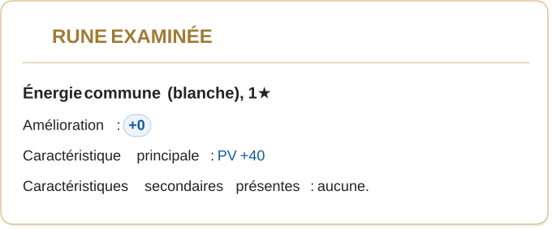
  </picture>
  

    
Version textuelle de la fenêtre

  
RUNE EXAMINÉE

  <h3>Énergie (commune (blanche)), 1★</h3>
  
Amélioration : +0

  
Caractéristique principale : PV +40

  
Caractéristiques secondaires présentes : aucune.

  

— Celle-ci n'est pas une rune poubelle.

L'artisan haussa un sourcil.

— Vraiment ?

— Oui !

Elle lui tendit la pierre.

— Elle aura de bonnes caractéristiques secondaires après amélioration.

Orven la contempla.

— Elle n'en possède pourtant aucune actuellement.

— Je sais !

Hasol sourit.

— Mais je peux voir celles qui apparaîtront.

L'artisan resta immobile.

— Tu peux voir quoi ?

— Les futures caractéristiques secondaires !

Orven regarda la pierre.

Puis la jeune fille.

— Attends…

Il posa lentement son coffret.

— Tu veux dire que tu peux connaître les caractéristiques qu'une rune découvrira avant de l'améliorer ?

Hasol acquiesça.

— Oui !

L'artisan se pencha vers elle.

— Même celles qui n'existent pas encore ?

— Oui !

— Et jusqu'à quel palier ?

— Jusqu'à +15 !

Orven resta silencieux.

Hasol poursuivit naturellement :

— Je peux même connaître le résultat final exact si j'effectue moi-même les améliorations.

L'artisan ouvrit grand les yeux.

— Le résultat exact ?

— Oui !

Il contempla son élève.

Puis les pierres.

— Les valeurs finales des caractéristiques secondaires également ?

— Oui.

Orven s'assit lentement sur son tabouret.

Il avait consacré plus de vingt-cinq ans à l'artisanat runique.

Et une jeune fille de seize ans venait de lui annoncer, presque innocemment, qu'elle pouvait connaître des informations dont les artisans ignoraient normalement l'existence jusqu'aux améliorations successives.

— Hasol…

Il inspira profondément.

— Tu comprends ce que tu viens de me dire ?

Elle pencha la tête.

— Que cette rune est meilleure qu'elle en a l'air ?

Orven éclata d'un rire incrédule.

— Bien davantage !

L'artisan récupéra une rune Énergie commune (blanche), 1★, +0, de faible valeur : principale Résistance +1 %, aucune caractéristique secondaire présente.

— Regarde celle-ci.

Hasol activa de nouveau Œil runique.

Elle consulta les informations.

— Sa première caractéristique secondaire sera la Vitesse.

Orven prit une plume.

Il nota soigneusement la prédiction.

Puis demanda :

— Et si c'est moi qui améliore cette pierre ?

Hasol réfléchit un instant.

— La caractéristique découverte sera la même.

L'artisan s'immobilisa.

— Tu en es certaine ?

— Oui !

Elle lui montra la rune.

— Les caractéristiques secondaires qui doivent apparaître ne changent pas selon l'artisan.

— Et les valeurs ?

— Là, c'est différent.

Hasol désigna sa propre fenêtre.

— Je peux voir les valeurs finales exactes à +15 si je réalise les améliorations moi-même et que j'atteins ce palier. Mais si quelqu'un d'autre améliore la pierre, je ne peux pas garantir les mêmes valeurs.

Orven resta silencieux plusieurs secondes.

Puis il se leva brusquement.

— Nous allons vérifier cela.

Hasol ouvrit grand les yeux.

— Maintenant ?

— Maintenant.

Il rassembla les matériaux nécessaires.

Puis prépara la pierre sur son établi.

— Tu m'as annoncé de la Vitesse. Je vais effectuer les améliorations moi-même.

Hasol sourit.

— D'accord !

La première tentative réussit.

Puis la deuxième.

À la troisième amélioration réussie, la rune atteignit +3.

Une nouvelle caractéristique secondaire apparut.

Orven examina immédiatement les informations.

Son souffle se coupa.

  <picture class="lit-window__github-picture">
    <source media="(max-width: 600px)" srcset="assets/fenetres-livre-2/L2-C2-F01-mobile.svg">
    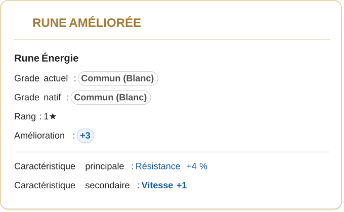
  </picture>
  

    
Version textuelle de la fenêtre

  
RUNE AMÉLIORÉE

  <h3>Rune Énergie (commune (blanche))</h3>
  
Rang : 1★

  
Amélioration : +3

  

  
Caractéristique principale : Résistance +4&nbsp;%

  
Caractéristique secondaire : <strong>Vitesse +1</strong>

  

Exactement comme Hasol l'avait annoncé.

Il regarda son registre.

Puis la rune.

Puis son apprentie.

— Incroyable…

Hasol sourit.

— Je vous l'avais dit !

Orven éclata de rire.

— Oui. Tu me l'avais dit.

Il récupéra une seconde pierre.

— Nous allons recommencer.

La deuxième expérience fut réalisée sur une rune Gardien peu commune (verte), 1★, +0.

  <picture class="lit-window__github-picture">
    <source media="(max-width: 600px)" srcset="assets/fenetres-livre-2/L2-C2-R02-mobile.svg">
    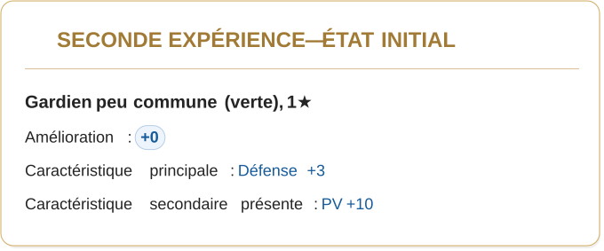
  </picture>
  

    
Version textuelle de la fenêtre

  
SECONDE EXPÉRIENCE — ÉTAT INITIAL

  <h3>Gardien (peu commune (verte)), 1★</h3>
  
Amélioration : +0

  
Caractéristique principale : Défense +3

  
Caractéristique secondaire présente : PV +10

  

Cette fois, la pierre possédait déjà une caractéristique secondaire.

Hasol annonça celle qui apparaîtrait lors d'un prochain palier de découverte.

Orven nota sa prédiction.

Puis réalisa lui-même les améliorations nécessaires.

Plusieurs tentatives consommèrent du mana et des pierres de mana.

L'une d'elles échoua.

La rune conserva son niveau d'amélioration.

Hasol observa attentivement.

— Même quand on connaît les caractéristiques futures, on peut toujours échouer…

Orven acquiesça.

— Exactement. Ta compétence ne supprime pas le coût ni le risque du travail.

Il reprit les améliorations.

Lorsque le palier attendu fut atteint, une nouvelle caractéristique apparut.

Celle annoncée par Hasol.

  <picture class="lit-window__github-picture">
    <source media="(max-width: 600px)" srcset="assets/fenetres-livre-2/L2-C2-R03-mobile.svg">
    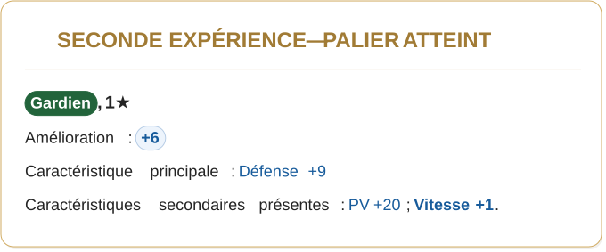
  </picture>
  

    
Version textuelle de la fenêtre

  
SECONDE EXPÉRIENCE — PALIER ATTEINT

  <h3>Gardien (peu commune (verte)), 1★</h3>
  
Amélioration : +6

  
Caractéristique principale : Défense +9

  
Caractéristiques secondaires présentes : PV +20 ; <strong>Vitesse +1</strong>.

  

Une seconde fois.

Orven contempla les résultats.

Puis il reposa lentement ses outils.

— C'est une révolution.

Hasol cligna des yeux.

— À ce point ?

L'artisan la regarda avec une expression qu'elle ne lui connaissait pas encore.

— Hasol, nous consacrons parfois des fortunes à améliorer des runes dont nous ignorons le potentiel réel.

Il prit deux pierres d'apparence semblable.

— Ces deux runes peuvent sembler équivalentes aujourd'hui. Pourtant, après plusieurs améliorations, l'une pourrait posséder les caractéristiques idéales pour un chasseur et l'autre devenir presque inutilisable pour lui.

Il désigna Œil runique.

— Toi, tu peux identifier cette différence avant de dépenser les ressources nécessaires.

Hasol acquiesça.

— Oui !

Orven poursuivit :

— Et les caractéristiques découvertes restent les mêmes si un autre artisan réalise les améliorations !

Il se leva.

— Cela signifie que tu pourrais examiner des centaines de runes, sélectionner celles qui méritent un investissement et laisser ensuite d'autres artisans travailler sur les pierres choisies.

Il s'interrompit.

Puis sourit.

— Sans même parler de la précision de tes propres résultats à +15.

Hasol contempla les runes.

Elle n'avait pas encore envisagé toutes ces possibilités.

Orven posa une main sur le coffret.

— Tu ne possèdes pas simplement une compétence utile.

Il la regarda.

— Tu détiens une capacité susceptible de transformer profondément notre métier.

La jeune Astrale rougit légèrement.

— Vous exagérez peut-être…

— Pas du tout.

Il lui montra les pierres.

— Nous venons de vérifier que tes prédictions des caractéristiques à découvrir fonctionnent même lorsque je réalise les améliorations.

Puis son expression devint plus sérieuse.

— Mais attention. Cela ne signifie pas que toutes les valeurs que tu prévois pour tes propres améliorations seraient identiques si je travaillais à ta place.

Hasol acquiesça.

— Je sais.

— Et connaître le résultat final d'une rune ne garantit jamais d'atteindre +15.

— Oui !

Orven sourit.

— Bien.

Il contempla les pierres.

Puis un rire lui échappa.

— Dire que nous avons découvert tout cela parce que tu cherchais des runes poubelles…

Hasol regarda le coffret.

Puis releva les yeux.

— Justement…

L'artisan la contempla.

— Quoi encore ?

Elle désigna une rune.

— Maintenant qu'on sait lesquelles ne valent vraiment pas la peine d'être améliorées…

Orven leva les yeux au ciel.

Hasol sourit.

— Est-ce que je peux les acheter ?

L'artisan éclata de rire.

— Tu es décidément incroyable !

Ils passèrent le reste de la matinée à trier les pierres de faible valeur.

Certaines furent immédiatement écartées de la réserve sacrificielle.

Œil runique révélait qu'elles possédaient un potentiel intéressant pour certains équipements.

D'autres étaient simplement médiocres pour le besoin initialement envisagé, mais pouvaient convenir à une autre classe.

Orven expliqua à Hasol pourquoi il ne fallait pas confondre une mauvaise rune pour soi et une rune sans valeur pour tout le monde.

Enfin, ils sélectionnèrent les pierres qui présentaient le moins d'intérêt.

Des runes encore intactes et utilisables, mais dont les caractéristiques et le potentiel ne justifiaient pas d'investissement important.

Orven les rassembla dans un petit coffret.

— Voilà une première réserve.

Hasol contempla son contenu avec satisfaction.

— Pour Aura runique !

— Exactement.

L'artisan nota leur destination dans son registre.

— Je te les céderai à leur valeur de récupération.

Elle sourit.

— Merci, Maître Orven !

Il leva un doigt.

— À une condition.

Hasol s'immobilisa.

— Laquelle ?

— Tu ne sacrifieras aucune pierre sans avoir vérifié qu'elle ne mérite pas d'être conservée.

Elle acquiesça immédiatement.

— Promis !

Orven sourit.

— Et tu suivras les consignes d'Elric pour les premiers essais.

— Bien sûr !

Il contempla la jeune Astrale.

Puis le coffret.

Grâce à son maître d'armes, Hasol était venue chercher de quoi détruire des runes.

Grâce à Œil runique, elle venait de lui montrer comment en sauver certaines qui auraient été injustement écartées.

Orven éclata doucement de rire.

Cette apprentie promettait décidément de bouleverser ses habitudes.

### III. Deux talents, une même énigme

Les semaines suivantes confirmèrent les premières impressions d'Orven.

Hasol possédait une facilité déconcertante pour l'artisanat.

Elle retenait les explications presque immédiatement.

Comprenait rapidement comment guider son mana.

Et parvenait à reproduire des gestes techniques après un nombre étonnamment faible de tentatives.

Mais Orven découvrit aussi les limites de son jeune prodige.

Une amélioration pouvait échouer malgré une préparation parfaite.

Les pierres de mana étaient consommées.

La réserve personnelle d'Hasol diminuait.

Et sa fatigue finissait par compromettre sa concentration.

Un après-midi, elle observa avec déception une rune dont l'amélioration venait d'échouer.

— Pourtant, j'avais tout préparé correctement…

Orven examina la pierre.

— C'est vrai.

— Alors pourquoi ça n'a pas fonctionné ?

— Parce que la réussite n'est jamais garantie.

Il lui montra les ressources consommées.

— Tu disposes d'avantages extraordinaires, Hasol. Mais ils ne suppriment pas toutes les difficultés de l'artisanat.

La jeune fille contempla son registre.

Puis acquiesça.

— Alors je recommencerai après m'être reposée.

Orven sourit.

— Voilà une bonne décision.

Elle rangea soigneusement son matériel.

Puis récupéra le coffret contenant ses premières runes sacrificielles.

— Je peux le montrer à monsieur Arowell ?

— Bien entendu.

Il lui adressa un sourire amusé.

— Tu pourras même lui dire que son idée nous a permis de faire une découverte remarquable.

Hasol éclata de rire.

— Je vais lui raconter !

Elric écouta le récit avec un intérêt grandissant.

La jeune Astrale lui expliqua les expériences réalisées par Orven.

Les caractéristiques secondaires prédites.

Leur apparition identique lorsque l'artisan travaillait lui-même.

Et la différence concernant les valeurs finales à +15.

Le Porte-bouclier contempla le coffret.

— Alors nous avons des runes pour Aura runique.

Hasol acquiesça.

— Oui !

Puis elle sourit.

— Et Orven a dit qu'Œil runique pourrait révolutionner l'artisanat !

Elric croisa les bras.

— Je commence à comprendre pourquoi.

Il prit une pierre entre ses doigts.

— Vous avez aussi pensé à conserver celles qui possèdent un potentiel intéressant ?

Hasol acquiesça vivement.

— Évidemment ! On ne va pas sacrifier une bonne rune !

Son mentor sourit.

— Excellent.

Puis il reposa la pierre.

— Il ne nous reste qu'à poursuivre ta progression jusqu'à ce que nous puissions organiser les essais dans de bonnes conditions.

Hasol contempla le coffret.

— Je pourrais continuer à en acheter d'autres ?

— Oui, si leur prix est raisonnable et si Orven valide leur intérêt limité pour l'artisanat.

Il ajouta :

— Mais n'oublie pas que tu dois aussi financer tes propres améliorations.

La jeune Astrale fit la moue.

— Vous êtes aussi prudent avec l'argent qu'avec les combats !

Elric éclata de rire.

— Je considère cela comme un compliment.

Un autre phénomène attira bientôt l'attention du Porte-bouclier.

Hasol progressait à l'épée presque aussi rapidement qu'à l'atelier.

Elle assimilait les techniques avec une facilité étonnante.

Un mouvement qu'il aurait normalement dû lui faire répéter pendant des semaines pouvait devenir naturel en quelques jours.

Parfois, il avait même l'impression qu'elle comprenait la logique d'un enchaînement avant d'en avoir reçu toutes les explications.

Un matin, il décida de la mettre à l'épreuve.

Il installa plusieurs mannequins sur un terrain irrégulier.

— Aujourd'hui, nous allons travailler les transitions.

Hasol observa les cibles.

— Entre les attaques ?

— Entre l'attaque, la défense et le déplacement.

Il lui montra un enchaînement complexe.

Puis lui demanda de le reproduire.

Hasol commença.

Son premier pivot fut trop large.

Elle corrigea immédiatement le mouvement.

Puis poursuivit.

Au troisième mannequin, elle dut interrompre son attaque pour retrouver son équilibre.

Elric lui indiqua son erreur.

— Encore.

Elle recommença.

Une fois.

Deux fois.

Puis plusieurs autres.

Ses mouvements gagnaient progressivement en fluidité.

Le Porte-bouclier observa ses progrès.

— Tu as déjà appris cette technique ?

Hasol secoua la tête.

— Non !

— Tu en es certaine ?

Elle éclata de rire.

— Maître Orven me pose exactement les mêmes questions !

Elric haussa un sourcil.

— Vraiment ?

— Oui ! Il dit que je manipule les outils comme si j'avais déjà travaillé dans un atelier !

Le mentor resta silencieux.

Hasol poursuivit :

— Mais je ne comprends pas pourquoi. Je n'ai jamais appris tout ça avant !

Elle contempla son épée.

— Certains mouvements me semblent simplement… naturels.

Elric réfléchit.

Puis lui désigna les mannequins.

— Recommence.

La jeune Astrale obéit.

Cette fois, elle cessa de réfléchir séparément à chaque attaque.

Elle observa les distances.

Les angles.

Les possibilités de déplacement.

Puis elle s'élança.

Sa lame fendit l'air.

Elle pivota.

Changea de direction.

Et termina l'enchaînement dans une garde presque parfaite.

Une sensation étrange parcourut son corps.

Pendant un instant, chaque mouvement lui parut évident.

Les gestes se succédaient avec une fluidité qu'elle n'avait jamais ressentie auparavant.

Puis une fenêtre apparut.

  <picture class="lit-window__github-picture">
    <source media="(max-width: 600px)" srcset="assets/fenetres-livre-2/L2-C2-F02-mobile.svg">
    
  </picture>
  

    
Version textuelle de la fenêtre

  
Nouvelle compétence passive acquise.

  
Lame runique.

  
Renforce la compréhension des techniques d'escrime.

  
Facilite leur assimilation et améliore la précision ainsi que les automatismes associés au maniement de la lame.

  

Hasol s'immobilisa.

— Monsieur Arowell !

Elric s'approcha immédiatement.

— Qu'y a-t-il ?

— J'ai obtenu une nouvelle compétence !

Il fronça les sourcils.

— Tu viens de gagner un niveau ?

Elle consulta son statut.

— Non !

— Un nouveau cercle ?

— Non plus !

Hasol lui présenta la description.

Lame runique renforçait sa compréhension des techniques d'escrime.

Elle facilitait leur assimilation et améliorait la précision ainsi que les automatismes associés au maniement de la lame.

Elric resta silencieux.

Puis il sourit.

— Voilà qui est remarquable.

Hasol contempla son épée.

— C'est grâce à tous nos entraînements ?

— Je n'en doute pas.

Elle releva les yeux.

— Alors je peux encore progresser plus vite !

Elric éclata de rire.

— Probablement.

Puis il ajouta :

— Mais cela ne signifie pas que tu es devenue invincible.

Hasol fit la moue.

— Vous dites toujours ça !

— Parce que tu sembles toujours prête à l'oublier.

Elle rit.

Puis reprit sa garde.

— On continue ?

Le Porte-bouclier contempla son élève.

Il avait désormais une certitude.

Cette jeune fille possédait un talent extraordinaire.

Et ses capacités semblaient encore loin d'avoir révélé toutes leurs possibilités.

### IV. Le huitième cercle

Les mois passèrent.

Hasol continua de partager ses journées entre l'Académie, les chasses et l'atelier d'Orven.

Ses progrès étaient considérables.

Mais Croissance runique demeurait au centre de son organisation.

Elle cherchait régulièrement des zones où les monstres ordinaires restaient admissibles à son passif.

Elric l'accompagnait dans ses choix.

Il refusait qu'elle se mette inutilement en danger pour accélérer son compteur.

Mais il reconnaissait volontiers que les cercles supplémentaires représentaient un avantage exceptionnel.

Chaque nouveau cercle augmentait sa capacité à employer le mana.

Et lui ouvrait un nouvel emplacement runique.

Hasol avait commencé sa seconde vie avec deux cercles.

Elle en obtint un troisième.

Puis un quatrième.

Et progressivement, les suivants.

Avec sept cercles, elle portait déjà sept runes, choisies avec Orven et Ray : quatre Fatal, dont celle offerte par son père, deux Gardien, dont son autre cadeau, et une Énergie.

Avec eux, elle avait aussi préparé une seconde Énergie, gardée en réserve pour équiper son prochain emplacement dès l'obtention d'un nouveau cercle.

  <picture class="lit-window__github-picture">
    <source media="(max-width: 600px)" srcset="assets/fenetres-livre-2/L2-C2-R04-mobile.svg">
    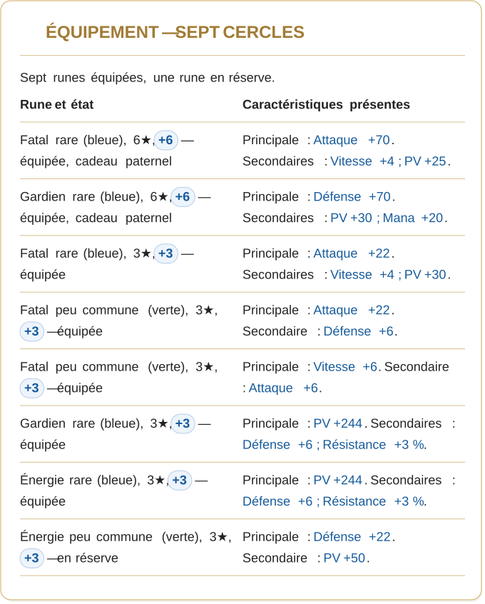
  </picture>
  

    
Version textuelle de la fenêtre

  
ÉQUIPEMENT — SEPT CERCLES

  
Sept runes équipées, une rune en réserve.

  <table>
    <thead><tr><th scope="col">Rune et état</th><th scope="col">Caractéristiques présentes</th></tr></thead>
    <tbody>
      <tr data-rune-id="L2-HAS-R001"><td>Fatal (rare (bleue)), 6★, +6 — équipée, cadeau paternel</td><td>Principale : Attaque +70. Secondaires : Vitesse +4 ; PV +25.</td></tr>
      <tr data-rune-id="L2-HAS-R002"><td>Gardien (rare (bleue)), 6★, +6 — équipée, cadeau paternel</td><td>Principale : Défense +70. Secondaires : PV +30 ; Mana +20.</td></tr>
      <tr data-rune-id="L2-HAS-R003"><td>Fatal (rare (bleue)), 3★, +3 — équipée</td><td>Principale : Attaque +22. Secondaires : Vitesse +4 ; PV +30.</td></tr>
      <tr data-rune-id="L2-HAS-R004"><td>Fatal (peu commune (verte)), 3★, +3 — équipée</td><td>Principale : Attaque +22. Secondaire : Défense +6.</td></tr>
      <tr data-rune-id="L2-HAS-R005"><td>Fatal (peu commune (verte)), 3★, +3 — équipée</td><td>Principale : Vitesse +6. Secondaire : Attaque +6.</td></tr>
      <tr data-rune-id="L2-HAS-R006"><td>Gardien (rare (bleue)), 3★, +3 — équipée</td><td>Principale : PV +244. Secondaires : Défense +6 ; Résistance +3&nbsp;%.</td></tr>
      <tr data-rune-id="L2-HAS-R007"><td>Énergie (rare (bleue)), 3★, +3 — équipée</td><td>Principale : PV +244. Secondaires : Défense +6 ; Résistance +3&nbsp;%.</td></tr>
      <tr data-rune-id="L2-HAS-R008"><td>Énergie (peu commune (verte)), 3★, +3 — en réserve</td><td>Principale : Défense +22. Secondaire : PV +50.</td></tr>
    </tbody>
  </table>
  

Un jour, au terme d'une nouvelle chasse, son compteur franchit encore un palier.

Une notification apparut.

  <picture class="lit-window__github-picture">
    <source media="(max-width: 600px)" srcset="assets/fenetres-livre-2/L2-C2-F03-mobile.svg">
    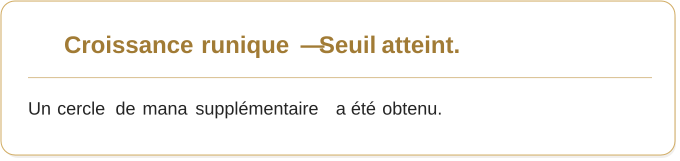
  </picture>
  

    
Version textuelle de la fenêtre

  
Croissance runique — Seuil atteint.

  
Un cercle de mana supplémentaire a été obtenu.

  
Cercles de mana : 7 → 8

  
Emplacements runiques : 8

  

Hasol s'immobilisa.

Elle sortit aussitôt la seconde Énergie préparée avec Orven et Ray et l'équipa dans le nouvel emplacement.

Elle ouvrit son statut.

Puis compta.

Une fois.

Deux fois.

— Huit…

Son sourire s'élargit.

— HUIT !

Elle leva les bras.

— Monsieur Arowell ! J'ai huit cercles !

Elric, qui s'était approché, consulta les informations.

Puis il sourit.

— Félicitations, Hasol.

Elle contempla ses emplacements.

Huit cercles.

Huit runes équipées.

Quatre Fatal, deux Gardien et deux Énergie : ses huit emplacements étaient occupés, et la paire Énergie était désormais active. Ses ensembles s'équilibraient.

Elric l'observa avec amusement.

— Je crois savoir à quoi tu penses.

Hasol releva les yeux.

— À quoi ?

— Aux runes.

Elle éclata de rire.

— Évidemment !

— Ce soir, je vais devoir aller voir Orven pour améliorer mes runes et préparer les prochains ensembles.

— Attends, ne sois pas trop pressée. L'Académie te réserve une surprise. Tu verras.

À son retour à l'Académie, un employé l'attendait près de l'entrée.

— Mademoiselle Shun ?

Hasol se retourna.

— Oui ?

— Le directeur souhaite vous recevoir dans son bureau.

La jeune Astrale cligna des yeux.

— Maintenant ?

— Dès que vous serez disponible.

Elle regarda sa tenue poussiéreuse.

— Je peux au moins me changer ?

L'employé sourit.

— Bien entendu.

Hasol le remercia.

Puis se dirigea vers les vestiaires.

Elle se demandait pourquoi le directeur avait besoin de la voir aussi rapidement.

Dans le bureau de ce dernier, un coffret de bois sombre reposait sur la table.

Elric en examinait le contenu.

Huit runes bleues étaient disposées sur un coussin.

— Deux ensembles complets de Vol de vie, observa-t-il.

Il prit l'une des pierres.

— Toutes rares, quatre étoiles, améliorées à +6.

Le directeur acquiesça.

— Elles correspondent à la configuration souhaitée.

Elric examina les caractéristiques.

— Attaque, Puissance arcanique et Vitesse.

Il sourit.

— Elles conviendront très bien à son style de combat.

Près de la fenêtre, Iseria écoutait silencieusement.

Ses longs cheveux roses retombaient sur ses épaules.

Lorsque les deux hommes eurent terminé, elle posa doucement sa tasse.

— Les dispositions convenues lors de son admission sont toujours respectées ?

Le directeur tourna la tête vers elle.

Un dossier reposait à côté du coffret.

Sur sa couverture figurait le nom d'Hasol Shun.

Un cachet rouge indiquait :

*Accès restreint.*

— Naturellement, madame Shun.

Iseria acquiesça.

— Et les personnes concernées ?

— Elles respectent leurs engagements.

Le directeur referma le dossier.

Puis le rangea dans un tiroir verrouillé.

Elric, qui avait terminé son examen, redressa la tête.

— Je pense que nous pouvons maintenant recevoir Hasol.

On frappa à la porte.

— Entrez !

La jeune Astrale apparut.

— Bonjour, monsieur le directeur ! Vous m'avez fait dem…

Elle s'interrompit.

Son regard venait de se poser sur Iseria.

— Maman ?!

Sa mère lui sourit.

— Bonjour, ma chérie.

Hasol regarda successivement les trois adultes.

— Qu'est-ce qui se passe ?

Elle se raidit.

— Il y a un problème ?

— Aucun, la rassura le directeur.

Hasol poussa un soupir de soulagement.

Puis son visage s'illumina.

— Alors j'ai une grande nouvelle !

Elric croisa les bras.

— Ah bon ?

— J'ai obtenu mon huitième cercle !

Le Porte-bouclier prit un air faussement surpris.

— Vraiment ?

Hasol fit la moue.

— Vous étiez avec moi !

Il éclata de rire.

Le directeur lui désigna une chaise.

— Installez-vous, mademoiselle Shun. Votre progression est justement la raison de cette réunion.

Hasol s'assit.

Puis remarqua le coffret.

Son regard s'y arrêta.

— Qu'est-ce que c'est ?

Le directeur le fit glisser vers elle.

— Ouvrez-le.

Elle souleva délicatement le couvercle.

Son souffle se coupa.

Huit runes bleues reposaient devant elle.

Hasol en prit une.

Activa Œil runique.

Puis ouvrit grand les yeux.

— Rare…

Elle examina une deuxième pierre.

— Quatre étoiles…

Son regard descendit vers le renforcement.

— Elles sont toutes à +6 ?!

Elric sourit.

— Exactement.

Hasol consulta les autres pierres.

Puis elle découvrit leur type.

— Vol de vie…

Elle releva brusquement la tête.

— Deux ensembles complets ?

— Oui, répondit le directeur.

  <picture class="lit-window__github-picture">
    <source media="(max-width: 600px)" srcset="assets/fenetres-livre-2/L2-C2-R05-mobile.svg">
    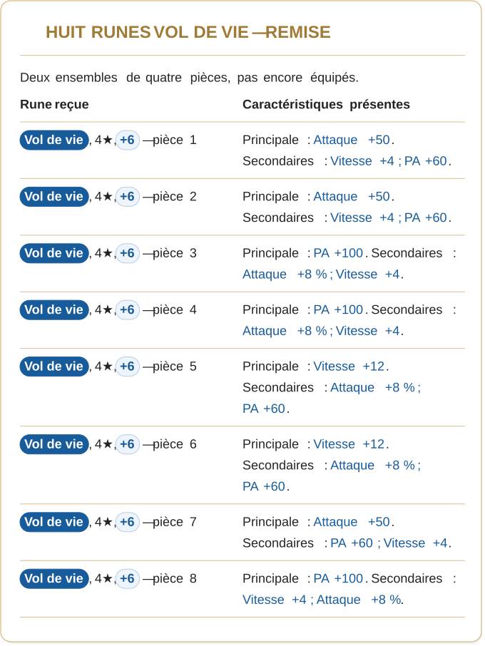
  </picture>
  

    
Version textuelle de la fenêtre

  
HUIT RUNES VOL DE VIE — REMISE

  
Deux ensembles de quatre pièces, pas encore équipés.

  <table>
    <thead><tr><th scope="col">Rune reçue</th><th scope="col">Caractéristiques présentes</th></tr></thead>
    <tbody>
      <tr data-rune-id="L2-HAS-R009"><td>Vol de vie (rare (bleue)), 4★, +6 — pièce 1</td><td>Principale : Attaque +50. Secondaires : Vitesse +4 ; PA +60.</td></tr>
      <tr data-rune-id="L2-HAS-R010"><td>Vol de vie (rare (bleue)), 4★, +6 — pièce 2</td><td>Principale : Attaque +50. Secondaires : Vitesse +4 ; PA +60.</td></tr>
      <tr data-rune-id="L2-HAS-R011"><td>Vol de vie (rare (bleue)), 4★, +6 — pièce 3</td><td>Principale : PA +100. Secondaires : Attaque +8&nbsp;% ; Vitesse +4.</td></tr>
      <tr data-rune-id="L2-HAS-R012"><td>Vol de vie (rare (bleue)), 4★, +6 — pièce 4</td><td>Principale : PA +100. Secondaires : Attaque +8&nbsp;% ; Vitesse +4.</td></tr>
      <tr data-rune-id="L2-HAS-R013"><td>Vol de vie (rare (bleue)), 4★, +6 — pièce 5</td><td>Principale : Vitesse +12. Secondaires : Attaque +8&nbsp;% ; PA +60.</td></tr>
      <tr data-rune-id="L2-HAS-R014"><td>Vol de vie (rare (bleue)), 4★, +6 — pièce 6</td><td>Principale : Vitesse +12. Secondaires : Attaque +8&nbsp;% ; PA +60.</td></tr>
      <tr data-rune-id="L2-HAS-R015"><td>Vol de vie (rare (bleue)), 4★, +6 — pièce 7</td><td>Principale : Attaque +50. Secondaires : PA +60 ; Vitesse +4.</td></tr>
      <tr data-rune-id="L2-HAS-R016"><td>Vol de vie (rare (bleue)), 4★, +6 — pièce 8</td><td>Principale : PA +100. Secondaires : Vitesse +4 ; Attaque +8&nbsp;%.</td></tr>
    </tbody>
  </table>
  

La jeune Astrale resta bouche bée.

Elric s'approcha.

— Chaque ensemble comporte quatre pièces. Avec tes huit cercles, tu peux désormais en porter deux.

Il désigna les runes.

— Leurs caractéristiques ont été choisies principalement pour renforcer ton Attaque, ta Puissance arcanique et ta Vitesse.

Hasol examina les pierres.

Les bonus individuels étaient déjà très intéressants.

Mais l'ensemble complet apporterait également du vol de vie.

Elle pourrait récupérer une partie de ses PV en infligeant des dégâts.

Et avec deux ensembles, cet avantage deviendrait particulièrement précieux pour une combattante utilisant principalement l'épée.

Hasol contempla les huit runes.

Puis elle activa successivement Œil runique sur chacune d'elles.

Leurs caractéristiques futures lui apparurent.

Elle sourit.

La sélection était particulièrement intéressante.

Ce n'étaient pas simplement huit pierres choisies pour former deux ensembles.

Elles avaient été préparées pour accompagner sa progression.

— Elles sont magnifiques…

Le directeur lui adressa un sourire.

— L'Académie souhaite vous donner les moyens de développer vos capacités.

Hasol releva les yeux.

— Elles sont vraiment pour moi ?

— Oui.

Elle resta silencieuse.

Puis elle s'inclina profondément.

— Merci, monsieur le directeur !

Elle se tourna vers Elric.

— Merci à vous aussi !

Le Porte-bouclier sourit.

— Tu pourras me remercier en continuant à travailler sérieusement.

— Promis !

Hasol regarda ensuite sa mère.

Iseria lui adressa simplement un sourire affectueux.

La jeune Astrale ne comprenait toujours pas pourquoi elle avait assisté à cette réunion.

Mais elle était heureuse de la voir.

Puis son regard descendit vers les deux runes de son père, parmi les huit qu'elle portait.

Son sourire hésita.

— Il y a juste une chose…

Elric pencha la tête.

— Laquelle ?

Hasol effleura ses emplacements.

— J'aimerais attendre ce soir avant d'équiper les nouvelles runes.

Le directeur sembla surpris.

— Pourquoi ?

Elle baissa légèrement les yeux.

— Je voudrais d'abord en parler à papa.

Iseria acquiesça doucement.

— Bien sûr, ma chérie.

Le directeur referma le coffret.

— Prenez tout le temps nécessaire.

Hasol le récupéra avec précaution.

Elle avait rarement été aussi pressée de rentrer chez elle.

Armin trouva sa fille assise dans le salon.

Deux coffrets étaient ouverts devant elle.

Il s'approcha.

— Voilà une réunion qui semble particulièrement importante.

Hasol se retourna.

— Papa !

Elle lui raconta tout.

Le huitième cercle.

La convocation.

La présence inattendue d'Iseria.

Et les huit runes Vol de vie.

Armin les examina avec fascination.

— Huit runes pareilles…

Il éclata de rire.

— Ma princesse devient une véritable collectionneuse !

Hasol sourit.

Puis son expression s'assombrit.

— Mais j'ai un problème.

Son père s'assit auprès d'elle.

— Lequel ?

Elle désigna les deux pierres qu'il lui avait offertes.

La Fatal.

Et la Gardien.

— Si j'équipe mes huit nouvelles runes, je vais devoir retirer les tiennes.

Armin cligna des yeux.

— Et alors ?

Hasol baissa la tête.

— Tu ne seras pas déçu ?

Son père resta silencieux un instant.

Puis il éclata de rire.

— Déçu ? Mais pourquoi ?

Elle contempla ses cadeaux.

— Elles sont très précieuses…

— C'est vrai.

— Et tu les as choisies pour moi…

Armin prit doucement la rune Fatal entre ses doigts.

— Hasol, pourquoi crois-tu que je te les ai offertes ?

Elle réfléchit.

— Pour m'aider à devenir plus forte.

— Exactement !

Il lui montra les huit nouvelles pierres.

— Et aujourd'hui, tu possèdes un équipement qui te convient encore mieux.

Hasol releva les yeux.

Armin sourit.

— Je serais surtout contrarié d'apprendre que ma fille refuse de progresser parce qu'elle a peur de me décevoir.

La jeune Astrale sentit ses yeux devenir humides.

— Alors… Je peux les ranger ?

— Évidemment !

Il se leva.

— D'ailleurs, nous allons leur trouver un endroit digne d'elles.

Quelques minutes plus tard, il revint avec un petit coffre doublé de tissu.

Hasol installa soigneusement les deux pierres dans des compartiments séparés.

Puis referma le couvercle.

— Je les remettrai lorsque j'aurai suffisamment de cercles !

Armin éclata de rire.

— Voilà une excellente motivation !

Hasol se jeta dans ses bras.

— Merci, papa.

Il lui caressa doucement les cheveux.

— De rien, ma princesse.

Ce soir-là, Hasol retira aussi les six autres runes et les rangea à part, puis équipa ses huit nouvelles runes.

Deux ensembles Vol de vie complets.

Elle consulta son statut.

Son Attaque avait progressé.

Sa Puissance arcanique également.

Et plusieurs caractéristiques amélioraient sa Vitesse.

Les deux bonus d'ensemble étaient désormais actifs.

Hasol contempla les informations avec émerveillement.

Elle avait commencé sa formation avec deux cercles.

Aujourd'hui, elle en possédait huit.

Mais surtout, elle comprenait enfin à quel point des runes soigneusement sélectionnées pouvaient transformer les capacités d'un chasseur.

Elle sourit.

Puis son regard glissa vers le petit coffre où reposaient les cadeaux de son père.

Ces pierres attendaient simplement leur tour.

Et elle comptait bien avoir un jour suffisamment d'emplacements pour les porter de nouveau.

### V. L'épée imprégnée

La réserve de runes préparée avec Orven trouva bientôt sa première utilité.

Hasol avait progressé suffisamment pour réunir le mana nécessaire à un lancement d'Aura runique.

Elric décida donc d'organiser un essai.

Orven accepta d'y assister.

Ils se retrouvèrent sur un terrain réservé aux expérimentations magiques.

Une rune de faible valeur reposait sur une petite table.

Hasol l'avait examinée plusieurs fois.

Œil runique n'avait révélé aucun potentiel justifiant un investissement.

La pierre était parfaitement utilisable.

Mais sa disparition ne représenterait pas une perte importante pour l'atelier.

Elric dégaina son épée.

Puis la tendit à son élève.

— Nous allons commencer par une imprégnation simple.

Hasol acquiesça.

— D'accord !

Orven désigna la rune.

— Tu es certaine de vouloir sacrifier celle-ci ?

Elle sourit.

— Absolument !

Il lui adressa un regard amusé.

— Voilà bien la première fois que je rencontre une apprentie aussi heureuse de détruire une pierre.

Elric éclata de rire.

Hasol fit la moue.

— Mais c'est pour une expérience !

— Je sais, répondit Orven. Je voulais simplement te taquiner.

La jeune Astrale plaça la rune près de l'épée.

Puis activa Aura runique.

Deux cents points de mana furent consommés.

La pierre s'illumina.

De fines inscriptions lumineuses apparurent à sa surface.

Puis elles commencèrent à se désagréger.

Une énergie élémentaire se propagea le long de la lame.

Lorsque le phénomène s'acheva, la rune avait complètement disparu.

Hasol recula.

Ses yeux brillaient.

— Ça a fonctionné !

Elric récupéra son épée.

Il examina la lumière qui enveloppait le métal.

Puis effectua quelques mouvements.

L'aura suivait naturellement la trajectoire de son arme.

Le Porte-bouclier s'approcha d'un mannequin.

Il frappa.

L'énergie élémentaire accompagna son attaque.

Puis il recommença.

Orven nota soigneusement les observations.

Elric abaissa finalement sa lame.

— Impressionnant.

Hasol rayonnait.

— Vous avez vu ?

— Oui.

Il contempla son arme.

— Et l'effet peut durer jusqu'à vingt-quatre heures.

— Exactement !

Orven acquiesça.

— Une capacité qui pourrait être très utile lors d'une expédition préparée à l'avance.

Il montra le registre.

— Mais son coût interdit de l'utiliser sans réfléchir.

Hasol acquiesça.

— C'est pour ça qu'on a préparé nos runes poubelles !

Elric sourit.

— En effet.

Elle contempla l'épée.

Puis demanda :

— Vous pourrez l'utiliser pendant votre prochain entraînement ?

— Certainement.

Hasol ouvrit grand les yeux.

— Formidable !

Elric la regarda.

Puis ajouta :

— Mais toi, tu continueras avec ton arme ordinaire jusqu'au niveau dix.

La jeune Astrale soupira.

— Je sais…

Orven éclata de rire.

Les essais suivants furent organisés avec prudence.

Hasol ne pouvait pas multiplier les imprégnations à volonté.

Chaque lancement exigeait du mana.

Et chaque rune sacrifiée était définitivement perdue.

Cependant, la petite réserve constituée grâce au conseil d'Elric lui permit de réaliser plusieurs expériences sans toucher à son équipement personnel.

Orven commença même à conserver certaines pierres spécialement pour cet usage.

Lorsqu'un lot présentait des runes de très faible valeur, il demandait à Hasol de les examiner.

Elle utilisait Œil runique.

Écartait les pierres qui possédaient un potentiel intéressant.

Puis sélectionnait celles qui ne méritaient pas d'être améliorées.

Progressivement, cette activité devint une habitude.

Orven laissa un compartiment réservé aux pierres destinées à Aura runique.

Il lui donna une étiquette.

*Réserve sacrificielle.*

Hasol la contempla.

Puis sourit.

— C'est beaucoup plus élégant que « runes poubelles ».

L'artisan acquiesça avec satisfaction.

— Merci.

Elle réfléchit.

Puis ajouta :

— Mais je préfère toujours « runes poubelles ».

Orven leva les yeux au ciel.

Elric éclata de rire.

Le niveau dix apporta une nouvelle surprise.

Hasol venait de terminer une chasse lorsqu'une notification apparut devant elle.

  <picture class="lit-window__github-picture">
    <source media="(max-width: 600px)" srcset="assets/fenetres-livre-2/L2-C2-F04-mobile.svg">
    
  </picture>
  

    
Version textuelle de la fenêtre

  
Niveau supérieur.

  
Niveau 10 atteint.

  

La jeune Astrale ouvrit immédiatement son statut.

Elle pouvait enfin manier personnellement une arme imprégnée par Aura runique.

Mais une autre information attira son attention.

Un effet supplémentaire venait d'apparaître dans la description.

  <picture class="lit-window__github-picture">
    <source media="(max-width: 600px)" srcset="assets/fenetres-livre-2/L2-C2-F05-mobile.svg">
    
  </picture>
  

    
Version textuelle de la fenêtre

  
Infiltration runique.

  

Hasol relut le texte.

Puis elle ouvrit grand les yeux.

Lorsqu'un lancement d'Aura runique était critique, les attaques de l'arme imprégnée bénéficiaient pendant trente secondes d'un minimum de dégâts déterminé par sa Puissance arcanique effective.

La Défense de l'adversaire ne pouvait pas réduire les dégâts sous ce seuil.

Hasol resta immobile.

Puis elle se précipita vers l'Académie.

— Monsieur Arowell !

Elric se retourna.

— Hasol ?

— J'ai atteint le niveau dix !

Il sourit.

— Félicitations !

— Et Aura runique vient de révéler quelque chose !

Elle lui présenta la description.

Le Porte-bouclier l'examina attentivement.

— Attends. L'effet dépend d'une activation critique de la compétence ?

Hasol acquiesça.

— Oui !

— Pas d'un coup critique porté ensuite avec l'épée ?

— Non. C'est le lancement d'Aura runique qui doit être critique.

Elric réfléchit.

— Voilà une distinction essentielle.

Il relut le passage.

— Et l'effet ne dure que trente secondes.

— Oui. L'imprégnation élémentaire normale continue ensuite jusqu'à sa disparition.

Le Porte-bouclier acquiesça.

— Cela signifie que nous devrons préparer les activations critiques particulièrement soigneusement.

Hasol sourit.

— Et je peux maintenant utiliser moi-même mon épée imprégnée !

— En effet.

Elle se redressa.

— Alors on essaie ?

Elric éclata de rire.

— Tu ne perds décidément jamais de temps.

Lors d'un nouvel essai, Aura runique produisit enfin une activation critique.

Une notification apparut.

  <picture class="lit-window__github-picture">
    <source media="(max-width: 600px)" srcset="assets/fenetres-livre-2/L2-C2-F06-mobile.svg">
    
  </picture>
  

    
Version textuelle de la fenêtre

  
Infiltration runique activée.

  
Durée : 30 secondes.

  

Hasol saisit immédiatement son épée.

Elle s'élança vers le dispositif d'entraînement.

Sa lame atteignit le premier mannequin.

Puis un second, protégé par une défense plus élevée.

Les résultats confirmèrent la propriété annoncée.

Pendant Infiltration runique, les dégâts des attaques réussies ne pouvaient pas être abaissés sous le minimum imposé par la Puissance arcanique effective d'Hasol du seul fait de la Défense de la cible.

La jeune Astrale attaqua encore.

Puis les trente secondes s'achevèrent.

L'effet particulier disparut.

L'imprégnation élémentaire normale demeura.

Hasol reprit son souffle.

— C'est incroyable…

Elric examina les observations.

— Oui.

Il leva ensuite les yeux.

— Mais ces trente secondes commencent dès l'activation, pas au premier coup porté.

Hasol acquiesça.

— Donc si je perds du temps à rejoindre mon adversaire…

— Tu perds une partie de la durée.

Orven intervint :

— Et une activation critique n'est pas garantie.

Il désigna le registre.

— Chaque nouveau lancement consomme toujours une rune et deux cents points de mana.

Hasol soupira.

— Vous pensez toujours aux dépenses !

L'artisan sourit.

— Heureusement pour toi.

Elric éclata de rire.

Hasol contempla son épée.

Elle comprenait désormais que ses compétences ne devaient pas être utilisées séparément.

Œil runique lui permettait de sélectionner les pierres intéressantes.

Bénédiction runique l'aidait à les améliorer.

Aura runique transformait les mauvaises runes en imprégnations élémentaires.

Et Infiltration runique pouvait renforcer momentanément ses attaques lorsque l'activation était critique.

Sa classe possédait une logique qui lui plaisait énormément.

Chaque compétence offrait de nouvelles possibilités aux autres.

Et elle était encore loin de les avoir toutes explorées.

### VI. Les trois premières années

À dix-sept ans, Hasol passait déjà une grande partie de son temps entre l'Académie et l'atelier d'Orven.

Ses progrès étaient si rapides que l'artisan avait dû modifier plusieurs fois son programme.

Mais il lui rappelait régulièrement qu'une bonne prédiction ne suffisait pas à faire une bonne artisane.

Un jour, il lui présenta deux runes.

La première possédait un excellent potentiel offensif.

La seconde était moins spectaculaire, mais correspondait parfaitement aux besoins d'un client recherchant de la protection.

— Laquelle choisirais-tu ? demanda-t-il.

Hasol examina les pierres.

— La première donnera de meilleures valeurs à +15.

Orven acquiesça.

— C'est vrai.

Puis il lui montra le dossier du client.

— Mais laquelle lui conseillerais-tu ?

Elle réfléchit.

Puis désigna la seconde.

— Celle-ci.

— Pourquoi ?

— Parce que ses caractéristiques lui seront plus utiles.

L'artisan sourit.

— Exactement.

Hasol acquiesça.

Grâce à Œil runique, elle pouvait reconnaître le potentiel des pierres.

Mais elle devait également apprendre à comprendre les besoins des chasseurs.

Cette distinction devint progressivement l'une des bases de son travail.

Orven lui confia ses premières commandes rémunérées.

Les bénéfices étaient modestes au début.

Puis ils augmentèrent avec son expérience.

Hasol apprit à examiner les lots avant d'acheter les pierres.

À éviter les améliorations inutilement coûteuses.

À sélectionner les runes adaptées aux besoins des clients.

Et à distinguer une pierre réellement médiocre d'une pierre simplement mal comprise.

Son expertise devint de plus en plus précieuse.

Même lorsqu'un autre artisan réalisait les améliorations, les caractéristiques secondaires découvertes correspondaient aux prédictions d'Hasol.

Cela permettait à Orven de mieux organiser certains travaux de l'atelier.

Les commandes confiées personnellement à Hasol bénéficiaient en outre de Bénédiction runique.

Mais ses échecs restaient possibles.

Le mana et les matériaux étaient consommés.

Et la fatigue limitait toujours son rythme.

Orven refusait qu'elle se laisse emporter par son enthousiasme.

— Tu t'arrêtes pour aujourd'hui.

Hasol levait les yeux.

— Mais il me reste du mana !

— Et tu commences à manquer de concentration.

Elle regardait alors la pierre devant elle.

Puis soupirait.

— D'accord…

L'artisan souriait.

— Demain, tu travailleras mieux.

Et le lendemain, elle revenait généralement avant lui.

Ray Corvus avait pris l'habitude de retrouver Hasol à la bibliothèque.

Il arrivait avec plusieurs ouvrages sous le bras.

La jeune Astrale, elle, arrivait souvent directement de l'atelier.

— Tu es en retard, constata Ray un après-midi.

Hasol s'immobilisa.

— Seulement un peu !

— Douze minutes.

— Maître Orven avait besoin de moi !

Ray ajusta ses lunettes.

— C'est ce que tu as dit la semaine dernière.

— Et c'était déjà vrai !

Il sourit légèrement.

Puis lui tendit un livre.

Hasol ouvrit grand les yeux.

— Tu l'as trouvé !

— Il était dans une section rarement consultée.

Elle récupéra immédiatement l'ouvrage.

— Tu es formidable !

Ray sourit.

— Je sais.

Elle lui donna un léger coup de coude.

Puis commença à feuilleter les pages.

L'ouvrage présentait différentes configurations d'ensembles runiques.

Hasol s'attarda sur plusieurs descriptions.

Puis elle releva la tête.

— Ray ?

— Oui ?

— Quand j'aurai davantage de cercles, tu choisirais quel ensemble pour moi ?

Il réfléchit.

— Tu portes toujours tes deux ensembles Vol de vie ?

— Oui !

— Et tu souhaites les conserver ?

Hasol acquiesça.

— Ils me conviennent très bien.

Ray parcourut quelques pages.

— Dans ce cas, je privilégierais probablement Arcanique.

La jeune Astrale pencha la tête.

— Même si je combats principalement à l'épée ?

— Justement.

Il lui montra un passage.

— Ta classe ne dépend pas uniquement de ton Attaque. Plusieurs de tes compétences utilisent aussi ta Puissance arcanique.

Hasol réfléchit.

— Elric me conseille plutôt Vitesse.

— Ce n'est pas un mauvais choix.

Elle fit la moue.

— Vous ne pourriez pas vous mettre d'accord ?

Ray éclata de rire.

— Nous ne réfléchissons simplement pas à la même priorité.

Il désigna les informations.

— Elric veut améliorer ta mobilité. Moi, je pense aux effets de tes compétences.

Hasol contempla la page.

Puis sourit.

— Alors je pourrais faire les deux !

Ray acquiesça.

— Lorsque tu disposeras d'assez d'emplacements et de ressources.

La jeune Astrale sourit jusqu'aux oreilles.

— Ça, je peux essayer de l'obtenir !

Ray éclata de rire.

Il n'avait aucune idée de l'ampleur de ses ambitions.

Quelques jours plus tard, Hasol présenta son projet à Elric.

Le Porte-bouclier parcourut ses notes.

— Arcanique avant Vitesse ?

Elle sourit timidement.

— Oui…

Il leva les yeux.

— Ray ?

Hasol cligna des yeux.

— Comment vous avez deviné ?

Elric éclata de rire.

— Je commence à connaître ton meilleur ami.

Il contempla les documents.

— Son raisonnement se défend.

Hasol se redressa.

— Vraiment ?

— Oui. Mais je maintiens que la Vitesse te sera très utile.

Elle sourit.

— Alors je ferai les deux !

Elric secoua la tête avec amusement.

— Lorsque tes cercles le permettront.

La jeune Astrale acquiesça.

Ses deux ensembles Vol de vie constitueraient sa base.

Elle ajouterait ensuite Arcanique.

Puis Vitesse.

Et plus tard, lorsqu'elle disposerait de davantage d'emplacements, elle envisagerait Énergie, Gardien et des runes Fatal pour compléter sa configuration.

Mais elle savait que ces projets demanderaient du temps.

Elle ne pouvait pas équiper plusieurs ensembles complets simplement parce qu'elle possédait quelques pierres du bon type.

Il lui fallait respecter le nombre de pièces nécessaire à chaque bonus.

Et les nouveaux cercles n'arrivaient pas sans travail.

Cette perspective ne la décourageait pas.

Au contraire.

Elle aimait construire progressivement son équipement.

Hasol continuait également de retrouver Zéphyr Claire pour ses exercices d'exploration.

La fille du Ranger, Samia, participait souvent aux séances.

Elle possédait deux cercles de mana depuis ses neuf ans.

Ses longs cheveux argentés attiraient parfois les regards curieux.

Mais Hasol s'était rapidement habituée à cette particularité.

Elle connaissait surtout Samia comme une jeune fille sérieuse et passionnée par les mécanismes.

Un jour, Zéphyr plaça plusieurs coffres devant elles.

— Hasol, lesquels sont piégés ?

La jeune Astrale activa Œil runique.

Elle identifia immédiatement les mécanismes dangereux.

Zéphyr acquiesça.

Puis se tourna vers Samia.

— Et comment pourrais-tu expliquer leur fonctionnement ?

La jeune fille s'approcha.

Elle observa les serrures.

Les attaches.

Les petites plaques dissimulées sous les couvercles.

Puis elle désigna un mécanisme.

— Celui-ci se déclencherait si on soulevait le couvercle sans bloquer cette pièce.

Zéphyr sourit.

— Excellent.

Samia baissa les yeux.

— Mais Hasol les a trouvés beaucoup plus vite…

La jeune Astrale éclata de rire.

— Parce que j'ai une compétence pour ça !

Samia releva la tête.

Hasol désigna le coffre.

— Moi, je sais qu'il est piégé. Toi, tu comprends comment il fonctionne.

Zéphyr acquiesça.

— Voilà précisément pourquoi nous apprenons aussi à observer.

Samia sourit timidement.

Hasol lui donna un petit coup d'épaule.

— Tu es vraiment douée !

Lorsque Samia approcha de ses seize ans, elle devint plus nerveuse.

Un après-midi, alors qu'elles rangeaient leur matériel, elle posa une question.

— Hasol ?

— Oui ?

— Tu crois que je vais recevoir une bonne classe ?

La jeune Astrale se retourna.

— Bien sûr !

Samia baissa les yeux.

— Tu n'en sais rien…

Hasol resta silencieuse quelques instants.

Puis elle sourit.

— Tu sais, avant ma Révélation, j'avais très peur.

Samia ouvrit grand les yeux.

— Toi ?

— Oui !

Hasol lui raconta son seizième anniversaire.

Sa peur d'obtenir une classe décevante.

Son souhait d'être née un jour plus tôt.

Et les plaisanteries d'Armin lorsqu'elle avait expliqué que sa Révélation pourrait gâcher son anniversaire.

Samia éclata de rire.

— Tu as vraiment dit ça ?

— Oui !

— C'est ridicule !

— Merci beaucoup !

Elles rirent ensemble.

Puis Hasol reprit plus doucement :

— Ma mère m'a dit quelque chose ce jour-là.

Samia l'écouta.

— Quelle que soit la classe que tu recevras, tu resteras la même personne.

Hasol sourit.

— Et moi, je t'apprécie déjà énormément.

Samia baissa légèrement les yeux.

Puis murmura :

— Merci.

Hasol lui adressa un sourire.

Elle ne savait pas encore à quel point cette conversation allait devenir importante.

### VII. Deux lumières, deux destins

Hasol avait dix-neuf ans lorsque Samia atteignit enfin ses seize ans.

Trois années s'étaient écoulées depuis sa propre Révélation.

Elle avait gagné des niveaux, développé ses cercles et acquis une expérience considérable.

Mais ce matin-là, elle n'avait prévu aucun entraînement.

Elle accompagnait Zéphyr au temple.

— Vous êtes nerveux ? demanda-t-elle.

Le Ranger lui adressa un sourire.

— Absolument pas.

Hasol observa la manière dont il ajustait pour la troisième fois une attache de son équipement.

— Vous êtes certain ?

— Parfaitement.

Elle éclata de rire.

— Monsieur Claire, vous êtes encore plus nerveux que Samia !

Zéphyr soupira.

— C'est possible.

Il contempla les portes du temple.

— Elle attend cette journée depuis tellement longtemps…

Hasol sourit.

— Elle sera formidable.

Ils entrèrent ensemble.

Le temple n'avait presque pas changé.

Les hautes colonnes.

Les vitraux.

La stèle dressée au centre du sanctuaire.

Hasol ressentit une légère émotion en retrouvant le lieu de sa propre Révélation.

Elle se souvenait encore de la lumière violette.

Des applaudissements.

Et de la joie immense de ses parents.

Elle aperçut Samia parmi les candidats.

La jeune fille lui adressa un petit signe.

Hasol répondit avec enthousiasme.

Zéphyr l'imita, si énergiquement que plusieurs spectateurs se retournèrent.

— Vous allez lui faire honte, murmura Hasol.

— C'est mon devoir de père.

Elle éclata de rire.

La cérémonie commença.

Plusieurs candidats se succédèrent.

Puis le prêtre appela :

— Samia Claire !

Zéphyr se redressa immédiatement.

Hasol sentit son cœur accélérer.

Samia s'avança vers la stèle.

Ses cheveux argentés reflétaient la lumière du temple.

Elle inspira profondément.

Puis posa la main sur le cristal.

Pendant quelques instants, rien ne se produisit.

Une petite lueur apparut.

Si faible que certains spectateurs ne la remarquèrent même pas.

Puis elle prit une teinte particulière.

Violette.

Hasol se figea.

— Attendez…

La lumière était extrêmement discrète.

Elle ne formait aucune colonne éclatante.

Elle ne remplissait pas le sanctuaire.

Mais sa couleur était indéniable.

Le prêtre recula d'un pas.

— Une… Astrale ?

Un murmure parcourut la foule.

Puis les exclamations commencèrent.

— Une autre Astrale ?!

— Regardez !

— C'est violet !

Zéphyr semblait incapable de parler.

Hasol retint son souffle.

Samia, elle, contemplait la stèle avec des yeux immenses.

La lumière vacilla.

Puis disparut.

Le prêtre se pencha vers les informations affichées.

Il fronça les sourcils.

Relut le résultat.

Puis resta silencieux.

La foule attendait.

— Alors ?

— Quelle classe ?

Le prêtre releva lentement la tête.

— Samia Claire. Classe : Marcheuse du voile.

Plusieurs spectateurs se penchèrent en avant.

— Rang : Commun.

Un silence tomba sur le temple.

Puis les murmures reprirent.

— Commune ?

— Mais la lumière était violette !

— Le prêtre s'est trompé ?

— Tout ça pour une Ranger…

Samia resta immobile.

Elle regardait toujours la stèle.

Sa fenêtre indiquait clairement :

  <picture class="lit-window__github-picture">
    <source media="(max-width: 600px)" srcset="assets/fenetres-livre-2/L2-C2-F07-mobile.svg">
    
  </picture>
  

    
Version textuelle de la fenêtre

  
Samia Claire.

  
Classe : Marcheuse du voile (commune).

  
Cercles de mana : 2.

  
Aptitudes présentes dès la Révélation, à maîtriser progressivement : Écho des Mondes ; Vision du Voile ; Flèche du Néant ; Pas du Voile.

  

Le prêtre paraissait aussi déconcerté que les spectateurs.

— Le phénomène lumineux était inhabituel, reconnut-il. Mais le résultat est sans ambiguïté.

Samia acquiesça.

— Je comprends.

Sa voix était presque inaudible.

Elle retira sa main.

Puis descendit lentement les marches.

Zéphyr se précipita vers elle.

— Samia !

La jeune fille releva les yeux.

— Papa…

Il posa les mains sur ses épaules.

— Félicitations !

Samia baissa la tête.

— Mais je n'ai reçu qu'une classe commune…

Zéphyr fronça les sourcils.

— Et alors ?

Elle le contempla.

— Tu pensais que je pourrais devenir…

— Je pensais que ma fille allait découvrir sa classe aujourd'hui.

Il sourit.

— Et c'est exactement ce qui s'est passé.

Samia pinça les lèvres.

— Tout le monde croyait que j'allais être Astrale…

Zéphyr jeta un regard vers les spectateurs.

Puis reporta son attention sur elle.

— La foule ne te connaît pas.

Il lui caressa doucement les cheveux.

— Moi, si.

Hasol les rejoignit.

— Et moi aussi !

Samia releva les yeux.

— Hasol…

La jeune Astrale lui prit les mains.

— Tu te souviens de ce qu'on s'est dit ?

Samia hésita.

Puis acquiesça.

Hasol sourit.

— Tu es toujours Samia.

La jeune Ranger baissa les yeux.

Puis se rapprocha d'elle.

Hasol la serra doucement dans ses bras.

Pendant quelques instants, elles restèrent silencieuses.

Une nouvelle candidate fut appelée.

— Yoon Notos !

Hasol tourna la tête.

Une jeune fille aux cheveux violets tirant vers le rose s'avança vers la stèle.

Elle semblait nerveuse, mais déterminée.

Parmi les spectateurs, un jeune homme lui adressa un sourire encourageant.

Yoon posa la main sur le cristal.

La réaction fut immédiate.

Une immense lumière dorée jaillit de la stèle.

Le sanctuaire s'illumina.

Le prêtre recula brusquement.

— Une classe légendaire !

Les applaudissements éclatèrent.

La foule se leva presque d'un seul mouvement.

— Une Légendaire !

— Incroyable !

— Quelle journée !

Hasol ouvrit grand les yeux.

Elle était impressionnée.

Elle applaudit avec enthousiasme.

Puis tourna légèrement la tête.

Samia regardait la scène.

Quelques minutes auparavant, les spectateurs avaient espéré assister à sa propre Révélation Astrale.

Ils avaient applaudi.

Crié.

Puis exprimé leur déception lorsqu'ils avaient découvert sa classe commune.

À présent, ils célébraient Yoon.

Samia baissa les yeux.

Hasol sentit son sourire s'adoucir.

Elle lui prit doucement la main.

— Viens.

Samia cligna des yeux.

— Où ?

— On va manger quelque chose.

— Maintenant ?

— Oui !

Hasol sourit.

— Mon père voulait organiser un immense banquet pour ma Révélation. Je pense que tu mérites au moins un très bon déjeuner !

Zéphyr éclata de rire.

— Excellente idée !

Samia regarda une dernière fois la stèle.

Puis sourit timidement.

— D'accord.

Ils quittèrent le temple pendant que la foule continuait d'acclamer Yoon.

Hasol était heureuse pour la nouvelle Légendaire.

Mais elle avait compris une chose ce matin-là.

Une lumière éclatante ne rendait pas nécessairement une personne plus précieuse.

Et une lumière presque invisible ne retirait rien à celle qu'elle révélait.

### VIII. Une Marcheuse du voile

L'évaluation de Samia fut organisée quelques jours plus tard.

Le directeur de l'Académie souhaitait comprendre les circonstances inhabituelles de sa Révélation, mais il s'intéressait également aux quatre aptitudes déjà présentes dans sa classe. Hasol avait obtenu l'autorisation d'assister à une partie des exercices.

— Prête ?

Samia lui adressa un sourire nerveux.

— Je crois…

— Tu vas voir, tout se passera bien !

La première aptitude examinée fut **Écho des Mondes**.

Elle prolongeait ce que Samia avait appris avec Cartographie : une carte mentale se construisait à partir des zones qu'elle avait réellement explorées et y signalait les portails qu'elle détectait. Elle ne révélait ni les pièges, ni les ennemis, ni les lieux qu'elle n'avait jamais parcourus.

Samia se concentra. Une représentation des environs familiers apparut devant elle. Les parties qu'elle n'avait pas explorées restaient absentes.

— Vous ne pouvez pas compléter ces zones ? demanda un enseignant.

— Non. Je dois d'abord les parcourir.

Le directeur acquiesça.

— Cette limite est importante. Continuez.

Samia activa ensuite **Vision du Voile**, le passif associé. Lorsqu'Écho lui signalait un portail, Vision lui en indiquait la couleur, et rien de plus : ni heure d'apparition ou d'ouverture, ni contenu, ni nature des créatures.

— Seulement la couleur ? demanda le directeur.

— Pour le moment, oui.

— Cela reste une information précieuse, à condition de ne pas lui faire dire davantage.

Zéphyr sourit. Hasol adressa un clin d'œil à son amie.

Les enseignants étudièrent ensuite **Flèche du Néant**. Samia banda son arc ; une énergie de Ténèbres enveloppa la flèche avant son tir. L'attaque active exigeait bien l'arc. Ses dégâts, son coût et les autres paramètres ne furent pas chiffrés pendant cette présentation.

Une protection intercepta un second projectile avant qu'il atteigne le mannequin placé derrière.

— La compétence ne traverse donc pas les obstacles, constata Samia.

— Exactement, répondit Zéphyr. Ton pouvoir ne remplace ni le placement ni la précision.

Samia conserva sa dague comme arme de secours à courte distance, mais Flèche du Néant demeurait une technique d'archerie.

Enfin, **Pas du Voile** fut observé pendant un exercice collectif. Le passif réduisait la facilité avec laquelle les adversaires la choisissaient pour cible tant qu'elle ne représentait pas une menace immédiate. Il ne la rendait ni invisible ni immunisée. Dès qu'elle attaquait ou menaçait directement une créature, elle pouvait attirer son attention.

— Il faudra apprendre à choisir le moment où tu te dévoiles, conclut Zéphyr.

Samia acquiesça.

Ses quatre aptitudes étaient présentes depuis la Révélation. Leur existence ne lui donnait pas encore leur pleine maîtrise.

Le directeur lui proposa donc un programme particulier, adapté à sa classe commune et à une progression fondée autant sur l'exploration que sur le combat.

Samia rougit légèrement.

Mais elle semblait heureuse.

### IX. L'Astrale et la Légendaire

La rencontre officielle entre Hasol et Yoon fut organisée peu après leur Révélation.

Le directeur souhaitait examiner les possibilités de coopération entre leurs classes.

Hasol arriva légèrement en avance.

Elric l'attendait déjà.

— Tu viens de l'atelier ?

Elle acquiesça.

Il observa ses manches.

Quelques traces de poussière runique y étaient encore visibles.

Hasol suivit son regard.

— Oh…

Elle tenta de les faire disparaître.

Elric sourit.

— Ne t'inquiète pas. Nous ne sommes pas ici pour examiner ta tenue.

La jeune Astrale éclata de rire.

Quelques instants plus tard, la porte s'ouvrit.

Yoon entra, accompagnée d'un jeune homme.

Hasol reconnut immédiatement la nouvelle Légendaire.

Le directeur se leva.

— Mademoiselle Shun, je vous présente Yoon Notos.

Hasol s'inclina légèrement.

— Enchantée !

Yoon lui rendit son salut.

— Moi aussi !

Le directeur poursuivit :

— Et voici son frère aîné, Zio Notos.

Hasol se tourna vers lui.

— Enchantée, monsieur Notos.

— De même.

Zio lui adressa un sourire poli.

Il avait naturellement entendu parler de l'Arcaniste Astral.

Mais son attention se reporta rapidement sur sa sœur.

— Tu es prête ?

Yoon acquiesça.

— Je crois.

Il lui posa une main sur l'épaule.

— Alors tout se passera bien.

Elle sourit.

— Tu dis toujours ça.

— Et j'ai généralement raison.

— Généralement, répéta-t-elle avec malice.

Zio éclata de rire.

Hasol observa leur échange avec amusement.

Il était évident que le frère et la sœur étaient très proches.

Zio annonça qu'il devait rejoindre une réunion concernant les préparatifs d'un raid de portail.

Il salua les personnes présentes, puis se tourna une dernière fois vers Yoon.

— Je viendrai te chercher après ton entretien.

Elle acquiesça.

— D'accord.

Il quitta la pièce.

Le directeur leur expliqua pourquoi il avait souhaité les réunir.

Yoon possédait une classe légendaire.

Ses compétences semblaient particulièrement intéressantes pour le soutien d'une équipe.

Mais elle venait à peine de commencer sa formation.

Hasol, en revanche, avait déjà trois années d'apprentissage derrière elle.

Elle avait une nette avance en niveau.

Et surtout, elle possédait une expérience du combat que Yoon n'avait pas encore eu le temps d'acquérir.

La jeune Légendaire semblait en avoir parfaitement conscience.

— Je risque de te ralentir, admit-elle.

Hasol cligna des yeux.

— Pourquoi ?

— Tu as beaucoup plus de niveaux que moi…

Hasol réfléchit quelques instants.

Puis sourit.

— Alors on commencera doucement !

Yoon releva les yeux.

— Tu n'es pas déçue ?

— Pas du tout !

Elle désigna Elric.

— Quand je l'ai rencontré, il était déjà niveau quarante-cinq.

Le Porte-bouclier acquiesça.

— Et je le suis toujours.

Hasol sourit.

— Pourtant, il a accepté de m'entraîner alors que je venais seulement de recevoir ma classe !

Yoon sembla se détendre.

— C'est vrai…

— Et puis, ajouta Hasol, on n'est pas obligées de faire toutes nos chasses ensemble. Tu peux progresser à ton rythme, et nous nous entraînerons lorsque ce sera utile.

Le directeur sourit.

— Une approche raisonnable.

Elric contempla son élève avec satisfaction.

Lorsque Yoon présenta ses compétences, une aptitude attira immédiatement l'attention d'Hasol.

**Vague runique.**

— C'est une attaque de Lumière, expliqua Yoon. Elle n'inflige pas énormément de dégâts, mais elle possède également un effet de soin.

Hasol ouvrit grand les yeux.

— Elle attaque et soigne en même temps ?

— Oui !

Yoon lui montra sa description.

  <picture class="lit-window__github-picture">
    <source media="(max-width: 600px)" srcset="assets/fenetres-livre-2/L2-C2-F08-mobile.svg">
    
  </picture>
  

    
Version textuelle de la fenêtre

  
Yoon Notos — Sage runique (légendaire)

  <h3>Pouvoirs initiaux</h3>
  
<strong>Résonance runique</strong> — actif ciblé amplifiant temporairement les principales des runes de l’allié choisi.

  
<strong>Chant runique</strong> — cercle vert posé et autonome ; restaure 10&nbsp;% des PV maximaux de Yoon toutes les cinq secondes.

  <h3>Vague runique · Vague légendaire</h3>
  
Attaque de Lumière.

  
Coût : 5 Mana.

  
Portée : 10 mètres.

  
Incantation : 5 secondes.

  
Aucun temps de recharge.

  
Dégâts de base : 20&nbsp;% de la Puissance arcanique de Yoon, avant prise en compte de la Défense et des affinités.

  
Effet légendaire : restaure au membre du groupe possédant le plus faible pourcentage de PV actuels, Yoon comprise, une quantité de PV égale à 5&nbsp;% des PV maximaux de Yoon.

  

Hasol relut la dernière ligne.

Puis releva brusquement la tête.

— Attends…

Yoon la regarda.

— Oui ?

— Le soin dépend de tes propres PV maximaux ?

— Exactement.

— Pas de ceux de la personne que tu soignes ?

— Non.

Elric s'approcha.

— Voilà une propriété particulièrement intéressante.

Il examina la description.

— Cela signifie que tu peux aider un compagnon blessé tout en participant à l'offensive.

Yoon acquiesça.

— Oui.

Hasol réfléchit.

— Et si tu es celle qui possède le plus faible pourcentage de PV ?

— Le sort me soigne moi.

La jeune Astrale sourit jusqu'aux oreilles.

— C'est formidable !

Yoon rougit légèrement.

— Mais les dégâts restent assez faibles…

— Ce n'est pas grave !

Hasol désigna son épée.

— Moi, je n'ai même pas de véritable sort offensif direct !

Elric sourit.

— Elle compense assez bien.

Yoon éclata de rire.

Ils rejoignirent ensuite un terrain d'entraînement.

Elric souhaitait observer leur capacité à travailler ensemble.

Il disposa plusieurs obstacles et mannequins.

— Hasol, tu avanceras en première ligne. Yoon, tu conserveras une distance suffisante pour utiliser tes compétences.

Les deux jeunes filles acquiescèrent.

— Et surtout, ajouta le Porte-bouclier, communiquez.

L'exercice commença.

Hasol se dirigea rapidement vers le premier mannequin.

Elle attaqua.

Pivota.

Puis changea brusquement de direction.

Derrière elle, Yoon tenta de suivre.

Mais un obstacle l'obligea à contourner une partie du parcours.

Elle perdit momentanément la bonne distance.

— Hasol ! lança Elric.

La jeune Astrale s'immobilisa.

— Oui ?

— Tu viens de changer de direction sans prévenir ta partenaire.

Hasol se retourna.

Yoon lui adressa un sourire embarrassé.

— Je n'ai pas réussi à suivre…

Hasol baissa la tête.

— Désolée.

Elric croisa les bras.

— Ton expérience est un avantage. Mais elle ne te dispense pas de tenir compte de tes compagnons.

Hasol acquiesça.

Ils recommencèrent.

Cette fois, elle annonça ses déplacements.

Yoon adapta progressivement son placement.

Lorsqu'Hasol s'éloigna trop, la Légendaire lui signala qu'elle risquait de sortir de sa portée.

La jeune Astrale revint immédiatement.

Quelques minutes plus tard, elles parvinrent à terminer le parcours sans se gêner.

Elric sourit.

— Voilà.

Hasol reprit son souffle.

— C'était mieux ?

— Beaucoup mieux.

Il regarda Yoon.

— Vous avez encore beaucoup de travail, toutes les deux. Mais vous commencez à comprendre ce qui rend une équipe efficace.

Yoon sourit.

Hasol lui tendit la main.

— On recommence demain ?

La Légendaire l'accepta.

— Avec plaisir !

Leur amitié se développa au fil des semaines.

Yoon découvrit rapidement qu'Hasol pouvait parler de runes pendant des heures.

Hasol, de son côté, appréciait la patience et la gentillesse de la Légendaire.

Un après-midi, elles se retrouvèrent avec Samia.

Yoon semblait légèrement embarrassée.

— Je voulais te dire quelque chose, commença-t-elle.

Samia pencha la tête.

— Oui ?

— Je n'ai pas aimé la manière dont certaines personnes ont réagi pendant ta Révélation.

La jeune Ranger resta surprise.

Yoon poursuivit :

— Tu n'avais rien fait de mal.

Samia contempla son visage.

Puis un sourire apparut sur ses lèvres.

— Merci.

Hasol les regarda.

Elle avait espéré qu'elles s'entendraient bien.

Et cette conversation la rassura immédiatement.

Très vite, les trois jeunes filles prirent l'habitude de se retrouver.

Leurs classes étaient différentes.

Leurs compétences aussi.

Mais leurs échanges étaient toujours passionnants.

Yoon s'intéressait aux découvertes de Samia.

Samia posait de nombreuses questions sur Vague runique.

Et Hasol leur racontait ses dernières expériences chez Orven.

La jeune Astrale aimait énormément ces moments.

Elle avait l'impression que sa vie ne cessait de devenir plus heureuse.

Yoon atteignit le niveau dix au cours de leurs entraînements communs. Elle voulut essayer sa nouvelle aptitude avec Hasol avant de l’utiliser sur le terrain.

  <picture class="lit-window__github-picture">
    <source media="(max-width: 600px)" srcset="assets/fenetres-livre-2/L2-C2-F12-mobile.svg">
    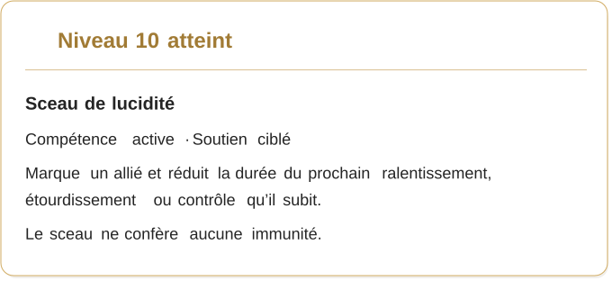
  </picture>
  

    
Version textuelle de la fenêtre

  
Niveau 10 atteint

  <h3>Sceau de lucidité</h3>
  
Compétence active · Soutien ciblé

  
Marque un allié et réduit la durée du prochain ralentissement, étourdissement ou contrôle qu’il subit.

  
Le sceau ne confère aucune immunité.

  

Sur le terrain de l’Académie, une écriture claire se posa brièvement sur le bras d’Hasol. Elric déclencha ensuite l’un des dispositifs de contrôle réservés aux exercices. La gêne saisit bien la jeune Astrale, mais se dissipa plus tôt que lors de l’essai précédent.

— Je l’ai quand même senti, constata Hasol en remuant les épaules.

— Le sceau réduit le contrôle, répondit Yoon. Il ne l’empêche pas.

Elric approuva. Hasol, elle, sourit à son amie : ce pouvoir ne lui permettrait pas d’ignorer le danger, mais il pourrait lui rendre plus vite la possibilité d’agir.

### X. Trois chasseurs, cinquante points

Lorsque Hasol atteignit le niveau vingt, elle se précipita vers Elric.

— Monsieur Arowell !

Le Porte-bouclier releva la tête.

— Oui ?

Elle lui montra son statut.

— Niveau vingt !

Il sourit.

— Félicitations !

Hasol croisa les bras.

Puis attendit.

Elric la contempla.

— Quoi ?

Elle prit un air offensé.

— Vous avez oublié ?

Son mentor réfléchit.

Puis soupira.

— Les boss de donjon.

Elle sourit jusqu'aux oreilles.

— Exactement !

Elric éclata de rire.

— Je me doutais que tu n'allais pas me laisser oublier cette conversation.

Hasol acquiesça avec enthousiasme.

— Vous aviez promis !

— J'avais dit que nous pourrions envisager une expédition à partir du niveau vingt.

Elle le regarda.

— Et maintenant ?

Le Porte-bouclier sourit.

— Maintenant, nous allons vérifier si tu es prête.

Hasol passa également chez Orven pour lui annoncer sa progression.

Bénédiction runique venait de connaître une évolution importante.

  <picture class="lit-window__github-picture">
    <source media="(max-width: 600px)" srcset="assets/fenetres-livre-2/L2-C2-F10-mobile.svg">
    
  </picture>
  

    
Version textuelle de la fenêtre

  
Passif amélioré

  <h3>Bénédiction runique</h3>
  

La notification ne lui indiquait aucun taux exact. Orven récupéra plusieurs registres.

— Nous allons devoir revoir certaines de nos estimations.

Hasol s'assit auprès de lui. Ils comparèrent les travaux réalisés au cours des mois précédents et leur expérience des tentatives réussies, échouées ou renforcées sans résultat maximal.

Leurs registres suggéraient une réduction sensible des deux risques, sans leur permettre d'en connaître les valeurs réelles avec certitude. L'avantage ne garantissait toujours pas la réussite : une amélioration pouvait échouer et les ressources pouvaient être consommées.

Même lorsqu'Hasol connaissait le résultat final exact d'une rune qui atteindrait +15 sous son travail, elle devait encore réussir la tentative de passage à ce palier.

Orven sourit.

— Cette évolution devrait rendre certaines commandes beaucoup plus intéressantes.

Hasol acquiesça.

— Et je pourrai économiser davantage de ressources !

— À condition de continuer à choisir soigneusement tes investissements.

— Évidemment !

L'artisan la contempla.

Puis son regard descendit vers les différents registres accumulés depuis leurs premières séances.

Il repensa à cette jeune fille de seize ans qui lui avait demandé des runes poubelles.

Elle était désormais capable de réaliser des travaux que de nombreux artisans expérimentés n'auraient pas osé entreprendre.

Et son talent semblait encore grandir.

— Tu sais, Hasol…

Elle releva les yeux.

— Oui ?

Orven sourit.

— Je crois que tu vas vraiment finir par bouleverser notre métier.

La jeune Astrale rougit légèrement.

— Vous exagérez…

L'artisan secoua la tête.

— Pas autant que tu le crois.

Elric organisa une première expédition en donjon lorsque Yoon eut acquis suffisamment d'expérience pour les accompagner.

Le directeur examina leur composition.

Hasol possédait une classe Astrale.

Vingt-cinq points.

Yoon était Légendaire.

Vingt points.

Elric était un Porte-bouclier commun.

Cinq points.

**Total : cinquante points.**

Trois membres.

Le minimum requis pour entrer dans un donjon.

La formation respectait donc exactement les limites autorisées.

Elric avait choisi une expédition adaptée à leur niveau et à leur expérience.

Il avait étudié les renseignements disponibles sur les monstres.

Préparé les itinéraires.

Et prévu les conditions dans lesquelles ils devraient battre en retraite.

— Nous ne partons pas pour établir un record, annonça-t-il.

Hasol acquiesça.

— Compris.

— Nous respectons notre formation.

Yoon hocha la tête.

— Oui.

— Et si la situation devient dangereuse, nous battons en retraite.

Les deux jeunes femmes répondirent ensemble :

— Oui, monsieur Arowell !

Elric les contempla.

Puis sourit.

— Très bien.

Le donjon était situé dans une région rocheuse à plusieurs heures de la capitale.

L'air y était humide.

Les couloirs étaient étroits.

Et les monstres ne ressemblaient en rien aux mannequins de l'Académie.

Elric avançait en première ligne.

Son bouclier protégeait le passage.

Hasol restait suffisamment proche pour intervenir lorsqu'une ouverture apparaissait.

Yoon conservait une position légèrement en retrait.

La première salle se déroula sans difficulté majeure.

La seconde leur posa davantage de problèmes.

Plusieurs monstres surgirent de passages différents.

Elric attira l'attention des premiers.

Hasol intercepta une créature qui tentait de contourner leur position.

Mais, emportée par son mouvement, elle s'éloigna un peu trop.

Un deuxième monstre apparut derrière le premier.

Hasol recula.

Trop tard.

Une griffe atteignit son bras.

— Ah !

Elric intervint immédiatement.

Il repoussa le monstre avec son bouclier.

— Hasol ! Reste à portée !

— Oui !

La jeune Astrale serra les dents.

Elle venait de commettre une erreur qu'il lui avait signalée des dizaines de fois.

Son équipement Vol de vie lui permettait de récupérer une partie de ses PV lorsqu'elle frappait.

Mais il ne pouvait pas la protéger de toutes les blessures.

Et encore moins compenser un mauvais déplacement.

Yoon observa la situation.

Hasol était désormais la plus blessée proportionnellement parmi les trois membres du groupe.

La Légendaire choisit une cible à portée.

Puis commença son incantation.

Cinq secondes.

Une lumière blanche et dorée apparut devant elle.

— Vague runique !

L'onde atteignit un monstre.

Au même instant, une douce énergie enveloppa Hasol.

Une partie de ses PV fut restaurée.

Elle baissa les yeux.

Puis se tourna vers Yoon.

— Tu m'as soignée !

La jeune Légendaire lui sourit.

— Oui !

Elric observa brièvement leur coordination.

— Très bien, Yoon ! Maintenant, concentrez-vous !

Hasol se remit en garde.

Cette fois, elle attendit qu'Elric crée une ouverture.

Elle frappa.

Puis recula.

Elle ne chercha plus à poursuivre les monstres qui s'éloignaient de leur formation.

Yoon conserva sa position.

À chaque nouvelle utilisation de Vague runique, son effet de soin apportait une aide supplémentaire au compagnon le plus blessé en pourcentage.

Le montant dépendait toujours des PV maximaux de Yoon.

Pas de ceux d'Hasol.

Ni de ceux d'Elric.

À son niveau actuel, ce soin demeurait modeste.

Mais il pouvait devenir particulièrement intéressant à mesure que la Légendaire progresserait.

Lorsque le dernier monstre tomba, Hasol reprit son souffle.

Elric s'approcha.

— Qu'est-ce qui n'a pas fonctionné ?

Elle baissa les yeux.

— Je me suis trop éloignée.

— Oui.

— J'aurais dû attendre que vous attiriez le deuxième monstre.

— Exactement.

Hasol regarda Yoon.

— Heureusement que tu étais là.

La Légendaire sourit.

— C'est pour ça qu'on forme une équipe.

Elric les contempla avec satisfaction.

Il n'attendait pas d'elles un combat parfait.

Il voulait qu'elles apprennent à reconnaître leurs erreurs avant qu'elles deviennent fatales.

Avant la dernière salle, Hasol utilisa Œil runique pour examiner les environs.

Elle repéra plusieurs mécanismes dangereux.

Elric interrompit immédiatement leur progression.

La jeune Astrale signala les pièges.

Puis, sous la supervision de son mentor, elle utilisa Main runique pour ouvrir une porte verrouillée.

Yoon contempla la scène avec admiration.

— C'est vraiment pratique !

Hasol sourit.

— Oui !

Elric acquiesça.

— Tes compétences d'exploration nous font gagner un temps précieux.

La jeune Astrale sourit davantage.

Puis ils étudièrent les renseignements disponibles sur le boss.

Hasol sentit son cœur accélérer.

Elle attendait ce moment depuis des années.

Elric se tourna vers elle.

— Tu te souviens de nos règles ?

Elle soupira.

— Oui.

— Répète.

Hasol prit un air résigné.

— Le niveau vingt ne signifie pas que je peux vaincre n'importe quel boss. Nous devons respecter le plan et battre en retraite si la situation devient dangereuse.

Elric sourit.

— Excellent.

Yoon étouffa un rire.

Hasol lui adressa un regard faussement vexé.

Puis sourit à son tour.

Le combat commença quelques minutes plus tard.

Elric engagea le boss.

Hasol attendit l'ouverture.

Yoon resta attentive aux déplacements de ses compagnons.

Le monstre était puissant.

Ses attaques obligeaient régulièrement Elric à reculer.

Plusieurs fois, Hasol dut interrompre son offensive pour éviter de s'exposer.

Mais progressivement, ils trouvèrent un rythme.

Elric absorbait ou détournait les attaques les plus dangereuses.

Hasol exploitait les ouvertures.

Yoon soutenait le groupe et utilisait ses sorts lorsqu'elle disposait d'une position suffisamment sûre.

Enfin, le boss vacilla.

Elric leva son bouclier.

Puis lança :

— Hasol ! Maintenant !

Elle s'élança.

Son épée frappa l'ouverture qu'il venait de créer.

Le boss s'effondra.

Hasol recula, haletante.

Pendant quelques instants, elle resta immobile.

Puis une fenêtre apparut devant elle.

  <picture class="lit-window__github-picture">
    <source media="(max-width: 600px)" srcset="assets/fenetres-livre-2/L2-C2-F09-mobile.svg">
    
  </picture>
  

    
Version textuelle de la fenêtre

  
Croissance runique.

  
Boss de donjon ou de portail personnellement achevé : +1.

  

Dans cette vie astrale, son compteur commun aux boss de donjon et de portail venait de progresser.

Une seule élimination sur les cent nécessaires au prochain cercle obtenu par cette voie.

Hasol contempla le résultat.

Puis releva les yeux vers Elric et Yoon.

Elle sourit.

— On a réussi !

Yoon leva les bras.

— Oui !

Elric abaissa son bouclier.

— Félicitations.

Hasol referma sa fenêtre.

Un seul boss.

Mais elle avait désormais compris ce que cette élimination représentait.

Elle aurait pu chercher à remplir son compteur le plus rapidement possible.

À la place, elle avait appris quelque chose de plus important.

Un boss n'était pas simplement une unité supplémentaire dans une progression.

C'était un adversaire qu'il fallait comprendre, préparer et vaincre avec ses compagnons.

— Merci, murmura-t-elle.

Yoon pencha la tête.

— Pourquoi ?

Hasol sourit.

— Parce que je n'aurais pas réussi seule.

Elric lui adressa un regard fier.

— Voilà une leçon qui valait le déplacement.

### XI. Les années heureuses

Les années suivantes furent riches en découvertes.

Hasol continua de progresser dans les donjons.

Les boss devinrent une source importante d'expérience.

Mais elle n'abandonna pas les autres formes de chasse.

Croissance runique lui offrait plusieurs chemins distincts.

Les monstres ordinaires admissibles éliminés hors des portails.

Les boss de donjon ou de portail personnellement achevés.

Et les démons de portails éliminés personnellement, sans condition de niveau.

Chaque catégorie possédait son propre compteur.

Les éliminations ne pouvaient pas être ajoutées arbitrairement à plusieurs compteurs.

Hasol apprit donc à organiser ses activités en tenant compte de leurs différents avantages.

Elle ne pouvait pas augmenter ses cercles simplement en gagnant davantage d'expérience.

Elle devait remplir les conditions précises de son passif.

Cette distinction devint une partie essentielle de sa stratégie.

Yoon atteignit à son tour le niveau vingt pendant ces années d’expéditions. Sa nouvelle compétence trouva sa première utilité tactique lorsqu’un groupe de créatures tenta de déborder leur formation.

  <picture class="lit-window__github-picture">
    <source media="(max-width: 600px)" srcset="assets/fenetres-livre-2/L2-C2-F13-mobile.svg">
    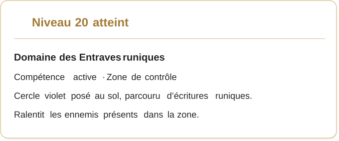
  </picture>
  

    
Version textuelle de la fenêtre

  
Niveau 20 atteint

  <h3>Domaine des Entraves runiques</h3>
  
Compétence active · Zone de contrôle

  
Cercle violet posé au sol, parcouru d’écritures runiques.

  
Ralentit les ennemis présents dans la zone.

  

Un cercle violet se déploya devant Yoon. Les créatures qui le traversèrent continuèrent d’avancer, mais leurs mouvements se firent plus lourds. Hasol vit aussitôt l’ouverture : elle se replaça avant qu’elles atteignent leur flanc, tandis qu’Elric refermait la ligne avec son bouclier.

Le Domaine ne les avait ni immobilisées ni vaincues. Il avait donné au trio le temps de reprendre sa formation, exactement comme Yoon l’avait voulu.

Lorsqu'elle commença à participer à des raids de portails adaptés à son expérience, elle découvrit un autre aspect du métier de chasseuse.

Ces opérations étaient souvent plus complexes que les donjons.

Il fallait coordonner plusieurs unités.

Répartir les rôles.

Préparer les déplacements.

Et tenir compte des capacités parfois très dangereuses des démons.

Samia apportait désormais une aide précieuse à leur préparation.

Grâce à Écho des Mondes et à Vision du Voile, elle partageait avec les responsables les portails détectés dans les zones qu'elle avait explorées et leur couleur, sans heure ni contenu.

Les guildes gagnaient du temps pour organiser leurs interventions.

Ray et Zio participaient également à ces opérations.

Ils n'appartenaient pas pour autant au trio de donjon d'Hasol, Yoon et Elric.

Leurs activités étaient principalement liées aux raids de portails et aux formations constituées pour ces missions.

Hasol retrouvait parfois son meilleur ami pendant les préparatifs. Ray lui recommanda notamment les gobelins rouges de niveau onze, compatibles avec le compteur des mille tant qu'ils restaient admissibles pour son niveau.

Ray étudiait toujours soigneusement les renseignements disponibles.

Un jour, elle le trouva devant une carte couverte de notes.

— Ray ?

Il releva la tête.

— Oui ?

— Tu es encore en train de travailler ?

— Évidemment.

Hasol observa ses documents.

Puis sourit.

— Tu sais qu'on part bientôt ?

— Justement.

Elle lui donna un léger coup de coude.

— Tu devrais essayer de dormir de temps en temps.

Ray ajusta ses lunettes.

— C'est un conseil intéressant venant de toi.

Hasol ouvrit la bouche.

Puis éclata de rire.

— D'accord, tu as gagné !

Zio était tout aussi sérieux dans la préparation des raids.

Il se distinguait par ses capacités défensives et son souci de protéger les chasseurs placés sous sa responsabilité.

Hasol appréciait son professionnalisme.

Mais leurs relations demeuraient essentiellement courtoises.

Ils discutaient lorsqu'une mission l'exigeait.

Échangeaient quelques paroles pendant les préparatifs.

Puis rejoignaient leurs groupes respectifs.

Zio ne semblait pas chercher à mieux la connaître.

Et Hasol n'y voyait rien d'étrange.

Elle savait simplement qu'il était très attaché à Yoon.

Il lui arrivait de demander des nouvelles de sa sœur lorsqu'il croisait Hasol.

— Elle progresse bien ?

— Très bien ! répondait-elle avec enthousiasme.

Zio souriait alors.

— Tant mieux.

Mais il ne prolongeait généralement pas la conversation.

Il avait ses propres missions.

Et Hasol se consacrait aux siennes.

À l'atelier, la réputation d'Hasol grandissait.

Ses compétences lui permettaient désormais d'obtenir des résultats que de nombreux artisans expérimentés auraient eu du mal à égaler.

Œil runique jouait un rôle fondamental dans cette réussite.

Elle pouvait examiner une rune avant d'engager des dépenses importantes.

Connaître les caractéristiques secondaires qu'elle découvrirait.

Et, lorsqu'elle réalisait personnellement les améliorations jusqu'à +15, connaître le résultat final exact.

Orven avait parfaitement compris la portée de cet avantage.

Il avait progressivement organisé une partie des activités de l'atelier autour de ses expertises.

Mais il n'avait jamais cessé de lui enseigner la prudence.

Certaines commandes étaient refusées.

D'autres reportées.

Et lorsqu'une amélioration présentait trop de risques au regard du budget disponible, Hasol apprenait à expliquer pourquoi il valait mieux ne pas la tenter.

Cette rigueur contribua à sa réputation.

Elle ne se contentait pas de produire de bonnes runes.

Elle apprenait à investir intelligemment les ressources qu'on lui confiait.

La réserve sacrificielle, elle aussi, continuait de grandir.

Elle ne contenait jamais les pierres qu'Hasol jugeait intéressantes pour un équipement.

Celles-ci étaient conservées pour être améliorées ou proposées à des clients.

Mais les runes dont le potentiel était réellement médiocre pouvaient être récupérées à faible coût.

Elles devenaient alors des ressources utiles pour Aura runique.

Un jour, Orven observa Hasol trier un nouveau lot.

Elle plaça une pierre dans le coffret des runes à améliorer.

Une deuxième dans celui des runes destinées aux clients.

Puis une troisième dans la réserve sacrificielle.

L'artisan sourit.

— Tu te souviens de ton premier jour ici ?

Hasol releva la tête.

— Bien sûr !

— Tu étais venue me demander des runes poubelles.

Elle éclata de rire.

— C'est vrai !

Orven contempla ses trois coffrets.

— Et aujourd'hui, tu sais reconnaître pourquoi une pierre mérite d'être conservée, améliorée ou sacrifiée.

Hasol sourit.

— C'est grâce à vous !

L'artisan secoua la tête.

— Je t'ai appris à travailler. Mais Œil runique nous a ouvert des possibilités que je n'aurais jamais imaginées.

Il contempla la rune qu'elle venait de sélectionner pour l'amélioration.

— Et tu continues à m'en apprendre sur mon propre métier.

La jeune Astrale rougit légèrement.

— Vous exagérez…

Orven éclata de rire.

— Pas autant que tu le crois.

Lorsqu'Hasol atteignit le niveau trente, Bénédiction runique évolua de nouveau.

  <picture class="lit-window__github-picture">
    <source media="(max-width: 600px)" srcset="assets/fenetres-livre-2/L2-C2-F11-mobile.svg">
    
  </picture>
  

    
Version textuelle de la fenêtre

  
Passif amélioré

  <h3>Bénédiction runique</h3>
  

La description ne donnait toujours aucun taux. Leurs registres et leur expérience montrèrent progressivement à Hasol et Orven que les risques avaient encore diminué, sans leur livrer les valeurs exactes.

Orven contempla longtemps la nouvelle description.

Puis il leva les yeux vers son apprentie.

— Tu vas vraiment finir par révolutionner tout ce que nous connaissons de l'artisanat runique.

Hasol sourit.

— Vous aviez déjà dit ça le premier jour !

L'artisan éclata de rire.

— Et je maintiens chaque mot !

Lorsque Yoon atteignit le niveau trente, elle demanda à Hasol de l’aider à distinguer sa nouvelle aptitude de Chant runique.

  <picture class="lit-window__github-picture">
    <source media="(max-width: 600px)" srcset="assets/fenetres-livre-2/L2-C2-F14-mobile.svg">
    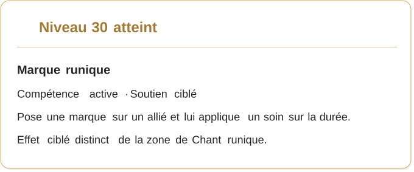
  </picture>
  

    
Version textuelle de la fenêtre

  
Niveau 30 atteint

  <h3>Marque runique</h3>
  
Compétence active · Soutien ciblé

  
Pose une marque sur un allié et lui applique un soin sur la durée.

  
Effet ciblé distinct de la zone de Chant runique.

  

Après un exercice, Yoon posa la marque sur une éraflure du bras d’Hasol. Les écritures restèrent attachées à leur cible et diffusèrent leur soin progressivement, sans cercle vert au sol.

— Chant soutient ceux qui restent dans sa zone, résuma Hasol. La Marque, elle, suit un seul allié.

— Et elle ne referme pas tout d’un coup, confirma Yoon.

Hasol acquiesça. Son amie gagnait une nouvelle manière de soutenir quelqu’un en mouvement, sans devenir pour autant une soigneuse pure.

Les nouveaux cercles d'Hasol lui ouvraient également des possibilités d'équipement.

Elle conservait ses deux ensembles Vol de vie.

Puis, suivant les conseils de Ray, elle commença à investir dans des runes Arcanique.

Chaque pierre était sélectionnée soigneusement.

Elle cherchait à renforcer sa Puissance arcanique sans négliger totalement son Attaque et sa mobilité.

Lorsque les emplacements et les ressources le lui permirent, elle développa ensuite sa configuration Vitesse.

Elric ne manqua pas de lui rappeler qu'il lui conseillait cet ensemble depuis des années.

Hasol lui répondit en riant qu'elle n'avait jamais oublié.

Ses projets ne s'arrêtaient pas là.

Elle souhaitait encore intégrer Énergie et Gardien.

Puis compléter les emplacements restants avec Fatal.

Mais elle savait que ces objectifs demanderaient des cercles, des runes appropriées et énormément de ressources.

Elle ne pouvait pas tout obtenir immédiatement.

Alors elle avançait progressivement.

Et chaque nouvelle acquisition constituait une petite victoire.

Le temps continuait de passer.

Hasol poursuivait ses entraînements.

Yoon devenait une Légendaire de plus en plus compétente.

Samia perfectionnait son tir à l'arc, ses techniques aux dagues et l'utilisation progressive d'Écho des Mondes.

Ray continuait de lui apporter des livres.

Orven lui confiait des travaux de plus en plus exigeants.

Et Elric la poussait toujours à perfectionner ses techniques d'épée.

Hasol rentrait aussi régulièrement chez ses parents.

Armin lui racontait ses affaires commerciales avec un enthousiasme inépuisable.

Iseria s'inquiétait de ses horaires.

Et les repas familiaux donnaient souvent lieu à des discussions interminables sur les runes, les chasses ou les nouvelles découvertes de l'Académie.

Hasol aimait cette vie.

Elle avait des amis.

Une famille.

Des maîtres qu'elle admirait.

Un métier qui la passionnait.

Et l'impression que son avenir ne cessait de s'agrandir.

Pourtant, elle ne remarqua pas immédiatement que les années avaient aussi commencé à peser sur Elric.

Il récupérait moins rapidement après certaines expéditions.

Ses épaules le faisaient parfois souffrir.

Il prenait davantage de pauses après les entraînements les plus exigeants.

Et lorsqu'Hasol lui demandait s'il allait bien, il répondait toujours avec un sourire :

— Je ne suis plus aussi jeune que toi.

Elle riait.

Puis reprenait son épée.

Elle ne s'imaginait pas encore qu'un jour, leurs entraînements quotidiens prendraient fin.

### XII. Le dernier entraînement

Hasol avait vingt-quatre ans lorsque son mentor lui annonça qu'il prenait sa retraite.

Ils venaient de terminer une séance d'entraînement.

Le soleil descendait lentement derrière les bâtiments de l'Académie.

Hasol rangeait son épée lorsqu'Elric s'approcha.

— Hasol, j'aimerais te parler.

Elle se retourna.

— Oui ?

Il observa le terrain pendant quelques instants.

Puis sourit.

— Cela fait huit ans que nous nous entraînons ensemble.

Hasol cligna des yeux.

— Huit ans…

Elle réfléchit.

Puis éclata de rire.

— C'est vrai !

Elric acquiesça.

— J'avais quarante-deux ans lorsque nous nous sommes rencontrés. Aujourd'hui, j'en ai cinquante.

Hasol sourit.

— Et vous êtes toujours aussi sévère !

— Heureusement.

Mais son mentor ne reprit pas immédiatement.

Il contempla son épée.

Puis le grand bouclier posé près de leurs affaires.

— J'ai décidé de prendre ma retraite de chasseur.

Hasol s'immobilisa.

— Quoi ?

Elric tourna la tête vers elle.

— J'en ai parlé au directeur. Je vais cesser de participer aux expéditions.

La jeune Astrale resta silencieuse.

Pendant quelques instants, elle eut l'impression d'avoir mal entendu.

— Mais…

Elle chercha ses mots.

— Vous allez bien ?

Elric acquiesça.

— Oui.

Puis il sourit.

— Aussi bien qu'un homme qui a passé une bonne partie de sa vie à recevoir des coups derrière un bouclier peut aller.

Hasol ne rit pas.

Elle regarda son mentor.

Son armure semblait toujours aussi solide.

Son épée était soigneusement entretenue.

Ses gestes demeuraient précis.

Mais elle connaissait désormais suffisamment Elric pour remarquer les changements qu'il cherchait parfois à dissimuler.

Il récupérait moins rapidement.

Certaines anciennes blessures le faisaient souffrir.

Et il lui arrivait de rester assis plus longtemps après un entraînement particulièrement exigeant.

Hasol avait préféré ne pas trop y réfléchir.

— Vous pourriez encore nous accompagner, murmura-t-elle.

Elric sourit doucement.

— Peut-être quelque temps.

Puis il ajouta :

— Mais je préfère choisir moi-même le moment de m'arrêter plutôt que d'attendre qu'une blessure m'y oblige.

Hasol baissa les yeux.

Elle comprenait.

Mais cela ne rendait pas la nouvelle plus facile à accepter.

— Et Yoon et moi ?

Elric posa une main sur son épaule.

— Vous avez appris à travailler ensemble.

— Oui, mais…

— Et vous continuerez.

Elle releva la tête.

— Avec qui ?

Le Porte-bouclier sourit.

— Justement. Il y a quelqu'un avec qui j'aimerais te voir en discuter.

Samia les attendait dans une salle d'entraînement voisine.

Son arc reposait contre le mur.

Elle portait deux dagues à sa ceinture.

Lorsqu'elle aperçut Hasol et Elric, elle leur adressa un sourire.

— Bonjour !

Hasol s'arrêta.

— Samia ?

La jeune Ranger pencha la tête.

— Oui ?

Elric s'approcha.

— J'ai demandé à Samia si elle accepterait de prendre ma place dans votre équipe de donjon.

Hasol ouvrit grand les yeux.

— Vraiment ?!

Samia acquiesça.

— Si tu es d'accord, bien sûr.

Un immense sourire apparut sur le visage d'Hasol.

— Mais évidemment !

Samia éclata de rire.

— Je pensais que tu serais contente.

Hasol lui prit les mains.

— C'est formidable !

Elric toussota légèrement.

Les deux jeunes femmes se tournèrent vers lui.

— Avant de célébrer votre nouvelle équipe, il reste quelques points à examiner.

Hasol soupira.

— Je m'en doutais…

Le mentor sourit.

Puis il récupéra une feuille.

— Hasol possède une classe Astrale, soit vingt-cinq points. Yoon est Légendaire, pour vingt points. Samia est une Marcheuse du voile commune, qui représente cinq points.

Il écrivit le total.

**50 points.**

La composition respectait exactement le plafond autorisé.

Trois membres.

Le minimum requis pour un groupe de donjon.

Hasol contempla le document.

— Ça fonctionne !

— Oui, confirma Elric.

Samia sourit.

— Nous pourrons donc former une équipe toutes les trois.

Hasol acquiesça avec enthousiasme.

Puis Elric leva un doigt.

— Mais attention.

Elle se figea.

— Quoi encore ?

— Jusqu'à présent, je tenais le rôle de protecteur principal.

Il désigna son bouclier.

— Samia ne pourra pas remplacer directement mes capacités défensives.

La jeune Ranger acquiesça.

— Je ne possède pas votre endurance ni vos compétences de protection.

Elric se tourna vers Hasol.

— Cela signifie que vous devrez revoir votre manière de combattre.

La jeune Astrale réfléchit.

Elle possédait une excellente maîtrise de l'épée.

Ses ensembles Vol de vie lui permettaient de récupérer des PV pendant les affrontements.

Yoon pouvait soigner et soutenir le groupe.

Samia apportait sa maîtrise de l'arc, ses dagues et Flèche du Néant.

Mais elles ne disposaient plus d'un Porte-bouclier expérimenté pour attirer et encaisser les attaques.

— Nous devrons être beaucoup plus mobiles, murmura Hasol.

Elric acquiesça.

— Oui.

Samia ajouta :

— Je pourrai couvrir vos déplacements avec mon arc. Et intervenir au contact lorsque la situation le permettra.

Hasol sourit.

— Avec Œil runique, je pourrai également repérer les pièges. Et Main runique nous permettra d'ouvrir les coffres et les portes.

Elric hocha la tête.

— Voilà.

Il contempla les deux jeunes femmes.

— Vous possédez suffisamment de capacités pour construire une bonne équipe. Mais vous devrez apprendre à exploiter vos propres forces.

Hasol acquiesça.

Samia aussi.

Puis la jeune Astrale demanda :

— Et pour les raids de portails ?

— Ils continueront à nécessiter des formations adaptées, répondit Elric. Votre trio de donjon ne sera pas forcément celui qui participera à chaque opération.

Samia sourit.

— Je continuerai aussi à travailler avec les guildes sur Écho des Mondes et Vision du Voile.

— Naturellement.

Hasol réfléchit.

— Et nous pourrons toujours retrouver Ray et Zio lors de certains raids ?

— Bien entendu, lorsque vos missions et les compositions autorisées le permettront.

Hasol sourit.

La nouvelle organisation lui plaisait.

Ray et Zio continueraient principalement leurs activités de raids de portails.

Samia rejoindrait Hasol et Yoon pour les donjons.

Et Elric pourrait enfin prendre le repos qu'il avait largement mérité.

La jeune Astrale regarda ses deux compagnons.

Puis elle leva les bras.

— Je crois que nous allons former une excellente équipe !

Elric poussa un soupir.

— J'espère surtout que vous allez rester prudentes.

Samia éclata de rire.

— Promis !

Hasol acquiesça vivement.

— Absolument !

Elric les contempla.

Puis secoua la tête avec amusement.

— Curieusement, cette promesse ne me rassure qu'à moitié.

Le lendemain matin, Hasol arriva sur le terrain d'entraînement avant le lever complet du soleil.

Elle portait sa tenue habituelle.

Son épée reposait à son côté.

Et elle attendait.

Quelques minutes plus tard, Elric apparut.

Il avait choisi une tenue légère plutôt que son imposante armure.

Il avait conservé son épée d'entraînement et un bouclier adapté aux exercices.

Lorsqu'il aperçut Hasol, il sourit.

— Tu es en avance.

Elle acquiesça.

— Je ne voulais pas être en retard.

Il regarda le terrain.

— Tu te souviens de notre première séance ?

Hasol éclata de rire.

— Évidemment !

— Tu avais beaucoup d'enthousiasme.

— J'en ai toujours !

— Et très peu de patience.

Elle fit la moue.

— Vous allez vraiment me le rappeler jusqu'au bout ?

Elric sourit.

— Probablement.

Ils gagnèrent le centre du terrain.

Pendant quelques instants, aucun des deux ne bougea.

Puis Elric leva son épée.

— Une dernière fois ?

Hasol sentit quelque chose se serrer dans sa poitrine.

Elle inspira doucement.

Puis sourit.

— Une dernière fois.

Le combat commença.

Elric attaqua le premier.

Hasol para.

Elle pivota, chercha une ouverture, puis recula lorsque son mentor referma sa garde.

Leurs épées se rencontrèrent.

Encore.

Et encore.

Hasol connaissait désormais les habitudes d'Elric.

La manière dont il déplaçait son pied avant certaines attaques.

La position de son épaule lorsqu'il préparait une parade.

Ses préférences lorsqu'il cherchait à reprendre l'avantage.

Mais Elric connaissait tout aussi bien son élève.

Il savait qu'elle aimait accélérer lorsqu'elle découvrait une ouverture.

Qu'elle privilégiait souvent la précision à la force brute.

Et que, malgré ses progrès extraordinaires, elle pouvait encore se laisser emporter par son enthousiasme.

Il tenta une feinte.

Hasol ne réagit pas.

Elric sourit.

— Bien.

Elle attaqua.

Il para.

Puis déplaça brusquement son bouclier.

Hasol recula juste assez pour éviter le contact.

Son mentor acquiesça.

— Très bien.

Ils poursuivirent.

Le soleil commença à apparaître au-dessus des murs.

Leurs ombres s'étirèrent sur le terrain.

Hasol respirait plus rapidement.

Mais elle souriait.

Elle avait l'impression de revivre une partie de ses huit années d'apprentissage.

Les premières séances.

Les innombrables corrections.

Les exercices qu'elle avait trouvés interminables.

Les journées où elle rentrait épuisée.

Et les moments où Elric la félicitait après une réussite particulièrement difficile.

Puis le combat ralentit.

Ils échangèrent encore quelques coups.

Elric tenta une dernière attaque.

Hasol la para.

Elle pivota.

Puis revint immédiatement en garde, sans perdre son équilibre.

Elric s'immobilisa.

Elle aussi.

Pendant quelques instants, ils restèrent silencieux.

Puis le Porte-bouclier baissa lentement son épée.

Un sourire apparut sur son visage.

— Voilà.

Hasol cligna des yeux.

— Voilà quoi ?

Il désigna ses pieds.

— Tu n'as pas perdu ton équilibre.

La jeune Astrale baissa les yeux.

Puis releva la tête.

Elle éclata de rire.

— Vous avez encore essayé de me piéger !

— Naturellement.

Hasol secoua la tête.

— Vous ne changerez jamais !

Elric sourit.

— Je pourrais te répondre la même chose.

Ils rirent ensemble.

Puis le silence revint.

Hasol contempla son mentor.

Elle avait tellement de choses à lui dire.

Merci pour ses premières leçons.

Pour sa patience.

Pour les fois où il l'avait empêchée de prendre des risques inconsidérés.

Pour avoir accepté de réorganiser sa formation autour de Croissance runique.

Pour avoir cru en elle alors qu'elle découvrait à peine les possibilités de sa classe.

Et pour avoir continué à lui enseigner tant de choses, même lorsqu'elle était devenue une épéiste capable de le surprendre.

Mais tous ces mots lui paraissaient insuffisants.

Elle finit par sourire doucement.

— Merci, monsieur Arowell.

Elric la contempla.

— Pour quoi ?

Hasol baissa légèrement la tête.

— Pour ces huit années.

Le Porte-bouclier resta silencieux.

Puis son expression s'adoucit.

— Tu as travaillé dur, Hasol.

Elle releva les yeux.

— Grâce à vous.

— Non.

Il secoua doucement la tête.

— Je t'ai montré des chemins. Mais c'est toi qui les as parcourus.

Hasol sentit ses yeux devenir humides.

Elle détourna légèrement le regard.

Elric sourit.

— Tu maîtrises aujourd'hui des techniques que je n'aurais jamais imaginé te voir apprendre aussi rapidement.

Puis il posa une main sur son épaule.

— Mais ce dont je suis le plus fier, c'est que tu as appris à reconnaître tes limites.

Hasol eut un petit rire.

— J'essaie…

— Je sais.

Elle releva les yeux.

— Vous viendrez quand même nous voir à l'Académie ?

Elric éclata de rire.

— Bien sûr !

— Et je pourrai encore vous demander des conseils ?

— Évidemment.

— Et vous pourrez regarder nos entraînements de temps en temps ?

Il prit un air faussement accablé.

— Je commence à comprendre que ma retraite ne sera pas aussi tranquille que je l'espérais.

Hasol éclata de rire.

Puis elle s'approcha de lui et le serra dans ses bras.

Elric resta surpris un instant.

Puis il lui rendit doucement son étreinte.

— Prends soin de toi, Hasol.

Elle acquiesça.

— Promis.

Il recula légèrement.

— Et prends soin de Yoon et Samia.

Hasol lui adressa un sourire.

— Elles prendront aussi soin de moi.

Elric la contempla.

Puis acquiesça.

— Voilà exactement ce que je voulais entendre.

Un peu plus tard, Hasol retrouva Yoon et Samia devant l'entrée de l'Académie.

La jeune Légendaire tenait plusieurs documents.

Samia portait son arc dans le dos et ses dagues à la ceinture.

Lorsqu'elles aperçurent Hasol, elles lui adressèrent un sourire.

— Alors ? demanda Yoon.

Hasol s'approcha.

— C'était un très bel entraînement.

Samia l'observa avec douceur.

— Tu vas bien ?

La jeune Astrale acquiesça.

— Oui.

Elle regarda une dernière fois les bâtiments derrière elle.

Huit années s'étaient écoulées depuis son arrivée à l'Académie.

Elle avait découvert une classe extraordinaire.

Appris à manier l'épée.

Développé son artisanat.

Obtenu de nouveaux cercles de mana.

Exploré des donjons.

Participé à des raids de portails.

Et rencontré des personnes qui occupaient désormais une place essentielle dans sa vie.

Aujourd'hui, Elric prenait sa retraite.

Une partie de son apprentissage se terminait.

Mais une autre commençait.

Hasol se tourna vers ses amies.

— Alors, qu'est-ce qu'on fait maintenant ?

Yoon ouvrit son dossier.

— J'ai préparé plusieurs propositions de donjons.

Samia sourit.

— Et j'ai quelques idées pour adapter notre formation.

Hasol éclata de rire.

— Vous avez travaillé sans moi !

— Évidemment, répondit Yoon. Tu étais occupée.

Samia lui tendit une feuille.

— On voulait te faire une surprise.

Hasol la prit.

Elle parcourut rapidement les notes.

Puis un immense sourire apparut sur son visage.

— C'est formidable !

Yoon éclata de rire.

— Tu dis ça avant même d'avoir tout lu !

— Je vais lire !

Hasol se pencha davantage sur les documents.

Samia lui montra un passage.

Yoon lui expliqua une proposition de placement.

Et les trois jeunes femmes commencèrent à discuter de leurs prochaines expéditions en traversant les jardins de l'Académie.

Un peu plus loin, Ray les attendait devant la bibliothèque.

Il tenait un livre sous le bras.

— Hasol !

Elle se retourna.

— Ray !

Il s'approcha.

— J'ai trouvé l'ouvrage dont tu m'avais parlé.

Les yeux de la jeune Astrale s'illuminèrent.

— Vraiment ?!

— Oui.

Elle récupéra immédiatement le livre.

Puis contempla sa couverture avec enthousiasme.

— Tu es formidable !

Ray ajusta ses lunettes.

— Tu me l'as déjà dit.

Hasol éclata de rire.

— Et je continuerai à te le dire !

Yoon sourit.

Samia aussi.

Les quatre amis reprirent leur chemin.

Hasol avait vingt-quatre ans.

Elle possédait une famille aimante.

Des amis précieux.

Des maîtres qu'elle admirait.

Un métier qu'elle adorait.

Et encore tant de choses à découvrir.

L'avenir lui paraissait immense.

Pour l'instant, elle n'aurait échangé cette vie contre aucune autre.

*Fin du chapitre 2 — Les prodiges de l'Académie*
---

## Chapitre 3 — Celle qui n'était pas dans les bois

### I. Une nouvelle voie

Hasol contemplait les pages de son carnet.

Depuis qu'elle avait atteint le niveau trente, elle réfléchissait à la meilleure manière de poursuivre le développement de ses cercles de mana.

Assis en face d'elle, Ray parcourait un ouvrage consacré aux créatures démoniaques.

— Ray ?

— Oui ?

— À ma place, où irais-tu chasser maintenant ?

Il referma son livre.

— Pour gagner de l'expérience ou pour Croissance runique ?

— Croissance runique, principalement.

Ray réfléchit quelques instants.

— Il serait peut-être temps de songer sérieusement aux portails. Avec ton équipement actuel, les démons rouges ne devraient pas te poser de problème.

Hasol releva les yeux.

— Les démons rouges…

— Ils sont nombreux et tu possèdes désormais les capacités nécessaires pour les éliminer rapidement. Les boss de portail feront aussi progresser ton compteur de cent boss.

Hasol tourna quelques pages de son carnet.

Les gobelins rouges de niveau onze que Ray lui avait précédemment recommandés avaient largement contribué à sa progression. Mais il était désormais temps de changer de méthode.

— Deux compteurs au cours d'une même expédition…

— Exactement.

Ray lui présenta son ouvrage.

Ils passèrent une bonne partie de l'après-midi à étudier les différents portails qui s'offraient à elle.

— Je vais proposer à Yoon et Samia de rejoindre régulièrement des raids. Et toi ? Tu pourrais venir avec nous.

— Lorsque mon groupe sera disponible, avec plaisir.

Hasol sourit.

— Merci, Ray.

— Tu me remercieras lorsque tu auras obtenu tes prochains cercles.

— Dans ce cas, tu risques de m'entendre te remercier souvent.

### II. Les pierres dont personne ne voulait

Avant d'intensifier ses expéditions, Hasol souhaitait s'assurer qu'elle disposerait de suffisamment de runes pour utiliser régulièrement Aura runique.

Elle se rendit chez Orven.

— J'aurais besoin de davantage de runes.

L'artisan désigna les différentes pierres exposées dans son atelier.

— Quel ensemble recherches-tu ?

— Aucun en particulier. Je voudrais celles dont personne ne veut.

Orven la regarda quelques instants.

— Encore ?

— Beaucoup plus, cette fois.

Elle lui expliqua ses projets concernant les portails.

— Combien ?

— Pour commencer, j'aimerais constituer une réserve de cinq cents runes.

Orven posa ses outils.

— Cinq cents ?

— Et il faudra pouvoir renouveler cette réserve régulièrement.

L'artisan réfléchit.

Il connaissait suffisamment de marchands et d'artisans pour organiser un approvisionnement régulier. Les runes dépourvues de potentiel commercial encombraient leurs réserves et immobilisaient inutilement une partie de leur argent.

Hasol leur offrait un débouché inattendu.

— Je vais contacter quelques connaissances.

— Même les runes blanches de faible qualité m'intéressent.

— Je crois que tu vas devenir la cliente préférée de certains marchands.

— Tant mieux.

En parallèle, Hasol poursuivait ses propres activités d'artisanat.

Grâce à Œil runique, elle pouvait identifier des pierres dont la véritable valeur échappait aux autres artisans.

Une rune apparemment médiocre pouvait dissimuler d'excellentes statistiques secondaires.

Elle les achetait, les améliorait, puis confiait leur revente à Orven, qui prélevait une commission sur les ventes.

Cette collaboration leur était profitable à tous les deux.

Hasol réinvestissait une partie importante de ses bénéfices dans l'acquisition de nouvelles runes, tout en conservant une réserve financière confortable.

Elle pouvait ainsi financer ses expéditions sans dépendre exclusivement des récompenses obtenues lors de ses chasses.

### III. L'élève et le maître

Les progrès d'Hasol dans le domaine de l'artisanat runique continuaient d'étonner Orven.

Depuis l'évolution de Bénédiction runique au niveau trente, les résultats de ses améliorations étaient devenus encore plus impressionnants.

Elle poursuivait néanmoins ses recherches avec la même rigueur.

Chaque amélioration était consignée.

Chaque valeur maximale était enregistrée.

Chaque résultat décevant était étudié.

Elle comparait régulièrement ses observations aux anciens registres d'Orven afin d'affiner ses estimations concernant l'influence de son passif.

Un jour, alors qu'elle travaillait sur une rune Vol de vie rare (bleue), 6★, Orven s'approcha de son établi.

Il observa ses gestes sans intervenir.

Hasol engagea une tentative vers le dernier palier d'amélioration. Elle pouvait encore échouer et perdre les ressources investies.

Cette fois, la rune atteignit +15 : principale Attaque +160 ; secondaires Vitesse +8, PA +120, PV +150 et Résistance +6 %. La statistique principale bénéficia d'une augmentation considérable, tandis que la dernière amélioration secondaire atteignait sa valeur maximale.

Orven récupéra la pierre.

— Impressionnant.

— J'espérais obtenir ce résultat.

— Ce n'est pas uniquement le résultat qui m'impressionne.

Hasol releva la tête.

— Tes gestes sont devenus remarquablement précis. Certaines techniques que je t'ai enseignées, tu les maîtrises désormais mieux que moi.

— Vous êtes sérieux ?

— Je préférerais plaisanter.

Elle éclata de rire.

Hasol elle-même avait parfois du mal à expliquer la facilité avec laquelle elle assimilait certaines techniques.

Il lui arrivait de comprendre instinctivement comment résoudre une difficulté, alors même qu'elle ne se souvenait pas avoir rencontré un problème similaire auparavant.

Elle attribuait cette facilité à ses nombreuses heures de pratique.

— Je suis encore loin de posséder vos connaissances, répondit-elle.

— En matière de commerce, certainement. Pour le reste, je commence à avoir des doutes.

Il reposa la rune devant elle.

— Œil runique représente une véritable révolution pour notre métier. Rien que la possibilité de connaître à l'avance les statistiques secondaires d'une rune permettrait d'éviter d'innombrables dépenses inutiles.

Hasol acquiesça.

— Même lorsque ce n'est pas moi qui réalise l'amélioration. Mais la prédiction des valeurs exactes à +15 ne garantit jamais que la tentative de passage réussira.

— Exactement. Mais entre tes mains, associé à Bénédiction runique et à ta maîtrise de l'artisanat, son potentiel est encore plus extraordinaire.

Hasol contempla la pierre.

Elle avait encore énormément de choses à apprendre.

Mais pour la première fois, elle réalisa qu'elle pouvait désormais apporter à son maître autant qu'il lui apportait.

### IV. Les démons rouges

Les premières expéditions confirmèrent les recommandations de Ray.

Les démons rouges étaient particulièrement intéressants pour Croissance runique.

Ils étaient nombreux et Hasol disposait des capacités nécessaires pour les éliminer rapidement.

Depuis la retraite d'Elric, elle avait pris l'habitude d'évoluer en première ligne.

Ses deux ensembles Vol de vie lui permettaient de récupérer ses points de vie en combattant, tandis que Yoon assurait son soutien grâce à ses compétences de mage.

Samia, quant à elle, exploitait la mobilité de sa Marcheuse du voile, son arc et sa connaissance du terrain.

Elle utilisait sa dague lorsque les circonstances l'obligeaient à combattre à courte distance.

Le trio fonctionnait remarquablement bien.

Lors des raids, les autres chasseurs ne tardaient pas à remarquer la manière particulière dont Hasol combattait.

Elle ne cherchait pas uniquement à éliminer les démons les plus dangereux.

Elle cherchait à en éliminer le plus grand nombre possible.

Chaque démon qu'elle éliminait personnellement dans un portail représentait une progression supplémentaire, sans condition de niveau pour ce compteur.

Chaque boss de donjon ou de portail qu'elle achevait personnellement alimentait un autre compteur.

Les portails se succédèrent.

Hasol adaptait régulièrement ses choix en fonction de son niveau.

Elle savait désormais qu'une créature trop faible ne lui permettrait plus de faire progresser certains de ses compteurs, comme elle l'avait constaté avec les slimes lorsqu'elle avait atteint le niveau vingt.

Ray participait également à plusieurs de leurs raids.

Il pouvait ainsi observer directement les créatures qu'il avait étudiées à la bibliothèque et confronter ses connaissances à la réalité du terrain.

Leurs conversations après les expéditions devenaient parfois interminables.

Hasol cherchait constamment de nouvelles manières d'améliorer son efficacité.

Mais ce fut Samia qui lui proposa l'une des idées les plus inattendues.

### V. Une question de couleurs

Au cours d'une expédition, Samia avait passé plusieurs minutes à observer un groupe de démons rouges.

Elle attendit que le raid fasse une pause avant de partager ses observations.

— Vous avez remarqué la manière dont les démons réagissent lorsqu'ils se croisent ?

Yoon secoua la tête.

— Qu'est-ce que tu veux dire ?

— Lorsqu'ils nous aperçoivent, ils nous identifient presque immédiatement comme des ennemis. En revanche, ils semblent réagir différemment lorsqu'un autre démon entre dans leur champ de vision.

Hasol s'intéressa immédiatement à ses explications.

— Tu penses que leur perception repose en partie sur les couleurs ?

— C'est possible. Regardez-les. Ils sont presque tous rouges. Au milieu d'eux, nos tenues nous rendent particulièrement faciles à identifier.

— Et qu'est-ce que tu proposes ? demanda Yoon.

— Que nous portions toutes les trois des tenues rouges.

Hasol contempla ses vêtements.

— Tu penses vraiment que cela suffirait ?

— Pas à nous rendre invisibles. Mais cela pourrait légèrement augmenter le temps dont ils ont besoin pour nous identifier comme des ennemis.

— Une fraction de seconde, peut-être, remarqua Yoon.

— Exactement.

Samia se tourna vers Hasol.

— Et pour toi, qui élimines les monstres si rapidement grâce à Aura runique, cela pourrait faire une énorme différence. Certains démons n'auront peut-être même pas le temps de réagir avant que tu les aies tués.

Hasol réfléchit.

Moins d'attaques à esquiver.

Moins d'interruptions.

Davantage de temps consacré à l'élimination des démons.

— Je pourrais en éliminer davantage au cours d'une même expédition.

— C'est l'idée, répondit Samia.

— Et donc obtenir mes prochains cercles plus rapidement.

Yoon éclata de rire.

— Il suffisait de lui parler de ses cercles de mana.

Hasol sourit.

— Je vais en parler à ma mère.

### VI. Les cadeaux d'Iseria

Le lendemain, Hasol rendit visite à sa mère en compagnie de Yoon et de Samia.

— Maman, nous aurions besoin de trois nouvelles tenues de chasse.

— Trois ? Vous souhaitez quelque chose de particulier ?

— Du rouge, répondit Samia.

Iseria observa les trois jeunes femmes.

— Toutes les trois ?

Samia lui expliqua ses observations concernant les démons rouges et l'avantage tactique qu'elles espéraient obtenir.

Iseria l'écouta attentivement.

— Voilà une idée intéressante. Je suppose que vous souhaitez conserver les particularités de vos tenues habituelles ?

— Exactement, confirma Hasol.

Iseria s'intéressa aux besoins de chacune.

Hasol devait conserver une grande liberté de mouvement pour combattre au corps à corps.

Samia devait pouvoir utiliser son arc sans être gênée par ses vêtements, tout en conservant un accès rapide à sa dague.

Yoon avait besoin d'une tenue adaptée à son rôle de mage de soutien.

— Je devrais pouvoir vous trouver quelque chose.

— J'aurais également une demande supplémentaire, ajouta Hasol.

— Je t'écoute.

— Un masque représentant un démon rouge.

Samia se tourna lentement vers elle.

— Tu es sérieuse ?

— Si nous cherchons à retarder leur identification, autant essayer de dissimuler également mon visage.

Iseria sourit.

— Très bien. Laisse-moi quelques jours.

Hasol s'attendait à recevoir trois tenues relativement simples, semblables à celles qu'elles portaient habituellement, mais dont les couleurs auraient été adaptées à leur nouvelle stratégie.

Elle était loin d'imaginer ce que sa mère leur réservait.

Quelques jours plus tard, Iseria invita les trois jeunes femmes à découvrir leurs nouvelles tenues.

Lorsqu'elle les dévoila, un silence s'installa.

Les trois ensembles partageaient les mêmes couleurs : un rouge écarlate profond, du noir et de magnifiques ornements dorés.

Pourtant, chacun possédait sa propre identité.

Samia s'approcha de sa tenue, admirant la finesse des coutures.

Yoon, quant à elle, semblait presque hésiter à toucher la sienne.

— Mais… ces tenues doivent coûter une fortune !

Hasol partageait son étonnement.

— Maman, nous avions simplement besoin de tenues rouges pour nos expéditions…

— Et elles sont rouges, répondit Iseria avec un sourire.

— Ce n'est pas vraiment ce que je voulais dire…

— Elles ne vous plaisent pas ?

— Si ! Elles sont magnifiques ! s'empressa de répondre Yoon. Mais je ne suis pas certaine de pouvoir me permettre une telle dépense.

— Qui a parlé de vous faire payer ?

Les trois jeunes femmes regardèrent Iseria.

— Considérez-les comme des cadeaux.

— Des cadeaux ? répéta Samia.

— Maman, tu es sérieuse ? demanda Hasol.

— Tout à fait. Et je ne vous ai pas encore tout montré.

Iseria ouvrit plusieurs coffrets disposés derrière les tenues.

Samia découvrit un magnifique arc aux finitions écarlates et dorées, accompagné d'une dague dont le fourreau s'intégrait parfaitement à sa nouvelle tenue.

Yoon resta sans voix devant un bâton de mage surmonté d'un cristal rouge.

Hasol, quant à elle, contempla une épée dont les ornements reprenaient les motifs de sa tenue.

Elle la souleva délicatement.

La qualité de sa fabrication était remarquable.

— Maman… Nous ne t'avions pas demandé de nouvelles armes.

— Je sais, mais je trouvais dommage que vos armes ne soient pas assorties à vos vêtements.

Les trois jeunes femmes échangèrent un regard.

— Tu nous as procuré de nouvelles armes simplement pour qu'elles soient assorties à nos tenues ? demanda Hasol, incrédule.

— Vous n'allez tout de même pas vous plaindre ?

— Ce n'est pas la question !

Yoon contempla alternativement son bâton et sa tenue.

— Je crois que je n'ai jamais possédé un équipement aussi luxueux.

— Moi non plus, ajouta Samia.

Hasol examina une nouvelle fois son épée.

— Combien tout cela t'a-t-il coûté ?

— Ce sont des cadeaux, Hasol. Tu n'as pas à t'en préoccuper.

— Mais…

Yoon se tourna vers elle avec un sourire malicieux.

— De toute façon, vu ta maison, j'ai toujours su que tu étais une princesse.

Samia éclata de rire.

— Yoon !

— Quoi ? Regarde ses vêtements, sa maison et maintenant les cadeaux de sa mère ! Il ne lui manque plus qu'une couronne.

— Je ne suis pas une princesse !

— Toutes mes excuses, Votre Altesse.

Samia s'inclina à son tour, incapable de retenir son rire.

Iseria observait les trois jeunes femmes avec amusement.

— Allez, Votre Altesse, il serait peut-être temps d'essayer votre nouvelle tenue.

— Maman ! Pas toi aussi !

Les quatre femmes éclatèrent de rire.

Iseria tendit ensuite une dernière boîte à sa fille.

Hasol l'ouvrit.

À l'intérieur reposait un magnifique masque de démon rouge, pourvu de deux cornes. La précision de ses détails dépassait largement ses attentes.

— Même le masque…

— Il correspond à ce que tu souhaitais ?

— Il est encore mieux que ce que j'imaginais. Mais comment as-tu réussi à obtenir tout ça en si peu de temps ?

— J'ai encore quelques connaissances, ma chérie.

— Des connaissances ?

— Tu n'es pas la seule à connaître du monde.

Iseria n'ajouta rien de plus et invita les trois jeunes femmes à essayer leurs nouvelles tenues.

Tandis que sa mère aidait Yoon à ajuster la sienne, Hasol se perdit dans ses pensées.

La plaisanterie de son amie continuait de résonner dans son esprit.

Elle repensa à leur maison, puis à la garde-robe d'Iseria.

Depuis son enfance, elle avait toujours vu sa mère porter de magnifiques vêtements. Elle n'y avait jamais accordé une attention particulière.

Son père, Armin, bénéficiait certes d'une bonne situation. Sa famille n'avait jamais manqué de rien.

Pourtant, certaines tenues de sa mère étaient bien plus raffinées que celles portées par les nobles qu'elle avait eu l'occasion de rencontrer.

Et il en allait de même pour chacune des tenues qu'Iseria lui avait offertes depuis son enfance.

Hasol se remémora alors plusieurs rencontres au cours desquelles des nobles l'avaient initialement prise pour l'une des leurs.

Elle avait toujours trouvé ces méprises amusantes, sans véritablement chercher à en comprendre la raison.

Depuis qu'elle travaillait avec Orven et fréquentait régulièrement les marchands, elle avait pourtant acquis une bien meilleure compréhension de la valeur des matériaux et du travail artisanal.

Ce qui lui paraissait autrefois ordinaire ne l'était peut-être pas du tout.

Elle-même disposait désormais de revenus considérables grâce à son activité d'artisanat runique.

Pourtant, elle aurait probablement hésité avant de dépenser une telle somme pour trois équipements de chasse.

Sa mère, en revanche, venait de leur offrir des vêtements et des armes d'une qualité exceptionnelle.

Et tout cela simplement parce qu'elles souhaitaient porter du rouge.

*Papa gagne bien sa vie, mais tout de même…*

Hasol observa Iseria.

— Maman ?

— Oui, ma chérie ?

Elle hésita quelques instants.

— Non, rien… Merci pour les cadeaux.

— Tout le plaisir est pour moi.

Iseria lui adressa un sourire chaleureux avant de reprendre ses occupations.

Hasol contempla une nouvelle fois les trois équipements.

Pour la première fois, elle se demanda sérieusement ce qu'elle connaissait réellement du passé de sa mère.

*Maman… Qui étais-tu avant de rencontrer papa ?*

### VII. Les chasseuses écarlates

Quelques jours plus tard, Yoon et Samia attendaient Hasol devant un portail.

Les cheveux argentés de Samia, coupés relativement courts, contrastaient avec sa nouvelle tenue écarlate. Son nouvel arc reposait dans sa main, tandis qu'une unique dague était attachée à sa ceinture.

À ses côtés, Yoon portait sa magnifique tenue de mage. Ses longs cheveux aux nuances violettes et roses encadraient son visage, et elle tenait fièrement son nouveau bâton.

— Je n'ose toujours pas imaginer le prix de tout cet équipement, remarqua Yoon.

— Hasol non plus, apparemment.

— Sa mère est vraiment incroyable.

Une silhouette s'approcha.

Samia resta silencieuse.

Yoon ouvrit de grands yeux.

Hasol portait sa nouvelle tenue rouge et noire, ornée de motifs dorés. Sa longue chevelure noire était attachée et sa nouvelle épée reposait à sa taille.

Mais ce fut son visage qui attira immédiatement leur attention.

Le masque de démon rouge dissimulait entièrement ses traits.

— Hasol ? demanda Yoon.

— Oui ?

Samia la contempla quelques secondes.

— Je parlais simplement de changer la couleur de nos vêtements.

— Je sais.

— Tu as vraiment pris mon idée au sérieux.

— Évidemment.

Yoon éclata de rire.

— Tu risques surtout d'effrayer les autres chasseurs.

Hasol retira momentanément son masque.

— Vous n'aimez pas ?

— Si, répondit Samia. Mais préviens-nous avant de surgir derrière nous avec ça.

— Notre princesse s'est transformée en reine des démons, ajouta Yoon.

— Tu comptes vraiment continuer avec cette histoire de princesse ?

— Absolument.

Les trois jeunes femmes rejoignirent les autres membres du raid.

Plusieurs chasseurs se retournèrent à leur passage.

Leurs tenues et leurs armes semblaient avoir été conçues pour former un ensemble unique.

Mais Hasol, avec son masque démoniaque, suscitait une curiosité particulière.

Quelques instants plus tard, les trois silhouettes écarlates franchirent ensemble le portail.

Les premiers affrontements confirmèrent les observations de Samia.

Les démons continuaient de les identifier comme des ennemis, mais leur réaction semblait légèrement retardée.

La différence était minime.

Pour Hasol, elle était pourtant exploitable.

Elle parvenait parfois à frapper un démon avant même que celui-ci ait commencé à réagir à sa présence.

Elle enchaînait alors immédiatement avec le suivant.

Yoon et Samia constatèrent également qu'elles disposaient parfois d'un bref instant supplémentaire pour préparer leurs attaques ou modifier leur position.

À la fin de l'expédition, Hasol consulta la progression de ses compteurs.

— Samia.

— Oui ?

— Nous allons conserver ces tenues.

Samia sourit.

— Je suppose que les résultats sont satisfaisants ?

— Très satisfaisants.

Hasol venait de recevoir un rappel important.

Toutes les améliorations de ses capacités ne provenaient pas nécessairement du Système.

Une simple observation, une meilleure connaissance de l'adversaire ou un changement de tenue pouvaient également améliorer son efficacité.

Et contrairement à une rune, sa nouvelle tenue n'occupait aucun cercle de mana.

### VIII. L'Astrale sanguinaire

Les semaines passèrent.

Hasol multipliait les expéditions dans les portails.

Orven lui avait constitué un réseau d'approvisionnement particulièrement efficace. Les marchands et les artisans avaient pris l'habitude de lui réserver les runes dont ils ne parvenaient pas à se débarrasser.

Les caisses arrivaient régulièrement à l'atelier.

Et Hasol les vidait avec une rapidité qui continuait de surprendre Orven.

Dans les portails, sa réputation grandissait.

Les chasseurs reconnaissaient désormais sa tenue écarlate et son masque de démon.

Lorsqu'elle se retrouvait au milieu des créatures, il devenait parfois difficile de distinguer sa silhouette de celles de ses adversaires.

Elle traversait les groupes de démons avec une détermination impressionnante.

Yoon veillait à maintenir son soutien, tandis que Samia surveillait les alentours et éliminait les créatures susceptibles de menacer les autres membres du raid.

Lors d'une expédition, deux chasseurs observèrent Hasol s'éloigner vers un nouveau groupe de démons.

— Elle en a déjà éliminé combien ?

— Aucune idée. J'ai arrêté de compter.

— Et elle continue ?

— Tu ne connais pas sa classe ? C'est une Astrale.

Le premier chasseur secoua la tête.

— Une Astrale complètement sanguinaire, oui.

L'expression fit rire plusieurs de leurs compagnons.

Elle fut répétée lors des expéditions suivantes.

Puis elle se répandit parmi les chasseurs qui fréquentaient régulièrement les portails.

**L'Astrale sanguinaire.**

Certains prononçaient ce surnom avec admiration.

D'autres avec une certaine appréhension.

Tous s'accordaient cependant sur un point : participer à un raid en sa présence facilitait considérablement l'élimination des démons.

Hasol finit par apprendre l'existence de ce surnom lorsque Samia le prononça devant elle.

— Notre Astrale sanguinaire est prête ?

— Notre quoi ?

Yoon éclata de rire.

— Tu ne savais pas ?

— Savoir quoi ?

— C'est comme ça que certains chasseurs t'appellent maintenant.

Hasol retira son masque.

— Sanguinaire ?

— Il faut dire que tu ne leur laisses pas beaucoup de démons, répondit Samia.

— J'en ai besoin pour mes cercles de mana !

— Nous le savons.

— Alors pourquoi sanguinaire ?

Yoon désigna son masque.

— Tu veux vraiment que je réponde à cette question ?

Hasol contempla le visage démoniaque qu'elle tenait entre ses mains.

Elle finit par sourire.

— Bon… Je suppose que je peux comprendre.

Le soir même, elle retrouva Ray à la bibliothèque.

Samia avait manifestement été plus rapide qu'elle.

— Bonsoir, Astrale sanguinaire.

Hasol s'immobilisa.

— Pas toi aussi…

Ray éclata de rire.

— Je trouve que ça te va plutôt bien.

— Je ne suis pas sanguinaire.

— Bien sûr que non.

Il désigna les livres disposés sur leur table.

— La terrifiante Astrale sanguinaire, capable de passer trois heures à comparer des statistiques secondaires.

— Ray…

— La terreur des démons rouges et des marchands de mauvaises runes.

Hasol tenta de conserver son sérieux.

Elle finit par éclater de rire à son tour.

### IX. Un compagnon inattendu

Un matin, alors que les chasseurs se rassemblaient devant un portail, Yoon aperçut une silhouette familière.

— Zio ?

Son frère se retourna.

— Bonjour, petite sœur.

Yoon s'approcha immédiatement de lui.

Hasol et Samia la suivirent.

— Cela faisait longtemps, remarqua Hasol.

— Effectivement.

Zio contempla leurs équipements.

— Vous avez décidé de former une troupe de démons ?

— C'est une stratégie de camouflage, répondit Samia.

Son regard se posa ensuite sur le masque d'Hasol.

— Alors, c'est toi, l'Astrale sanguinaire ?

Hasol soupira.

— Même toi, tu as entendu parler de ça ?

— Difficile de ne pas en entendre parler.

Il lui adressa un sourire.

Hasol était heureuse de le retrouver.

Ils n'avaient pas eu beaucoup d'occasions de discuter ces derniers temps, chacun étant occupé par ses propres expéditions.

Le raid pénétra dans le portail.

Zio démontra rapidement les qualités qu'il avait développées au cours de ses années de chasse.

Il protégeait efficacement les membres les plus exposés et permettait aux combattants à distance de conserver leurs positions.

Hasol, de son côté, poursuivait sa propre progression.

Elle n'avait plus besoin qu'un gardien l'accompagne constamment.

Ses ensembles Vol de vie lui permettaient de maintenir ses points de vie tant qu'elle pouvait continuer à infliger des dégâts.

La présence de Zio était néanmoins particulièrement appréciable pour le reste du raid.

Lors d'une pause, Yoon s'assit auprès de son frère.

— D'ailleurs, comment se fait-il que tu sois disponible aujourd'hui ? Tu n'avais rien de prévu avec ton groupe ?

Zio perdit son sourire.

— Ils m'ont donné quelques jours pour réfléchir à mes erreurs.

— Tes erreurs ?

— C'est ce qu'ils prétendent.

Il croisa les bras.

— On ne s'entend pas particulièrement bien en ce moment. Et comme d'habitude, c'est à moi de me remettre en question.

— Qu'est-ce qui s'est passé ?

— Je ne peux pas t'en parler.

Yoon observa son frère.

— Tu as l'air vraiment en colère.

— Évidemment que je suis en colère ! Je n'ai rien fait de mal.

Elle n'insista pas.

Un peu plus loin, Hasol et Ray examinaient les restes d'un démon.

— Je te l'avais dit, déclara Ray.

— Tu avais dit qu'il possédait une résistance élevée.

— Et ?

— Tu n'avais pas dit à quel point.

— C'est un détail.

Hasol éclata de rire.

— Un détail qui a failli te coûter ton arme.

Ray examina son équipement.

— Je vais devoir trouver un bon artisan.

— Je connais quelqu'un.

— Ses tarifs sont raisonnables ?

— Pour toi, ils risquent d'être particulièrement élevés.

— Quelle générosité.

Hasol lui donna un léger coup d'épaule.

Lorsque le raid reprit sa progression, elle rejoignit naturellement Ray.

Zio ne participa à aucune autre expédition avec eux durant cette période.

Quelques jours plus tard, il avait retrouvé son groupe habituel.

### X. Une puissance soigneusement construite

Chaque nouveau cercle de mana obtenu permettait à Hasol d'améliorer son équipement.

Elle ne laissait rien au hasard.

Elle préparait régulièrement plusieurs runes à l'avance afin de pouvoir les équiper dès l'apparition d'un nouveau cercle.

Les pierres de quatre étoiles qu'elle avait autrefois été heureuse d'acquérir cédaient progressivement leur place à des runes de cinq et six étoiles.

Elle accordait cependant davantage d'importance à leur potentiel réel qu'à leur seule rareté.

Une rune bleue possédant des statistiques secondaires parfaitement adaptées à ses besoins pouvait se révéler plus intéressante qu'une rune légendaire mal adaptée à son équipement.

Œil runique lui permettait de réaliser cette sélection avec une précision inaccessible aux autres artisans.

Bénédiction runique lui offrait ensuite de meilleures chances d'obtenir les valeurs maximales recherchées.

Elle ne réussissait pas systématiquement.

Certaines pierres n'atteignaient pas les résultats qu'elle espérait.

D'autres, en revanche, devenaient de véritables chefs-d'œuvre.

Elle continuait d'étudier les améliorations obtenues aux paliers +3, +6, +9, +12 et +15.

La rareté native d'une rune déterminait le nombre de statistiques secondaires qu'elle possédait initialement. Mais ni cette rareté ni son nombre d'étoiles ne changeaient au cours de son amélioration.

C'était précisément pour cette raison que la sélection initiale des pierres était si importante.

Hasol conservait également précieusement la Fatal rare (bleue), 6★, et la Gardien rare (bleue), 6★, que son père lui avait offertes.

Elles avaient naturellement bénéficié de ses progrès en artisanat et avaient atteint le quinzième palier d'amélioration.

Elle ne souhaitait pas s'en séparer.

Parallèlement, elle cherchait à augmenter ses chances de réaliser des coups critiques.

Elle avait parfaitement compris l'intérêt d'Infiltration runique.

Contre les démons ordinaires, elle pouvait généralement se contenter de ses capacités habituelles.

Contre les adversaires les plus résistants, en revanche, obtenir cet effet pouvait considérablement réduire la durée d'un affrontement.

Le problème demeurait le coût en mana des activations successives d'Aura runique.

Même avec ses nombreux cercles, Hasol devait encore gérer attentivement ses ressources.

Elle ignorait alors que sa prochaine montée de niveau allait profondément modifier sa manière de combattre. Les anciennes runes Vol de vie 4★ avaient déjà été remplacées progressivement par des exemplaires 5★ et 6★ ; les deux cadeaux paternels, eux, étaient conservés et améliorés.

### XI. Le quarantième niveau

Les démons affluaient.

Hasol venait d'en achever un nouveau lorsqu'une notification apparut devant elle.

  <picture class="lit-window__github-picture">
    <source media="(max-width: 600px)" srcset="assets/fenetres-livre-2/L2-C3-F01-mobile.svg">
    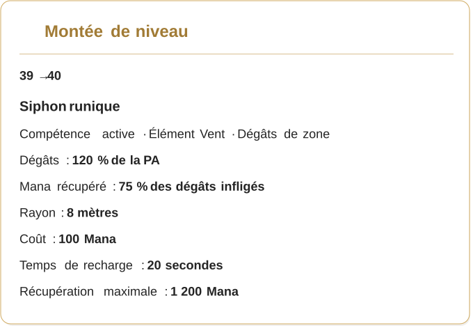
  </picture>
  

    
Version textuelle de la fenêtre

  
Montée de niveau

  
<strong>39 → 40</strong>

  <h3>Siphon runique</h3>
  
Compétence active · Élément Vent · Dégâts de zone

  
Dégâts : <strong>120&nbsp;% de la PA</strong>

  
Mana récupéré : <strong>75&nbsp;% des dégâts infligés</strong>

  
Rayon : <strong>8 mètres</strong>

  
Coût : <strong>100 Mana</strong>

  
Temps de recharge : <strong>20 secondes</strong>

  
Récupération maximale : <strong>1&nbsp;200 Mana</strong>

  

Hasol relut attentivement la description.

Une compétence de zone.

Des dégâts de Vent, un élément ne bénéficiant d'aucun avantage élémentaire, mais ne subissant également aucun désavantage.

Et surtout, une récupération de mana proportionnelle aux dégâts infligés.

Elle leva les yeux vers les démons.

— Yoon ! Samia ! Je viens d'obtenir une nouvelle compétence !

— Tu es passée niveau quarante ? demanda Yoon.

— Oui !

Hasol attendit que plusieurs créatures se trouvent à proximité.

— Siphon runique !

Le vent se déchaîna autour d'elle.

Une violente onde parcourut les environs, frappant simultanément les démons présents dans son rayon d'action.

Hasol consulta immédiatement sa réserve de mana.

La récupération maximale avait été atteinte.

Mille deux cents points de mana récupérés pour seulement cent points dépensés.

Un gain net de mille cent points.

Elle resta immobile quelques instants.

Puis un large sourire apparut sous son masque.

— Oh…

Samia reconnut immédiatement cette réaction.

— Qu'est-ce que tu viens encore de découvrir ?

— Je peux récupérer mon mana en infligeant des dégâts.

— Combien ?

— Jusqu'à mille deux cents points toutes les vingt secondes.

Yoon contempla les démons qui continuaient d'approcher.

— Avec autant de cibles, tu ne risques plus de manquer de mana.

Hasol sortit une rune de sa réserve.

— Exactement.

Samia soupira.

— Je crois que je commence à comprendre.

Hasol activa Aura runique.

Puis elle recommença.

### XII. Trente secondes

Siphon runique transforma profondément les habitudes de combat d'Hasol.

Dans les affrontements contre de nombreux adversaires, elle pouvait désormais reconstituer régulièrement sa réserve de mana.

Elle commença à multiplier les activations d'Aura runique.

Les pierres se désagrégeaient les unes après les autres entre ses doigts.

Les démons rouges bénéficiaient déjà de peu de temps pour réagir à son approche grâce à sa tenue et à son masque.

Sa nouvelle compétence réduisait encore les interruptions dans sa progression.

Sa réputation d'Astrale sanguinaire ne fit que grandir.

Ce fut néanmoins contre les boss que Hasol découvrit une autre manière d'exploiter cette nouvelle liberté.

Lors d'une expédition, Samia la vit activer plusieurs fois Aura runique alors que son épée était déjà imprégnée.

— Pourquoi recommences-tu ?

— Je cherche un coup critique.

Hasol sacrifia une nouvelle rune.

Puis une autre.

Enfin, la notification attendue apparut.

  <picture class="lit-window__github-picture">
    <source media="(max-width: 600px)" srcset="assets/fenetres-livre-2/L2-C3-F02-mobile.svg">
    
  </picture>
  

    
Version textuelle de la fenêtre

  
Coup critique

  <h3>Infiltration runique</h3>
  
Durée : <strong class="temporary-bonus">30 secondes</strong>

  

— Voilà !

Hasol s'élança.

Elle exploita immédiatement les trente secondes dont elle disposait.

La défense de son adversaire ne constituait plus le même obstacle.

Ses frappes infligeaient des dégâts considérables.

Lorsque l'effet disparut, elle recommença à sacrifier des runes jusqu'à obtenir un nouveau coup critique.

Dans les affrontements où suffisamment de créatures étaient présentes, Siphon runique lui permettait de compenser une grande partie de ses dépenses.

Elle adopta également cette stratégie contre les monstres ordinaires dont la résistance ralentissait trop sa progression.

Yoon et Samia s'adaptèrent rapidement à cette nouvelle manière de combattre.

Samia finit néanmoins par lui poser une question.

— Combien de runes as-tu détruites aujourd'hui ?

Hasol réfléchit.

— Beaucoup.

— C'est très précis.

— Je les compterai ce soir.

— Orven va devoir acheter toutes les mauvaises runes de la région.

— C'est déjà plus ou moins ce qu'il fait.

Yoon éclata de rire.

Le lendemain, Hasol se rendit effectivement chez l'artisan.

— Il va falloir augmenter les commandes.

Orven leva lentement les yeux de son registre.

— Encore ?

### XIII. Une progression différente

Au fil des expéditions, Yoon continuait de réduire l'écart de niveau qui la séparait d'Hasol.

Un jour, elle poussa un cri de satisfaction.

— Niveau quarante !

Une seconde notification se déploya devant Yoon.

  <picture class="lit-window__github-picture">
    <source media="(max-width: 600px)" srcset="assets/fenetres-livre-2/L2-C3-F06-mobile.svg">
    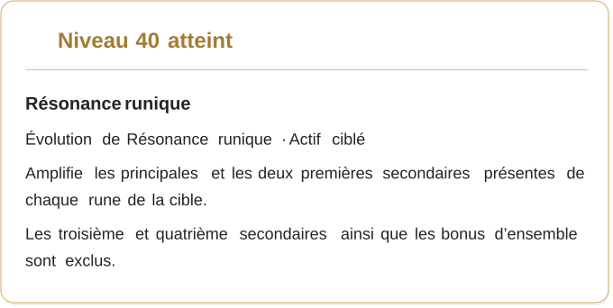
  </picture>
  

    
Version textuelle de la fenêtre

  
Niveau 40 atteint

  <h3>Résonance runique</h3>
  
Évolution de Résonance runique · Actif ciblé

  
Amplifie les principales et les deux premières secondaires présentes de chaque rune de la cible.

  
Les troisième et quatrième secondaires ainsi que les bonus d’ensemble sont exclus.

  

— Ma Résonance vient d’évoluer, annonça-t-elle. Elle peut maintenant atteindre les deux premières secondaires de chaque rune.

Hasol lui tendit aussitôt la main. Yoon activa son pouvoir sur elle ; la sensation familière de ses principales renforcées s’accompagna cette fois d’échos plus fins, limités aux premières lignes secondaires de chaque pierre.

— Pas les suivantes, constata Hasol en consultant les effets.

— Ni les ensembles, confirma Yoon. Mais c’est déjà beaucoup plus qu’avant.

Hasol partageait son sourire. Cette progression appartenait à Yoon, construite au fil de leurs années d’entraînement et de combat.

Hasol lui adressa un large sourire.

— Félicitations !

— Je t'ai enfin rattrapée !

Samia croisa les bras.

— Vous pourriez faire un petit effort, toutes les deux.

Yoon se tourna vers elle.

— Pardon ?

— Je vous attends depuis un moment, maintenant.

Hasol éclata de rire.

Samia avait déjà dépassé le niveau quarante.

Malgré le nombre considérable de démons qu'Hasol éliminait personnellement, sa classe astrale nécessitait qualitativement davantage d'expérience, à niveau égal, que les classes de rareté inférieure. Aucune table ne lui permettait d'en déduire un écart exact.

Cette différence expliquait pourquoi ses deux anciennes élèves avaient progressivement réduit leur retard.

Hasol n'en éprouvait aucune frustration.

Bien au contraire.

Elle était particulièrement fière de leur progression.

Son propre développement ne reposait d'ailleurs pas uniquement sur ses montées de niveau.

Ses cercles de mana lui permettaient de continuer à augmenter sa puissance indépendamment de son expérience.

— Vous avez fait énormément de progrès depuis votre entrée à l'académie, remarqua-t-elle.

— Grâce à notre formidable princesse ? demanda Yoon.

— Mentor, Yoon. Mentor !

Samia leva les yeux au ciel.

— Vous ne changerez jamais, toutes les deux.

Les trois jeunes femmes éclatèrent de rire.

### XIV. Trente-deux cercles de mana

À vingt-cinq ans, Hasol contempla le résultat de ses efforts.

Les chasses classiques, les donjons et les innombrables expéditions dans les portails lui avaient permis d'atteindre un nouveau stade de développement.

  <picture class="lit-window__github-picture">
    <source media="(max-width: 600px)" srcset="assets/fenetres-livre-2/L2-C3-F03-mobile.svg">
    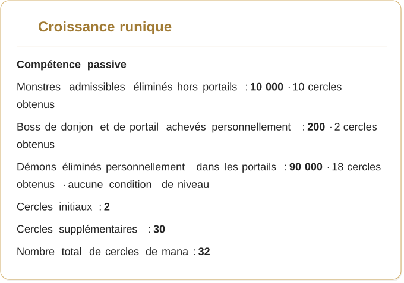
  </picture>
  

    
Version textuelle de la fenêtre

  
Croissance runique

  
<strong>Compétence passive</strong>

  
Monstres admissibles éliminés hors portails : <strong>10&nbsp;000</strong> · 10 cercles obtenus

  
Boss de donjon et de portail achevés personnellement : <strong>200</strong> · 2 cercles obtenus

  
Démons éliminés personnellement dans les portails : <strong>90&nbsp;000</strong> · 18 cercles obtenus · aucune condition de niveau

  
Cercles initiaux : <strong>2</strong>

  
Cercles supplémentaires : <strong>30</strong>

  
Nombre total de cercles de mana : <strong>32</strong>

  

Trente-deux cercles.

Trente-deux runes.

Hasol avait consacré une attention particulière à chacune des pierres composant son équipement.

Toutes avaient atteint le quinzième palier d'amélioration.

La majorité de leurs améliorations secondaires avaient atteint des valeurs maximales, et certaines runes présentaient même des résultats parfaits.

  <picture class="lit-window__github-picture">
    <source media="(max-width: 600px)" srcset="assets/fenetres-livre-2/L2-C3-F04-mobile.svg">
    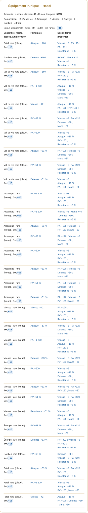
  </picture>
  

    
Version textuelle de la fenêtre

  
Équipement runique — Hasol

  
Arcaniste runique · Niveau <strong>40</strong> · Runes équipées <strong>32/32</strong>

  
Composition : 8 Vol de vie · 8 Arcanique · 8 Vitesse · 2 Énergie · 2 Gardien · 4 Fatal

  
Bonus d'ensemble actifs : <strong>9</strong> · Toutes les runes : +15

  <table>
    <thead><tr><th>Ensemble, étoiles, amélioration</th><th>Principale</th><th>Secondaires présentes</th></tr></thead>
    <tbody>
    <tr data-rune-id="L2-HAS-R001"><td>Fatal (rare (bleue)), 6★, +15</td><td class="rune-bonus">Attaque +160</td><td class="rune-bonus">Vitesse +8 ; PV +25 ; PA +60 ; Résistance +6&nbsp;%</td></tr>
    <tr data-rune-id="L2-HAS-R002"><td>Gardien (rare (bleue)), 6★, +15</td><td class="rune-bonus">Défense +160</td><td class="rune-bonus">PV +60 ; Mana +20 ; Vitesse +4 ; Résistance +6&nbsp;%</td></tr>
    <tr data-rune-id="L2-HAS-R017"><td>Vol de vie (rare (bleue)), 6★, +15</td><td class="rune-bonus">Attaque +160</td><td class="rune-bonus">Vitesse +8 ; PA +120 ; PV +150 ; Résistance +6&nbsp;%</td></tr>
    <tr data-rune-id="L2-HAS-R018"><td>Vol de vie (rare (bleue)), 6★, +15</td><td class="rune-bonus">PA +1&nbsp;200</td><td class="rune-bonus">Attaque +16&nbsp;% ; Vitesse +8 ; Défense +30 ; Mana +30</td></tr>
    <tr data-rune-id="L2-HAS-R019"><td>Vol de vie (rare (bleue)), 6★, +15</td><td class="rune-bonus">Vitesse +42</td><td class="rune-bonus">Attaque +16&nbsp;% ; PA +120 ; PV +150 ; Résistance +6&nbsp;%</td></tr>
    <tr data-rune-id="L2-HAS-R020"><td>Vol de vie (rare (bleue)), 6★, +15</td><td class="rune-bonus">PV +63&nbsp;%</td><td class="rune-bonus">Vitesse +8 ; PA +120 ; Défense +30 ; Mana +30</td></tr>
    <tr data-rune-id="L2-HAS-R021"><td>Vol de vie (rare (bleue)), 5★, +15</td><td class="rune-bonus">PA +600</td><td class="rune-bonus">Vitesse +8 ; Attaque +16&nbsp;% ; PV +150 ; Résistance +6&nbsp;%</td></tr>
    <tr data-rune-id="L2-HAS-R022"><td>Vol de vie (rare (bleue)), 5★, +15</td><td class="rune-bonus">Attaque +51&nbsp;%</td><td class="rune-bonus">PA +120 ; Vitesse +8 ; Défense +30 ; Mana +30</td></tr>
    <tr data-rune-id="L2-HAS-R023"><td>Vol de vie (rare (bleue)), 5★, +15</td><td class="rune-bonus">PV +51&nbsp;%</td><td class="rune-bonus">Vitesse +8 ; PA +120 ; Défense +30 ; Résistance +6&nbsp;%</td></tr>
    <tr data-rune-id="L2-HAS-R024"><td>Vol de vie (rare (bleue)), 5★, +15</td><td class="rune-bonus">Défense +51&nbsp;%</td><td class="rune-bonus">Vitesse +8 ; Attaque +16&nbsp;% ; PA +120 ; Mana +30</td></tr>
    <tr data-rune-id="L2-HAS-R025"><td>Arcanique (rare (bleue)), 6★, +15</td><td class="rune-bonus">PA +1&nbsp;200</td><td class="rune-bonus">Vitesse +8 ; Attaque +16&nbsp;% ; PV +150 ; Résistance +6&nbsp;%</td></tr>
    <tr data-rune-id="L2-HAS-R026"><td>Arcanique (rare (bleue)), 6★, +15</td><td class="rune-bonus">PA +1&nbsp;200</td><td class="rune-bonus">Vitesse +8 ; Mana +40 ; Défense +30 ; Résistance +6&nbsp;%</td></tr>
    <tr data-rune-id="L2-HAS-R027"><td>Arcanique (rare (bleue)), 6★, +15</td><td class="rune-bonus">Attaque +63&nbsp;%</td><td class="rune-bonus">PA +120 ; Vitesse +8 ; PV +150 ; Mana +30</td></tr>
    <tr data-rune-id="L2-HAS-R028"><td>Arcanique (rare (bleue)), 6★, +15</td><td class="rune-bonus">PV +63&nbsp;%</td><td class="rune-bonus">PA +120 ; Vitesse +8 ; Défense +30 ; Mana +30</td></tr>
    <tr data-rune-id="L2-HAS-R029"><td>Arcanique (rare (bleue)), 5★, +15</td><td class="rune-bonus">PA +600</td><td class="rune-bonus">Vitesse +8 ; Attaque +16&nbsp;% ; PV +150 ; Résistance +6&nbsp;%</td></tr>
    <tr data-rune-id="L2-HAS-R030"><td>Arcanique (rare (bleue)), 5★, +15</td><td class="rune-bonus">Attaque +51&nbsp;%</td><td class="rune-bonus">PA +120 ; Vitesse +8 ; Défense +30 ; Mana +30</td></tr>
    <tr data-rune-id="L2-HAS-R031"><td>Arcanique (rare (bleue)), 5★, +15</td><td class="rune-bonus">PV +51&nbsp;%</td><td class="rune-bonus">PA +120 ; Vitesse +8 ; Défense +30 ; Résistance +6&nbsp;%</td></tr>
    <tr data-rune-id="L2-HAS-R032"><td>Arcanique (rare (bleue)), 5★, +15</td><td class="rune-bonus">Défense +51&nbsp;%</td><td class="rune-bonus">PA +120 ; Vitesse +8 ; PV +150 ; Mana +30</td></tr>
    <tr data-rune-id="L2-HAS-R033"><td>Vitesse (rare (bleue)), 6★, +15</td><td class="rune-bonus">Vitesse +42</td><td class="rune-bonus">PA +120 ; Attaque +16&nbsp;% ; PV +150 ; Résistance +6&nbsp;%</td></tr>
    <tr data-rune-id="L2-HAS-R034"><td>Vitesse (rare (bleue)), 6★, +15</td><td class="rune-bonus">Attaque +63&nbsp;%</td><td class="rune-bonus">Vitesse +8 ; PA +120 ; Défense +30 ; Mana +30</td></tr>
    <tr data-rune-id="L2-HAS-R035"><td>Vitesse (rare (bleue)), 6★, +15</td><td class="rune-bonus">PA +1&nbsp;200</td><td class="rune-bonus">Vitesse +8 ; Attaque +16&nbsp;% ; PV +150 ; Résistance +6&nbsp;%</td></tr>
    <tr data-rune-id="L2-HAS-R036"><td>Vitesse (rare (bleue)), 6★, +15</td><td class="rune-bonus">Défense +63&nbsp;%</td><td class="rune-bonus">Vitesse +8 ; PA +120 ; PV +150 ; Mana +30</td></tr>
    <tr data-rune-id="L2-HAS-R037"><td>Vitesse (rare (bleue)), 5★, +15</td><td class="rune-bonus">PA +600</td><td class="rune-bonus">Vitesse +8 ; Attaque +16&nbsp;% ; Défense +30 ; Résistance +6&nbsp;%</td></tr>
    <tr data-rune-id="L2-HAS-R038"><td>Vitesse (rare (bleue)), 5★, +15</td><td class="rune-bonus">Attaque +51&nbsp;%</td><td class="rune-bonus">Vitesse +8 ; PA +120 ; PV +150 ; Mana +30</td></tr>
    <tr data-rune-id="L2-HAS-R039"><td>Vitesse (rare (bleue)), 5★, +15</td><td class="rune-bonus">PV +51&nbsp;%</td><td class="rune-bonus">Vitesse +8 ; PA +120 ; Défense +30 ; Résistance +6&nbsp;%</td></tr>
    <tr data-rune-id="L2-HAS-R040"><td>Vitesse (rare (bleue)), 5★, +15</td><td class="rune-bonus">Résistance +51&nbsp;%</td><td class="rune-bonus">Vitesse +8 ; Attaque +16&nbsp;% ; PA +120 ; Mana +30</td></tr>
    <tr data-rune-id="L2-HAS-R041"><td>Énergie (rare (bleue)), 6★, +15</td><td class="rune-bonus">PV +63&nbsp;%</td><td class="rune-bonus">Vitesse +8 ; PA +120 ; Défense +30 ; Mana +30</td></tr>
    <tr data-rune-id="L2-HAS-R042"><td>Énergie (rare (bleue)), 6★, +15</td><td class="rune-bonus">Défense +63&nbsp;%</td><td class="rune-bonus">PV +300 ; Vitesse +8 ; PA +60 ; Résistance +6&nbsp;%</td></tr>
    <tr data-rune-id="L2-HAS-R043"><td>Gardien (rare (bleue)), 6★, +15</td><td class="rune-bonus">PV +63&nbsp;%</td><td class="rune-bonus">Défense +60 ; Vitesse +8 ; PA +60 ; Résistance +6&nbsp;%</td></tr>
    <tr data-rune-id="L2-HAS-R044"><td>Fatal (rare (bleue)), 6★, +15</td><td class="rune-bonus">Attaque +63&nbsp;%</td><td class="rune-bonus">Vitesse +8 ; PA +120 ; PV +150 ; Résistance +6&nbsp;%</td></tr>
    <tr data-rune-id="L2-HAS-R045"><td>Fatal (rare (bleue)), 6★, +15</td><td class="rune-bonus">PA +1&nbsp;200</td><td class="rune-bonus">Vitesse +8 ; Attaque +16&nbsp;% ; PV +150 ; Mana +30</td></tr>
    <tr data-rune-id="L2-HAS-R046"><td>Fatal (rare (bleue)), 6★, +15</td><td class="rune-bonus">Vitesse +42</td><td class="rune-bonus">Attaque +16&nbsp;% ; PA +120 ; Défense +30 ; Mana +30</td></tr>
    </tbody>
  </table>
  

Elle avait réussi à construire un équipement équilibré, capable de soutenir aussi bien ses capacités offensives que sa résistance et son autonomie.

Elle ne comptait pourtant pas s'arrêter là.

Lorsqu'elle présenta ses résultats à Ray, celui-ci contempla longuement ses notes.

— Quatre-vingt-dix mille démons…

Il releva les yeux.

— Finalement, ton surnom n'est peut-être pas exagéré.

— Ray !

Il éclata de rire.

— Trente-deux cercles, reprit-il. Tu te rends compte ?

— Oui.

— Et tu réfléchis déjà aux prochains ?

— Évidemment.

Ray secoua la tête avec amusement.

Hasol referma son carnet.

— Tu sais, tu m'as énormément aidée.

— Moi ?

— Les gobelins rouges, les portails, les recherches sur les démons… Sans tes conseils, j'aurais probablement perdu énormément de temps.

— Je n'ai fait que lire quelques livres.

— Encore fallait-il savoir lesquels lire.

Ray sourit.

— Dans ce cas, je vais continuer.

Hasol appréciait particulièrement ces moments.

Avec Orven, elle approfondissait ses connaissances en artisanat.

Avec Elric, elle pouvait discuter de ses techniques de combat.

Avec Yoon et Samia, elle découvrait de nouvelles stratégies.

Et avec Ray, elle pouvait réunir toutes ces connaissances et réfléchir à de nouvelles manières de les exploiter.

Il lui arrivait cependant d'oublier complètement ses recherches lorsqu'elle discutait avec lui.

Les heures passaient sans qu'elle s'en aperçoive.

Elle ne s'en plaignait jamais.

### XV. Une journée ordinaire

— Niveau vingt-cinq !

Hasol releva immédiatement la tête.

Ray se tenait devant elle, visiblement fier de lui.

— Félicitations !

— Merci.

— Depuis quand ?

— Hier.

— Et tu ne me le dis que maintenant ?

— Tu étais occupée à expliquer pourquoi ta dernière rune était meilleure que celle que nous avions étudiée la semaine dernière.

— Elle est meilleure.

— Je n'en doute absolument pas.

Hasol éclata de rire.

Ray progressait à son propre rythme.

Il ne cherchait pas à rivaliser avec elle, et Hasol ne lui en demandait jamais davantage.

Elle s'intéressait sincèrement à ses réussites, à ses difficultés et aux projets qu'il envisageait avec ses compagnons.

— On devrait aller manger quelque chose, proposa-t-elle.

— Tu abandonnes tes recherches ?

— Pour ce soir.

Ils quittèrent ensemble la bibliothèque.

Le soleil commençait à disparaître derrière les bâtiments.

Les rues étaient encore animées et une agréable douceur régnait dans l'air.

Ils trouvèrent un endroit où dîner.

Ray lui raconta une mésaventure survenue lors de sa dernière chasse. Hasol rit tellement qu'elle dut interrompre son repas.

Elle lui parla ensuite de ses dernières expéditions et des difficultés d'Orven à suivre ses commandes de runes.

— Tu vas finir par épuiser les réserves de mauvaises runes de tous les marchands de la région, remarqua Ray.

— Ce serait plutôt une bonne nouvelle pour eux.

— Jusqu'au jour où ils comprendront qu'ils peuvent te les vendre plus cher.

Hasol s'immobilisa.

— Ne leur donne surtout pas cette idée.

Ray éclata de rire.

La soirée passa rapidement.

Lorsqu'ils sortirent, Ray lui annonça qu'il devait retrouver ses compagnons le lendemain matin.

— Une chasse ?

— Oui. Dans les bois.

— Vous partez tôt ?

— Assez tôt. Et toi ?

— Un donjon avec Yoon et Samia.

— Alors, après-demain à la bibliothèque ?

— Comme toujours.

Ils marchèrent encore quelques instants avant d'atteindre le croisement où leurs chemins se séparaient.

— Bonne chasse, Hasol.

— À toi aussi, Ray.

Elle lui adressa un sourire.

Puis elle rentra chez elle.

### XVI. Celle qui n'était pas dans les bois

Le donjon ne leur posa aucune difficulté particulière.

Leur expérience commune permettait aux trois jeunes femmes d'anticiper les réactions les unes des autres avec une facilité remarquable.

Elles terminèrent leur expédition et reprirent le chemin du retour.

Hasol pensait passer à l'atelier avant de rentrer chez elle.

Mais une agitation inhabituelle attira son attention.

Plusieurs chasseurs blessés venaient d'être ramenés.

Elle reconnut l'un d'entre eux.

Un compagnon de Ray.

— Qu'est-ce qui s'est passé ?

L'homme releva la tête.

— Un loup alpha…

Hasol regarda autour d'elle.

— Où est Ray ?

Il ne répondit pas immédiatement.

— Où est-il ?

— Il est resté derrière. Il nous a dit de courir.

Le cœur d'Hasol se mit à battre violemment.

— Où ?

L'homme lui indiqua l'endroit.

Elle partit aussitôt.

Yoon cria son nom, mais Hasol ne ralentit pas.

Elle traversa les rues, dépassa les dernières habitations et pénétra dans les bois.

Elle devait se dépêcher.

Ray avait atteint le niveau vingt-cinq.

Il était expérimenté.

Il connaissait les dangers de la forêt.

Il pouvait tenir.

Il devait tenir.

Elle accéléra encore.

Puis elle aperçut la créature.

Le loup alpha se tenait entre les arbres.

Hasol saisit une rune.

— Aura runique.

La pierre se désagrégea.

  <picture class="lit-window__github-picture">
    <source media="(max-width: 600px)" srcset="assets/fenetres-livre-2/L2-C3-F05-mobile.svg">
    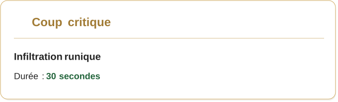
  </picture>
  

    
Version textuelle de la fenêtre

  
Coup critique

  <h3>Infiltration runique</h3>
  
Durée : <strong class="temporary-bonus">30 secondes</strong>

  

Elle dégaina son épée.

Le loup bondit.

Hasol frappa une première fois, en diagonale.

Sa lame traversa la défense de la créature.

Le monstre était encore vivant.

Elle enchaîna immédiatement avec une seconde frappe, dans le sens opposé.

Deux entailles se croisèrent sur le corps du loup alpha.

La créature s'effondra.

Hasol ne prit même pas le temps de regarder la notification annonçant sa mort.

— Ray !

Elle poursuivit sa course.

— Ray !

Elle scruta les alentours.

Puis elle l'aperçut.

Il était étendu au pied d'un arbre.

Elle se précipita vers lui.

— Ray !

Elle tomba à genoux et posa une main sur son épaule.

— C'est moi. Je suis là.

Il ne bougea pas.

Hasol chercha son pouls.

Elle recommença.

Puis une troisième fois.

— Non…

Elle secoua doucement son épaule.

— Ray, réponds-moi.

Le silence de la forêt lui parut soudain insupportable.

Elle regarda son visage.

La veille encore, il riait avec elle.

Ils avaient dîné ensemble.

Ils devaient se retrouver à la bibliothèque.

— Tu avais promis…

Sa voix se brisa.

Elle posa son front contre son épaule.

Le loup était mort.

Deux coups d'épée.

Il ne lui avait fallu que deux coups d'épée.

### XVII. Le courage de Ray

Les compagnons de Ray racontèrent ce qui s'était passé.

Lorsque le loup alpha les avait attaqués, ils avaient rapidement compris qu'ils ne pourraient pas le vaincre.

Ray avait choisi de rester en arrière.

Il leur avait donné le temps de s'échapper.

Sans lui, plusieurs d'entre eux seraient morts.

Hasol écouta leur récit sans les interrompre.

Elle ne leur en voulait pas.

Elle connaissait suffisamment Ray pour comprendre pourquoi il avait pris cette décision.

C'était précisément ce qui rendait la situation si douloureuse.

Lors des funérailles, elle resta auprès des parents de Ray.

Yoon et Samia étaient présentes.

Elric et Orven avaient également fait le déplacement.

Tous essayèrent de lui apporter du réconfort.

Hasol leur en était reconnaissante.

Mais chaque fois qu'elle fermait les yeux, elle revoyait les deux frappes.

La première.

La seconde.

Le loup s'effondrant devant elle.

Elle aurait pu le faire la veille.

Elle aurait pu le faire au début de l'affrontement.

Elle aurait pu le faire avant même que Ray ait besoin de tirer son arme.

Il aurait simplement fallu qu'elle soit présente.

De retour chez elle, Hasol s'enferma dans sa chambre.

Elle déposa son épée et son masque sur une table.

Elle contempla longuement le visage démoniaque.

Les chasseurs l'appelaient l'Astrale sanguinaire.

Elle avait éliminé des dizaines de milliers de démons.

Elle possédait trente-deux cercles de mana et un équipement dont rêvaient de nombreux chasseurs.

Pourtant, aucun de ses exploits ne pouvait changer ce qui venait de se produire.

Quelques coups furent frappés à sa porte.

— Hasol ?

C'était sa mère.

— Entre…

Iseria pénétra dans la chambre.

Elle observa sa fille, puis s'assit à ses côtés.

— Maman…

Hasol tenta de poursuivre, mais aucun mot ne sortit de sa bouche.

Iseria la prit simplement dans ses bras.

Hasol s'effondra.

— Deux coups… Maman… Il ne m'a fallu que deux coups…

Iseria resserra doucement son étreinte.

— J'aurais pu le sauver…

Elle pleura longuement contre sa mère.

Iseria ne chercha pas à lui expliquer ce qu'elle aurait dû faire ni à lui rappeler ses nombreux exploits.

Elle resta simplement auprès d'elle.

### XVIII. La chaise vide

Quelques jours plus tard, Hasol retourna à la bibliothèque.

Elle emprunta machinalement les allées qu'elle connaissait si bien.

Elle récupéra un ouvrage qu'ils avaient prévu de consulter ensemble, puis rejoignit leur table habituelle.

Elle s'assit.

La chaise en face d'elle était vide.

Hasol ouvrit le livre.

Elle lut les premières lignes.

Puis elle les relut.

Elle ne parvenait pas à se concentrer.

Son regard revenait constamment vers cette chaise.

Elle sortit son carnet.

Au fil des pages se succédaient des informations sur les monstres, les runes et les portails.

Elle retrouva les notes qu'elle avait prises lorsque Ray lui avait recommandé les gobelins rouges.

Plus loin figuraient leurs recherches sur les démons.

Elle se souvint de cette conversation.

*Il serait peut-être temps de songer sérieusement aux portails. Avec ton équipement actuel, les démons rouges ne devraient pas te poser de problème.*

Elle tourna une nouvelle page.

Des annotations.

Des calculs.

Des idées qu'ils n'avaient pas encore eu le temps d'explorer.

Elle referma le carnet.

Trente-deux cercles de mana.

Ray l'avait aidée à en obtenir une partie.

Il avait consacré des heures à chercher les monstres qui lui permettraient de progresser, à étudier les portails qu'elle pourrait traverser et à réfléchir avec elle aux possibilités offertes par son équipement.

Grâce à lui, elle était devenue plus forte.

Et pourtant, elle n'avait pas été capable de le sauver.

Elle se surprit à imaginer Ray arriver en retard, s'excuser et lui demander ce qu'elle avait découvert depuis leur dernière rencontre.

Elle aurait aimé lui parler de ses runes.

Lui montrer ses nouveaux calculs.

L'écouter raconter une histoire sans importance.

L'entendre l'appeler une nouvelle fois l'Astrale sanguinaire pour se moquer gentiment d'elle.

— À quoi ça sert ?

Une larme tomba sur la couverture du carnet.

Elle n'avait pas besoin de davantage de puissance.

Elle n'avait pas besoin d'une meilleure épée.

Elle n'avait pas besoin d'un trente-troisième cercle.

Elle avait simplement besoin d'être là.

— Si seulement j'avais été avec toi…

Elle serra les poings.

— Si seulement j'avais pu te sauver…

Un son grave retentit.

**DONG.**

Hasol releva la tête.

**DONG.**

**DONG.**

**DONG.**

**DONG.**

**DONG.**

**DONG.**

**DONG.**

**DONG.**

**DONG.**

**DONG.**

**DONG.**

Puis le son changea.

**DING.**

**DING.**

La bibliothèque disparut.

*Fin du chapitre 3 — Celle qui n'était pas dans les bois.*

---

## Chapitre 4 — Cette fois, avec moi

### I. Trois rêves et un cauchemar

Les démons rouges se rapprochaient.

Hasol se tenait au milieu d'eux, vêtue de sa nouvelle tenue écarlate. Plusieurs créatures levèrent leurs armes dans sa direction.

Elle ne chercha pourtant pas à s'éloigner.

— Siphon runique !

Une violente onde de vent se propagea autour d'elle, frappant simultanément les créatures qui l'entouraient.

Hasol sentit sa réserve de mana se remplir.

Un sourire apparut sous son masque.

Puis les démons disparurent.

Hasol entrouvrit les yeux.

— Siphon runique… murmura-t-elle.

Encore à moitié endormie, elle se retourna dans son lit et remonta sa couverture jusqu'aux épaules.

Quelques instants plus tard, elle dormait de nouveau.

La bibliothèque.

Plusieurs ouvrages étaient ouverts devant elle, ainsi qu'une feuille sur laquelle figuraient différentes combinaisons de runes.

Ray était assis à ses côtés.

— Avec trente-six cercles, tu pourrais équiper un ensemble supplémentaire, expliqua-t-il.

Hasol examina les différentes possibilités.

Ray retira ses lunettes et les posa sur la table.

Elle tourna la tête vers lui.

— C'est vrai que sans lunettes, tu as beaucoup de charme. Les lentilles, c'est pour quand ?

Hasol ouvrit lentement les yeux.

Elle fixa le plafond de sa chambre.

— Ray, sans lunettes… N'importe quoi…

Un léger sourire se dessina sur ses lèvres.

Elle enfouit son visage dans son oreiller avant de se rendormir.

Une forêt.

Un immense loup se dressait devant elle.

Hasol sortit une rune de sa réserve.

— Aura runique !

La rune se désagrégea et une aura de Terre enveloppa son épée.

  <picture class="lit-window__github-picture">
    <source media="(max-width: 600px)" srcset="assets/fenetres-livre-2/L2-C4-F01-mobile.svg">
    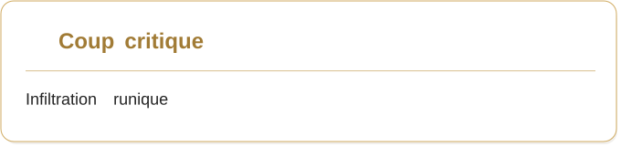
  </picture>
  

    
Version textuelle de la fenêtre

  
Coup critique

  
Infiltration runique

  

Hasol s'élança.

Son épée imprégnée de Terre fendit l'air une première fois, puis une seconde.

Deux traînées rouges formèrent une croix devant elle.

Le loup alpha s'effondra.

Hasol se réveilla brusquement.

— Un loup alpha…

Elle se redressa, attrapa le verre d'eau posé sur sa table de chevet et en but quelques gorgées.

— C'est vraiment n'importe quoi… Comme si j'étais capable de tuer un loup alpha en deux coups d'épée !

Elle reposa son verre et s'allongea de nouveau.

Il lui fallut cette fois plusieurs minutes pour retrouver le sommeil.

Hasol courait.

Au pied d'un arbre dont certaines branches brûlaient encore se trouvait une silhouette immobile.

Des lunettes.

Un bâton dont le sommet était toujours enflammé.

Ray.

— RAY !

Hasol se redressa brutalement dans son lit, le souffle court et le visage couvert de sueur.

Son cœur battait à une vitesse impressionnante.

Les premières lueurs du jour traversaient les rideaux de sa chambre.

Elle ramena ses jambes contre elle et posa son front sur ses genoux.

Il lui fallut un long moment pour se calmer.

Cette fois, elle ne parvint pas à se rendormir.

### II. Les chasseuses écarlates

L'idée de Samia se révéla particulièrement efficace.

Les démons rouges mettaient effectivement un peu plus de temps à identifier les trois chasseuses comme des ennemies, un avantage dont Hasol apprit rapidement à tirer profit.

Les expéditions se succédèrent.

Aura runique devint l'un de ses principaux atouts contre les créatures des portails. Les runes dont personne ne voulait lui permettaient d'imprégner son épée d'une aura élémentaire, avant de se battre au milieu des démons.

Maître Orven, de son côté, poursuivait ses activités avec une élève dont les besoins en runes semblaient ne jamais diminuer.

Hasol perfectionnait son équipement, développait ses talents d'artisane et consacrait une part toujours plus importante de son temps aux portails.

Sa réputation grandissait également.

Il ne fallut pas longtemps pour que certains chasseurs commencent à parler d'une jeune femme au masque de démon, capable d'abattre des groupes entiers de créatures avec son épée imprégnée.

L'Astrale sanguinaire.

Un surnom qui amusait énormément Yoon et dont Samia ne manquait jamais de rappeler l'existence lorsque l'occasion se présentait.

Ray continuait de chasser avec ses propres compagnons et retrouvait régulièrement Hasol à la bibliothèque.

Leurs recherches ne s'interrompirent jamais vraiment. Les questions changeaient simplement au fil de leur progression.

Les mois passèrent.

Les étranges rêves d'Hasol finirent par occuper une place de moins en moins importante dans ses pensées.

Jusqu'au jour où elle atteignit le niveau quarante.

### III. Une compétence familière

Hasol venait d'éliminer un démon lorsqu'une notification apparut devant elle.

  <picture class="lit-window__github-picture">
    <source media="(max-width: 600px)" srcset="assets/fenetres-livre-2/L2-C4-F02-mobile.svg">
    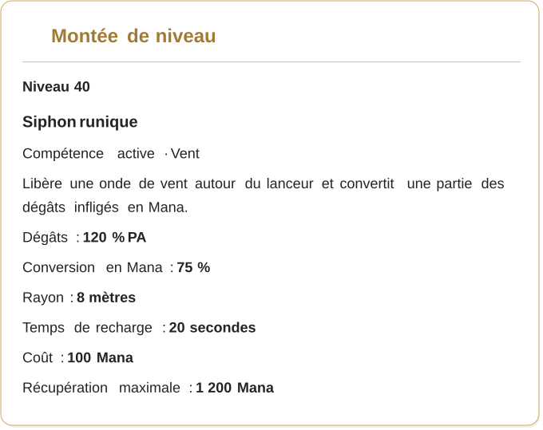
  </picture>
  

    
Version textuelle de la fenêtre

  
Montée de niveau

  
<strong>Niveau 40</strong>

  <h3>Siphon runique</h3>
  
Compétence active · Vent

  
Libère une onde de vent autour du lanceur et convertit une partie des dégâts infligés en Mana.

  
Dégâts : <strong>120&nbsp;% PA</strong>

  
Conversion en Mana : <strong>75&nbsp;%</strong>

  
Rayon : <strong>8 mètres</strong>

  
Temps de recharge : <strong>20 secondes</strong>

  
Coût : <strong>100 Mana</strong>

  
Récupération maximale : <strong>1&nbsp;200 Mana</strong>

  

Hasol resta immobile.

Elle relut le nom de la compétence.

*Siphon runique.*

— Hasol ! s'écria Samia.

Une flèche passa à proximité de la jeune femme et atteignit un démon qui s'apprêtait à l'attaquer.

Hasol recula précipitamment.

— Qu'est-ce que tu fais ? demanda Samia.

— Désolée… Je viens de passer niveau quarante.

— Félicitations ! lança Yoon. Tu as obtenu quelque chose d'intéressant ?

Hasol observa les démons qui se rapprochaient.

— Je crois que oui.

Elle attendit que plusieurs créatures pénètrent dans le rayon d'action de sa nouvelle compétence.

— Siphon runique !

Le vent se déchaîna autour d'elle.

Une onde frappa simultanément les démons présents à proximité et Hasol sentit sa réserve de mana se remplir.

Elle connaissait cette sensation.

— Alors ? demanda Yoon.

— Je récupère du mana en infligeant des dégâts aux ennemis qui m'entourent. Plus ils sont nombreux, plus j'en récupère !

— Oh non… murmura Samia.

Hasol se tourna vers elle.

— Quoi ?

— Tu vas encore nous demander de trouver davantage de monstres.

Yoon éclata de rire.

Hasol esquissa un sourire et sortit une rune de sa réserve.

Le combat reprit.

Pourtant, elle ne parvenait pas à se réjouir pleinement de sa nouvelle compétence.

Elle se souvenait parfaitement de ce rêve.

Comment avait-elle pu connaître le nom et les effets d'une compétence qu'elle ne possédait pas encore ?

Elle pensa soudainement à Ray.

### IV. Le charme de Ray

Quelques jours plus tard, les quatre amis profitèrent d'un moment de repos.

Ray retira ses lunettes pour les nettoyer.

Yoon l'observa quelques instants.

— Tu sais, Ray, tu as vraiment beaucoup de charme sans tes lunettes.

Le jeune homme leva les yeux vers elle.

— Pardon ?

— Quoi ? Je dis simplement ce que je pense.

Ray devint écarlate.

Hasol éclata de rire, rapidement imitée par Samia.

— Regarde-le ! s'amusa Yoon. Il est presque de la même couleur que nos tenues !

— Merci, Yoon…

Ray remit précipitamment ses lunettes.

— Oh, dommage !

— Tu devrais arrêter de l'embêter, intervint Hasol, incapable de dissimuler son amusement.

— Très bien. Mais tu ne vas pas me dire que j'ai tort ?

Hasol regarda Ray.

— Je vais m'abstenir de répondre.

— Voilà qui est intéressant, remarqua Samia.

— Mais vous allez me laisser tranquille, oui ?

Les trois jeunes femmes éclatèrent de rire.

Ray finit par sourire à son tour.

— Hasol, on se retrouve à la bibliothèque ce soir ?

— Comme prévu !

— Parfait. J'ai quelques idées concernant tes futurs cercles de mana.

Yoon adressa un regard amusé à Samia.

Ray fit semblant de ne pas le remarquer.

### V. Les trente-six cercles

Lorsque Ray arriva à la bibliothèque, Samia occupait sa place habituelle.

Hasol lui adressa un signe de la main.

— Installe-toi !

Ray posa ses ouvrages sur la table et prit place à côté d'elle.

Samia referma le livre qu'elle consultait.

— Je vais vous laisser à vos passionnantes discussions sur les runes.

— Tu pourrais rester, proposa Hasol.

— Et vous écouter débattre pendant deux heures pour savoir s'il vaut mieux augmenter ton Attaque ou ta Puissance arcanique ?

— Ce sont des questions importantes !

— Je n'en doute pas.

Samia se leva.

— Bonne soirée, vous deux.

Ray attendit qu'elle se soit éloignée avant de sortir une feuille de son carnet.

— Alors, ces trente-six cercles…

Hasol se pencha immédiatement vers lui.

— Tu as trouvé quelque chose ?

— J'ai surtout réfléchi à ce que tu possèdes déjà.

Il inscrivit les différents ensembles sur la feuille.

**Équipement runique actuel — 32 cercles de mana**

| Ensemble | Runes | Ensembles actifs |
|---|---:|---:|
| Vol de vie | 8 | 2 |
| Arcanique | 8 | 2 |
| Vitesse | 8 | 2 |
| Énergie | 2 | 1 |
| Gardien | 2 | 1 |
| Fatal | 4 | 1 |

— Tes deux ensembles Vol de vie te permettent déjà de récupérer une quantité importante de points de vie, poursuivit Ray. Mais pourquoi ne pas augmenter les dégâts que tu infliges ?

— Tu penses à un deuxième ensemble Fatal ?

— Exactement. Avec de l'Attaque et de la Puissance arcanique comme statistiques principales. Il faudrait également rechercher ces deux statistiques en secondaire.

**Ensemble supplémentaire envisagé : Fatal, quatre runes.**

Principales recherchées : Attaque ou Puissance arcanique. Secondaires visées : Attaque et Puissance arcanique.

— Tu augmenterais ainsi les dégâts de ton épée et de tes compétences magiques. Ton vol de vie n'en serait que plus efficace.

— Sans avoir à sacrifier mes ensembles actuels…

— Voilà.

Hasol sourit.

— J'aime beaucoup cette idée.

— Je m'en doutais.

Elle récupéra la feuille et commença à y ajouter quelques annotations.

— Tu sais, Ray, tu devrais également consacrer davantage de temps à tes propres ensembles.

— Je le fais.

— Pas autant qu'aux miens.

— Il faut dire que tu m'offres beaucoup plus de possibilités.

Hasol rit.

Ils poursuivirent leur discussion.

Ray lui présenta plusieurs combinaisons de statistiques, puis retira ses lunettes pour se frotter les yeux.

Il les posa sur la table.

Hasol tourna la tête vers lui.

Elle repensa à la remarque de Yoon.

Un sourire amusé se dessina sur ses lèvres.

Elle ouvrit la bouche.

*C'est vrai que sans lunettes, tu as beaucoup de charme. Les lentilles, c'est pour quand ?*

Elle se figea.

Ray était assis à côté d'elle.

Ses lunettes étaient posées sur la table.

Devant eux se trouvait une feuille sur laquelle figuraient différentes combinaisons de runes.

— Hasol ?

Elle sentit ses joues s'échauffer.

— Oui ?

— Tu voulais me dire quelque chose ?

— Non… Rien.

Ray la regarda quelques instants, puis sourit timidement et remit ses lunettes.

Hasol détourna les yeux.

Elle comprenait maintenant pourquoi elle aurait pu prononcer cette phrase. Une simple plaisanterie pour poursuivre celle de Yoon.

Mais comment avait-elle pu rêver de cette conversation si longtemps auparavant ?

Ray, quant à lui, avait une tout autre interprétation de son silence.

Elle n'avait jamais rougi de cette manière en sa présence.

Il baissa les yeux vers ses notes, incapable de dissimuler complètement son sourire.

Hasol ne le remarqua pas.

Elle pensait à un arbre.

À un bâton enflammé.

À Ray.

### VI. Une confidence nocturne

Lorsqu'Hasol rentra chez elle, Iseria était encore installée dans le salon.

— Tu rentres tard, ma chérie.

— J'étais à la bibliothèque avec Ray.

— Vous avez trouvé quelque chose d'intéressant ?

Hasol ne répondit pas immédiatement.

Elle retira ses chaussures et vint s'asseoir auprès de sa mère.

— Maman… Est-ce que tu crois qu'il est possible de voir l'avenir dans ses rêves ?

Iseria releva les yeux.

— Pourquoi cette question ?

— Tu te souviens du jour où tu nous as offert nos tenues de chasse ?

— Bien sûr.

— J'ai fait des rêves assez étranges cette nuit-là.

Iseria posa ce qu'elle tenait entre les mains.

— Je t'écoute.

Hasol lui raconta son premier rêve. Elle lui expliqua comment elle avait découvert Siphon runique en atteignant le niveau quarante, alors qu'elle connaissait déjà le nom et les effets de cette compétence.

Elle lui parla ensuite de la bibliothèque, des trente-six cercles de mana et de la conversation qu'elle venait d'avoir avec Ray.

— J'allais vraiment lui dire la même chose que dans mon rêve, maman. Mot pour mot.

— Et tu ne l'as pas fait ?

— Non. Je me suis mise à rougir comme une idiote.

Iseria esquissa un sourire.

— Ce n'est pas bien grave, ma chérie.

— Ce n'est pas ça qui m'inquiète.

Hasol ramena ses jambes contre elle.

— J'ai également rêvé que je tuais un loup alpha. Mais c'est surtout le cauchemar que j'ai fait ensuite qui me fait peur.

Elle lui décrivit la forêt, l'arbre aux branches enflammées et la silhouette de Ray.

Sa voix devint progressivement plus faible.

— Il ne bougeait pas, maman.

Iseria posa délicatement une main sur celle de sa fille.

— Tu es certaine qu'il était blessé ?

— Je ne sais pas… Je me suis réveillée avant de pouvoir le rejoindre.

Hasol serra les doigts de sa mère.

— Si mes autres rêves se réalisent, qu'est-ce qui me garantit que celui-ci ne se réalisera pas également ?

— Rien ne t'oblige à considérer chacun de tes rêves comme une certitude.

— Mais comment pourrais-je faire comme si je n'avais rien vu ?

Iseria demeura silencieuse.

Hasol posa sa tête contre son épaule.

— Et puis, il y a autre chose…

— Dis-moi.

— Je pense énormément à Ray depuis quelque temps. J'ai toujours envie de le voir, de passer davantage de temps avec lui… Quand il part chasser avec ses compagnons, je ne peux pas m'empêcher de m'inquiéter.

Elle marqua une pause.

— Mais je ne sais pas pourquoi.

— Comment cela ?

— Maman… Je ne sais même plus ce que je ressens réellement pour lui.

Hasol sentit les larmes lui monter aux yeux.

— Est-ce que j'ai envie d'être avec lui parce que je suis amoureuse ? Ou simplement parce que j'ai peur qu'il lui arrive quelque chose ?

Iseria attira doucement sa fille contre elle.

— Depuis combien de temps connais-tu Ray ?

— Des années.

— Et depuis combien de temps aimes-tu passer tes soirées à discuter avec lui ?

Hasol ne répondit pas.

— Bien avant ces rêves, n'est-ce pas ?

— Oui…

— Alors ne laisse pas quelques mauvais rêves effacer tous les souvenirs heureux que vous avez construits ensemble.

Iseria caressa doucement les cheveux de sa fille.

— Tu n'es pas obligée de comprendre immédiatement tout ce que tu ressens. Laisse-toi un peu de temps.

Hasol ferma les yeux.

— Merci, maman.

Elles discutèrent encore un moment, puis les réponses d'Hasol devinrent de plus en plus espacées.

Elle finit par s'endormir contre sa mère.

Iseria déposa délicatement un coussin sous sa tête et la recouvrit d'une couverture.

Elle observa sa fille pendant plusieurs minutes.

Son sourire avait disparu.

Lorsqu'elle fut convaincue qu'Hasol dormait profondément, elle se leva et se dirigea vers le vaisselier.

Elle actionna un mécanisme dissimulé.

Le meuble se déplaça lentement, dévoilant un passage vers une pièce obscure.

— Maman… Tu vas où ?

Iseria se figea.

Hasol avait entrouvert les yeux.

— Nulle part, ma chérie. Rendors-toi.

— D'accord…

Hasol referma les yeux.

Sa respiration redevint rapidement régulière.

Iseria contempla une dernière fois sa fille endormie.

*Pourquoi fallait-il que ma plus jeune fille possède, elle aussi, un don semblable au mien ?*

Elle pénétra dans la pièce obscure.

Le vaisselier reprit silencieusement sa place.

### VII. Une quatrième tenue écarlate

Le lendemain matin, Hasol retrouva sa mère.

— Maman, j'aurais besoin d'un service.

— Je t'écoute.

— Est-ce que tu pourrais me procurer une quatrième tenue de chasse ? Du même style que les nôtres.

— Une quatrième ?

— Oui. Une tenue pour un mage offensif, avec un bâton assorti.

Iseria observa attentivement sa fille.

— Pour Ray ?

— Oui.

Un sourire apparut sur le visage de sa mère.

— Je devrais pouvoir arranger cela.

— Mais cette fois, c'est moi qui paie !

— Pourquoi ?

— Parce que c'est un cadeau que je souhaite lui faire.

Iseria ne put s'empêcher de sourire davantage.

Hasol fronça les sourcils.

— Quoi ?

— Rien, ma chérie.

— Maman…

— Je vais m'en occuper.

— Et tu me diras combien je te dois !

— Bien sûr.

Hasol repartit satisfaite.

Iseria attendit qu'elle ait quitté la pièce avant de laisser échapper un petit rire.

Deux jours plus tard, Iseria invita sa fille à découvrir les équipements.

Hasol resta émerveillée devant le résultat.

Comme leurs propres tenues, celle de Ray associait le rouge écarlate, le noir et de magnifiques ornements dorés. Le bâton avait été conçu dans le même esprit.

— C'est exactement ce que je souhaitais !

— Tu penses qu'il lui plaira ?

— J'en suis certaine !

Hasol contempla encore quelques instants la tenue avant de se tourner vers sa mère.

— Alors, combien est-ce que je te dois ?

— Rien du tout.

Hasol fronça immédiatement les sourcils.

— Maman, nous en avions parlé !

— Considère cela comme un cadeau.

— Mais c'est mon cadeau pour Ray !

— Et c'est le mien pour toi.

— Ce n'est pas pareil !

Iseria rit.

— Hasol, tu n'as pas besoin de me rembourser.

— Si ! Je gagne suffisamment d'argent maintenant. Entre mon travail avec maître Orven et les portails, j'ai largement de quoi te payer.

— Tu en es certaine ?

— Évidemment !

— Très bien.

Iseria lui annonça le prix.

Hasol cessa immédiatement de parler.

Elle fixa sa mère.

Puis la tenue.

Puis le bâton.

— Attends…

Elle chercha une chaise et s'assit lentement.

— Tu es sérieuse ?

— Tout à fait.

— Pour une seule tenue et un bâton ?

— Oui.

Hasol tenta mentalement de comparer cette somme à ce qu'elle avait gagné depuis le début de son activité artisanale.

Iseria croisa les bras, amusée.

— Alors, souhaites-tu toujours me rembourser ?

Hasol leva les yeux vers elle.

— Ne me dis pas que nos tenues et nos armes ont également coûté aussi cher ?

— À peu de chose près.

— Maman !

Elle repensa soudainement à la garde-robe d'Iseria, à ces vêtements dont la qualité avait toujours semblé parfaitement ordinaire à ses yeux, simplement parce qu'elle avait grandi en les voyant.

Et à Yoon qui s'amusait à la surnommer princesse.

— Mais… Comment peux-tu te permettre de dépenser autant ?

— Ne t'inquiète pas pour moi, ma chérie.

— C'est justement ce que tu dis à chaque fois !

Iseria récupéra soigneusement les équipements.

— Tu devrais plutôt réfléchir à la manière dont tu souhaites offrir tout cela à Ray.

Hasol ouvrit la bouche, puis la referma.

Sa mère venait une fois encore de détourner la conversation.

Elle observa la magnifique tenue écarlate.

— Tu ne lui diras pas combien elle coûte, hein ?

— C'était justement ce que j'allais te conseiller.

### VIII. Cette fois, avec moi

Ray examina attentivement les deux paquets qu'Hasol venait de déposer devant lui.

— Qu'est-ce que c'est ?

— Ouvre-les !

Il défit le premier emballage.

Lorsqu'il découvrit la tenue écarlate, il resta silencieux.

Hasol attendit sa réaction avec impatience.

— Alors ?

— Hasol… C'est pour moi ?

— Évidemment !

Il souleva délicatement la tenue.

— Elle ressemble aux vôtres.

— C'était l'idée.

Ray contempla les ornements dorés.

Il connaissait suffisamment bien le travail des artisans pour reconnaître la qualité exceptionnelle de cet équipement.

— Ça a dû te coûter…

— Ne pose pas cette question !

Ray leva les yeux vers elle.

— Enfin… Je veux dire que ce n'est pas important.

— Mais…

— Ouvre le deuxième !

Ray découvrit le bâton.

Son expression changea de nouveau.

— Hasol !

— Tu aimes ?

— Bien sûr que j'aime ! Mais tu ne peux pas m'offrir tout cela sans raison !

Hasol s'assit face à lui.

— Justement, j'ai quelque chose à te proposer.

Ray posa délicatement le bâton.

— Je t'écoute.

— J'aimerais que tu participes à toutes nos expéditions dans les portails.

— Toutes ?

— Oui.

Il la regarda avec étonnement.

— Et Yoon et Samia sont d'accord ?

— Je leur en ai déjà parlé.

— Mais votre groupe est complet.

— Notre groupe permanent, oui. Pas nos raids. Il suffit de te réserver une place à chaque expédition.

Ray réfléchit quelques instants.

— Vous passez presque tout votre temps dans les portails.

— Exactement.

— Je risque de ne plus avoir beaucoup de temps pour mes autres chasses.

— Ce serait dommage de refuser une telle occasion de progresser, non ?

Ray sourit.

— Tu as raison.

— Alors ?

— J'accepte avec plaisir !

Le soulagement d'Hasol fut immédiat.

— Vraiment ?

— Évidemment ! Entre les portails et nos soirées à la bibliothèque, nous allons finir par passer toutes nos journées ensemble.

Hasol rougit légèrement.

— Ça te dérange ?

— Absolument pas.

Ray contempla de nouveau les équipements.

— Merci, Hasol. Sincèrement.

Elle lui sourit.

— Désormais, tu viendras avec moi.

Ray acquiesça.

Pour la première fois depuis plusieurs jours, Hasol se sentit véritablement rassurée.

### IX. Les quatre écarlates

Lors de leur expédition suivante, Ray retrouva les trois jeunes femmes devant le portail.

Yoon fut la première à l'apercevoir.

— Oh !

Samia se tourna vers lui.

— Eh bien, nous voilà quatre maintenant.

Ray sourit.

— Qu'en pensez-vous ?

— Magnifique ! répondit Yoon.

Elle se rapprocha d'Hasol et lui murmura quelques mots.

— Tu as très bon goût.

Hasol lui donna un léger coup de coude.

— Arrête.

Yoon éclata de rire.

Les autres chasseurs arrivèrent progressivement.

L'un d'eux s'approcha de Ray.

— Sympa, ta tenue ! Et ton bâton aussi. Ça a dû te coûter une fortune.

— C'est un cadeau d'une amie.

— Eh bien, tu as de la chance !

Le chasseur observa les personnes présentes avant de froncer les sourcils.

— C'est étrange, nous ne sommes que treize. À quelle heure arrivent les autres ?

— Quels autres ?

— Les autres chasseurs du raid. Nous sommes encore loin des cent points, non ?

Ray le regarda avec étonnement.

— Tu ne connais pas mes coéquipières ?

— Non, c'est la première fois que je participe à un raid avec vous.

Ray désigna successivement les trois jeunes femmes.

— Samia est de classe commune, comme nous. Yoon est de classe légendaire et Hasol de classe astrale.

Le chasseur resta silencieux quelques secondes.

— Une légendaire et une astrale ? Dans le même raid ?

— Exactement.

— Mais… Vous représentez cinquante-cinq points à vous quatre !

— Voilà. Avec vous neuf, nous sommes à cent.

  <picture class="lit-window__github-picture">
    <source media="(max-width: 600px)" srcset="assets/fenetres-livre-2/L2-C4-F03-mobile.svg">
    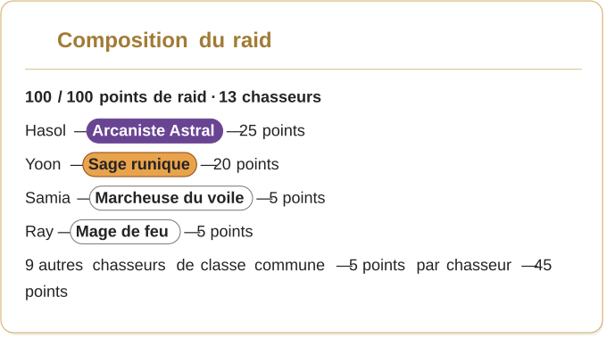
  </picture>
  

    
Version textuelle de la fenêtre

  
Composition du raid

  
<strong>100 / 100 points de raid · 13 chasseurs</strong>

  
Hasol — Arcaniste Astral (classe astrale) — 25 points

  
Yoon — Sage runique (classe légendaire) — 20 points

  
Samia — Marcheuse du voile (classe commune) — 5 points

  
Ray — Mage de feu (classe commune) — 5 points

  
9 autres chasseurs de classe commune — 5 points par chasseur — 45 points

  

— Je n'ai jamais participé à un raid avec une légendaire. Alors une astrale…

Son regard s'arrêta sur Hasol, qui venait d'enfiler son masque de démon écarlate.

— Attends une seconde… Ce serait elle, l'Astrale sanguinaire ?

— En personne.

— Et tu participes régulièrement à leurs raids ?

— Désormais, oui.

— Décidément, tu en as de la chance…

Ray sourit en regardant Hasol.

— Je commence à le croire.

Les treize chasseurs franchirent le portail.

Ray ne tarda pas à découvrir l'avantage que lui procurait sa nouvelle tenue.

Lorsqu'un groupe de démons rouges s'approcha des quatre chasseurs écarlates, les créatures hésitèrent brièvement.

— Ray ! Maintenant ! lança Hasol.

— Boule de feu !

Le projectile traversa l'espace qui les séparait des monstres et explosa au milieu d'eux.

Hasol profita immédiatement de cette ouverture pour s'élancer.

Samia décocha plusieurs flèches tandis que Yoon soutenait ses compagnons.

Ray observa attentivement les déplacements d'Hasol, attendant qu'elle se trouve suffisamment éloignée des démons avant de lancer son prochain sort.

— Trait incandescent !

Un projectile enflammé atteignit une créature qui s'apprêtait à rejoindre le combat.

Hasol tourna brièvement la tête vers lui.

— Bien joué !

Les quatre chasseurs poursuivirent leur progression.

Lorsque l'expédition prit fin, Ray vint naturellement retrouver ses trois partenaires de raid.

— Alors, demanda Hasol, prêt à recommencer ?

— Quand vous voulez !

— Demain ? proposa Samia.

Ray rit.

— Je commence à comprendre pourquoi vous progressez aussi vite.

— Tu vas t'habituer, lui assura Yoon.

Hasol retira son masque et lui adressa un sourire.

### X. Les secrets de deux mères

Quelques jours plus tard, Iseria retrouva Irène Corvus.

Les deux femmes se connaissaient depuis de nombreuses années et avaient régulièrement l'occasion de discuter de leurs enfants.

Mais cette fois-ci, Iseria avait quelque chose de particulièrement intéressant à lui raconter.

— Tu aurais dû voir Hasol l'autre jour !

— Pourquoi ? demanda Irène.

— Elle est venue me demander une tenue de chasse et un bâton pour Ray.

— Il me les a montrés ! Ils sont magnifiques. Je voulais justement te remercier.

— Ce qui est amusant, c'est qu'elle voulait absolument les payer elle-même.

Irène haussa les sourcils.

— Vraiment ?

— Elle s'est presque disputée avec moi lorsque j'ai refusé son argent.

— Cela ne m'étonne pas d'elle.

— Il a fallu que je lui révèle le prix pour qu'elle abandonne.

Irène éclata de rire.

— La pauvre !

— Elle a dû s'asseoir.

Les deux femmes rirent ensemble.

— Mais ce n'est pas tout, poursuivit Iseria. Elle souhaite désormais que Ray participe à toutes leurs expéditions.

Irène sourit.

— Oui, il m'en a parlé. Je ne l'avais pas vu aussi enthousiaste depuis longtemps.

Iseria se pencha légèrement vers elle.

— Je crois que nos enfants commencent sérieusement à s'apprécier.

— Commencent ?

Irène lui adressa un regard malicieux.

— Tu sais que Ray s'est rendu dans notre atelier d'orfèvrerie pour commander un Anneau runique ?

Iseria ouvrit de grands yeux.

— Pour Hasol ?

— Pour qui d'autre ?

— Oh !

— Et il a demandé qu'on l'orne d'un diamant.

Iseria porta une main à sa bouche, incapable de dissimuler son enthousiasme.

— Un diamant ?

— Oui. Il accorde énormément d'importance à cette commande.

— Il ne lui en a pas encore parlé ?

— Pas à ma connaissance. Et j'espère que tu ne lui diras rien !

— Évidemment !

Iseria récupéra sa tasse.

— Hasol, qui se dispute avec moi pour payer les équipements de Ray, pendant que ton fils commande un anneau spécialement pour elle…

Irène sourit tendrement.

— Ils nous en auront fait attendre, ces deux-là.

— Beaucoup trop longtemps !

Les deux mères éclatèrent de rire.

Leur conversation se prolongea une bonne partie de l'après-midi.

### XI. Un avenir différent

Les mois suivants furent particulièrement riches en expéditions.

Ray découvrit rapidement les avantages d'une fréquentation aussi intensive des portails.

Avec Hasol, Yoon et Samia, il affrontait bien davantage de créatures que lors de ses chasses habituelles.

Sa progression s'accéléra considérablement.

Un soir, alors qu'Hasol l'attendait à la bibliothèque, Ray arriva avec un large sourire.

— J'ai quelque chose à te montrer !

— Une nouvelle rune ?

— Pour une fois, non.

Il s'assit devant elle.

— Niveau trente !

— C'est pas trop tôt ! Tu aurais dû passer moins de temps à la bibliothèque durant tes années à l'Académie.

— Et qui aurait répondu à toutes tes questions sur les runes ?

Hasol éclata de rire.

— Bon, je te l'accorde. Alors, montre-moi ta nouvelle compétence !

  <picture class="lit-window__github-picture">
    <source media="(max-width: 600px)" srcset="assets/fenetres-livre-2/L2-C4-F04-mobile.svg">
    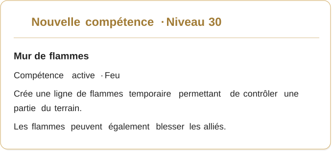
  </picture>
  

    
Version textuelle de la fenêtre

  
Nouvelle compétence · Niveau 30

  <h3>Mur de flammes</h3>
  
Compétence active · Feu

  
Crée une ligne de flammes temporaire permettant de contrôler une partie du terrain.

  
Les flammes peuvent également blesser les alliés.

  

Hasol examina attentivement la description.

— Ça pourrait être particulièrement intéressant contre les groupes de démons.

— C'est ce que je pensais. Je pourrais les obliger à contourner certaines zones.

— Ou les inciter à se regrouper !

Ray la regarda.

— Pour Siphon runique ?

Hasol sourit.

— Tu commences à vraiment bien me connaître.

Dès leur expédition suivante, ils expérimentèrent ensemble les possibilités offertes par cette nouvelle compétence.

Ray dressa un mur de flammes à proximité d'un groupe de démons.

Plusieurs créatures modifièrent leur trajectoire pour éviter le feu.

Hasol profita de leur regroupement.

— Siphon runique !

Une onde de vent frappa les démons regroupés autour d'Hasol.

Ray observa le résultat.

— Je crois que ça fonctionne plutôt bien.

— Plutôt bien ? C'est excellent !

Les expéditions se poursuivirent.

Zio les accompagna à quelques reprises lorsque ses disponibilités le lui permettaient, sans pour autant abandonner son propre groupe.

Ray, lui, ne manquait pratiquement aucun de leurs raids.

Il avait progressivement délaissé les chasses classiques. Ses anciens compagnons comprenaient parfaitement son choix. Peu de chasseurs avaient la possibilité de participer aussi régulièrement aux expéditions d'une Astrale et d'une Légendaire.

Lorsqu'il atteignit le niveau quarante, Hasol fut une nouvelle fois la première personne à laquelle il souhaita présenter ses nouvelles compétences.

  <picture class="lit-window__github-picture">
    <source media="(max-width: 600px)" srcset="assets/fenetres-livre-2/L2-C4-F05-mobile.svg">
    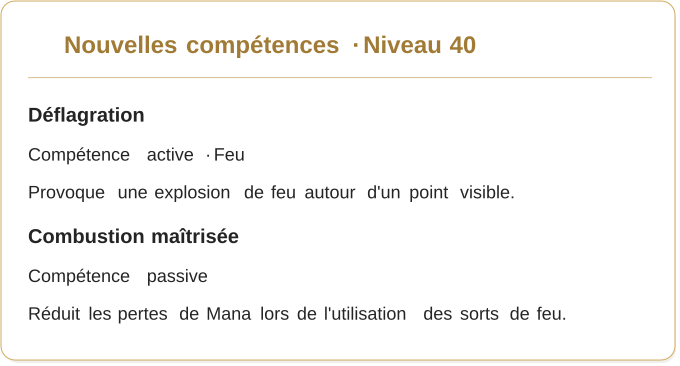
  </picture>
  

    
Version textuelle de la fenêtre

  
Nouvelles compétences · Niveau 40

  <h3>Déflagration</h3>
  
Compétence active · Feu

  
Provoque une explosion de feu autour d'un point visible.

  <h3>Combustion maîtrisée</h3>
  
Compétence passive

  
Réduit les pertes de Mana lors de l'utilisation des sorts de feu.

  

— Enfin ! s'exclama Ray.

Hasol releva les yeux.

— Tu attendais une compétence particulière ?

— Combustion maîtrisée. Je vais enfin pouvoir utiliser un peu plus souvent mes sorts sans craindre de manquer de mana.

— Et Déflagration ?

Ray sourit.

— J'ai hâte de l'essayer.

Il n'eut pas à attendre longtemps.

Lors de leur expédition suivante, Yoon ralentit un rassemblement de démons grâce à son Domaine des Entraves runiques.

Ray attendit qu'Hasol s'écarte des créatures.

Il pointa son bâton dans leur direction.

— Déflagration !

Une violente explosion de feu illumina les environs.

Samia tourna immédiatement la tête vers lui.

— Eh bien !

— Pas mal, hein ?

— Préviens-moi avant de faire ça à côté de moi !

Hasol acheva l'un des démons encore debout.

— On devrait essayer de combiner Déflagration avec Siphon runique !

Samia soupira.

— Il ne manquait plus que ça…

Yoon éclata de rire.

De son côté, Hasol poursuivait sa croissance runique.

Lorsqu'elle disposa enfin de trente-six cercles de mana, elle concrétisa le projet qu'elle avait élaboré avec Ray à la bibliothèque.

Elle avait préparé les runes nécessaires en réserve et les avait équipées au fil des nouveaux cercles. Quatre nouvelles runes Fatal vinrent ainsi compléter son équipement.

Elle avait consacré de nombreuses heures à rechercher les statistiques qu'ils avaient sélectionnées ensemble, se montrant particulièrement exigeante concernant l'Attaque et la Puissance arcanique.

  <picture class="lit-window__github-picture">
    <source media="(max-width: 600px)" srcset="assets/fenetres-livre-2/L2-C4-F06-mobile.svg">
    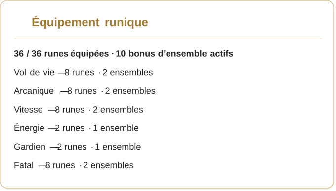
  </picture>
  

    
Version textuelle de la fenêtre

  
Équipement runique

  
<strong>36 / 36 runes équipées · 10 bonus d’ensemble actifs</strong>

  
Vol de vie — 8 runes · 2 ensembles

  
Arcanique — 8 runes · 2 ensembles

  
Vitesse — 8 runes · 2 ensembles

  
Énergie — 2 runes · 1 ensemble

  
Gardien — 2 runes · 1 ensemble

  
Fatal — 8 runes · 2 ensembles

  

Les résultats confirmèrent les attentes de Ray.

— Tu avais raison ! lui annonça-t-elle après une expédition.

— Concernant quoi ?

— Le deuxième ensemble Fatal ! Mon vol de vie est encore plus efficace qu'avant.

— Je suis heureux de l'apprendre.

Hasol lui adressa un large sourire.

— Qu'est-ce que je ferais sans toi ?

Ray la regarda quelques instants.

— Tu trouverais probablement quelqu'un d'autre pour passer ses soirées à étudier des combinaisons de runes.

— Certainement pas !

Elle lui donna un léger coup d'épaule.

— Tu es irremplaçable.

Ray devint silencieux.

Hasol, qui examinait déjà ses notes, ne remarqua pas son expression.

Le temps continua de s'écouler.

Ray atteignit finalement le niveau cinquante.

Une nouvelle fois, il vint présenter sa compétence à Hasol.

  <picture class="lit-window__github-picture">
    <source media="(max-width: 600px)" srcset="assets/fenetres-livre-2/L2-C4-F07-mobile.svg">
    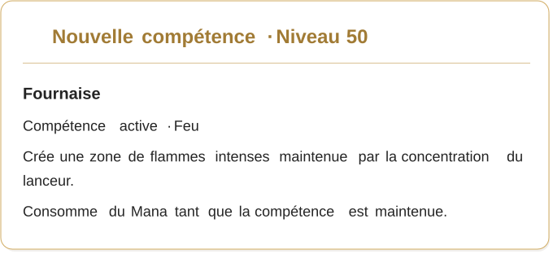
  </picture>
  

    
Version textuelle de la fenêtre

  
Nouvelle compétence · Niveau 50

  <h3>Fournaise</h3>
  
Compétence active · Feu

  
Crée une zone de flammes intenses maintenue par la concentration du lanceur.

  
Consomme du Mana tant que la compétence est maintenue.

  

— Une nouvelle compétence de zone ! s'enthousiasma Hasol.

— Oui, mais elle risque d'être particulièrement gourmande en mana.

— Il faudra réfléchir à de nouveaux ensembles pour ton équipement.

— Je savais que tu allais me dire ça.

Hasol éclata de rire.

Ray rangea son carnet.

— Tu sais, je n'aurais jamais imaginé atteindre le niveau cinquante aussi rapidement.

— Tu te débrouilles vraiment bien.

— Grâce aux portails.

Il regarda Hasol.

— Et grâce à toi.

Elle lui sourit.

— Tu as travaillé autant que nous.

— Peut-être. Mais sans ton invitation, je serais probablement encore en train de chasser avec mes anciens compagnons.

Hasol baissa brièvement les yeux.

Voilà bien longtemps que Ray n'avait pas participé à une chasse en forêt.

— Tu ne regrettes pas ?

— Pas une seule seconde.

Il lui adressa un sourire.

— Pourquoi cette question ?

— Pour rien.

Elle sourit à son tour.

### XII. Le cœur et la raison

— On devrait aller manger quelque chose, proposa Ray.

Hasol releva la tête.

— Tu as terminé tes recherches ?

— Non.

— Alors pourquoi veux-tu partir ?

— Parce que tu n'as pas quitté cette chaise depuis des heures.

Hasol regarda autour d'elle.

La bibliothèque s'était progressivement vidée.

— Il est si tard que ça ?

— Oui.

Elle referma son carnet.

— Très bien. Mais c'est toi qui choisis où nous allons.

— Avec plaisir.

Ils quittèrent ensemble la bibliothèque.

Les rues étaient encore animées malgré l'heure.

Hasol marchait tranquillement aux côtés de Ray, profitant de la douceur de la soirée.

— Tu te souviens de nos premières recherches à l'Académie ? demanda-t-il.

— Comment pourrais-je les oublier ?

— Tu venais me voir presque tous les jours avec de nouvelles questions.

— Et tu avais toujours une réponse.

— Pas toujours.

— Dans ce cas, tu passais les jours suivants à la chercher.

Ray sourit.

— Tu étais particulièrement tenace.

— J'avais trouvé quelqu'un de compétent. J'allais quand même pas le laisser filer !

— Je vois. J'étais donc simplement utile.

— Très utile, même !

Ray prit un air faussement vexé.

Hasol éclata de rire.

Ils arrivèrent devant un établissement que Ray connaissait bien.

Pour une fois, Hasol ne sortit ni son carnet ni ses notes sur les runes. La soirée se déroula agréablement, même si elle remarqua que Ray semblait parfois préoccupé.

— Tout va bien ? lui demanda-t-elle.

— Oui, pourquoi ?

— Tu as l'air nerveux.

— C'est possible…

— Tu veux me parler de quelque chose ?

Ray hésita.

— Après le repas.

Hasol haussa légèrement les sourcils.

— Très mystérieux, monsieur Corvus.

Il sourit.

Lorsqu'ils quittèrent l'établissement, ils poursuivirent leur promenade jusqu'à trouver un endroit tranquille.

Ray s'arrêta.

— Hasol…

— Oui ?

Il sortit un petit écrin de sa poche.

— J'aimerais t'offrir quelque chose.

Hasol le regarda avec étonnement.

— Pour quelle occasion ?

— Ouvre-le.

Elle souleva délicatement le couvercle.

À l'intérieur se trouvait un anneau en or jaune, au jonc épais et parfaitement lisse. Un magnifique diamant rond était serti directement dans le métal, sans griffes saillantes.

— Ray… Il est magnifique !

Elle sortit délicatement le bijou de son écrin.

— J'ai demandé à notre atelier de réaliser un sertissage particulier, expliqua-t-il. Je ne voulais pas que la pierre puisse te gêner lorsque tu tiens ton épée.

— Tu l'as fait fabriquer spécialement pour moi ?

— Oui. Et ce n'est pas un anneau ordinaire.

Hasol l'examina avec davantage d'attention.

  <picture class="lit-window__github-picture">
    <source media="(max-width: 600px)" srcset="assets/fenetres-livre-2/L2-C4-F08-mobile.svg">
    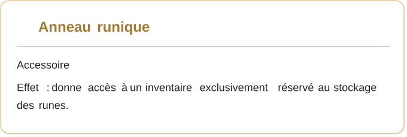
  </picture>
  

    
Version textuelle de la fenêtre

  
Anneau runique

  
Accessoire

  
Effet : donne accès à un inventaire exclusivement réservé au stockage des runes.

  

Ses yeux s'illuminèrent.

— Un inventaire réservé aux runes !

— Je me suis dit que ça pourrait t'être utile.

— Utile ? Mais c'est génial ! Tu n'imagines pas le temps que je passe à chercher certaines runes dans mon inventaire !

Ray rit.

— Si, justement.

Hasol contempla de nouveau le diamant.

— Mais pourquoi avoir fait fabriquer un anneau aussi beau ?

Ray prit une profonde inspiration.

— Parce que je ne voulais pas simplement t'offrir un équipement.

Hasol releva les yeux.

— Depuis toutes ces années, tu es devenue la personne avec laquelle j'ai le plus envie de passer mon temps. Et pas uniquement pour parler de runes.

Il marqua une courte pause.

— Hasol, je suis amoureux de toi.

La jeune femme resta silencieuse.

Elle sentit ses joues s'échauffer.

Elle avait imaginé cette conversation à plusieurs reprises, sans jamais parvenir à déterminer ce qu'elle lui répondrait.

Maintenant qu'elle se trouvait devant lui, les mots lui manquaient.

— Ray…

Il attendit patiemment.

— Tu sais que je tiens énormément à toi ?

— Oui.

— Ces derniers mois, je me suis souvent posé des questions sur ce que je ressentais.

Elle baissa les yeux vers l'anneau.

— J'aimerais pouvoir te donner une réponse sans la moindre hésitation. Mais je crois que j'ai encore besoin d'un peu de temps.

Ray acquiesça.

— Je comprends.

Hasol observa son visage.

— Ça ne veut pas dire que je ne souhaite pas être avec toi !

— Hasol, tu n'es pas obligée de…

— Attends !

Elle réfléchit quelques instants.

Puis elle releva les yeux vers lui.

— Si tu es d'accord… Soyons fiancés, dans un premier temps.

Ray resta bouche bée.

— Fiancés ?

— Oui. On n'est pas obligés de se marier demain, non plus !

— Non, évidemment !

— On pourrait prendre notre temps. Continuer à faire ce qu'on aime ensemble et voir où tout cela nous mène.

Un immense sourire apparut sur le visage de Ray.

— Avec plaisir.

Hasol lui tendit l'anneau, puis sa main.

— Alors ?

Ray récupéra délicatement le bijou et le glissa à son doigt.

Hasol contempla sa main.

— Il me va parfaitement.

— Heureusement.

— Tu connaissais ma taille ?

— J'ai mes sources.

— Ta mère ?

Ray éclata de rire.

Hasol sourit avant de se rapprocher de lui et de le prendre dans ses bras.

— Merci, Ray.

Il la serra doucement contre lui.

Ils reprirent leur promenade quelques instants plus tard.

Cette fois, lorsque Ray lui prit la main, Hasol ne la retira pas.

Lorsqu'elle rentra chez elle, Iseria était installée dans le salon.

— Tu as passé une bonne soirée ?

— Excellente !

Hasol s'approcha de sa mère.

— Regarde.

Elle lui présenta sa main.

Iseria reconnut immédiatement l'anneau.

— Oh !

— Ray me l'a offert.

— Il est magnifique, ma chérie.

Hasol sourit timidement.

— Et… Nous sommes fiancés.

Iseria se leva brusquement.

— Vous êtes quoi ?

— Fiancés.

Sa mère la prit aussitôt dans ses bras.

— Oh, ma chérie !

— Maman, calme-toi ! On n'a pas encore prévu de se marier !

— Je sais, je sais !

Iseria recula pour examiner de nouveau l'anneau.

— Il faudra que j'invite Irène.

Hasol plissa les yeux.

— Tu savais quelque chose, n'est-ce pas ?

— Moi ?

— Maman…

Iseria éclata de rire.

— Bonne nuit, ma chérie.

— C'est ça…

Hasol rejoignit sa chambre, toujours souriante.

Une fois allongée, elle leva sa main devant elle et contempla le diamant à la lumière de sa lampe.

Elle repensa aux paroles de Ray.

Puis aux siennes.

*Soyons fiancés.*

Elle ne savait pas encore si elle avait trouvé toutes les réponses qu'elle cherchait.

Mais elle avait envie de découvrir la suite à ses côtés.

Pour cette nuit, cela lui suffisait.

*Fin du chapitre 4 — Cette fois, avec moi.*

---

## Chapitre 5 — Le village sur la carte

### I. Une nouvelle fiancée

— Fais voir !

Hasol tendit sa main à Yoon.

Cette dernière contempla attentivement l'anneau avant de se tourner vers Samia.

— Tu vois ? Je te l'avais dit !

— Qu'est-ce que tu lui avais dit ? demanda Hasol.

— Que Ray finirait par se déclarer.

Samia sourit.

— Elle commençait même à trouver le temps long.

— Vous parliez de nous dans mon dos ?

— Évidemment !

Hasol leva les yeux au ciel.

Yoon examina de nouveau le bijou.

— Il a vraiment choisi quelque chose de magnifique.

— Il l'a fait fabriquer dans l'atelier de sa famille. Le diamant est serti dans l'anneau pour ne pas me gêner lorsque je combats.

— Et maintenant, vous êtes ensemble ?

— Nous sommes fiancés.

Yoon lâcha immédiatement sa main.

— FIANCÉS ?!

Plusieurs chasseurs se retournèrent dans leur direction.

— Moins fort ! s'exclama Hasol.

Samia éclata de rire.

— Eh bien, félicitations !

Yoon prit aussitôt son amie dans ses bras.

— Il va falloir fêter ça !

— On n'a encore rien prévu !

— Ça ne change rien !

Ray arriva quelques instants plus tard, son bâton à la main.

— Bonjour !

Yoon se tourna vers lui.

— Tiens, voilà le fiancé !

Ray regarda Hasol.

— Tu leur as déjà annoncé la nouvelle ?

— Je crois que tous les chasseurs présents sont au courant maintenant.

— De rien ! répondit Yoon.

Samia désigna le portail.

— Bon, les amoureux, on est quand même venus pour travailler.

Hasol enfila son masque de démon.

— Heureusement que tu es là.

— Je me le dis de plus en plus souvent.

### II. Aimant runique

Les chasseurs pénétrèrent dans le portail.

Hasol avait conservé son anneau, impatiente d'expérimenter son nouvel inventaire au cours d'une véritable expédition.

Elle ne tarda pas à en apprécier l'utilité.

Les runes qu'elle obtenait pouvaient désormais être rangées séparément du reste de son butin.

Elle allait enfin pouvoir accéder plus facilement à celles qu'elle réservait à Aura runique.

Un peu plus loin, plusieurs démons rouges s'approchèrent d'elle.

Hasol attendit qu'ils soient suffisamment proches.

— Siphon runique !

Une violente onde de vent frappa les créatures qui l'entouraient, éliminant les plus affaiblies tout en restaurant une partie de son Mana.

Elle acheva les survivants à l'épée.

Alors qu'elle s'apprêtait à rejoindre ses compagnons, de petites inscriptions turquoise apparurent brièvement autour de son anneau.

Une notification se manifesta devant elle.

  <picture class="lit-window__github-picture">
    <source media="(max-width: 600px)" srcset="assets/fenetres-livre-2/L2-C5-F01-mobile.svg">
    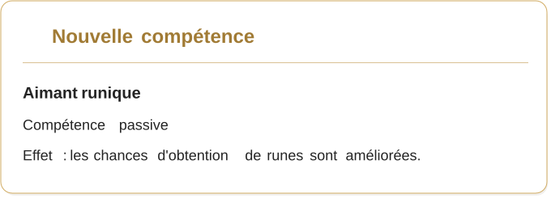
  </picture>
  

    
Version textuelle de la fenêtre

  
Nouvelle compétence

  <h3>Aimant runique</h3>
  
Compétence passive

  
Effet : les chances d'obtention de runes sont améliorées.

  

— Oh !

Hasol relut attentivement la fenêtre avant de regarder l'anneau à son doigt.

— Ray !

Le mage se tourna vers elle.

— Qu'est-ce qu'il y a ?

— Ton anneau vient de me débloquer une compétence !

— Mon anneau ?

— Regarde !

Elle lui présenta la description d'Aimant runique.

Ray ajusta ses lunettes.

— C'est intéressant… Tu sais de combien tes chances sont améliorées ?

— Non, ce n'est pas précisé.

— Il faudra comparer les résultats de tes prochaines expéditions.

Hasol hocha la tête avec enthousiasme.

Samia, qui venait de les rejoindre, consulta à son tour la description.

— Encore plus de runes…

— Tu te rends compte de ce que ça représente pour mon artisanat ?

— Malheureusement, oui.

Yoon rit.

— Ray, je crois que tu viens de lui offrir le meilleur cadeau possible.

Hasol contempla de nouveau son anneau.

— Je crois aussi.

Elle se rapprocha de lui et déposa un baiser sur sa joue.

Ray devint écarlate.

Yoon porta immédiatement une main à sa bouche.

— Oh !

— Pas un mot ! lança Hasol.

Samia secoua la tête.

— Ça va être long, cette expédition…

### III. Les années heureuses

Les fiançailles ne bouleversèrent pas les habitudes des deux chasseurs.

Hasol et Ray continuèrent de consacrer une grande partie de leur temps aux portails et à leurs recherches, tout en prenant régulièrement quelques soirées pour eux.

Iseria et Irène trouvaient également de plus en plus d'occasions de réunir leurs enfants autour d'un repas.

— Vous n'avez toujours pas choisi de date ? demanda un soir Irène.

— Maman… murmura Ray.

— Je pose simplement une question.

— Nous avons le temps, répondit Hasol.

— Bien sûr, intervint Iseria. Absolument tout notre temps.

Irène lui adressa un regard amusé.

Hasol soupira.

— Vous êtes terribles, toutes les deux.

À mesure que les années passaient, Hasol poursuivait ses activités auprès de maître Orven.

Aimant runique lui permettait d'obtenir plus régulièrement de nouvelles pièces, dont certaines présentaient un véritable intérêt pour son équipement.

Maître Orven se réjouissait de cette nouvelle compétence.

— Si tous mes élèves pouvaient obtenir autant de runes que toi…

— Vous manqueriez de place dans votre atelier.

— J'en manque déjà à cause de toi !

Hasol éclata de rire.

Ray continuait de l'aider à rechercher les meilleures combinaisons, tout en perfectionnant son propre équipement.

Leurs discussions se prolongeaient parfois jusque tard dans la soirée.

Il n'était plus rare qu'Hasol s'endorme sur l'épaule de son fiancé, au milieu de leurs ouvrages.

Ray avait appris à poursuivre ses recherches sans la réveiller.

Les quatre écarlates continuaient également de participer régulièrement aux expéditions organisées par les guildes.

Leur présence était particulièrement appréciée des autres chasseurs.

Samia, quant à elle, consacrait une part toujours plus importante de son temps à une tout autre activité.

### IV. La carte de Samia

Les guildes accordaient une importance croissante aux informations fournies par Samia.

Grâce à Écho des Mondes et Vision du Voile, elle était capable de localiser les portails dans les régions qu'elle avait déjà explorées et d'en identifier la couleur.

Hasol la retrouva un après-midi dans une salle où plusieurs officiers préparaient les prochaines interventions.

Samia était penchée sur une grande carte.

— Celui-ci est vert, expliqua-t-elle en désignant un emplacement. Et il y en a un blanc un peu plus au sud.

L'un des officiers ajouta deux marques sur la carte.

— Une estimation de leur ouverture ?

— Toujours pas.

— Nous allons envoyer des éclaireurs.

— Prévenez également les habitants de cette région. Il y a plusieurs exploitations agricoles près du portail vert.

L'officier acquiesça.

Lorsqu'il quitta la salle, Hasol s'approcha de son amie.

— Tu es devenue indispensable, on dirait.

Samia sourit.

— Je préférerais qu'ils arrêtent de venir me chercher pendant mes jours de repos.

— Tu pourrais leur demander de te mettre à disposition une salle entière.

— Ne leur donne pas cette idée !

Hasol observa la carte.

Plusieurs régions étaient couvertes de marques de différentes couleurs.

— Tu as vraiment parcouru tous ces endroits ?

— Pas chaque chemin, évidemment. Mais une bonne partie.

Samia désigna une région de villages agricoles.

— C'est par ici que j'ai grandi.

— Tu y retournes régulièrement ?

— Pas suffisamment au goût de ma tante.

Elle sortit une lettre de sa sacoche.

— D'ailleurs, elle m'a écrit récemment.

— De bonnes nouvelles ?

— Mon petit cousin a décidé qu'il deviendrait chasseur.

Hasol sourit.

— Il a quel genre de classe ?

— Il est encore bien trop jeune pour ça ! Il a fabriqué un arc avec une branche et de la ficelle. Il prétend pouvoir atteindre les pommes du jardin depuis le toit de la remise.

— Et il y arrive ?

— Absolument pas. Mais il aurait déjà cassé deux pots et effrayé toutes les poules.

Hasol éclata de rire.

— Une carrière prometteuse !

Samia replia soigneusement la lettre.

— Il veut que je lui apprenne à tirer. Je lui ai promis de passer dès que j'aurais quelques jours.

— Tu devrais y aller.

— Quand les interventions se calmeront.

— On arrivera très bien à se débrouiller sans toi pendant quelques jours.

Samia regarda Hasol d'un air sceptique.

— Qui va vérifier que tu manges correctement ?

— Ray.

— Alors vous êtes perdus tous les deux.

Hasol rit.

Samia rangea sa lettre avant de reprendre son travail.

### V. Une nouvelle couleur

Un matin, Samia fit une découverte inhabituelle.

Un portail venait d'être détecté dans une région qu'elle connaissait.

Sa couleur n'était ni blanche ni verte.

Elle se rendit immédiatement auprès des responsables de la guilde.

— Un portail bleu ? répéta l'un des officiers.

— Oui.

— Tu en es certaine ?

— Absolument.

Les responsables mobilisèrent rapidement plusieurs équipes.

D'autres signalements confirmèrent bientôt l'apparition de cette nouvelle catégorie de portails.

Les premières expéditions révélèrent des créatures bien plus dangereuses que celles rencontrées jusqu'alors.

  <picture class="lit-window__github-picture">
    <source media="(max-width: 600px)" srcset="assets/fenetres-livre-2/L2-C5-F02-mobile.svg">
    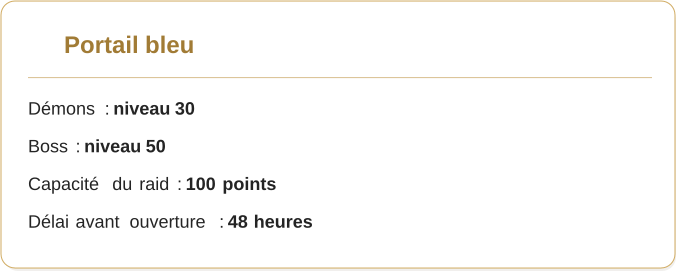
  </picture>
  

    
Version textuelle de la fenêtre

  
Portail bleu

  
Démons : <strong>niveau 30</strong>

  
Boss : <strong>niveau 50</strong>

  
Capacité du raid : <strong>100 points</strong>

  
Délai avant ouverture : <strong>48 heures</strong>

  

Les guildes durent revoir leur organisation.

Les chasseurs capables d'affronter de tels adversaires étaient moins nombreux, et leur répartition entre les différentes interventions devenait difficile.

Samia passa de longues heures auprès des officiers, actualisant leurs cartes à chaque nouvelle détection.

Les quatre écarlates participèrent à plusieurs expéditions contre ces nouveaux portails.

Leurs années de préparation portèrent leurs fruits.

Ray utilisait désormais Fournaise avec une grande maîtrise. Samia ralentissait les créatures qui tentaient de s'échapper de ses flammes, tandis que Yoon soutenait les membres de son groupe.

Hasol alternait les attaques à l'épée et Siphon runique, profitant de ses ensembles Vol de vie pour maintenir sa présence au milieu des démons.

Les portails bleus représentaient une nouvelle étape dans leur progression.

Pour les guildes, en revanche, chaque nouvelle apparition devenait une source d'inquiétude.

### VI. Un portail près de l'Académie

Hasol venait de terminer une commande chez maître Orven lorsqu'elle reçut un message du directeur de l'Académie.

Un portail bleu était apparu à proximité de l'établissement.

Une intervention était en cours de préparation.

Le directeur souhaitait savoir si elle pouvait y participer.

Hasol se rendit à l'Académie dans l'après-midi.

— Hasol ! Je suis heureux que tu sois venue.

— Vous souhaitiez me voir au sujet du portail ?

— Effectivement. Nous avons déjà contacté plusieurs guildes, mais je dois t'avouer que ta présence lors de cette expédition me rassurerait énormément.

Hasol sourit.

— Je participerai au raid.

Le directeur sembla immédiatement soulagé.

— Merci.

Il lui présenta une carte des environs.

— Nous avons interdit aux élèves de s'approcher de cette zone. Certains parents commencent également à s'inquiéter.

— Je comprends. Ray et Yoon pourront certainement m'accompagner.

— Et Samia ?

— Elle passe beaucoup de temps auprès des guildes en ce moment. Je lui demanderai.

Le directeur acquiesça.

— Lorsque je repense à vos premières années ici…

— Quoi donc ?

— J'étais loin d'imaginer que je finirais un jour par solliciter ton aide pour assurer la sécurité de l'Académie.

Hasol éclata de rire.

— Vous étiez pourtant particulièrement exigeant avec moi.

— Et je ne le regrette absolument pas !

Ils discutèrent encore quelques instants avant qu'Hasol ne rejoigne ses compagnons.

### VII. Le village sur la carte

Samia se tenait devant la grande carte de la guilde.

Un officier venait d'ajouter plusieurs marques bleues lorsqu'elle lui demanda de s'arrêter.

— Attendez.

Elle désigna une région à l'écart des autres portails.

— Il y en a un autre, ici.

L'officier récupéra son crayon.

— Quelle couleur ?

Samia ne répondit pas immédiatement.

— Bleu.

Elle se pencha davantage sur la carte.

Son doigt suivit une route avant de s'arrêter sur un petit village.

— Il faut envoyer quelqu'un là-bas.

— Nous allons transmettre l'information.

— Il y a un village juste à côté !

— Samia, nous avons plusieurs interventions en cours. Je vais demander aux guildes de la région quelles équipes sont disponibles.

— Et pour l'évacuation ?

— Nous allons prévenir les autorités locales.

Samia observa encore quelques instants la carte.

— Je vais m'y rendre.

— Attends au moins que nous ayons une réponse concernant les renforts.

— Ma famille vit dans ce village.

L'officier releva les yeux.

— Je comprends. Mais ne tente surtout pas de pénétrer dans ce portail seule.

— Ce n'est pas mon intention.

Samia récupéra ses affaires.

Elle retrouva Hasol et Ray alors qu'ils préparaient leur prochaine expédition.

— Hasol, je ne pourrai pas venir avec vous cette fois-ci.

— Oh ? Quelque chose de prévu ?

— Un portail bleu est apparu près du village de ma tante.

Hasol cessa immédiatement de ranger ses runes.

— Celui dont tu m'avais parlé ?

— Oui.

— Tu sais depuis combien de temps il est là ?

— Non. Je viens seulement de le détecter.

— La guilde envoie une équipe ?

— Ils cherchent des chasseurs disponibles.

Samia vérifia les attaches de sa sacoche.

— Je vais prévenir ma famille et aider les habitants à quitter le village.

Hasol réfléchit quelques instants.

— Tu veux que je vienne avec toi ?

— Tu n'as pas promis au directeur de participer à l'expédition près de l'Académie ?

— Si…

— Alors vas-y. Je ne compte pas combattre le boss toute seule, de toute façon.

Ray intervint.

— Tu nous enverras un message lorsque tu seras arrivée ?

— Bien sûr.

Hasol sourit à son amie.

— Et profite-en pour passer un peu de temps avec ton petit cousin, une fois le portail fermé.

— C'est bien mon intention !

Samia ajusta son arc.

— À bientôt, vous deux.

— À bientôt !

Hasol reprit la préparation de son équipement.

— Tu crois qu'on pourrait trouver quelques chasseurs pour l'aider ? demanda-t-elle à Ray.

— Je vais me renseigner auprès de la guilde avant notre départ.

— Merci.

### VIII. Deux expéditions

Samia arriva au village en fin de journée.

Elle reconnut les terres agricoles, les petites maisons et le chemin qui menait à la demeure de sa tante.

Elle n'avait pas parcouru quelques mètres dans la rue principale qu'une voix familière retentit derrière elle.

— SAMIA !

Un jeune garçon courut dans sa direction.

Il tenait un morceau de bois courbé auquel était attachée une ficelle.

— Regarde !

Samia éclata de rire.

— Alors, c'est donc toi, le terrible chasseur dont tout le monde parle ?

— Regarde mon arc !

Il lui présenta fièrement sa création.

Samia s'accroupit devant lui.

— Pas mal du tout. Mais il faudra revoir la manière dont tu tiens tes flèches.

— Tu vas m'apprendre ?

— Bien sûr !

— Maintenant ?

— Pas tout de suite. Où est ta mère ?

— À la maison !

Il lui prit la main et l'entraîna jusqu'au jardin.

Comme à son habitude, sa tante avait planté de nombreuses fleurs devant la maison.

Lorsqu'elle aperçut Samia, elle abandonna immédiatement ses occupations.

— Tu aurais pu nous prévenir !

Elle la prit chaleureusement dans ses bras.

— Je t'aurais préparé quelque chose !

— Je ne vais malheureusement pas pouvoir rester longtemps.

L'expression de sa tante changea.

— Il y a un problème ?

— Un portail est apparu non loin du village. Il faudrait préparer quelques affaires et quitter les lieux par précaution.

— Un portail ?

— Les guildes sont prévenues. Mais je préférerais que vous soyez tous à l'abri avant leur arrivée.

Sa tante acquiesça.

— Je vais chercher ton oncle.

Le petit garçon leva les yeux vers Samia.

— Tu vas combattre des monstres ?

— J'espère que non.

— Je peux venir avec toi ?

— Certainement pas !

Elle lui ébouriffa les cheveux.

— Ta première mission de chasseur sera d'aider tes parents à préparer leurs affaires.

Il redressa fièrement les épaules.

— D'accord !

Samia sourit.

— Et n'oublie pas ton arc.

Près de l'Académie, Hasol retrouvait les chasseurs mobilisés pour l'expédition.

Le directeur était également présent.

Lorsqu'il aperçut les trois tenues écarlates, il vint immédiatement à leur rencontre.

— Merci à tous les trois.

Yoon lui adressa un sourire.

— Cela faisait longtemps, monsieur le directeur.

— Effectivement ! Je suis heureux de vous revoir, même dans de telles circonstances.

Il remarqua l'anneau d'Hasol.

— Tiens donc…

Hasol suivit son regard.

— Ah, oui…

Elle désigna Ray.

— Nous sommes fiancés.

— Eh bien ! Mes félicitations !

Ray le remercia.

— Vous formiez déjà un duo inséparable à la bibliothèque, poursuivit le directeur. Je suppose que je ne devrais pas être surpris.

Yoon éclata de rire.

— Vous voyez ? Même lui l'avait remarqué !

Hasol soupira.

— On pourrait peut-être se concentrer sur le portail ?

— Excellente idée, répondit Ray.

Une voix familière retentit derrière eux.

— Bonjour à tous !

Yoon se retourna immédiatement.

— Zio !

Elle courut rejoindre son frère et le prit dans ses bras.

— Tu participes aussi à l'expédition ?

— Oui, le directeur m'a appelé. Il m'a demandé si je pouvais me libérer pour ce portail.

— C'est génial ! Ça fait longtemps qu'on n'a pas combattu ensemble !

Zio sourit avant de s'approcher de Ray et Hasol.

Machinalement, Hasol recouvrit son anneau de son autre main.

— Comment allez-vous ? demanda Zio.

— Très bien ! répondit Ray. Et toi ?

— Pas de quoi me plaindre.

— Tu aurais pu nous prévenir que tu venais ! ajouta Yoon.

— Et gâcher la surprise ?

Yoon lui donna un léger coup d'épaule.

— Idiot !

Le directeur sourit en observant ses anciens élèves.

— Avec vous quatre, je crois que je vais enfin pouvoir dormir tranquillement.

— Vous pouvez compter sur nous, lui assura Zio.

Les chasseurs terminèrent leurs préparatifs avant de rejoindre les autres membres du raid.

### IX. Avant l'arrivée des renforts

L'évacuation du village avait commencé.

Samia parcourait les rues pour s'assurer que chaque famille avait été informée.

Certaines avaient déjà quitté les lieux. D'autres préparaient leurs charrettes ou rassemblaient leurs animaux.

Quelques habitants hésitaient encore à abandonner leurs maisons.

— Les guildes vont fermer le portail, leur expliquait Samia. Vous pourrez revenir dès que la région sera sécurisée.

Elle rejoignit un petit groupe de chasseurs venus des environs.

— Vous avez reçu des nouvelles des renforts ?

— Une équipe doit nous rejoindre, mais elle termine une autre intervention.

— Quand ?

— On ne sait pas encore.

Samia regarda en direction des terres agricoles.

— Il faut accélérer l'évacuation.

Les chasseurs se répartirent dans le village.

Samia retourna auprès de sa famille.

Son oncle terminait de charger quelques provisions sur une charrette.

— Tout est prêt !

— Parfait. Rejoignez les autres habitants sur la route principale.

— Et toi ?

— Je vais aider les derniers à partir.

Sa tante lui prit la main.

— Ne reste pas trop longtemps.

— Ne t'inquiète pas.

Samia se pencha vers son petit cousin.

— Alors, ta mission est terminée ?

Il hocha fièrement la tête.

— J'ai aidé maman !

— Excellent travail !

Elle lui adressa un clin d'œil avant de s'éloigner.

Un cri retentit à l'entrée du village.

Samia se retourna.

Un chasseur courait dans leur direction.

— LE PORTAIL S'EST OUVERT !

Elle saisit immédiatement son arc.

Des silhouettes rouges apparurent au loin.

Les premiers démons avaient franchi le portail.

— Faites partir les habitants !

Les chasseurs présents se précipitèrent vers les rues les plus exposées.

Samia décocha une première flèche.

— Flèche du Néant !

Le projectile frappa un démon qui se dirigeait vers une charrette.

— Flèche d'entrave !

La créature ralentit suffisamment pour permettre aux habitants de s'éloigner.

Un autre chasseur vint se placer auprès d'elle.

— Ils sont trop nombreux !

— Il faut tenir jusqu'à ce que les derniers habitants soient partis !

Samia décocha plusieurs nouvelles flèches.

Au loin, d'autres démons apparaissaient déjà.

### X. Le portail de l'Académie

— Fournaise !

Les flammes de Ray engloutirent un groupe de démons.

Zio maintenait les démons à distance des autres chasseurs, son bouclier levé. Lorsque les flammes s'éteignirent, Hasol s'élança vers les créatures encore debout.

— Siphon runique !

Une violente onde de vent frappa les démons qui l'entouraient.

Elle acheva les survivants à l'épée tandis que Yoon veillait sur les membres de son groupe.

Les chasseurs poursuivirent leur avancée jusqu'à atteindre le boss.

L'affrontement fut particulièrement intense, mais leur coordination permit de maintenir la pression sur la créature.

Lorsque le boss s'effondra, plusieurs chasseurs laissèrent échapper des cris de victoire.

Hasol rangea son épée.

— Tout le monde va bien ?

Yoon acquiesça.

— Quelques blessés, mais rien de grave.

Zio abaissa son bouclier et rejoignit sa sœur.

Ray s'approcha d'elles.

— On devrait aller retrouver Samia après notre retour.

— Bonne idée, répondit Hasol. On pourra peut-être encore l'aider à fermer son portail.

Les trois chasseurs rejoignirent la sortie.

Le directeur les attendait à l'extérieur avec plusieurs responsables de l'Académie.

— Le portail est fermé ?

— Oui, répondit Hasol.

Un immense soulagement apparut sur son visage.

— Je ne sais comment vous remercier.

— Vous n'avez plus à vous inquiéter.

Yoon retira son masque.

— Et vous pouvez rassurer vos élèves.

Le directeur leur serra chaleureusement la main.

Ils discutèrent encore quelques instants avant de prendre congé.

Ray se rendit directement auprès d'un représentant de la guilde.

— Avez-vous reçu des informations concernant le portail situé près des villages agricoles ?

L'homme consulta ses documents.

— Lequel ?

Ray lui indiqua l'emplacement que Samia leur avait communiqué.

L'expression du représentant changea.

— Des renforts ont été envoyés. Mais le portail s'est ouvert avant leur arrivée.

Hasol se rapprocha.

— Les habitants ont été évacués ?

— L'évacuation était encore en cours lorsque les premières créatures ont atteint le village.

— Et les chasseurs qui étaient sur place ?

— Nous attendons toujours un rapport complet.

Hasol regarda Ray.

— On y va.

### XI. Le dernier combat de Samia

Une partie du village était déjà en flammes.

Samia se déplaçait entre les maisons, attirant l'attention des démons qui se rapprochaient des habitants.

— Traversée du voile !

Elle se déplaça rapidement jusqu'à une clôture située quelques mètres plus loin et décocha une nouvelle flèche.

Deux chasseurs tentaient de retenir les créatures à l'entrée d'une rue.

— Il faut reculer ! cria l'un d'eux.

Samia regarda derrière elle.

Plusieurs familles étaient encore présentes.

Parmi elles se trouvaient sa tante, son oncle et ses cousins, dont la charrette avait été abandonnée après avoir heurté des débris.

— Par ici !

Elle leur indiqua une rue encore accessible.

Les habitants se mirent à courir.

Samia aperçut soudain son petit cousin.

Il s'était arrêté près de la charrette.

— Qu'est-ce que tu fais ?!

— Mon arc !

— LAISSE-LE !

Le garçon sursauta.

Un démon apparut à l'extrémité de la rue.

Samia leva son arme.

— Flèche d'entrave !

La créature ralentit.

— Cours !

Sa tante récupéra le garçon et l'entraîna avec elle.

Samia continua de tirer.

Une flèche.

Puis une autre.

Les créatures se rapprochaient malgré ses efforts.

Elle recula progressivement afin de couvrir la fuite des derniers habitants.

Un chasseur tenta de la rejoindre.

— Samia ! Il faut partir !

— Emmène-les !

Elle décocha une nouvelle Flèche du Néant.

— Je vous rejoins !

Le chasseur hésita avant de courir vers les habitants.

Samia consulta brièvement sa réserve de Mana.

Elle devenait dangereusement faible.

Elle chercha un nouvel itinéraire.

Plusieurs démons occupaient désormais la rue par laquelle elle comptait se retirer.

Elle aperçut un passage entre deux maisons.

— Traversée du voile !

Elle échappa de justesse à une attaque.

Mais un autre démon la frappa avant qu'elle puisse reprendre sa course.

Une douleur fulgurante lui traversa le flanc.

Samia tomba à genoux.

Son arc lui échappa des mains.

Elle le récupéra difficilement et tenta de se relever.

Au loin, elle aperçut les derniers habitants qui atteignaient les terres agricoles.

Son petit cousin courait auprès de sa mère.

Elle esquissa un sourire.

— C'est bien…

Un démon se rapprocha d'elle.

Samia leva une dernière fois son arc.

### XII. Le village qui n'existe plus

Hasol, Ray et Yoon chevauchèrent aussi rapidement qu'ils le purent.

Ils croisèrent plusieurs groupes d'habitants accompagnés de chasseurs.

Certains étaient blessés.

D'autres avaient abandonné toutes leurs possessions.

En apercevant les premières maisons détruites, Hasol sentit son cœur se serrer.

Elle descendit de cheval avant même d'avoir atteint le centre du village.

— SAMIA !

Personne ne répondit.

Des équipes de secours parcouraient les rues.

Les renforts étaient finalement arrivés. Le portail avait été fermé et les derniers démons avaient été éliminés.

Hasol se précipita vers un chasseur.

— Vous avez vu une femme aux cheveux argentés ? Elle porte une tenue écarlate et utilise un arc !

L'homme regarda ses vêtements.

— Vous êtes ses compagnons ?

— Oui !

Il hésita.

Yoon s'approcha.

— Où est-elle ?

— Venez avec moi.

Ils traversèrent la place du village.

Hasol aperçut un puits, une vieille fontaine, plusieurs maisons effondrées et des habitants réunis autour des soigneurs.

Le chasseur les conduisit jusqu'à un bâtiment partiellement préservé.

Plusieurs corps avaient été recouverts de couvertures.

Hasol s'arrêta.

— Non…

Ray se plaça immédiatement auprès d'elle.

Le chasseur s'approcha de l'une des couvertures.

— Elle a aidé à évacuer les derniers habitants. Lorsque les renforts sont arrivés, il était déjà trop tard.

Hasol secoua la tête.

Elle avança lentement.

Un arc reposait à côté de la couverture.

Elle le reconnut immédiatement.

Yoon porta une main à sa bouche.

Hasol s'agenouilla.

Elle souleva délicatement la couverture.

Les cheveux argentés de Samia étaient couverts de poussière.

Hasol lui prit la main.

— Samia…

Ray baissa les yeux.

Yoon s'effondra à genoux auprès de son amie.

Hasol attendit une réaction.

Un mouvement.

Quelque chose.

Mais la main de Samia était froide.

Un peu plus tard, une femme vint les retrouver.

Un jeune garçon l'accompagnait.

— Vous êtes les amies de Samia ?

Yoon essuya ses larmes.

— Oui.

La femme tenta de parler.

Sa voix se brisa.

— Elle nous a sauvés.

Elle serra son fils contre elle.

— Sans elle, nous n'aurions jamais réussi à quitter le village.

Le garçon regarda Hasol.

— Vous êtes une chasseuse aussi ?

Hasol acquiesça difficilement.

— Samia est restée derrière pour nous laisser le temps de fuir…

Il baissa les yeux.

— Elle m'avait promis de m'apprendre à tirer à l'arc.

Il baissa les yeux.

— J'ai perdu le mien.

Hasol ne trouva rien à lui répondre.

Elle se souvint de la lettre que Samia lui avait montrée.

Des deux pots cassés.

Des poules effrayées.

Elle se tourna vers Ray et enfouit son visage contre sa poitrine.

Il la serra dans ses bras.

### XIII. Trois coups

Quelques jours plus tard, Hasol retrouva Ray à la bibliothèque.

Elle n'avait pas participé à la moindre expédition depuis leur retour.

Ray avait apporté plusieurs ouvrages, mais aucun des deux ne parvenait véritablement à se concentrer.

Hasol contemplait son anneau.

— Ray…

— Oui ?

— Tu te souviens du jour où Samia nous a laissés seuls pour discuter de mes trente-six cercles ?

— Bien sûr.

— Elle disait qu'elle ne voulait pas nous écouter débattre pendant deux heures de mes statistiques.

Ray esquissa un triste sourire.

— Elle avait probablement raison.

Hasol tenta de sourire à son tour.

Les larmes lui montèrent aux yeux.

— Elle me manque.

Ray posa sa main sur la sienne.

— À moi aussi.

Hasol baissa la tête.

— J'aurais dû l'accompagner.

— Tu ne pouvais pas savoir ce qui allait se passer.

— Elle m'avait dit où se trouvait le portail.

— Hasol…

— Elle était juste devant moi, Ray. Elle m'a dit qu'elle partait retrouver sa famille.

Sa voix tremblait.

— Et je lui ai dit à bientôt.

Ray vint s'asseoir auprès d'elle.

Hasol posa sa tête contre son épaule.

Il lui caressa doucement les cheveux.

Elle ferma les yeux.

Un son grave retentit.

**DONG.**

Hasol releva la tête.

**DONG.**

**DONG.**

Elle regarda autour d'elle.

— Ray ?

**DONG.**

**DONG.**

**DONG.**

Les doigts de Ray étaient toujours posés sur les siens.

**DONG.**

**DONG.**

**DONG.**

Hasol contempla une dernière fois son anneau.

**DONG.**

**DONG.**

**DONG.**

Puis le son changea.

**DING.**

**DING.**

**DING.**

La bibliothèque disparut.

*Fin du chapitre 5 — Le village sur la carte.*

---

## Chapitre 6 — Préparer une place pour les vivants

### I. Deux souvenirs, un seul rêve

— Zio !

Yoon courut rejoindre son frère et le prit dans ses bras.

— Tu participes aussi à l'expédition ?

— Oui, le directeur m'a appelé. Il m'a demandé si je pouvais me libérer pour ce portail.

— C'est génial ! Ça fait longtemps qu'on n'a pas combattu ensemble !

Zio sourit avant de s'approcher de Ray et Hasol.

Machinalement, Hasol recouvrit son anneau de son autre main.

— Comment allez-vous ?

— Très bien ! répondit Ray. Et toi ?

— Pas de quoi me plaindre.

Dans son sommeil, Hasol fronça légèrement les sourcils et se retourna dans son lit.

Les voix de ses compagnons s'estompèrent progressivement.

Un village dévasté.

Des maisons effondrées.

Un petit garçon se tenait devant elle.

— Samia est restée derrière pour nous laisser le temps de fuir…

Il baissa les yeux.

— Elle m'avait promis de m'apprendre à tirer à l'arc.

Hasol aperçut Ray à ses côtés.

Elle enfouit son visage contre sa poitrine et se mit à pleurer.

Hasol ouvrit brutalement les yeux.

— Samia !

Elle se redressa dans son lit.

Pendant plusieurs minutes, elle tenta de remettre de l'ordre dans ses pensées.

Ce garçon ne pouvait être que le petit cousin dont Samia lui avait parlé.

Mais pourquoi avait-elle également rêvé de Zio ?

Elle regarda l'anneau à son doigt.

— Pourquoi est-ce que je cachais ma bague ?

Elle resta un moment perplexe avant de repousser sa couverture.

Les premières lueurs du jour n'étaient pas encore visibles.

Hasol descendit dans le salon, se servit un verre d'eau et s'installa sur le canapé.

Elle repensa à ses anciens rêves.

À Siphon runique.

À Ray et ses lunettes.

Cette fois, elle ne prendrait aucun risque.

### II. Un changement de programme

Plus tard dans la matinée, Hasol retrouva Ray pour préparer leur expédition près de l'Académie.

— Tu as mal dormi ? demanda-t-il.

— Un peu.

— Tu devrais te reposer avant le raid.

— Ça ira, ne t'inquiète pas.

Elle terminait de vérifier son équipement lorsque Samia arriva.

— Hasol, je ne pourrai pas venir avec vous cette fois-ci.

La jeune femme releva immédiatement les yeux.

— Pourquoi ?

— Un portail bleu est apparu près du village de ma tante.

Hasol déposa la rune qu'elle tenait entre ses doigts.

— Je viens avec toi.

Samia la regarda avec étonnement.

— Mais je ne t'ai même pas encore expliqué ce que je comptais faire !

— Tu vas prévenir ta famille et aider les habitants à évacuer le village, n'est-ce pas ?

— Oui… Comment le sais-tu ?

— C'est ce que j'aurais fait à ta place.

Samia haussa les épaules.

— Et le directeur de l'Académie ? Tu lui avais promis de participer au raid.

Hasol se tourna vers Ray.

— Vous devriez pouvoir vous en sortir avec Yoon et Zio.

— Zio ? répéta Ray.

— Il devrait également participer à votre expédition.

— Tu lui as parlé ?

— Non.

Ray ajusta ses lunettes.

— Alors comment…

— Tu peux me faire confiance ?

Il observa quelques instants sa fiancée.

— Évidemment.

Hasol lui prit la main.

— J'aimerais que vous terminiez votre expédition aussi rapidement que possible. Dès que vous aurez fermé le portail, rejoignez-nous au village avec les chasseurs qui accepteront de vous accompagner.

— D'accord.

Samia croisa les bras.

— Tu sais, Hasol, je ne comptais pas pénétrer seule dans ce portail.

— Je sais.

— Tu n'es donc pas obligée de venir.

Hasol récupéra son épée.

— Tant mieux, parce que je viens quand même.

Samia finit par sourire.

— Tu es vraiment têtue.

— Depuis le temps, tu devrais le savoir.

### III. Le frère de Yoon

Près de l'Académie, le directeur accueillit Ray et Yoon.

— Hasol ne vous accompagne pas ?

— Samia a détecté un portail près de son village natal, expliqua Ray. Hasol est partie avec elle.

— Oh… Je comprends.

Yoon lui adressa un sourire.

— Ne vous inquiétez pas, monsieur le directeur. Nous allons nous en occuper.

Une voix familière retentit derrière eux.

— Bonjour à tous !

Yoon se retourna.

— Zio !

Elle courut rejoindre son frère et le prit dans ses bras.

— Tu participes aussi à l'expédition ?

— Oui, le directeur m'a appelé. Il m'a demandé si je pouvais me libérer pour ce portail.

— C'est génial ! Ça fait longtemps qu'on n'a pas combattu ensemble !

Zio sourit avant de s'approcher de Ray.

— Comment vas-tu ?

— Très bien… Et toi ?

— Pas de quoi me plaindre.

Ray demeura silencieux quelques instants.

Comment Hasol avait-elle pu savoir que Zio participerait à cette expédition ?

— Hasol et Samia ne viennent pas ? demanda Zio.

— Elles sont parties vers un autre portail. On leur a promis de les rejoindre dès que nous aurons terminé ici.

— Dans ce cas, ne perdons pas de temps.

Le directeur leur adressa un sourire.

— Je vous confie la sécurité de l'Académie.

Zio ajusta son bouclier.

— Vous pouvez compter sur nous.

### IV. Le village de Samia

Les deux jeunes femmes arrivèrent au village en fin de journée.

Samia ralentit son cheval à l'approche des premières habitations.

— Ça faisait longtemps que je n'étais pas venue ici.

Hasol observa les maisons et les terres agricoles qui les entouraient.

Tout était intact.

Des enfants jouaient dans la rue tandis que plusieurs habitants terminaient leurs occupations.

— SAMIA !

Un jeune garçon courut dans leur direction.

Il tenait un morceau de bois courbé auquel était attachée une ficelle.

— Regarde !

Samia descendit de cheval et éclata de rire.

— Alors, c'est donc toi, le terrible chasseur dont tout le monde parle ?

— Regarde mon arc !

Hasol resta immobile.

Elle reconnut immédiatement le visage du garçon.

— Hasol, viens ! Je vais te présenter ma famille.

La jeune femme descendit à son tour de cheval.

— Bonjour, répondit-elle en souriant au petit garçon.

— Tu es une chasseuse, toi aussi ?

— Oui.

— Tu utilises un arc ?

— Une épée.

— Oh !

Il observa attentivement l'arme d'Hasol avant de lui présenter son arc.

— Samia va m'apprendre à tirer !

— Tu as choisi un excellent professeur.

Samia lui ébouriffa les cheveux.

— Allez, conduis-nous jusqu'à ta mère.

Le garçon lui prit la main.

Hasol les suivit.

Lorsqu'elles arrivèrent devant la maison, Samia retrouva sa tante occupée à entretenir ses fleurs.

— Tu aurais pu nous prévenir !

Elle abandonna immédiatement ses occupations pour prendre sa nièce dans ses bras.

— Et tu as amené une amie !

— Je te présente Hasol.

— Enchantée, répondit la jeune femme.

— C'est donc toi, la fameuse Hasol dont Samia nous parle régulièrement ?

Hasol sourit.

— J'espère qu'elle vous en dit du bien.

— La plupart du temps, répondit Samia.

— Hé !

Sa tante éclata de rire.

— Venez, je vais vous préparer quelque chose.

— Malheureusement, nous ne sommes pas venues pour nous reposer, expliqua Samia.

Elle lui annonça la présence du portail bleu et lui demanda de préparer les affaires nécessaires pour quitter temporairement le village.

Pendant ce temps, Hasol observa le jardin.

Les fleurs étaient magnifiques.

— Samia, on devrait commencer l'évacuation immédiatement.

— C'est ce que j'avais prévu.

— Il faudrait également demander aux chasseurs présents de surveiller les environs du portail. Nous pourrions tenir les créatures à distance du village si elles commencent à en sortir.

Samia réfléchit quelques instants.

— Bonne idée.

Elle se tourna vers son petit cousin.

— Tu vas devoir m'aider.

— Moi ?

— Oui. Ta première mission de chasseur sera d'aider tes parents à préparer leurs affaires.

Le garçon redressa fièrement les épaules.

— D'accord !

### V. Deux fronts

Près de l'Académie, les chasseurs progressaient rapidement à l'intérieur du portail.

— Domaine des Entraves runiques !

Un cercle violet apparut sous les pieds des démons.

Zio s'avança, son bouclier levé.

— Défi du Gardien !

L'une des créatures se détourna des autres chasseurs pour se précipiter dans sa direction.

— Ray, maintenant !

— Déflagration !

Une explosion de feu frappa les démons ralentis par Yoon.

Zio acheva celui qui se trouvait devant lui avant de rejoindre les autres combattants.

Ray consulta brièvement sa réserve de Mana.

— On peut continuer.

Yoon le regarda avec amusement.

— Tu es particulièrement pressé aujourd'hui.

— J'ai promis à Hasol de la rejoindre rapidement.

— Ah, les jeunes fiancés…

— Yoon !

Zio tourna la tête vers Ray.

— Vous êtes fiancés ?

— Oui.

— Eh bien, félicitations ! Depuis combien de temps ?

— Quelques années déjà.

— Et vous n'avez toujours pas prévu de mariage ?

Yoon leva les bras.

— Merci ! Enfin quelqu'un qui pose la bonne question !

— On pourrait terminer ce portail avant d'en parler ? demanda Ray.

— Très bien, répondit Zio en souriant.

Il reprit sa place à l'avant de la formation.

Au village, les derniers préparatifs de l'évacuation étaient en cours.

Hasol et Samia avaient retrouvé plusieurs chasseurs de la région.

Ils s'étaient réparti les tâches. Certains accompagnaient les habitants tandis que les autres surveillaient les environs du portail.

Hasol se trouvait parmi ces derniers.

Elle avait déjà imprégné son épée d'une aura élémentaire et préparé plusieurs runes dans son anneau.

— Tu as prévu de combattre tous les démons toute seule ? lui demanda Samia en la rejoignant.

— Seulement ceux qui ne voudront pas attendre Ray et Yoon.

Samia sourit.

— Ma famille est presque prête à partir.

— Parfait.

Elles observèrent le portail.

— Tu sais, Hasol, tu n'étais vraiment pas obligée de venir.

— Et manquer l'occasion de rencontrer le célèbre fabricant d'arcs ?

Samia éclata de rire.

— Je te préviens, si tu lui offres des runes, ma tante risque de ne jamais te pardonner.

— Je lui offrirai plutôt un véritable arc lorsqu'il sera plus grand.

Samia lui donna un léger coup d'épaule.

— Marché conclu.

### VI. Avant qu'il ne soit trop tard

Le portail s'ouvrit alors que les derniers habitants quittaient le village.

Les premiers démons apparurent.

— Prévenez les autres chasseurs ! ordonna Samia.

Hasol enfila son masque et dégaina son épée.

Deux créatures se précipitèrent vers elle.

Elle esquiva la première attaque avant de frapper son adversaire au flanc.

— Flèche du Néant !

Le projectile de Samia atteignit le second démon.

Hasol l'acheva avant de s'avancer vers les créatures suivantes.

Elles combattirent ainsi pendant plusieurs minutes.

Lorsque les démons commencèrent à se regrouper autour d'Hasol, celle-ci activa sa compétence.

— Siphon runique !

Une violente onde de vent frappa les créatures qui l'entouraient.

Elle profita du Mana récupéré pour poursuivre le combat.

Derrière elle, Samia surveillait les déplacements des démons.

— Flèche d'entrave !

L'une des créatures qui tentait de contourner Hasol ralentit suffisamment pour permettre à un autre chasseur de l'intercepter.

— Il y en a d'autres qui arrivent ! cria-t-il.

Hasol leva les yeux vers le portail.

De nouvelles silhouettes rouges en sortaient.

— Reculez vers le village !

Les chasseurs se replièrent progressivement.

Samia se déplaça jusqu'à un point depuis lequel elle pouvait surveiller la route empruntée par les habitants.

Au loin, elle aperçut la charrette de son oncle.

Puis son petit cousin, assis auprès de sa mère.

Elle sourit.

Ils étaient suffisamment éloignés.

— Hasol ! Les habitants sont presque tous partis !

— Très bien !

Hasol repoussa un démon d'un coup d'épée.

Les deux jeunes femmes continuèrent de combattre côte à côte.

À plusieurs reprises, Samia dut utiliser Traversée du voile pour se repositionner et éviter les créatures qui s'approchaient d'elle.

Mais les chasseurs commençaient à fatiguer.

Leurs réserves de Mana diminuaient et de nouveaux démons continuaient d'apparaître.

— On va devoir reculer encore, annonça Samia.

Hasol acquiesça.

C'est alors qu'une voix familière retentit derrière elles.

— Déflagration !

Une explosion de feu frappa les démons.

— Ray !

Plusieurs chasseurs arrivaient en renfort.

À leur tête se trouvaient Ray, Yoon et Zio.

— Désolé pour le retard ! lança Ray.

— Tu as été suffisamment rapide !

Yoon s'approcha immédiatement des deux jeunes femmes.

— Chant runique !

Un cercle vert apparut sous leurs pieds.

— Vous allez bien ?

— Quelques égratignures, répondit Samia.

Zio vint se placer devant elles.

Il leva son bouclier pour intercepter une attaque destinée à Hasol.

— Rempart de lumière !

Une protection lumineuse se déploya devant lui.

— Reprenez votre souffle. On prend le relais.

Hasol recula de quelques pas avant de consulter ses réserves de Mana.

— Samia, reste auprès de Yoon. Je retourne au combat.

Zio laissa retomber sa protection lumineuse avant de reprendre sa progression. Hasol le rejoignit alors qu'il repoussait un démon avec son bouclier.

Celui-ci pivota légèrement sur sa gauche.

Avant même qu'il ait terminé son mouvement, Hasol s'était déjà engouffrée dans l'ouverture.

Son épée traversa le flanc de la créature.

Zio lui adressa un regard surpris.

Un second démon s'approcha par la droite. Hasol poursuivit son attaque sans se retourner.

Zio intercepta le coup qui lui était destiné.

Elle profita aussitôt de la proximité du démon pour l'abattre.

Les deux chasseurs avancèrent.

Lorsqu'Hasol reculait, Zio prenait immédiatement sa place. Lorsqu'il repoussait un adversaire, elle se trouvait déjà en position pour le frapper.

Ils n'avaient pratiquement pas besoin de se parler.

Hasol semblait savoir exactement quand Zio allait avancer, reculer ou lever son bouclier.

De son côté, Zio adapta rapidement ses mouvements aux siens.

Un démon tenta de contourner le jeune homme.

Hasol l'intercepta avant même qu'il ait besoin de se retourner.

— Merci !

— Chacun son tour !

Zio éclata de rire.

Depuis l'arrière de la formation, Yoon observait les deux chasseurs avec étonnement.

— On dirait qu'ils combattent ensemble depuis des années.

Samia acquiesça.

— C'est pourtant rare de les voir combattre côte à côte.

Un peu plus tard, Zio profita d'un court répit pour s'adresser à Hasol.

— Comment fais-tu pour anticiper aussi bien mes mouvements ?

— Je ne sais pas… Je trouve ta manière de combattre assez prévisible.

— Je dois prendre ça comme un compliment ?

— Évidemment !

— Eh bien, ce n'est pas l'avis de tout le monde…

— Pourtant, je trouve ça plutôt naturel.

Zio sourit.

— Dans ce cas, ne change rien !

Les deux chasseurs reprirent leur progression.

### VII. Tous ensemble

Les renforts permirent aux chasseurs de reprendre l'avantage.

Zio et Hasol maintenaient leur position au front, soutenus par plusieurs autres combattants.

Ray et Samia réduisaient progressivement le nombre de démons tandis que Yoon s'occupait des blessés.

Lorsque la situation fut suffisamment maîtrisée à l'extérieur, une partie des chasseurs resta auprès du village pour en assurer la protection.

Les autres pénétrèrent dans le portail.

Hasol et Samia participèrent toutes deux à l'expédition.

Il leur fallut encore plusieurs heures pour atteindre le boss.

Zio maintint l'attention de la créature avec l'aide des autres combattants défensifs. Hasol combattait à ses côtés, profitant de chaque ouverture pour frapper.

Samia exploitait sa mobilité pour attaquer depuis différentes positions.

— Écartez-vous ! lança Ray.

Hasol recula. Zio s'écarta à son tour pour laisser à Ray une ligne de tir dégagée.

— Déflagration !

Une violente explosion de feu frappa la créature.

Hasol s'élança aussitôt après la disparition des flammes.

Zio dévia une attaque du boss avec son bouclier, lui permettant d'atteindre son flanc.

Son épée imprégnée fendit l'air.

La créature chancela.

Les dernières attaques des chasseurs finirent par l'abattre.

— Enfin ! s'exclama Samia.

Hasol rengaina son épée et retira son masque.

— On l'a fait.

Samia sourit.

— Oui !

Zio observa les deux jeunes femmes.

— Vous avez bien fait de venir ici toutes les deux. Vu le nombre de démons qui étaient déjà sortis, je n'imagine pas l'état dans lequel nous aurions retrouvé le village sans vous.

Hasol tourna les yeux vers Samia.

Elle ne répondit pas.

À leur sortie, les derniers démons avaient été éliminés.

Les habitants commencèrent progressivement à revenir.

Quelques bâtiments avaient subi des dégâts, mais le village avait été préservé.

Samia retrouva rapidement sa famille.

Son petit cousin courut dans sa direction.

— SAMIA !

Elle s'accroupit pour l'accueillir dans ses bras.

— Alors, tu as bien rempli ta mission ?

— Oui ! Et j'ai même aidé papa avec la charrette !

— Je suis fière de toi.

Il lui présenta son arc.

— Tu vas pouvoir m'apprendre maintenant ?

Samia regarda sa tante.

— Tu crois que je peux rester quelques jours ?

— Évidemment !

Hasol s'approcha d'eux.

Le petit garçon leva les yeux vers elle.

— Samia va m'apprendre à tirer à l'arc !

— Je sais.

Elle sourit.

— Écoute bien tout ce qu'elle te dira.

Samia remarqua que les yeux de son amie étaient humides.

— Hasol ?

— Viens là, toi !

Hasol la prit brusquement dans ses bras.

— Mais qu'est-ce qui te prend ?

— Rien.

Samia rit avant de lui rendre son étreinte.

— Tu es vraiment bizarre, parfois.

### VIII. Une soirée au village

La tante de Samia insista pour accueillir les compagnons de sa nièce autour d'un repas.

Les chasseurs acceptèrent avec plaisir.

Quelques tables furent installées dans le jardin.

Le petit cousin de Samia s'intéressa immédiatement au bouclier de Zio.

— Il est lourd ?

— Un peu.

— Je peux le porter ?

Zio déposa son bouclier devant lui.

— Essaie.

Le garçon saisit les poignées et tenta de le soulever.

Il ne parvint qu'à le faire légèrement basculer.

— Il est trop lourd !

— Tu as encore quelques années pour t'entraîner.

— Mais moi, je serai archer !

— Alors tu auras besoin de quelqu'un pour te protéger.

Yoon sourit.

— Tu essaies déjà de recruter de nouveaux chasseurs ?

— Il faut bien préparer la relève.

Le repas se déroula dans la bonne humeur.

Samia raconta plusieurs anecdotes de son enfance, dont certaines firent particulièrement rire ses compagnons.

Hasol, assise à côté de Ray, observait son amie.

Elle parlait, riait et se disputait gentiment avec son petit cousin.

Ray se pencha vers Hasol.

— Ça va mieux ?

— Beaucoup mieux.

Elle posa sa tête contre son épaule.

— Merci d'être venu aussi rapidement.

— Je te l'avais promis.

Hasol entrelaça ses doigts aux siens.

Un peu plus tard, Samia leur annonça qu'elle resterait quelques jours auprès de sa famille.

— Ne vous inquiétez pas, dit-elle. Je reviendrai surveiller vos repas dès la semaine prochaine.

— Profites-en plutôt pour te reposer, répondit Hasol.

— C'est prévu !

Hasol lui adressa un sourire.

Pour une fois, elle était heureuse de devoir se séparer d'elle.

### IX. Une question de mariage

Les mois passèrent.

Samia reprit ses activités auprès des guildes et retourna régulièrement dans son village.

Son petit cousin lui écrivait désormais lui-même pour lui raconter ses progrès.

Hasol avait tenu parole. Avec l'autorisation de sa tante, elle lui avait fait parvenir un véritable arc adapté à sa taille.

Elle reçut en retour un dessin représentant les cinq chasseurs.

Ray était reconnaissable à ses lunettes, Zio à son immense bouclier et Hasol à son masque de démon.

— Pourquoi suis-je aussi petite ? demanda Yoon en découvrant le dessin.

— Il a probablement voulu respecter les proportions, répondit Samia.

— Pardon ?!

Hasol éclata de rire.

Elle conserva précieusement le dessin.

Un soir, alors qu'elle dînait avec Ray, Hasol contempla son anneau.

— Dis-moi…

— Oui ?

— Tu as toujours envie de m'épouser ?

Ray manqua de s'étouffer.

— Quelle question !

— Réponds-moi !

— Bien sûr que oui !

Hasol sourit.

— Alors, pourquoi est-ce qu'on ne commencerait pas à réfléchir à une date ?

Ray posa ses couverts.

— Tu es sérieuse ?

— Absolument.

— Mais tu m'avais dit que tu souhaitais prendre ton temps.

— Je crois qu'on en a pris suffisamment, non ?

Ray resta silencieux quelques instants.

— Tu es certaine de toi ?

Hasol acquiesça.

— Oui.

Un large sourire apparut sur le visage de Ray.

Il lui prit la main.

— Dans ce cas, avec plaisir.

Elle sourit en observant son fiancé.

— Le plus difficile sera probablement de l'annoncer à nos mères.

— Tu crois ?

— Tu imagines leur réaction ?

Ray réfléchit.

— On pourrait peut-être leur envoyer une lettre et partir quelques jours en chasse.

Hasol éclata de rire.

— Excellente idée !

### X. Deux mères impatientes

— ENFIN !

Hasol sursauta.

Iseria venait de se lever de sa chaise.

— Maman !

— Depuis le temps que nous attendons cette nouvelle !

Irène se leva à son tour pour prendre son fils dans ses bras.

— Félicitations, mon chéri !

Ray regarda Hasol.

— La lettre aurait été une meilleure idée.

— Je te l'avais dit.

Les deux jeunes gens éclatèrent de rire.

Iseria s'installa auprès de sa fille.

— Alors, vous avez réfléchi à la cérémonie ?

— Pas encore.

— Et à la robe ?

— Maman, on vient seulement de vous annoncer la nouvelle !

— Justement ! Il va falloir s'en occuper.

Irène acquiesça.

— Nous pourrions commencer par établir une liste d'invités.

— Et trouver un endroit suffisamment agréable pour la réception, ajouta Iseria.

Hasol observa Ray.

— Je crois qu'on vient de perdre le contrôle de notre mariage.

— Je crois aussi.

Iseria lui prit les mains.

— Ne t'inquiète pas, ma chérie. Laisse-moi au moins m'occuper de ta robe.

Hasol sourit.

— D'accord. Mais pas de dépenses extravagantes !

Sa mère lui adressa un sourire innocent.

— Évidemment.

Hasol soupira.

— Pourquoi est-ce que je ne te crois pas ?

### XI. D'étranges visiteurs

Les préparatifs du mariage occupèrent une partie des semaines suivantes.

Hasol continuait néanmoins de travailler auprès de maître Orven et de participer aux expéditions organisées par les guildes.

La nouvelle de son futur mariage se répandit rapidement parmi les chasseurs.

Yoon n'y était probablement pas étrangère.

Un après-midi, Ray retrouva Hasol à la bibliothèque.

— Il m'est arrivé quelque chose d'assez étrange aujourd'hui.

— Quoi donc ?

— Des enquêteurs de l'Empire sont venus me voir à ton sujet.

Hasol releva les yeux.

— À mon sujet ?

— Oui. Ils semblaient particulièrement intéressés par nos tenues de chasse.

— Pourquoi ?

— Je n'en ai aucune idée. Ils voulaient savoir où nous les avions obtenues et qui les avait fait fabriquer.

Hasol fronça les sourcils.

— Et tu leur as répondu quoi ?

— Que la mienne était un cadeau de ta part. Je ne connais pas le nom de l'atelier qui l'a confectionnée.

— C'est maman qui s'en était occupée.

— Je le sais.

Ray s'assit devant elle.

— Ils m'ont également posé quelques questions concernant notre mariage.

— Notre mariage ?

— Oui.

Hasol demeura perplexe.

— Depuis quand l'Empire s'intéresse-t-il au mariage des chasseurs ?

— C'est justement ce que je me demande.

Elle referma son carnet.

— Je vais en parler à maman.

Le soir même, Hasol raconta sa conversation à Iseria.

— Des enquêteurs impériaux ?

— Oui. Tu crois qu'ils connaissent l'atelier qui a confectionné nos tenues ?

Iseria resta silencieuse.

— Maman ?

— C'est possible.

— Tu les avais commandées dans un atelier particulièrement réputé ?

— On peut dire ça.

Hasol sourit.

— Vu leur prix, ça ne m'étonnerait pas.

Iseria esquissa un sourire.

— S'ils reviennent vous poser des questions, dites-leur simplement de s'adresser à moi.

— D'accord.

Hasol récupéra son carnet.

— Au fait, Irène voulait savoir si tu avais choisi le modèle de ma robe.

— Presque.

— Je peux le voir ?

— Certainement pas !

— Mais c'est ma robe !

— Tu la découvriras lorsqu'elle sera prête.

Hasol soupira avant de rejoindre sa chambre.

Iseria resta seule dans le salon.

Elle contempla longuement le vaisselier.

### XII. Le jour tant attendu

Le jour du mariage arriva.

Hasol se tenait devant un grand miroir.

Iseria terminait les derniers ajustements de sa robe.

— Tu es magnifique, ma chérie.

Hasol contempla son reflet.

— Elle est vraiment splendide, maman.

— Je suis heureuse qu'elle te plaise.

Yoon entra dans la pièce, suivie de Samia.

Toutes deux s'arrêtèrent immédiatement.

— Oh…

Hasol se tourna vers elles.

— Alors ?

Yoon s'approcha.

— J'ai toujours su que tu étais une princesse !

Samia sourit.

— Ray risque d'oublier ce qu'il doit dire.

— Ne me porte pas malheur !

Les trois jeunes femmes éclatèrent de rire.

Yoon examina attentivement la robe.

— Madame Shun, il faudra absolument me donner l'adresse de votre couturière !

— Nous en reparlerons, répondit Iseria.

Samia s'approcha d'Hasol.

— Prête ?

— Je crois.

— Tu crois ?

— Bon, d'accord, je suis un peu nerveuse.

— Après avoir affronté autant de boss ?

— Ce n'est pas la même chose !

Yoon lui prit la main.

— Tout va bien se passer.

Hasol sourit.

Ray attendait le début de la cérémonie.

Zio se tenait auprès de lui.

— Tu devrais arrêter de toucher à tes lunettes.

— Je ne fais pas ça.

Zio le regarda.

Ray retira aussitôt sa main.

— D'accord…

— Détends-toi.

— Facile à dire.

Zio sourit et posa une main sur son épaule.

— Toutes mes félicitations, Ray.

— Merci.

La musique commença.

Les conversations s'interrompirent progressivement.

Lorsque Hasol apparut, Ray resta silencieux.

Elle s'avança jusqu'à lui.

— Alors ? murmura-t-elle.

Il contempla sa robe.

— Tu es magnifique.

— Merci.

Elle lui adressa un sourire.

— Yoon pensait que tu oublierais ce que tu devais dire.

— Pour être honnête, je crois qu'elle avait raison.

Hasol rit doucement.

Iseria et Irène observaient leurs enfants depuis les premières places.

Irène essuya discrètement une larme.

— Depuis toutes ces années…

Iseria lui prit la main.

— Oui.

### XIII. Au nom de l'Empire

La cérémonie venait de commencer lorsque les portes s'ouvrirent.

Plusieurs gardes impériaux pénétrèrent dans la salle.

Les conversations cessèrent.

Le responsable de la cérémonie s'interrompit.

Un officier s'avança.

— Iseria Shun ?

Hasol se tourna vers sa mère.

Iseria se leva lentement.

— C'est moi.

L'officier déplia un document portant le sceau impérial.

— Par ordre de Sa Majesté, cette cérémonie doit être interrompue.

Ray fronça les sourcils.

— Pour quelle raison ?

L'officier ne lui accorda pas un regard.

— Iseria Shun, vous avez enfreint le pacte conclu avec Sa Majesté impériale.

Iseria ferma les yeux.

Hasol regarda sa mère avec incompréhension.

— Quel pacte ?

L'officier poursuivit.

— Pour avoir dissimulé la naissance d'une enfant de classe astrale, vous êtes condamnée à mort.

Un silence absolu s'abattit sur la salle.

Hasol sentit les doigts de Ray se resserrer autour des siens.

— Quoi ?

Elle lâcha sa main.

— Attendez ! Vous devez faire erreur !

Les gardes s'approchèrent d'Iseria.

Zio se leva immédiatement.

Samia et Yoon en firent autant.

Hasol se précipita vers sa mère.

— Maman ! Dis-leur qu'ils se trompent !

Iseria posa ses mains sur les épaules de sa fille.

— Hasol, écoute-moi.

— Pourquoi parlent-ils de ma naissance ? Qu'est-ce que tu as fait ?

Iseria caressa doucement sa joue.

— Ma chérie…

— Maman !

Les gardes s'approchèrent davantage.

Hasol voulut faire apparaître son épée.

Iseria lui saisit fermement le poignet.

— Non.

— Mais ils veulent te tuer !

— Je t'en prie.

Les yeux d'Iseria se remplirent de larmes.

— Ne fais rien.

— Pourquoi ?!

Sa mère la prit dans ses bras.

— Pardonne-moi, ma chérie.

Hasol sentit ses jambes trembler.

— Maman…

Les gardes les séparèrent.

— NON !

Ray tenta de retenir Hasol tandis qu'Iseria était emmenée vers la sortie.

— MAMAN !

Un son grave retentit.

**DONG.**

Hasol aperçut une dernière fois le visage de sa mère.

**DONG.**

**DONG.**

Elle tenta de se dégager des bras de Ray.

**DONG.**

**DONG.**

**DONG.**

Les larmes coulaient sur son visage.

**DONG.**

**DONG.**

**DONG.**

Iseria disparut derrière les portes.

**DONG.**

**DONG.**

**DONG.**

Puis le son changea.

**DING.**

**DING.**

**DING.**

**DING.**

*Fin du chapitre 6 — Préparer une place pour les vivants.*

---

## Chapitre 7 — Le poids du sang

### I. Les portes du mariage

Les portes de la salle s'ouvrirent.

Plusieurs gardes impériaux pénétrèrent dans la pièce, interrompant la cérémonie.

Un officier s'avança.

— Iseria Shun ?

Hasol se tourna vers sa mère.

— C'est moi.

L'homme déplia un document portant le sceau impérial.

— Iseria Shun, vous avez enfreint le pacte conclu avec Sa Majesté impériale. Pour avoir dissimulé la naissance d'une enfant de classe astrale, vous êtes condamnée à mort.

— Maman ! Dis-leur qu'ils se trompent !

Iseria posa ses mains sur les épaules de sa fille.

— Pardonne-moi, ma chérie.

Les gardes les séparèrent.

— MAMAN !

Hasol remua dans son sommeil.

Elle se trouvait désormais dans le salon familial, allongée sur le canapé.

Sa mère déposa délicatement une couverture sur elle avant de se diriger vers le vaisselier.

Le meuble se déplaça lentement, dévoilant un passage vers une pièce obscure.

Une femme élégamment vêtue était assise près d'une fenêtre.

Un proche vint la rejoindre, un document à la main.

— Carmela, tiens, regarde le rapport d'enquête.

La femme récupéra le document.

À mesure qu'elle en parcourait les lignes, son expression changea.

— Oh non, Iseria… Pourquoi nous as-tu caché ça ?

Elle porta une main à son front.

— Je ne pourrai pas te protéger de ton frère cette fois-ci.

Hasol ouvrit brutalement les yeux.

— Maman !

Elle repoussa sa couverture et quitta précipitamment sa chambre.

Elle descendit les escaliers avant de rejoindre la chambre de ses parents.

— Maman !

Iseria ouvrit les yeux.

— Hasol ?

Armin se redressa à son tour.

— Qu'est-ce qui se passe ?

Hasol se précipita dans les bras de sa mère.

— Tu es là…

Iseria passa doucement une main dans ses cheveux.

— Bien sûr que je suis là, ma chérie.

— Encore un cauchemar ? demanda Armin.

Hasol acquiesça.

— Tu veux nous en parler ? proposa sa mère.

— Non… Ça va aller.

Iseria observa attentivement sa fille.

— Tu es certaine ?

— Oui. Désolée de vous avoir réveillés.

Hasol resta encore quelques instants auprès de ses parents avant de regagner sa chambre.

Elle s'assit au bord de son lit.

*Carmela…*

Elle n'avait jamais entendu ce prénom auparavant.

Et depuis quand sa mère avait-elle un frère ?

### II. Derrière le vaisselier

Le lendemain matin, Iseria quitta la demeure afin de retrouver Irène. Les deux femmes devaient encore s'occuper de plusieurs détails concernant le mariage.

Armin était également parti.

Hasol descendit dans le salon et s'arrêta devant le vaisselier.

Elle examina attentivement le meuble. Rien ne semblait indiquer la présence d'un quelconque mécanisme.

Elle posa une main contre celui-ci.

— Main runique.

Un léger déclic retentit.

Le vaisselier se déplaça lentement, dévoilant le passage qu'elle avait aperçu dans son rêve.

— Alors, c'était vrai…

Hasol pénétra dans la pièce.

Plusieurs étagères occupaient les murs. Des ouvrages, des coffrets et différents documents y étaient soigneusement rangés.

Elle s'approcha du bureau et parcourut rapidement les quelques feuilles qui s'y trouvaient.

L'une d'elles attira son attention.

Le papier était d'une qualité exceptionnelle et portait un sceau qu'elle reconnut immédiatement.

Le sceau impérial.

> **Autorisation permanente**
>
> La présente autorisation accorde à Iseria Shun un accès libre et illimité aux ateliers royaux de l'Empire.
>
> Cette autorisation est personnelle et sans limitation de durée.
>
> *Carmela A.*
>
> Sceau impérial

— Carmela…

Hasol relut la signature.

Il s'agissait du prénom qu'elle avait entendu dans son cauchemar.

Elle repensa aussitôt aux tenues écarlates, à leurs armes et à la somme astronomique que sa mère lui avait annoncée lorsqu'elle avait souhaité offrir un équipement à Ray.

*Les ateliers royaux…*

Elle recopia rapidement les informations figurant sur le document, le reposa à sa place et quitta la pièce.

Elle remit le vaisselier dans sa position initiale avant de récupérer ses affaires.

Elle savait exactement qui pourrait l'aider.

### III. Un nom dans les livres

Ray était installé à leur table habituelle lorsqu'Hasol arriva à la bibliothèque.

— Tu es en avance aujourd'hui !

— Ray, j'ai besoin de ton aide.

Il referma immédiatement son ouvrage.

— Qu'est-ce qui se passe ?

— Je cherche une femme du nom de Carmela.

— Carmela ?

— Oui. Elle semble avoir des liens avec la famille impériale.

Hasol lui présenta les informations qu'elle avait recopiées.

Ray les parcourut attentivement.

— Une autorisation permanente d'accès aux ateliers royaux ?

— C'est bien ce qui était écrit.

— Au nom de ta mère ?

— Oui.

Ray ajusta ses lunettes.

— Ça expliquerait beaucoup de choses concernant nos équipements…

— C'est également ce que je me suis dit.

— Où as-tu trouvé ce document ?

Hasol hésita.

— Chez moi.

Ray remarqua son embarras, mais n'insista pas.

Il relut la signature.

— Carmela A. Nous devrions pouvoir trouver quelque chose.

Il se leva et parcourut plusieurs rayonnages consacrés à l'histoire de l'Empire.

Hasol resta pensive.

*Carmela A.*

Elle avait l'impression qu'un élément lui échappait.

Elle relut la signature, puis releva les yeux vers les ouvrages que Ray consultait.

— Ray !

Il se retourna.

— Oui ?

— Tu crois que cette initiale pourrait nous aider ?

Ray parcourut les noms dans l'ouvrage qu'il tenait.

— Elle pourrait correspondre aux Astrea.

— Qui sont-ils ?

Il récupéra un autre ouvrage.

— C'est le nom de la famille impériale.

Hasol se figea.

— Tu es sérieux ?

— Tout à fait.

Il revint s'asseoir auprès d'elle et commença à parcourir les pages.

Plusieurs portraits de membres de la famille impériale accompagnaient les textes.

Ray tourna encore quelques pages.

— Tiens, regarde.

Hasol aperçut le portrait d'une femme.

Elle la reconnut immédiatement.

— C'est elle !

— Carmela Astrea, épouse de l'ancien empereur et mère de l'empereur actuel.

Hasol contempla longuement le portrait.

Ray se tourna vers elle.

— Tu l'as déjà rencontrée ?

— Non…

Elle repensa aux paroles prononcées par cette femme.

*Je ne pourrai pas te protéger de ton frère cette fois-ci.*

— Ray…

— Oui ?

— Je crois que cette femme est ma grand-mère.

Le jeune homme resta silencieux.

— Ta grand-mère ?

— Je crois que ma mère est la sœur de l'empereur.

Ray retira ses lunettes.

Il regarda successivement Hasol, le portrait et les notes qu'elle lui avait apportées.

— Attends… Si ce que tu dis est vrai…

— Oui ?

— Yoon ne va jamais nous laisser tranquilles.

Hasol le regarda.

— Quoi ?

— Elle te surnomme princesse depuis des années.

Malgré son inquiétude, Hasol laissa échapper un petit rire.

— Ce n'est vraiment pas le moment…

Ray remit ses lunettes.

— Qu'est-ce que tu comptes faire ?

— Il faut que je rencontre Carmela.

— Tu ne préfères pas commencer par en parler à ta mère ?

Hasol secoua la tête.

— Pas maintenant.

Elle prit la main de son fiancé.

— C'est important, Ray.

— Très bien. Je vais voir ce que je peux faire.

### IV. Des visiteurs impériaux

Deux jours plus tard, Ray retrouva Hasol à la bibliothèque.

— Il m'est arrivé quelque chose d'assez étrange aujourd'hui.

Hasol referma aussitôt son carnet.

— Quoi donc ?

— Des enquêteurs de l'Empire sont venus me voir à ton sujet.

Elle sentit son cœur se serrer.

— Ils t'ont posé des questions sur nos tenues ?

Ray la regarda avec étonnement.

— Oui… Comment le sais-tu ?

— Qu'est-ce qu'ils voulaient savoir exactement ?

— Où nous les avions obtenues, qui les avait fait fabriquer… Ils m'ont également posé quelques questions concernant notre mariage.

Hasol se leva.

— As-tu trouvé un moyen de contacter Carmela ?

— Mon père connaît quelques personnes qui travaillent régulièrement avec les ateliers royaux. Il devrait pouvoir faire transmettre une demande d'audience.

— Il faut que je la rencontre au plus vite.

Ray posa ses mains sur les épaules de sa fiancée.

— Hasol, qu'est-ce qui se passe ?

Elle baissa les yeux.

— J'ai peur qu'il arrive quelque chose à ma mère.

— À cause de ces enquêteurs ?

— Oui.

— Tu ne veux toujours pas m'expliquer comment tu sais tout cela ?

Hasol hésita longuement.

— J'ai fait un cauchemar.

Ray attendit qu'elle poursuive.

— Le jour de notre mariage, des gardes impériaux viennent chercher maman. Ils la condamnent à mort.

— Pour quelle raison ?

— Parce qu'elle aurait dissimulé la naissance d'une enfant astrale.

Ray fronça les sourcils.

— Ta naissance ?

Hasol acquiesça.

— Tu comprends maintenant pourquoi je dois rencontrer Carmela ?

— Oui… Mais comment peux-tu être certaine que ce cauchemar va se réaliser ?

— Parce que ce n'est pas la première fois que ça m'arrive.

Ray ne répondit pas immédiatement.

Il repensa au jour où Hasol avait décidé d'accompagner Samia dans son village.

— Zio… murmura-t-il.

— Quoi ?

— Le portail près de l'Académie. Tu savais déjà qu'il serait là.

Elle acquiesça.

Ray récupéra son manteau.

— Viens. Nous allons retrouver mon père.

### V. Carmela Astrea

Il fallut encore deux jours avant qu'Hasol obtienne une réponse.

Carmela acceptait de la recevoir en privé.

Ray l'accompagna jusqu'à la résidence impériale, où un domestique vint les accueillir.

— Mademoiselle Shun ?

— C'est moi.

— Madame vous attend. Je vais vous conduire auprès d'elle.

Hasol se tourna vers Ray.

— Tu m'attends ?

— Bien sûr.

Elle lui adressa un sourire avant de suivre le domestique.

Ils traversèrent plusieurs couloirs richement décorés. Hasol remarqua quelques tableaux représentant d'anciens membres de la famille impériale.

Le domestique s'arrêta finalement devant une porte.

— Vous pouvez entrer.

Hasol pénétra dans la pièce.

Une femme se tenait près d'une fenêtre.

Elle portait une robe dont le style rappelait étrangement celles que sa mère affectionnait tant.

— Approchez, je vous en prie.

Hasol s'inclina maladroitement.

— Madame…

Carmela sourit.

— Vous ne semblez pas très habituée à ce genre de rencontre.

— Pas vraiment.

— Asseyez-vous.

Hasol prit place face à elle.

Carmela récupéra la demande d'audience posée sur sa table.

— Hasol Shun… Vous souhaitiez me rencontrer au sujet d'une affaire familiale ?

— Oui. Il s'agit de ma mère.

— Je vous écoute.

— Elle s'appelle Iseria Shun.

Le sourire de Carmela disparut.

Elle reposa lentement la feuille.

— Iseria est ta mère ?

— Oui.

Carmela examina attentivement le visage de la jeune femme.

— Quel âge as-tu ?

Hasol lui répondit.

La matriarche demeura silencieuse quelques instants.

— Toutes ces années…

— Vous êtes bien sa mère, n'est-ce pas ?

Carmela acquiesça.

— Oui.

Hasol baissa les yeux.

Elle avait donc une grand-mère.

Une grand-mère dont sa mère ne lui avait jamais parlé.

— Comment as-tu découvert mon identité ? demanda Carmela.

— J'ai trouvé une autorisation d'accès aux ateliers royaux que vous aviez signée.

— Je vois.

Carmela esquissa un sourire.

— Ta mère en a donc fait bon usage ?

— Oui. Elle m'a notamment offert plusieurs équipements de chasse.

— Tu es chasseuse ?

— Effectivement.

— Quelle classe possèdes-tu ?

Hasol hésita.

— Arcaniste Astral.

— Je ne connais pas cette classe.

— C'est une classe astrale.

Carmela resta bouche bée.

— Astrale ?

Hasol acquiesça.

— Depuis ta Révélation ?

— Oui.

Carmela se leva et fit quelques pas dans la pièce.

— Iseria… Qu'as-tu donc fait ?

Hasol se leva à son tour.

— C'est justement pour cette raison que je suis venue vous voir.

Carmela se retourna.

— Comment cela ?

— Des enquêteurs impériaux ont commencé à poser des questions à mon fiancé.

— Ton fiancé ?

— Ray Corvus. Nous devons bientôt nous marier.

Carmela observa l'anneau qu'Hasol portait à son doigt.

— Et que cherchaient ces enquêteurs ?

— Ils s'intéressent aux équipements que maman nous a offerts.

Carmela ferma les yeux.

— Évidemment…

— Vous savez ce qui risque d'arriver, n'est-ce pas ?

La matriarche regarda sa petite-fille sans répondre.

### VI. Sauvez ma mère

— J'ai fait un cauchemar il y a quelques jours, poursuivit Hasol.

— Un cauchemar ?

— Des gardes impériaux sont venus interrompre mon mariage. Ils ont annoncé que ma mère avait enfreint un pacte et qu'elle était condamnée à mort.

Carmela s'approcha lentement.

— Continue.

— J'ai également rêvé de vous.

— De moi ?

— Quelqu'un vous remettait un rapport d'enquête.

Hasol prit quelques instants pour se remémorer les paroles exactes.

— Après l'avoir lu, vous avez dit : « Oh non, Iseria… Pourquoi nous as-tu caché ça ? Je ne pourrai pas te protéger de ton frère cette fois-ci. »

Carmela pâlit.

— Tu as entendu ces paroles dans ton sommeil ?

— Oui.

— Et tu ne connaissais pas mon identité ?

— Non. J'ai dû demander à Ray de m'aider à vous retrouver.

Carmela se rassit.

— Depuis combien de temps fais-tu ce genre de rêves ?

— Plusieurs années.

— Et certains se sont déjà réalisés ?

— Oui. J'ai même réussi à empêcher certaines choses de se produire.

La matriarche resta silencieuse.

Hasol s'approcha d'elle.

— Je vous en prie. Je ne sais pas ce que maman a fait, ni pourquoi elle ne m'a jamais parlé de vous. Mais vous devez la sauver.

— Hasol…

— Elle ne mérite pas de mourir !

Les larmes lui montèrent aux yeux.

— C'est votre fille…

Carmela lui prit doucement les mains.

— Je le sais, ma chérie.

Hasol baissa la tête.

C'était la première fois que sa grand-mère s'adressait à elle de cette manière.

— Je vais faire tout ce qui est en mon pouvoir pour la protéger, lui promit Carmela.

— Vous pensez pouvoir convaincre l'empereur ?

— Ton oncle et moi avons certaines choses à régler.

Hasol releva les yeux.

*Ton oncle…*

Il lui semblait encore impossible d'associer ces mots à l'empereur.

Carmela lui tendit un mouchoir.

— Pour le moment, rentre chez toi. Je viendrai voir ta mère.

— Quand ?

— Aujourd'hui.

Hasol essuya ses larmes.

— Merci…

Carmela l'attira doucement contre elle.

— Tu n'as pas à me remercier pour cela.

Ray attendait patiemment lorsqu'Hasol le retrouva.

Il se leva en l'apercevant.

— Alors ?

— C'est bien ma grand-mère.

— Et concernant ta mère ?

— Elle m'a promis de faire tout son possible pour la protéger.

Ray lui tendit la main.

— C'est déjà une bonne nouvelle.

Hasol la saisit.

— Oui…

Elle se rapprocha de lui et posa sa tête contre son épaule.

— J'ai tellement hâte que tout ça soit terminé.

### VII. Une visite inattendue

Iseria venait de rentrer lorsqu'on frappa à la porte de la demeure Shun.

— J'y vais ! lança Hasol.

Elle ouvrit la porte.

Carmela se tenait devant elle.

— Bonjour, ma chérie.

— Entrez, je vous en prie.

Hasol la conduisit jusqu'au salon.

— Maman ! Nous avons de la visite !

Iseria arriva quelques instants plus tard.

Elle s'immobilisa en apercevant Carmela.

— Mère ?

Hasol observa les deux femmes.

Elle n'avait jamais vu sa mère adopter une telle expression.

— Bonjour, Iseria.

— Qu'est-ce que tu fais ici ?

Carmela tourna les yeux vers Hasol.

Iseria suivit son regard.

— Hasol ?

— C'est moi qui suis allée la voir.

— Mais comment…

— J'ai trouvé l'autorisation pour les ateliers royaux.

Iseria porta immédiatement son regard vers le vaisselier.

— Je suis désolée, maman. Mais je devais absolument la rencontrer.

Carmela s'approcha de sa fille.

— Pourquoi ne m'as-tu rien dit ?

Iseria baissa les yeux.

— Je voulais simplement qu'elle puisse vivre librement.

— Tu savais pourtant ce que ton frère risquait de faire en apprenant son existence.

— C'est précisément pour cette raison que je ne vous ai rien dit.

Carmela soupira.

— Des enquêteurs s'intéressent déjà à elle. Ils finiront par retrouver les commandes passées auprès des ateliers royaux.

Iseria se tourna vers Hasol.

— Tu leur as parlé ?

— Non. Ils sont allés voir Ray.

— Et comment as-tu compris que…

Elle s'interrompit.

— Tu as encore fait un cauchemar, n'est-ce pas ?

Hasol acquiesça.

— J'ai rêvé qu'ils venaient te chercher le jour de mon mariage.

Iseria ferma les yeux.

Carmela posa une main sur son épaule.

— Je vais parler à ton frère.

— Mère…

— Tu aurais dû venir me voir bien plus tôt.

Iseria ne répondit pas.

Carmela se tourna vers Hasol.

— Pourrais-tu nous laisser seules quelques instants ?

— Bien sûr.

Hasol quitta le salon.

Un peu plus tard, Carmela vint prendre congé de sa petite-fille.

— Je reviendrai dès que j'aurai parlé à ton oncle.

— Merci.

Carmela lui caressa doucement la joue.

— J'espère que nous aurons bientôt l'occasion de nous revoir dans de meilleures circonstances.

Hasol lui sourit.

Après son départ, elle retrouva sa mère.

Iseria était assise sur le canapé.

— Maman…

— Viens près de moi, ma chérie.

Hasol s'installa à ses côtés.

— Pourquoi ne m'as-tu jamais dit que tu faisais partie de la famille impériale ?

— Parce que je ne voulais pas que cela change ta manière de vivre.

— Mais pourquoi ?

Iseria lui prit la main.

— Être née dans cette famille ne signifie pas que l'on peut faire tout ce que l'on souhaite. Bien au contraire.

Hasol contempla sa mère.

— Alors, Yoon avait raison toutes ces années ?

— À quel sujet ?

— Elle n'arrête pas de me surnommer princesse.

Iseria esquissa un sourire.

— Elle n'était finalement pas si loin de la vérité.

Hasol se blottit contre elle.

— Je préfère être une Shun.

Iseria resta silencieuse quelques instants avant de sourire tendrement.

— C'est drôle que tu dises ça, ma chérie…

— Pourquoi ?

— Tu comprendras peut-être un jour.

Elle embrassa sa fille sur le front.

### VIII. La matriarche

Carmela se présenta auprès de son fils.

L'empereur venait de prendre connaissance du rapport d'enquête.

— Tu savais ? demanda-t-il en apercevant sa mère.

— Je viens de l'apprendre.

— Iseria a enfreint notre pacte.

— Je suis parfaitement au courant.

— Une enfant astrale ! Toutes ces années sans que nous en sachions rien !

Il déposa le rapport sur son bureau.

— Et elle s'apprête à épouser un homme de classe commune.

— Il s'appelle Ray Corvus.

— Peu importe son nom.

Carmela fronça les sourcils.

— Il importe à ta nièce.

— Ce mariage n'aura pas lieu.

— Et que comptes-tu faire d'Iseria ?

L'empereur ne répondit pas immédiatement.

— Elle connaissait les conséquences d'une rupture du pacte.

— C'est ta sœur.

— Cela ne lui donne pas le droit de manquer à ses engagements.

Carmela s'approcha du bureau.

— Dois-je te rappeler certaines circonstances de ton accession au trône ?

L'empereur releva brusquement les yeux.

— Mère…

— Ton frère ignore toujours la vérité. Je me demande quelle serait sa réaction s'il venait à l'apprendre.

— Tu n'oserais pas.

— Ne me demande pas de choisir entre mon silence et la vie de ma fille.

L'empereur se leva.

Il fit quelques pas dans la pièce avant de s'arrêter devant une fenêtre.

— Très bien. Je renonce à poursuivre Iseria.

Carmela ne répondit pas.

— Mais je maintiens mon opposition à ce mariage.

— Laisse cette enfant vivre sa vie.

— Elle possède une classe astrale et appartient à notre famille. Son mariage ne peut être considéré comme une simple affaire personnelle.

— Elle a vécu jusqu'à présent sans rien vous demander.

— Cela ne change rien.

Carmela observa longuement son fils.

— Que proposes-tu ?

— Qu'elle mette fin à ses fiançailles.

— Et ensuite ?

— Nous déciderons en temps voulu de ce qu'il convient de faire.

Carmela serra les dents.

— Tu ne lui imposeras pas un mariage.

L'empereur demeura silencieux quelques instants.

— Tant qu'elle respecte nos conditions, elle pourra continuer à vivre auprès de ses parents.

— Quelles conditions ?

— Je veux m'assurer qu'il n'y aura aucun bâtard au sein de notre famille.

Carmela détourna les yeux.

— Je te rappelle qu'il s'agit de ta nièce.

— C'est précisément pour cette raison que je prends cette décision.

### IX. Le prix de la liberté

Quelques heures plus tard, Carmela retrouva Iseria et Hasol dans le salon familial.

— Ton frère renonce à te poursuivre pour avoir enfreint le pacte, annonça-t-elle.

Hasol laissa échapper un immense soupir de soulagement.

Elle se précipita dans les bras de sa mère.

— Maman !

Iseria serra sa fille contre elle.

Carmela les observa quelques instants.

— Cependant…

Hasol se tourna vers elle.

— Quoi ?

— Ton oncle s'oppose formellement à ton mariage avec Ray.

— Pardon ?

— Il considère que ton mariage doit servir les intérêts de la famille impériale.

Hasol resta bouche bée.

— Mais je ne lui ai jamais rien demandé !

— J'ai fait tout ce qui était en mon pouvoir.

— Il ne me connaît même pas ! Il ne m'a jamais rencontrée !

Carmela baissa les yeux.

— Il exige également que tu mettes fin à tes fiançailles.

Hasol contempla son anneau.

— Pourquoi ?

— Il refuse que des enfants naissent d'une union qu'il n'aurait pas autorisée.

— Et si je refuse ?

Iseria se redressa.

— Hasol…

Carmela resta silencieuse.

Ce silence suffit.

Hasol s'assit lentement.

Elle passa plusieurs fois son pouce sur le diamant de sa bague.

— Je ne veux pas épouser quelqu'un d'autre.

— Je ne laisserai personne t'imposer un époux, lui assura Carmela.

— Mais je veux épouser Ray !

Sa voix se brisa.

Iseria s'installa auprès d'elle.

— Je suis tellement désolée, ma chérie…

Hasol secoua la tête.

Elle lui prit la main.

— Tu es en vie. C'est le plus important.

Carmela contempla sa petite-fille.

Elle aurait aimé pouvoir lui annoncer une autre nouvelle.

### X. Les fiançailles brisées

Hasol retrouva Ray à la bibliothèque.

Il se leva immédiatement en l'apercevant.

— Alors ?

— Maman ne risque plus rien.

— C'est merveilleux !

Ray la prit dans ses bras.

Hasol ne dit rien.

Il remarqua rapidement qu'elle ne partageait pas son enthousiasme.

— Qu'est-ce qu'il y a ?

— Ray… Il faut qu'on parle.

Ils s'installèrent à leur table.

Hasol posa ses mains devant elle.

— L'empereur s'oppose à notre mariage.

Ray fronça les sourcils.

— Pour quelle raison ?

— Il considère que mon mariage doit servir les intérêts de sa famille.

Ray resta silencieux quelques instants.

— Je vois…

Il tenta de sourire.

— Rien ne nous empêche de rester fiancés, n'est-ce pas ?

Hasol baissa les yeux.

— Ce n'est pas aussi simple… L'empereur veut s'assurer qu'il n'y aura pas de bâtards au sein de la famille impériale.

— Des bâtards ?!

— Ce sont ses mots, pas les miens.

Ray resta silencieux quelques instants.

— Est-ce qu'on pourra au moins continuer à se voir ?

— Oui… Mais je préfère qu'on évite de se retrouver seuls tous les deux.

— Hasol…

— Je ne veux pas prendre le risque de céder à la tentation, Ray. C'est la vie de ma mère qui est en jeu.

Ray baissa la tête.

— Je comprends…

Hasol contempla son anneau.

— Mais je refuse de te rendre cette bague.

Ray lui prit doucement la main.

— Je ne te l'aurais jamais demandée.

Les larmes montèrent aux yeux d'Hasol.

— Je suis désolée, Ray…

Il la prit une dernière fois dans ses bras.

Ils demeurèrent ainsi pendant de longues minutes.

Lorsqu'elle finit par se séparer de lui, Ray lui tendit son mouchoir.

— On se retrouve demain pour le raid ?

Hasol acquiesça.

— Oui.

Elle récupéra ses affaires.

— À demain, Ray.

— À demain, Hasol.

Ray resta seul à leur table.

Deux ouvrages étaient ouverts devant lui.

Il avait passé une bonne partie de la journée à préparer de nouvelles combinaisons runiques qu'il souhaitait présenter à sa fiancée.

Il referma lentement les livres.

### XI. Une véritable princesse

Le lendemain, Hasol retrouva Yoon et Samia devant la guilde.

— Alors, demanda Yoon, les préparatifs avancent ?

Hasol ne répondit pas.

Samia remarqua immédiatement son expression.

— Tout va bien ?

— Le mariage est annulé.

— QUOI ?!

Plusieurs chasseurs se retournèrent vers elles.

— Yoon, moins fort…

— Mais pourquoi ? Qu'est-ce qui s'est passé ? Vous vous êtes disputés ?

— Non.

Hasol les invita à s'éloigner un peu.

— Yoon, tu te souviens que tu me surnommes princesse depuis des années ?

— Oui…

— Eh bien… Tu n'étais pas si loin de la vérité.

Yoon la regarda sans comprendre.

Hasol leur expliqua ce qu'elle venait de découvrir concernant sa mère et la famille impériale.

Samia resta bouche bée.

— Attends… Ta mère est la sœur de l'empereur ?

— Oui.

— Donc l'empereur est ton oncle ?

— Oui.

Yoon ouvrit la bouche.

Puis la referma.

Samia se tourna vers elle.

— Eh bien, c'est la première fois que je te vois sans voix !

— Laissez-moi le temps de réfléchir !

Yoon regarda Hasol de haut en bas.

— Toutes ces robes… Les tenues écarlates… Les armes…

Hasol acquiesça.

— Maman dispose d'une autorisation permanente d'accès aux ateliers royaux.

— Je savais bien qu'elles étaient beaucoup trop belles pour provenir d'un atelier ordinaire !

Samia lui donna un léger coup de coude.

— Ce n'est pas le problème, Yoon.

— Oui, pardon…

Hasol poursuivit ses explications.

À mesure qu'elle leur racontait les exigences de l'empereur, le visage de Yoon s'assombrit.

— Mais c'est complètement injuste !

— Je sais.

— Tu ne peux même pas choisir avec qui tu veux passer ta vie ?

Hasol secoua la tête.

Samia posa une main sur son épaule.

— Et Ray ?

— Il comprend ma décision.

Yoon baissa les yeux vers l'anneau.

— Tu l'as gardé.

— Je ne compte pas l'enlever.

Les deux jeunes femmes prirent Hasol dans leurs bras.

L'expédition se déroula sans incident majeur.

Ray et Hasol combattirent avec la même efficacité qu'à leur habitude.

Lorsque le raid prit fin, Ray vint la retrouver.

— J'ai trouvé quelque chose d'intéressant concernant tes ensembles runiques.

— Ah oui ?

— Je pensais te montrer ça ce soir à la bibliothèque.

Hasol hésita.

— Je vais plutôt travailler chez maître Orven.

Ray marqua une courte pause.

— D'accord… Une prochaine fois, alors.

— Oui.

Elle lui adressa un sourire.

— À demain, Ray.

— À demain.

Yoon observa Hasol s'éloigner avant de rejoindre le mage.

— Tu veux qu'on aille manger quelque chose avec Samia ?

Ray acquiesça.

— Avec plaisir.

### XII. Les préparatifs abandonnés

Lorsqu'Hasol rentra chez elle, plusieurs tissus étaient disposés sur la table du salon.

Iseria les rangeait soigneusement dans un coffret.

Hasol reconnut immédiatement certains échantillons.

Sa mère les lui avait présentés quelques semaines auparavant pour choisir les couleurs qui accompagneraient sa robe de mariée.

— Tu n'es pas obligée de ranger tout ça maintenant, maman.

Iseria releva les yeux.

— Je préfère m'en occuper.

Hasol s'approcha de la table.

— Tu as prévenu Irène ?

— Oui.

— Comment a-t-elle réagi ?

— Elle est très triste pour vous deux.

Hasol passa doucement ses doigts sur l'un des tissus.

— Moi qui pensais que vous alliez toutes les deux nous rendre complètement fous avec ce mariage…

Iseria esquissa un sourire.

— C'était pourtant bien parti.

Hasol rit légèrement.

Sa mère referma le coffret.

— Si je n'avais pas enfreint ce pacte, tu aurais pu épouser Ray…

Hasol s'installa auprès d'elle.

— Et si tu l'avais respecté, quelle vie aurais-je eue, maman ?

Iseria ne répondit pas.

— Tu m'as permis de vivre librement pendant toutes ces années. De devenir chasseuse, de travailler avec maître Orven, de choisir mes amis…

Hasol lui prit les mains.

— Maintenant, c'est à mon tour de te protéger.

Iseria attira sa fille contre elle.

Elles restèrent un moment enlacées.

— Tu sais, maman, je crois que je vais passer davantage de temps à l'atelier.

— Chez Orven ?

— Oui. Ça me fera du bien de m'occuper l'esprit.

— C'est une bonne idée.

Hasol sourit.

— Et puis, il paraît que je peux encore devenir meilleure.

— Tu en doutes ?

— Maître Orven trouvera bien quelque chose à me reprocher !

Iseria éclata doucement de rire.

### XIII. Encore des choses à apprendre

— Depuis quand passes-tu autant de temps ici ? Ton fiancé ne va pas finir par m'en vouloir ?

Hasol déposa la rune qu'elle examinait.

— Nous ne sommes plus fiancés…

Orven toussa légèrement avant de reprendre.

— Oh… Je suis désolé, Hasol.

— Ne vous inquiétez pas. Vous allez simplement devoir me supporter un peu plus souvent !

— Comme si je ne te supportais pas déjà depuis suffisamment d'années !

Hasol éclata de rire.

— Allez, montre-moi cette rune.

Orven récupéra la pièce lorsque la porte de l'atelier s'ouvrit.

— Bonjour à vous deux !

Hasol releva la tête.

— Oh, Zéphyr ! Bonjour !

— Alors, on travaille dur ?

— Comme toujours ! répondit-elle.

Orven esquissa un sourire.

— Elle ne me laisse même plus le temps de me reposer.

— Ce n'est pas vrai !

Zéphyr éclata de rire.

— Je vois que les choses n'ont pas beaucoup changé ici.

— Qu'est-ce qui vous amène ? demanda Hasol.

— Je retourne au village dans quelques jours. Je voulais passer vous saluer avant de partir.

— Samia vous accompagne ?

— Non, elle restera ici.

— Vous saluerez tout le monde de ma part !

— Je n'y manquerai pas.

Orven fut soudainement pris d'une quinte de toux.

— Vous allez bien, maître ? demanda Hasol.

— Oui, oui… Une mauvaise toux dont je n'arrive pas à me débarrasser.

— En effet, elle est plutôt persistante. Ça fait déjà plus d'un mois que vous toussez, maintenant. Vous devriez vous reposer un peu.

— Et te laisser seule dans mon atelier ? Certainement pas !

— Comme si je pouvais encore faire des bêtises !

— Tu serais bien capable de m'en inventer de nouvelles.

Zéphyr éclata de rire.

— Bon, je vais vous laisser travailler.

— Bon séjour au village ! lui lança Hasol.

— Merci. À bientôt !

Zéphyr quitta l'atelier.

Orven but quelques gorgées d'eau avant de reprendre ses explications.

— Regarde attentivement cette inscription…

Il désigna deux runes disposées sur son établi.

— Un chasseur est venu nous demander de lui trouver de nouvelles runes Gardien. Il souhaite améliorer sa capacité à rester au front.

Hasol examina les deux pièces à l'aide d'Œil runique.

— Celle-ci me semble bien plus intéressante.

— Pourquoi ?

— Ses futures statistiques secondaires correspondent davantage aux besoins d'un tank.

— Et l'autre ?

— Elle pourrait convenir à un chasseur plus offensif qui cherche simplement à compléter un ensemble Gardien.

Orven acquiesça.

— Très bien. Laquelle comptes-tu proposer au client ?

Hasol le regarda avec étonnement.

— La première, évidemment.

— Même si elle risque de dépasser ses moyens ?

Hasol resta silencieuse.

Orven sourit.

— Tu as trouvé la meilleure rune. Maintenant, trouve la meilleure rune qu'il puisse réellement s'offrir.

Elle récupéra le registre des commandes.

— Ah… Effectivement.

— Tous nos clients ne disposent pas de tes ressources, Hasol.

— Je pourrais lui faire une réduction.

— Et tu pourrais également apprendre à lui proposer un équipement adapté à ses besoins sans travailler à perte.

Hasol rit.

— D'accord, maître.

Elle examina de nouveau les stocks de l'atelier.

Quelques minutes plus tard, elle déposa plusieurs runes devant lui.

— Celles-ci devraient convenir.

Orven consulta le registre.

— Bien mieux !

Hasol sourit, satisfaite.

— Vous voyez ? J'ai encore des choses à apprendre.

— Ton Œil runique te permet de voir ce qu'aucun autre artisan ne peut voir. Mais ce n'est pas lui qui te dira ce dont tes clients ont réellement besoin.

— Je m'en souviendrai.

Orven fut de nouveau pris d'une quinte de toux.

Hasol lui tendit son verre d'eau.

— Merci.

Il attendit quelques instants avant de reprendre.

— Allez, au travail !

— À vos ordres !

Plus tard dans l'après-midi, un chasseur vint récupérer une commande.

Hasol lui présenta les runes qu'elle avait préparées, lui expliquant les raisons de ses choix et les avantages qu'il pourrait en tirer.

Le client repartit particulièrement satisfait.

Orven, qui avait assisté à la conversation depuis son établi, adressa un sourire à son élève.

— Tu sais, lorsque ta mère t'a amenée ici pour la première fois, j'étais loin d'imaginer que tu deviendrais une artisane aussi compétente.

— Vous pensiez que j'étais mauvaise ?

— Je pensais surtout que tu avais davantage envie de parcourir les forêts que de passer tes journées dans un atelier.

— Ce n'est pas complètement faux.

— Et pourtant, regarde-toi maintenant.

Hasol contempla les nombreuses runes disposées sur son établi.

— J'aime vraiment ce métier.

— Je l'avais remarqué.

Orven se redressa.

— Tu pourrais même ouvrir ton propre atelier, si tu le souhaitais.

— Pour vous faire concurrence ?

— Je ne m'en remettrais probablement pas !

Hasol éclata de rire.

— Je n'en ai pas envie pour le moment. Je me plais bien ici.

Orven sourit.

— Alors, je vais devoir te supporter encore longtemps.

— Exactement !

### XIV. Une nouvelle partenaire de recherche

Quelques jours plus tard, Hasol retrouva Samia à l'issue d'un raid.

— Tu as quelque chose de prévu cet après-midi ?

— Pas particulièrement. Pourquoi ?

— Tu veux bien m'accompagner à la bibliothèque ?

Samia la regarda avec étonnement.

— Ray ne t'accompagne pas ?

— Non.

— Ah… Oui, évidemment. Excuse-moi.

Hasol lui sourit.

— Alors, tu viens ?

— Avec plaisir.

Les deux jeunes femmes s'installèrent à une table de la bibliothèque.

Hasol sortit plusieurs feuilles de son sac et les disposa devant elle.

Samia observa les différentes combinaisons runiques inscrites sur les documents.

— Dis-moi, qu'est-ce que tu me conseillerais comme prochain ensemble runique ? demanda Hasol.

Samia releva les yeux.

— Tu me demandes vraiment conseil sur les runes ?

— Oui, pourquoi ?

— Hasol… Depuis qu'on se connaît, c'est toi qui me conseilles sur mon équipement !

— Il faut bien que ça change un jour !

Samia examina les notes de son amie.

— Tu te souviens pourquoi je vous laissais toujours seuls à la bibliothèque, Ray et toi ?

— Oui…

— Eh bien, en regardant tes feuilles, je me souviens parfaitement pourquoi !

Hasol éclata de rire.

Samia récupéra néanmoins les documents.

— Bon, explique-moi ce que tu recherches exactement. Je vais essayer de t'aider.

Hasol rapprocha sa chaise de celle de son amie et commença à lui présenter les différentes possibilités qu'elle avait envisagées.

— Tu hésites donc entre améliorer tes dégâts et augmenter ta résistance ? demanda Samia.

— Entre autres.

— Et tu n'as pas déjà suffisamment de résistance ?

— On n'en a jamais suffisamment !

— Dans ce cas, pourquoi me demandes-tu mon avis ?

Hasol éclata de rire.

— Parce que j'aimerais savoir ce que tu en penses !

Samia soupira avant de reprendre l'examen des documents.

— Très bien, mais la prochaine fois, c'est toi qui m'aides à choisir mes runes !

— Comme d'habitude, finalement !

Les deux amies se mirent à rire.

Elles passèrent une bonne partie de l'après-midi à discuter.

Lorsque Samia repartit, Hasol resta encore quelques instants à la bibliothèque.

Elle rangea lentement ses documents avant de jeter un regard vers la table à laquelle Ray et elle avaient l'habitude de s'installer.

Puis elle récupéra son sac et quitta les lieux.

### XV. Un atelier silencieux

Un matin, Hasol se présenta comme à son habitude devant l'atelier d'Orven.

La porte était fermée.

Elle frappa.

— Maître Orven ?

Aucune réponse.

Elle attendit quelques instants avant de frapper de nouveau.

Il était rare qu'Orven ouvre son atelier en retard.

Un commerçant voisin l'aperçut.

— Hasol ?

— Bonjour ! Vous n'avez pas vu maître Orven aujourd'hui ?

L'homme s'approcha.

— Tu n'es pas au courant ?

— Au courant de quoi ?

— Il a passé une très mauvaise nuit. Un soigneur s'est rendu chez lui ce matin.

Hasol fronça les sourcils.

— À cause de sa toux ?

— Je crois.

Elle le remercia avant de prendre immédiatement la direction de la demeure d'Orven.

Lorsqu'elle arriva, un soigneur se trouvait encore auprès du maître artisan.

Orven était allongé dans son lit.

Son visage était particulièrement pâle et chacune de ses respirations semblait lui demander un effort considérable.

— Maître ?

Il tourna lentement la tête vers elle.

— Hasol…

Elle s'approcha de son lit.

— Mais qu'est-ce qui vous est arrivé ?

— Il semblerait que tu avais raison.

Il tenta de sourire.

— J'aurais peut-être dû me reposer un peu.

Hasol se tourna vers le soigneur.

— Vous pouvez le guérir ?

— Nous faisons tout notre possible.

— Il lui faut quelque chose ? Des médicaments ? Je peux aller les chercher !

— Pour le moment, laissez-le se reposer.

Hasol s'assit auprès de son maître.

— Vous auriez dû me dire que vous vous sentiez aussi mal.

— Je me sentais encore parfaitement capable de travailler hier.

Une quinte de toux l'interrompit.

Hasol lui tendit un verre d'eau.

Il en but difficilement quelques gorgées.

— Ne t'inquiète pas pour les commandes, murmura-t-il.

— Vous croyez vraiment que je pense aux commandes en ce moment ?

Orven esquissa un sourire.

— Non, je suppose que non.

Hasol lui prit la main.

— Vous allez vous reposer. Je m'occuperai de l'atelier en attendant votre retour.

— Je sais que je peux te faire confiance.

— Et lorsque vous irez mieux, vous pourrez de nouveau me reprocher mes erreurs.

— Avec plaisir…

Hasol tenta de sourire.

Elle resta auprès de lui une bonne partie de la journée.

Mais son état ne s'améliora pas.

En fin d'après-midi, Orven finit par s'endormir.

Hasol attendait dans la pièce voisine lorsque le soigneur vint la retrouver.

Il s'arrêta devant elle.

— Mademoiselle Shun…

Elle se leva.

— Comment va-t-il ?

Le soigneur baissa les yeux.

— Je suis désolé.

Hasol resta immobile.

— Quoi ?

— Nous n'avons pas réussi à le sauver.

Elle secoua lentement la tête.

— Non…

Elle retourna précipitamment dans la chambre.

— Maître Orven ?

Elle s'approcha du lit.

— Maître ?

Elle lui prit la main.

— Vous m'aviez promis de me laisser travailler sur les prochaines commandes…

Sa voix trembla.

— Maître Orven…

Il ne répondit pas.

Hasol s'assit auprès de lui, incapable de lâcher sa main.

Les larmes commencèrent à couler le long de ses joues.

### XVI. Une simple infusion

Lorsqu'Hasol rentra chez elle, le soleil avait déjà disparu.

Iseria était installée dans le salon.

— Tu rentres tard, ma chérie.

Hasol ne répondit pas.

Sa mère releva les yeux et remarqua immédiatement son visage.

— Hasol ? Qu'est-ce qu'il y a ?

— Maître Orven…

Sa voix se brisa.

— Il est mort, maman.

Iseria se leva.

— Quoi ?

Hasol éclata en sanglots.

Sa mère la prit immédiatement dans ses bras.

— Mais comment ? Je ne savais même pas qu'il était malade…

— Il toussait depuis plusieurs semaines, expliqua Hasol. Je pensais que ce n'était rien de grave…

Iseria releva brusquement les yeux.

— Il toussait ?

— Oui… Pourquoi ?

— Mais pourquoi ne m'en as-tu pas parlé ? Une simple infusion aurait suffi à le soigner !

Hasol se figea.

— Une infusion ?

Iseria baissa la tête.

— Avec les préparatifs de ton mariage, cela faisait tellement longtemps que je n'étais pas allée le voir…

Les larmes lui montèrent aux yeux.

— J'aurais dû lui rendre visite…

— Et moi, j'aurais dû t'en parler, maman…

Mère et fille se blottirent l'une contre l'autre.

Hasol repensa à toutes ces années durant lesquelles maître Orven lui avait appris les rouages du métier.

À sa patience lorsqu'elle commettait ses premières erreurs, à ses conseils, à leurs longues journées passées dans l'atelier.

Elle se souvenait encore de la fierté qu'il avait exprimée lorsqu'elle avait réalisé ses premières améliorations.

Ses larmes coulèrent de plus belle.

— Je suis tellement bête de ne pas t'en avoir parlé !

Elle serra les poings, envahie par une colère qu'elle ne dirigeait que contre elle-même.

— Il suffisait que je t'en parle… C'était pourtant si simple !

Iseria resserra son étreinte autour de sa fille.

— Hasol…

Un son grave retentit.

**DONG.**

**DONG.**

**DONG.**

Hasol enfouit son visage contre l'épaule de sa mère.

**DONG.**

**DONG.**

**DONG.**

— Pardonnez-moi, maître Orven…

**DONG.**

**DONG.**

**DONG.**

Elle aurait tellement aimé passer une journée de plus dans son atelier.

**DONG.**

**DONG.**

**DONG.**

Puis le son changea.

**DING.**

**DING.**

**DING.**

**DING.**

**DING.**

*Fin du chapitre 7 — Le poids du sang.*
