# Les Chroniques de l’Arcaniste Runique

*Livre I — L’Ascension d’une légende oubliée*

## Sommaire

1. [Chapitre 1 — La légendaire inutile](#chapitre-1)
2. [Chapitre 2 — La véritable valeur d’une rune](#chapitre-2)
3. [Chapitre 3 — Le prix d’un rêve](#chapitre-3)
4. [Chapitre 4 — La voie de l’artisan](#chapitre-4)
5. [Chapitre 5 — Le premier lien](#chapitre-5)
6. [Chapitre 6 — Deux chemins, un même objectif](#chapitre-6)
7. [Chapitre 7 — Le talent d’une légende](#chapitre-7)
8. [Chapitre 8 — La puissance des dix runes](#chapitre-8)
9. [Chapitre 9 — Douze cercles](#chapitre-9)
10. [Chapitre 10 — Ceux qui riaient autrefois](#chapitre-10)
11. [Chapitre 11 — Le dernier départ](#chapitre-11)
12. [Chapitre 12 — La légende prend sa place](#chapitre-12)
13. [Chapitre 13 — Ce que nous construisons](#chapitre-13)

---

# Chapitre 1 — La légendaire inutile

---

## I. La princesse de la maison Shun

Hasol n’arrivait pas à dormir.

Allongée sur le dos, enfouie sous une épaisse couverture, elle contemplait les ombres que la lumière de la lune dessinait sur le plafond de sa chambre. Sa longue chevelure brune s’étalait sur l’oreiller, et les manches de son pyjama dépassaient à peine des draps qu’elle avait remontés jusqu’au menton.

Demain.

Il suffisait de penser à ce mot pour que son cœur se mette à battre plus vite.

Demain, elle aurait seize ans.

Demain, elle se tiendrait devant la stèle sacrée du grand temple de la capitale.

Et demain, elle découvrirait enfin quelle classe lui avait été destinée.

Elle se tourna sur le côté.

Puis de l’autre.

Elle repoussa sa couverture, trouvant soudain sa chambre trop chaude, avant de la ramener presque aussitôt sur ses épaules.

— Je ne vais jamais réussir à dormir…

Sur la petite table près de son lit reposait un livre consacré aux grandes expéditions de l’Empire d’Astréa. Elle en connaissait presque chaque page. Les illustrations de chasseurs affrontant des dragons, de mages dressant des barrières contre des hordes de monstres et d’explorateurs découvrant d’anciennes cités avaient accompagné une bonne partie de son enfance.

Hasol tendit la main vers le livre, hésita, puis la laissa retomber.

Elle avait promis à sa mère de ne pas passer une nouvelle nuit à lire.

Et, pour une fois, elle comptait tenir parole.

Un sourire se dessina sur ses lèvres lorsqu’elle repensa à ce que son père lui avait dit pendant le dîner.

« Quelle que soit la classe que tu recevras demain, ma princesse, je serai fier de toi. »

Il avait prononcé ces mots avec cette assurance tranquille qu’elle lui connaissait depuis toujours.

Son père n’avait jamais douté d’elle.

Même lorsqu’elle rentrait couverte de poussière après un entraînement raté. Même lorsqu’elle revenait en pleurant parce qu’elle n’arrivait pas à reproduire un mouvement d’épée. Même lorsqu’elle lui posait cent questions auxquelles il ne connaissait pas forcément les réponses.

Il trouvait toujours le moyen de lui rendre le sourire.

Hasol effleura machinalement le haut de sa poitrine, là où elle pouvait sentir la présence discrète de ses deux cercles de mana.

Le premier s’était éveillé lorsqu’elle avait sept ans.

Elle se souvenait encore de cette journée.

Et surtout, de la soirée qui avait suivi.

***

— Papa ! Papa ! Regarde !

Une petite fille aux cheveux bruns traversa le couloir à toute vitesse, les bras tendus devant elle.

— Hasol, ne cours pas dans les escaliers ! lança une voix féminine depuis l’étage.

— Mais maman, c’est important !

La fillette dévala les dernières marches, manqua de trébucher sur le tapis du salon et s’arrêta devant un homme installé dans un grand fauteuil.

Son père leva les yeux du registre commercial qu’il consultait. Quelques mèches brunes se soulevaient au-dessus de son front, adoucissant les traits nets de son visage. Il portait une veste sombre à col haut, bordée de fins galons dorés, dont il avait défait une attache pour lire à son aise.

— Eh bien ! Qu’arrive-t-il à ma petite princesse ?

— Regarde !

Hasol lui présenta ses mains.

Il les observa attentivement.

— Hmm…

Il prit un air extrêmement sérieux.

— Dix doigts. Tout semble en ordre.

— Papaaa !

Elle gonfla les joues.

— Pas mes doigts ! Ça !

Elle ferma les yeux avec une concentration si intense que son petit visage se plissa.

Pendant quelques secondes, rien ne se produisit.

Puis une faible lueur turquoise apparut autour de son corps.

De minuscules particules lumineuses convergèrent vers sa poitrine et dessinèrent un cercle translucide, parcouru d’inscriptions délicates.

Le registre glissa des mains de son père.

— Hasol… ?

La fillette ouvrit un œil.

— Tu vois ?

Il se redressa lentement.

— C’est… un cercle de mana ?

— Oui !

Elle bondit sur place, faisant vaciller la formation lumineuse.

— Maman dit que c’est mon premier ! Elle a dit que je devais te le montrer !

Son père resta bouche bée.

Puis un sourire immense éclaira son visage.

— À sept ans ?

Il éclata de rire et souleva sa fille dans ses bras.

— Ma princesse a éveillé son premier cercle de mana !

— Papa ! Tu me fais tourner !

— Et comment pourrais-je rester tranquille après une pareille nouvelle ?

Il la fit tournoyer une dernière fois avant de la serrer contre lui.

Hasol riait aux éclats.

Lorsqu’il la reposa enfin, elle posa les mains sur ses hanches.

— Alors ? Je suis forte maintenant ?

Son père s’accroupit devant elle.

— Tu as surtout fait un très grand pas.

— Un grand pas vers quoi ?

Il lui tapota doucement le nez.

— Vers ton avenir.

La fillette fronça les sourcils.

— Ça veut dire que je peux devenir chasseuse ?

— Peut-être bien.

— Et combattre des monstres ?

— Quand tu seras plus grande.

— Et des dragons ?

Il hésita.

— Nous commencerons peut-être par quelque chose de moins gros.

— Un petit dragon ?

— Un slime, par exemple.

Hasol fit la moue.

— C’est nul, un slime.

Son père éclata de rire.

— Nous en reparlerons lorsque tu auras appris à tenir une épée sans la faire tomber !

***

Ce soir-là, après le dîner, Hasol refusa catégoriquement d’aller se coucher.

Elle avait trop de questions.

Son père finit par céder et l’installa sur ses genoux, dans le grand fauteuil près de la cheminée.

La petite fille portait son pyjama préféré, décoré de minuscules étoiles dorées. Elle s’était blottie contre lui, une couverture sur les jambes, tandis que les flammes crépitaient doucement dans l’âtre.

— Papa ?

— Oui, ma princesse ?

— Maintenant que j’ai un cercle de mana, je vais recevoir ma classe ?

— Pas encore.

— Pourquoi ?

— Parce que tu n’as que sept ans.

— Mais j’ai déjà un cercle !

— Et c’est remarquable. Seulement, il faudra attendre tes seize ans pour participer à la Révélation.

Hasol leva la tête vers lui.

— C’est quoi, exactement, la Révélation ?

Son père réfléchit quelques instants.

— Tu sais que les gens n’ont pas tous les mêmes talents ?

Elle hocha la tête.

— Maman sait soigner les blessures et fabriquer des runes. Toi, tu sais compter l’argent.

Il eut un petit rire.

— Je préfère dire que je dirige une entreprise, mais oui, c’est à peu près cela.

— Et moi, je sais courir très vite !

— Évidemment.

— Plus vite que toi !

— Voilà qui reste à prouver.

Hasol lui tira la langue.

Son père lui ébouriffa les cheveux avant de reprendre :

— Le jour de la Révélation, la stèle sacrée révèle la classe qui correspond à une personne. Cette classe lui donne des aptitudes particulières, parfois des compétences, et influence la manière dont elle pourra progresser.

— Comme les guerriers ?

— Exactement. Certains deviennent guerriers, archers ou mages. D’autres deviennent soigneurs, artisans ou exercent des métiers dont tu n’as même pas encore entendu parler.

Hasol sembla réfléchir.

— Et il y a des classes plus fortes que les autres ?

— Certaines sont plus rares, surtout.

Il prit une petite bûche et la plaça dans le feu.

— On distingue quatre grandes raretés. Les classes communes, les classes rares, les classes légendaires et, tout au sommet, les classes astrales.

Les yeux de Hasol s’illuminèrent.

— Astrales ? Comme les étoiles sur mon pyjama ?

Son père sourit.

— Oui, ma princesse. Comme les étoiles.

Elle baissa les yeux vers les petits motifs dorés qui décoraient ses manches.

— Alors je veux une classe astrale !

— Ah ! Rien que ça ?

— Oui !

Elle leva les deux bras.

— Je serai une chasseuse astrale et je tuerai tous les dragons !

Son père partit d’un grand rire.

— Dans ce cas, il va falloir que je t’achète une très grande épée !

Hasol hocha la tête avec enthousiasme.

Puis elle se ravisa.

— Mais… il y en a beaucoup, des chasseurs astraux ?

Le sourire de son père s’adoucit.

— Non. Ils sont extraordinairement rares.

— Combien ?

— D’après les chroniques de l’Empire, moins de dix personnes ont éveillé une classe astrale depuis le début de l’histoire connue.

Hasol ouvrit grand la bouche.

— Moins de dix ?

Elle contempla ses doigts.

Compta jusqu’à dix.

Puis regarda son père avec stupéfaction.

— Mais c’est presque personne !

— C’est pour cela que leurs noms figurent dans les livres d’histoire.

Il désigna le grand ouvrage posé sur une table voisine.

— Certains ont fondé des royaumes. D’autres ont vaincu des monstres que des armées entières ne parvenaient pas à arrêter. Leurs exploits ont changé le monde.

La petite fille resta silencieuse quelques instants.

— Et les légendaires ?

— Ils sont également très rares. Les grandes guildes cherchent souvent à les recruter, car leur potentiel peut être extraordinaire.

— Plus que les classes rares ?

— En général, oui. Mais il faut comprendre une chose importante.

Il posa doucement un doigt sur son front.

— Une classe prestigieuse ne rend pas automatiquement quelqu’un invincible.

Hasol fronça les sourcils.

— Pourquoi ?

— Imagine deux chasseurs. Le premier possède une classe légendaire, mais il vient tout juste de commencer son entraînement. Le second possède une classe commune, mais il combat des monstres depuis vingt ans.

— Le légendaire gagne !

Son père secoua la tête.

— Pas forcément.

— Mais il est légendaire !

— Et l’autre possède vingt années d’expérience.

Il lui prit délicatement la main.

— Le niveau, les compétences, les caractéristiques, l’équipement et surtout l’expérience du combat comptent énormément. Même un héros légendaire peut commettre une erreur.

Hasol plissa les yeux.

— Alors pourquoi les classes légendaires sont meilleures ?

— Elles offrent généralement davantage de possibilités. Par exemple, lorsqu’un chasseur gagne un niveau, ses caractéristiques naturelles peuvent augmenter. Plus sa classe est rare, plus il a de chances d’obtenir des gains particulièrement importants.

— Donc il devient plus fort ?

— Il peut devenir plus fort, oui. Mais les augmentations ne sont pas toujours celles qu’il espère.

Hasol leva la tête.

— Comment ça ?

— Un guerrier pourrait souhaiter gagner beaucoup d’Attaque et recevoir surtout du Mana. Ce serait embêtant s’il ne savait pas utiliser la magie, tu ne crois pas ?

La fillette éclata de rire.

— Ce serait un guerrier tout nul !

— Peut-être seulement un guerrier qui doit encore trouver comment utiliser ses talents.

Il lui adressa un sourire.

— Voilà pourquoi il ne faut jamais juger quelqu’un uniquement à sa classe.

Hasol acquiesça avec un sérieux exagéré.

— Compris !

Son père lui embrassa le sommet du crâne.

***

Pendant quelques instants, ils restèrent silencieux.

Puis Hasol se redressa brusquement.

— Papa !

— Hmm ?

— Quand je serai chasseuse, je pourrai avoir une équipe ?

— Bien sûr.

— Avec plein de gens ?

— Pas autant que tu l’imagines.

Elle pencha la tête.

— Pourquoi ?

Son père attrapa cinq petites pièces de bois qui traînaient sur la table basse, vestiges d’un jeu auquel ils avaient joué plus tôt.

Il les aligna sur l’accoudoir.

— Une équipe de chasseurs ne peut pas compter plus de cinq membres.

— Seulement cinq ?

— Seulement cinq.

Hasol réfléchit.

— Alors je prendrai cinq chasseurs astraux !

Son père manqua de s’étouffer de rire.

— Cinq ? Tu comptes vraiment les trouver où ?

— Je les chercherai !

— Même si tu les trouvais, cela ne fonctionnerait pas.

— Pourquoi ?

Il retourna l’une des pièces de bois.

— Parce qu’il existe une deuxième limite. Chaque classe représente un certain nombre de points, et une équipe ne peut pas dépasser cinquante points au total.

Hasol regarda les pièces avec méfiance.

— Des points ?

— Oui. Une classe commune vaut cinq points. Une rare en vaut dix. Une légendaire, vingt. Et une astrale, vingt-cinq.

Il plaça deux pièces devant elle.

— Si tu avais une classe astrale et que ton amie en possédait une aussi, vous utiliseriez déjà les cinquante points disponibles.

Hasol ouvrit de grands yeux.

— Mais on serait seulement deux !

— Exactement.

— C’est pas juste !

Son père rit.

— Peut-être. Mais c’est ainsi que fonctionnent les équipes.

Elle croisa les bras, contrariée.

— Alors je prendrai des légendaires !

— Très bien. Imaginons que tu sois légendaire et que tu rencontres un autre chasseur légendaire.

Il posa deux pièces côte à côte.

— Vingt points chacun. Cela fait quarante.

Hasol compta sur ses doigts.

— Il reste dix !

— Très bien ! Tu pourrais donc accueillir un compagnon de classe rare.

Il ajouta une troisième pièce.

— Et ton équipe aurait atteint sa limite de cinquante points, même si elle ne comptait que trois membres.

Hasol observa longuement les petites pièces.

Puis elle en prit une et la posa à côté des autres.

— Et si je prends quelqu’un de classe commune ?

— Si tu remplaces le compagnon de classe rare par une personne de classe commune, alors il resterait cinq points. Tu pourrais encore accueillir une autre personne de classe commune.

Le visage de Hasol s’éclaira.

— Donc on serait quatre !

— Exactement.

— Et si on prend cinq personnes communes ?

— Vingt-cinq points seulement. Vous seriez cinq, mais vous ne pourriez pas accueillir un sixième compagnon.

Hasol regarda les pièces avec fascination.

— C’est compliqué, les équipes…

— Un peu, oui.

Il rassembla les morceaux de bois dans sa paume.

— Mais tu sais, ma princesse, les points ne sont pas ce qui fait une bonne équipe.

— Ah bon ?

— Non. Un groupe composé uniquement de personnes très puissantes peut échouer s’il ne sait pas travailler ensemble.

Il désigna la petite fille.

— Imagine que tu sois une formidable épéiste.

Hasol se redressa immédiatement.

— La meilleure !

— Naturellement. Mais si tu es blessée, qui te soignera ?

Elle réfléchit.

— Un soigneur.

— Et si un monstre attaque quelqu’un derrière toi ?

— Un gardien avec un bouclier !

— Et si un ennemi se trouve trop loin pour ton épée ?

— Un archer !

Son père sourit.

— Tu vois ? Chacun peut apporter quelque chose aux autres.

Hasol regarda les cinq petites pièces.

Puis elle en choisit une et la serra dans sa main.

— Alors je veux une équipe où tout le monde s’entraide.

— C’est une excellente idée.

— Et personne ne sera laissé derrière !

Son père la contempla avec une tendresse immense.

— Voilà une promesse digne d’une véritable chasseuse.

La fillette lui adressa un sourire radieux.

— Tu crois que je serai une bonne chasseuse, papa ?

Il ne répondit pas immédiatement.

Il la serra simplement un peu plus fort contre lui.

— Je crois surtout que tu deviendras quelqu’un dont je serai très fier.

Hasol se blottit contre sa poitrine.

— Même si je reçois une classe commune ?

— Même si tu reçois une classe commune.

— Même si je suis nulle à l’épée ?

— Alors nous nous entraînerons ensemble.

— Même si je n’arrive pas à tuer un slime ?

Son père sourit.

— Alors nous chercherons pourquoi.

La petite fille leva les yeux vers lui.

— Tu me le promets ?

Il lui tendit son petit doigt.

— Promis, ma princesse.

Hasol accrocha solennellement son petit doigt au sien.

Puis elle bâilla si largement que son père éclata de rire.

— Voilà une grande chasseuse qui commence à manquer d’énergie.

— Même pas vrai…

— Ah non ?

— Je pourrais encore combattre… dix dragons…

Sa voix devenait déjà somnolente.

Il la souleva doucement.

— Dans ce cas, nous laisserons les dragons tranquilles pour ce soir.

Hasol posa la tête sur son épaule.

Quelques minutes plus tard, elle dormait profondément.

***

Neuf années s’étaient écoulées depuis cette soirée.

Allongée dans son lit, Hasol souriait encore en repensant aux cinq petites pièces de bois, aux histoires de chasseurs et au petit doigt de son père accroché au sien.

À dix ans, elle avait éveillé un deuxième cercle de mana.

Son père avait de nouveau célébré l’événement comme si elle venait de remporter une grande victoire.

Il lui avait offert des livres, financé ses cours d’escrime et fait aménager une salle d’entraînement dans la demeure familiale.

Il n’avait jamais cessé de croire en elle.

Et demain, elle découvrirait enfin sa classe.

Hasol remonta sa couverture jusqu’au menton.

Une classe astrale…

Elle eut un petit rire silencieux.

À sept ans, elle avait vraiment cru qu’il lui suffirait de le souhaiter assez fort pour devenir l’une de ces héroïnes dont les exploits remplissaient les livres d’histoire.

Aujourd’hui, elle savait que les choses étaient plus compliquées.

Une classe rare serait déjà une chance extraordinaire.

Une classe légendaire, un rêve presque inaccessible.

Et une classe astrale…

Elle secoua doucement la tête.

Il ne faut pas trop rêver.

Pourtant, au fond d’elle, la petite fille aux étoiles dorées sur son pyjama n’avait jamais complètement disparu.

Hasol ferma les yeux.

Elle imagina son père dans le grand temple, souriant fièrement lorsqu’elle poserait la main sur la stèle.

Quelle que soit sa classe, elle voulait voir cette expression sur son visage.

Elle voulait qu’il soit heureux.

Elle voulait devenir une chasseuse dont il pourrait parler avec fierté.

Et peut-être, un jour, l’emmener voir les merveilles qu’elle découvrirait au-delà des frontières de l’Empire.

— Bonne nuit, papa… murmura-t-elle dans l’obscurité.

Puis, enfin, le sommeil l’emporta.

Demain serait le jour de sa Révélation.

Et Hasol Shun n’avait aucune idée de ce qui l’attendait.

---

## II. Le jour de la Révélation

Le grand temple de la capitale était bondé.

Des centaines de familles s’étaient rassemblées sous les hautes voûtes de pierre blanche.

Au centre de l’édifice se dressait une stèle de cristal, haute de plusieurs mètres, parcourue de fines inscriptions dorées.

Hasol attendait son tour.

Ses longs cheveux brun sombre étaient attachés en queue-de-cheval. Elle portait une robe blanche brodée de turquoise, choisie par sa mère pour l’occasion, dont les fils colorés rappelaient l’éclat de ses yeux. Sous ses semelles, le marbre gardait une fraîcheur qui remontait jusque dans ses jambes. Une odeur de cire et d’encens flottait entre les familles ; chaque fois qu’un nom résonnait sous les voûtes, les conversations se suspendaient autour d’elle.

Ses doigts ne cessaient de jouer avec le bord de ses manches.

— Tu vas finir par déchirer ta robe, murmura sa mère.

Hasol baissa les yeux.

— Désolée.

Sa mère sourit. Ses longs cheveux rose pâle glissèrent sur son épaule lorsqu’elle se pencha vers Hasol. Les broderies dorées de sa robe claire dessinaient de fines arabesques le long des manches ; la coupe elfique et le tombé impeccable du tissu lui donnaient cette élégance que sa fille lui avait toujours connue.

— Tu es nerveuse ?

— Un peu.

— Seulement un peu ?

Hasol lui adressa un regard embarrassé.

— Beaucoup.

Sa mère rit doucement.

— Quelle que soit ta classe, tu resteras ma fille.

— Je sais, maman.

Une grande main se posa sur sa tête.

— Et quelle que soit ta classe, je serai fier de toi.

Hasol leva les yeux vers son père.

Il portait un élégant manteau sombre et affichait un sourire chaleureux.

— Même si je deviens une simple apprentie marchande ?

— Alors je te confierai immédiatement la moitié de mes affaires !

— Père !

— Quoi ? Tu es ma fille. Tu dois forcément être meilleure que moi !

Sa mère soupira.

— Tu vas lui donner une confiance démesurée.

— C’est le rôle d’un père !

Hasol éclata de rire.

Puis son nom résonna dans le temple.

— Hasol Shun !

Son sourire disparut aussitôt.

Son cœur bondit.

Elle inspira profondément et s’avança.

La stèle semblait encore plus imposante de près.

— Pose ta main sur le cristal, ordonna doucement le prêtre.

Hasol obéit.

Une sensation glacée traversa ses doigts.

Puis une chaleur étrange se répandit dans son corps.

La stèle s’illumina.

D’abord en blanc.

Puis en bleu.

Enfin, une lumière dorée jaillit du cristal.

Les conversations cessèrent.

Les inscriptions se mirent à tourner autour de la stèle.

Une vibration profonde traversa le sol.

Le prêtre recula d’un pas.

— Cette lumière…

Une colonne dorée s’éleva jusqu’au plafond.

Et devant Hasol, une fenêtre translucide apparut.

  <picture class="lit-window__github-picture">
    <source media="(max-width: 600px)" srcset="assets/fenetres/001-mobile.svg">
    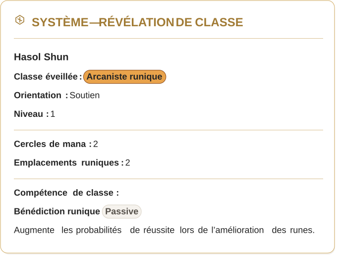
  </picture>
  

    
Version textuelle de la fenêtre

  
<svg class="lit-window__icon" viewBox="0 0 24 24" aria-hidden="true" focusable="false"><path d="m12 3 8 5v8l-8 5-8-5V8Z M12 7v10 M8 10l8 4"/></svg>SYSTÈME — RÉVÉLATION DE CLASSE

  <h3>Hasol Shun</h3>
  
<strong>Classe éveillée :</strong> Arcaniste runique

  
<strong>Orientation :</strong> Soutien

  
<strong>Rareté :</strong> ★ LÉGENDAIRE ★

  
<strong>Niveau :</strong> 1

  

  
<strong>Cercles de mana :</strong> 2

  
<strong>Emplacements runiques :</strong> 2

  

  
<strong>Compétence de classe :</strong>

  
<strong>Bénédiction runique</strong> Passive

  
Augmente les probabilités de réussite lors de l’amélioration des runes.

  

Pendant quelques secondes, personne ne parla.

Puis une voix s’éleva.

— Une classe légendaire !

Le temple explosa en exclamations.

— C’est incroyable !

— Une Arcaniste runique ?

— Je n’ai jamais entendu parler de cette classe !

— Prévenez les grandes guildes !

Hasol resta immobile.

*Légendaire…*

Elle relut le mot.

Une fois.

Deux fois.

Puis un sourire immense apparut sur son visage.

Elle se retourna vers ses parents.

Sa mère avait les yeux humides.

Son père semblait incapable de contenir sa joie.

— Ma fille !

Il s’avança malgré les protestations d’un assistant du temple.

— Ma fille a éveillé une classe légendaire !

Hasol rougit violemment.

— Père ! Tout le monde nous regarde !

— Qu’ils regardent !

Il éclata de rire.

— C’est le plus beau jour de ma vie !

Il la serra contre lui.

— Je suis tellement fier de toi, ma princesse.

Hasol ferma les yeux.

À cet instant, elle se sentit capable d’accomplir n’importe quoi.

Elle ignorait encore que ce jour, qui aurait dû être le plus heureux de sa jeunesse, marquait également le commencement de trois années de souffrance.

---

## III. Les deux cadeaux

Le soir même, la famille Shun organisa un dîner pour célébrer la Révélation.

Quelques proches furent invités.

Les conversations tournaient presque exclusivement autour de la classe légendaire de Hasol.

Son père racontait avec enthousiasme la lumière dorée qui avait illuminé le temple.

Sa mère tentait régulièrement de le faire parler moins fort.

Hasol, elle, avait surtout hâte de retourner dans sa chambre pour examiner son interface.

Mais lorsque les invités furent partis, son père lui demanda de rester au salon.

— J’ai quelque chose pour toi.

Hasol pencha la tête.

— Encore un cadeau ?

— Celui-ci est un peu particulier.

Il posa un coffret de bois sombre sur la table.

Deux fines bandes métalliques en ornaient les côtés.

Au centre du couvercle était gravé le symbole de la maison Shun.

Hasol observa l’objet avec curiosité.

— Qu’est-ce que c’est ?

Son père sourit.

— Ouvre.

Elle souleva délicatement le couvercle.

À l’intérieur reposaient deux pierres runiques.

L’une était gravée d’un symbole évoquant une lame.

L’autre portait un motif semblable à un bouclier.

Toutes deux émettaient une lueur bleutée.

Hasol écarquilla les yeux.

— Des runes…

Elle approcha lentement la main.

Puis reconnut leur qualité.

— Des runes rares, bleues, à six étoiles ?!

Elle n’osa pas les toucher immédiatement.

Six étoiles. Ce rang n’avait rien à voir avec leur couleur bleue, qui indiquait leur rareté. Il appartenait aux runes obtenues sur des monstres de niveau cinquante et un à soixante, des créatures dont elle ne connaissait encore que les illustrations des bestiaires. Elle se représenta les chasseurs capables de les affronter, puis les deux petites pierres posées dans le coffret familial. La distance entre ces deux images lui donna presque le vertige.

Son père croisa les bras, visiblement satisfait de sa réaction.

— Exactement.

— Mais… elles coûtent une fortune !

— Une fortune raisonnable.

Sa mère lui adressa un regard appuyé.

— Une fortune tout court.

Il toussota.

— Ce sont des détails.

Hasol regarda alternativement les runes rares à six étoiles et son père.

— Tu les as achetées pour moi ?

— Bien sûr.

— Mais tu ne savais même pas quelle classe j’allais recevoir !

— Je savais que tu possédais deux cercles de mana.

Il s’assit près d’elle.

— Et je savais que, quelle que soit ta classe, tu aurais besoin d’un bon équipement.

Il désigna la première pierre.

— Celle-ci renforcera ton Attaque.

Puis la seconde.

— Et celle-là ta Défense.

Hasol sentit sa gorge se serrer.

— Père…

Il posa doucement une main sur sa tête.

— Tu vas entrer à l’Académie impériale. Je veux que tu commences avec les meilleures chances possibles.

— Mais…

— Pas de mais.

Il lui sourit.

— Tu es ma princesse. Et une princesse mérite de beaux cadeaux.

Hasol se jeta dans ses bras.

— Merci !

Il éclata de rire.

— Doucement ! Tu vas me renverser !

Sa mère les regardait avec tendresse.

— Tu devrais peut-être lui expliquer comment les équiper avant qu’elle t’étouffe.

***

Hasol prit la première rune rare à six étoiles entre ses doigts.

Une fenêtre apparut.

  <picture class="lit-window__github-picture">
    <source media="(max-width: 600px)" srcset="assets/fenetres/002-mobile.svg">
    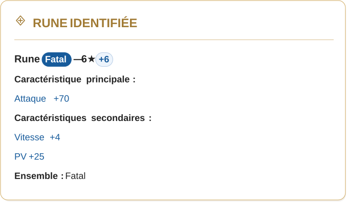
  </picture>
  

    
Version textuelle de la fenêtre

  
<svg class="lit-window__icon" viewBox="0 0 24 24" aria-hidden="true" focusable="false"><path d="m12 3 8 9-8 9-8-9Z M8 12h8 M12 8v8"/></svg>RUNE IDENTIFIÉE

  <h3>Rune Fatal rare (bleue) — 6★ +6</h3>
  
<strong>Grade :</strong> Rare — Bleu

  
<strong>Caractéristique principale :</strong>

  
Attaque +70

  
<strong>Caractéristiques secondaires :</strong>

  
Vitesse +4

  
PV +25

  
<strong>Ensemble :</strong> Fatal

  

Elle contempla les inscriptions.

La pierre était fraîche au toucher.

Son père lui montra comment établir un lien avec l’un de ses cercles de mana.

— Je peux vraiment l’équiper maintenant ? demanda-t-elle. Je ne suis que niveau un.

— Ton niveau n’est pas un obstacle. Celui des monstres sur lesquels on trouve une rune détermine ses étoiles, pas le niveau nécessaire pour la porter. Il te faut un emplacement libre.

Il désigna les deux cercles qu’elle venait de faire apparaître dans son interface.

— Et tu en as deux.

Hasol regarda de nouveau la rune Fatal rare à six étoiles. Elle avait admiré sa valeur marchande ; elle commençait seulement à mesurer ce que ce cadeau signifiait. Son père avait acheté quelque chose dont elle pourrait profiter dès son premier jour, sans attendre de devenir la chasseuse qu’elle rêvait d’être.

Hasol ferma les yeux.

Elle fit circuler une petite quantité de mana dans la rune rare à six étoiles.

La pierre vibra.

Puis se transforma en particules bleutées qui pénétrèrent dans sa poitrine.

Un symbole apparut brièvement autour de son premier cercle.

  <picture class="lit-window__github-picture">
    <source media="(max-width: 600px)" srcset="assets/fenetres/003-mobile.svg">
    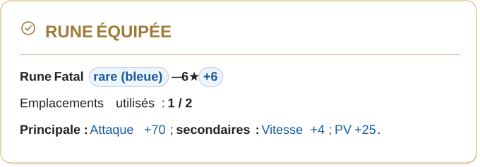
  </picture>
  

    
Version textuelle de la fenêtre

  
<svg class="lit-window__icon" viewBox="0 0 24 24" aria-hidden="true" focusable="false"><circle cx="12" cy="12" r="9"/><path d="m8 12 3 3 5-6"/></svg>RUNE ÉQUIPÉE

  
<strong>Rune Fatal rare (bleue) — 6★</strong> +6

  
Emplacements utilisés : <strong class="lit-window__value">1 / 2</strong>

  

Hasol ouvrit les yeux.

— Je l’ai fait !

— Évidemment ! répondit son père.

Elle prit aussitôt la seconde rune rare à six étoiles.

  <picture class="lit-window__github-picture">
    <source media="(max-width: 600px)" srcset="assets/fenetres/004-mobile.svg">
    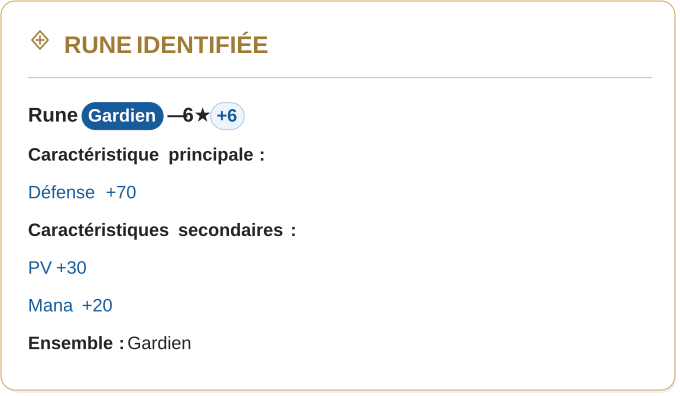
  </picture>
  

    
Version textuelle de la fenêtre

  
<svg class="lit-window__icon" viewBox="0 0 24 24" aria-hidden="true" focusable="false"><path d="m12 3 8 9-8 9-8-9Z M8 12h8 M12 8v8"/></svg>RUNE IDENTIFIÉE

  <h3>Rune Gardien rare (bleue) — 6★ +6</h3>
  
<strong>Grade :</strong> Rare — Bleu

  
<strong>Caractéristique principale :</strong>

  
Défense +70

  
<strong>Caractéristiques secondaires :</strong>

  
PV +30

  
Mana +20

  
<strong>Ensemble :</strong> Gardien

  

Quelques instants plus tard, la rune Gardien rare à six étoiles rejoignit la Fatal rare à six étoiles.

  <picture class="lit-window__github-picture">
    <source media="(max-width: 600px)" srcset="assets/fenetres/005-mobile.svg">
    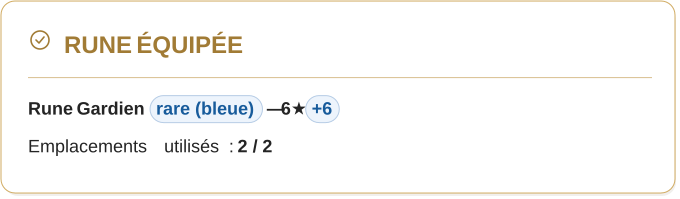
  </picture>
  

    
Version textuelle de la fenêtre

  
<svg class="lit-window__icon" viewBox="0 0 24 24" aria-hidden="true" focusable="false"><circle cx="12" cy="12" r="9"/><path d="m8 12 3 3 5-6"/></svg>RUNE ÉQUIPÉE

  
<strong>Rune Gardien rare (bleue) — 6★</strong> +6

  
Emplacements utilisés : <strong class="lit-window__value">2 / 2</strong>

  

Hasol sentit une légère modification dans la circulation de son mana.

Ce n’était pas une explosion de puissance.

Plutôt une sensation de stabilité.

Comme si son corps venait de recevoir deux soutiens invisibles.

Elle ouvrit son statut.

  <picture class="lit-window__github-picture">
    <source media="(max-width: 600px)" srcset="assets/fenetres/006-mobile.svg">
    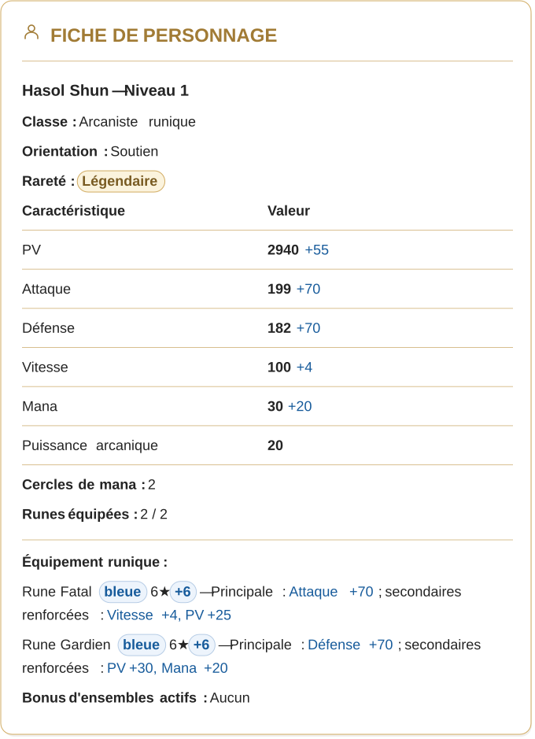
  </picture>
  

    
Version textuelle de la fenêtre

  
<svg class="lit-window__icon" viewBox="0 0 24 24" aria-hidden="true" focusable="false"><circle cx="12" cy="8" r="4"/><path d="M4 21v-2a8 6 0 0 1 16 0v2"/></svg>FICHE DE PERSONNAGE

  <h3>Hasol Shun — Niveau 1</h3>
  
<strong>Classe :</strong> Arcaniste runique

  
<strong>Orientation :</strong> Soutien

  
<strong>Rareté :</strong> Légendaire

  <table class="lit-window__stats">
    <thead><tr><th scope="col">Caractéristique</th><th scope="col">Valeur</th></tr></thead>
    <tbody>
      <tr><td>PV</td><td><strong>2940</strong> +55</td></tr>
      <tr><td>Attaque</td><td><strong>199</strong> +70</td></tr>
      <tr><td>Défense</td><td><strong>182</strong> +70</td></tr>
      <tr><td>Vitesse</td><td><strong>100</strong> +4</td></tr>
      <tr><td>Mana</td><td><strong>30</strong> +20</td></tr>
      <tr><td>Puissance arcanique</td><td><strong>20</strong></td></tr>
    </tbody>
  </table>
  
<strong>Cercles de mana :</strong> 2

  
<strong>Runes équipées :</strong> 2 / 2

  

  
<strong>Équipement runique :</strong>

  
Rune Fatal bleue 6★ +6 — Principale : Attaque +70 ; secondaires renforcées : Vitesse +4, PV +25

  
Rune Gardien bleue 6★ +6 — Principale : Défense +70 ; secondaires renforcées : PV +30, Mana +20

  
<strong>Bonus d'ensembles actifs :</strong> Aucun

  

Hasol contempla les chiffres.

Deux cent soixante-neuf points d’Attaque au total.

Deux cent cinquante-deux points de Défense.

Ce n’était qu’un début.

Mais elle avait déjà l’impression d’être devenue une véritable chasseuse.

Son père observa son expression avec satisfaction.

— Alors ?

Elle leva les yeux.

Un sourire immense éclairait son visage.

— Je vais devenir forte !

Il lui ébouriffa les cheveux.

— Je n’en ai jamais douté.

Cette nuit-là, Hasol s’endormit en imaginant les aventures qui l’attendaient.

Elle ne savait pas encore que ces deux runes rares à six étoiles deviendraient les témoins silencieux des années les plus difficiles de sa vie.

---

## IV. Une puissance sans forme

Les premières semaines à l’Académie impériale furent merveilleuses.

Hasol fut accueillie avec tous les honneurs.

Une classe légendaire représentait un prestige immense.

Plusieurs professeurs souhaitèrent immédiatement étudier ses capacités.

Ils examinèrent ses cercles de mana.

Mesurèrent sa circulation énergétique.

Lui firent essayer différents catalyseurs magiques.

Baguettes.

Bâtons.

Grimoires.

Pierres élémentaires.

Rien ne fonctionna.

Son mana répondait parfaitement.

Sa Puissance arcanique était réelle.

Mais elle ne parvenait à produire aucune attaque magique.

Un professeur spécialisé finit par poser son carnet sur son bureau.

— C’est étrange…

Hasol attendit, les mains serrées.

— Ton potentiel magique est remarquable pour ton niveau.

Elle sentit renaître un peu d’espoir.

— Alors vous pensez que je pourrai apprendre un sort ?

L’homme hésita.

— Je ne sais pas.

Le sourire de Hasol disparut.

— Mais… ma classe est légendaire.

— Je le sais.

Il regarda les résultats de ses tests.

— Seulement, une grande quantité de mana ne suffit pas à lancer des sorts.

Il referma son carnet.

— Nous continuerons les recherches.

Hasol s’inclina.

— Merci, professeur.

Elle sortit de la salle.

Puis resta longtemps immobile dans le couloir.

***

Les autres élèves découvraient progressivement leurs compétences.

Les guerriers apprenaient à renforcer leurs coups.

Les archers développaient des techniques de tir.

Les mages invoquaient leurs premiers projectiles élémentaires.

Hasol, elle, apprenait à manier une épée ordinaire.

Ses deux runes rares, bleues et à six étoiles, lui procuraient un avantage appréciable.

La rune Fatal rare à six étoiles renforçait ses frappes.

La rune Gardien rare à six étoiles lui permettait de mieux supporter les coups.

Mais aucun de ces bonus ne remplaçait une véritable compétence de combat.

Elle n’avait ni technique offensive de classe ni sort capable d’exploiter son potentiel magique.

Seulement son corps.

Son équipement.

Son entraînement.

Et une détermination que les autres étudiants ne comprenaient pas toujours.

Un soir, elle réussit à frapper trois fois de suite le centre d’une cible.

Elle sourit.

— Enfin…

Derrière elle, quelqu’un éclata de rire.

— Trois coups sur un mannequin immobile ?

Hasol se retourna.

Un étudiant en armure la regardait avec amusement.

— Impressionnant, pour une légendaire.

Ses amis rirent.

Hasol baissa les yeux.

— Je m’entraîne.

— Ça se voit.

Il désigna son épée.

— Tu sais qu’un guerrier de classe commune possède déjà de meilleures compétences que toi ?

Elle ne répondit pas.

— Alors à quoi sert ta classe légendaire ?

Hasol serra la poignée de son arme.

Elle aurait voulu répondre.

Mais elle n’avait pas de réponse.

***

Sa première montée de niveau survint après plusieurs exercices et chasses supervisées.

Une fenêtre apparut devant elle.

  <picture class="lit-window__github-picture">
    <source media="(max-width: 600px)" srcset="assets/fenetres/007-mobile.svg">
    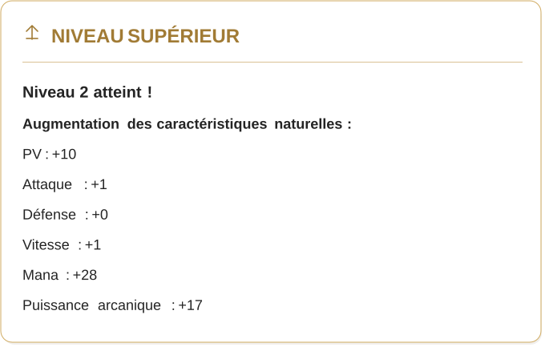
  </picture>
  

    
Version textuelle de la fenêtre

  
<svg class="lit-window__icon" viewBox="0 0 24 24" aria-hidden="true" focusable="false"><path d="M12 21V4 M5 11l7-7 7 7 M5 20h14"/></svg>NIVEAU SUPÉRIEUR

  <h3>Niveau 2 atteint !</h3>
  
<strong>Augmentation des caractéristiques naturelles :</strong>

  
PV : +10

  
Attaque : +1

  
Défense : +0

  
Vitesse : +1

  
Mana : +28

  
Puissance arcanique : +17

  

Hasol resta figée.

Vingt-huit points de Mana.

Dix-sept points de Puissance arcanique.

C’étaient des gains considérables.

Mais elle avait obtenu un seul point d’Attaque.

Un seul point de Vitesse.

Et aucun point de Défense.

Elle fixa sa fenêtre.

*Encore de la magie…*

Elle leva les yeux vers les autres étudiants.

Un guerrier de classe commune venait d’obtenir une nouvelle technique.

Un mage rare faisait apparaître une boule de feu au-dessus de sa main.

Hasol regarda ses propres doigts.

Une faible lueur turquoise y dansait.

Elle essaya de sourire.

— Ce n’est que le niveau deux…

Elle referma sa fenêtre.

— Ça changera sûrement.

Mais les niveaux suivants ne lui apportèrent aucun sort.

Et ses caractéristiques continuèrent à évoluer principalement vers le Mana et la Puissance arcanique.

---

## V. Le poids d’une légendaire

Quelques mois après son entrée à l’Académie, Hasol atteignit le niveau trois.

Elle avait cessé de demander chaque matin à son interface si une nouvelle compétence était apparue. Elle vérifiait encore, bien sûr, mais plus discrètement, à l’abri d’une porte ou dans l’angle d’un couloir. L’espoir lui paraissait moins douloureux lorsqu’elle n’avait pas à l’expliquer à quelqu’un.

Ce jour-là, une annonce avait été épinglée près des terrains d’entraînement. Un groupe d’étudiants cherchait une cinquième personne pour une chasse.

Hasol lut le parchemin deux fois. Elle connaissait le lieu du rendez-vous et avait déjà participé à des exercices dans la zone indiquée. Rien qui lui fût entièrement étranger. En équipe, elle pourrait affronter des adversaires qu’un instructeur lui interdisait d’approcher seule. Elle apprendrait plus vite. Elle gagnerait davantage d’expérience.

Peut-être qu’au retour, elle aurait enfin quelque chose de nouveau à raconter à son père.

Les quatre étudiants se trouvaient sous la galerie qui bordait la cour. Des sacs étaient ouverts sur un banc ; une jeune fille vérifiait les attaches d’une protection de cuir tandis qu’un garçon repliait une carte. Ils discutaient à voix basse, avec cette aisance des gens qui savaient déjà quelle place ils occuperaient les uns auprès des autres.

Hasol essuya ses paumes sur sa tunique avant de s’approcher.

— Bonjour. C’est vous qui cherchez quelqu’un pour la chasse ?

Le garçon à la carte leva les yeux.

— Oui. Tu es de quelle classe ?

Elle redressa un peu les épaules.

— Arcaniste runique. Je m’appelle Hasol Shun.

Le silence qui suivit ne dura qu’un instant. Assez pour qu’elle remarque le regard échangé entre deux des étudiants.

— Ah. C’est toi.

Elle garda son sourire.

— Je suis niveau trois. Je connais les consignes de sécurité, et je peux tenir une épée.

Le garçon posa sa carte sur le banc. Lorsqu’il reprit la parole, son ton n’était plus tout à fait le même.

— Ta classe est légendaire, c’est ça ?

— Oui.

— Vingt points.

Il ne l’avait pas dit comme un compliment.

Hasol regarda les quatre sacs, les quatre armes, la place encore libre à l’extrémité du banc.

— Vous êtes deux classes rares et deux communes, d’après l’annonce. Ça fait trente points. Avec moi, nous serions cinq pour cinquante. Nous respecterions les deux limites.

— Je sais compter.

Elle sentit la chaleur lui monter au visage.

— Je ne voulais pas dire que…

— Ce n’est pas la question. Qu’est-ce que tu peux faire pendant un combat ?

Hasol ouvrit la bouche, puis hésita. Derrière elle, une lame d’entraînement heurta un bouclier. Le choc sec résonna sous la galerie.

— Ma compétence améliore les chances de réussite des améliorations runiques.

— Pendant un combat, répéta-t-il.

Elle serra les doigts contre sa cuisse.

— Je n’ai pas encore de compétence offensive. Mais je m’entraîne tous les jours. Je peux rester en première ligne, aider à contenir…

— Est-ce que tu sais soigner ? demanda la jeune fille qui vérifiait son armure.

— Non.

— Protéger quelqu’un avec une compétence ?

Hasol baissa légèrement les yeux.

— Non plus.

Le garçon passa une main sur sa nuque. Il n’avait pas l’air furieux. C’était presque pire. Il la regardait comme une difficulté pratique qu’il aurait préféré ne pas avoir à résoudre.

— Écoute, nous avons besoin de quelqu’un qui nous aide sur le terrain. Pour vingt points, nous attendons autre chose qu’une personne qui essaie de se débrouiller avec une épée.

— Vous pourriez me laisser essayer.

La phrase lui avait échappé trop vite.

L’un des autres étudiants détourna les yeux. Le garçon à la carte, lui, secoua la tête.

— Pas aujourd’hui.

Hasol attendit malgré elle une suite. Une prochaine fois. Une condition à remplir. Quelque chose qui ne refermerait pas complètement la porte.

Il reprit sa carte.

— Nous allons chercher quelqu’un d’autre.

Elle acquiesça.

— Je comprends.

Sa voix avait paru parfaitement calme. Elle en fut presque fière, jusqu’au moment où elle essaya de sourire et sentit ses lèvres trembler.

Elle s’éloigna sans courir. Traverser la cour lui sembla prendre beaucoup plus de temps qu’à l’aller. Elle entendait les conversations reprendre sous la galerie, mais ne distinguait plus les mots. Près du panneau d’affichage, elle s’arrêta pour laisser passer un groupe d’élèves.

L’annonce était toujours là.

*Une place disponible.*

Elle fixa ces trois mots.

Il y avait de la place. Ils auraient pu l’accepter sans dépasser cinquante points. Ce n’était pas une impossibilité du système qui l’avait tenue à l’écart.

C’était elle.

Ou ce qu’elle ne savait pas encore faire.

***

Les refus suivants ne furent pas tous aussi difficiles à entendre. Certains furent polis, d’autres embarrassés. Une équipe avait déjà engagé quelqu’un. Une autre cherchait un soigneur. Parfois, il ne restait réellement pas assez de points pour accueillir une légendaire, même lorsqu’un emplacement demeurait libre.

Hasol apprit à poser la question avant de parler d’elle.

— Combien de points vous reste-t-il ?

Puis elle apprit à reconnaître les silences qui venaient après sa réponse.

On lui demandait moins souvent ce qu’elle avait étudié, combien de temps elle s’entraînait ou si elle connaissait les monstres de la région. On voulait savoir ce qu’elle apportait. Ce qu’elle pouvait faire immédiatement. Ce que justifiaient ces vingt points.

Elle ne pouvait pas en rendre dix pour devenir plus facile à recruter. Elle ne pouvait pas promettre un sort qui n’existait pas.

Peu à peu, le mot *légendaire* cessa de lui évoquer seulement la lumière dorée du temple.

Il devint aussi une mesure de la place qu’elle occupait.

Une place qu’il lui faudrait mériter avant que quelqu’un accepte de la lui laisser.

Lorsqu’elle rentra chez elle après un nouveau refus, son père leva la tête de ses comptes.

— Alors, princesse ? Tu as trouvé des compagnons ?

Elle resserra la lanière de son sac sur son épaule.

— Pas encore. Ils cherchaient quelqu’un d’autre.

— Tu trouveras.

Il l’avait dit avec une telle confiance qu’elle ne put rien ajouter.

Ce soir-là, elle alla s’entraîner dans la salle qu’il avait aménagée pour elle. Une fois la porte fermée, elle posa son sac, prit son épée et recommença les mouvements appris le matin.

Dehors, des pas traversaient le jardin. Dans la maison, sa mère appelait quelqu’un pour le dîner. La vie continuait avec une douceur presque insupportable.

Hasol frappa la cible jusqu’à sentir ses bras trembler.

Elle ne voulait pas seulement devenir plus forte.

Elle voulait qu’un jour, lorsqu’elle demanderait à rejoindre un groupe, personne ne commence par calculer ce qu’elle coûtait.

---

## VI. Les premières fissures

Pendant les premiers mois, son père continua à l’encourager.

Lorsqu’elle rentrait de l’Académie, il l’attendait souvent dans le salon.

— Alors, princesse ? Qu’as-tu appris aujourd’hui ?

Hasol lui racontait ses entraînements.

Ses progrès à l’épée.

Les théories magiques étudiées en cours.

Parfois, elle lui montrait une nouvelle manière de faire circuler son mana.

Son père l’écoutait avec attention.

— Formidable !

— Ce n’est pas vraiment un sort, père.

— Pas encore !

Il lui adressait un clin d’œil.

— Les grandes choses prennent du temps.

Hasol souriait.

Elle voulait croire qu’il avait raison.

***

Mais les mois passèrent.

Puis une année entière.

Les résultats de Hasol restaient décevants.

Les spécialistes ne parvenaient toujours pas à comprendre pourquoi son immense potentiel magique demeurait inutilisable.

Ses deux runes rares, bleues et à six étoiles, lui permettaient de mieux résister que ne l’auraient laissé supposer ses seules caractéristiques naturelles.

Mais les autres élèves progressaient rapidement.

Leurs compétences devenaient plus puissantes.

Leurs niveaux augmentaient.

Et l’écart se creusait.

Un soir, Hasol rentra après une évaluation particulièrement difficile.

Son père l’attendait dans le salon.

— Comment s’est passé ton examen ?

Elle hésita.

— Pas très bien.

Son sourire diminua.

— Ah…

— J’ai perdu contre le mannequin de combat.

— Encore ?

Le mot lui échappa sans qu’il semble le vouloir.

Hasol baissa les yeux.

— Oui.

Son père resta silencieux.

Puis il se força à sourire.

— Ce n’est pas grave. Tu feras mieux la prochaine fois.

Mais quelque chose avait changé.

Pour la première fois, son encouragement avait semblé moins naturel.

***

La deuxième année fut plus difficile.

Hasol atteignit le niveau 7.

Ses camarades dépassaient déjà largement son niveau.

Les professeurs cessèrent progressivement de lui consacrer autant de temps.

Certains lui suggérèrent d’abandonner la voie du combat.

D’autres lui conseillèrent de se spécialiser dans l’artisanat runique.

Après tout, sa compétence passive améliorait les chances de réussite lors de l’amélioration des runes.

Cela pouvait constituer une carrière honorable.

Mais Hasol refusait d’abandonner son rêve.

Elle voulait devenir chasseuse.

Elle voulait explorer les donjons.

Elle voulait prouver que sa classe légendaire avait une véritable valeur.

Son père continuait à financer ses études.

Il ne lui retira jamais les runes rares à six étoiles qu’il lui avait offertes.

Il ne lui refusa pas non plus les moyens de poursuivre son entraînement.

Mais il parlait moins de son avenir.

Les conversations autrefois joyeuses devinrent plus courtes.

Lorsqu’elle lui racontait ses journées, il l’écoutait sans toujours répondre.

Et parfois, Hasol surprenait dans ses yeux une expression qu’elle n’avait jamais connue auparavant.

De la déception.

***

Un soir, elle l’entendit discuter avec sa mère.

La porte du salon était entrouverte.

— Elle ne progresse presque plus, disait-il.

— Elle fait pourtant des efforts considérables.

— Je le sais.

Sa voix semblait fatiguée.

— Mais ses camarades ont déjà plusieurs niveaux d’avance. Certains commencent à recevoir des propositions de guildes.

— Hasol n’est pas ses camarades.

— Je sais.

Un silence.

Puis son père reprit :

— Je ne comprends pas. Elle possède une classe légendaire. Deux cercles avant même sa Révélation. Tout indiquait qu’elle deviendrait exceptionnelle.

Sa mère répondit doucement :

— Elle est exceptionnelle.

— Alors pourquoi n’arrive-t-elle pas à utiliser sa puissance ?

Hasol recula lentement.

Elle n’écouta pas la suite.

Elle monta dans sa chambre.

S’assit sur son lit.

Et contempla les deux runes rares à six étoiles que son père lui avait offertes.

Elles brillaient toujours faiblement dans son interface.

Leurs caractéristiques n’avaient pas changé.

Leurs bonus étaient toujours présents.

Mais pour la première fois, Hasol eut l’impression que ces cadeaux étaient devenus trop lourds à porter.

---

## VII. Trois années d’efforts

La troisième année fut la plus douloureuse.

Hasol atteignit le niveau 8.

Ses camarades approchaient progressivement du niveau 30.

L’écart était devenu immense.

Hasol avait beau s’entraîner, ses capacités physiques ne progressaient pas suffisamment pour compenser l’absence de compétences offensives.

Elle pouvait manier une épée.

Elle connaissait les bases du combat.

Ses deux runes rares, bleues et à six étoiles, amélioraient son Attaque et sa Défense.

Mais lorsqu’elle affrontait des monstres plus dangereux, ses limites apparaissaient rapidement.

Un jour, lors d’une évaluation, elle fut opposée à un mannequin de combat animé.

La créature artificielle avançait avec des mouvements simples.

Hasol esquiva sa première attaque.

Puis tenta une frappe au flanc.

Sa lame toucha le mannequin.

Mais le choc fut insuffisant pour le repousser.

Le bras mécanique pivota.

Hasol reçut un coup à l’épaule.

Elle recula en grimaçant.

Un deuxième coup la déséquilibra.

Puis un troisième la projeta au sol.

— Évaluation terminée, annonça l’instructeur.

Hasol resta quelques secondes allongée.

Autour d’elle, des étudiants murmuraient.

— Elle n’a même pas tenu une minute…

— Et dire qu’elle est légendaire.

— C’est ridicule.

Elle se releva péniblement.

Puis ramassa son épée.

L’instructeur lui adressa un regard fatigué.

— Hasol, tu dois améliorer tes capacités physiques.

Elle baissa la tête.

— Oui, monsieur.

— Ton mana ne te servira à rien si tu ne peux pas l’utiliser.

Elle connaissait déjà cette vérité.

Elle l’entendait presque chaque jour.

***

Les plaines situées à l’extérieur de la capitale devinrent son refuge.

On y trouvait des slimes de niveau 1.

Des monstres faibles.

Lents.

Prévisibles.

Hasol pouvait les éliminer sans prendre de risques excessifs.

Chaque slime lui rapportait un seul point d’expérience.

C’était peu.

Terriblement peu.

Surtout pour une classe légendaire, dont les niveaux exigeaient davantage d’expérience que ceux des classes moins rares.

Mais elle continuait.

Jour après jour.

Semaine après semaine.

Elle apprit à reconnaître les mouvements des slimes.

À viser leurs noyaux.

À économiser ses forces.

À frapper avec précision plutôt qu’avec brutalité.

Elle en tua des centaines.

Puis des milliers.

Au fil de cette troisième année, les éliminations s’accumulaient par milliers dans son historique.

Pourtant, elle n’avait toujours pas atteint le niveau 10.

***

Un après-midi, alors qu’elle revenait des plaines, trois étudiants l’attendaient près de l’entrée de l’Académie.

Hasol les aperçut de loin.

Elle reconnut immédiatement le guerrier qui l’avait si souvent humiliée. À ses côtés se tenaient un autre étudiant et un jeune mage aux cheveux sombres.

Ray Corvus.

Son cœur se serra légèrement.

Il fut un temps où elle aurait couru vers lui avec un sourire.

Ils se connaissaient depuis l’enfance.

Leurs familles entretenaient des relations commerciales depuis des années, et Ray avait longtemps été l’un de ses compagnons de jeu préférés. Ils avaient passé d’innombrables après-midi dans les jardins de la demeure Shun, à construire des forteresses imaginaires, à se poursuivre avec des épées de bois et à inventer des aventures dans lesquelles ils devenaient de grands chasseurs.

Ray avait toujours voulu devenir mage.

Hasol, elle, rêvait de manier une épée.

Ils s’étaient même promis qu’un jour, ils partiraient ensemble explorer les donjons de l’Empire.

À l’époque, Ray riait lorsqu’elle affirmait qu’elle deviendrait une chasseuse légendaire.

Mais il ne se moquait jamais d’elle.

Pas comme aujourd’hui.

— Tiens, voilà notre légende !

Le guerrier s’avança avec un sourire mauvais.

Hasol ralentit.

Elle aurait pu faire demi-tour.

Mais cela n’aurait fait que les encourager.

— Alors, combien de slimes aujourd’hui ?

Elle ne répondit pas.

— Cinquante ? Cent ?

Le troisième étudiant éclata de rire.

— À ce rythme, elle va finir par exterminer toute l’espèce !

Ray eut un petit rire à son tour.

Un rire bref.

Presque machinal.

Mais Hasol l’entendit.

Et, étrangement, ce fut celui-là qui lui fit le plus mal.

Le guerrier se pencha vers elle.

— Toujours niveau 8 ?

Elle baissa les yeux.

— Oui.

Il secoua la tête avec une expression faussement compatissante.

— Trois années à l’Académie impériale…

Il leva un doigt.

— Une classe légendaire…

Puis son sourire s’élargit.

— Et même pas le niveau 10.

Les deux autres rirent.

Hasol sentit ses joues brûler.

— Je fais de mon mieux.

— Ton mieux ?

Le guerrier éclata de rire.

— Ton mieux ne vaut même pas celui d’un chasseur de classe commune !

Il se tourna vers ses compagnons.

— Regardez-la. La légendaire inutile !

Hasol serra les poings.

Elle avait entendu ces mots tant de fois qu’elle aurait dû y être habituée.

Pourtant, chaque fois, ils trouvaient encore un endroit où faire mal.

Elle leva les yeux vers Ray.

Il évita son regard.

— Ray…

Le jeune mage se raidit légèrement.

Le guerrier tourna la tête vers lui.

— Quoi ? Tu la connais ?

Ray hésita.

Hasol attendit.

Elle ne lui demandait pas de se battre pour elle.

Elle ne lui demandait même pas de prendre sa défense.

Elle voulait seulement qu’il reconnaisse qu’ils se connaissaient.

Qu’il se souvienne des après-midi passés ensemble.

Des épées de bois.

Des promesses faites dans les jardins.

Ray haussa finalement les épaules.

— Nos familles se connaissent.

Un silence passa.

Nos familles se connaissent.

C’était tout ?

Le guerrier ricana.

— Ah ! Alors tu connais personnellement notre grande légende ?

Ray esquissa un sourire embarrassé.

— On jouait ensemble quand on était petits.

— Sérieusement ?

— Oui, mais c’était il y a longtemps.

Hasol sentit quelque chose se briser doucement en elle.

Il y a longtemps.

Elle aurait voulu lui rappeler qu’ils avaient encore parlé de leur future équipe quelques semaines avant la Révélation.

Qu’il lui avait promis de lui montrer ses premiers sorts.

Qu’elle l’avait félicité lorsqu’il avait obtenu sa classe commune de mage.

Mais les mots restèrent coincés dans sa gorge.

Le guerrier éclata de rire.

— Alors tu dois être déçu ! Tu pensais sûrement avoir une légendaire dans ton équipe !

Ray ne répondit pas immédiatement.

Puis il lâcha :

— Avec son niveau, elle ne pourrait même pas nous accompagner.

Les mots tombèrent entre eux.

Hasol resta immobile.

Elle savait qu’il disait la vérité.

Elle était trop faible pour suivre les autres étudiants dans leurs expéditions.

Elle le savait mieux que personne.

Mais l’entendre de sa bouche…

— Je vois, murmura-t-elle.

Ray releva les yeux.

Pendant un instant, leurs regards se croisèrent.

Quelque chose passa sur son visage.

Une hésitation.

Peut-être du regret.

Mais il ne dit rien.

Hasol baissa la tête et fit un pas pour passer entre eux.

Le guerrier se décala aussitôt, lui barrant le chemin.

— Oh, pas si vite ! Tu ne vas pas partir sans nous raconter ton dernier exploit !

Il tendit la main vers le carnet qu’elle tenait contre sa poitrine.

— Qu’est-ce que tu caches là ?

Hasol recula.

— Rien qui t’intéresse.

— Alors montre !

Il lui arracha le carnet avant qu’elle puisse réagir.

— Rends-le-moi !

Le guerrier l’ouvrit avec un sourire moqueur.

— Voyons voir… « Travail des déplacements. Répéter les enchaînements. Améliorer la garde… »

Le troisième étudiant éclata de rire.

— Elle s’entraîne vraiment pour tuer des slimes !

Hasol tendit la main.

— S’il te plaît, rends-le-moi.

Mais le guerrier leva le carnet au-dessus de sa tête.

— Allez, attrape-le !

Elle fit un pas en avant.

Il recula en riant.

Ray observait la scène.

Il ne riait plus.

Hasol tourna la tête vers lui.

Pendant une seconde, elle crut qu’il allait enfin intervenir.

Il ouvrit légèrement la bouche.

Puis la referma.

Ce fut presque pire que le reste.

— Rends-lui son carnet.

La voix venait de derrière eux.

Elle était grave, posée.

Et ne laissait aucune place à la plaisanterie.

Les trois garçons se retournèrent.

Un étudiant plus âgé se tenait à quelques pas de l’entrée de l’Académie.

Zio Notos.

Porteur de la classe rare de Gardien, il était connu pour son sérieux, son épée et l’imposant bouclier qu’il portait presque toujours avec lui.

Il s’avança sans se presser.

Le guerrier ricana.

— Tiens, voilà le grand Zio. Tu veux quoi ?

— Le carnet.

— Pourquoi ? Tu la connais ?

Zio jeta un bref regard vers Hasol.

Elle se tenait immobile, les mains serrées contre elle.

Puis il revint au guerrier.

— Je n’ai pas besoin de la connaître pour savoir que ce que tu fais est lamentable.

Le sourire du garçon se crispa.

— On plaisantait.

— Elle ne rit pas.

Le silence qui suivit fut bref, mais pesant.

Le guerrier haussa les épaules.

— Tu vas te battre pour elle ?

Zio ne répondit pas immédiatement.

Il décrocha lentement son bouclier et le posa au sol.

Le bruit sourd résonna contre les pierres de la cour.

Plusieurs étudiants qui passaient près de l’entrée tournèrent la tête.

Zio tendit la main.

— Je t’ai demandé de lui rendre son carnet.

Le guerrier regarda le bouclier.

Puis le visage parfaitement calme de Zio.

Il hésita.

Enfin, il referma brutalement le carnet et le lui tendit.

— Tiens. De toute façon, il n’y a rien d’intéressant dedans.

Zio le récupéra.

— Alors tu n’avais aucune raison de le prendre.

Le garçon détourna les yeux.

Zio se tourna vers Hasol et lui tendit son carnet.

— C’est à toi, je crois.

Elle le récupéra avec des mains tremblantes.

— Merci…

Zio lui adressa un sourire tranquille.

— Tu n’as pas à me remercier pour ça.

Puis son regard se posa sur Ray.

— Corvus.

Le jeune mage se redressa.

— Oui ?

Zio le contempla quelques instants.

— J’ai entendu ce que tu as dit.

Ray pâlit légèrement.

— Je…

— Tu la connais depuis l’enfance, c’est bien ça ?

Le guerrier ricana.

— Oh, ça va ! Ils jouaient ensemble quand ils étaient petits. C’est pas comme si…

— Je ne te parle pas.

Le ton de Zio n’avait pas changé.

Pourtant, le guerrier se tut aussitôt.

Zio reporta son attention sur Ray.

— Alors ?

Ray baissa légèrement les yeux.

— Oui. On se connaît depuis longtemps.

— Et tu trouves normal de la traiter ainsi ?

— Je ne l’ai pas insultée.

Zio resta silencieux une seconde.

— Non. Tu as simplement ri pendant que les autres le faisaient.

Ray serra la mâchoire.

— Ce n’était pas…

— Et lorsqu’elle a cherché ton regard, tu as fait semblant de ne pas comprendre.

Hasol sentit ses joues s’échauffer davantage.

Elle aurait voulu disparaître.

Mais Zio ne parlait pas assez fort pour attirer une foule.

Il s’adressait uniquement à Ray.

— Écoute-moi bien, Corvus.

Le jeune mage releva les yeux.

— Je ne sais pas ce qui s’est passé entre vous. Et cela ne me regarde pas.

Zio marqua une pause.

— Mais si tu as partagé son enfance, si elle t’a considéré comme un ami, alors tu devrais avoir honte de rester là pendant qu’on l’humilie.

Ray ne répondit pas.

— Tu n’es pas obligé de combattre à sa place. Tu n’es même pas obligé de rester son ami.

Le regard de Zio se durcit légèrement.

— Mais tu pourrais au moins avoir le courage de ne pas participer.

Le silence devint pesant.

Ray baissa la tête.

Le guerrier fit un pas en avant.

— Tu te prends pour qui, à lui faire la morale ?

Zio tourna lentement les yeux vers lui.

— Pour quelqu’un qui n’a pas besoin d’humilier plus faible que lui pour se sentir fort.

Le garçon ouvrit la bouche.

Puis la referma.

Personne ne rit.

Finalement, il fit un geste agacé.

— Venez. On perd notre temps.

Le troisième étudiant le suivit aussitôt.

Ray resta une seconde de plus.

Il regarda Hasol.

Elle tenait son carnet contre sa poitrine.

Leurs regards se croisèrent.

— Hasol, je…

Elle attendit.

Peut-être allait-il enfin dire quelque chose.

Une excuse.

Une explication.

N’importe quoi.

Mais Ray détourna les yeux.

— À plus tard.

Puis il rejoignit les autres.

Hasol le regarda s’éloigner.

À plus tard.

Comme s’ils venaient simplement de se croiser dans un couloir.

Comme si rien ne s’était passé.

Elle baissa les yeux vers son carnet.

La couverture était légèrement froissée.

Une page s’était pliée.

Elle passa doucement le pouce dessus pour la remettre en place.

— Tu t’entraînes beaucoup ?

Hasol sursauta presque.

Zio était toujours là.

— Pardon ?

Il désigna le carnet.

— J’ai entendu ce qu’il lisait. Tu notes tes exercices ?

Elle acquiesça timidement.

— Oui.

— C’est une bonne habitude.

Hasol releva les yeux, surprise.

— Vous trouvez ?

— Bien sûr.

Il ramassa son bouclier.

— Quand on s’entraîne tous les jours, on finit parfois par oublier le chemin parcouru. Écrire ses progrès permet de s’en souvenir.

Hasol contempla son carnet.

— Mais je ne progresse presque pas…

Zio réfléchit un instant.

— Presque ?

Elle hésita.

— Je suis toujours niveau huit. Et je n’arrive même pas à suivre les autres.

— Je ne te demandais pas ton niveau.

Hasol cligna des yeux.

Zio lui adressa un sourire.

— Je te demandais si tu progressais.

Elle resta silencieuse.

Elle repensa à ses entraînements.

À ses mouvements un peu plus précis.

Aux quelques secondes gagnées face au mannequin.

Aux erreurs qu’elle parvenait parfois à éviter.

— Un peu, admit-elle.

— Alors continue.

Il ajusta la sangle de son bouclier.

— Tu n’as pas besoin d’avancer à la même vitesse que les autres pour avoir le droit d’avancer.

Hasol sentit sa gorge se serrer.

— Merci, Zio…

— Et garde bien ce carnet.

Il lui adressa un dernier sourire.

— Un jour, tu seras peut-être contente de pouvoir relire tout ce que tu as traversé.

Puis il reprit son chemin vers les bâtiments de l’Académie.

Hasol resta seule près de l’entrée.

Elle contempla longuement la couverture abîmée de son carnet.

Pendant des mois, elle avait espéré que Ray prononce quelques mots pour la défendre.

Ce jour-là, un garçon qui la connaissait à peine l’avait fait à sa place.

Et il avait même osé dire à Ray ce qu’elle n’avait jamais trouvé le courage de lui reprocher.

Elle n’oublia jamais cette journée.

Ni les paroles de son ancien ami.

Ni son silence lorsqu’elle avait eu besoin de lui.

Ni le regard tranquille de Zio Notos lorsqu’il lui avait dit de continuer à avancer.

Ce fut l’un des rares souvenirs réconfortants de ses années à l’Académie.

Et, bien des années plus tard, lorsqu’elle repenserait à cette journée, elle se souviendrait surtout d’une chose :

Zio avait été le premier à lui montrer qu’on pouvait défendre quelqu’un sans rien attendre en retour.

---

## VIII. Le niveau neuf

Vers la fin de cette troisième année, Hasol chassait de nouveau dans les plaines. Elle était toujours niveau huit.

Un slime venait de disparaître sous son épée.

La lumière du soleil couchant colorait l’herbe d’orange.

Une notification apparut.

  <picture class="lit-window__github-picture">
    <source media="(max-width: 600px)" srcset="assets/fenetres/008-mobile.svg">
    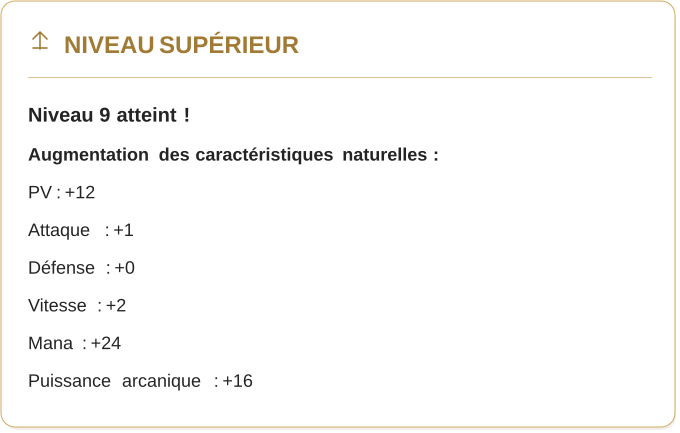
  </picture>
  

    
Version textuelle de la fenêtre

  
<svg class="lit-window__icon" viewBox="0 0 24 24" aria-hidden="true" focusable="false"><path d="M12 21V4 M5 11l7-7 7 7 M5 20h14"/></svg>NIVEAU SUPÉRIEUR

  <h3>Niveau 9 atteint !</h3>
  
<strong>Augmentation des caractéristiques naturelles :</strong>

  
PV : +12

  
Attaque : +1

  
Défense : +0

  
Vitesse : +2

  
Mana : +24

  
Puissance arcanique : +16

  

Hasol contempla les chiffres.

Elle aurait dû être heureuse.

Ses gains magiques étaient impressionnants.

Mais elle ne possédait toujours aucun sort.

Elle serra son épée.

Puis murmura :

— Encore…

Sa voix se brisa.

— Encore du mana…

Elle s’assit dans l’herbe.

Et pour la première fois depuis longtemps, elle pleura sans chercher à se retenir.

***

Quelques jours avant la fin de l’année, elle consulta son statut.

  <picture class="lit-window__github-picture">
    <source media="(max-width: 600px)" srcset="assets/fenetres/009-mobile.svg">
    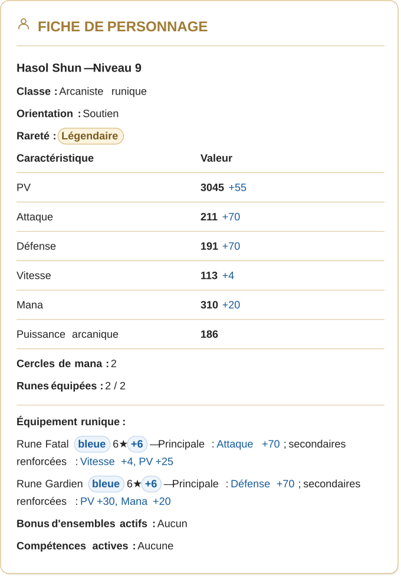
  </picture>
  

    
Version textuelle de la fenêtre

  
<svg class="lit-window__icon" viewBox="0 0 24 24" aria-hidden="true" focusable="false"><circle cx="12" cy="8" r="4"/><path d="M4 21v-2a8 6 0 0 1 16 0v2"/></svg>FICHE DE PERSONNAGE

  <h3>Hasol Shun — Niveau 9</h3>
  
<strong>Classe :</strong> Arcaniste runique

  
<strong>Orientation :</strong> Soutien

  
<strong>Rareté :</strong> Légendaire

  <table class="lit-window__stats">
    <thead><tr><th scope="col">Caractéristique</th><th scope="col">Valeur</th></tr></thead>
    <tbody>
      <tr><td>PV</td><td><strong>3045</strong> +55</td></tr>
      <tr><td>Attaque</td><td><strong>211</strong> +70</td></tr>
      <tr><td>Défense</td><td><strong>191</strong> +70</td></tr>
      <tr><td>Vitesse</td><td><strong>113</strong> +4</td></tr>
      <tr><td>Mana</td><td><strong>310</strong> +20</td></tr>
      <tr><td>Puissance arcanique</td><td><strong>186</strong></td></tr>
    </tbody>
  </table>
  
<strong>Cercles de mana :</strong> 2

  
<strong>Runes équipées :</strong> 2 / 2

  

  
<strong>Équipement runique :</strong>

  
Rune Fatal bleue 6★ +6 — Principale : Attaque +70 ; secondaires renforcées : Vitesse +4, PV +25

  
Rune Gardien bleue 6★ +6 — Principale : Défense +70 ; secondaires renforcées : PV +30, Mana +20

  
<strong>Bonus d'ensembles actifs :</strong> Aucun

  
<strong>Compétences actives :</strong> Aucune

  

Les chiffres confirmaient ce qu’elle ressentait.

Elle possédait un immense potentiel magique.

Mais ses capacités physiques restaient modestes.

Et sans sort, ce potentiel ne lui servait presque à rien en combat.

Un professeur avait tenté de lui expliquer ce que sa progression avait d’inhabituel. Elle se souvenait de son doigt posé sur les lignes de son relevé, de la patience avec laquelle il avait séparé les caractéristiques naturelles des bonus de son équipement.

— Pour te donner un repère, lui avait-il dit, une réserve de mille points de Mana au niveau soixante constitue une norme. Ce n’est pas un plafond, et les parcours diffèrent, mais cela te permet de comprendre l’ordre de grandeur.

Hasol avait regardé les trois cent dix points de Mana que son corps possédait déjà, sans compter le bonus de la rune Gardien rare à six étoiles offerte par son père.

Elle n’était que niveau neuf.

— Et la Puissance arcanique ? avait-elle demandé.

— Autour de six cents pour une classe de soutien de niveau soixante. Pour un mage, le repère est plutôt de deux mille.

— Alors je progresse comme un soutien ?

Il avait hésité, non parce qu’il ignorait la réponse, mais parce qu’il savait désormais ce qu’elle espérait entendre derrière chacune de ses questions.

— Ta classe relève du soutien, Hasol. Pas ton profil de croissance magique. Les caractéristiques que tu développes ressemblent à celles d’un mage.

Elle avait redressé la tête.

— Dans ce cas, pourquoi est-ce que je n’arrive pas à lancer leurs sorts ?

Le professeur avait baissé les yeux vers le relevé.

Il avait fallu quelques secondes avant qu’il réponde.

— Parce que les caractéristiques et les compétences sont deux choses différentes.

Elle connaissait la distinction. Elle l’avait apprise dans les livres, puis retrouvée dans chacun de ses échecs. Pourtant, l’entendre formulée aussi simplement lui avait fait l’effet d’une porte refermée avec douceur.

Son corps accumulait de quoi nourrir une puissance qu’aucun geste appris ne parvenait à façonner. On lui parlait de potentiel, de réserves remarquables, d’une évolution que les instructeurs ne savaient pas expliquer entièrement. Mais lorsqu’elle demandait ce qu’elle pouvait en faire, les mots devenaient plus prudents.

Il fallait attendre.

Continuer les recherches.

Monter encore de niveau.

Pendant ce temps, ses camarades trouvaient des compagnons et partaient chasser.

Même ses deux runes rares, bleues et à six étoiles, ne suffisaient plus à compenser l’écart avec ses camarades.

Elle referma sa fenêtre.

Puis retourna s’entraîner.

---

## IX. Le verdict de l’Académie

Le dernier jour de l’année scolaire, Hasol fut convoquée dans le bureau du directeur.

Elle s’y rendit avec son uniforme soigneusement repassé.

Elle avait passé une partie de la nuit à préparer ses arguments.

Elle expliquerait ses progrès.

Ses milliers de chasses.

Ses connaissances théoriques.

Elle demanderait une année supplémentaire.

Une seule.

Lorsqu’elle entra, le directeur était assis derrière son bureau.

Deux instructeurs se tenaient près de la fenêtre.

— Hasol Shun.

Elle s’inclina.

— Monsieur le directeur.

— Assieds-toi.

Elle obéit.

Le directeur ouvrit un dossier.

— Trois années.

Hasol baissa légèrement la tête.

— Oui, monsieur.

— Trois années pendant lesquelles l’Académie a consacré des ressources importantes à ta formation.

Il tourna une page.

— Nous avons fait intervenir plusieurs spécialistes.

Une autre page.

— Nous avons étudié ta classe, tes cercles de mana et tes capacités.

Il leva les yeux.

— Mais tu es toujours niveau 9.

Hasol serra les mains.

— Je suis très proche du niveau 10.

— Nous le savons.

— Je peux l’atteindre bientôt.

Le directeur soupira.

— Ce n’est pas uniquement une question de niveau.

Un silence s’installa.

— Tu ne possèdes toujours aucune compétence offensive. Tes résultats aux évaluations de combat sont insuffisants.

Hasol sentit sa gorge se serrer.

— Je peux continuer à m’entraîner.

— Tu t’entraînes déjà énormément.

Elle releva les yeux.

Le directeur semblait sincèrement fatigué.

— Personne ici ne remet en cause tes efforts, Hasol.

Il referma le dossier.

— Mais nous ne pouvons pas poursuivre ta formation indéfiniment.

Il posa un document devant elle.

Hasol lut le titre.

*Décision de radiation du cursus impérial.*

Le monde sembla s’arrêter.

— Non…

Sa voix était presque inaudible.

— Monsieur, je…

Elle déglutit.

— Donnez-moi encore une chance.

Le directeur détourna les yeux.

— La décision est définitive.

Hasol fixa le document.

Elle aurait voulu protester.

Crier.

Supplier.

Mais aucun mot ne sortit.

Elle prit finalement la feuille.

Puis s’inclina.

— Merci… pour ces trois années.

Sa voix tremblait.

Elle quitta le bureau.

***

Dans les couloirs, les autres étudiants parlaient de leurs futures affectations.

Certains avaient déjà reçu des propositions de grandes guildes.

D’autres préparaient leurs premières expéditions.

Hasol traversa la foule en silence.

Près de l’entrée, elle entendit une voix familière.

— Hé, Shun !

Elle ne s’arrêta pas.

— Alors ? Ils t’ont finalement renvoyée ?

Des rires éclatèrent.

Hasol continua à marcher.

— La légendaire inutile quitte l’Académie !

Elle franchit les grandes portes.

Traversa la place.

Puis tourna dans une ruelle déserte.

Là, à l’abri des regards, elle s’adossa contre un mur.

Et les larmes coulèrent.

Trois années.

Plus de huit mille slimes.

Des milliers d’heures d’entraînement.

Et tout cela semblait n’avoir servi à rien.

---

## X. Le dîner des silences

Lorsqu’elle rentra chez elle, une odeur de soupe aux légumes flottait dans la maison.

Sa mère préparait le dîner.

— Hasol ? Tu es rentrée tôt.

La jeune fille essaya de sourire.

— Oui, maman.

Sa mère remarqua immédiatement ses yeux rouges.

— Qu’est-ce qui s’est passé ?

Hasol ne répondit pas.

Elle sortit simplement le document de son sac.

Sa mère le prit.

Le lut.

Puis resta silencieuse.

— Oh, ma chérie…

Elle posa la feuille et attira sa fille contre elle.

Hasol s’effondra dans ses bras.

— J’ai essayé, maman…

Sa voix se brisa.

— J’ai vraiment essayé…

Sa mère lui caressa les cheveux.

— Je sais.

— Mais je n’y arrive pas…

— Tu n’as pas à tout réussir immédiatement.

Hasol secoua la tête.

— Trois ans…

Elle serra les poings.

— Trois ans, maman…

Sa mère la serra plus fort.

***

Le dîner fut silencieux.

Son père avait lu la décision.

Il semblait profondément déçu.

Après plusieurs minutes, il posa ses couverts.

— Trois années.

Hasol se crispa.

— Père…

— Trois années, Hasol.

Il regarda le document posé sur la table.

— Nous pensions que ta classe légendaire t’ouvrirait toutes les portes.

Sa mère intervint doucement.

— Ce n’est pas le moment.

Mais il continua :

— Les autres étudiants commencent déjà leur carrière.

Hasol baissa les yeux.

— Je sais.

— Et toi, tu es toujours incapable d’affronter des monstres de ton niveau.

Elle serra ses mains sous la table.

— Je fais de mon mieux.

Son père soupira.

— Je sais que tu travailles. Mais il faut aussi obtenir des résultats.

Un silence douloureux suivit.

Hasol sentit les larmes lui monter aux yeux.

Elle aurait préféré qu’il se mette en colère.

Qu’il crie.

Qu’il lui reproche les dépenses engagées pour ses études.

Mais il ne faisait rien de tout cela.

Il semblait simplement épuisé.

Déçu.

Comme s’il avait perdu quelque chose de précieux.

Et cette expression blessa Hasol davantage que les moqueries de l’Académie.

Sa mère posa fermement ses couverts.

— Cela suffit.

Le père de Hasol détourna les yeux.

Il resta silencieux quelques secondes.

Puis son regard se posa sur sa fille.

— Hasol…

Elle releva timidement la tête.

Il semblait chercher ses mots.

— Je…

Mais il ne termina pas sa phrase.

Hasol attendit.

Un instant.

Puis un autre.

Enfin, elle se leva.

— Excusez-moi.

Sa mère tendit la main.

— Hasol…

— Je n’ai plus faim.

Elle quitta la table.

***

Dans sa chambre, Hasol resta longtemps assise sur son lit.

Elle contempla son épée posée contre le mur.

Puis ouvrit son interface.

Sa barre d’expérience était presque pleine.

Il ne manquait qu’un seul point.

Un unique point d’expérience.

Hasol fixa longtemps cette information.

Puis elle baissa les yeux vers les deux runes rares à six étoiles équipées.

Les cadeaux de son père.

Elle se souvenait encore de son sourire le soir de sa Révélation.

*Tu es ma princesse.*

Elle ferma les yeux.

Quand avait-il cessé de l’appeler ainsi ?

Elle essaya de se rappeler la dernière fois.

Un anniversaire ?

Une soirée après l’entraînement ?

Elle n’en était même plus certaine.

Cette pensée lui fit plus mal que toutes les autres.

Hasol inspira profondément.

Puis se leva.

Elle prit son épée.

Enfila sa tenue de chasse.

Et ouvrit doucement la fenêtre.

---

## XI. Le dernier slime

La nuit enveloppait les plaines à l’extérieur de la capitale.

La lune éclairait les herbes hautes d’une lumière argentée.

Hasol avançait seule.

Elle connaissait parfaitement cet endroit.

Chaque arbre.

Chaque pierre.

Chaque sentier.

Trois années de chasse avaient transformé ces plaines en un paysage familier.

Elle marcha jusqu’à une clairière.

Puis s’arrêta.

Devant elle, un petit slime bleu se déplaçait lentement dans l’herbe.

  <picture class="lit-window__github-picture">
    <source media="(max-width: 600px)" srcset="assets/fenetres/010-mobile.svg">
    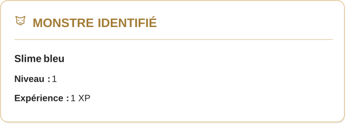
  </picture>
  

    
Version textuelle de la fenêtre

  
<svg class="lit-window__icon" viewBox="0 0 24 24" aria-hidden="true" focusable="false"><path d="M5 10 3 4l7 3h4l7-3-2 6v7l-7 4-7-4Z M8 12h1 M15 12h1 M10 17h4"/></svg>MONSTRE IDENTIFIÉ

  <h3>Slime bleu</h3>
  
<strong>Niveau :</strong> 1

  
<strong>Expérience :</strong> 1 XP

  

Hasol contempla la créature.

Un rire amer lui échappa.

— Encore toi…

Le slime bondit faiblement.

Elle esquiva sans difficulté.

Puis leva son épée.

Pendant un instant, elle hésita.

Elle repensa aux paroles de son père.

Aux rires des étudiants.

À la décision de l’Académie.

Puis murmura :

— Je veux juste avancer…

Sa voix trembla.

— Même un tout petit peu.

Elle abattit sa lame.

Le noyau du slime se brisa.

La créature se dissipa en particules lumineuses.

Une notification apparut.

  <picture class="lit-window__github-picture">
    <source media="(max-width: 600px)" srcset="assets/fenetres/011-mobile.svg">
    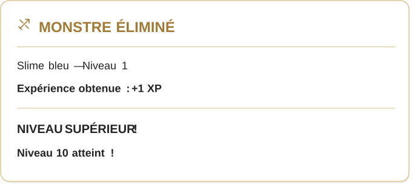
  </picture>
  

    
Version textuelle de la fenêtre

  
<svg class="lit-window__icon" viewBox="0 0 24 24" aria-hidden="true" focusable="false"><path d="m5 19 14-14 M14 4h6v6 M3 16l5 5 M5 5l5 5 M14 14l5 5"/></svg>MONSTRE ÉLIMINÉ

  
Slime bleu — Niveau 1

  
<strong>Expérience obtenue :</strong> <strong class="lit-window__value">+1 XP</strong>

  

  <h3>NIVEAU SUPÉRIEUR !</h3>
  
<strong>Niveau 10 atteint !</strong>

  

Hasol resta immobile.

Elle avait réussi.

Enfin.

Après trois années.

Le niveau 10.

Une deuxième fenêtre apparut.

  <picture class="lit-window__github-picture">
    <source media="(max-width: 600px)" srcset="assets/fenetres/012-mobile.svg">
    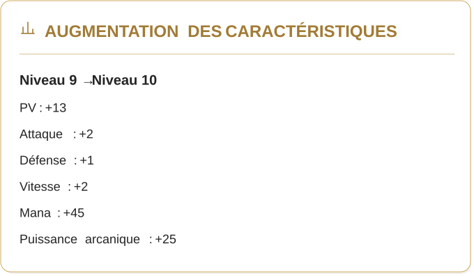
  </picture>
  

    
Version textuelle de la fenêtre

  
<svg class="lit-window__icon" viewBox="0 0 24 24" aria-hidden="true" focusable="false"><path d="M5 20V11 M12 20V4 M19 20v-6 M3 20h18"/></svg>AUGMENTATION DES CARACTÉRISTIQUES

  <h3>Niveau 9 → Niveau 10</h3>
  
PV : +13

  
Attaque : +2

  
Défense : +1

  
Vitesse : +2

  
Mana : +45

  
Puissance arcanique : +25

  

Le sourire de Hasol s’effaça.

Quarante-cinq points de Mana.

Vingt-cinq points de Puissance arcanique.

Encore des gains exceptionnels.

Encore une puissance qu’elle ne pouvait pas utiliser.

Elle baissa lentement son épée.

— Encore…

Ses yeux se remplirent de larmes.

— Encore du mana…

Elle leva les yeux vers le ciel.

— À quoi ça sert…

Sa voix se brisa.

— À quoi ça sert d’avoir autant de puissance si je ne peux rien en faire ?

Elle referma sa fenêtre.

Ou du moins, elle essaya.

Car une nouvelle notification venait d’apparaître.

---

## XII. La croissance oubliée

Cette fenêtre était différente.

Ses bordures étaient dorées.

De fines inscriptions turquoise circulaient le long de son cadre.

Hasol fronça les sourcils.

— Qu’est-ce que… ?

  <picture class="lit-window__github-picture">
    <source media="(max-width: 600px)" srcset="assets/fenetres/013-mobile.svg">
    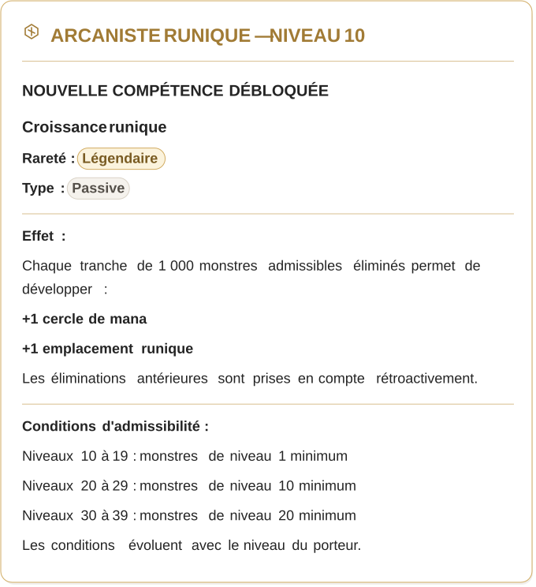
  </picture>
  

    
Version textuelle de la fenêtre

  
<svg class="lit-window__icon" viewBox="0 0 24 24" aria-hidden="true" focusable="false"><path d="m12 3 8 5v8l-8 5-8-5V8Z M12 7v10 M8 10l8 4"/></svg>ARCANISTE RUNIQUE — NIVEAU 10

  <h3>NOUVELLE COMPÉTENCE DÉBLOQUÉE</h3>
  <h2>Croissance runique</h2>
  
<strong>Rareté :</strong> Légendaire

  
<strong>Type :</strong> Passive

  

  

  
<strong>Effet :</strong>

  
Chaque tranche de 1 000 monstres admissibles éliminés permet de développer :

  
<strong>+1 cercle de mana</strong>

  
<strong>+1 emplacement runique</strong>

  
Les éliminations antérieures sont prises en compte rétroactivement.

  

  

  

  
<strong>Conditions d'admissibilité :</strong>

  
Niveaux 10 à 19 : monstres de niveau 1 minimum

  
Niveaux 20 à 29 : monstres de niveau 10 minimum

  
Niveaux 30 à 39 : monstres de niveau 20 minimum

  
Les conditions évoluent avec le niveau du porteur.

  

  

Hasol relut la description.

Une fois.

Deux fois.

— Un cercle…

Son cœur accéléra.

— Tous les mille monstres ?

Son regard s’arrêta sur la phrase suivante.

*Les éliminations antérieures sont prises en compte rétroactivement.*

Hasol cessa presque de respirer.

— Attends…

Elle ouvrit son historique.

Plus de huit mille slimes.

Des milliers de petites créatures éliminées pendant ses années à l’Académie.

Des milliers de combats que tout le monde avait jugés inutiles.

Ses doigts tremblèrent.

— Non…

Une nouvelle fenêtre apparut.

  <picture class="lit-window__github-picture">
    <source media="(max-width: 600px)" srcset="assets/fenetres/014-mobile.svg">
    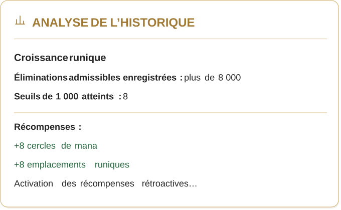
  </picture>
  

    
Version textuelle de la fenêtre

  
<svg class="lit-window__icon" viewBox="0 0 24 24" aria-hidden="true" focusable="false"><path d="M5 20V11 M12 20V4 M19 20v-6 M3 20h18"/></svg>ANALYSE DE L’HISTORIQUE

  <h3>Croissance runique</h3>
  
<strong>Éliminations admissibles enregistrées :</strong> plus de 8 000

  
<strong>Seuils de 1 000 atteints :</strong> 8

  

  
<strong>Récompenses :</strong>

  
+8 cercles de mana

  
+8 emplacements runiques

  
<em>Activation des récompenses rétroactives…</em>

  

Hasol resta figée.

Huit.

Huit nouveaux cercles.

Elle en possédait déjà deux.

Cela signifiait…

— Dix… ?

La lumière autour d’elle changea.

Un premier cercle apparut derrière son dos.

Puis un deuxième.

Elle les reconnut immédiatement.

C’étaient ses cercles de mana d’origine.

Mais un troisième cercle se dessina soudain dans l’air.

Hasol poussa un cri de surprise.

— Ah !

Le cercle tourna lentement.

Ses inscriptions s’illuminèrent.

Puis un quatrième apparut.

Un cinquième.

Un sixième.

Le mana de Hasol se mit à circuler avec une intensité qu’elle n’avait jamais ressentie.

Elle tomba à genoux.

Ce n’était pas douloureux.

Mais la sensation était immense.

Comme si des portes longtemps fermées venaient de s’ouvrir les unes après les autres.

Septième cercle.

Huitième.

Neuvième.

Puis le dixième.

Autour d’elle, les dix formations lumineuses tournoyaient dans la nuit.

Leurs inscriptions turquoise éclairaient les herbes.

Hasol leva lentement les mains.

Elle sentait chaque cercle.

Chaque nouvelle possibilité.

Et une dernière notification apparut.

  <picture class="lit-window__github-picture">
    <source media="(max-width: 600px)" srcset="assets/fenetres/015-mobile.svg">
    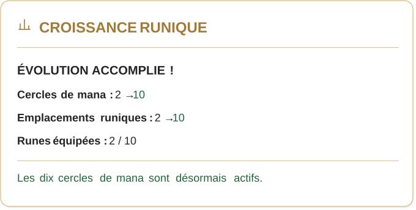
  </picture>
  

    
Version textuelle de la fenêtre

  
<svg class="lit-window__icon" viewBox="0 0 24 24" aria-hidden="true" focusable="false"><path d="M5 20V11 M12 20V4 M19 20v-6 M3 20h18"/></svg>CROISSANCE RUNIQUE

  <h3>ÉVOLUTION ACCOMPLIE !</h3>
  
<strong>Cercles de mana :</strong> 2 → 10

  
<strong>Emplacements runiques :</strong> 2 → 10

  
<strong>Runes équipées :</strong> 2 / 10

  

  
Les dix cercles de mana sont désormais actifs.

  

Hasol contempla la fenêtre.

Puis les cercles autour d’elle.

Dix.

Dix cercles de mana.

Dix emplacements runiques.

Elle connaissait suffisamment les principes des runes pour comprendre ce que cela représentait.

Chaque rune pouvait renforcer une ou plusieurs caractéristiques.

Certaines augmentaient l’Attaque.

D’autres la Défense.

D’autres encore la Vitesse ou les Points de vie.

Et les runes appartenant à un même ensemble pouvaient activer des bonus supplémentaires.

Un chasseur ordinaire devait faire des choix difficiles.

Hasol venait d’obtenir la possibilité d’équiper dix runes.

Elle n’avait pas soudainement gagné une force physique exceptionnelle.

Elle ne possédait toujours aucun sort offensif.

Mais elle venait de découvrir un moyen de compenser les caractéristiques que ses montées de niveau lui avaient si rarement accordées.

Sa classe représentait toujours vingt points dans une équipe. Elle n’avait ni effacé les refus ni gagné soudainement le droit de promettre qu’elle protégerait quelqu’un. Les dix cercles n’avaient pas transformé son inexpérience en maîtrise.

Pourtant, elle ne regardait plus les emplacements vides de la même manière.

Jusqu’à cette nuit, elle avait attendu qu’une compétence la rende enfin assez utile pour être choisie. Désormais, elle entrevoyait quelque chose sur quoi travailler : de l’équipement à réunir, des possibilités à comprendre, des décisions qui ne se résumaient pas à supplier une barre d’expérience d’avancer.

Ce n’était pas encore une place dans un groupe.

Mais c’était peut-être un commencement.

— Les runes…

Elle regarda ses mains.

Puis son épée.

— Je peux…

Sa voix trembla.

— Je peux devenir plus forte grâce aux runes…

Elle pensa immédiatement à sa mère.

À son atelier.

Aux petites pierres gravées qu’elle manipulait depuis des années.

Puis elle repensa aux milliers de slimes.

Aux longues journées passées dans les plaines.

Aux moqueries.

À la fatigue.

À toutes les fois où elle avait eu envie d’abandonner.

Ses lèvres se mirent à trembler.

Et soudain, elle éclata de rire.

Un rire maladroit.

Incrédule.

Presque désespéré.

Puis les larmes coulèrent.

Mais cette fois, ce n’étaient pas des larmes de honte.

— Huit mille…

Elle porta une main à sa bouche.

— J’en ai tué plus de huit mille…

Ses épaules furent secouées de sanglots.

— Ce n’était pas inutile…

Elle releva la tête.

Les dix cercles brillaient autour d’elle.

— Ce n’était pas inutile !

Sa voix résonna dans la clairière déserte.

---

## XIII. Le commencement d’une légende

Longtemps après, Hasol resta assise dans l’herbe.

La lune poursuivait sa course au-dessus des plaines.

Les cercles de mana s’étaient dissipés, mais elle pouvait toujours les sentir.

Dix présences silencieuses.

Dix possibilités.

Elle ouvrit une dernière fois son statut.

  <picture class="lit-window__github-picture">
    <source media="(max-width: 600px)" srcset="assets/fenetres/016-mobile.svg">
    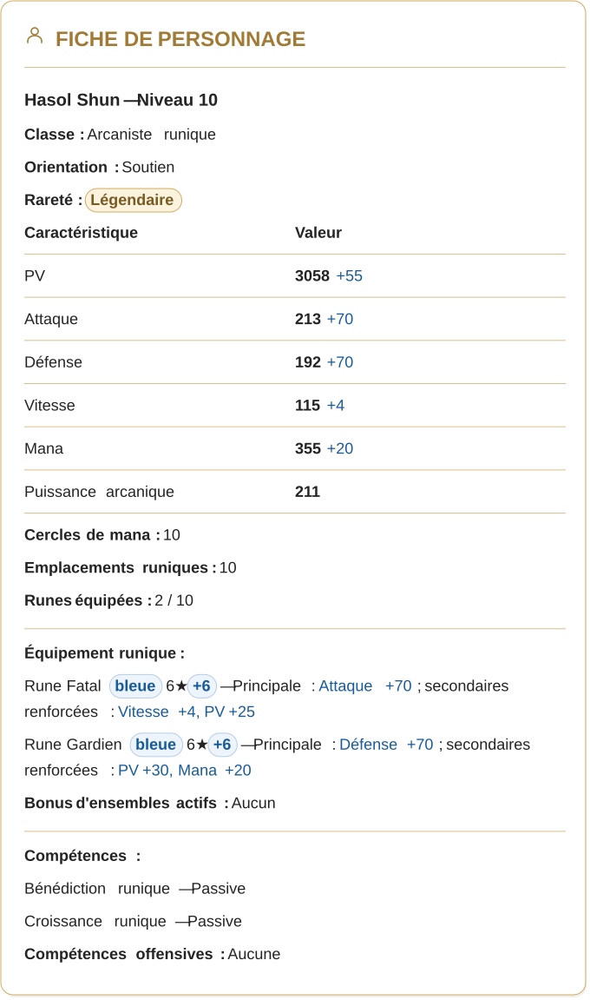
  </picture>
  

    
Version textuelle de la fenêtre

  
<svg class="lit-window__icon" viewBox="0 0 24 24" aria-hidden="true" focusable="false"><circle cx="12" cy="8" r="4"/><path d="M4 21v-2a8 6 0 0 1 16 0v2"/></svg>FICHE DE PERSONNAGE

  <h3>Hasol Shun — Niveau 10</h3>
  
<strong>Classe :</strong> Arcaniste runique

  
<strong>Orientation :</strong> Soutien

  
<strong>Rareté :</strong> Légendaire

  <table class="lit-window__stats">
    <thead><tr><th scope="col">Caractéristique</th><th scope="col">Valeur</th></tr></thead>
    <tbody>
      <tr><td>PV</td><td><strong>3058</strong> +55</td></tr>
      <tr><td>Attaque</td><td><strong>213</strong> +70</td></tr>
      <tr><td>Défense</td><td><strong>192</strong> +70</td></tr>
      <tr><td>Vitesse</td><td><strong>115</strong> +4</td></tr>
      <tr><td>Mana</td><td><strong>355</strong> +20</td></tr>
      <tr><td>Puissance arcanique</td><td><strong>211</strong></td></tr>
    </tbody>
  </table>
  
<strong>Cercles de mana :</strong> 10

  
<strong>Emplacements runiques :</strong> 10

  
<strong>Runes équipées :</strong> 2 / 10

  

  
<strong>Équipement runique :</strong>

  
Rune Fatal bleue 6★ +6 — Principale : Attaque +70 ; secondaires renforcées : Vitesse +4, PV +25

  
Rune Gardien bleue 6★ +6 — Principale : Défense +70 ; secondaires renforcées : PV +30, Mana +20

  
<strong>Bonus d'ensembles actifs :</strong> Aucun

  

  
<strong>Compétences :</strong>

  
Bénédiction runique — Passive

  
Croissance runique — Passive

  
<strong>Compétences offensives :</strong> Aucune

  

Hasol contempla les chiffres.

Ses caractéristiques physiques restaient modestes.

Elle était toujours niveau 10.

Et si elle affrontait immédiatement un chasseur expérimenté, elle perdrait probablement.

Mais quelque chose avait changé.

Pour la première fois depuis trois ans, elle ne regardait plus son statut comme la preuve de son échec.

Elle y voyait un avenir.

Dix emplacements runiques.

Une compétence qui facilitait leur amélioration.

Et une autre qui lui permettrait de développer davantage de cercles en continuant à chasser.

Elle ne savait pas encore jusqu’où cette combinaison pourrait la mener.

Elle ignorait combien de temps il lui faudrait pour réunir les runes nécessaires.

Elle ignorait également si elle parviendrait un jour à utiliser toute cette puissance arcanique qui continuait de grandir en elle.

Mais elle possédait enfin quelque chose qu’elle n’avait plus ressenti depuis longtemps.

De l’espoir.

Hasol se releva.

Elle essuya ses joues.

Puis rangea son épée dans son fourreau.

Au loin, les lumières de la capitale scintillaient dans la nuit.

Quelque part derrière ces murs, sa mère devait probablement s’inquiéter de son absence.

Et son père…

Hasol baissa les yeux vers son interface.

Les deux runes rares, bleues et à six étoiles, brillaient toujours à leur emplacement.

Elles étaient là depuis trois ans.

Deux cadeaux offerts par un père qui l’avait autrefois regardée comme si elle pouvait accomplir n’importe quoi.

Elle posa doucement une main sur sa poitrine.

— Père…

Sa voix était à peine audible.

— Je n’ai pas abandonné.

Elle inspira profondément.

— Je vais te le prouver.

Puis elle prit le chemin du retour.

Ses pas étaient fatigués.

Ses muscles douloureux.

Son avenir encore incertain.

Mais elle avançait désormais la tête haute.

***

Pendant trois ans, l’Académie impériale avait considéré Hasol Shun comme une erreur.

Une classe légendaire incapable de lancer un sort.

Une chasseuse dont les caractéristiques les plus puissantes semblaient inutilisables.

Une jeune fille qui avait gaspillé son adolescence à tuer des milliers de slimes.

Personne n’avait compris ce que ces années préparaient.

Pas même Hasol.

Mais cette nuit-là, dans une clairière oubliée, les milliers de monstres qu’elle avait éliminés lui avaient offert quelque chose qu’aucun professeur n’avait su lui donner.

Un véritable chemin vers la puissance.

Et tandis qu’elle rentrait chez elle, une pensée lui traversa l’esprit.

*Ils m’ont appelée la légendaire inutile…*

Elle posa une main sur sa poitrine, là où elle sentait désormais vibrer ses dix cercles de mana.

Puis sourit.

*Alors je leur montrerai un jour ce que vaut réellement une Arcaniste runique.*

**La légende de Hasol Shun venait seulement de commencer.**

---

**Fin du chapitre 1 — La légendaire inutile**

# Chapitre 2 — La véritable valeur d’une rune

---

## I. La lampe du salon

Lorsque Hasol referma la porte de la maison, elle prit soin de retenir le battant jusqu’au dernier instant. Le bois rencontra le chambranle avec un bruit mat qui lui sembla pourtant beaucoup trop fort.

Une lampe brûlait encore dans le salon.

Sa mère était assise près de la fenêtre, une tasse entre les mains. Elle ne lisait pas. Le livre posé sur ses genoux était fermé, et le thé ne fumait plus depuis longtemps.

— Hasol.

La jeune fille s’immobilisa.

— Je suis rentrée, maman.

Sa mère posa la tasse et se leva. Son regard descendit sur l’épée, remonta vers son visage, s’arrêta sur ses mains.

— Où étais-tu ?

Hasol baissa les yeux. Maintenant qu’elle se trouvait sous le toit familial, sa sortie nocturne lui paraissait moins simple que dans sa chambre. Elle avait laissé derrière elle une fenêtre ouverte, une assiette presque intacte et une mère qui avait déjà eu suffisamment de raisons de s’inquiéter.

— Dans les plaines. Je suis désolée.

— Tu es blessée ?

— Non.

Sa mère s’approcha tout de même. Elle écarta doucement une mèche collée à sa joue, puis effleura la manche de sa tenue de chasse. Hasol la laissa vérifier, sans protester. Elle aurait voulu commencer par la bonne nouvelle ; à la place, elle sentit la honte lui serrer la gorge.

— Je n’aurais pas dû partir sans te prévenir.

— Non, répondit sa mère. Tu n’aurais pas dû.

Il n’y avait pas de colère dans sa voix, seulement une fatigue qui fit davantage baisser la tête de Hasol.

Puis sa mère désigna le fauteuil.

— Assieds-toi. Tu as à peine mangé ce soir.

Hasol retint doucement sa manche.

— Maman. Attends.

Elle avait imaginé ce moment pendant tout le trajet. Dans les rues désertes, les phrases lui étaient venues facilement. À présent, devant ce visage inquiet, elle ne savait plus comment les assembler.

— Je suis passée au niveau dix.

Sa mère resta immobile.

— Tu l’as atteint ?

Hasol acquiesça.

— Le dernier point. Il ne me manquait que celui-là.

L’expression de sa mère changea lentement. L’inquiétude ne disparut pas tout à fait, mais quelque chose de plus doux la traversa. Elle prit les mains de sa fille.

— Oh, Hasol…

Elle la serra contre elle.

Hasol ferma les yeux. Ce n’était pas la reconnaissance qu’elle avait imaginée autrefois, au milieu d’étudiants enfin obligés de la regarder autrement. Il n’y avait ni applaudissements ni lumière dorée sous les voûtes d’un temple. Seulement une lampe trop basse, une tasse de thé froid et les bras de sa mère.

Elle s’y accrocha quelques secondes de plus.

— Il y a autre chose, murmura-t-elle.

Sa mère recula juste assez pour voir son visage.

— Une compétence ?

— Oui. Pas un sort.

Elle avait ajouté ces mots par réflexe, avant que l’espoir de quelqu’un d’autre puisse devenir une déception de plus.

Mais cette fois, sa propre voix ne se brisa pas.

— Une compétence passive. Regarde.

Elle ouvrit la fenêtre et la partagea avec sa mère.

  <picture class="lit-window__github-picture">
    <source media="(max-width: 600px)" srcset="assets/fenetres/017-mobile.svg">
    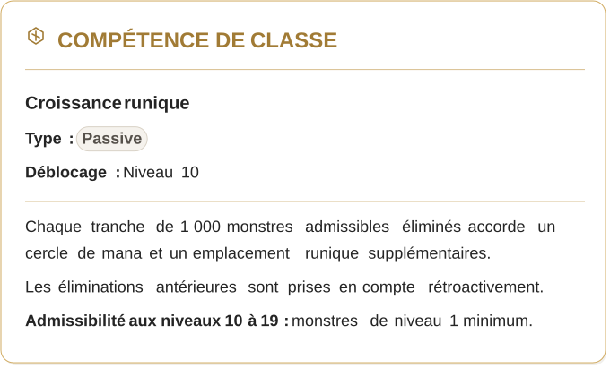
  </picture>
  

    
Version textuelle de la fenêtre

  
<svg class="lit-window__icon" viewBox="0 0 24 24" aria-hidden="true" focusable="false"><path d="m12 3 8 5v8l-8 5-8-5V8Z M12 7v10 M8 10l8 4"/></svg>COMPÉTENCE DE CLASSE

  <h3>Croissance runique</h3>
  
<strong>Type :</strong> Passive — Légendaire

  
<strong>Déblocage :</strong> Niveau 10

  

  
Chaque tranche de 1 000 monstres admissibles éliminés accorde un cercle de mana et un emplacement runique supplémentaires.

  
Les éliminations antérieures sont prises en compte rétroactivement.

  
<strong>Admissibilité aux niveaux 10 à 19 :</strong> monstres de niveau 1 minimum.

  

Sa mère lut sans parler. Son regard s’arrêta sur la dernière phrase de l’effet, puis revint au début.

— Les éliminations antérieures…

— Tous ces slimes ont compté.

Hasol sentit sa gorge se serrer de nouveau.

— Huit paliers, maman.

Elle fit apparaître une seconde fenêtre.

  <picture class="lit-window__github-picture">
    <source media="(max-width: 600px)" srcset="assets/fenetres/018-mobile.svg">
    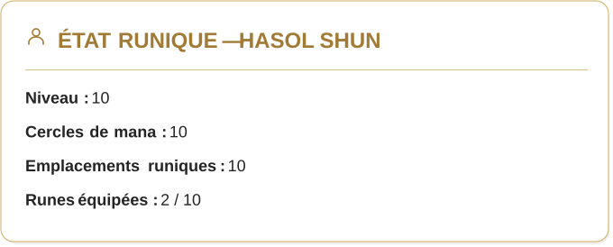
  </picture>
  

    
Version textuelle de la fenêtre

  
<svg class="lit-window__icon" viewBox="0 0 24 24" aria-hidden="true" focusable="false"><circle cx="12" cy="8" r="4"/><path d="M4 21v-2a8 6 0 0 1 16 0v2"/></svg>ÉTAT RUNIQUE — HASOL SHUN

  
<strong>Niveau :</strong> 10

  
<strong>Cercles de mana :</strong> 10

  
<strong>Emplacements runiques :</strong> 10

  
<strong>Runes équipées :</strong> 2 / 10

  

Sa mère porta une main à sa bouche.

Dans le silence, Hasol entendit une poutre travailler quelque part au-dessus d’elles. Elle leva les yeux vers le plafond. La chambre de ses parents était à l’étage.

Sa mère suivit son regard, puis lui reprit la main.

— Pour l’instant, ne montre pas cela à n’importe qui.

— Tu crois que c’est dangereux ?

— Je crois que nous devons comprendre ce que tu possèdes avant de laisser les autres décider de ce qu’ils veulent en faire.

Hasol contempla les huit emplacements vides. Depuis les plaines, elle n’y avait vu que des possibilités. Elle n’avait pas imaginé les questions, les demandes ou les regards qui pourraient les accompagner.

— Et père ?

Sa mère resta un instant silencieuse.

— Nous en parlerons. Mais pas cette nuit, alors que vous êtes tous les deux blessés par ce qui s’est passé au dîner.

Hasol hocha lentement la tête. Elle ne voulait pas que cette découverte devienne une nouvelle dispute, ni une preuve qu’elle brandirait avec colère avant même de savoir l’expliquer.

Sa mère lui caressa la joue.

— Tu peux être fière de toi, tu sais.

— Même si je ne sais pas encore quoi en faire ?

Un sourire fatigué éclaira son visage.

— Nous allons commencer par te donner quelque chose à manger. Ensuite, tu dormiras. Le reste attendra le matin.

Cette fois, Hasol ne protesta pas.

---

## II. Deux cadeaux et huit places

Elle se réveilla avant que les bruits de la maison commencent à monter dans l’escalier.

Pendant un instant, elle resta allongée sans bouger. Puis elle ouvrit son statut.

Dix cercles.

Ce n’était pas un rêve.

La joie revint, plus calme que dans les plaines. Elle ne chassa pas la fatigue de ses muscles ni le souvenir du dîner, mais elle lui donna une raison de se lever.

Après le petit-déjeuner, sa mère la conduisit à son atelier. La pièce donnait sur le jardin intérieur ; une fenêtre entrouverte laissait entrer l’odeur de la terre humide. Sur la table, des boîtes de tailles différentes avaient été disposées près d’un linge propre et d’une petite réserve de pierres de mana.

Hasol s’arrêta sur le seuil.

— Tu avais préparé tout ça ?

— Je connaissais mes réserves. Il a surtout fallu choisir.

Sa mère lui fit signe d’approcher.

— D’abord, montre-moi ce que tu portes déjà.

Hasol ouvrit son équipement. La rune Fatal rare, bleue, six étoiles et améliorée à +6, apparut à côté de la Gardien de même rareté, de même rang et de même amélioration.

Elle les regarda longtemps.

— Je les garde.

Sa mère tourna la tête vers elle.

— Bien sûr que tu les gardes.

— Je veux dire… même si on doit changer les autres choix.

Sa mère ne lui demanda pas pourquoi. Elle savait.

— Nous ne cherchons pas à effacer ce que ton père t’a donné, Hasol. Nous allons construire autour.

La jeune fille sentit ses épaules se détendre.

Sa mère posa deux doigts près de la fenêtre partagée.

— Deux emplacements sont déjà occupés. Il en reste huit. Pas dix.

— Je sais compter, maman.

— Je préfère vérifier avant que tu ne décides de tout équiper à la fois.

Hasol eut un petit rire. Sa mère attendit qu’elle tire une chaise, puis ouvrit les boîtes une à une.

Huit pierres runiques reposaient sur leurs garnitures. Quatre émettaient une lueur verte ; les quatre autres avaient cet éclat bleu qu’Hasol connaissait si bien.

Toutes portaient trois étoiles.

— Des runes trois étoiles…

— Peu communes pour les vertes, rares pour les bleues, précisa sa mère. Elles ne sont pas du même rang que les deux cadeaux rares à six étoiles de ton père. Mais elles peuvent t’apporter ce dont tu manques.

Hasol approcha la main sans encore toucher les pierres.

— Tu les avais toutes ?

— Certaines depuis longtemps. D’autres étaient destinées à être vendues. Je peux me permettre de t’aider à commencer, pas de remplir tes dix emplacements de pièces exceptionnelles ni de payer toutes tes améliorations futures.

Elle le dit simplement, sans transformer le cadeau en dette.

— Je ne te demande pas cela, répondit Hasol.

— Je sais. Mais je veux que tu comprennes ce que tu reçois. Ce sont des moyens de travailler. Pas une promesse que tout sera facile.

Hasol passa le pouce sur le bord de la table.

— Alors je vais essayer de ne pas les gaspiller.

Sa mère sourit.

— Commence par apprendre à les choisir.

---

## III. Ce que la couleur ne dit pas

Sa mère prit une rune Fatal peu commune, verte, trois étoiles et encore à +0. Elle la posa sur le linge entre elles.

— Dis-moi ce que tu regardes en premier.

— L’ensemble. La principale. Le grade et les étoiles.

— Et ?

Hasol se pencha.

— La secondaire. Et le niveau d’amélioration.

— Bien. Aucun de ces éléments ne remplace les autres.

Elles examinèrent la fenêtre. La principale de cette Fatal peu commune, trois étoiles, +0, augmentait l’Attaque ; sa secondaire renforçait la Défense. La couleur n’imposait pas un usage unique, pas plus que l’ensemble ne dictait toutes les caractéristiques de la pierre.

— Les étoiles déterminent le rang et l’échelle des valeurs, reprit sa mère. Le grade te dit combien de secondaires sont présentes au départ. Une commune blanche commence sans secondaire. Une peu commune verte en a une, une rare bleue deux, une épique violette trois, une légendaire orange quatre.

— Quatre au maximum, compléta Hasol.

Sa mère acquiesça.

— Le nombre peut augmenter avec l’amélioration, mais pas sans limite. Ta Fatal rare, bleue, six étoiles, +6, possède toujours ses deux secondaires natives, renforcées. Elle n’en a pas gagné deux autres simplement parce qu’elle a franchi +3 et +6.

Hasol compara les deux lignes de son cadeau paternel avec celles de la nouvelle Fatal peu commune, verte, trois étoiles, +0.

— À +9, la rare bleue pourra en gagner une troisième. Puis une quatrième à +12.

— Exactement. Et à +15, une de ses quatre secondaires sera encore renforcée.

Sa mère prit le temps de la laisser suivre le raisonnement.

— La principale, elle, augmente à chaque amélioration réussie. Pas seulement aux paliers. Le dernier passage, de +14 à +15, lui apporte un gain plus important.

— Donc les paliers ne remplacent pas les augmentations ordinaires.

— Ils s’y ajoutent.

Hasol sentit quelque chose se remettre en ordre dans son esprit. Elle connaissait les mots, les avait appris sur des pages et recopiés dans des cahiers. Mais les appliquer à des pierres dont elle pouvait désormais choisir l’usage donnait à cette théorie un poids différent.

Elles examinèrent ensuite les huit nouvelles acquisitions. Sa mère lui demanda de lire chaque principale, de distinguer chaque secondaire et d’expliquer ce qu’elle espérait en tirer. Hasol se trompa une fois en allant trop vite ; elles reprirent la ligne depuis le début.

  <picture class="lit-window__github-picture">
    <source media="(max-width: 600px)" srcset="assets/fenetres/019-mobile.svg">
    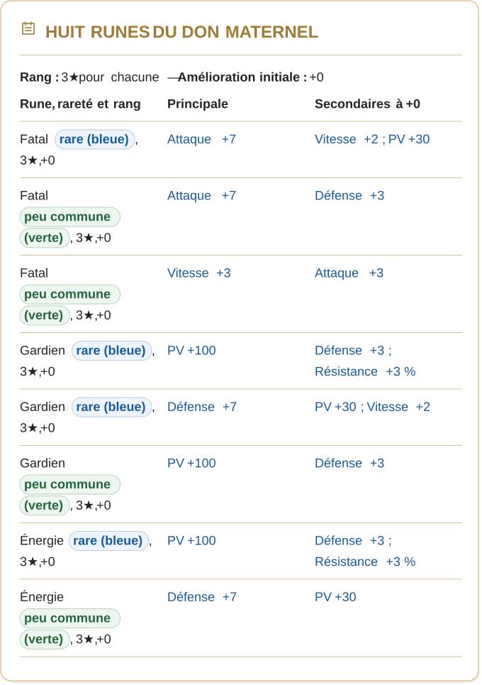
  </picture>
  

    
Version textuelle de la fenêtre

  
<svg class="lit-window__icon" viewBox="0 0 24 24" aria-hidden="true" focusable="false"><path d="M4 5h16v15H4Z M8 3v4 M16 3v4 M8 11h8 M8 15h8"/></svg>HUIT RUNES DU DON MATERNEL

  
<strong>Rang :</strong> 3★ pour chacune — <strong>Amélioration initiale :</strong> +0

  <table class="lit-window__inventory" role="table">
    <thead><tr><th scope="col">Rune, rareté et rang</th><th scope="col">Principale</th><th scope="col">Secondaires à +0</th></tr></thead>
    <tbody>
      <tr><td>Fatal rare (bleue), 3★, +0</td><td>Attaque +7</td><td>Vitesse +2 ; PV +30</td></tr>
      <tr><td>Fatal peu commune (verte), 3★, +0</td><td>Attaque +7</td><td>Défense +3</td></tr>
      <tr><td>Fatal peu commune (verte), 3★, +0</td><td>Vitesse +3</td><td>Attaque +3</td></tr>
      <tr><td>Gardien rare (bleue), 3★, +0</td><td>PV +100</td><td>Défense +3 ; Résistance +3 %</td></tr>
      <tr><td>Gardien rare (bleue), 3★, +0</td><td>Défense +7</td><td>PV +30 ; Vitesse +2</td></tr>
      <tr><td>Gardien peu commune (verte), 3★, +0</td><td>PV +100</td><td>Défense +3</td></tr>
      <tr><td>Énergie rare (bleue), 3★, +0</td><td>PV +100</td><td>Défense +3 ; Résistance +3 %</td></tr>
      <tr><td>Énergie peu commune (verte), 3★, +0</td><td>Défense +7</td><td>PV +30</td></tr>
    </tbody>
  </table>
  

Hasol releva les yeux.

— Il n’y a pas que des principales offensives parmi les Fatal.

— Tu vas te battre avec tout ton corps, pas seulement avec ton Attaque. Une principale qui augmente tes PV ne devient pas inutile parce que la pierre appartient à Fatal.

Sa mère fit glisser les trois nouvelles Fatal vertes ou bleues, toutes trois étoiles et à +0, vers la fenêtre du cadeau paternel Fatal rare, bleu, six étoiles, +6.

— Quatre pièces Fatal, dit-elle. Un ensemble complet. Les trois nouvelles Gardien trois étoiles, deux rares bleues et une peu commune verte, complètent celle de ton père, rare bleue, six étoiles, +6 : quatre pièces également.

— Mais Gardien fonctionne par paire, remarqua Hasol. Cela fait deux ensembles ?

— Exactement. Chaque paire apporte quinze pour cent de Défense. Deux paires donnent trente pour cent. Et les deux Énergie trois étoiles, l’une rare bleue, l’autre peu commune verte, complètent un dernier ensemble.

Hasol recompta les pièces : quatre Fatal, quatre Gardien, deux Énergie.

— Dix runes. Quatre ensembles complets, de trois types différents.

Sa mère acquiesça.

— Une cinquième Fatal n’aurait pas complété un deuxième ensemble, pas plus qu’une Gardien isolée ne formerait une nouvelle paire. Les caractéristiques de chaque pierre ont leur intérêt, mais autant employer tes dix emplacements pour compléter les ensembles que nous avons choisis.

Hasol regarda les huit pierres, puis les deux cadeaux paternels dans son interface. Pour la première fois, les emplacements ne lui apparurent plus comme dix cases qu’il suffisait de remplir. Chaque choix avait un usage, une limite et un coût.

Elle prit une inspiration.

— Alors on essaie ?

---

## IV. Une première amélioration

Sa mère lui proposa de commencer par la nouvelle Fatal rare, bleue, trois étoiles et à +0, dont la principale augmentait l’Attaque de sept points. Une fine entaille traversait son motif de lame ; Hasol la reconnut sans avoir besoin de rouvrir la fenêtre.

— Celle-ci ne remplace pas la Fatal rare à six étoiles de père, dit-elle.

— Non. Elle l’accompagne. Et c’est celle-ci que tu vas améliorer aujourd’hui.

Sa mère dégagea le centre de la table, plaça les ressources nécessaires à portée de main et lui fit vérifier deux fois l’état de départ. La Fatal rare, trois étoiles, +0, possédait une secondaire de Vitesse et une autre de PV. Hasol les lut à voix haute pour ne pas les confondre avec la principale.

Puis elle commença.

La lumière prit sous ses doigts. Une vibration remonta le long de son poignet, régulière d’abord, puis plus hésitante. Hasol retint son souffle au lieu de relâcher ses épaules.

L’éclat s’éteignit.

  <picture class="lit-window__github-picture">
    <source media="(max-width: 600px)" srcset="assets/fenetres/020-mobile.svg">
    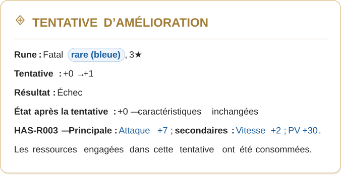
  </picture>
  

    
Version textuelle de la fenêtre

  
<svg class="lit-window__icon" viewBox="0 0 24 24" aria-hidden="true" focusable="false"><path d="m12 3 8 9-8 9-8-9Z M8 12h8 M12 8v8"/></svg>TENTATIVE D’AMÉLIORATION

  
<strong>Rune :</strong> Fatal rare (bleue), 3★

  
<strong>Tentative :</strong> +0 → +1

  
<strong>Résultat :</strong> Échec

  
<strong>État après la tentative :</strong> +0 — caractéristiques inchangées

  
Les ressources engagées dans cette tentative ont été consommées.

  

Hasol fixa les pierres devenues ternes.

— Déjà…

Sa mère lui laissa le temps de retirer sa main.

— Bénédiction runique améliore tes chances. Elle ne choisit pas le résultat de chaque tentative à ta place.

— Je sais. Mais j’aurais aimé réussir la première.

— Moi aussi, dit sa mère avec un petit sourire. Pour toi comme pour mes réserves.

Hasol eut un rire bref, encore embarrassé.

Elles vérifièrent la Fatal rare, trois étoiles, restée à +0. La principale et les deux secondaires étaient intactes. Sa mère nota l’échec avant de lui donner les ressources nécessaires pour recommencer.

Cette fois, la lumière tint.

La nouvelle Fatal rare à trois étoiles atteignit +1, puis +2 lors de la tentative suivante. À chaque réussite, sa principale gagna cinq points d’Attaque. Hasol prit le temps de regarder les chiffres au lieu de se précipiter vers le palier.

La dernière tentative lui parut durer plus longtemps que les autres.

Puis un éclat bleu se répandit sur le linge.

  <picture class="lit-window__github-picture">
    <source media="(max-width: 600px)" srcset="assets/fenetres/021-mobile.svg">
    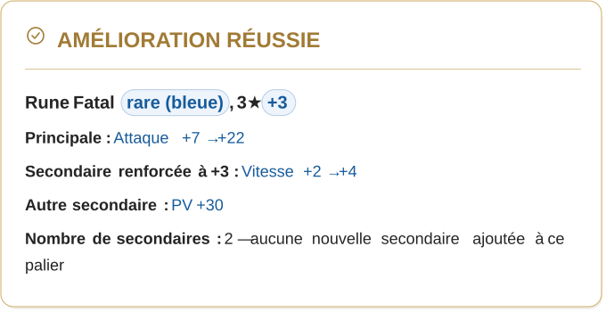
  </picture>
  

    
Version textuelle de la fenêtre

  
<svg class="lit-window__icon" viewBox="0 0 24 24" aria-hidden="true" focusable="false"><circle cx="12" cy="12" r="9"/><path d="m8 12 3 3 5-6"/></svg>AMÉLIORATION RÉUSSIE

  <h3>Rune Fatal rare (bleue), 3★ +3</h3>
  
<strong>Principale :</strong> Attaque +7 → +22

  
<strong>Secondaire renforcée à +3 :</strong> Vitesse +2 → +4

  
<strong>Autre secondaire :</strong> PV +30

  
<strong>Nombre de secondaires :</strong> 2 — aucune nouvelle secondaire ajoutée à ce palier

  

Hasol resta penchée au-dessus de la table.

— J’ai réussi.

Elle le dit presque à voix basse, comme si une exclamation trop forte risquait d’effacer le résultat.

Sa mère posa une main sur son épaule.

— Oui.

Hasol regarda les ressources consommées, celles qui restaient, puis la Fatal rare, trois étoiles, désormais +3. L’échec n’avait pas disparu parce qu’elle avait fini par réussir. Il faisait partie du prix payé pour obtenir ce résultat.

Elle comprenait mieux pourquoi sa mère avait parlé de moyens de travailler.

— On continue jusqu’à +6 ? demanda-t-elle pourtant.

— Pas aujourd’hui.

Hasol releva la tête.

— Mais…

— Tu veux déjà dépenser ce qu’il reste sans avoir essayé ton nouvel équipement ?

La jeune fille regarda les huit emplacements encore vides.

Puis elle sourit, un peu honteuse.

— Non. D’accord. Une chose à la fois.

---

## V. Dix runes, quatre ensembles

L’équipement des nouvelles pierres demanda moins de temps que leur examen, mais Hasol ne s’autorisa pas à le faire distraitement. Chaque rune trois étoiles, peu commune verte ou rare bleue, fut vérifiée avant qu’elle établisse le lien avec un emplacement libre.

Elle commença par la Fatal rare, bleue, trois étoiles, +3 qu’elle venait d’améliorer. Sa lumière se défit en particules et rejoignit le troisième cercle. Les deux autres Fatal maternelles, peu communes vertes, trois étoiles et à +0, suivirent.

Puis elle équipa les trois Gardien trois étoiles, +0, deux rares bleues et une peu commune verte. Enfin vinrent les deux Énergie trois étoiles, +0, l’une rare bleue, l’autre peu commune verte.

Les deux cadeaux rares, bleus, six étoiles, +6 de son père n’avaient pas quitté leurs emplacements.

Lorsque le dernier lien se stabilisa, Hasol sentit un changement dans la circulation de son mana. Pas un choc, ni la sensation démesurée des nouveaux cercles dans les plaines. Plutôt une série d’appuis qui venaient se mettre en place, encore étrangers, mais distincts.

  <picture class="lit-window__github-picture">
    <source media="(max-width: 600px)" srcset="assets/fenetres/022-mobile.svg">
    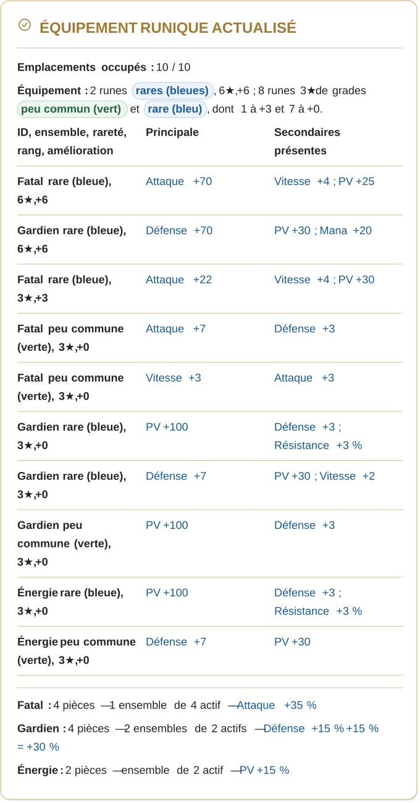
  </picture>
  

    
Version textuelle de la fenêtre

  
<svg class="lit-window__icon" viewBox="0 0 24 24" aria-hidden="true" focusable="false"><circle cx="12" cy="12" r="9"/><path d="m8 12 3 3 5-6"/></svg>ÉQUIPEMENT RUNIQUE ACTUALISÉ

  
<strong>Emplacements occupés :</strong> 10 / 10

  
<strong>Équipement :</strong> 2 runes rares (bleues), 6★, +6 ; 8 runes 3★ de grades peu commun (vert) et rare (bleu), dont 1 à +3 et 7 à +0.

  

  
<strong>Fatal :</strong> 4 pièces — 1 ensemble de 4 actif — Attaque +35 %

  
<strong>Gardien :</strong> 4 pièces — 2 ensembles de 2 actifs — Défense +15 % +15 % = +30 %

  
<strong>Énergie :</strong> 2 pièces — ensemble de 2 actif — PV +15 %

  

Hasol ouvrit et referma la main. Elle se leva, fit quelques pas entre la table et la fenêtre, puis revint sans pouvoir retenir un sourire.

— Je me sens différente.

— Prends le temps de t’y habituer.

Sa mère la regardait avec attention, sans partager tout à fait son impatience.

— Tu as davantage de soutien dans tes mouvements. Cela ne signifie pas que tu sais déjà quoi en faire.

Hasol consulta la fiche. Les bonus fixes étaient distingués des caractéristiques de son corps ; les ensembles apparaissaient à part. Elle suivit les lignes du doigt, puis revint aux dix emplacements.

  <picture class="lit-window__github-picture">
    <source media="(max-width: 600px)" srcset="assets/fenetres/023-mobile.svg">
    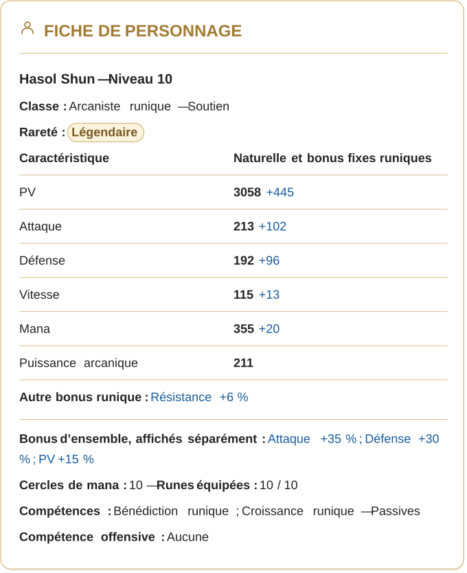
  </picture>
  

    
Version textuelle de la fenêtre

  
<svg class="lit-window__icon" viewBox="0 0 24 24" aria-hidden="true" focusable="false"><circle cx="12" cy="8" r="4"/><path d="M4 21v-2a8 6 0 0 1 16 0v2"/></svg>FICHE DE PERSONNAGE

  <h3>Hasol Shun — Niveau 10</h3>
  
<strong>Classe :</strong> Arcaniste runique — Soutien

  
<strong>Rareté :</strong> Légendaire

  <table class="lit-window__stats">
    <thead><tr><th scope="col">Caractéristique</th><th scope="col">Naturelle et bonus fixes runiques</th></tr></thead>
    <tbody>
      <tr><td>PV</td><td><strong>3058</strong> +445</td></tr>
      <tr><td>Attaque</td><td><strong>213</strong> +102</td></tr>
      <tr><td>Défense</td><td><strong>192</strong> +96</td></tr>
      <tr><td>Vitesse</td><td><strong>115</strong> +13</td></tr>
      <tr><td>Mana</td><td><strong>355</strong> +20</td></tr>
      <tr><td>Puissance arcanique</td><td><strong>211</strong></td></tr>
    </tbody>
  </table>
  
<strong>Autre bonus runique :</strong> Résistance +6 %

  

  
<strong>Bonus d’ensemble, affichés séparément :</strong> Attaque +35 % ; Défense +30 % ; PV +15 %

  
<strong>Cercles de mana :</strong> 10 — <strong>Runes équipées :</strong> 10 / 10

  
<strong>Compétences :</strong> Bénédiction runique ; Croissance runique — Passives

  
<strong>Compétence offensive :</strong> Aucune

  

Les dernières lignes n’avaient pas changé.

Hasol les lut sans retrouver immédiatement l’amertume des mois précédents. Elle savait qu’aucun sort ne l’attendait derrière les nombres. Mais, pour une fois, elle avait pu agir autrement qu’en espérant sa prochaine montée de niveau.

Sa mère referma les boîtes vides.

— Que vas-tu faire maintenant ?

Hasol baissa les yeux vers son épée.

— Vérifier ce que ça change vraiment.

---

## VI. Quarante-deux secondes

Elle hésita longtemps devant l’entrée des salles d’entraînement de l’Académie.

La veille encore, elle avait franchi les grandes portes avec sa décision de radiation dans le sac. Revenir lui donnait l’impression absurde de ne pas avoir compris qu’on ne voulait plus d’elle. Pourtant, l’accès aux installations pour les chasseurs indépendants était distinct du cursus. Elle le savait. Elle avait même préparé les pièces nécessaires dans sa poche pour ne pas avoir à les chercher devant le guichet.

L’employé encaissa son paiement sans commentaire.

Ce fut presque décevant, après l’effort qu’elle avait fait pour se préparer à son regard.

Dans la salle, l’odeur du cuir usé et du bois frappé lui était familière. Elle reconnut une éraflure près du mur, le banc où les élèves laissaient leurs affaires, le carré de lumière qui avançait lentement sur le sol.

Elle choisit un mannequin simulant un guerrier ordinaire de niveau dix. Pour mesurer sa garde sans attendre d’être réellement mise hors de combat, elle régla l’exercice sur un arrêt après trois touches reçues.

Elle vérifia les réglages une seconde fois. Lorsqu’elle recommencerait, elle garderait le même adversaire simulé et la même condition d’arrêt. Sinon, tenir plus longtemps ne lui apprendrait pas grand-chose sur ses progrès.

Puis elle prit position.

  <picture class="lit-window__github-picture">
    <source media="(max-width: 600px)" srcset="assets/fenetres/024-mobile.svg">
    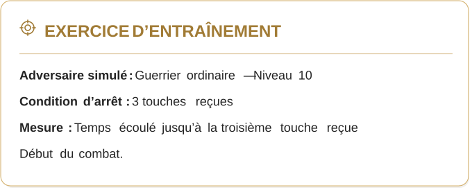
  </picture>
  

    
Version textuelle de la fenêtre

  
<svg class="lit-window__icon" viewBox="0 0 24 24" aria-hidden="true" focusable="false"><circle cx="12" cy="12" r="9"/><circle cx="12" cy="12" r="4"/><path d="M12 1v4 M12 19v4 M1 12h4 M19 12h4"/></svg>EXERCICE D’ENTRAÎNEMENT

  
<strong>Adversaire simulé :</strong> Guerrier ordinaire — Niveau 10

  
<strong>Condition d’arrêt :</strong> 3 touches reçues

  
<strong>Mesure :</strong> Temps écoulé jusqu’à la troisième touche reçue

  
Début du combat.

  

Le mannequin attaqua.

Hasol para. Le choc passa dans ses bras, mais sa garde tint mieux qu’elle ne l’aurait cru. Elle sentit son pied arrière trouver le sol au lieu de glisser. Un sourire lui échappa.

Elle pouvait supporter cela.

À l’attaque suivante, elle se décala et porta une frappe latérale. Sa lame atteignit le bras du mannequin.

Une touche.

Le plaisir fut si vif qu’elle tarda à retirer son arme.

L’épée d’entraînement adverse revint par-dessus sa garde et heurta son épaule.

Hasol recula en grimaçant. La construction avait déjà repris sa position. Elle tenta de retrouver la sienne, mais son talon était trop près de l’autre pied ; lorsqu’elle voulut pivoter, elle dut corriger son équilibre au lieu de regarder la lame.

La deuxième touche atteignit son côté.

Elle serra les dents.

*Calme-toi. Tu peux encaisser. Reprends ta garde.*

Elle para le coup suivant, puis un autre. Le nouvel équipement lui donnait les moyens de tenir, mais pas le temps qu’elle perdait à choisir sa réponse. À chaque échange, elle s’efforçait de réparer la faute précédente.

Le mannequin avança d’un pas. Hasol crut voir une ouverture et se lança.

La feinte la prit avant qu’elle comprenne qu’il n’y avait pas d’ouverture.

La troisième touche frappa son flanc. La construction s’immobilisa aussitôt.

  <picture class="lit-window__github-picture">
    <source media="(max-width: 600px)" srcset="assets/fenetres/025-mobile.svg">
    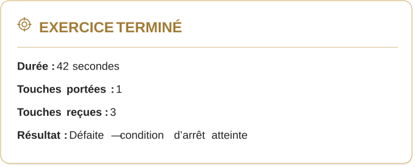
  </picture>
  

    
Version textuelle de la fenêtre

  
<svg class="lit-window__icon" viewBox="0 0 24 24" aria-hidden="true" focusable="false"><circle cx="12" cy="12" r="9"/><circle cx="12" cy="12" r="4"/><path d="M12 1v4 M12 19v4 M1 12h4 M19 12h4"/></svg>EXERCICE TERMINÉ

  
<strong>Durée :</strong> 42 secondes

  
<strong>Touches portées :</strong> 1

  
<strong>Touches reçues :</strong> 3

  
<strong>Résultat :</strong> Défaite — condition d’arrêt atteinte

  

Hasol resta accroupie, une main appuyée au sol.

Quarante-deux secondes.

Elle avait espéré davantage. Pas nécessairement gagner, se dit-elle. Puis elle reconnut qu’elle avait imaginé précisément cela : une victoire assez nette pour lui prouver que les dix emplacements avaient changé sa vie.

À la place, elle avait reçu trois touches.

Elle regarda les marques sur ses vêtements. L’exercice ne disait pas que son corps n’avait plus de force ou que ses PV étaient épuisés. Il disait quelque chose de plus simple et de plus difficile à accepter : elle avait encore laissé passer trois attaques en moins d’une minute.

Ses caractéristiques l’avaient aidée à tenir sa garde. Elles n’avaient pas repéré la feinte.

Elle se releva lentement.

Pendant trois ans, elle avait surtout appris à viser des noyaux de slimes. Elle savait économiser ses forces, recommencer malgré la fatigue, frapper au même endroit. Mais un adversaire qui lui cachait son intention exigeait autre chose.

— Les caractéristiques ne suffisent pas…

Sa voix parut petite dans la salle.

Elle vérifia son épaule, puis récupéra ses affaires. Avant de partir, elle regarda une dernière fois le mannequin.

Cette défaite ne lui avait pas retiré ses dix cercles. Elle ne prouvait pas que les cadeaux de sa mère étaient inutiles.

Elle lui montrait ce qu’il restait à apprendre.

---

## VII. Le Bois des Crocs Gris

Plus tard dans la journée, Hasol s’arrêta devant les annonces du bureau des chasseurs.

Elle passa sans les lire sur les demandes destinées aux équipes expérimentées. Son regard chercha une zone qu’elle pourrait approcher seule, sans confondre la nouveauté de son équipement avec une préparation qu’elle ne possédait pas encore.

Une fiche mentionnait les loups gris de niveau cinq du Bois des Crocs Gris.

Elle connaissait leurs descriptions. Plus rapides que les slimes. Capables de chasser ensemble, de contourner une cible et de profiter d’un déséquilibre. Leurs crocs ne s’arrêteraient pas après la troisième touche.

Hasol resta devant l’annonce assez longtemps pour laisser passer deux autres chasseurs.

Elle aurait dû, peut-être, se contenter de rentrer et de reprendre ses exercices. Cette pensée lui vint clairement. Une autre suivit, plus insistante : si elle ne quittait jamais les plaines, elle ne saurait pas non plus ce qu’elle était capable d’affronter.

Elle décida de rester près des sentiers extérieurs du bois et de repartir si la situation lui paraissait trop dangereuse.

Ce n’était pas la même chose qu’être prête.

Mais, au moment de préparer ses provisions, elle réussit à se convaincre que cela suffisait pour essayer.

Elle emporta de l’eau, un peu de nourriture et une petite potion de soin. Avant de quitter la capitale, elle vérifia les attaches de ses protections et s’assura que son épée glissait librement dans le fourreau.

La marche lui laissa le temps de repenser aux quarante-deux secondes.

Quand les arbres commencèrent à masquer le ciel, elle avait cessé de compter les gestes qu’elle aurait dû faire. Il fallait regarder ceux qu’elle faisait maintenant.

Le bois sentait l’écorce humide et les feuilles anciennes. Des racines traversaient les sentiers. La lumière descendait par plaques entre les branches, assez vive par endroits pour lui faire perdre les détails dans les zones d’ombre.

Hasol ralentit.

Un froissement se produisit sur sa droite.

Elle s’arrêta, puis aperçut un pelage gris entre deux troncs.

  <picture class="lit-window__github-picture">
    <source media="(max-width: 600px)" srcset="assets/fenetres/026-mobile.svg">
    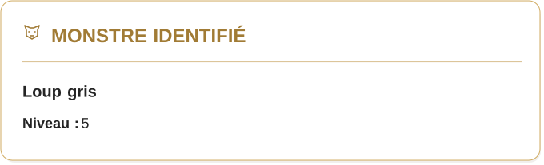
  </picture>
  

    
Version textuelle de la fenêtre

  
<svg class="lit-window__icon" viewBox="0 0 24 24" aria-hidden="true" focusable="false"><path d="M5 10 3 4l7 3h4l7-3-2 6v7l-7 4-7-4Z M8 12h1 M15 12h1 M10 17h4"/></svg>MONSTRE IDENTIFIÉ

  <h3>Loup gris</h3>
  
<strong>Niveau :</strong> 5

  

La créature la fixait déjà.

Hasol dégaina son épée. Le bruit familier du métal lui rendit un peu de calme.

*Ce n’est pas un slime.*

Le loup abaissa la tête et bondit.

---

## VIII. Trois loups

Elle se déplaça sur le côté avant d’avoir réellement choisi où poser le pied.

Sa semelle rencontra la terre ferme. Le loup passa assez près pour qu’elle entende son souffle. Hasol frappa, mais trop tard ; la lame ne fit qu’effleurer son flanc.

La créature pivota aussitôt.

Elle était plus rapide que Hasol ne l’avait imaginé en lisant sa fiche. Non parce qu’elle se déplaçait sans cesse, mais parce qu’elle changeait de direction avant que la jeune fille ait terminé son propre mouvement.

Hasol recula. Le second bond vint contre sa garde.

Le choc la secoua jusqu’aux épaules. Elle tint pourtant, et ce simple fait lui évita de céder à la panique. Son équipement l’aidait réellement. Elle avait le droit de s’appuyer dessus, à condition de ne pas s’arrêter pour l’admirer.

Elle resserra sa prise.

Au lieu de poursuivre le loup, elle attendit qu’il revienne. Ses yeux quittèrent les crocs pour observer les épaules, le tassement du corps, la poussée des pattes arrière.

Lorsqu’il bondit, elle se dégagea et frappa plus court.

Cette fois, la lame atteignit l’épaule. Le loup retomba de travers. Hasol avança avant qu’il retrouve ses appuis, porta un deuxième coup, puis un troisième.

La créature s’effondra.

  <picture class="lit-window__github-picture">
    <source media="(max-width: 600px)" srcset="assets/fenetres/027-mobile.svg">
    
  </picture>
  

    
Version textuelle de la fenêtre

  
<svg class="lit-window__icon" viewBox="0 0 24 24" aria-hidden="true" focusable="false"><path d="m5 19 14-14 M14 4h6v6 M3 16l5 5 M5 5l5 5 M14 14l5 5"/></svg>MONSTRE ÉLIMINÉ

  
Loup gris — Niveau 5

  
<strong>Expérience obtenue :</strong> +12 XP

  

Hasol resta en garde plusieurs secondes après la fin du combat.

Puis elle laissa sortir l’air qu’elle retenait.

— J’ai réussi…

Le sourire qui venait n’avait rien de celui qu’elle avait imaginé devant le mannequin. Il était plus hésitant, traversé par le soulagement de ne pas s’être trompée cette fois-ci.

Elle venait de vaincre un adversaire capable de la surprendre.

Un grondement répondit entre les arbres.

Hasol releva son épée.

Deux autres loups approchaient. L’un resta face à elle, tandis que le second s’écartait vers un tronc. Elle les regarda tour à tour et sentit immédiatement combien ce mouvement pouvait lui coûter.

— Non…

Elle recula jusqu’à sentir un grand rocher près de son côté gauche. Au moins, ils ne pourraient pas arriver de partout.

Le premier bondit contre sa garde. Hasol para et voulut le repousser assez loin pour retrouver de l’espace. Pendant ce mouvement, le second passa sur sa droite.

Elle le vit trop tard.

Elle retira le bras, mais une griffe accrocha son avant-bras entre deux protections. La douleur fut brève et vive, suivie d’une chaleur qui descendit vers son poignet.

Hasol eut un cri et recula d’un pas de trop.

Le sol glissa sous son talon.

Elle retrouva son équilibre contre le rocher, le cœur battant si fort qu’elle entendait à peine les grondements.

Du sang tachait sa manche.

Pendant un instant, elle ne vit plus que cela.

Puis le premier loup avança de nouveau.

Hasol ramena son épée devant elle.

*Après. Tu regarderas après.*

Elle chercha une issue sans tourner le dos. Deux troncs se resserraient à quelques pas, laissant un passage où les animaux auraient du mal à bondir côte à côte. Elle s’y déplaça lentement, en gardant le rocher aussi longtemps que possible sur son flanc.

Les loups suivirent.

Le premier tenta d’entrer avant que le second ait trouvé un autre angle. Hasol attendit sa poussée, se dégagea juste assez et frappa. Sa lame rencontra le cou de la créature.

Le loup s’abattit près des racines.

  <picture class="lit-window__github-picture">
    <source media="(max-width: 600px)" srcset="assets/fenetres/028-mobile.svg">
    
  </picture>
  

    
Version textuelle de la fenêtre

  
<svg class="lit-window__icon" viewBox="0 0 24 24" aria-hidden="true" focusable="false"><path d="m5 19 14-14 M14 4h6v6 M3 16l5 5 M5 5l5 5 M14 14l5 5"/></svg>MONSTRE ÉLIMINÉ

  
Loup gris — Niveau 5

  
<strong>Expérience obtenue :</strong> +12 XP

  

Le dernier ralentit.

Hasol aurait voulu qu’il parte. Elle ne se sentait aucune envie de le poursuivre, aucune fierté qui exigeât de terminer la chasse. Son bras lui faisait mal et sa prise devenait moins sûre à force de serrer la poignée.

Mais le loup restait devant le passage.

Lorsqu’il attaqua, elle para de nouveau. La lame dévia la tête, puis Hasol tenta de se décaler pour frapper le flanc.

Son pied heurta une racine.

Le mouvement qu’elle avait préparé se défit. Elle leva l’épée pour empêcher la créature de l’atteindre ; le loup se jeta contre la lame avant qu’elle puisse reprendre une position correcte.

Le choc la fit tomber.

Hasol se retrouva sur le dos, le souffle coupé, les doigts crispés autour de son arme.

Pendant une seconde, elle attendit les crocs.

Ils ne vinrent pas.

  <picture class="lit-window__github-picture">
    <source media="(max-width: 600px)" srcset="assets/fenetres/029-mobile.svg">
    
  </picture>
  

    
Version textuelle de la fenêtre

  
<svg class="lit-window__icon" viewBox="0 0 24 24" aria-hidden="true" focusable="false"><path d="m5 19 14-14 M14 4h6v6 M3 16l5 5 M5 5l5 5 M14 14l5 5"/></svg>MONSTRE ÉLIMINÉ

  
Loup gris — Niveau 5

  
<strong>Expérience obtenue :</strong> +12 XP

  

Elle fixa la notification sans la comprendre immédiatement.

Puis elle tourna la tête vers le loup immobile.

— Trois…

Sa voix n’était qu’un souffle.

Elle se redressa avec précaution, vérifia les alentours et alla s’adosser à un arbre. Ses jambes tremblaient. Le bois, qui lui avait paru silencieux, se remplissait de bruits minuscules : une feuille froissée, un insecte, le battement de son propre sang dans ses oreilles.

Elle était vivante.

Elle avait gagné.

Ces deux pensées mirent un moment à devenir la même chose.

---

## IX. Les petits nombres

Hasol sortit sa potion de soin, puis hésita en regardant le flacon.

Elle l’avait emporté pour cela. Elle le savait. Pourtant, après avoir vu les ressources d’amélioration se consumer le matin, elle ne pouvait s’empêcher de mesurer chaque dépense.

Elle baissa les yeux vers sa manche.

Le sang continuait de perler sur son avant-bras.

— Ne sois pas idiote, murmura-t-elle.

Elle nettoya la griffure avec l’eau de sa gourde, puis appliqua une petite quantité de potion. La sensation la fit serrer les dents avant qu’une fraîcheur diffuse apaise la brûlure.

Elle attendit que sa respiration redevienne régulière avant d’ouvrir les notifications de la chasse.

  <picture class="lit-window__github-picture">
    <source media="(max-width: 600px)" srcset="assets/fenetres/030-mobile.svg">
    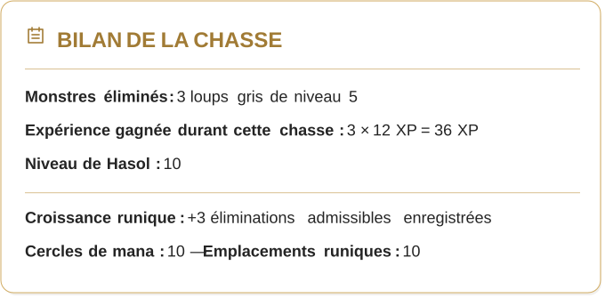
  </picture>
  

    
Version textuelle de la fenêtre

  
<svg class="lit-window__icon" viewBox="0 0 24 24" aria-hidden="true" focusable="false"><path d="M4 5h16v15H4Z M8 3v4 M16 3v4 M8 11h8 M8 15h8"/></svg>BILAN DE LA CHASSE

  
<strong>Monstres éliminés :</strong> 3 loups gris de niveau 5

  
<strong>Expérience gagnée durant cette chasse :</strong> 3 × 12 XP = 36 XP

  
<strong>Niveau de Hasol :</strong> 10

  

  
<strong>Croissance runique :</strong> +3 éliminations admissibles enregistrées

  
<strong>Cercles de mana :</strong> 10 — <strong>Emplacements runiques :</strong> 10

  

Trente-six points.

Autant que trente-six slimes.

Hasol regarda son bras, puis les traces laissées dans la terre entre le rocher et les deux troncs. Elle avait voulu sortir des plaines pour apprendre. Elle ne pouvait pas prétendre n’avoir rien appris.

Les loups ne l’avaient pas laissée choisir le nombre de ses adversaires. Le terrain l’avait aidée autant qu’il avait failli la faire tomber. Et les dix runes équipées — deux rares bleues à six étoiles, huit trois étoiles vertes ou bleues — ne regardaient pas derrière elle à sa place.

Les trois éliminations s’ajoutaient à son historique. Elles ne formaient pas un nouveau départ effaçant tout ce qui précédait. Les milliers de slimes restaient là, avec les huit paliers qui lui avaient donné ses emplacements.

Elle referma la fenêtre sans se mettre à calculer combien de chasses semblables elle pourrait encore accomplir avant la nuit.

Aujourd’hui, elle en avait fait assez.

Elle récupéra ce qu’elle pouvait transporter sans prolonger inutilement son arrêt, rangea soigneusement la potion et reprit le chemin du retour. Cette fois, elle regarda les racines avant d’y poser le pied.

---

## X. Ne pas confondre

Lorsque Hasol rentra, la lumière baissait dans le jardin intérieur.

Sa mère leva les yeux dès qu’elle passa la porte. Son regard s’arrêta presque aussitôt sur la manche abîmée.

— Montre-moi.

Hasol s’était préparée à raconter la victoire. Elle obéit sans commencer son récit.

Sa mère l’installa près de la table, examina la griffure, puis lui demanda ce qu’elle avait utilisé pour la nettoyer. Hasol sortit la potion, expliqua la quantité appliquée et tendit le bras sans protester lorsqu’on reprit les soins.

— Des loups ? demanda sa mère.

— Niveau cinq. J’en ai vaincu trois.

Les doigts qui tenaient le linge s’immobilisèrent un instant.

— Seule ?

Hasol baissa la tête.

— Oui.

Elle entendit le bruit du flacon reposé sur la table.

— Pourquoi ne m’en as-tu pas parlé ?

— Je voulais essayer. Après le mannequin…

— Quel mannequin ?

Alors elle raconta les quarante-deux secondes, la touche qu’elle avait réussi à porter et les trois qu’elle avait reçues. Puis l’annonce, la marche, le premier loup. Lorsqu’elle arriva aux deux autres, son récit ralentit.

Sa mère ne l’interrompit pas.

Ce silence l’obligea à ne rien arranger.

— J’ai utilisé le terrain, finit-elle par dire. Mais j’ai quand même failli tomber au mauvais moment. Plusieurs fois.

Sa mère acheva de protéger la griffure, puis s’assit en face d’elle.

— Ce qui me fait peur, Hasol, ce n’est pas que tu aies encore beaucoup à apprendre.

La jeune fille garda les yeux sur le linge.

— C’est que tu veuilles rattraper trois années en une seule journée.

Hasol ouvrit la bouche. Elle aurait voulu dire qu’elle avait choisi des monstres moins forts qu’elle, prévu une potion, regardé les chemins. Tout cela était vrai.

Ce n’était pas toute la vérité.

— Je voulais que ça change, murmura-t-elle.

Sa mère prit sa main valide.

— Ça a changé.

Hasol releva les yeux.

— Tu n’as pas besoin de risquer ta vie pour que ce qui t’est arrivé soit réel. Tes dix cercles ne disparaîtront pas parce que tu prends le temps d’apprendre.

Cette fois, Hasol sentit les larmes monter. Elle les retint, non pour les cacher, mais parce qu’elle essayait encore de comprendre ce qui lui faisait si mal dans ces mots.

Elle avait passé trois ans à attendre une preuve.

Maintenant qu’elle en possédait une, elle avait peur qu’elle ne suffise pas.

Sa mère se rapprocha et la serra doucement contre elle, en évitant son bras.

— Ne confonds jamais courage et imprudence.

Hasol ferma les yeux.

— Je vais essayer.

Elle n’ajouta pas qu’elle ne ferait plus jamais d’erreur. Elle n’était pas certaine de pouvoir tenir cette promesse-là.

***

Plus tard, dans sa chambre, elle ouvrit un carnet.

Sur une page neuve, elle écrivit :

*Apprendre à me déplacer sans perdre ma garde.*

Elle resta un moment devant la phrase, puis en ajouta deux autres.

*Comprendre mon équipement avant de vouloir l’améliorer davantage.*

*Préparer une retraite avant d’avoir besoin de fuir.*

Sa bourse reposait à côté du carnet. Les pierres de mana utilisées le matin appartenaient aux réserves de sa mère ; les huit nouvelles runes trois étoiles, peu communes vertes et rares bleues, lui avaient été offertes. Si elle voulait continuer, il lui faudrait trouver les moyens de progresser sans attendre que quelqu’un paie chacune de ses tentatives.

Elle nota une dernière question.

*Comment financer les prochaines améliorations ?*

Puis elle ouvrit son équipement.

Les deux cadeaux rares, bleus, six étoiles, +6 de son père occupaient toujours leurs premiers emplacements. Les huit runes maternelles trois étoiles, vertes et bleues, les entouraient désormais ; parmi elles, la Fatal rare, bleue, trois étoiles, +3 gardait la marque du premier travail qu’elle avait accompli ce matin-là.

Elle n’était pas devenue une autre personne en les équipant.

Elle était toujours niveau dix. Toujours sans sort offensif. Toujours blessée par ce qui s’était passé à l’Académie et par les mots échangés au dîner de la veille.

Mais son carnet ne contenait plus seulement le souhait de devenir forte.

Il contenait des choses à faire.

Hasol posa la plume. Dans le couloir, elle entendit les bruits familiers de la maison ; elle resta un moment à les écouter avant de fermer son interface.

Demain, elle commencerait par ses appuis.

Pas par une nouvelle chasse.

---

**Fin du chapitre 2 — La véritable valeur d’une rune**

---

# Chapitre 3 — Le prix d’un rêve

---

## I. Soixante-dix-huit secondes

Hasol avait déjà reçu deux touches lorsque le mannequin leva de nouveau son épée. Son épaule gardait la sensation du premier choc ; le second avait atteint son côté pendant un changement d’appui trop lent. Elle n’avait plus droit à l’erreur.

Elle avait repris les réglages de la veille : un guerrier ordinaire de niveau dix, un arrêt à la troisième touche reçue, le temps mesuré jusqu’à cette dernière. Rien ne devait changer, sinon sa manière de se battre.

La lame de bois descendit. Hasol recula d’un pas, retint le second. L’arme passa devant son visage et souleva quelques mèches échappées de sa queue-de-cheval. Elle sentit l’envie de fuir plus loin lui tirer les jambes, mais son pied arrière resta à sa place. Quand le mannequin pivota, elle put ramener sa garde sans chercher le sol.

Le coup suivant heurta le plat de son épée. La secousse réveilla la griffure sous son bandage ; elle expira entre ses dents et desserra un peu les épaules. Une autre attaque se prépara. Cette fois, elle en vit le départ dans le mouvement du buste et se dégagea avant que la lame arrive.

Le soulagement lui coûta son attention. Elle suivit des yeux l’épée qui la dépassait et ne vit pas la jambe du mannequin partir vers les siennes.

Le balayage la toucha au mollet — troisième touche — et lui emporta les appuis. La construction s’immobilisa tandis qu’elle tombait sur le dos, le souffle coupé.

  <picture class="lit-window__github-picture">
    <source media="(max-width: 600px)" srcset="assets/fenetres/031-mobile.svg">
    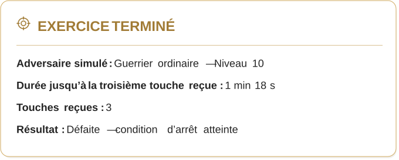
  </picture>
  

    
Version textuelle de la fenêtre

  
<svg class="lit-window__icon" viewBox="0 0 24 24" aria-hidden="true" focusable="false"><circle cx="12" cy="12" r="9"/><circle cx="12" cy="12" r="4"/><path d="M12 1v4 M12 19v4 M1 12h4 M19 12h4"/></svg>EXERCICE TERMINÉ

  
<strong>Adversaire simulé :</strong> Guerrier ordinaire — Niveau 10

  
<strong>Durée jusqu’à la troisième touche reçue :</strong> 1 min 18 s

  
<strong>Touches reçues :</strong> 3

  
<strong>Résultat :</strong> Défaite — condition d’arrêt atteinte

  

Hasol contempla la fenêtre, puis le plafond derrière elle. Soixante-dix-huit secondes au lieu de quarante-deux. Trente-six secondes gagnées, avec le même équipement et le même adversaire.

Elle aurait préféré les lire debout.

En se redressant sur son bras valide, elle aperçut le banc et son carnet resté ouvert. Elle avait passé le début de la matinée à reprendre les déplacements qu’elle connaissait depuis des années : garder les pieds assez écartés, déplacer la garde avec le corps, ne pas croiser les jambes pour aller plus vite. Sans adversaire, elle savait faire. Devant une arme, elle cherchait encore à réparer ses gestes après les avoir commencés.

Pourtant, cette fois, elle avait retenu ce pas inutile. Elle pouvait se rappeler le moment précis, le pied qui n’avait pas quitté le sol. Ce n’était pas seulement un nombre plus agréable dans une fenêtre.

Elle récupéra son épée et se tourna vers le mannequin. Son pouce chercha presque le réglage de départ. Alors la manche frotta contre le bandage déplacé et une douleur plus nette remonta de son avant-bras.

Hasol baissa l’arme.

La veille, une griffe avait suffi à lui ouvrir la peau entre ses protections. Elle n’allait pas tirer sur cette blessure pour vérifier si elle pouvait gagner quelques secondes de plus avant midi. Elle s’assit sur le banc, remit le tissu en place avec précaution et attendit que la douleur s’apaise.

Dans son carnet, sous le résultat précédent, elle inscrivit : *78 s. Recul plus court. Garde mieux conservée. Regard accroché à l’arme sur le balayage.*

La couverture abîmée se rabattit sous sa paume. Zio lui avait conseillé de conserver ces traces, à l’Académie. Elle était contente, aujourd’hui, de ne pas avoir arraché les pages des mauvais jours.

Avant de quitter la salle, elle regarda encore le mannequin immobile. Puis elle passa son sac sur l’épaule qui ne lui faisait pas mal.

---

## II. Ce que coûte une pierre

Le marché des artisans avait débordé des boutiques jusque sur les pavés. Hasol dut se ranger contre une devanture pour laisser passer un apprenti chargé d’une caisse. Un marteau sonnait derrière des volets ouverts ; plus loin, une vendeuse rabattait un linge sur des pains encore chauds. L’odeur du métal chauffé se mêlait à celle de leur croûte.

Enfant, Hasol tirait sa mère vers les armuriers. Elle s’arrêtait maintenant devant les présentoirs de runes, avec cette façon nouvelle de lire les étiquettes jusqu’au bout.

Une Fatal peu commune, verte, trois étoiles, à +0, retint son regard. Principale d’Attaque, secondaire de Vitesse. Elle rapprocha mentalement ses caractéristiques de celles de son équipement. Ses dix emplacements étaient occupés, ses ensembles complets : quatre Fatal, quatre Gardien, deux Énergie. Cette pièce ne s’ajouterait pas aux autres. Il faudrait en retirer une, comparer ce qu’elle perdrait et ce qu’elle gagnerait.

Elle se pencha néanmoins. Sur le coussin sombre, l’éclat vert soulignait les creux de la gravure.

— Je peux vous la montrer, proposa le marchand en sortant de sa boutique.

Hasol se redressa.

— Quel est son prix ?

Il le lui annonça. Elle n’eut pas besoin d’ouvrir sa bourse. Même ses économies restées à la maison n’auraient pas suffi.

Le marchand attendit, la main près du présentoir, sans encore prendre la pierre.

— Pas aujourd’hui, dit-elle. Merci. En revanche, je voudrais me renseigner sur les pierres de mana.

Il se tourna vers les boîtes alignées derrière la vitrine. Hasol lui expliqua qu’elle avait déjà son équipement et souhaitait en améliorer une partie jusqu’à +6. Il lui montra les lots disponibles ; elle demanda ce qu’elle pourrait préparer avec chacun, puis fit répéter un prix qu’elle avait parfaitement entendu.

— Vous comptez juste de quoi essayer ? demanda-t-il.

— J’essaie surtout de voir par où commencer.

— Alors gardez de quoi recommencer aussi.

Il remit le couvercle sur une boîte. Ce petit bruit rappela à Hasol les ressources devenues ternes dans l’atelier maternel. La veille, elle avait vu leur disparition ; ici, elle en entendait le prix. Le passage de l’un à l’autre lui laissa une gêne au creux de l’estomac.

Elle remercia le marchand sans rien acheter. En reprenant sa marche, elle jeta un dernier regard à la Fatal peu commune, verte, trois étoiles, à +0. Elle avait encore envie de la prendre entre ses mains. Mais ce désir-là pouvait attendre : elle n’avait même pas de quoi poursuivre le travail sur ce qu’elle possédait déjà.

Devant une guilde, des chasseurs discutaient autour d’une carte. Hasol s’arrêta à l’écart d’un homme qui traçait un itinéraire du doigt. Elle reconnut le Bois des Crocs Gris ; au-delà des routes familières, des reliefs rouges portaient un nom qu’elle lut deux fois : *Collines de Braise*.

— Ceux qu’on a repérés près du chemin oriental sont niveau onze, disait un chasseur. Pour ceux d’en haut, je ne m’avance pas.

— Ils sont descendus jusque-là ? demanda son compagnon.

— Des gobelins rouges, oui.

Hasol attendit une pause pour les interrompre.

— Excusez-moi. Il faut combien de temps pour atteindre ces collines ?

Le plus âgé lui montra la route.

— Quelques heures. Tu cherches un groupe pour y aller ?

— Je regarde les régions où je pourrais chasser. Plus tard.

Il suivit son regard vers la carte, puis aperçut le bandage sous sa manche.

— Renseigne-toi bien avant. Ils sont armés, et ils ne restent pas sagement devant toi. Celui que tu vois peut t’occuper pendant que les autres se déplacent.

Hasol approcha de nouveau de la carte, cette fois pour regarder les chemins plutôt que le relief coloré.

— Ils chassent en groupe ?

— Compte dessus. Si tu n’en vois qu’un, cherche les autres avant d’avancer.

Elle hocha la tête. Dans le bois, elle avait dû attendre un grondement pour comprendre que le premier loup n’était pas seul. Elle revoyait le second pelage glisser près d’un tronc, son propre bras retiré trop tard. Des armes s’ajoutaient maintenant à ce souvenir, et des adversaires capables de choisir où l’attendre.

— Merci. Je ne connais pas encore assez le terrain.

Elle laissa les hommes reprendre leur discussion et s’écarta pour un chariot. À travers les passants, les collines rouges restaient visibles au-dessus d’une épaule. Quelques heures de route : elles lui semblaient presque proches. Elle aurait voulu savoir ce qu’on voyait depuis leurs sommets.

Elle prit pourtant la rue qui ramenait chez elle.

---

## III. Une proposition inattendue

Sa mère travaillait dans l’atelier, un registre maintenu ouvert par une boîte de pierres de mana. En voyant sa fille, elle posa sa plume et regarda d’abord la manche qu’Hasol avait remontée.

— Le bandage a bougé ?

— Un peu. J’ai arrêté l’entraînement quand ça a tiré.

Hasol lui tendit le bras. Les doigts de sa mère suivirent le bord du tissu, sans appuyer sur la griffure.

— Je te le referai avant que tu ressortes.

— J’ai tenu soixante-dix-huit secondes. Avec les mêmes réglages qu’hier.

Sa mère leva les yeux et sourit. Hasol lui raconta le pas retenu, puis le balayage. Elle s’entendit décrire le combat sans s’excuser du résultat ; elle ajouta tout de même qu’il restait beaucoup à corriger, et s’assit avant que la conversation puisse s’attarder sur ses progrès.

Sa bourse tomba sur la table avec un bruit léger.

— Je suis allée au marché. Je voulais savoir combien il me faudrait pour les prochaines améliorations.

Elle lui rapporta les prix entendus, les lots qu’on lui avait montrés. Le registre maternel était couvert de colonnes semblables à celles des marchands. Hasol le regarda autrement qu’en entrant.

— Tu m’as déjà donné de quoi m’équiper. Je ne peux pas revenir te demander des pierres chaque fois qu’une tentative échoue.

— Tu peux me demander de l’aide, Hasol.

— Je ne dis pas que je ne veux plus de ton aide. Je voudrais pouvoir en payer une partie. Commencer, au moins.

Sa mère rapprocha la bourse du sac pour dégager le linge propre. Pendant qu’elle défaisait le bandage, Hasol parla de la carte et des gobelins rouges. Les mains s’arrêtèrent sur son bras.

— Tu n’as pas l’intention de partir ?

— Non. Pas maintenant. Mais j’ai regardé la route en pensant à ce qu’une chasse pourrait rapporter.

— Cela m’inquiète que tu aies à peine quitté les bois et que tu cherches déjà plus loin.

Hasol baissa les yeux vers la griffure. Elle n’avait pas besoin qu’on la lui décrive. Elle attendit que sa mère reprenne le pansement avant de répondre.

— Je ne sais pas quoi faire d’autre pour gagner ma vie.

Sa mère tira une chaise et s’assit près d’elle. Le registre resta ouvert, oublié entre les boîtes.

— Nous pouvons demander à Orven s’il accepterait de te voir travailler.

Hasol releva la tête. Elle connaissait l’enseigne du marchand, près de la place des Artisans, pas l’homme derrière son comptoir.

— Dans son atelier ?

— Il améliore des runes autant qu’il en vend. Nous nous connaissons depuis longtemps ; je peux te présenter. Le travail, ce sera à toi de le demander.

Hasol frotta de son pouce une trace d’encre au bord de la table.

— Tu penses que je devrais devenir artisane.

Sa mère ne répondit pas tout de suite.

— Je pense que tu pourrais essayer ce métier. Je sais aussi ce que tu veux devenir.

— Alors pourquoi maintenant ?

— Parce que tu viens de me demander comment financer tes améliorations. Je ne voulais pas te pousser vers l’atelier comme si ton rêve de chasseuse était terminé. J’attendais que tu sois prête à envisager autre chose à côté.

Hasol regarda les objets autour d’elles : les linges soigneusement pliés, les boîtes refermées, la plume dont sa mère essuyait toujours la pointe avant de la poser. Elle avait passé tant de temps dans cette pièce sans jamais imaginer devoir y gagner sa place.

— Je pourrais apprendre, dit-elle enfin. J’ai la théorie. Il me manque la pratique.

— Voilà ce que tu lui diras.

Sa mère acheva le nœud et lui rendit son bras. Hasol le plia doucement ; le tissu tenait sans serrer la peau sensible.

— Il est exigeant ?

— Il fait ce travail depuis plus de vingt-cinq ans. Et il aime qu’on repose les choses là où on les a prises.

Hasol ramena machinalement la plume dans sa rainure. Sa mère suivit le geste, puis elles échangèrent un sourire.

— Allons lui demander, dit Hasol.

---

## IV. Maître Orven

Une enseigne de bois sombre, gravée d’une rune entourée de trois cercles, se balançait au-dessus de la porte. Derrière la vitrine, les présentoirs laissaient voir le fond de la boutique : un comptoir usé au milieu, des tiroirs, des registres empilés à portée de main. Rien de ce que Hasol avait admiré sur les coussins de velours ne semblait ici plus important que la place laissée pour travailler.

La clochette tinta. Une voix leur demanda d’attendre, puis un homme aux cheveux grisonnants sortit de l’arrière-boutique en s’essuyant les doigts. Une barbe encadrait son visage, et il releva les yeux derrière ses lunettes pour accueillir la mère de Hasol avec un sourire, avant de contourner son comptoir.

— Tu passes enfin autrement qu’entre deux courses.

— Cette fois, c’est Hasol qui vient te voir.

La jeune fille s’inclina et donna son nom. Orven répéta « Shun » à mi-voix ; son regard passa de la mère à la fille.

— L’Arcaniste runique de l’Académie ? J’ai entendu parler de toi.

Hasol resserra sa prise sur la lanière de son sac. Elle aurait voulu savoir ce qu’il avait entendu, puis regretta aussitôt cette pensée. Elle n’était pas venue pour lui faire reprendre chaque jugement.

— Je cherche du travail, Maître Orven. J’ai étudié la théorie runique pendant trois ans. Je n’ai encore effectué qu’une amélioration jusqu’à +3, avec ma mère, mais je voudrais apprendre à travailler dans un atelier.

Il abaissa les yeux vers sa manche, sans la questionner sur le bandage.

— Pour gagner ta vie, ou pour payer ton équipement de chasse ?

— Pour commencer, mon équipement.

— Au moins, c’est clair.

Il plia le linge qu’il tenait et le posa derrière le comptoir.

— J’ai besoin que les travaux soient suivis même lorsqu’ils n’ont plus rien de nouveau. Tu viendrais pour les commandes, pas pour essayer ce qui te plaît sur mes étagères.

— Je comprends. Je peux aussi préparer les ressources et tenir les notes.

— Nous allons voir cela.

Sa mère demanda s’ils pouvaient poursuivre en privé. Orven leur ouvrit l’atelier et referma la porte derrière elles. Hasol attendit qu’il ait tiré des chaises pour parler de Bénédiction runique, puis du passif découvert au niveau dix. Elle expliqua les paliers rétroactifs, les années de chasse dont les éliminations avaient été prises en compte.

À l’annonce des dix cercles, il cessa de faire tourner sa plume.

— Dix, à ton niveau ?

Elle partagea son état runique. Cette fois, la main sur sa lanière resta immobile.

  <picture class="lit-window__github-picture">
    <source media="(max-width: 600px)" srcset="assets/fenetres/032-mobile.svg">
    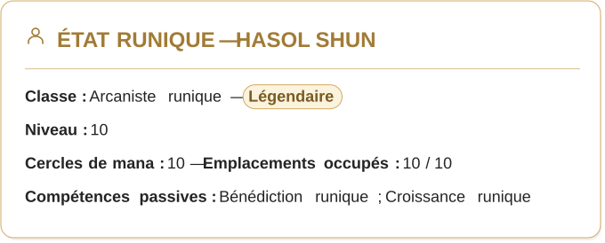
  </picture>
  

    
Version textuelle de la fenêtre

  
<svg class="lit-window__icon" viewBox="0 0 24 24" aria-hidden="true" focusable="false"><circle cx="12" cy="8" r="4"/><path d="M4 21v-2a8 6 0 0 1 16 0v2"/></svg>ÉTAT RUNIQUE — HASOL SHUN

  
<strong>Classe :</strong> Arcaniste runique — Légendaire

  
<strong>Niveau :</strong> 10

  
<strong>Cercles de mana :</strong> 10 — <strong>Emplacements occupés :</strong> 10 / 10

  
<strong>Compétences passives :</strong> Bénédiction runique ; Croissance runique

  

Orven se pencha pour lire les effets qu’elle lui montrait, puis revint aux emplacements. Il regarda sa mère ; elle acquiesça, sans rien ajouter.

— Je n’ai pas rencontré de cas pareil en plus de vingt-cinq ans de métier, dit-il enfin.

Hasol sentit revenir cette attente dangereuse, celle qui lui faisait chercher dans un visage la promesse que tout allait changer. Orven posa pourtant la plume sur la table et passa à une question pratique.

— Qui est au courant ?

— Ma mère. Et vous, maintenant.

— Très bien. Cela restera entre nous ici.

Elle referma la fenêtre partagée. Ses caractéristiques magiques restèrent dans son interface privée ; il ne les lui demanda pas.

— Pour l’atelier, reprit-il, ce sont surtout tes connaissances et ta façon de travailler que je dois vérifier. Ton passif ne me dira pas si tu sais suivre une consigne.

— Je peux vous montrer.

Sa voix était sortie plus vite qu’elle ne l’aurait voulu. Orven repoussa sa chaise, dégagea un coin d’établi et lui fit signe d’approcher. Sa mère resta près de la porte, là où elle ne gênerait pas leurs mouvements.

---

## V. La première commande

Orven prit sur un plateau une Énergie commune, blanche, deux étoiles, à +0, et la posa devant elle. Hasol consulta son état, vérifia le symbole circulaire et les inscriptions : une principale de PV, aucune secondaire. Elle la plaça au centre du support sans engager d’énergie.

  <picture class="lit-window__github-picture">
    <source media="(max-width: 600px)" srcset="assets/fenetres/090-mobile.svg">
    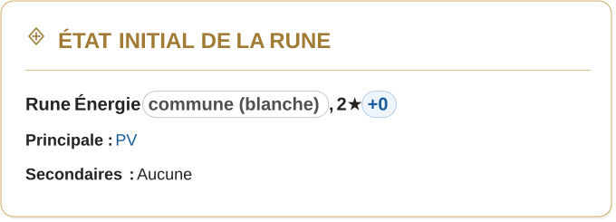
  </picture>
  

    
Version textuelle de la fenêtre

  
<svg class="lit-window__icon" viewBox="0 0 24 24" aria-hidden="true" focusable="false"><path d="m12 3 8 9-8 9-8-9Z M8 12h8 M12 8v8"/></svg>ÉTAT INITIAL DE LA RUNE

  <h3>Rune Énergie commune (blanche), 2★ +0</h3>
  
<strong>Principale :</strong> PV

  
<strong>Secondaires :</strong> Aucune

  

— Jusqu’à +3 ? demanda-t-elle.

— C’est l’épreuve. Les ressources sont fournies par l’atelier. Tu m’indiques chaque résultat avant de continuer ; si je te demande d’arrêter, tu t’arrêtes.

Il ouvrit une boîte de pierres de mana, puis attira son registre vers lui. Hasol posa son sac sous la chaise. Elle aurait aimé que sa mère ne soit pas là pour la voir échouer ; aussitôt, elle fut soulagée d’entendre le léger froissement de son manteau derrière elle.

Elle connaissait les étapes. Elle les reprit néanmoins dans l’ordre, en séparant les ressources de la première tentative du reste de la réserve. Sous son poignet, le bord du support était froid.

— Je commence.

Orven acquiesça.

La lumière naquit au creux des gravures. Hasol sentit la vibration familière dans ses doigts et accompagna le flux jusqu’à ce que les lignes se rejoignent. Ses épaules étaient montées sans qu’elle s’en aperçoive.

— Relâche-toi, dit Orven. Tu n’as pas besoin de tenir la table.

Elle desserra sa main libre. L’éclat se stabilisa, puis la notification confirma le passage de +0 à +1 et l’augmentation de la principale. Aucune secondaire : le palier n’était pas encore atteint.

Hasol communiqua le résultat. La plume d’Orven gratta le papier.

— Tu peux poursuivre.

Elle renouvela les ressources et vérifia le niveau de départ. À +1, la rune Énergie commune, blanche, deux étoiles, gardait la même apparence discrète. Hasol était déjà moins gênée par le regard de l’artisan lorsqu’une vibration irrégulière traversa le support. Elle voulut la corriger ; le flux lui échappa et les inscriptions s’éteignirent.

  <picture class="lit-window__github-picture">
    <source media="(max-width: 600px)" srcset="assets/fenetres/033-mobile.svg">
    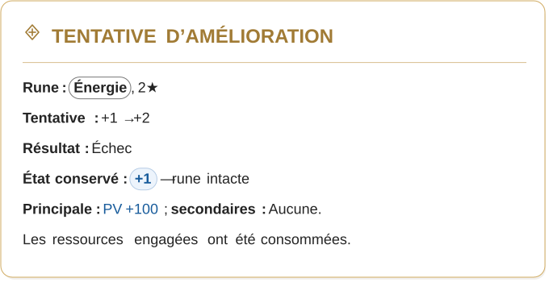
  </picture>
  

    
Version textuelle de la fenêtre

  
<svg class="lit-window__icon" viewBox="0 0 24 24" aria-hidden="true" focusable="false"><path d="m12 3 8 9-8 9-8-9Z M8 12h8 M12 8v8"/></svg>TENTATIVE D’AMÉLIORATION

  
<strong>Rune :</strong> Énergie commune (blanche), 2★

  
<strong>Tentative :</strong> +1 → +2

  
<strong>Résultat :</strong> Échec

  
<strong>État conservé :</strong> +1 — rune intacte

  
Les ressources engagées ont été consommées.

  

Le silence qui suivit lui sembla trop long. Elle regarda les pierres ternies, puis la main d’Orven, dont la plume n’avait pas encore bougé.

— Je suis désolée.

Il lui désigna le support.

— Vérifie d’abord l’état.

Hasol se pencha. Son cœur battait jusque dans sa gorge, mais les lignes de l’interface étaient nettes. Elle les lut, confirma le maintien à +1, contrôla la principale et l’absence de secondaire. Rien n’avait changé.

Orven nota l’échec et les ressources utilisées.

— C’était prévu dans les moyens de l’épreuve. Tu ne dépasses pas ce que je t’autorise, tu ne caches pas une tentative, et tu me demandes avant de reprendre dans une autre boîte. Pour celle-ci, tu peux recommencer.

Elle hocha la tête. Il avait déjà rapproché le registre de sa place initiale ; elle n’y lut ni déception ni indulgence particulière. Il attendait son prochain geste.

Hasol écarta les consommables épuisés. Elle prit le temps de retrouver la position de ses mains, sans chercher à rendre la tentative plus rapide pour effacer la précédente. La chaleur revint sous ses doigts. Lorsque la vibration changea, elle n’essaya pas de la brusquer ; elle maintint son attention sur les inscriptions jusqu’à leur stabilisation.

Cette fois, le passage de +1 à +2 réussit. La principale de PV augmenta encore. Hasol annonça le résultat et attendit l’accord d’Orven avant de préparer la suite.

À +3, la première secondaire devait apparaître. Elle savait la règle ; cela ne l’empêcha pas d’observer avec une impatience presque douloureuse les lignes qui s’illuminaient. Une goutte de sueur glissa près de son oreille. Elle la laissa descendre.

L’éclat se resserra au bord de la pierre, puis prit une teinte verte.

Hasol retira lentement les mains.

  <picture class="lit-window__github-picture">
    <source media="(max-width: 600px)" srcset="assets/fenetres/034-mobile.svg">
    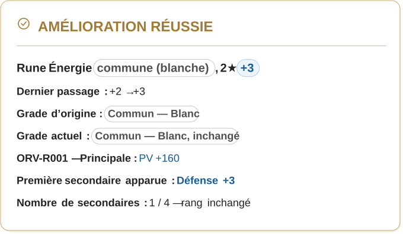
  </picture>
  

    
Version textuelle de la fenêtre

  
<svg class="lit-window__icon" viewBox="0 0 24 24" aria-hidden="true" focusable="false"><circle cx="12" cy="12" r="9"/><path d="m8 12 3 3 5-6"/></svg>AMÉLIORATION RÉUSSIE

  <h3>Rune Énergie peu commune (verte), 2★ +3</h3>
  
<strong>Dernier passage :</strong> +2 → +3

  
<strong>Grade d’origine :</strong> Commun — Blanc

  
<strong>Grade actuel :</strong> Peu commun — Vert

  
<strong>Principale :</strong> PV renforcés

  
<strong>Première secondaire apparue :</strong> Défense

  
<strong>Nombre de secondaires :</strong> 1 / 4 — rang inchangé

  

Elle aurait voulu tendre immédiatement la pierre à sa mère. Elle la laissa sur son support et se recula pour qu’Orven l’examine. Il suivit la nouvelle inscription avec sa lentille, compara l’état final à ses notes et posa l’ensemble sur un linge propre.

— Le travail est acceptable.

Hasol attendit une suite. Il n’en ajouta pas.

— Donc… j’ai terminé l’épreuve ?

— Oui. Maintenant, nous allons regarder ce que tu as fait.

Il tourna le registre vers elle. Elle déchiffra les quatre tentatives : réussite à +1, échec au passage +2, réussite à +2, réussite à +3. Les ressources de la tentative ratée occupaient leur ligne comme les autres. Hasol posa le doigt près de cette inscription, puis le retira pour ne pas toucher l’encre fraîche.

Derrière elle, sa mère avait cessé de retenir son sourire.

---

## VI. Le poids des premières pièces

Orven lui fit parcourir une fiche de commande. À l’identité et à l’état de départ s’ajoutaient les instructions, les ressources prévues et la limite autorisée. Il lui montra où reporter chaque tentative, puis comment rapprocher la fiche du bon plateau.

— Il y a des pierres à l’atelier et d’autres confiées par des clients. Tu vérifies à qui appartient ce que tu prends, y compris les consommables. Une boîte ouverte n’est pas une réserve où puiser librement.

Hasol suivait les lignes du registre. Certaines avaient été corrigées ; les anciennes indications restaient lisibles sous les traits. Ici, on n’arrachait pas une page parce qu’elle contenait une erreur.

— Et si les ressources sont épuisées avant le palier demandé ?

— Tu m’appelles. Tu n’en engages pas d’autres sans accord.

Il posa la fiche sur son plateau et referma le registre de l’épreuve. La rune Énergie peu commune, verte, deux étoiles, à +3, resta sur le linge, avec ses notes. Hasol ramassa les consommables épuisés et les mit à l’endroit qu’il lui indiquait. Elle essuya ensuite le support, en prenant garde à son bras.

Orven attendit qu’elle ait terminé.

— Si tu es toujours intéressée, je te prends à l’essai. Nous commencerons par les travaux simples, sous ma supervision. Pas de commande plus difficile parce que tu te sens en confiance.

Hasol posa le linge.

— Je peux venir demain.

— Demain, alors. Avec ton carnet. Et un bras qui te permette de travailler sans arracher ton pansement.

— Je vérifierai cela, dit sa mère.

— Je peux aussi le vérifier moi-même, protesta Hasol.

Orven jeta un coup d’œil au bandage.

— Ce sera encore mieux.

Elle ne sut pas quoi répondre ; sa mère eut un rire qu’elle n’essaya plus de cacher.

De retour dans la boutique, Hasol remit son sac à l’épaule. Elle cherchait comment remercier l’artisan sans lui promettre d’être une apprentie parfaite lorsqu’il ouvrit un tiroir et déposa une petite bourse sur le comptoir.

— Pour ton travail.

Elle ne la prit pas tout de suite.

— Mais c’était une épreuve.

Orven repoussa le tiroir de la hanche.

— Cela ne signifie pas que ton temps ne vaut rien.

Hasol regarda la bourse. À l’Académie, le mot *épreuve* signifiait qu’on attendait un résultat d’elle. Elle n’avait pas pensé qu’il pût se terminer par ce geste, une somme posée devant elle plutôt qu’une appréciation à emporter.

Elle tendit la main. Le cuir gardait un pli sous ses doigts ; à travers, elle sentait le bord des pièces.

— Merci, Maître Orven.

— À demain, Hasol.

Elle franchit le seuil avec sa mère. Le soleil descendait derrière les toits, et le marché commençait à rentrer ses caisses. Devant une échoppe, un apprenti balayait la poussière autour de ses chaussures.

Hasol ouvrit la bourse à l’abri de son sac. Elle en vérifia le contenu, compta les pièces, puis refit le nœud avec soin. Ce salaire ne lui permettrait pas d’acheter la Fatal peu commune, verte, trois étoiles, à +0, admirée le matin. Elle ne retournerait pas non plus remplir d’un coup ses réserves de pierres de mana.

Elle marcha pourtant quelques pas avant de ranger la bourse, simplement pour en sentir encore le poids.

— Je crois que je l’ai remercié trop bas, dit-elle.

Sa mère tourna la tête.

— Il t’a entendue.

— Je voulais dire davantage.

— Tu le reverras demain.

Hasol sourit. Demain, il ne s’agirait plus de demander si elle pouvait essayer. Elle aurait une heure d’arrivée, des consignes, une place à l’établi qu’on lui avait laissé nettoyer.

Quand la rue s’élargit, elle prit le bras de sa mère du côté où cela ne tirait pas sur la griffure. Elles continuèrent ainsi jusqu’à la maison, sans chercher à remplir le silence.

---

## VII. Ce qui mérite d’être gagné

Dans sa chambre, Hasol posa l’épée contre le mur et commença par sortir son carnet. À la page suivante, elle recopia brièvement le suivi de l’épreuve : Énergie commune blanche, deux étoiles, de +0 à +3 ; un échec au passage +2 ; grade final peu commun vert, deux étoiles, première secondaire de Défense.

Elle n’ajouta pas de conclusion. Sous les résultats, elle nota l’heure convenue avec Orven et souligna la consigne sur les ressources autorisées. Puis elle glissa le carnet dans son sac pour ne pas l’oublier le matin.

La fatigue la rattrapa lorsqu’elle se pencha pour retirer ses bottes. Son avant-bras protesta ; elle termina plus lentement, assise sur le bord du lit. Sous la manche, le nouveau bandage était resté propre. Elle laissa son épée à sa place au lieu de reprendre les déplacements dans la chambre.

Elle avait encore en tête la carte des chasseurs. Elle sortit un feuillet et y inscrivit le nom des Collines de Braise, les gobelins rouges de niveau onze, la route qu’on lui avait montrée. À côté, elle écrivit : *Pas encore.* Le feuillet rejoignit le carnet, pas ses provisions de chasse.

Avant de ranger sa bourse, elle ouvrit son équipement. Toujours niveau dix, dix cercles et dix emplacements occupés. Les deux cadeaux de son père, Fatal et Gardien rares, bleues, six étoiles, à +6, n’avaient pas changé. La Fatal maternelle rare, bleue, trois étoiles, restait à +3 ; les sept autres cadeaux trois étoiles, peu communs verts ou rares bleus, à +0. Aucun nouvel éclat ne s’était ajouté à ceux de la veille.

Hasol referma l’interface. Ce soir, ce n’était pas là qu’elle avait envie de regarder.

Elle vida les pièces sur le bureau. Leur tintement lui parut trop sonore dans la maison assoupie. Elle en retint une qui roulait vers le bord, la ramena sous la lampe et la fit tourner entre ses doigts. Une pièce ordinaire, avec une marque près de la tranche.

Elle imagina la montrer à son père. Il aurait peut-être souri ; il aurait peut-être demandé ce qu’elle comptait gagner ensuite. Elle ne trouva pas les mots qu’elle aurait employés pour lui raconter l’après-midi, et resta un moment le coude posé sur le bureau, la pièce au creux de la main.

Puis elle rangea l’argent dans la bourse, sauf celle-là.

Demain, elle retournerait chez Orven pour sa première journée complète. Elle avait peur de mal lire une commande, de chercher trop longtemps un outil, de laisser le silence s’installer après une question dont elle connaissait la réponse. Cette peur n’avait pas disparu avec le paiement. Elle prépara néanmoins une tenue qui ne gênerait pas son bras et vérifia une dernière fois que son carnet était dans le sac.

En passant près de l’épée, elle redressa le fourreau contre le mur. Elle voulait toujours la reprendre, sortir de la capitale et voir au-delà des sentiers qu’elle connaissait. Pour le moment, la route du lendemain passait par la place des Artisans.

Hasol posa la pièce sur son chevet. De son lit, elle pouvait encore en voir le reflet avant de souffler la lumière.

---

# Chapitre 4 — La voie de l’artisan

---

## I. Les mains d’une apprentie

Au réveil, Hasol chercha la pièce sur son chevet avant même de regarder l’heure. Le métal avait perdu le reflet de la lampe ; une lumière grise en soulignait maintenant la tranche. Elle la prit, retrouva du pouce la petite marque qu’elle avait remarquée la veille, puis la rangea avec le reste de son salaire.

Son sac attendait près de la porte. Elle en vérifia le contenu, en sortit le carnet pour s’assurer qu’une plume n’avait pas coulé contre les pages et le remit à sa place. Il lui restait assez de temps pour déjeuner sans courir. Cette avance lui plaisait, bien qu’elle ne sût pas encore quoi en faire : elle fit deux fois le tour de sa chambre avant de s’habiller.

La manche accrocha légèrement la peau de son avant-bras. La potion appliquée après la chasse et les soins de sa mère avaient refermé la griffure, mais elle la sentait encore lorsqu’elle étendait le coude. Hasol termina le mouvement plus lentement. Elle avait laissé son épée contre le mur ; son regard y revint pendant qu’elle attachait ses cheveux.

Elle aurait pu emporter ses affaires et décider plus tard d’un entraînement. Elle souleva pourtant son sac sans y ajouter le nécessaire. La veille, le bras avait tiré après le mannequin. Aujourd’hui, elle aurait besoin de garder les mains sûres pendant plusieurs heures.

Dans la rue, les premiers chariots obligeaient déjà les passants à se ranger. Hasol longea un mur tandis qu’un homme soulevait les volets de sa boutique. Un volet lui échappa, claqua contre la façade et lui arracha un juron. Elle lui retint le coin le temps qu’il retrouve sa prise, reçut un remerciement distrait et poursuivit son chemin. Au marché, les étalages étaient encore à moitié couverts ; elle passa devant sans s’arrêter. Elle connaissait désormais un peu mieux le prix de ce qu’elle désirait, mais ce matin elle avait surtout une heure à respecter.

La clochette d’Orven tinta dans une boutique presque silencieuse. Une odeur de bois ciré et de pierre chauffée venait de l’arrière-boutique.

— Bonjour, Maître Orven !

— Derrière.

Il avait dégagé un espace sur l’établi où elle s’était installée pour l’épreuve. À côté, des boîtes et leurs fiches formaient une rangée qu’un registre ouvert venait interrompre. Orven rapprochait une feuille de la fenêtre ; il la posa lorsqu’elle entra.

— Le tablier est au crochet. Tu peux mettre ton sac dessous.

Hasol noua les liens dans son dos. Le tissu était plus large qu’elle ne l’avait imaginé ; elle dut en rabattre un côté pour ne pas le prendre sous son coude.

— Il faudra que je l’ajuste.

— Tant que tu ne décides pas d’ajuster les commandes avec, cela me va.

Elle leva les yeux. Orven avait déjà repris sa fiche, mais le coin de sa bouche bougeait.

— Ton bras ?

— La peau est refermée. Ça tire encore si je tends trop le coude.

Il déplaça vers elle un plateau vide. Hasol le prit à deux mains, le posa sur sa place de travail et essaya la position de ses avant-bras. En rapprochant sa chaise, elle pouvait atteindre le support sans étirer la blessure.

— Comme cela, je suis bien.

— Signale-le si ça change.

Elle posa le carnet au sec, loin du récipient où elle rincerait ses doigts, puis regarda les boîtes.

— Je commence par les commandes à rendre aujourd’hui ?

Orven lui indiqua la première fiche.

— Vérifie d’abord ce qui est arrivé. Ensuite, nous répartirons le travail.

Hasol rapprocha la feuille de son plateau. Elle avait craint de rester plantée derrière lui, à attendre qu’on lui trouve une occupation. Le bruit des pages qu’elle tournait l’aida à quitter cette inquiétude. Au bout de quelques instants, elle dut repousser une mèche derrière son oreille et se pencher pour déchiffrer une annotation : elle avait déjà oublié de surveiller l’expression de son employeur.

---

## II. Ce que la pierre exige

Les commandes ne se ressemblaient pas. Certaines étaient accompagnées de longues indications ; d’autres tenaient en quelques lignes, avec un montant encadré et une heure de restitution. Hasol rapprocha chaque fiche de sa boîte, contrôla les états de départ et laissa à part les travaux qu’Orven ne lui avait pas confiés. Il venait vérifier sans lui prendre les feuilles des mains.

Une Gardien commune, blanche, deux étoiles, à +0, devait être rendue dans la matinée. Le propriétaire demandait +2 ; trois tentatives au maximum étaient prévues dans le budget.

  <picture class="lit-window__github-picture">
    <source media="(max-width: 600px)" srcset="assets/fenetres/091-mobile.svg">
    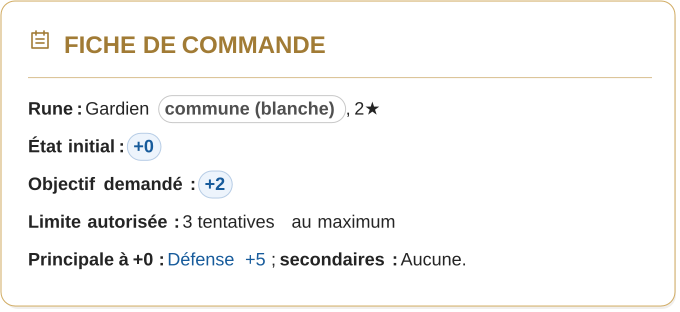
  </picture>
  

    
Version textuelle de la fenêtre

  
<svg class="lit-window__icon" viewBox="0 0 24 24" aria-hidden="true" focusable="false"><path d="M4 5h16v15H4Z M8 3v4 M16 3v4 M8 11h8 M8 15h8"/></svg>FICHE DE COMMANDE

  
<strong>Rune :</strong> Gardien commune (blanche), 2★

  
<strong>État initial :</strong> +0

  
<strong>Objectif demandé :</strong> +2

  
<strong>Limite autorisée :</strong> 3 tentatives au maximum

  

Hasol suivit du doigt la limite inscrite.

— Si je n’atteins pas +2 dans les trois, je m’arrête là.

— Oui. Celle-ci sera pour toi, sous ma surveillance.

Elle installa la Gardien commune blanche, deux étoiles, à +0, sur le support. La principale était présente, sans secondaire. Elle vérifia les indications de la commande, puis sépara les ressources autorisées du reste des réserves. Le volume posé devant elle lui parut soudain bien réduit. Dans l’atelier maternel, sa mère avait ouvert les boîtes ; ici, une ligne du registre déterminait ce qu’elle aurait le droit de prendre ensuite.

Orven approcha une chaise, non pour s’installer à sa place, mais pour voir le support de côté.

— Ce matin, surveille aussi ta réserve entre les tentatives. Pas seulement les consommables.

— Je l’ai regardée après l’épreuve, dit Hasol. Pas après chaque passage.

Elle savait conduire le Mana depuis ses cercles et connaissait la dépense qu’exigeait ce travail. Mais elle n’avait encore enchaîné que de courtes séries, entourée de quelqu’un qui décidait du moment où elles finissaient. Elle ouvrit brièvement son interface privée pour prendre un repère avant de commencer.

— Tu me préviens avant de te sentir à court, reprit Orven. Avec des commandes différentes, le rythme change. Les étoiles, le grade et le palier ne demandent pas le même effort.

Il lui montra sur une fiche la place où noter ses observations entre deux résultats.

— Tu as l’habitude d’observer les flux. Apprends à te surveiller au milieu du travail aussi.

Hasol hocha la tête. Elle tira son carnet vers elle, y écrivit quelques mots, puis leva les yeux sur Orven qui attendait.

— Je vais vous laisser une marge avant de noter votre prochaine phrase.

— Généreuse précaution.

Elle sourit et reposa sa plume.

Le support était froid sous le bord de ses mains. Elle engagea son Mana, sentit la circulation gagner les gravures et accompagna la lumière qui montait depuis les pierres préparées. Le mouvement lui était déjà moins étranger que la veille. Une irrégularité apparut pourtant sur le côté ; son attention s’y accrocha, elle corrigea trop vite. L’éclat se rompit avant d’avoir tenu.

Hasol retira ses doigts. La chaleur resta un instant dans sa paume.

  <picture class="lit-window__github-picture">
    <source media="(max-width: 600px)" srcset="assets/fenetres/035-mobile.svg">
    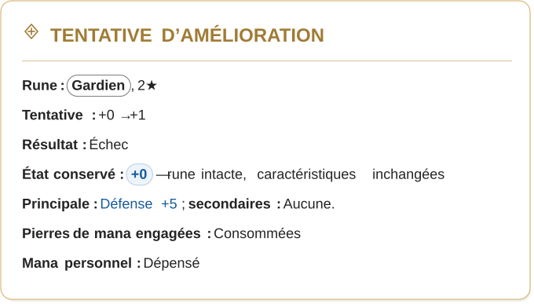
  </picture>
  

    
Version textuelle de la fenêtre

  
<svg class="lit-window__icon" viewBox="0 0 24 24" aria-hidden="true" focusable="false"><path d="m12 3 8 9-8 9-8-9Z M8 12h8 M12 8v8"/></svg>TENTATIVE D’AMÉLIORATION

  
<strong>Rune :</strong> Gardien commune (blanche), 2★

  
<strong>Tentative :</strong> +0 → +1

  
<strong>Résultat :</strong> Échec

  
<strong>État conservé :</strong> +0 — rune intacte, caractéristiques inchangées

  
<strong>Pierres de mana engagées :</strong> Consommées

  
<strong>Mana personnel :</strong> Dépensé

  

Elle eut un regard pour les ressources devenues ternes. Une tentative sur trois. Elle aurait aimé disposer d’un résultat à inscrire en face de cette dépense ; sa main resta suspendue au-dessus du registre avant de s’y poser.

Orven attendait le contrôle. Hasol vérifia la Gardien commune blanche, deux étoiles, restée à +0, puis nota l’échec et les ressources engagées. Elle consulta sa réserve. La dépense existait bien, même si rien n’avait changé sur la pierre. Elle referma l’interface et revint aux lignes de son registre.

— J’ai repris le flux trop brusquement, dit-elle.

— Je l’ai vu. Reprends ta position avant de préparer la suivante.

Hasol rapprocha les coudes, desserra les doigts. Elle aurait voulu que la seconde tentative efface vite la première ; cette impatience lui rendait le bord du support trop étroit. Elle prit le temps d’écarter les consommables épuisés et de vérifier ce qu’il restait dans le lot.

Orven n’ajouta rien. De l’autre côté de la table, sa plume reprit son bruit sec.

Cette fois, Hasol garda son attention sur l’ensemble des gravures. Quand la vibration se modifia, elle accompagna le mouvement sans pousser davantage. La lumière resta présente, se resserra, puis une notification confirma le passage.

  <picture class="lit-window__github-picture">
    <source media="(max-width: 600px)" srcset="assets/fenetres/036-mobile.svg">
    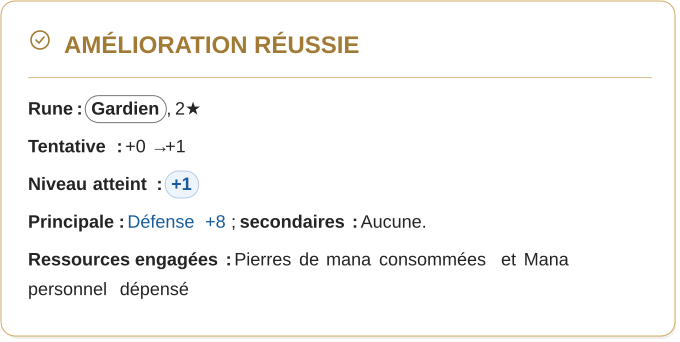
  </picture>
  

    
Version textuelle de la fenêtre

  
<svg class="lit-window__icon" viewBox="0 0 24 24" aria-hidden="true" focusable="false"><circle cx="12" cy="12" r="9"/><path d="m8 12 3 3 5-6"/></svg>AMÉLIORATION RÉUSSIE

  
<strong>Rune :</strong> Gardien commune (blanche), 2★

  
<strong>Tentative :</strong> +0 → +1

  
<strong>Niveau atteint :</strong> +1

  
<strong>Principale :</strong> Renforcée — aucune secondaire

  
<strong>Ressources engagées :</strong> Pierres de mana consommées et Mana personnel dépensé

  

Hasol laissa échapper son souffle. Elle annonça le résultat, le reporta sur la fiche et écarta la plume pour qu’Orven puisse contrôler. Il parcourut les deux lignes, puis la limite autorisée.

— Il en reste une, dit-elle.

— Oui.

Elle venait de tirer le support un peu plus près lorsque la clochette de la boutique retentit. Orven lui fit signe de ne rien engager et passa devant. Hasol laissa les dernières ressources à leur place ; elle essuya ses doigts avant de le rejoindre.

---

## III. Le prix d’une erreur

Le jeune chasseur attendait près du comptoir, une bourse tenue dans sa main. Sa veste était propre, usée aux coudes ; il avait frotté ses bottes sans parvenir à enlever toute la poussière des coutures. Il demanda sa Gardien commune blanche, deux étoiles, avec une hésitation sur l’heure à laquelle il avait promis de revenir.

— Vous arrivez bien, répondit Orven. Nous pouvons regarder où en est votre commande.

Hasol apporta le plateau et la fiche. Elle posa celle-ci tournée vers le client, comme elle avait vu l’artisan le faire.

— Elle est à +1, indiqua Orven. La première tentative a échoué, la seconde a réussi. Il reste de quoi en faire une dans les trois que vous avez autorisées.

Le chasseur se pencha sur le relevé. Son pouce frottait le nœud de sa bourse.

— Et si la dernière échoue, elle reste à +1 comme maintenant ?

Orven lui expliqua l’état attendu pour cette tentative et la dépense à engager. Hasol regardait malgré elle la dernière ligne vide. Le budget n’était plus un encadré sur une feuille : son propriétaire était devant elle, à réfléchir avant de donner son accord.

— Je pars demain avec deux amis, dit le jeune homme. J’espérais avoir un peu plus de Défense avant.

Il souleva un coin du linge, regarda la Gardien commune blanche, deux étoiles, à +1, puis le reposa sans la prendre.

— On peut aussi la rendre ainsi, rappela Orven. Vous n’êtes pas obligé d’utiliser ce qui reste.

Le chasseur fit glisser la fiche vers lui et relut le relevé. Hasol attendit. Elle connaissait l’impatience de vouloir mieux s’équiper avant de sortir ; elle s’interdit d’en faire une réponse à sa place.

— Essayons d’atteindre +2. Avec la dernière tentative, pas plus.

Orven confirma la limite et l’inscrivit. Le jeune homme regarda alors Hasol.

— C’est vous qui vous en occupez ?

La question lui serra le ventre. Elle avait pourtant préparé la réponse en venant au comptoir.

— Oui, sous la supervision de Maître Orven.

Il tourna les yeux vers l’artisan, qui acquiesça. Cela sembla lui suffire.

Hasol revint à l’établi. Le client resta dans la boutique ; elle entendait de temps à autre le cuir de ses bottes sur le plancher. Elle relut l’autorisation avant de disposer les dernières ressources. Ses doigts cherchaient à aller vite, comme si l’attente derrière la cloison était une faute qu’elle aurait pu réparer. Elle les arrêta sur le bord de la table.

Orven s’installa à côté du support.

— Je suis prêt.

Elle vérifia le niveau de départ de la Gardien commune blanche, deux étoiles, à +1. Puis elle commença.

La circulation se forma sous ses mains. Hasol eut conscience du bruit du magasin, de l’artisan près de son épaule, et dut ramener son attention aux lignes qu’elle accompagnait. Le flux ne demandait pas qu’elle oublie le client ; il demandait qu’elle cesse de deviner son visage pendant qu’elle travaillait.

La résistance augmenta. Elle ajusta son geste, sentit une tension dans la nuque et expira sans retirer ses mains. L’éclat tint.

  <picture class="lit-window__github-picture">
    <source media="(max-width: 600px)" srcset="assets/fenetres/037-mobile.svg">
    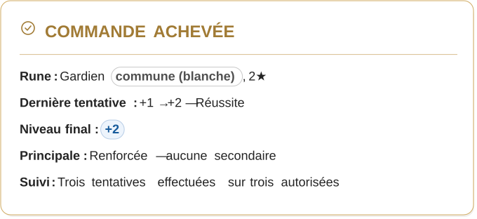
  </picture>
  

    
Version textuelle de la fenêtre

  
<svg class="lit-window__icon" viewBox="0 0 24 24" aria-hidden="true" focusable="false"><circle cx="12" cy="12" r="9"/><path d="m8 12 3 3 5-6"/></svg>COMMANDE ACHEVÉE

  
<strong>Rune :</strong> Gardien commune (blanche), 2★

  
<strong>Dernière tentative :</strong> +1 → +2 — Réussite

  
<strong>Niveau final :</strong> +2

  
<strong>Principale :</strong> Renforcée — aucune secondaire

  
<strong>Suivi :</strong> Trois tentatives effectuées sur trois autorisées

  

— +2, annonça Hasol.

Elle souriait déjà, mais attendit qu’Orven eût examiné le résultat. Il compara la fiche à l’état final, puis lui laissa le plateau à rapporter.

Au comptoir, le jeune chasseur se redressa.

— C’est terminé ?

— Oui. Vous pouvez vérifier.

Elle lui présenta la Gardien commune blanche, deux étoiles, désormais à +2, avec le relevé des tentatives. Il la prit entre ses doigts et consulta son état. Ses épaules s’abaissèrent un peu ; il remercia Orven, puis se tourna vers elle.

— Merci à vous aussi.

— Je vous en prie. Bonne chasse demain.

L’homme rangea sa commande avec soin et quitta la boutique. Hasol resta un instant face au comptoir vide. Elle avait répondu sans trébucher sur les mots ; le remerciement lui revenait maintenant, avec un léger retard qui lui donnait envie de sourire de nouveau.

Orven lui tendit la fiche.

— Restitution.

— Oui.

Elle porta la mention à l’endroit prévu, vérifia que rien n’était resté dans la boîte, puis la rangea. Le jeune homme serait sur la route le lendemain, avec la Gardien commune blanche, deux étoiles, à +2, qu’elle venait de lui rendre. Hasol avait envie de réussir d’autres commandes. Elle prit néanmoins le temps de nettoyer son support avant de demander la suite.

---

## IV. Deux runes, deux avenirs

Un peu plus tard, Orven la fit venir au comptoir pour ranger des documents. Elle trouva deux fiches de comparaison, l’une consacrée aux principales fixes, l’autre aux pourcentages. À côté, des annotations portaient sur les besoins des porteurs.

— Vous gardez cela pour conseiller les clients ?

— Pour éviter de conseiller deux personnes différentes comme si elles n’en faisaient qu’une.

Hasol parcourut les rubriques. Elle savait définir les deux types de principales ; ce qui l’intéressait était la décision inscrite au bout.

— J’aurais tendance à regarder ce que le pourcentage apportera plus tard, dit-elle. Surtout si le client manque d’argent et veut conserver son équipement.

— C’est une question à poser. Mais il faut aussi qu’il puisse s’en servir maintenant.

Orven prit une ardoise et essuya une ancienne addition du revers d’un linge. Il écrivit *Attaque +50* et *Attaque +10 %*, en laissant entre les deux une traînée blanche.

— Des exemples de calcul, précisa-t-il. Pas les caractéristiques de deux pièces que je te demande de vendre.

Hasol approcha sa chaise. L’artisan traça une première ligne : *200 naturels*. Elle inscrivit elle-même vingt sous le pourcentage, cinquante sous la valeur fixe. À la ligne suivante, avec cinq cents naturels, les deux colonnes donnaient cinquante. Orven ajouta enfin deux mille ; Hasol posa deux cents sous les dix pour cent et laissa le premier gain à cinquante.

Elle recula l’ardoise pour embrasser les trois lignes.

— Je vois ce qui me manquait. Je pensais à la croissance sans regarder ce qu’il faudrait attendre pour qu’elle change le choix.

— Et sans savoir si le client gardera son équipement jusque-là. Une principale fixe aide souvent davantage au début. Avec la croissance naturelle, le pourcentage prend l’avantage selon les valeurs que tu compares. Tu ne trouveras pas un niveau à partir duquel tous les clients doivent changer en même temps.

Il souligna le mot *naturels*.

— Le pourcentage de principale se calcule ici, avant d’ajouter les bonus fixes runiques. Ne le prends pas sur un total où tu aurais déjà tout mélangé.

Hasol suivit le trait de craie.

— Et les deux colonnes ne disent pas si je casse un ensemble en remplaçant une pièce.

— Ni ce que tu perds en secondaires. Dans une vraie comparaison, regarde le rang en étoiles, l’amélioration, le grade, les affixes, les ensembles. Si tu places une pièce très travaillée en face d’une autre qui ne l’est pas, le signe pour cent ne fera pas tout le travail à ta place.

Il remit les fiches côte à côte. Hasol les lut de nouveau. Elle pouvait maintenant distinguer ce qui relevait du calcul de principale et ce qui exigerait d’autres informations. Elle marqua du doigt la rubrique de l’équipement porté : sans elle, les deux colonnes ne suffiraient pas à conseiller le client.

La craie laissa une poussière pâle sur son index. Elle la frotta du pouce avant de parler.

— Mon père m’a offert une Fatal rare bleue, six étoiles, à +6, avec soixante-dix d’Attaque fixe. Et une Gardien rare bleue, six étoiles, à +6, avec soixante-dix de Défense fixe.

Orven attendit. Hasol avait commencé d’une voix posée, mais la suite lui venait moins facilement.

— Si j’avance assez loin, un jour il faudra peut-être les remplacer.

Elle revit le coffret de bois sombre sur la table du salon, les bandes métalliques, la main de son père qui en rapprochait le couvercle pour qu’elle puisse l’ouvrir. Le souvenir était précis jusque dans la chaleur de la pièce. Elle regrettait aussitôt d’avoir mêlé cela à une leçon de comparaison.

Orven posa la craie.

— Ce serait un choix d’équipement, Hasol. Pas un jugement sur le cadeau.

Elle regarda l’ardoise sans répondre.

— Ton père t’a donné de quoi commencer avec de bonnes chances, poursuivit-il. Si tu trouves un jour mieux pour continuer, cela n’enlèvera rien à ce qu’il t’a donné ce soir-là.

Hasol ramena vers elle les fiches pour en aligner les coins. Elle comprenait la distinction. Il lui restait un malaise qu’un calcul ne pouvait pas faire disparaître, et Orven ne lui demanda pas de l’expliquer.

— Je ne compte pas les changer maintenant, dit-elle enfin.

— J’espère bien que tu ne vas pas dépenser ton salaire de ce matin avant de l’avoir gagné.

Elle releva la tête, surprise, puis rit.

— Celui d’hier n’y suffirait pas.

— Nous sommes donc sauvés, pour le moment.

Il lui confia le rangement des documents. Hasol effaça l’ardoise après avoir gardé une courte note sur la comparaison. La trace des colonnes resta visible sous le linge, mais elle ne recommença pas le calcul dans son carnet : elle voulait conserver la place pour les questions qu’elle aurait en face d’un vrai client.

---

## V. Une réserve inhabituelle

L’après-midi, le rythme changea. Les passages dans la boutique s’espacèrent et Orven prépara les commandes simples qu’il pouvait lui faire exécuter. Hasol apportait une fiche à son établi, rapprochait les ressources du bon lot, attendait le contrôle avant de commencer. Au début, elle demandait encore où déposer chaque chose ; peu à peu, elle n’eut plus besoin de se retourner pour trouver le linge propre ou la boîte des consommables épuisés.

Les résultats se succédaient sans régularité. Une amélioration tenait ; une autre tentative s’éteignait avant son terme. Elle notait les échecs à leur place, reprenait les contrôles et poursuivait seulement dans les limites de la commande. Orven corrigea un mouvement de son poignet. Plus tard, il lui demanda de rapprocher la fiche plutôt que de tourner la tête pendant qu’elle préparait le support.

Les indications étaient courtes, souvent données au milieu d’une autre tâche. Hasol appréciait qu’il lui laissât le temps de les appliquer sans rester devant elle à attendre un aveu d’incompréhension. Lorsqu’elle ne voyait pas ce qu’il voulait, elle lui demandait de montrer le geste.

Entre deux travaux, elle se leva pour boire. Son dos protesta lorsqu’elle se redressa. Elle était restée penchée malgré ses précautions ; elle déplaça sa chaise avant de se rasseoir.

Elle surveillait désormais sa réserve. La dépense n’avait pas toujours la même présence dans ses sensations, mais l’énergie engagée manquait bien ensuite, y compris après un échec. Les pauses lui permettaient de récupérer sans qu’elle cherchât à en tirer un rythme régulier. Elle ne prit pas de potion : ce jour-là, elle n’en avait pas besoin pour continuer.

Une lumière plus oblique vint toucher le bord des fiches. Hasol achevait une vérification lorsqu’Orven posa sa plume.

— Arrête-toi un instant.

Elle retira ses mains et lui présenta le travail qu’elle venait de terminer. Il l’examina, puis parcourut les lignes du registre.

— Tu as surveillé ta réserve comme prévu ?

— Oui. Elle a diminué, mais il m’en reste une bonne partie.

Orven releva les yeux. Il revint aux commandes terminées, suivit du doigt les tentatives, puis demanda s’il pouvait voir les informations utiles. Hasol hésita le temps de refermer les autres rubriques de son interface privée. Ils étaient seuls dans l’atelier ; elle partagea son niveau et sa capacité de Mana, avec le bonus distingué.

  <picture class="lit-window__github-picture">
    <source media="(max-width: 600px)" srcset="assets/fenetres/038-mobile.svg">
    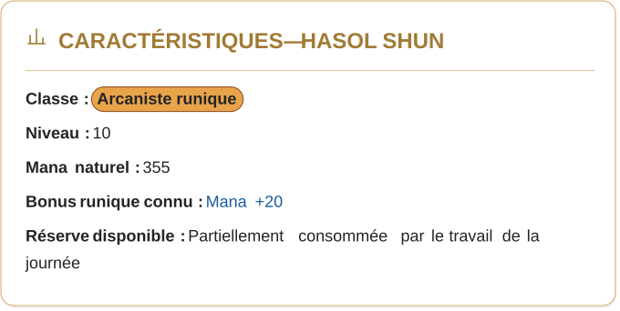
  </picture>
  

    
Version textuelle de la fenêtre

  
<svg class="lit-window__icon" viewBox="0 0 24 24" aria-hidden="true" focusable="false"><path d="M5 20V11 M12 20V4 M19 20v-6 M3 20h18"/></svg>CARACTÉRISTIQUES — HASOL SHUN

  
<strong>Classe :</strong> Arcaniste runique — Légendaire

  
<strong>Niveau :</strong> 10

  
<strong>Mana naturel :</strong> 355

  
<strong>Bonus runique connu :</strong> Mana +20

  
<strong>Réserve disponible :</strong> Partiellement consommée par le travail de la journée

  

Orven se rapprocha pour lire. Il resta silencieux plus longtemps qu’elle ne l’avait prévu, puis posa sa main à plat près du registre.

— Trois cent cinquante-cinq naturels. Tu ne m’avais pas montré cela hier.

— Vous ne me l’aviez pas demandé.

— C’est vrai.

Il eut un petit sourire, aussitôt absorbé par un nouveau regard sur les informations.

— Tes dix cercles m’avaient déjà donné de quoi réfléchir. Mais ce que tu viens de faire aujourd’hui, avec encore cette marge…

Il laissa la phrase en suspens. Hasol regarda les fiches terminées. Elle avait l’impression d’entendre parler de son Mana sur un ton auquel elle n’était pas habituée.

— Vous vous attendiez à ce que je doive m’arrêter plus tôt ?

— Pour récupérer, oui. C’est une bonne endurance. Je ne vais pas te donner une comparaison précise sur une seule journée et des commandes de ce genre, mais la marge est réelle.

Hasol ramena sa main près de la fenêtre partagée. Les mêmes chiffres lui avaient si souvent laissé un goût amer après une montée de niveau. Elle savait, en entrant chez Orven, qu’ils pourraient servir au travail. Elle n’avait pas imaginé le plaisir de voir les commandes faites et de comprendre qu’il lui restait encore des moyens pour celles qui attendaient.

— Je regardais surtout ce qu’il me manquait pour combattre, dit-elle. Je n’avais jamais travaillé assez longtemps comme cela pour voir ce que cette réserve permettait.

Orven acquiesça.

— Ici, nous pouvons en faire quelque chose. Il faudra apprendre à organiser tes journées avec, pas les remplir jusqu’à ce que tu tombes.

Elle ferma le partage. Devant elle, le support avait gardé un peu de chaleur. Hasol posa ses mains de chaque côté sans engager de Mana ; elle aimait déjà ce moment où tout était préparé et où il lui restait à choisir de commencer.

— Elle ne m’a pas empêchée de rater, dit-elle en regardant une ligne du registre.

— Elle n’est pas là pour te donner de la précision. Ça, nous y travaillons.

Il n’y avait ni reproche ni promesse dans sa voix. Hasol étira doucement ses doigts. Elle avait envie de reprendre, non pour modifier ce qu’Orven venait de dire, mais parce qu’une commande encore dans sa boîte lui paraissait désormais un travail qu’elle pourrait apprendre à mener jusqu’au bout.

---

## VI. La limite invisible

— Je peux préparer la suivante ?

Orven regarda son établi, puis la lumière dans la fenêtre.

— Lis-moi d’abord celle-ci.

Il lui plaça une fiche sous les yeux. Hasol y reconnut la désignation d’une Gardien rare bleue, trois étoiles. Elle passa à la consigne et lut :

— Amélioration jusqu’à +2.

Orven ne bougea pas. Elle s’approcha de la feuille, trouva le trait qu’elle avait pris pour la courbe du chiffre et se reprit.

— Non. +1.

La chaleur lui monta au visage. Aucun consommable n’avait été préparé, elle n’avait pas touché au support ; pourtant, elle revit déjà sa main aller vers une ligne de plus dans le registre.

— Je l’ai mal lu.

— Oui. Si tu gardais +2 en tête, tu pourrais engager une tentative que personne n’a autorisée. Pour cette commande, nous n’avons encore rien fait. Tu la laisses ainsi.

Hasol s’adossa. Elle aurait voulu remettre la fiche bien droit et lui montrer qu’à présent elle ne se tromperait plus. Orven la retira de l’espace de travail.

— Les améliorations s’arrêtent pour toi aujourd’hui.

Elle entrouvrit la bouche. Il lui restait du Mana ; elle venait de le montrer. Mais les caractères sur la feuille lui avaient paru moins nets avant même qu’il lui demandât de lire. Elle avait changé plusieurs fois de place pour que ses épaules cessent de tirer, en continuant à considérer chaque geste comme une simple gêne à corriger.

— J’ai la tête lourde, reconnut-elle.

Orven repoussa sa propre tasse, oubliée depuis trop longtemps.

— La réserve et l’attention ne s’épuisent pas ensemble. Une potion peut restaurer du Mana ; elle ne fera pas disparaître le besoin de repos mental. Aujourd’hui, tu as assez conduit de flux et vérifié de lignes.

Hasol regarda la place laissée libre par la fiche. L’erreur la gênait davantage parce qu’elle était petite. Elle n’avait pas ignoré une règle difficile ; elle avait lu ce qu’elle s’attendait à voir.

Elle prit son carnet et inscrivit un repère dans la marge, à l’endroit où commençait cette fin d’après-midi. Puis elle remit le capuchon sur sa plume.

— Je vais ranger les lots qui sont terminés.

— Après une pause. Sans fiche à lire pendant que tu bois.

Hasol retira la main qu’elle tendait déjà vers le registre. Orven la vit et lui désigna la chaise près de la porte.

Elle s’y assit avec sa tasse. Pendant quelques minutes, elle écouta les bruits de la rue. Un chariot passa sur un pavé disjoint ; le battement sourd se prolongea sous les roues. Elle découvrit combien elle avait envie de ne rien suivre jusqu’au bout.

Lorsqu’elle se releva, Orven lui laissa les boîtes vides et les linges, pas les commandes en attente. Elle nettoya son espace sans essayer de négocier une dernière tentative. Au moment de repousser le support, son bras tira légèrement et elle changea de main.

— Il restera du travail demain, dit-elle.

— J’y compte. Sinon, j’aurais mal organisé ma boutique.

Hasol eut un rire qui défit un peu la tension de sa nuque. Elle replia le linge en deux et alla le poser avec les autres.

---

## VII. Le bon choix

Ils rangeaient encore lorsque la clochette annonça une cliente. La femme portait une armure légère et un petit coffret sous le bras ; elle salua Orven avec l’aisance d’une habituée. Hasol resta en retrait, les mains sèches, tandis qu’il allait chercher les documents demandés.

— J’aurais aussi besoin d’un conseil, dit la chasseuse en posant le coffret fermé sur le comptoir. Pour le jeune de mon groupe.

Orven disposa devant elle deux fiches de comparaison. L’une proposait le choix d’une principale fixe, l’autre celui d’un pourcentage. La cliente se pencha sur la seconde.

— Je pensais partir là-dessus. Il commence à nous accompagner sur des expéditions plus exigeantes. Autant prendre ce que recherchent les chasseurs expérimentés.

Orven se tourna vers Hasol.

— Tu peux regarder avec nous.

Elle posa le linge qu’elle tenait et vint près du comptoir. Elle n’aurait plus eu envie de reprendre une amélioration ; parler avec une personne dont elle pouvait demander les besoins lui semblait un autre exercice. Elle prit néanmoins le temps de lire avant de répondre.

— Vous connaissez ses caractéristiques naturelles ?

— Pas exactement. Elles ne sont pas encore très élevées.

— Et ce qui lui manque pendant vos sorties ? Vous cherchez surtout à l’aider dans quel rôle ?

La chasseuse lui décrivit ce qu’elle attendait du jeune membre et les difficultés qu’il rencontrait encore. Hasol l’écouta sans transformer ces indications en statistiques. Elle demanda aussi combien de temps le groupe espérait conserver le prochain équipement.

— Quelques mois, probablement. Nous lui trouverons mieux après, si les expéditions se passent bien.

Hasol rapprocha les deux fiches. Elle sentit Orven près d’elle, silencieux, et évita de tourner les yeux vers lui pour y chercher sa réponse.

— Je ne choisirais pas seulement parce que la seconde ressemble aux équipements des plus anciens. Il faut voir ce qu’elle lui apporte à lui, pendant les chasses qui viennent. Le fixe peut être plus utile maintenant ; je ne peux pas vous l’assurer sans ses valeurs.

Elle montra les rubriques à compléter, sans annoncer de résultat.

— Si vous rapportez son profil et ce qu’il porte déjà, nous pourrons comparer sans oublier ce qu’un remplacement ferait perdre. Vous aurez les deux possibilités sous les yeux.

La cliente parcourut les documents, puis releva la tête vers Orven.

— Vous allez me faire revenir avant de dépenser ?

— Cela arrive, répondit-il.

Elle sourit.

— Il dira que je m’inquiète trop pour lui. Mais je préfère lui demander que lui rapporter quelque chose qui ne lui sert pas.

Hasol lui remit les fiches dans l’ordre. La chasseuse les rangea avec ses autres papiers et la remercia pour les questions. Cette fois, Hasol ne resta pas à chercher si elle avait trop parlé ; elle lui souhaita une bonne soirée.

Après son départ, Orven ferma le tiroir des documents.

— Tu as laissé le choix ouvert quand il manquait les données. C’était ce qu’il fallait faire.

Hasol eut envie de lui demander si toutes ses questions avaient été les bonnes. Elle regarda plutôt la place où la cliente avait posé ses mains.

— J’aimerais voir la comparaison quand elle reviendra.

— Tu seras là.

Elle reprit son linge. Le coffret n’avait pas été ouvert, aucune vente n’avait eu lieu, et pourtant cette cliente avait une raison de revenir les voir. Hasol acheva le dernier rangement avec plus de calme qu’elle n’en avait mis, le matin, à aligner les boîtes.

---

## VIII. Le travail du lendemain

Orven tourna l’enseigne lorsque le ciel commençait à prendre une teinte orangée. Hasol vida l’eau utilisée pour le nettoyage, essuya l’emplacement du support et vérifia que son carnet n’était pas resté sous un plateau. En retirant le tablier, elle trouva une trace de craie sur le pli de sa manche.

L’artisan achevait de rapprocher les fiches rendues du registre. Elle attendit près du comptoir, les mains encore occupées à défaire un nœud récalcitrant.

— Viens regarder avant de partir.

Il lui montra ce qui avait été terminé et ce qui restait prévu. Elle reconnut ses lignes parmi celles d’Orven. Une annotation était moins lisible que les autres ; elle la reprécisa à sa demande, sans effacer la mention initiale.

— Pour demain, dit-il, nous reprendrons les commandes simples. Et nous continuerons les comparaisons.

— Je peux préparer les fiches avant que vous arriviez à l’établi ?

— Les rapprocher des boîtes et signaler ce qui manque, oui. Tu me laisses vérifier avant les améliorations.

Hasol acquiesça. Elle n’avait plus à demander si elle pourrait revenir : ils organisaient ce qu’elle ferait en revenant.

Orven lui remit sa rémunération de la journée. Elle en vérifia le contenu, la rangea et le remercia. Le poids rejoignit celui de la veille dans sa bourse ; elle commençait à penser à la part qu’elle mettrait de côté plutôt qu’à une vitrine précise où tout dépenser.

— Tu as travaillé sérieusement, ajouta-t-il. Les fiches ont suivi les commandes, et tu n’as pas essayé de décider pour la cliente ce qu’il nous manquait pour savoir.

Hasol releva les yeux.

— J’ai aussi mal lu une consigne.

— Oui. C’est pour cela que je vérifierai encore demain.

Elle laissa passer un instant, puis sourit.

— Je comptais bien vous laisser faire.

— Voilà qui m’épargne une discussion.

Orven rassembla les documents. Hasol suspendit enfin le tablier, dégagea son sac du crochet et y glissa son carnet. Sa tête était lourde ; à présent qu’elle n’avait plus à se tenir penchée, elle sentait la fatigue prendre toute sa place.

À la porte, elle se retourna.

— Pour devenir une bonne artisane… il faudra apprendre à faire tout cela sans vous avoir à côté chaque fois.

Orven avait la main sur le verrou. Il ne répondit pas tout de suite.

— Cela s’apprend aussi, dit-il. Une première journée ne suffit pas à confier une boutique. Elle peut suffire à préparer la suivante.

Hasol regarda derrière lui l’espace qu’elle avait nettoyé. Le lendemain, elle saurait où poser ses affaires et par quoi commencer. Cela ne lui donnait pas les réponses aux commandes difficiles, mais elle avait envie de retrouver cette place.

— À demain, Maître Orven.

— À demain. Et repose ce bras.

Elle le promit sans ajouter de programme pour la soirée. Dans la rue, l’air frais lui fit du bien. Les boutiques fermaient ; derrière certaines vitres, une lampe mettait encore en valeur ce qu’on ne pouvait pas acheter tout de suite. Hasol continua vers la maison en tenant sa lanière du côté valide. Elle songeait aux ressources qu’elle apprendrait à prévoir, aux questions qu’elle pourrait poser avant qu’un client dépense, et à son propre équipement dont elle financerait peu à peu les améliorations. Elle n’avait rien acheté aujourd’hui. Elle n’en éprouva pas le besoin en passant devant les derniers étals.

---

## IX. Ce que son père ne voyait pas

Une odeur de soupe chaude flottait dans le couloir. Hasol posa ses chaussures près de la porte et trouva sa mère au salon, occupée à refermer une boîte de composants. Celle-ci s’interrompit en la voyant.

— Viens t’asseoir. Tu as l’air d’avoir regardé de très petites écritures toute la journée.

— Elles ont rétréci après le milieu de l’après-midi.

Sa mère sourit, puis suivit le mouvement prudent avec lequel elle retirait son sac.

— Et le bras ?

Hasol lui présenta l’avant-bras avant qu’elle le demande. La peau était restée fermée ; elle tira légèrement lorsqu’elle tourna le poignet.

— Je n’ai pas forcé. Orven a rapproché le travail, et j’ai laissé l’épée ici.

— Je l’avais remarquée.

Sa mère lui rendit son bras. Hasol s’installa près d’elle et commença par raconter le jeune chasseur, sa dernière tentative, le moment où il avait vérifié la commande devant elle. Elle entendit son propre récit accélérer ; elle ralentit en arrivant au budget, pour expliquer pourquoi ils avaient attendu son accord.

Sa mère ne lui demanda ni les calculs ni le détail de chaque flux. Elle voulait savoir comment Hasol s’était sentie lorsque le client avait demandé qui allait travailler. Cette fois, la jeune femme put en rire un peu.

— J’ai cru qu’il allait dire non. Il a regardé Orven, puis il m’a laissée faire.

— Et tu as pu travailler avec lui dans la boutique ?

— J’ai surtout essayé de ne pas écouter ses bottes.

Sa mère eut un rire discret. Hasol poursuivit avec les commandes de l’après-midi, puis la surprise d’Orven devant sa réserve. Elle ne reprit pas toute la leçon : elle décrivit le registre, le travail déjà fait et cette marge qui restait, plus concrète à ses yeux que la capacité affichée seule.

— Je savais que le Mana me servirait à l’atelier. Mais aujourd’hui, j’ai vu ce que ça pouvait changer dans une journée.

Elle s’arrêta, cherchant ce qui lui plaisait tant dans cette idée.

— J’ai envie de savoir comment organiser la suivante. Pas seulement de refaire une tentative qui m’a plu.

Sa mère la regarda avec un sourire qui ne cherchait pas à lui dicter la suite.

— Tu me raconteras.

Hasol lui rapporta aussi la lecture de +2 au lieu de +1 et l’arrêt imposé. En le disant, elle posa machinalement deux doigts entre ses sourcils.

— J’ai encore envie de penser que j’aurais pu me reprendre.

— Tu l’as fait. Tu n’as rien engagé, puis tu t’es arrêtée.

Sa mère se leva pour aller chercher leur repas. Hasol l’aida du côté où son bras ne tirait pas, et la conversation passa aux habitudes de la boutique, à la place des boîtes qu’Orven semblait reconnaître sans les regarder, au tablier qui lui allait trop grand. Elle put parler de son travail sans avoir à en défendre l’existence. Lorsqu’elle avoua avoir envie de retourner à l’établi, sa mère lui dit simplement qu’elle était contente que cette première journée lui eût donné envie de la suivante.

Plus tard, en traversant le couloir, Hasol aperçut la lumière du bureau paternel. La porte était entrouverte. À l’intérieur, son père examinait des contrats parmi des lettres et des registres ; elle reconnut la courbe de son dos lorsqu’il suivait une ligne difficile.

Elle ralentit. Elle aurait aimé lui raconter le client comme elle venait de le faire à sa mère, en gardant le temps de chercher ses mots. Depuis plusieurs années, elle ne savait plus très bien comment obtenir ce temps avec lui.

Il leva les yeux avant qu’elle ait décidé de frapper.

— Hasol ? Tu rentres de chez Orven ?

— Oui. J’ai déjà mangé avec maman.

Il posa sa plume.

— Elle m’a dit qu’il te prenait à l’essai. Cela se passe bien ?

— Oui. J’ai terminé des commandes sous sa surveillance aujourd’hui.

Il acquiesça. Hasol s’avança jusqu’au bord de la porte.

— Il a regardé ma réserve de Mana. Elle me donne une bonne endurance pour les améliorations. J’ai pu travailler longtemps sans être à court.

Son père lui sourit.

— C’est une bonne nouvelle.

— Oui, dit-elle. Je suis contente.

Elle avait prononcé ces derniers mots sans les préparer. Il baissa les yeux vers le contrat, puis les releva brièvement vers son bras.

— Fais attention à ne pas trop te fatiguer, ma princesse.

Le surnom lui fit encore quelque chose, comme la pression d’une main familière dont elle n’aurait pas su retenir le geste.

— Je vais me reposer. Bonne nuit, papa.

— Bonne nuit.

Il reprit sa plume. Hasol attendit une respiration, puis ramena doucement la porte dans la position où elle l’avait trouvée.

Dans le couloir, le bruit du travail continuait derrière le bois. Elle était déçue ; elle aurait voulu une question de plus. Elle garda pourtant la phrase qu’elle venait de prononcer : *Je suis contente.* Elle n’avait pas eu besoin de la corriger en voyant son père revenir à ses contrats.

Elle reprit son sac et monta dans sa chambre. Le récit du jeune chasseur lui appartenait encore, avec le merci au comptoir et la fiche qu’elle avait elle-même marquée comme rendue.

---

## X. Une autre manière d’avancer

Hasol alluma la lampe et ouvrit son carnet à la page de la journée. Il y avait déjà les résultats et la courte note de l’ardoise. Elle n’avait pas besoin de recopier les explications d’Orven pour remplir l’espace restant.

Elle ajouta trois observations : *Préparer les fiches avant les ressources. Attention moins sûre en fin d’après-midi. Demander le profil du porteur, pas seulement ce qu’on veut acheter.*

Sous ces lignes, elle garda une question pour le lendemain : *Comparer les progressions à des rangs différents dans les tables.* Elle avait compris le choix à valeurs données ; pour préparer des améliorations, il lui faudrait aussi apprendre où chercher celles qui viendraient après.

Elle rangea la rémunération de la journée avec ce qu’elle avait gagné la veille et sépara la part qu’elle voulait conserver pour ses pierres de mana. La somme restait modeste face à ses projets, mais elle pouvait décider de son usage. Elle refit le nœud sans compter une nouvelle fois.

Son interface personnelle lui confirma l’équipement qu’elle connaissait : niveau dix, dix cercles et dix emplacements occupés, quatre Fatal, quatre Gardien, deux Énergie. La Fatal rare bleue, six étoiles, à +6, et la Gardien rare bleue, six étoiles, à +6, offertes par son père, étaient intactes. Les huit cadeaux maternels trois étoiles, peu communs verts ou rares bleus, n’avaient pas changé non plus : la Fatal rare bleue, trois étoiles, à +3, gardait seule son amélioration parmi eux ; les sept autres restaient à +0.

Hasol referma la fenêtre. Elle posa ses affaires pour le matin et s’assit afin de retirer ses bottes sans tirer sur son bras. Dans le silence, ses oreilles semblaient retrouver les petits sons de l’atelier : la plume d’Orven, le linge sur le métal, la clochette. Elle sourit en pensant qu’elle saurait désormais lesquels annonçaient une interruption et lesquels pouvaient simplement accompagner son travail.

Elle n’essaya pas de prolonger la soirée. Le carnet rejoignit le sac, fermé sur la question qu’elle avait choisie.

Le lendemain, elle arriva à l’atelier avec assez d’avance pour suspendre ses affaires sans se presser. Orven était déjà là. Elle le salua, enfila le tablier et en rabattit le côté avant de rapprocher les fiches des boîtes.

— Celles-ci sont à vérifier, dit-elle. Il manque une indication sur celle du dessus.

Orven la rejoignit. Ils regardèrent ensemble la rubrique laissée vide ; il mit la commande à part avant de lui présenter les documents de comparaison préparés sur l’établi.

— Nous allons reprendre les profils des porteurs. Pas lancer les améliorations.

Hasol hocha la tête. Elle consulta les rubriques, puis tira son carnet vers elle.

— J’ai aussi une question. Si deux principales en pourcentage ont la même valeur maintenant, mais pas le même rang en étoiles, comment vérifier ce qu’elles apporteront après plusieurs améliorations ? Je ne veux pas supposer que leur progression restera la même.

Orven posa sa tasse.

— Voilà une bonne raison d’ouvrir les tables.

Il alla chercher un manuel dont les coins portaient des réparations de papier. Hasol dégagea la place nécessaire entre eux. Lorsqu’il posa le livre, elle évita de le rapprocher d’un trait, comme elle l’aurait fait avec un cahier neuf : une couture dépassait légèrement de la couverture.

— Il a beaucoup servi ?

— Suffisamment pour que tu ne poses pas ta tasse dessus.

— Je n’ai pas de tasse.

— Nous prenons de bonnes habitudes à l’avance.

Elle rit et ouvrit son carnet à la page marquée. Orven tourna les premiers feuillets jusqu’aux tables utiles. La lumière du matin glissait sur le bord de l’établi ; Hasol déplaça légèrement sa chaise pour ne pas lui faire d’ombre.

Elle avait préparé la place, repéré une information manquante et apporté sa question. La fierté qu’elle en éprouvait était tranquille, assez solide pour ne pas lui faire précipiter la suite.

Hasol posa sa plume près de la première ligne.

— Je commence par cette comparaison. Vous regarderez quand j’aurai terminé ?

Orven acquiesça. Elle se pencha sur le livre et se mit au travail.

---

# Chapitre 5 — Le premier lien

## I. Une rencontre inattendue

— Non, Hasol. Recommence.

La jeune femme releva les yeux de la fiche posée devant elle.

— Encore ?

Orven croisa les bras.

— Tu préfères que je laisse un client dépenser ses pierres de mana pour une amélioration qui ne lui conviendra pas ?

— Non, Maître Orven…

— Alors recommence.

Hasol retint un soupir et se pencha de nouveau sur les deux runes disposées devant elle.

La fin de journée approchait. Dans l’atelier, les derniers rayons du soleil traversaient les fenêtres, éclairant les rangées de boîtes soigneusement étiquetées. Une odeur de bois ciré et de poudre minérale flottait dans l’air.

Cela faisait près d’une heure qu’Orven lui demandait d’examiner différentes commandes.

Elle avait déjà commis deux erreurs.

Pas des erreurs graves, heureusement. Il ne lui avait encore confié aucune amélioration délicate à réaliser seule.

Mais elle avait proposé des runes qui, malgré leurs bonnes caractéristiques apparentes, n’étaient pas les plus intéressantes pour les clients concernés.

Hasol relut les informations.

Cette fois, elle prit son temps.

— La première rune offre un meilleur bonus immédiat, commença-t-elle. Et puisque l’attaque naturelle de ce chasseur reste relativement faible, elle lui sera plus utile actuellement.

Orven ne répondit pas.

Hasol poursuivit :

— Mais s’il compte conserver cette rune pendant plusieurs niveaux, la seconde pourrait devenir plus intéressante. Il faudrait connaître ses objectifs avant de lui conseiller définitivement l’une ou l’autre.

Le maître artisan leva enfin les yeux.

— Voilà.

Hasol se redressa.

— C’est bon ?

— C’est mieux.

Elle sourit.

Orven récupéra les deux runes et les rangea dans leurs coffrets respectifs.

— Un bon artisan ne vend pas simplement la pierre qui possède les plus beaux chiffres. Il cherche celle qui correspond aux besoins de son client.

— Je sais.

— Alors pourquoi t’es-tu trompée deux fois ?

Hasol baissa les yeux.

— Parce que j’ai regardé les chiffres avant de réfléchir à la personne qui allait utiliser la rune…

— Exactement.

Il lui tendit les dernières fiches.

— Range-moi tout ça avant de partir.

Hasol les récupéra.

— Oui, maître.

Elle s’approcha des étagères et commença à remettre chaque document à sa place.

Derrière elle, Orven examinait déjà une nouvelle commande.

— Au fait, Hasol.

— Oui ?

— Ton travail de cette semaine était satisfaisant.

Elle se retourna si rapidement qu’elle manqua de faire tomber une boîte.

— Vraiment ?

Orven leva les yeux.

— Ne prends pas cet air étonné. Je ne distribue pas les compliments pour décorer l’atelier.

Hasol serra les fiches contre elle.

— Merci !

— Et maintenant, termine de ranger.

Elle s’exécuta avec un sourire qu’elle ne parvint pas à dissimuler.

Quelques minutes plus tard, elle détacha son tablier et le suspendit à son crochet habituel.

— À lundi, Maître Orven !

— À lundi.

Elle avait presque atteint la porte lorsqu’il ajouta :

— Et repose-toi un peu ce week-end. J’aimerais retrouver mon apprentie en un seul morceau.

Hasol s’immobilisa.

— Je vais seulement chasser quelques loups gris…

Orven leva lentement les yeux.

— C’est censé me rassurer ?

Elle eut un petit rire embarrassé.

— Je ferai attention.

— Tu as intérêt.

Hasol quitta l’atelier avec une humeur excellente.

Elle avait encore beaucoup de choses à apprendre, mais elle commençait enfin à trouver sa place chez Orven.

Et cela lui faisait du bien.

La capitale était particulièrement animée en cette fin d’après-midi.

Les marchands interpellaient les passants depuis leurs étals. Des apprentis couraient entre les ateliers, chargés de matériaux, tandis que plusieurs groupes de chasseurs revenaient des zones extérieures avec leurs équipements encore couverts de poussière.

Hasol traversait une place bordée de boutiques lorsqu’une voix familière l’interpella.

— Hasol ?

Elle s’arrêta.

Près de la fontaine se tenait un jeune homme portant un grand bouclier dans le dos.

Ses cheveux bruns, coupés court, encadraient son visage, et sa silhouette élancée ne semblait nullement gênée par le poids de son équipement.

Deux jeunes chasseuses qui passaient près de lui ralentirent pour le regarder.

L’une d’elles murmura quelque chose à l’oreille de son amie.

Cette dernière étouffa un rire avant de jeter un nouveau coup d’œil dans sa direction.

Hasol n’y prêta aucune attention.

Elle venait de reconnaître le jeune homme.

— Zio !

Un sourire éclaira immédiatement son visage.

Zio Notos lui répondit avec la même chaleur.

— Cela fait longtemps.

Hasol s’approcha.

Elle gardait un souvenir précieux de ce Gardien qui, autrefois, avait pris sa défense à l’Académie et lui avait rendu son carnet.

— Comment vas-tu ? demanda-t-il.

— Bien !

Elle réfléchit une seconde, puis ajouta avec un sourire :

— Beaucoup mieux qu’avant, même.

— Voilà une bonne nouvelle.

Son regard descendit vers la sacoche qu’elle portait à l’épaule.

— Tu reviens de travailler ?

— Oui. Je suis apprentie chez Maître Orven, maintenant.

— L’artisan runique ?

Hasol acquiesça.

— Tu le connais ?

— De réputation.

Elle sourit plus largement.

— Il est exigeant, mais j’apprends énormément avec lui.

— Ça se voit que ça te plaît.

Hasol rit doucement.

— Je parle déjà autant que lui ?

— Je pensais surtout à ton sourire.

Elle sentit ses joues chauffer légèrement.

Zio poursuivit :

— Et la chasse ? Tu continues ?

— Bien sûr ! Je suis niveau dix, maintenant.

— Félicitations !

— Merci.

  <picture class="lit-window__github-picture">
    <source media="(max-width: 600px)" srcset="assets/fenetres/039-mobile.svg">
    
  </picture>
  

    
Version textuelle de la fenêtre

  
<svg class="lit-window__icon" viewBox="0 0 24 24" aria-hidden="true" focusable="false"><circle cx="12" cy="8" r="4"/><path d="M4 21v-2a8 6 0 0 1 16 0v2"/></svg>ZIO NOTOS

  
<strong>Classe :</strong> Gardien — Rare

  
<strong>Niveau :</strong> 45

  

Hasol baissa brièvement les yeux.

Elle avait encore du mal à accepter les compliments sans chercher immédiatement à minimiser ses réussites.

Mais Zio semblait sincèrement heureux pour elle.

Il allait reprendre la parole lorsqu’une voix féminine s’éleva derrière lui.

— Zio !

Une jeune fille se frayait un passage entre les passants, plusieurs feuilles serrées contre sa poitrine.

— Tu avais promis de m’attendre près de la fontaine !

Zio tourna tranquillement la tête.

— Et je suis où, à ton avis ?

— De l’autre côté !

— C’est toujours la même fontaine.

— Tu es vraiment impossible !

Hasol ne put retenir un rire.

La jeune fille s’arrêta devant eux et remarqua enfin sa présence.

— Oh !

Elle redressa immédiatement sa tenue.

— Désolée. Je ne voulais pas vous interrompre.

Zio sourit.

— Hasol, je te présente ma petite sœur. Yoon.

La jeune fille s’inclina poliment.

— Yoon Notos. Enchantée !

— Hasol Shun. Enchantée également.

Yoon releva brusquement la tête.

— Attends…

Elle observa Hasol.

Puis son frère.

Puis Hasol de nouveau.

— Hasol Shun ?

Hasol eut un sourire légèrement embarrassé.

— Oui ?

— L’Arcaniste runique ?

— C’est moi…

Les yeux de Yoon s’illuminèrent.

— Mais c’est incroyable !

Elle fit un pas en avant.

— J’ai entendu parler de toi ! Une classe légendaire spécialisée dans les runes ! J’ai tellement de questions à te poser !

Zio soupira.

— Yoon…

— Quoi ?

— Laisse-la au moins respirer.

La jeune fille recula aussitôt.

— Ah ! Pardon !

Hasol éclata de rire.

Yoon rougit avant de sourire à son tour.

— Est-ce que tu as quelques minutes ? demanda-t-elle.

Hasol regarda les feuilles que Yoon tenait contre elle, puis son expression pleine d’espoir.

— Bien sûr.

— Super !

Yoon se tourna immédiatement vers son frère.

— Tu vois ? Elle est gentille !

Zio leva les yeux au ciel.

— Je n’ai jamais prétendu le contraire.

Ils s’installèrent sur un banc près de la fontaine.

Hasol ignorait encore qu’elle venait de rencontrer quelqu’un qui allait profondément changer ses prochaines années.

## II. Une Sage pas comme les autres

— Alors, tu fabriques vraiment des runes ?

Yoon s’était assise près de Hasol et semblait incapable de contenir sa curiosité.

— J’apprends surtout à les améliorer, répondit celle-ci. La fabrication elle-même demande des compétences que je ne possède pas.

— Mais tu peux déjà travailler dessus ?

— Oui. Sous la surveillance d’Orven.

— C’est génial !

Zio s’installa de l’autre côté du banc.

— Tu sais, Yoon, tu pourrais peut-être commencer par lui expliquer pourquoi tu es si intéressée par les runes.

La jeune fille lui lança un regard.

— J’allais le faire !

— Naturellement.

Hasol sourit.

— Tu possèdes une classe runique ?

Yoon se redressa fièrement.

— Sage runique. Rare !

Hasol ouvrit de grands yeux.

— Sérieusement ?

— Oui !

— Alors nous avons quelque chose en commun !

Yoon hocha vivement la tête.

— Exactement ! Enfin, nos classes sont assez différentes. Toi, tu travailles directement avec les runes. Moi, je soutiens les chasseurs grâce à elles.

— Comment ça ?

Yoon sembla ravie de la question.

Elle leva trois doigts.

— J’ai trois compétences depuis ma Révélation : Résonance runique, Chant runique et Vague runique.

Hasol se pencha légèrement.

— Trois compétences dès le niveau un ?

Yoon acquiesça.

— Oui.

  <picture class="lit-window__github-picture">
    <source media="(max-width: 600px)" srcset="assets/fenetres/040-mobile.svg">
    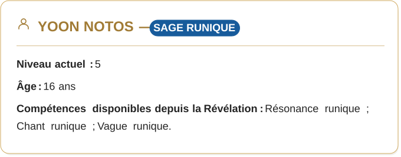
  </picture>
  

    
Version textuelle de la fenêtre

  
<svg class="lit-window__icon" viewBox="0 0 24 24" aria-hidden="true" focusable="false"><circle cx="12" cy="8" r="4"/><path d="M4 21v-2a8 6 0 0 1 16 0v2"/></svg>YOON NOTOS — SAGE RUNIQUE

  
<strong>Rareté :</strong> Rare — <strong>Niveau actuel :</strong> 5

  
<strong>Âge :</strong> 16 ans

  
<strong>Compétences disponibles depuis la Révélation :</strong> Résonance runique ; Chant runique ; Vague runique.

  

Hasol la contempla avec admiration.

Elle-même avait passé trois années à attendre de découvrir une véritable compétence active.

Yoon, au contraire, avait commencé son parcours avec un ensemble de capacités déjà utilisables.

— Résonance runique est la plus intéressante, expliqua la jeune Sage. Je peux cibler un allié et amplifier les caractéristiques principales des runes qu’il porte.

Hasol releva la tête.

— Uniquement les principales ?

— Oui. Les secondaires et les bonus d’ensemble ne sont pas concernés.

— Mais sur un chasseur bien équipé…

— Exactement !

Yoon se rapprocha encore.

— Les résultats peuvent devenir très intéressants.

Hasol réfléchit immédiatement à ses propres runes.

À leurs caractéristiques principales.

À ses dix emplacements.

Elle garda toutefois ces dernières informations pour elle.

— Et Chant runique ? demanda-t-elle.

— C’est mon sort de soin.

Yoon dessina un petit cercle dans l’air avec son doigt.

— Je crée une zone runique au sol. Toutes les cinq secondes, les alliés présents à l’intérieur récupèrent des PV équivalents à dix pour cent de mes propres PV maximum.

Hasol acquiesça.

— Donc les soins dépendent de tes caractéristiques, pas de celles des personnes soignées.

— Oui.

Yoon sourit.

— Et le cercle reste actif après son lancement. Je peux continuer à me déplacer ou à utiliser une autre compétence.

— C’est pratique !

— Très pratique, confirma Zio. À condition de ne pas poser le cercle au milieu d’un endroit dangereux.

Yoon lui lança un regard offensé.

— Tu vas vraiment raconter cette histoire ?

Hasol tourna la tête.

— Quelle histoire ?

— Aucune histoire !

Zio sourit.

— Lors d’un entraînement, elle a placé son cercle juste devant une zone où les mannequins mobiles effectuaient leurs charges.

— Je ne savais pas qu’ils allaient bouger !

— C’était un exercice contre des mannequins mobiles.

— Zio !

Hasol éclata de rire.

Yoon croisa les bras avec une dignité toute relative.

— Je me suis améliorée depuis.

— Heureusement, répondit son frère.

Hasol reprit son souffle.

— Et ta dernière compétence ?

Le visage de Yoon s’éclaira de nouveau.

— Vague runique !

Elle tendit la main.

Une petite lueur blanche et dorée apparut au bout de ses doigts avant de se dissiper.

— C’est une attaque magique à distance. Elle coûte seulement cinq points de Mana, ne possède pas de temps de recharge et inflige de faibles dégâts.

— Faibles à quel point ?

Yoon grimaça.

— Vingt pour cent de ma Puissance arcanique.

Hasol réfléchit.

— Alors ce n’est pas vraiment une compétence offensive puissante.

— Absolument pas !

Yoon rit.

— Mais elle me permet de faire autre chose que regarder les autres combattre. Je peux aider à achever un monstre, ou simplement lui infliger quelques dégâts pendant que mes autres compétences sont indisponibles.

Elle ajouta avec une pointe de fierté :

— Et je préfère participer plutôt que rester cachée derrière un arbre en attendant qu’on m’appelle.

  <picture class="lit-window__github-picture">
    <source media="(max-width: 600px)" srcset="assets/fenetres/041-mobile.svg">
    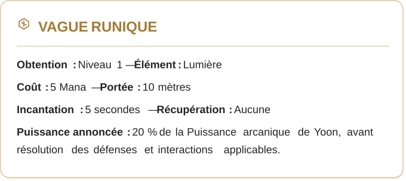
  </picture>
  

    
Version textuelle de la fenêtre

  
<svg class="lit-window__icon" viewBox="0 0 24 24" aria-hidden="true" focusable="false"><path d="m12 3 8 5v8l-8 5-8-5V8Z M12 7v10 M8 10l8 4"/></svg>VAGUE RUNIQUE

  
<strong>Obtention :</strong> Niveau 1 — <strong>Élément :</strong> Lumière

  
<strong>Coût :</strong> 5 Mana — <strong>Portée :</strong> 10 mètres

  
<strong>Incantation :</strong> 5 secondes — <strong>Récupération :</strong> Aucune

  
<strong>Puissance annoncée :</strong> 20 % de la Puissance arcanique de Yoon, avant résolution des défenses et interactions applicables.

  

Hasol lui adressa un sourire.

— Je comprends.

Cette petite phrase lui plaisait.

Yoon ne cherchait pas seulement à être utile.

Elle voulait prendre part aux aventures de son équipe.

Un coup de vent souleva soudain les feuilles posées près de Yoon.

— Ah !

Elle se précipita pour les rattraper.

Hasol attrapa l’une d’elles avant qu’elle tombe dans la fontaine.

— Tiens.

— Merci !

Hasol lui rendit le document.

Son regard s’arrêta malgré elle sur le sceau imprimé en haut de la page.

— C’est une proposition d’équipe ?

Yoon acquiesça, un peu gênée.

— Oui.

Zio eut un petit rire.

— La troisième de la semaine.

— La quatrième, corrigea sa sœur.

— Ah, pardon.

Hasol regarda les autres feuilles.

— Tu es vraiment très demandée…

Yoon haussa les épaules.

— C’est surtout ma classe qui les intéresse.

Elle récupéra les documents et les rangea dans sa sacoche.

— Certains groupes cherchent désespérément un soutien runique. Et comme j’ai déjà mes compétences de soin et d’amplification…

Elle s’interrompit.

Hasol remarqua que son enthousiasme s’était atténué.

— Tu n’as pas envie de les rejoindre ?

Yoon hésita.

— Pas vraiment.

Zio ne dit rien.

La jeune fille poursuivit :

— J’ai assisté à plusieurs entretiens. À chaque fois, c’est la même chose.

Elle compta sur ses doigts.

— Combien de temps dure Résonance ? À quelle fréquence puis-je soigner ? Combien de personnes peuvent bénéficier du cercle ? Est-ce que je peux consacrer toutes mes ressources aux compétences de soutien ?

Elle baissa les yeux.

— Un chef d’équipe m’a même expliqué qu’il préférait que je n’utilise pas Vague runique. Selon lui, ce serait du Mana gaspillé.

Hasol fronça les sourcils.

— Mais c’est ta compétence.

— Exactement !

Yoon la regarda.

— Je sais bien que je ne suis pas une mage offensive. Je ne prétends pas pouvoir vaincre des monstres puissants toute seule. Mais j’aimerais qu’on me laisse essayer des choses.

Elle marqua une pause.

— Je veux apprendre à combattre, moi aussi.

Hasol resta silencieuse un instant.

Puis elle demanda :

— Est-ce qu’ils t’ont demandé quel genre de chasseuse tu voulais devenir ?

Yoon releva les yeux.

Elle semblait surprise.

— Non.

— C’est dommage.

— Tu trouves ?

Hasol acquiesça.

— Tes compétences sont importantes, évidemment. Mais si tu dois passer plusieurs années avec des personnes, ce serait bien qu’elles s’intéressent aussi à toi.

Un sourire discret apparut sur le visage de Yoon.

— C’est exactement ce que je pense.

Zio observa les deux jeunes filles.

Puis il s’adossa tranquillement au banc, un peu en retrait.

La conversation continua.

Yoon posa des questions sur les runes que Hasol manipulait chez Orven.

Hasol découvrit que la jeune Sage adorait prendre des notes et avait déjà rempli plusieurs carnets avec ses propres observations.

— J’aimerais comprendre pourquoi certaines compétences runiques réagissent différemment selon les chasseurs, expliqua Yoon.

— Tu tiens un carnet, toi aussi ?

— Plusieurs !

Hasol éclata de rire.

— Alors nous allons bien nous entendre.

Yoon sourit.

Elles comparèrent leurs méthodes de classement.

Découvrirent qu’elles n’étaient d’accord sur presque aucune manière d’organiser les informations.

Puis se mirent à rire de leurs propres désaccords.

À un moment, Zio revint avec trois petites pâtisseries achetées à un marchand voisin.

Yoon récupéra immédiatement la sienne.

— Merci !

Elle mordit dedans avant de grimacer.

— C’est chaud !

Zio secoua la tête.

— Tu pourrais attendre deux secondes.

— Tu pourrais prévenir !

— La vapeur qui sortait du gâteau constituait un indice assez convaincant.

Hasol éclata de rire.

Yoon lui lança un regard faussement blessé.

— Tu prends déjà son parti ?

— Pas du tout !

Mais elle riait trop pour paraître crédible.

Lorsque le soleil commença à descendre, Hasol réalisa qu’elles discutaient depuis bien plus longtemps qu’elle ne l’avait imaginé.

Elle n’avait même pas terminé ses achats.

Yoon remarqua sa sacoche.

— Tu avais quelque chose à faire avant qu’on t’accapare ?

— Quelques provisions, répondit Hasol. Je comptais retourner chasser demain.

— Vraiment ?

Les yeux de Yoon brillèrent immédiatement.

— Où ça ?

— Au bois des Crocs Gris.

— Avec ton équipe ?

Hasol hésita.

— Je n’en ai pas.

Yoon sembla surprise.

— Tu chasses seule ?

— Pour le moment, oui.

La jeune Sage resta silencieuse quelques secondes.

Puis elle se tourna lentement vers son frère.

Zio soupira avant même qu’elle ouvre la bouche.

— Non.

Yoon se redressa.

— Mais je n’ai encore rien demandé !

— Je connais ce regard.

— Tu ne sais même pas ce que je vais dire !

— Tu veux que je vous accompagne demain.

Yoon ouvrit la bouche.

Puis la referma.

Hasol étouffa un rire.

— Bon… d’accord, admit Yoon. C’est exactement ce que je voulais demander.

Zio croisa les bras.

— Et pourquoi ?

Yoon se tourna vers Hasol.

Son sourire se fit soudain moins assuré.

— Parce que j’aimerais chasser avec toi.

Hasol cligna des yeux.

— Avec moi ?

— Oui.

— Mais… pourquoi ?

Yoon sembla déconcertée par la question.

— Parce que j’en ai envie !

Puis elle ajouta, un peu plus doucement :

— On vient de passer tout l’après-midi à discuter. Tu es gentille, tu aimes les runes, et tu as l’air de prendre la chasse au sérieux.

Elle hésita.

— J’aimerais voir si on pourrait bien combattre ensemble.

Hasol la contempla.

Personne ne lui avait proposé une sortie de chasse avec autant de simplicité depuis longtemps.

Zio observa sa sœur, puis Hasol.

— Je peux vous accompagner pour cette première fois.

Yoon se redressa aussitôt.

— Vraiment ?

— Pour vous surveiller. Pas pour combattre à votre place.

Il regarda les deux jeunes filles.

— Et si la situation devient dangereuse, je prends les décisions. Compris ?

Yoon acquiesça immédiatement.

— Compris !

Hasol sourit.

— Ça me va.

Yoon leva les bras avec enthousiasme.

— Parfait ! Demain matin, alors !

Zio se leva.

— Et maintenant, si tu as terminé de recruter des partenaires en pleine rue, nous pouvons rentrer.

— Je n’ai recruté personne !

Il lui adressa un regard.

Yoon réfléchit.

— Enfin… pas encore.

Hasol éclata de rire.

Lorsqu’elle reprit enfin le chemin de la maison, elle avait oublié une partie de ses achats.

Mais elle avait gagné quelque chose de bien plus inattendu.

Elle avait hâte d’être au lendemain.

## III. Trois chasseurs sur le chemin des Crocs Gris

Hasol arriva au point de rendez-vous avant l’heure prévue.

Elle avait vérifié son équipement plusieurs fois.

Son épée était propre, ses protections correctement attachées et sa sacoche contenait de l’eau, des provisions et le matériel nécessaire pour une journée dans les bois.

Elle avait également pris le temps d’examiner ses dix runes équipées.

Quatre Fatal (grades rares bleus ou peu communs verts ; 6★ et 3★ selon la pièce), quatre Gardien (grades rares bleus ou peu communs verts ; 6★ et 3★ selon la pièce) et deux Énergie (rare bleue et peu commune verte, 3★).

Ses bonus d’ensemble étaient actifs.

Les deux précieuses runes rares bleues, 6★ et améliorées à +6, offertes par son père, occupaient toujours leurs emplacements habituels.

Elle n’avait changé aucune rune.

Mais aujourd’hui, elle était particulièrement curieuse de découvrir comment celles-ci réagiraient à Résonance runique.

— Hasol !

Elle se retourna.

Yoon arrivait d’un pas rapide, suivie de son frère.

La jeune Sage portait une tenue d’entraînement renforcée et une sacoche qui semblait un peu trop remplie pour une chasse de quelques heures.

Zio, lui, avançait tranquillement, son grand bouclier fixé dans le dos.

— Bonjour ! lança Hasol.

— Tu es arrivée tôt !

— Je ne voulais pas vous faire attendre.

Zio jeta un regard à sa sœur.

— Tu entends ?

Yoon leva les yeux au ciel.

— Je suis à l’heure !

— Aujourd’hui, oui.

— Tu vas me le rappeler toute ma vie ?

— Probablement.

Hasol étouffa un rire.

Ils quittèrent la capitale et empruntèrent la route menant au bois des Crocs Gris.

Yoon marchait près de Hasol.

Elle semblait incapable de rester silencieuse plus de quelques minutes.

Elle parla de ses entraînements à l’Académie, de ses professeurs, des livres qu’elle voulait consulter et même d’un marchand qui vendait, selon elle, les meilleurs petits pains de toute la capitale.

Hasol découvrit rapidement que Yoon pouvait passer d’une conversation très sérieuse sur les caractéristiques runiques à une discussion passionnée sur la nourriture sans la moindre transition.

À un moment, elle sortit une pomme de sa sacoche.

Puis une deuxième.

Puis un petit paquet de biscuits.

Zio la regarda.

— Combien de nourriture as-tu emporté ?

— Le nécessaire.

— Nous partons chasser, Yoon. Pas traverser le continent.

— Tu dis ça parce que tu manges moins que moi.

— Je ne suis pas certain que ce soit physiquement possible.

Hasol éclata de rire.

Yoon lui tendit un biscuit.

— Tiens. Pour ne pas finir aussi désagréable que mon frère.

Hasol le prit avec un sourire.

— Merci.

Zio secoua la tête.

— Je suis entouré de personnes ingrates.

La marche fut si agréable que Hasol fut presque surprise lorsqu’ils atteignirent la lisière du bois.

La forêt semblait paisible.

Des oiseaux chantaient dans les branches, et les rayons du soleil dessinaient des taches de lumière sur le sentier.

Mais Hasol savait désormais que cette tranquillité pouvait être trompeuse.

Elle posa instinctivement la main sur la garde de son épée.

Zio le remarqua.

— Tu as déjà chassé ici ?

— Une fois.

— Seule ?

Hasol acquiesça.

— J’ai affronté trois loups gris. Ça ne s’est pas aussi bien passé que je l’espérais.

— Mais tu es rentrée.

— Oui.

Zio sourit légèrement.

— Alors tu as déjà appris quelque chose d’important.

Il leur fit signe de s’arrêter.

— Avant de commencer, expliquez-moi comment vous comptez combattre.

Yoon répondit immédiatement :

— Hasol devant. Moi derrière. Je la renforce et je soigne si nécessaire.

— Et si un loup arrive sur ton côté ?

Yoon hésita.

— Je… recule ?

— Vers où ?

Elle regarda les arbres.

Hasol réfléchit également.

Zio désigna un espace dégagé entre deux troncs.

— Vous voyez ce passage ? Il permet de reculer sans être bloquées par les racines.

Il montra ensuite les buissons proches du sentier.

— Mais ces fourrés cachent une partie du terrain.

Yoon plissa les yeux.

— Donc il faut éviter d’y placer notre zone de combat.

— Exactement.

Hasol observa les alentours.

Elle comprenait ce qu’il voulait leur montrer.

Mais elle se rendait aussi compte qu’elle n’aurait probablement pas pensé à tous ces détails seule.

Zio croisa les bras.

— Je resterai à distance. Je n’interviendrai que si vous risquez d’être gravement blessées.

Puis il ajouta, en regardant sa sœur :

— Et non, ce n’est pas une invitation à essayer des choses dangereuses pour voir si j’interviens.

Yoon ouvrit de grands yeux.

— Je n’allais pas faire ça !

— Bien.

Hasol sourit.

Ils s’enfoncèrent dans la forêt.

Le premier loup apparut peu après.

Il avançait entre deux arbres, le corps bas et les oreilles rabattues.

Hasol le reconnut immédiatement.

Un loup gris de niveau cinq.

Elle dégaina.

— Yoon, prête ?

— Prête !

La jeune Sage leva la main.

— Résonance runique !

Des caractères lumineux apparurent autour de ses doigts.

Ils tournoyèrent brièvement avant de se diriger vers Hasol.

La jeune femme sentit ses cercles de mana vibrer.

Une sensation étrange parcourut les runes qu’elle portait.

Ce n’était pas sa force naturelle qui augmentait directement.

C’étaient les caractéristiques principales de son équipement qui réagissaient au sort.

Elle sentit son corps devenir plus réactif.

Sa prise sur l’épée se raffermit.

  <picture class="lit-window__github-picture">
    <source media="(max-width: 600px)" srcset="assets/fenetres/042-mobile.svg">
    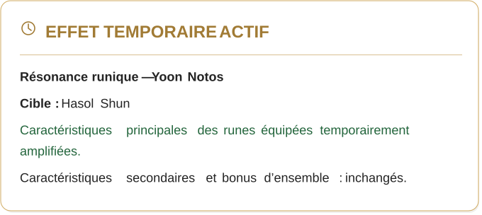
  </picture>
  

    
Version textuelle de la fenêtre

  
<svg class="lit-window__icon" viewBox="0 0 24 24" aria-hidden="true" focusable="false"><circle cx="12" cy="12" r="9"/><path d="M12 6v6l4 3"/></svg>EFFET TEMPORAIRE ACTIF

  
<strong>Résonance runique — Yoon Notos</strong>

  
<strong>Cible :</strong> Hasol Shun

  
Caractéristiques principales des runes équipées temporairement amplifiées.

  
Caractéristiques secondaires et bonus d’ensemble : inchangés.

  

Hasol sourit.

— Je sens la différence !

Yoon lui répondit avec enthousiasme :

— Alors allons-y !

Le loup bondit.

Hasol se décala sur le côté.

Elle connaissait désormais un peu mieux le mouvement des loups gris : la poussée des pattes arrière, le tassement des épaules, cet instant où leur trajectoire devenait difficile à modifier.

Elle évita les crocs et frappa.

La lame atteignit le flanc de l’animal.

Le loup poussa un grondement furieux.

Puis pivota vers elle.

Hasol recula.

Au terme des cinq secondes d’incantation de Yoon, une petite onde lumineuse passa près de son épaule.

Elle heurta le loup.

L’animal eut un mouvement de surprise, mais resta debout.

— Vague runique ! annonça Yoon.

Les dégâts étaient modestes.

Pourtant, cette intervention donna à Hasol le temps de reprendre une meilleure position.

Elle avança, para une nouvelle attaque et frappa une seconde fois.

Sa lame atteignit le cou du monstre.

Le loup s’effondra.

Hasol resta en garde quelques instants.

Puis laissa sortir un long souffle.

— On a réussi…

Yoon leva joyeusement les bras.

— Oui !

Elle allait se précipiter vers Hasol lorsqu’une voix retentit derrière elles.

— Pas mal.

Zio s’approcha tranquillement.

Yoon se retourna.

— Seulement pas mal ?

Il haussa les épaules.

— Vous avez vaincu un loup sans vous blesser.

— C’est déjà très bien !

— Oui.

Il désigna le sol.

— Mais Hasol a avancé un peu trop loin après sa première attaque. Et toi, tu as lancé ta vague alors qu’elle se trouvait presque sur la trajectoire.

Yoon baissa les yeux.

— Je voulais l’aider…

— Je sais. Mais dans une équipe, une attaque mal placée peut devenir aussi gênante qu’un ennemi.

Hasol acquiesça.

— J’aurais dû annoncer mon déplacement.

— Exactement.

Zio leur adressa un petit sourire.

— Vous vous débrouillez déjà mieux que certaines équipes débutantes. Maintenant, apprenez à vous parler pendant le combat.

Yoon se redressa.

— Compris !

Hasol sourit.

Elles continuèrent.

Les combats suivants leur permirent de trouver progressivement un premier rythme.

Hasol se chargeait d’attirer les loups et d’engager le corps à corps.

Yoon restait à distance, surveillant les mouvements de sa partenaire.

Ses Vagues runiques n’infligeaient que de faibles dégâts, mais elles lui permettaient de contribuer régulièrement aux affrontements.

Lorsqu’un loup réussit à griffer Hasol à l’épaule, Yoon leva immédiatement la main.

— Chant runique !

Un cercle d’écritures vertes apparut au sol.

Les symboles se mirent à tourner lentement, puis une lumière douce s’éleva autour des deux jeunes filles.

Quelques secondes plus tard, Hasol sentit une chaleur apaisante parcourir son corps.

Ses PV remontèrent.

Elle eut un sourire surpris.

— C’est agréable…

Yoon rit.

— N’est-ce pas ?

Elle leva aussitôt la main et commença l’incantation d’une nouvelle Vague runique.

Hasol comprit alors toute l’utilité de la compétence.

Le cercle continuait à soigner les alliés qui se trouvaient à l’intérieur.

Mais Yoon pouvait toujours attaquer.

La jeune Sage ne restait pas immobile à attendre que les autres combattent pour elle.

Au fil de la matinée, leur coordination s’améliora.

Hasol apprit à prévenir avant de changer brusquement de direction.

Yoon commença à mieux choisir les moments où lancer ses attaques.

Et lorsqu’un loup tenta de contourner Hasol, la jeune femme le remarqua suffisamment tôt pour se replacer entre lui et sa partenaire.

Zio les observait à distance.

De temps en temps, il leur donnait un conseil.

Mais il les laissait prendre leurs propres décisions.

À mesure que les combats s’enchaînaient, Hasol ressentait quelque chose de nouveau.

Elle n’était plus obligée de gérer chaque difficulté seule.

Quelqu’un surveillait ses arrières.

Quelqu’un pouvait lui rendre des PV pendant qu’elle combattait.

Et lorsqu’elle entendait Yoon l’encourager derrière elle, la fatigue semblait un peu moins lourde à supporter.

Cette sensation était agréable.

Peut-être trop agréable.

Car, peu à peu, les deux jeunes filles commencèrent à se sentir plus expérimentées qu’elles ne l’étaient réellement.

## IV. Une seconde de trop

Le danger arriva en fin de matinée.

Hasol venait d’achever un nouveau loup lorsque Yoon remarqua plusieurs empreintes dans la terre humide.

— Regarde !

Elle s’accroupit près d’un arbre.

Hasol s’approcha.

— Quoi ?

— Il y a des traces partout ici.

La jeune Sage passa les doigts au-dessus du sol.

— Certaines vont vers le sentier, d’autres vers les buissons…

Hasol examina les empreintes.

Elles étaient effectivement nombreuses.

Certaines semblaient fraîches.

— Plusieurs loups sont passés ici, murmura-t-elle.

Un grondement s’éleva sur leur gauche.

Hasol se redressa immédiatement.

Un loup gris venait d’apparaître entre deux arbres.

— Yoon, derrière moi !

Elle dégaina.

La jeune Sage recula.

— Résonance runique !

Les inscriptions lumineuses enveloppèrent les runes de Hasol.

Le loup bondit.

La jeune femme para l’attaque et repoussa la créature.

Elle voulut se décaler, mais une branche basse gêna son mouvement.

Elle dut reculer davantage que prévu.

Le loup revint aussitôt.

— Chant runique ! lança Yoon.

Un cercle vert apparut près d’elle.

Hasol se déplaça pour rester dans la zone de soin.

Le loup continuait à l’attaquer.

Elle se concentra sur ses crocs.

Sur ses pattes.

Sur le moment où elle pourrait riposter.

Elle ne vit pas immédiatement la seconde silhouette qui se glissait entre les arbres.

Yoon, elle, l’aperçut trop tard.

Un grondement retentit derrière elle.

La jeune fille pivota.

Un deuxième loup gris bondit hors des buissons.

— Hasol !

Elle tenta de reculer, mais son talon heurta une racine.

Elle perdit l’équilibre.

La Vague runique qu’elle préparait partit de travers et se dispersa contre un tronc.

Le loup se jeta sur elle.

Hasol se retourna.

Elle vit Yoon tomber.

Les crocs ouverts.

La distance qui les séparait.

Elle n’aurait pas le temps de se replacer correctement.

Elle le comprit immédiatement.

Pourtant, son corps bougea avant qu’elle puisse réfléchir davantage.

Elle abandonna son adversaire et se précipita vers Yoon.

— Attention !

Elle se jeta entre la jeune Sage et le loup.

Le choc fut brutal.

La gueule de l’animal se referma sur son avant-bras.

La douleur lui arracha un cri.

— AAH !

Les crocs traversèrent sa protection.

Hasol sentit une pression terrible, puis une brûlure qui remonta jusqu’à son épaule.

Le loup secoua la tête.

Elle perdit l’équilibre.

Son épée heurta une racine.

— Hasol !

Yoon tenta de se relever.

Son visage avait perdu toute couleur.

Hasol essaya de frapper le loup, mais son bras était prisonnier de sa mâchoire.

Elle sentit ses jambes fléchir.

Le premier loup approchait à nouveau.

Deux adversaires.

Yoon au sol.

Son propre bras immobilisé.

Pendant un instant, une peur glaciale lui serra la poitrine.

Je ne vais pas y arriver.

Une voix grave retentit alors.

— Reculez !

Zio.

Il surgit sur leur côté, son bouclier déjà levé.

Son arrivée fut si rapide que Hasol aperçut à peine son mouvement.

Le bouclier heurta le loup qui la mordait.

La créature lâcha immédiatement prise et fut projetée sur le côté.

Hasol tomba à genoux.

Du sang coulait le long de son bras.

Elle leva la tête.

L’épée de Zio brillait.

Une lumière brun doré enveloppait la lame.

De minuscules particules semblaient tourner autour du métal, comme une poussière de roche emportée par un vent invisible.

Zio avança.

Son épée traversa le flanc du premier loup.

La lumière de Terre se concentra brièvement au point d’impact.

Le monstre s’effondra.

Le second bondit vers lui.

Zio pivota.

Son bouclier reçut l’attaque sans qu’il recule.

Puis sa lame décrivit un mouvement court et précis.

Le deuxième loup tomba à son tour.

Tout était terminé.

Hasol resta immobile.

Le silence de la forêt lui paraissait soudain assourdissant.

Elle entendait son propre souffle.

Le bruit du sang qui tombait sur les feuilles.

Et la voix de Yoon.

— Hasol !

La jeune Sage se précipita près d’elle.

— Ton bras…

Elle porta une main à sa bouche.

— Je suis désolée… Je n’ai pas vu le loup…

Hasol voulut répondre.

Mais une douleur aiguë traversa son avant-bras.

Elle serra les dents.

Zio s’agenouilla immédiatement.

— Ne bouge pas.

Son expression était devenue parfaitement sérieuse.

Il examina la blessure, puis sortit de sa sacoche le matériel nécessaire pour la nettoyer et la comprimer.

Yoon tremblait.

— Je peux utiliser Chant runique…

— Oui, répondit Zio. Et garde ton calme. Elle a besoin de toi.

La jeune fille acquiesça précipitamment.

Le cercle de soin qu’elle avait posé était resté quelques mètres plus loin.

Zio aida Hasol à rejoindre la zone encore active.

Une nouvelle impulsion de soin traversa son corps.

La douleur diminua légèrement.

Mais les marques des crocs restaient visibles.

Zio nettoya soigneusement la plaie avant de la bander.

— Les soins restaurent tes PV, expliqua-t-il. Mais il faudra faire examiner la morsure. Les tissus sont abîmés.

Hasol acquiesça sans discuter.

Yoon s’agenouilla près d’elle.

Ses yeux étaient humides.

— J’ai vraiment cru…

Elle n’acheva pas sa phrase.

Hasol releva les yeux.

La jeune Sage fixait son bras blessé.

— Je suis désolée, murmura-t-elle.

Hasol sentit quelque chose se serrer dans sa poitrine.

Elle aurait voulu lui dire que ce n’était rien.

Mais ce serait un mensonge.

Elle avait eu peur.

Terriblement peur.

Et elle avait encore mal.

Elle tendit doucement sa main valide.

— Yoon…

La jeune fille la regarda.

— Je suis là.

Yoon serra sa main.

Elle ne répondit pas.

Mais sa prise était si forte que Hasol comprit combien elle avait été effrayée.

Quelques minutes plus tard, lorsque le bandage fut correctement fixé, Hasol remarqua que l’épée de Zio brillait encore légèrement.

Elle l’observa avec curiosité.

— Zio…

Il tourna la tête.

— Oui ?

— C’était quoi, cette aura sur ton épée ?

Il regarda sa lame.

— Une aura de Terre.

Hasol cligna des yeux.

— Tu possèdes une compétence élémentaire ?

— Non. C’est un forgeron runique qui l’a appliquée.

Il fit légèrement tourner son arme.

Les particules brun doré suivirent le mouvement.

— Les loups gris sont particulièrement vulnérables à la Terre.

Hasol acquiesça.

Zio poursuivit :

— Tu sais, les monstres possèdent différentes résistances et faiblesses élémentaires. Selon les espèces, il est préférable de…

— Oui, oui, ça va ! Tout le monde connaît les faiblesses élémentaires !

Elle avait répondu un peu trop rapidement.

Zio s’interrompit.

Yoon leva la tête.

Puis étouffa un rire.

Hasol sentit ses joues chauffer.

— Je veux dire… je connais la théorie.

  <picture class="lit-window__github-picture">
    <source media="(max-width: 600px)" srcset="assets/fenetres/043-mobile.svg">
    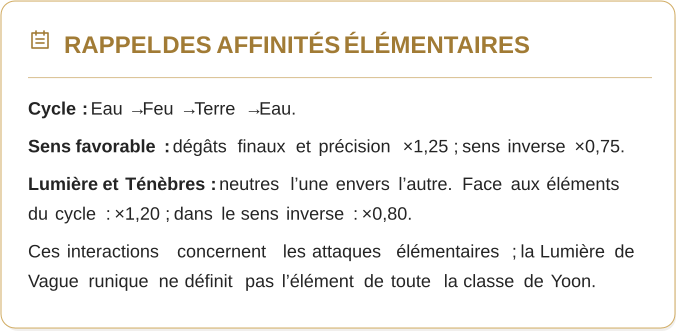
  </picture>
  

    
Version textuelle de la fenêtre

  
<svg class="lit-window__icon" viewBox="0 0 24 24" aria-hidden="true" focusable="false"><path d="M4 5h16v15H4Z M8 3v4 M16 3v4 M8 11h8 M8 15h8"/></svg>RAPPEL DES AFFINITÉS ÉLÉMENTAIRES

  
<strong>Cycle :</strong> Eau → Feu → Terre → Eau.

  
<strong>Sens favorable :</strong> dégâts finaux et précision ×1,25 ; sens inverse ×0,75.

  
<strong>Lumière et Ténèbres :</strong> neutres l’une envers l’autre. Face aux éléments du cycle : ×1,20 ; dans le sens inverse : ×0,80.

  
Ces interactions concernent les attaques élémentaires ; la Lumière de Vague runique ne définit pas l’élément de toute la classe de Yoon.

  

Zio haussa légèrement un sourcil.

— Ah.

Il observa son épée.

Puis celle de Hasol.

— Alors tu sais également qu’une faiblesse élémentaire ne sert pas à grand-chose si tu n’as aucun moyen de l’exploiter.

Hasol ouvrit la bouche.

Puis la referma.

Yoon éclata de rire.

— Il t’a eue !

— Yoon !

— Désolée !

Mais son sourire ne disparut pas.

Hasol regarda de nouveau l’épée de Zio.

Elle connaissait cette technique.

Elle l’avait étudiée à l’Académie.

Mais elle n’avait jamais eu l’occasion d’utiliser une arme imprégnée d’une aura élémentaire.

Avant le niveau dix, elle ne remplissait même pas les conditions nécessaires pour en manier une.

Et maintenant qu’elle avait enfin atteint ce niveau, elle avait consacré son attention à ses runes et à son apprentissage chez Orven.

Elle baissa les yeux vers sa propre épée.

Une lame ordinaire.

Puis vers son bras bandé.

Elle connaissait pourtant la faiblesse des loups gris.

Mais elle n’avait pas pu l’exploiter.

Zio suivit son regard.

Il ne dit rien.

Pas encore.

## V. La leçon du Gardien

Ils quittèrent la zone de combat et gagnèrent un espace dégagé près du sentier principal.

Zio demanda aux deux jeunes filles de s’asseoir.

Hasol posa son épée à côté d’elle.

Yoon resta tout près.

Depuis l’attaque, elle parlait beaucoup moins.

Zio ramassa une petite branche et traça quelques lignes dans la terre.

— Regardez.

Il dessina plusieurs arbres.

Une grosse racine.

Puis deux marques représentant les loups.

Enfin, il plaça deux petites pierres.

— Vous étiez ici.

Hasol observa le dessin.

Yoon acquiesça.

— Le premier loup est arrivé par là.

Elle désigna le côté gauche.

Zio déplaça l’une des pierres.

— Et le deuxième ?

Yoon baissa les yeux.

— Derrière moi.

— Pourquoi ne l’avez-vous pas vu ?

La jeune Sage serra les lèvres.

— Je regardais seulement celui que Hasol combattait.

Zio acquiesça.

Puis il se tourna vers Hasol.

— Et toi ?

Elle réfléchit.

Elle revit le combat.

Le premier loup.

La branche qui l’avait gênée.

Le cercle de soin.

Puis Yoon qui tombait.

— J’ai laissé le loup m’attirer vers les arbres, répondit-elle.

Zio ne dit rien.

Hasol poursuivit :

— Et lorsque le deuxième est apparu, j’étais trop loin de Yoon pour la protéger correctement.

Elle regarda son bras bandé.

— J’ai dû courir vers elle au lieu de simplement me replacer.

Zio acquiesça.

— Exactement.

Il posa la branche au milieu du dessin.

— Vous avez toutes les deux des compétences utiles. Mais vous ne savez pas encore organiser correctement votre positionnement.

Yoon baissa la tête.

— J’aurais dû poser mon cercle ailleurs…

— Peut-être. Mais le problème ne vient pas uniquement du cercle.

Il désigna les arbres.

— Vous avez commencé le combat sans prévoir où reculer si un deuxième adversaire apparaissait.

Hasol contempla les petites pierres.

— On était trop concentrées sur le premier loup.

— Oui.

Zio releva les yeux vers elle.

— Tu as tenté de réagir aussi vite que possible lorsque Yoon a été attaquée.

Hasol acquiesça.

— Mais ce n’était pas suffisant…

— Non.

Il marqua une pause.

— Parce que tu aurais dû anticiper.

Le mot resta un instant suspendu entre eux.

Zio poursuivit :

— Un bon combattant ne pense pas seulement à son prochain coup. Il doit aussi savoir où se trouvent ses alliés, quels obstacles peuvent le gêner et ce qu’il fera si la situation change.

Il regarda sa sœur.

— Et un bon soutien doit réfléchir à la façon dont ses compétences influencent les déplacements de son équipe.

Yoon acquiesça lentement.

— Donc mon cercle ne doit pas seulement soigner.

— Exactement. Il doit être placé là où vos déplacements resteront possibles.

Hasol regarda de nouveau le dessin.

Les erreurs lui paraissaient désormais évidentes.

Mais elle savait qu’elles ne l’avaient pas été pendant le combat.

— Je comprends, murmura-t-elle.

Zio reposa la branche.

— Alors vous avez déjà appris quelque chose d’important aujourd’hui.

Il eut un petit sourire.

— Même si j’aurais préféré une leçon un peu moins sanglante.

Yoon baissa les yeux vers le bras de Hasol.

Son sourire disparut.

— Hasol…

— Oui ?

— Tu as été blessée à cause de moi.

Hasol resta silencieuse.

La jeune Sage poursuivit :

— J’ai perdu l’équilibre. J’ai raté ma Vague runique. Et tu as dû venir me protéger.

Sa voix tremblait.

— Je suis désolée.

Hasol observa son visage.

Puis son bandage.

Elle prit quelques secondes avant de répondre.

— J’ai eu peur, Yoon.

La jeune Sage releva brusquement les yeux.

— Quand je t’ai vue tomber, j’ai vraiment eu peur.

Hasol baissa la tête.

— Et quand le loup m’a mordue… j’ai cru que je n’arriverais plus à le repousser.

Yoon serra les lèvres.

Hasol lui adressa un petit sourire.

— Mais je ne regrette pas d’avoir essayé de te protéger.

Elle marqua une pause.

— Ce que je regrette, c’est de ne pas avoir réfléchi assez tôt pour qu’on évite cette situation.

Yoon resta silencieuse.

Puis elle acquiesça lentement.

— Alors… la prochaine fois…

— Nous ferons mieux.

Yoon tendit timidement la main.

Hasol la prit avec sa main valide.

Leurs doigts se serrèrent.

Zio les observa sans intervenir.

Mais son expression s’adoucit légèrement.

Après quelques minutes, il se releva.

— Bon. Nous rentrons.

Yoon ouvrit la bouche.

Puis la referma.

Hasol acquiesça immédiatement.

Zio sourit.

— Au moins, personne ne va essayer de négocier trois combats supplémentaires.

Hasol rougit.

— Je n’allais pas…

Yoon tourna la tête.

— Tu y pensais ?

— Non !

Un silence passa.

Hasol baissa légèrement les yeux.

— … Peut-être un peu.

Yoon éclata de rire.

Même Zio ne put retenir un sourire.

Ils reprirent le chemin de la capitale.

La chasse était terminée.

Mais Hasol avait l’impression d’avoir appris davantage pendant cette dernière heure que durant plusieurs de ses anciens entraînements.

## VI. Une lame qui emprunte la force de la Terre

De retour en ville, Zio insista pour que la morsure soit examinée.

Hasol proposa de rentrer chez elle.

Sa mère connaissait suffisamment les soins pour traiter ce genre de blessure.

Lorsque celle-ci aperçut le bandage, son expression changea immédiatement.

— Hasol.

La jeune femme s’immobilisa près de la porte.

— Bonjour, maman…

— Assieds-toi.

Hasol obéit.

Yoon resta près de l’entrée, visiblement mal à l’aise.

Zio expliqua calmement ce qui s’était passé.

La mère de Hasol l’écouta sans l’interrompre.

Puis elle retira le bandage.

Hasol serra les dents.

La plaie était encore douloureuse.

Sa mère nettoya soigneusement les marques laissées par les crocs.

Puis elle utilisa ses soins.

Une lumière douce enveloppa le bras blessé.

La douleur diminua progressivement.

Mais la sensibilité ne disparut pas complètement.

— Tu as eu de la chance, murmura sa mère.

Hasol baissa la tête.

— Je sais.

Sa mère observa Yoon.

La jeune Sage s’inclina aussitôt.

— Madame Shun, je suis vraiment désolée…

— Tu es Yoon, n’est-ce pas ?

Elle acquiesça.

— Oui.

La mère de Hasol lui adressa un sourire fatigué.

— Ma fille m’a parlé de toi hier soir.

Yoon releva les yeux.

— Vraiment ?

— Elle était très heureuse d’avoir rencontré quelqu’un avec qui elle pourrait chasser.

Hasol rougit immédiatement.

— Maman…

Sa mère lui caressa doucement les cheveux.

Puis elle regarda les deux jeunes filles.

— Vous avez le droit d’apprendre. Et vous avez aussi le droit de commettre des erreurs.

Elle désigna le bras de Hasol.

— Mais le corps ne pardonne pas toujours aussi facilement que les gens.

Yoon acquiesça avec sérieux.

— Nous ferons attention.

— Je l’espère.

Elle termina les soins et posa un bandage propre.

— Pour aujourd’hui, plus de chasse. Et demain, je veux examiner ce bras avant que tu décides quoi que ce soit.

Hasol acquiesça.

— D’accord.

Sa mère releva un sourcil.

— Sans négociation ?

Hasol eut un petit rire.

— Sans négociation.

— Voilà qui est nouveau.

Yoon étouffa un rire.

Hasol lui lança un regard faussement indigné.

Sa mère se tourna enfin vers Zio.

— Merci d’être intervenu.

Il inclina légèrement la tête.

— C’était normal.

— Peut-être. Mais je vous remercie tout de même.

Zio sourit.

— Alors je vous en prie.

Plus tard, alors qu’ils quittaient la demeure, Zio se tourna vers Hasol.

— J’aimerais te montrer quelque chose.

Elle cligna des yeux.

— Quoi ?

Il désigna son épée.

— Tu t’intéressais à mon aura de Terre.

— Oui.

— Alors viens.

Yoon releva immédiatement la tête.

— Chez le forgeron ?

Zio acquiesça.

— Chez le forgeron.

Hasol hésita.

— Mais… pourquoi ?

Zio la regarda avec sérieux.

— Parce que si vous comptez continuer à chasser ensemble, je préfère que tu disposes d’une arme capable d’exploiter les faiblesses des monstres que vous affrontez.

Hasol baissa les yeux vers son épée.

— Une aura élémentaire coûte très cher…

— Je sais.

Elle releva les yeux.

Zio sourit légèrement.

— Je n’ai pas dit que tu devais la payer.

Hasol resta immobile.

— Pardon ?

— Viens.

Il commença à marcher.

Yoon le suivit immédiatement.

Hasol resta quelques secondes sur place.

Puis se précipita derrière eux.

— Attends ! Zio, je ne peux pas accepter ça !

Il ne se retourna même pas.

— Nous en parlerons devant le forgeron.

— Mais…

— Hasol.

Elle s’interrompit.

Il lui adressa un regard tranquille.

— Au moins, viens écouter.

Elle hésita.

Puis acquiesça.

Le forgeron runique travaillait dans une rue moins fréquentée du quartier des Artisans.

Son atelier était très différent de celui d’Orven.

L’air y était plus chaud.

Une odeur de métal, de charbon et de poudre minérale flottait dans la pièce.

De lourds marteaux reposaient près d’une enclume.

Plusieurs armes étaient suspendues aux murs.

Certaines portaient des inscriptions lumineuses.

D’autres étaient entourées d’un éclat presque imperceptible.

Hasol s’arrêta devant une épée dont la lame semblait parcourue de fines braises.

— C’est une aura de Feu… murmura-t-elle.

Une voix grave lui répondit :

— Bien observé.

Un homme robuste sortit de l’arrière-boutique.

Ses avant-bras portaient les marques de longues années passées à travailler le métal.

Il reconnut immédiatement Zio.

— Encore toi ?

Zio sourit.

— Bonjour.

Le forgeron désigna son épée.

— Ne me dis pas que tu veux déjà remplacer la Terre.

— Non. Je viens pour une autre arme.

Il se tourna vers Hasol.

— La sienne.

Le forgeron observa la jeune femme.

Puis son épée.

— Une aura élémentaire ?

Zio acquiesça.

— Terre.

L’homme tendit la main.

— Fais voir.

Hasol dégaina prudemment et lui remit son arme.

Le forgeron examina la lame.

Il vérifia son équilibre, l’état du métal et plusieurs détails de la garde.

Puis il releva les yeux.

— Tu as le niveau nécessaire ?

Hasol acquiesça.

— Niveau dix.

— Bien. C’est le minimum pour manier une arme imprégnée d’une aura.

  <picture class="lit-window__github-picture">
    <source media="(max-width: 600px)" srcset="assets/fenetres/044-mobile.svg">
    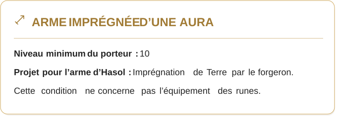
  </picture>
  

    
Version textuelle de la fenêtre

  
<svg class="lit-window__icon" viewBox="0 0 24 24" aria-hidden="true" focusable="false"><path d="m5 19 14-14 M14 4h6v6 M3 16l5 5"/></svg>ARME IMPRÉGNÉE D’UNE AURA

  
<strong>Niveau minimum du porteur :</strong> 10

  
<strong>Projet pour l’arme d’Hasol :</strong> Imprégnation de Terre par le forgeron.

  
Cette condition ne concerne pas l’équipement des runes.

  

Il reposa l’épée.

— Tu sais comment fonctionne cet enchantement ?

— En théorie, oui.

— Alors tu sais également qu’il n’est pas permanent.

Hasol acquiesça.

Le forgeron poursuivit :

— Pour une aura de Terre, l’imprégnation que je propose tiendra un mois.

Hasol ouvrit légèrement les yeux.

— Seulement un mois ?

L’homme haussa les épaules.

— Seulement ?

Il eut un petit rire.

— Une aura élémentaire n’est pas une couche de peinture. Il faut préparer la lame, stabiliser les inscriptions et y enfermer un flux qui résistera aux combats.

Il désigna son établi.

— Ce travail a un prix.

Hasol déglutit.

— Combien ?

Le forgeron lui indiqua le montant.

Elle resta silencieuse.

Puis regarda Zio.

Puis le forgeron.

Puis de nouveau Zio.

— C’est une plaisanterie ?

Le forgeron croisa les bras.

— Pas du tout.

Hasol fixa l’épée.

Elle avait travaillé plusieurs jours chez Orven.

Elle commençait enfin à mettre un peu d’argent de côté.

Et voilà qu’on lui demandait une somme qui lui semblait presque absurde pour un enchantement temporaire.

— Mais… avec cet argent, je pourrais acheter tellement de pierres de mana…

Le forgeron éclata de rire.

— Voilà une apprentie qui raisonne déjà comme une artisane.

Hasol rougit.

Zio sourit.

— C’est effectivement ce qu’elle fait.

Le forgeron reprit :

— Et si tu veux changer d’élément avant la fin du mois, il faudra recommencer l’opération.

Hasol releva brusquement la tête.

— Même si l’enchantement précédent est encore actif ?

— Oui.

— Et il faut repayer ?

— Évidemment.

Hasol contempla la lame.

Elle comprenait désormais pourquoi les chasseurs expérimentés choisissaient leurs enchantements avec tant de soin.

Une erreur de préparation pouvait coûter très cher.

Et changer de zone de chasse signifiait parfois devoir investir dans une autre affinité élémentaire.

Zio se tourna vers le forgeron.

— Faisons-le.

Hasol sursauta.

— Zio !

Il la regarda.

— Quoi ?

— C’est beaucoup trop cher !

— Je connais le prix.

— Mais…

Elle serra sa bourse.

— Je ne pourrai pas te rembourser avant très longtemps.

Zio resta silencieux quelques instants.

Puis il répondit :

— Je ne t’ai pas demandé de me rembourser.

Hasol sentit son cœur se contracter.

— Alors pourquoi ?

Zio regarda sa sœur.

Yoon se tenait près du mur, silencieuse pour une fois.

Il reporta son attention sur Hasol.

— Aujourd’hui, tu t’es blessée pour la protéger.

Hasol baissa les yeux.

— Je n’allais pas la laisser se faire attaquer…

— Je sais.

La voix de Zio était calme.

— Et je sais aussi qu’elle aurait essayé de faire la même chose pour toi.

Yoon releva la tête.

Son frère poursuivit :

— Vous manquez encore d’expérience. Vous ferez des erreurs. Je ne pourrai pas toujours être là pour intervenir.

Il posa la main sur le pommeau de son épée.

— Si la vie de ma sœur doit un jour dépendre de ta lame, je préfère que cette lame soit aussi bien préparée que possible.

Hasol resta immobile.

Elle ne savait pas quoi répondre.

Zio ajouta :

— Ce n’est pas une récompense pour avoir été blessée. Et ce n’est pas une dette que je veux te faire porter.

Il marqua une pause.

— C’est ma façon de vous aider à commencer dans de meilleures conditions.

Yoon s’approcha doucement.

— Hasol…

La jeune femme la regarda.

— J’aimerais vraiment qu’on continue à chasser ensemble.

Sa voix était plus basse qu’à l’ordinaire.

— Mais je ne veux plus te voir te faire mordre à cause de moi.

Hasol sentit sa gorge se serrer.

Elle contempla son épée.

Puis les deux Notos.

Elle n’avait pas l’habitude qu’on investisse autant dans ses capacités de chasseuse.

Pas depuis longtemps.

Elle prit une inspiration.

Puis s’inclina profondément.

— Merci.

Sa voix tremblait légèrement.

— Je ferai tout mon possible pour ne pas gaspiller ce que vous m’offrez.

Zio secoua doucement la tête.

— Fais surtout en sorte de rentrer vivante.

Le forgeron récupéra l’épée.

— Bon. Si les discours sont terminés, j’ai du travail.

Yoon étouffa un rire.

Hasol releva les yeux.

Et, pour la première fois, elle observa la forge runique avec autre chose que de la curiosité.

Quelqu’un venait de lui accorder une confiance qu’elle ne savait pas encore comment mériter.

L’opération demanda du temps.

Le forgeron prépara plusieurs composants.

Il traça des inscriptions sur la lame.

Puis plaça l’épée au centre d’un support métallique entouré de pierres de mana.

Une lumière brun doré apparut progressivement.

Elle suivit les gravures.

Se répandit le long du métal.

Puis sembla pénétrer la lame.

Hasol sentit une légère vibration dans l’air.

Lorsque le forgeron termina, l’épée avait retrouvé son apparence ordinaire.

Mais dès qu’il lui demanda d’y faire circuler son Mana, une lueur terreuse se déploya sur le fil.

De minuscules particules dorées tournoyaient autour de l’acier.

Hasol resta bouche bée.

— C’est magnifique…

Le forgeron eut un sourire satisfait.

— Une aura de Terre.

Il lui rendit l’épée.

— Un mois. Et souviens-toi : si tu changes d’élément, tu recommences à zéro.

Hasol acquiesça.

— Je m’en souviendrai.

Elle rangea précieusement son arme.

Puis regarda Zio.

Il lui adressa simplement un sourire.

Et cette fois, elle ne chercha pas à parler d’argent.

## VII. Dix cercles

Ils sortirent de l’atelier alors que le soleil commençait à descendre.

Yoon marchait près de Hasol.

Depuis qu’elles avaient quitté le forgeron, son regard revenait régulièrement vers l’épée.

— Tu as hâte de l’essayer ? demanda-t-elle.

Hasol sourit.

— Énormément.

— Moi aussi !

Elle marqua une pause.

— Enfin… de te voir l’essayer.

Hasol rit.

Elles traversèrent une petite rue bordée de boutiques fermées.

Zio marchait quelques pas devant elles.

Yoon semblait hésiter à poser une question.

Hasol le remarqua.

— Qu’est-ce qu’il y a ?

La jeune fille releva les yeux.

— Je peux te demander quelque chose ?

— Bien sûr.

— Pendant la chasse… j’ai senti une réaction étrange lorsque j’ai utilisé Résonance runique sur toi.

Hasol ralentit.

— Étrange ?

Yoon acquiesça.

— Pas mauvaise. Au contraire.

Elle chercha ses mots.

— J’avais l’impression que ton équipement répondait de partout.

Hasol sentit son cœur accélérer.

Yoon poursuivit :

— Je sais que tu possèdes une classe légendaire spécialisée dans les runes. Mais… tu as combien d’emplacements ?

La question resta suspendue entre elles.

Hasol baissa les yeux.

Elle pensa immédiatement à Orven.

À sa mère.

Aux réactions qu’elle avait suscitées lorsqu’elle avait révélé ses dix cercles.

Elle n’en avait parlé qu’à très peu de personnes.

Pas parce qu’elle avait honte.

Mais parce qu’elle savait à quel point cet avantage pouvait attirer l’attention.

Zio s’arrêta.

Il se tourna vers les deux jeunes filles.

— Yoon.

Sa sœur releva la tête.

— Quoi ?

— Ce n’est pas une question à poser au milieu de la rue.

Yoon rougit immédiatement.

— Ah…

Elle regarda Hasol.

— Désolée. Tu n’es pas obligée de répondre.

Hasol resta silencieuse.

Puis elle secoua doucement la tête.

— Non. Ce n’est pas ça.

Elle regarda autour d’elle.

Ils se trouvaient près d’une petite cour à l’écart de la circulation.

Hasol y entra.

Les deux Notos la suivirent.

Elle prit une inspiration.

Puis ouvrit son interface.

— Il y a quelque chose que je voudrais vous montrer.

Zio observa son expression.

— Tu es certaine ?

Hasol hésita.

Puis acquiesça.

— Oui.

Elle partagea uniquement la partie de son statut concernant ses cercles et ses emplacements runiques.

  <picture class="lit-window__github-picture">
    <source media="(max-width: 600px)" srcset="assets/fenetres/045-mobile.svg">
    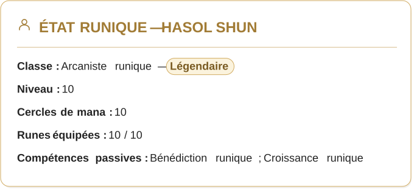
  </picture>
  

    
Version textuelle de la fenêtre

  
<svg class="lit-window__icon" viewBox="0 0 24 24" aria-hidden="true" focusable="false"><circle cx="12" cy="8" r="4"/><path d="M4 21v-2a8 6 0 0 1 16 0v2"/></svg>ÉTAT RUNIQUE — HASOL SHUN

  
<strong>Classe :</strong> Arcaniste runique — Légendaire

  
<strong>Niveau :</strong> 10

  
<strong>Cercles de mana :</strong> 10

  
<strong>Runes équipées :</strong> 10 / 10

  
<strong>Compétences passives :</strong> Bénédiction runique ; Croissance runique

  

Yoon cessa de respirer pendant une seconde.

Puis elle releva lentement les yeux.

— Dix ?

Hasol acquiesça.

— Oui.

Yoon regarda de nouveau la fenêtre.

— Dix cercles ?

— Oui…

La jeune fille se tourna vers son frère.

— Zio…

Il resta silencieux.

Son regard parcourut les informations.

Puis revint vers Hasol.

— Au niveau dix ?

Hasol acquiesça.

Yoon porta les mains à sa bouche.

— Mais c’est…

Elle chercha ses mots.

Puis les abandonna.

— C’est incroyable !

Hasol rougit.

— Je ne les avais pas au départ.

Elle leur expliqua brièvement les deux cercles qu’elle possédait auparavant, puis l’apparition de Croissance runique lors de son passage au niveau dix.

Elle mentionna également que les milliers de slimes vaincus au cours de ses années à l’Académie avaient été pris en compte par sa nouvelle compétence.

Yoon l’écoutait sans l’interrompre.

Lorsqu’Hasol termina, la jeune fille resta silencieuse.

Puis elle demanda :

— Tu as vraiment continué pendant toutes ces années ?

Hasol baissa les yeux.

— Oui.

— Même quand tu n’avais presque aucune chance de suivre les autres étudiants ?

La question lui fit un peu mal.

Mais elle ne contenait aucune moquerie.

Hasol acquiesça.

— Je voulais devenir chasseuse.

Yoon contempla la fenêtre.

Puis le visage de Hasol.

— Moi, je crois que j’aurais abandonné bien avant.

Hasol ne sut pas quoi répondre.

Yoon secoua la tête.

— Non… En fait, je n’en sais rien.

Elle sourit timidement.

— Mais je trouve ça impressionnant.

Hasol sentit une chaleur douce lui monter aux joues.

Zio prit alors la parole.

— Hasol.

Elle se tourna vers lui.

Son expression était sérieuse.

— Tu as bien fait de ne pas montrer cette information à tout le monde.

Elle acquiesça.

— Je sais.

— Dix emplacements à ton niveau, c’est un avantage inhabituel. Certaines personnes pourraient chercher à en profiter.

Yoon se redressa immédiatement.

— Je ne dirai rien !

Zio regarda sa sœur.

Elle poursuivit :

— Promis.

Puis elle se tourna vers Hasol.

— C’est ton secret. Pas le mien.

Hasol la contempla.

Puis sourit.

— Merci.

Zio acquiesça également.

— Cela restera entre nous.

Hasol referma la fenêtre.

Elle sentit son cœur battre un peu plus vite.

Mais cette fois, elle ne regrettait pas d’avoir parlé.

Elle venait de confier une partie importante de sa vie à deux personnes qu’elle commençait à apprécier.

Et aucune d’elles ne l’avait regardée comme une curiosité à exploiter.

Yoon resta silencieuse pendant quelques pas.

Puis elle s’arrêta brusquement.

— Hasol !

La jeune femme se retourna.

— Oui ?

— Je veux vraiment former une équipe avec toi.

Hasol cligna des yeux.

— Une vraie équipe ?

— Oui !

Yoon s’approcha.

— Pas seulement pour essayer une chasse. Je veux qu’on continue.

Hasol sentit son cœur accélérer.

Elle repensa aux propositions de recrutement.

Aux groupes de l’Académie.

Aux chasseurs qui auraient probablement été ravis d’accueillir une Sage runique.

— Mais… tu pourrais rejoindre une équipe beaucoup plus expérimentée.

Yoon acquiesça.

— Je sais.

— Et ma classe coûte vingt points.

— Je sais aussi.

— Avec tes dix points, cela ferait trente points pour seulement deux personnes…

Yoon sourit.

— Oui.

Hasol ouvrit la bouche.

Puis la referma.

La jeune Sage poursuivit :

— Tu es gentille avec moi. Tu m’écoutes. Et aujourd’hui, même si nous avons fait des erreurs, j’ai aimé combattre avec toi.

Elle baissa légèrement les yeux.

— Je ne veux pas seulement rejoindre un groupe qui me considère comme une soigneuse.

Puis elle releva la tête.

— J’aimerais construire quelque chose avec quelqu’un.

Hasol resta silencieuse.

Yoon tendit la main.

— Alors… tu veux bien ?

La jeune femme contempla cette main.

Elle pensa à l’Académie.

À toutes les équipes qui avaient refusé de lui donner une place.

À son nom que l’on rayait des listes.

À son coût de classe que l’on trouvait trop élevé pour une chasseuse incapable de lancer des sorts offensifs.

Et maintenant, une jeune fille très recherchée lui proposait simplement de faire équipe.

Pas parce qu’elle ignorait ses faiblesses.

Mais après les avoir vues.

Hasol sentit ses yeux devenir humides.

Elle prit la main de Yoon.

— Oui.

Le sourire de la jeune Sage s’élargit.

— Vraiment ?

— Oui.

Hasol rit doucement.

— Je veux bien.

Yoon poussa un petit cri de joie.

Zio secoua la tête avec amusement.

— Voilà qui est décidé.

Les deux jeunes filles confirmèrent leur association dans leur interface d’équipe.

  <picture class="lit-window__github-picture">
    <source media="(max-width: 600px)" srcset="assets/fenetres/046-mobile.svg">
    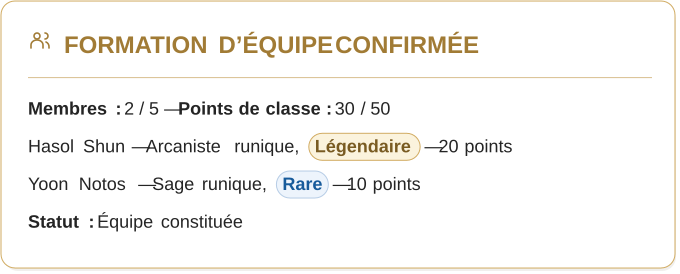
  </picture>
  

    
Version textuelle de la fenêtre

  
<svg class="lit-window__icon" viewBox="0 0 24 24" aria-hidden="true" focusable="false"><circle cx="9" cy="8" r="3"/><path d="M3 20v-3a6 5 0 0 1 12 0v3 M17 5a3 3 0 0 1 0 6 M18 14a5 5 0 0 1 3 5v1"/></svg>FORMATION D’ÉQUIPE CONFIRMÉE

  
<strong>Membres :</strong> 2 / 5 — <strong>Points de classe :</strong> 30 / 50

  
Hasol Shun — Arcaniste runique, Légendaire — 20 points

  
Yoon Notos — Sage runique, Rare — 10 points

  
<strong>Statut :</strong> Équipe constituée

  

Hasol relut les informations.

Deux membres.

Trente points.

Ce n’était pas encore une équipe capable de s’aventurer dans un donjon.

Ce n’était pas non plus un groupe célèbre.

Mais c’était la première équipe qu’elle formait réellement avec quelqu’un qui voulait rester à ses côtés.

Yoon regardait la même fenêtre avec un sourire immense.

Puis elle se tourna vers Hasol.

— Partenaires ?

Hasol sourit.

— Partenaires.

Zio les observa.

Et, pour la première fois de la journée, il sembla accepter l’idée de laisser sa sœur avancer sans lui.

## VIII. Le lendemain
<!-- Réserve documentaire TEMPS-01 : La seconde chasse est conservée le lendemain de la morsure comme dans la V2 validée ; le plan demandait un délai de récupération sans reprise imposée le lendemain. Voir lore/audit_chapitres_5_9.md. -->

Hasol dormit mal cette nuit-là.

Ce n’était pas uniquement à cause de son bras.

Même après les soins de sa mère, la morsure restait sensible lorsqu’elle bougeait trop brusquement.

Mais ce qui l’empêchait surtout de dormir, c’était le souvenir de la journée.

Yoon.

Zio.

L’épée imprégnée de Terre.

La formation de l’équipe.

Elle avait beau fermer les yeux, les images revenaient sans cesse.

Et, derrière elles, une inquiétude persistante.

Et si je n’arrivais pas à la protéger la prochaine fois ?

Elle se retourna prudemment.

Son bras tira légèrement.

Elle grimaça.

Puis contempla le fourreau posé près de son bureau.

Une faible lumière brun doré semblait encore parcourir les gravures de l’arme.

Le cadeau de Zio.

Un enchantement qui lui avait coûté une somme considérable.

Hasol ferma les yeux.

Elle ne voulait pas décevoir cette confiance.

Mais elle savait aussi qu’une arme plus puissante ne corrigerait pas toutes ses erreurs.

Elle repensa au dessin de Zio dans la terre.

Aux arbres.

Aux deux petites pierres.

Et à sa phrase.

« Tu aurais dû anticiper. »

Elle la répéta mentalement plusieurs fois.

Puis, finalement, le sommeil l’emporta.

Le dimanche matin, Hasol descendit plus tôt que prévu.

Sa mère était déjà levée.

Lorsqu’elle la vit apparaître avec son équipement, elle posa immédiatement sa tasse.

— Hasol.

La jeune femme s’arrêta.

— Bonjour, maman…

Sa mère désigna une chaise.

— Viens.

Hasol obéit.

Elle tendit son bras blessé.

Sa mère retira le bandage et examina la plaie.

Les soins de la veille avaient bien agi.

La peau était refermée.

Mais les tissus restaient sensibles.

Elle demanda à Hasol de bouger lentement le poignet.

Puis le coude.

Hasol s’exécuta.

— Ça tire encore un peu, admit-elle.

Sa mère acquiesça.

— Je vois.

Elle appliqua de nouveaux soins.

Une chaleur apaisante parcourut l’avant-bras.

Puis elle remit une protection propre.

— Tu comptes vraiment retourner chasser aujourd’hui ?

Hasol baissa légèrement les yeux.

— Oui.

Sa mère soupira.

— Avec Yoon ?

— Oui.

Hasol hésita.

Puis ajouta :

— Mais nous allons rester près des sentiers. Et si mon bras me gêne, nous rentrerons.

Sa mère la contempla longuement.

— Tu me le promets ?

Hasol acquiesça.

— Je te le promets.

Sa mère vérifia une dernière fois le bandage.

— Alors tu n’essaies pas de rattraper le temps perdu. Et tu ne confonds pas guérison et invulnérabilité.

Hasol sourit timidement.

— Compris.

Elle se leva.

Puis s’arrêta.

— Maman ?

— Oui ?

Hasol hésita.

— J’ai formé une équipe.

Sa mère releva la tête.

— Avec Yoon ?

La jeune femme acquiesça.

— Oui.

Un sourire doux apparut sur le visage de sa mère.

— Tu en avais envie depuis si longtemps…

Hasol baissa les yeux.

— Oui.

Sa mère s’approcha.

Puis la prit doucement dans ses bras, en évitant son bras blessé.

— Alors j’espère que vous prendrez soin l’une de l’autre.

Hasol ferma les yeux.

— Moi aussi.

Yoon l’attendait près des portes de la capitale.

Cette fois, Zio n’était pas là.

La jeune Sage tenait une petite carte du bois.

Elle avait tracé plusieurs marques dessus.

Lorsqu’elle aperçut Hasol, elle sourit.

— Tu es venue !

Hasol rit.

— J’avais dit que je viendrais.

— Oui, mais je ne savais pas si ta mère accepterait.

Elle regarda immédiatement son bras.

— Ça va ?

Hasol acquiesça.

— Beaucoup mieux.

Yoon sembla soulagée.

Puis elle lui montra la carte.

— J’ai préparé quelque chose.

Hasol s’approcha.

La jeune fille avait indiqué plusieurs sentiers.

Une petite clairière.

Des passages étroits.

Et les endroits où elles avaient rencontré des loups la veille.

— Tu as fait tout ça hier soir ?

Yoon acquiesça.

— Je voulais qu’on évite de répéter les mêmes erreurs.

Hasol contempla les annotations.

Elles étaient parfois maladroites.

Mais soigneusement organisées.

— C’est une bonne idée.

Yoon sourit.

Puis désigna un passage.

— Je pensais commencer ici. Le terrain est assez dégagé pour voir arriver les monstres. Et si nous avons besoin de reculer, il y a un sentier derrière.

Hasol examina la carte.

— Oui.

Elle réfléchit.

— Mais cette zone est près d’un bosquet. Il faudra vérifier qu’aucun loup ne s’y cache.

Yoon acquiesça immédiatement.

— Bonne remarque.

Elles se regardèrent.

Puis sourirent.

La chasse n’avait pas encore commencé.

Mais elles travaillaient déjà ensemble.

## IX. La force d’une bonne préparation

La lumière du matin traversait les branches lorsqu’elles atteignirent leur première zone de chasse.

Hasol dégaina son épée.

La lumière brun doré apparut lentement autour de la lame.

Yoon s’arrêta.

— C’est encore plus joli à la lumière du soleil…

Hasol sourit.

— Oui.

Elle fit légèrement tourner l’arme.

Les particules de Terre suivirent le mouvement.

Elles ne semblaient pas peser sur la lame.

Mais Hasol sentait une densité nouvelle dans son énergie.

Une présence stable.

Presque rassurante.

Yoon leva la main.

— Prête ?

Hasol acquiesça.

— Prête.

Elles commencèrent par examiner les alentours.

Pas seulement le sentier.

Les buissons.

Les rochers.

Les racines.

Les endroits où un loup pourrait se dissimuler.

Puis elles choisirent une position leur permettant de reculer sans se gêner.

Lorsqu’un premier loup gris apparut, Hasol ne se précipita pas.

Elle attendit qu’il s’avance.

Yoon se plaça derrière elle, légèrement sur le côté.

— Résonance runique !

Les inscriptions lumineuses se déployèrent autour de Hasol.

Ses runes répondirent à l’appel.

Le loup bondit.

Hasol se décala.

Puis frappa.

La lame de Terre rencontra son flanc.

Une lueur brun doré traversa le point d’impact.

Le résultat fut immédiat.

Le loup poussa un cri plus aigu que lors des combats précédents.

La blessure était nettement plus profonde.

Hasol sentit la différence jusque dans sa poignée.

— Alors c’est ça…

Le monstre tenta de se relever.

Une petite Vague runique le frappa sur le côté.

Son mouvement fut interrompu.

Hasol avança.

Puis acheva le combat.

Le loup s’effondra.

Elle resta quelques secondes immobile.

Puis regarda son épée.

L’aura brillait toujours.

— C’est impressionnant…

Yoon s’approcha.

— Elle fonctionne vraiment bien !

Hasol acquiesça.

— Oui.

Mais cette fois, elle ne laissa pas son enthousiasme prendre le dessus.

Elle regarda immédiatement les alentours.

Puis demanda :

— Tu as vu d’autres traces ?

Yoon examina le sol.

— Pas encore.

Hasol acquiesça.

— Alors vérifions avant de continuer.

Yoon sourit.

— D’accord.

Les heures suivantes furent riches en apprentissages.

Les deux jeunes filles affrontèrent plusieurs loups gris de niveau cinq.

Aucun combat ne se déroula exactement de la même manière.

Parfois, Hasol réussissait à attirer un monstre dans un espace dégagé.

D’autres fois, Yoon repérait une trace suspecte et les obligeait à contourner une zone.

Elles commencèrent à mieux comprendre les limites de leurs compétences.

Résonance runique rendait Hasol plus efficace, mais son renforcement n’était pas permanent.

Yoon devait choisir le bon moment pour le relancer.

Chant runique offrait des soins précieux.

Mais son cercle restait à l’endroit où elle l’avait posé.

Si Hasol quittait la zone, elle ne recevait plus ses impulsions de soin.

Et Vague runique, malgré son faible coût, restait une attaque modeste.

Yoon pouvait en lancer plusieurs sans s’épuiser immédiatement.

Mais elle devait toujours surveiller les déplacements de sa partenaire.

Une vague lancée au mauvais moment pouvait détourner un loup.

Ou l’attirer vers une position dangereuse.

Hasol, de son côté, découvrait les possibilités de sa nouvelle épée.

Contre les loups gris, la Terre lui permettait d’infliger des blessures beaucoup plus importantes.

Les combats étaient plus courts.

Elle utilisait moins de forces.

Et, surtout, elle avait davantage de marge pour réagir lorsqu’un adversaire changeait de direction.

Mais ce nouvel avantage ne supprimait pas les risques.

Un loup restait capable de bondir.

De contourner une garde.

De la surprendre.

Et elle devait encore apprendre à manier correctement cette puissance supplémentaire.

Vers le milieu de la journée, elles s’arrêtèrent près d’un petit ruisseau.

Yoon s’assit sur une pierre.

Elle sortit une gourde.

Puis la tendit à Hasol.

— Tu en veux ?

— Merci.

Hasol but quelques gorgées.

Puis s’assit à côté d’elle.

Son bras blessé la lançait légèrement.

Mais la douleur restait supportable.

Elle vérifia le bandage.

Il était intact.

Yoon le remarqua.

— Ça va vraiment ?

Hasol acquiesça.

— Oui.

La jeune Sage la contempla avec suspicion.

— Tu sais que tu peux me dire si tu as mal ?

Hasol baissa les yeux.

Puis sourit.

— Je sais.

Elle marqua une pause.

— Ça tire un peu. Mais je peux encore combattre.

Yoon resta silencieuse.

Puis elle acquiesça.

— Alors si ça empire, on rentre.

— D’accord.

Elles mangèrent en écoutant le bruit de l’eau.

Pendant quelques minutes, aucune des deux ne parla.

Ce silence était différent de celui que Hasol connaissait lorsqu’elle chassait seule.

Il n’était pas vide.

Il n’était pas pesant.

Elle pouvait simplement rester assise sans avoir à surveiller chaque bruit toute seule.

Yoon posa sa gourde.

— Hasol ?

— Hmm ?

— Tu penses qu’on va réussir ?

Hasol tourna la tête.

— Réussir quoi ?

Yoon réfléchit.

— À devenir une bonne équipe.

Hasol contempla le ruisseau.

Elle aurait voulu répondre immédiatement.

Dire oui.

Avec certitude.

Mais elle avait encore en mémoire la morsure de la veille.

La peur.

Et le visage de Yoon lorsqu’elle avait cru que tout était de sa faute.

Elle prit quelques secondes.

Puis répondit :

— Je ne sais pas encore.

Yoon baissa légèrement les yeux.

Hasol poursuivit :

— Mais je crois que nous pouvons apprendre.

Elle regarda sa partenaire.

— Hier, nous avons commis des erreurs.

Yoon acquiesça.

— Oui.

— Aujourd’hui, nous en avons déjà évité plusieurs.

La jeune Sage releva la tête.

Hasol sourit.

— Alors… si nous continuons à apprendre, je pense que nous avons une chance.

Yoon resta silencieuse.

Puis un sourire apparut lentement sur son visage.

— Ça me va.

Hasol rit doucement.

— Vraiment ?

— Oui !

Yoon se leva brusquement.

— Et maintenant, on continue !

Hasol la regarda.

Puis éclata de rire.

— Attends au moins que j’aie terminé de manger !

Le dernier combat de l’après-midi commença dans une petite clairière.

Deux loups gris sortirent des arbres.

Hasol les aperçut presque au même instant.

Son premier réflexe fut de dégainer et d’avancer.

Mais elle s’arrêta.

Elle observa le terrain.

Une grosse souche se trouvait à leur gauche.

Plusieurs racines traversaient la clairière.

Derrière Yoon, un passage étroit permettait de rejoindre le sentier.

Hasol prit une inspiration.

— Yoon.

— Oui ?

— Place ton cercle près du passage.

La jeune Sage regarda l’endroit indiqué.

Puis comprit.

— Comme ça, on pourra reculer dedans si nécessaire.

— Exactement.

Yoon leva la main.

Un cercle d’écritures vertes se dessina au sol.

Hasol avança.

— Résonance, quand tu seras prête.

— Maintenant !

Les inscriptions lumineuses parcoururent ses runes.

Le premier loup bondit.

Hasol se décala.

Elle frappa avec son épée de Terre.

La lame atteignit le flanc de l’animal.

Mais elle ne poursuivit pas immédiatement.

Le second loup approchait déjà.

Elle recula vers la zone de soin.

Les deux créatures tentèrent de l’encercler.

Hasol se plaça près de la souche.

Elle empêchait ainsi l’un des loups de passer directement derrière elle.

— Celui de droite ! annonça Yoon.

Hasol vit le mouvement.

Elle pivota.

La première impulsion de soin traversa son corps.

Elle profita de cet instant pour avancer.

Un coup court.

Puis un second.

L’aura de Terre brilla au moment de l’impact.

Le premier loup s’effondra.

Le second tenta de contourner la souche.

Yoon lança une Vague runique.

L’onde frappa l’animal.

Les dégâts furent faibles.

Mais le monstre ralentit suffisamment pour permettre à Hasol de changer de position.

Elle n’essaya pas de le poursuivre immédiatement.

Elle attendit.

Le loup bondit.

Hasol se dégagea.

Puis sa lame descendit.

La lumière brun doré traversa la fourrure grise.

Le monstre s’effondra.

Le silence revint.

Hasol resta immobile quelques secondes.

Son souffle était rapide.

Ses bras tremblaient légèrement.

Mais Yoon était toujours derrière elle.

Debout.

Sans blessure.

Et leur cercle de soin continuait à briller au sol.

Hasol tourna lentement la tête.

Yoon la regardait avec de grands yeux.

Puis un sourire immense apparut sur son visage.

— On a réussi !

Hasol la contempla.

Et cette fois, elle sourit sans hésitation.

— Oui.

Elle baissa son épée.

— On a réussi.

## X. L’éveil d’une nouvelle voie

La notification apparut quelques secondes plus tard.

Hasol venait de rengainer son épée lorsqu’une lumière dorée se déploya devant elle.

Elle s’immobilisa.

Yoon remarqua immédiatement son expression.

— Hasol ?

La jeune femme ne répondit pas.

Elle regardait la fenêtre qui venait de s’ouvrir.

  <picture class="lit-window__github-picture">
    <source media="(max-width: 600px)" srcset="assets/fenetres/047-mobile.svg">
    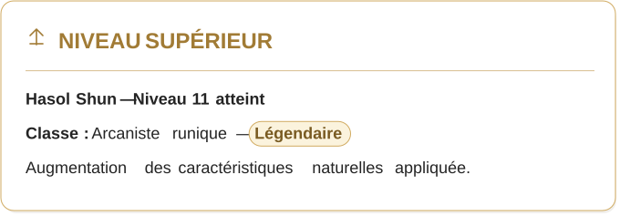
  </picture>
  

    
Version textuelle de la fenêtre

  
<svg class="lit-window__icon" viewBox="0 0 24 24" aria-hidden="true" focusable="false"><path d="M12 21V4 M5 11l7-7 7 7 M5 20h14"/></svg>NIVEAU SUPÉRIEUR

  
<strong>Hasol Shun — Niveau 11 atteint</strong>

  
<strong>Classe :</strong> Arcaniste runique — Légendaire

  
Augmentation des caractéristiques naturelles appliquée.

  

Hasol sentit son cœur bondir.

— Yoon…

— Quoi ?

La jeune Sage s’approcha.

— J’ai…

Hasol releva les yeux.

Un sourire immense apparut sur son visage.

— Je viens de passer niveau onze !

Yoon resta immobile une seconde.

Puis elle poussa un cri de joie.

— VRAIMENT ?

Hasol acquiesça.

— Oui !

Yoon lui sauta presque au cou.

Hasol éclata de rire.

— Attention à mon bras !

La jeune Sage recula précipitamment.

— Pardon !

Puis elle se mit à rire à son tour.

— C’est incroyable !

Hasol contempla sa fenêtre.

Niveau onze.

Elle avait atteint le niveau dix quelques jours plus tôt.

Et maintenant, elle venait de franchir un nouveau palier.

Ce n’était pas seulement la progression chiffrée qui la bouleversait.

C’était la manière dont elle l’avait obtenue.

Elle n’avait pas passé des journées entières à frapper des slimes.

Elle avait affronté de vrais adversaires.

Avec une partenaire.

En apprenant à combattre autrement.

Hasol sentit ses yeux devenir humides.

Yoon sourit.

— Tu vas pleurer ?

Hasol secoua rapidement la tête.

— Non !

Elle essuya pourtant le coin de ses yeux.

Yoon rit doucement.

— Un peu, quand même.

Hasol voulut répondre.

Mais une nouvelle lumière apparut.

Plus vive.

Plus nette.

Le sourire de Hasol disparut progressivement.

Une autre fenêtre venait de s’ouvrir.

Elle n’avait jamais vu cette notification auparavant.

  <picture class="lit-window__github-picture">
    <source media="(max-width: 600px)" srcset="assets/fenetres/048-mobile.svg">
    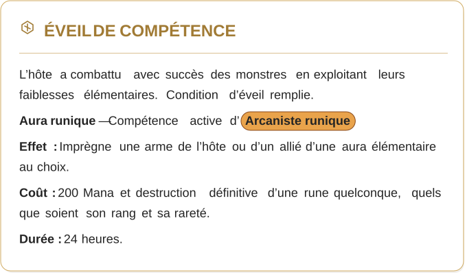
  </picture>
  

    
Version textuelle de la fenêtre

  
<svg class="lit-window__icon" viewBox="0 0 24 24" aria-hidden="true" focusable="false"><path d="m12 3 8 5v8l-8 5-8-5V8Z M12 7v10 M8 10l8 4"/></svg>ÉVEIL DE COMPÉTENCE

  
L’hôte a combattu avec succès des monstres en exploitant leurs faiblesses élémentaires. Condition d’éveil remplie.

  
<strong>Aura runique</strong> — Compétence active d’Arcaniste runique, Légendaire

  
<strong>Effet :</strong> Imprègne une arme de l’hôte ou d’un allié d’une aura élémentaire au choix.

  
<strong>Coût :</strong> 200 Mana et destruction définitive d’une rune quelconque, quels que soient son rang et sa rareté.

  
<strong>Durée :</strong> 24 heures.

  

Hasol resta immobile.

Son sourire avait complètement disparu.

Elle relut la fenêtre.

Une première fois.

Puis une seconde.

Aura runique…

Elle sentit ses doigts se resserrer lentement autour de son épée.

— Hasol ?

La voix de Yoon lui parvint de loin.

La jeune femme fixait toujours les informations.

Deux cents points de Mana.

Une rune détruite.

Vingt-quatre heures.

Et la possibilité de choisir l’élément.

Hasol leva lentement les yeux vers sa lame.

Une aura de Terre brillait encore autour de l’acier.

Une aura que Zio venait de faire installer par un forgeron runique.

Un enchantement extrêmement coûteux.

Valable un mois.

Et voilà que sa propre classe lui offrait désormais la possibilité de produire une aura élémentaire.

Sans forgeron.

Sans devoir payer une nouvelle opération à chaque changement d’affinité.

Elle pouvait même l’appliquer à l’arme d’un allié.

Hasol sentit un frisson parcourir son dos.

— C’est impossible…

Yoon fronça les sourcils.

— Qu’est-ce qui est impossible ?

Hasol ouvrit la bouche.

Puis la referma.

Elle relut la fenêtre.

Il ne s’agissait pas d’une compétence offensive classique.

Elle ne pouvait toujours pas lancer de boule de feu.

Ni faire tomber la foudre.

Ni projeter une attaque magique directement sur un monstre.

Mais elle pouvait imprégner une arme d’une énergie élémentaire.

La même sorte de puissance qui venait de leur permettre de combattre plus efficacement les loups gris.

Elle pouvait désormais la créer elle-même.

À un prix.

Un prix considérable.

Une rune.

Entièrement détruite.

Hasol pensa immédiatement à ses dix emplacements.

Aux deux runes rares bleues, 6★ et améliorées à +6, offertes par son père.

Aux huit runes reçues de sa mère.

À sa Fatal rare bleue, 3★ et améliorée à +3, qu’elle avait personnellement améliorée.

Elle ne pouvait pas sacrifier ces pierres à la légère.

Pas pour un enchantement de vingt-quatre heures.

Son regard revint vers la fenêtre.

Une rune quelconque…

Pas nécessairement une rune rare.

Pas nécessairement une rune puissante.

Pas nécessairement une rune déjà améliorée.

Hasol fronça légèrement les sourcils.

Une idée commença à se former.

Mais elle la repoussa presque aussitôt.

Elle était encore au milieu du bois.

Son bras restait sensible.

Et ses forces venaient déjà d’être sollicitées par une longue journée de chasse.
<!-- Réserve documentaire MANA-01 : Le Mana dépensé par Hasol pendant cette chasse n’est associé à aucune activation racontée ; réserve disponible non reconstituable, aucun débit inventé. Voir lore/audit_chapitres_5_9.md. -->

Ce n’était ni le lieu ni le moment d’essayer un pouvoir qu’elle ne comprenait pas encore.

— Hasol ?

Yoon posa doucement une main sur son épaule.

La jeune femme cligna des yeux.

— Oui ?

— Tu me fais peur, là.

Hasol la regarda.

Yoon semblait sincèrement inquiète.

— Tu as découvert quelque chose ?

Hasol hésita.

Puis elle acquiesça.

— Oui.

— Une compétence ?

Hasol acquiesça de nouveau.

Yoon ouvrit de grands yeux.

— Vraiment ?

La jeune femme inspira.

Puis lui montra la fenêtre.

Yoon se pencha.

Elle lut.

Puis s’immobilisa.

Une seconde passa.

Deux.

Puis elle releva lentement la tête.

— Hasol…

— Oui ?

— Tu peux créer des auras élémentaires ?

Hasol regarda son épée.

— Apparemment.

Yoon relut la fenêtre.

— Sur ton arme…

Son doigt descendit.

— Ou celle d’un allié…

Puis elle atteignit le coût.

Son expression changea.

— Deux cents Mana…

Elle continua.

Puis resta silencieuse.

— Une rune détruite…

Hasol acquiesça.

— Oui.

Yoon contempla l’interface.

— Ce n’est pas gratuit.

— Non.

— Et ça ne dure qu’un jour.

— Oui.

Un silence suivit.

Puis Yoon releva les yeux.

Un sourire incrédule apparut sur son visage.

— Mais tu te rends compte de ce que ça signifie ?

Hasol hésita.

— Je crois…

Yoon prit doucement ses mains, en évitant le bras blessé.

— Tu pourrais adapter nos armes aux monstres qu’on affronte !

Hasol acquiesça lentement.

— Si j’ai les runes nécessaires.

— Oui, mais…

Yoon s’interrompit.

Puis son regard se posa sur la sacoche de Hasol.

— Tu travailles chez un artisan runique.

Hasol suivit son regard.

Elle ne répondit pas immédiatement.

Elle revit les étagères d’Orven.

Les commandes.

Les petites boîtes.

Les runes que personne ne souhaitait améliorer.

Certaines étaient trop faibles pour présenter un véritable intérêt commercial.

D’autres possédaient des caractéristiques médiocres et finissaient simplement mises de côté.

Elle ignorait encore ce qu’Orven accepterait de lui céder.

Et ces pierres avaient malgré tout une valeur.

Mais pour la première fois, elle les regardait mentalement d’une manière différente.

Pas comme des runes destinées à être équipées.

Ni comme des pierres à améliorer.

Comme des ressources capables d’alimenter un pouvoir.

Hasol sentit son cœur accélérer.

Puis elle referma doucement la fenêtre.

— Il faudra que j’en parle à Maître Orven.

Yoon sourit.

— Tu crois qu’il pourra t’aider ?

Hasol regarda son épée.

Puis ses dix cercles.

Elle repensa au forgeron.

À Zio.

Aux sommes nécessaires pour obtenir une aura pendant un mois.

Et à cette nouvelle compétence qui venait d’apparaître après une journée de chasse.

— Je ne sais pas encore.

Elle marqua une pause.

Puis sourit.

— Mais j’ai envie de comprendre.

Yoon lui rendit son sourire.

— Alors on cherchera ensemble.

Hasol releva les yeux.

— Ensemble ?

La jeune Sage lui adressa un regard faussement indigné.

— Évidemment ! On est une équipe, maintenant !

Hasol resta silencieuse.

Puis un rire doux lui échappa.

— Oui…

Elle regarda la jeune fille devant elle.

Sa partenaire.

Celle qui avait choisi de chasser avec elle malgré sa réputation.

Celle qui l’avait soignée.

Celle qui avait commis des erreurs avec elle.

Et qui venait de promettre de chercher des réponses à ses côtés.

Hasol sentit une chaleur se répandre dans sa poitrine.

Pour la première fois depuis longtemps, elle n’avait pas l’impression de devoir porter toutes ses inquiétudes seule.

Elles reprirent le chemin de la capitale.

Le soleil descendait lentement derrière les arbres.

Les ombres s’allongeaient sur le sentier.

Yoon marchait près de Hasol, racontant déjà toutes les possibilités qu’elle imaginait pour Aura runique.

Une aura de Feu contre certains monstres.

Une aura de Terre pour les loups gris.

D’autres éléments, selon les régions qu’elles exploreraient un jour.

Hasol l’écoutait avec un sourire.

De temps en temps, elle lui rappelait qu’il faudrait d’abord trouver les runes nécessaires.

Yoon répondait qu’elles trouveraient bien une solution.

Puis elle changeait immédiatement de sujet.

Hasol finit par rire.

Elle avait encore mal au bras.

Elle était fatiguée.

Son équipement n’était pas devenu exceptionnel du jour au lendemain.

Et sa nouvelle compétence lui posait presque autant de questions qu’elle apportait de possibilités.

Mais elle avait atteint le niveau onze.

Elle possédait désormais une capacité active liée à sa classe légendaire.

Et, surtout, elle avait quelqu’un avec qui partager cette découverte.

Lorsqu’elles arrivèrent à la lisière du bois, Yoon se retourna vers elle.

— Hasol ?

— Oui ?

— On revient le week-end prochain ?

Hasol regarda le sentier.

Elle repensa aux loups.

À la morsure.

À l’épée de Terre.

Puis au cercle vert qui avait brillé sous leurs pieds.

Elle sourit.

— Oui.

Yoon leva joyeusement les bras.

— Parfait !

Hasol rit.

Puis ajouta :

— Mais on préparera notre sortie correctement.

— Promis !

— Et on vérifiera les alentours.

— Promis !

— Et on rentrera si l’une de nous est trop fatiguée.

Yoon ouvrit la bouche.

Puis sourit.

— Tu commences à parler comme mon frère.

Hasol éclata de rire.

— Je crois que c’est une bonne chose.

Yoon haussa les épaules.

— Ça dépend des jours.

Elles reprirent leur marche.

Devant elles, les remparts de la capitale se dessinaient dans la lumière du soir.

Hasol contempla un instant la silhouette de la ville.

Quelques jours auparavant, elle y était rentrée seule après sa première chasse aux loups.

Elle avait alors cru que progresser signifiait simplement devenir assez forte pour ne plus avoir peur.

Aujourd’hui, elle comprenait que ce n’était pas aussi simple.

Elle aurait encore peur.

Elle ferait encore des erreurs.

Elle rencontrerait des monstres bien plus dangereux que ceux des Crocs Gris.

Mais elle pourrait apprendre à les affronter autrement.

En comprenant ses runes.

En exploitant les faiblesses de ses adversaires.

En préparant ses combats.

Et en faisant confiance à quelqu’un d’autre.

Hasol tourna légèrement la tête.

Yoon marchait à ses côtés.

Elle parlait toujours.

Hasol sourit.

Puis accéléra pour rester à sa hauteur.

Elle ne savait pas encore jusqu’où leur chemin les conduirait.

Mais ce soir-là, pour la première fois, elle n’avait plus à l’imaginer seule.

**Fin du chapitre 5 — Le premier lien**

---

# Chapitre 6 — Deux chemins, un même objectif

## I. La caisse du fond

— Tu comptes rester plantée devant cette porte toute la matinée ?

Hasol sursauta.

Orven se tenait derrière son établi, une tasse fumante à la main. Il l’observait par-dessus ses lunettes avec cette expression qui lui donnait toujours l’impression d’avoir oublié quelque chose.

— Bonjour, Maître Orven !

— Bonjour. Tu vas entrer, maintenant ?

Hasol franchit le seuil avec un sourire embarrassé.

— Oui, pardon !

Elle avait passé une partie du trajet à réfléchir à la meilleure manière d’aborder le sujet. Depuis la veille, elle avait répété plusieurs débuts de conversation, tous plus maladroits les uns que les autres.

Maître Orven, j’ai obtenu une nouvelle compétence.

Trop brusque.

Est-ce que vous avez déjà entendu parler d’un Arcaniste runique capable de créer des auras élémentaires ?

Beaucoup trop prétentieux.

J’aurais besoin de runes que personne ne veut…

Elle imaginait déjà la tête qu’il ferait.

— Hasol.

Elle releva les yeux.

— Oui ?

— Ton tablier.

Elle baissa la tête.

Il était toujours accroché à son crochet.

— Ah.

Orven soupira.

— Je sens que la journée va être longue.

Hasol enfila précipitamment son tablier.

L’atelier avait retrouvé son agitation habituelle du lundi. Plusieurs commandes attendaient sur l’établi principal, une caisse de pierres de mana venait d’être livrée et un client discutait avec un employé près de l’entrée.

Hasol aimait cette atmosphère.

Quelques semaines auparavant, elle aurait été incapable d’imaginer trouver autant de plaisir à travailler dans un atelier. Pourtant, elle connaissait déjà le grincement particulier du troisième tiroir, l’odeur de la poudre utilisée pour nettoyer les inscriptions et la manière dont Orven fronçait le nez lorsqu’un client prétendait connaître mieux que lui le fonctionnement d’une rune.

Elle prenait peu à peu ses habitudes.

Ce matin-là, toutefois, son attention était ailleurs.

— Maître Orven ?

— Hmm ?

— J’aurais quelque chose à vous montrer.

Il continua à examiner la rune qu’il tenait.

— C’est urgent ?

— Pas vraiment.

— Alors commence par vérifier les commandes arrivées ce matin.

Hasol ouvrit la bouche, puis se ravisa.

— D’accord.

Pendant près de deux heures, elle classa des fiches, compara des caractéristiques et contrôla les quantités de pierres de mana nécessaires à plusieurs améliorations.

Elle s’appliqua.

Mais dès qu’Orven passait à proximité, ses yeux se relevaient malgré elle.

Au troisième regard, le maître artisan posa son outil.

— Bon.

Hasol se figea.

— Oui ?

— Si je ne t’écoute pas maintenant, tu vas finir par trouer mes fiches à force de les regarder sans les lire.

Elle rougit.

— Je les lis !

Orven désigna la feuille qu’elle tenait.

— Tu viens de recopier deux fois le même numéro de commande.

Hasol baissa les yeux.

Il avait raison.

— … Ah.

— Alors ?

Elle posa la fiche et s’approcha.

— Je suis passée niveau onze hier.

Orven se redressa.

— Déjà ?

Un sourire apparut sur son visage.

— Félicitations, Hasol.

— Merci !

Elle inspira.

— Et j’ai obtenu une nouvelle compétence.

Le sourire d’Orven se transforma immédiatement en curiosité.

— Ah ?

Hasol ouvrit son interface.

— Elle s’appelle Aura runique.

Elle lui montra la description.

Orven ajusta ses lunettes.

Il lut une première fois.

Puis une seconde.

Son expression changea imperceptiblement.

— Une aura élémentaire…

Hasol acquiesça avec enthousiasme.

— Je peux choisir l’élément et l’appliquer à mon arme ou à celle d’un allié !

— Sans passer par un forgeron runique ?

— Oui !

Orven posa sa tasse.

— Voilà qui est intéressant.

Hasol sourit plus largement.

Puis il descendit jusqu’aux conditions d’activation.

Son sourire disparut.

— Deux cents Mana.

— Oui…

— Et une rune définitivement détruite.

— Oui.

Orven releva lentement les yeux vers son apprentie.

— Tu ne fais décidément rien comme les autres.

Hasol eut un petit rire.

— C’est une mauvaise chose ?

— Je n’en sais rien encore. C’est bien ce qui m’ennuie.

Il relut les informations.

— Vingt-quatre heures de durée. Le choix de l’élément. Une application possible sur l’arme d’un allié…

Il réfléchit quelques secondes.

— C’est une capacité remarquable, mais son utilisation sera coûteuse.

Hasol acquiesça.

— J’y ai pensé.

— J’espère bien.

Orven croisa les bras.

— Tu possèdes dix runes équipées. Tu n’envisages pas d’en détruire une chaque fois que tu veux utiliser ton pouvoir ?

— Non !

Elle répondit si vivement qu’Orven haussa les sourcils.

— Je m’en doutais.

Hasol baissa légèrement les yeux.

— J’ai pensé à autre chose.

Elle hésita.

Puis demanda :

— Est-ce qu’il arrive que des runes soient envoyées au recyclage ?

Orven resta silencieux.

Une seconde passa.

Puis un petit sourire apparut au coin de ses lèvres.

— Ah.

Hasol releva les yeux.

— Ah ?

— Voilà donc pourquoi tu me regardes comme un marchand de pâtisseries depuis ce matin.

— Ce n’est pas du tout…

Elle s’interrompit.

Orven souriait franchement.

— Viens.

Il quitta son établi et se dirigea vers l’arrière de l’atelier.

Hasol le suivit entre les étagères.

Il s’arrêta devant plusieurs caisses empilées près d’une porte.

Sur l’une d’elles figurait une étiquette.

RÉCUPÉRATION — EN ATTENTE DE TRI

Orven souleva le couvercle.

À l’intérieur se trouvaient des dizaines de petites runes de différentes formes.

Certaines étaient communes, blanches et faiblement lumineuses.

D’autres présentaient des inscriptions ternes ou des combinaisons de caractéristiques peu recherchées.

Hasol se pencha.

— Toutes ces runes vont être détruites ?

— Pas exactement.

Orven en prit une.

— Elles doivent d’abord être examinées. Certaines méritent d’être conservées. Les autres sont vendues à des professionnels capables de récupérer une partie de leur valeur sous forme de pierres de mana.

Il lui montra la rune.

— Celle-ci, par exemple, possède une caractéristique principale correcte, mais ses secondaires sont peu adaptées à l’usage pour lequel elle avait été acquise.

Hasol observa la petite pierre.

— Pourtant, elle pourrait encore servir à quelqu’un…

— Exactement.

Orven la remit dans la caisse.

— C’est pour cette raison qu’on ne jette pas toutes les runes de faible rang au recyclage sans réfléchir. Même une rune une étoile peut intéresser un chasseur débutant si ses caractéristiques correspondent à ses besoins.

Hasol acquiesça.

Orven posa une main sur le bord de la caisse.

— En revanche, certaines runes n’ont pratiquement aucun débouché. Leur valeur commerciale se rapproche alors de celle que le recycleur accepte de payer.

Hasol sentit son cœur accélérer.

— Et… celles-là ?

Le maître artisan la regarda.

— Celles-là quoi ?

Elle déglutit.

— Est-ce que je pourrais en récupérer quelques-unes ?

Orven ne répondit pas immédiatement.

Puis il croisa les bras.

— Gratuitement ?

Hasol se redressa.

— Non ! Enfin… je ne pensais pas forcément…

— Tant mieux.

Elle cligna des yeux.

Orven poursuivit :

— Ces runes ne sont pas inutiles parce qu’elles ne trouvent pas d’acheteur. Elles représentent encore des matériaux et une valeur de recyclage. Si je les donne, l’atelier perd cette valeur.

Hasol baissa les yeux.

— Je comprends.

Elle avait pourtant espéré qu’une solution serait aussi simple.

Orven observa son expression.

Puis il tapota la caisse.

— Mais nous pouvons peut-être trouver un arrangement.

Hasol releva brusquement la tête.

— Vraiment ?

— Commence par me trier correctement ce lot. Tu sépareras les runes qui méritent une seconde évaluation de celles dont la valeur de récupération est la seule option raisonnable.

Il désigna un registre posé sur une étagère.

— Ensuite, nous calculerons ce que le recycleur nous en donnerait. Si tu veux les acheter, tu pourras le faire à cette valeur, éventuellement en compensant une partie avec du travail supplémentaire convenu à l’avance.

Hasol resta immobile.

Puis son visage s’illumina.

— Vous accepteriez ?

— Je viens de te le proposer, non ?

— Oui, mais…

— Hasol.

— Oui ?

— Ne me remercie pas encore. Tu risques de découvrir que ce travail est considérablement moins passionnant que tu ne l’imagines.

Elle sourit.

— Ça me va !

Orven eut un petit rire.

— Nous verrons si tu dis toujours ça après avoir examiné cinquante pierres dont personne ne veut.

Hasol se pencha déjà vers la caisse.

Elle prit une petite rune commune (blanche), rang À DÉFINIR et observa ses inscriptions.

Pour la plupart des chasseurs, cette pierre n’aurait probablement jamais représenté grand-chose.

Mais elle pouvait désormais devenir une ressource précieuse.

Une rune quelconque…

La phrase de la description de sa compétence lui revint en mémoire.

Hasol sourit.

Pour la première fois, elle avait l’impression qu’une partie de son travail d’artisane pourrait directement nourrir son rêve de chasseuse.

## II. Les heures de l’Académie

— Yoon !

La jeune Sage releva la tête juste à temps pour éviter qu’un livre ne lui tombe sur les genoux.

— Samia !

Une jeune fille venait de déposer une pile de documents sur la table.

Elle s’assit en face d’elle avec un soupir.

— Tu sais que je te cherche depuis dix minutes ?

— J’étais là.

Samia Claire observa les trois carnets ouverts devant son amie.

— Je vois ça.

Elle prit celui du milieu.

— « Positionnement du cercle de soin dans un passage étroit » ?

Yoon tendit immédiatement la main.

— Ne touche pas !

Samia éclata de rire.

— Toujours aussi possessive avec tes notes.

— Tu n’imagines pas combien de temps j’ai passé dessus.

— Je commence à le deviner.

La jeune Ranger posa le carnet devant elle et croisa les bras.

— Alors ? Comment s’est passée ta chasse ?

Yoon leva les yeux.

Elle avait raconté une partie de son week-end à Samia dès son arrivée à l’Académie.

Mais pas tout.

Certaines choses appartenaient à Hasol.

Et Yoon avait bien l’intention de respecter sa confiance.

— On a formé une équipe !

Samia cligna des yeux.

— Une vraie ?

— Oui !

— Avec Hasol Shun ?

Yoon acquiesça fièrement.

Samia resta silencieuse une seconde.

Puis elle sourit.

— Eh bien, tu as fait vite.

— Pas tant que ça !

— Yoon, vendredi tu ne savais même pas que tu allais la rencontrer.

La jeune Sage réfléchit.

— Vu comme ça…

Samia rit.

— Elle est comment ?

Yoon sembla chercher ses mots.

— Gentille. Sérieuse. Un peu trop modeste, parfois.

Elle sourit.

— Elle adore parler de runes. Et elle prend des notes sur absolument tout.

Samia leva un sourcil.

— Quelle surprise. Tu as trouvé une deuxième toi.

— Nous n’organisons pas nos carnets de la même manière !

— Ah. Une différence fondamentale.

Yoon lui lança un regard faussement offensé.

Puis son expression s’adoucit.

— Elle est courageuse aussi.

Samia remarqua immédiatement le changement.

— Il s’est passé quelque chose ?

Yoon baissa les yeux.

Pendant quelques instants, elle revit la forêt.

La racine.

Le loup qui bondissait.

Le sang sur le bras de Hasol.

— On a commis une erreur pendant la chasse, répondit-elle finalement. Elle a été blessée en me protégeant.

Samia cessa de sourire.

— Gravement ?

— Son bras a été soigné. Elle allait mieux hier.

Yoon tourna distraitement une page de son carnet.

— Mais j’ai eu peur.

Samia ne répondit pas immédiatement.

Puis elle demanda :

— Tu comptes continuer avec elle ?

Yoon releva la tête.

— Bien sûr.

— Même après ça ?

— Justement.

Samia la contempla.

Yoon poursuivit :

— Nous avons réfléchi à ce qui n’allait pas. Le lendemain, on a déjà mieux combattu.

Elle désigna ses notes.

— Et je veux qu’on continue à progresser.

Samia sourit légèrement.

— Alors tu as trouvé ce que tu cherchais.

Yoon pencha la tête.

— Quoi ?

— Une équipe dans laquelle tu as envie de t’investir.

La jeune Sage resta silencieuse.

Puis un sourire apparut lentement sur son visage.

— Oui.

L’après-midi, les étudiants participèrent à un exercice de coordination.

Le professeur avait disposé plusieurs mannequins mobiles dans une salle d’entraînement.

Certains avançaient directement vers les chasseurs.

D’autres contournaient les obstacles pour atteindre les soutiens placés à l’arrière.

Yoon observa le terrain avec attention.

Quelques jours auparavant, elle aurait probablement commencé par chercher le meilleur endroit où poser Chant runique.

Aujourd’hui, elle regarda d’abord les sorties.

Les obstacles.

Les passages permettant aux mannequins de contourner les combattants.

— Yoon Notos.

Elle releva la tête.

— Oui, professeur ?

— Tu travailleras avec ce groupe.

Trois étudiants s’approchèrent.

Un guerrier, un mage et une chasseuse équipée d’une lance.

Le guerrier sourit.

— Parfait ! Tu n’auras qu’à poser ton cercle derrière nous.

Yoon observa les positions qu’ils avaient choisies.

Puis fronça légèrement les sourcils.

— Vous comptez combattre ici ?

— Oui. Pourquoi ?

Elle désigna une ouverture entre deux piliers.

— Parce que si un mannequin passe par là, il pourra arriver directement derrière moi.

Le guerrier haussa les épaules.

— On l’arrêtera avant.

Yoon regarda le mannequin placé près de l’ouverture.

Ses yeux se rétrécirent.

— Tu en es sûr ?

L’étudiant hésita.

Le professeur observait la scène sans intervenir.

Yoon reprit :

— Je préférerais placer mon cercle près de ce mur. Nous pourrons y reculer et je garderai une ligne de vue sur le passage.

Le mage acquiesça.

— Ça me semble raisonnable.

Le guerrier soupira.

— D’accord. Fais comme tu veux.

L’exercice commença.

Les premiers mannequins avancèrent.

Yoon lança Résonance runique sur le guerrier.

Puis elle posa son cercle de soin à l’endroit choisi.

Lorsque le mage se déplaça vers la gauche, elle attendit que sa trajectoire se dégage avant de lancer Vague runique.

La petite onde lumineuse atteignit un mannequin.

Elle n’infligea que des dégâts modestes.

Mais elle avait frappé la bonne cible, au bon moment.

Yoon sourit.

Un peu mieux.

Quelques instants plus tard, un mannequin contourna le groupe par l’ouverture qu’elle avait remarquée.

— Derrière ! lança-t-elle.

Le guerrier pivota.

Yoon recula dans la zone de soin et se déplaça pour ne pas se retrouver coincée contre le mur.

Le mannequin atteignit le bord du cercle.

Mais le guerrier put l’intercepter avant qu’il ne frappe.

L’exercice se termina sans incident majeur.

Le professeur s’approcha.

— Notos.

Yoon se redressa.

— Oui ?

— Tu as changé ta manière de préparer les combats.

Elle hésita.

— Un peu.

— Qu’est-ce qui t’a donné cette idée ?

Yoon pensa au dessin de Zio dans la terre.

Puis à Hasol, blessée au milieu des arbres.

— Une chasse qui ne s’est pas très bien passée.

Le professeur acquiesça.

— Les erreurs sont de bons enseignants lorsqu’on accepte de les examiner.

Yoon sourit.

— Oui, professeur.

Il poursuivit :

— Et ta Vague runique était mieux placée que lors du dernier entraînement.

Le visage de Yoon s’illumina.

— Merci !

— Continue toutefois à surveiller ton Mana. Une compétence peu coûteuse finit par représenter une dépense importante lorsqu’on la répète sans réfléchir.

Elle acquiesça.

— Compris !

En quittant la salle, Yoon retrouva Samia près des vestiaires.

Son amie l’observa avec un petit sourire.

— Alors ?

— Alors quoi ?

— Tu vas encore remplir trois pages sur cet exercice ?

Yoon réfléchit.

— Quatre, peut-être.

Samia éclata de rire.

— Tu es irrécupérable.

Yoon lui tira la langue.

Puis elle regarda par la fenêtre.

Au-delà des bâtiments de l’Académie, la ville s’étendait sous la lumière de fin d’après-midi.

Quelque part, dans le quartier des Artisans, Hasol devait encore travailler.

Yoon se demanda ce qu’elle avait appris aujourd’hui.

Elle avait hâte de le découvrir.

## III. Ce qui mérite d’être conservé

— Non.

Hasol releva les yeux.

Orven venait de reposer une rune dans un petit coffret.

— Pourtant, ses caractéristiques secondaires sont vraiment mauvaises…

— Elles sont mauvaises pour l’usage auquel elle était destinée.

Il désigna la rune.

— Mais sa principale reste intéressante pour un chasseur débutant. Elle pourrait être vendue à quelqu’un qui n’a pas les moyens de s’offrir mieux.

Hasol acquiesça.

— D’accord.

Elle déplaça le coffret dans la pile des runes à réexaminer.

Le tri avançait lentement.

Depuis le matin, elle avait étudié plusieurs dizaines de pierres.

Certaines méritaient effectivement d’être conservées.

D’autres étaient trop peu intéressantes pour justifier les frais nécessaires à leur remise en vente.

Orven lui avait fait noter les raisons de chaque décision.

Ce travail exigeait beaucoup plus d’attention qu’elle ne l’avait imaginé.

Mais elle y trouvait un plaisir particulier.

Elle commençait à comprendre comment un artisan évaluait la valeur réelle d’une rune.

Pas seulement sa rareté.

Ni son nombre d’étoiles.

Mais ce qu’elle pouvait apporter à un utilisateur précis.

— Et celle-ci ? demanda-t-elle.

Orven examina la petite rune rare (bleue), 1★.

Il lut ses caractéristiques.

Puis la retourna entre ses doigts.

— Une étoile. Une principale peu recherchée dans cette configuration et des secondaires sans grande utilité commerciale.

Il la reposa.

— Celle-là peut rejoindre le lot destiné au recyclage.

Hasol sourit.

— Enfin !

Orven lui lança un regard amusé.

— Ne commence pas à célébrer chaque rune médiocre que tu découvres.

— Pardon…

— Sinon, nous ne finirons jamais.

Hasol étouffa un rire.

À la fin de la journée, ils avaient constitué un petit lot.

Orven calcula sa valeur de récupération en consultant les tarifs habituels du recycleur.

Puis il inscrivit le montant dans son registre.

Hasol observa les chiffres avec une certaine appréhension.

Ce n’était pas gratuit.

Mais ce n’était pas non plus comparable au prix d’achat de runes destinées à être équipées.

Orven lui montra la ligne correspondante.

— Voilà ce que l’atelier aurait normalement récupéré.

Hasol acquiesça.

— Je peux payer une partie maintenant.

— Et le reste ?

Elle réfléchit.

— Je pourrais effectuer des tâches supplémentaires après mes horaires habituels. Le tri des lots, par exemple.

Orven tapota son registre.

— À condition que le travail soit réellement utile et correctement effectué.

— Bien sûr !

— Et nous noterons chaque compensation. Je ne veux pas que tu te retrouves à travailler des heures sans savoir exactement ce que cela représente.

Hasol sourit.

— D’accord.

Le maître artisan referma le registre.

— Marché conclu.

Elle resta immobile une seconde.

— Vraiment ?

— Hasol.

— Oui ?

— Tu vas me poser cette question chaque fois que nous prendrons une décision ?

Elle rougit.

— Non…

Orven poussa le petit sachet vers elle.

— Alors prends tes runes.

Hasol le récupéra avec précaution.

Les pierres s’entrechoquèrent doucement à l’intérieur.

Elles ne possédaient rien de particulièrement impressionnant.

Quelques runes communes d’une étoile.

Des caractéristiques peu intéressantes.

Aucune de ces pierres n’aurait attiré son attention au marché lorsqu’elle cherchait à améliorer son équipement.

Pourtant, elle les tenait maintenant comme si elles étaient précieuses.

Orven l’observa.

— Tu comptes essayer ton Aura runique ce soir ?

Hasol releva la tête.

— Si possible.

— Sur ton épée ?

Elle hésita.

Puis baissa les yeux vers son arme.

La lame portait toujours l’aura de Terre que Zio lui avait offerte.

Un enchantement coûteux, valable un mois.

Elle n’avait aucune envie de le remplacer par une aura de vingt-quatre heures simplement pour réaliser une expérience.

— Non, répondit-elle. Je voudrais éviter de toucher à celle-ci.

Orven acquiesça.

— Sage décision.

Il réfléchit quelques secondes.

Puis se dirigea vers une armoire.

Il en sortit une épée d’essai à la lame émoussée.

Le métal portait plusieurs marques d’usure, mais l’ensemble semblait suffisamment solide pour des entraînements.

— Nous utilisons parfois cette arme pour certains contrôles. Elle fera l’affaire pour une première expérimentation.

Hasol ouvrit de grands yeux.

— Vous me la prêtez ?

— Tu me la rendras.

Elle récupéra l’épée avec précaution.

— Merci !

Orven leva un doigt.

— Et tu ne fais pas ton premier essai au milieu de l’atelier.

Hasol cligna des yeux.

— Pourquoi ?

Il lui adressa un regard.

Elle réfléchit.

Puis baissa légèrement la tête.

— Parce qu’on ne sait pas comment ma compétence va réagir…

— Exactement.

Orven récupéra son manteau.

— Il y a un terrain d’entraînement derrière le bâtiment des artisans. Nous irons là-bas.

Hasol sourit.

— Vous venez avec moi ?

— Je préfère savoir ce que fait mon apprentie avant qu’elle ne commence à transformer les épées de la ville en torches magiques.

Elle éclata de rire.

— Je vais essayer d’éviter ça.

— Je te le recommande.

## IV. Deux cents points de Mana

Le terrain d’entraînement était presque désert.

Quelques mannequins de bois occupaient le centre de la cour. Plus loin, des cibles renforcées permettaient de tester différents niveaux de résistance.

Orven posa une petite mallette sur un banc.

Hasol déposa l’épée d’essai près d’elle.

Puis sortit le sachet de runes.

Son enthousiasme avait légèrement diminué.

Elle connaissait les conditions d’activation d’Aura runique.

Mais savoir qu’une rune serait détruite était très différent de devoir en choisir une.

Elle prit une petite rune commune (blanche), 1★.

Ses inscriptions brillaient faiblement.

— Tu hésites ? demanda Orven.

Hasol acquiesça.

— Un peu.

— Pourquoi ?

Elle observa la rune.

— Même si elle n’a presque aucune valeur commerciale, ça reste une rune. Quelqu’un a dû travailler pour la fabriquer.

Orven resta silencieux.

Puis il répondit :

— C’est vrai.

Hasol releva les yeux.

— Vous ne trouvez pas ça dommage ?

Le maître artisan contempla la pierre.

— Je trouverais dommage de détruire une rune utile sans raison. Mais celle-ci allait être recyclée pour récupérer une partie de ses matériaux.

Il désigna l’épée.

— Ton pouvoir propose un autre usage. À toi de décider s’il en vaut le coût.

Hasol acquiesça lentement.

Elle serra la petite pierre entre ses doigts.

Puis prit une inspiration.

— D’accord.

Elle ouvrit son interface.

Aura runique.

Le coût apparut devant elle.

Deux cents points de Mana.

Une rune sacrifiée.

Vingt-quatre heures.

Hasol choisit l’élément Feu.

Elle avait décidé de ne pas reproduire immédiatement l’aura de Terre que portait son épée habituelle.

Elle voulait découvrir comment sa compétence réagirait à une autre affinité.

Elle plaça la rune près de la lame d’essai.

Puis leva la main.

— Aura runique !

Les cercles de mana de Hasol s’illuminèrent.

Une partie considérable de son énergie s’écoula brusquement.

Elle inspira entre ses dents.

La sensation était beaucoup plus intense que ce qu’elle avait imaginé.

Des inscriptions lumineuses apparurent autour de la petite rune.

Elles s’enroulèrent sur elles-mêmes.

Puis la pierre se fissura.

Hasol ouvrit de grands yeux.

Une première craquelure traversa sa surface.

Puis une seconde.

Un léger tintement retentit.

La rune se brisa en poussière lumineuse.

Cette poussière ne tomba pas au sol.

Elle se dirigea vers l’épée.

Des caractères runiques se formèrent le long du métal.

Puis une lueur rouge orangé enveloppa la lame.

Hasol recula d’un demi-pas.

— Oh…

L’aura brillait réellement.

Ce n’était pas une imitation.

Ce n’était pas une simple illusion.

Elle venait d’imprégner une arme d’une énergie élémentaire.

Sans l’aide d’un forgeron.

  <picture class="lit-window__github-picture">
    <source media="(max-width: 600px)" srcset="assets/fenetres/049-mobile.svg">
    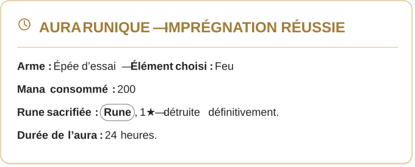
  </picture>
  

    
Version textuelle de la fenêtre

  
<svg class="lit-window__icon" viewBox="0 0 24 24" aria-hidden="true" focusable="false"><circle cx="12" cy="12" r="9"/><path d="M12 6v6l4 3"/></svg>AURA RUNIQUE — IMPRÉGNATION RÉUSSIE

  
<strong>Arme :</strong> Épée d’essai — <strong>Élément choisi :</strong> Feu

  
<strong>Mana consommé :</strong> 200

  
<strong>Rune sacrifiée :</strong> Commune (blanche), 1★ — détruite définitivement.

  
<strong>Durée de l’aura :</strong> 24 heures.

  

Orven s’approcha immédiatement.

— Fais voir.

Hasol lui présenta l’arme.

Il observa les inscriptions, leur stabilité et la manière dont le Mana circulait le long du métal.

Puis il hocha lentement la tête.

— Remarquable.

Hasol sentit son visage s’illuminer.

— Ça a fonctionné !

— Oui.

Orven releva les yeux.

— Comment te sens-tu ?

La question la surprit.

Elle prit quelques secondes pour examiner son état.

— Un peu fatiguée…

Elle regarda sa réserve de Mana.

— J’en ai consommé énormément.

— Deux cents points représentent une dépense sérieuse, même pour toi.

Hasol acquiesça.

Elle comprenait désormais que posséder une grande réserve de Mana ne signifiait pas pouvoir utiliser librement toutes ses compétences.

Si elle lançait Aura runique au mauvais moment, elle pourrait se retrouver avec beaucoup moins de ressources pour la suite d’un affrontement.

Orven désigna les mannequins.

— Essayons maintenant de voir ce que ton enchantement apporte réellement.

Les premiers essais furent encourageants.

L’épée portait bien une aura de Feu.

Contre une cible ordinaire, Hasol pouvait constater la présence de l’énergie élémentaire au moment de l’impact.

Mais lorsqu’elle s’attaqua à un mannequin fortement renforcé, les résultats furent beaucoup moins impressionnants.

La lame heurta la protection.

Une étincelle rouge traversa le point d’impact.

Puis la résistance du mannequin absorba l’essentiel du coup.

Hasol recula.

Elle essaya une seconde fois.

Puis une troisième.

Le résultat resta modeste.

Orven observait les mesures.

— L’aura fonctionne, dit-il. Mais elle ne transforme pas ton épée en arme capable de traverser n’importe quelle Défense.

Hasol acquiesça.

Elle n’était pas surprise.

Son enchantement restait soumis aux résistances de sa cible.

Contre un monstre vulnérable au Feu, le résultat aurait probablement été bien meilleur.

Mais ce mannequin ne possédait aucune faiblesse élémentaire qu’elle pouvait exploiter.

Elle regarda la lame.

— C’est déjà une excellente compétence.

Orven lui adressa un petit sourire.

— Pour une personne qui se plaignait de ne posséder aucune capacité offensive, je trouve que tu progresses.

Hasol baissa légèrement les yeux.

— C’est vrai…

Elle observa les inscriptions lumineuses.

Pendant trois années, elle avait attendu un pouvoir capable de l’aider à combattre.

Aujourd’hui, elle en possédait un.

Pas celui qu’elle avait imaginé.

Mais un pouvoir qui lui ressemblait davantage qu’elle ne l’aurait cru.

Orven referma sa mallette.

— Bon. Nous avons suffisamment travaillé pour aujourd’hui.

Hasol regarda les mannequins.

— Je pourrais peut-être essayer encore…

— Non.

— Juste quelques coups !

— Hasol.

Elle se tourna vers lui.

Orven désigna son bras récemment blessé.

Puis la réserve de Mana qu’elle venait d’entamer.

— Tu travailles toute la journée. Tu récupères encore de ta chasse. Et tu viens de dépenser deux cents Mana pour une expérimentation.

Il croisa les bras.

— Tu veux vraiment que je t’explique pourquoi ce n’est pas une excellente idée de continuer jusqu’à l’épuisement ?

Hasol hésita.

Puis elle sourit timidement.

— Non, Maître Orven.

— Bien.

Il commença à ranger.

Hasol l’aida.

Puis elle jeta un dernier regard à l’épée imprégnée de Feu.

L’aura continuerait de briller pendant vingt-quatre heures.

Après quoi il faudrait recommencer.

Dépenser encore deux cents Mana.

Et détruire une nouvelle rune.

Elle resserra les doigts autour du fourreau.

Son nouveau pouvoir était formidable.

Mais il lui faudrait apprendre à le mériter à chaque utilisation.

## V. Des journées différentes

Les jours suivants, Hasol retrouva le rythme de l’atelier.

Le matin, elle préparait les commandes.

L’après-midi, elle assistait Orven dans les améliorations simples, en surveillant soigneusement la consommation de pierres de mana et de son énergie personnelle.

Et lorsqu’elle avait terminé son travail habituel, elle consacrait une partie de son temps au tri des runes destinées à la récupération.

Orven ne la laissait jamais oublier les comptes.

Chaque pierre prélevée dans le lot était notée.

Chaque compensation par du travail supplémentaire figurait dans le registre.

Un soir, alors que Hasol terminait une nouvelle pile de fiches, elle observa le montant qu’il venait d’inscrire.

— Vous êtes vraiment obligé de tout noter ?

Orven leva les yeux.

— Oui.

— Même les toutes petites runes ?

— Surtout les toutes petites runes.

Hasol pencha la tête.

Il poursuivit :

— Si tu prends l’habitude de considérer les faibles dépenses comme négligeables, tu finiras par découvrir qu’elles représentent une somme considérable.

Elle acquiesça.

Puis sourit.

— Vous savez, vous ressemblez parfois à mon père quand il parle de commerce.

Orven s’immobilisa brièvement.

— Ah ?

Hasol baissa les yeux vers son registre.

— Il dit souvent qu’une mauvaise habitude coûte plus cher qu’une grosse erreur, parce qu’on la répète sans s’en rendre compte.

Le maître artisan resta silencieux.

Puis il reprit son écriture.

— Il n’a pas tort.

Hasol contempla un instant la petite rune qu’elle tenait.

Le souvenir de son père lui laissa une sensation douce-amère.

Elle aurait aimé lui raconter sa nouvelle compétence.

Lui montrer ce qu’elle savait faire.

Mais elle n’était pas certaine de trouver les mots.

Et elle redoutait encore de rencontrer ce regard distant qu’il avait pris l’habitude de lui adresser depuis plusieurs années.

Orven referma le registre.

— Hasol ?

Elle releva les yeux.

— Oui ?

— Tu viens de classer une rune Fatal (grade et rang : À DÉFINIR) dans le lot Gardien.

Elle baissa brusquement les yeux.

— Quoi ?

Orven désigna la boîte.

— Là.

Hasol rougit.

— Pardon !

— Tu vois ? C’est pour cela qu’on arrête de travailler quand on n’est plus concentré.

Elle sourit malgré elle.

— D’accord.

Orven récupéra la boîte.

— Va te reposer. Le tri sera encore là demain.

Cette fois, elle ne discuta pas.

Pendant ce temps, Yoon poursuivait ses cours à l’Académie.

Ses journées étaient remplies d’exercices, de lectures et de séances de combat.

Mais elle ne suivait plus exactement les entraînements de la même manière.

Chaque fois qu’un professeur présentait une formation, elle se demandait comment Hasol se serait déplacée à l’intérieur.

Lorsqu’on lui demandait de poser Chant runique, elle vérifiait les lignes de retraite avant de choisir son emplacement.

Et quand elle pratiquait Vague runique, elle cherchait à atteindre une cible sans gêner les mouvements de ses partenaires.

Un jour, après une séance particulièrement fatigante, Samia la retrouva devant les casiers.

— Tu as encore passé tout l’entraînement à déplacer ton cercle.

Yoon acquiesça.

— Oui.

— Tu comptes le faire danser, un jour ?

La jeune Sage éclata de rire.

— Ce n’est pas possible !

— Dommage. Ça aurait été amusant.

Yoon rangea ses affaires.

Samia lui donna un léger coup de coude.

— Tu as l’air heureuse, en ce moment.

Yoon s’interrompit.

— Ah bon ?

— Oui.

Son amie sourit.

— Avant, tu passais ton temps à râler contre les propositions de recrutement. Maintenant, tu parles de placements, d’entraînements et de chasses.

Yoon réfléchit.

Puis son sourire s’élargit.

— C’est vrai.

Samia l’observa.

— Ça te fait du bien, cette équipe ?

Yoon acquiesça.

— Beaucoup.

Elle repensa au sourire de Hasol lorsqu’elle avait appris son passage au niveau onze.

À leur cercle de soin dans la clairière.

À l’épée entourée d’une aura de Terre.

Puis à la main que Hasol avait serrée lorsqu’elles avaient confirmé leur équipe.

— Je crois que j’avais surtout besoin de trouver quelqu’un avec qui j’avais envie d’avancer.

Samia lui adressa un sourire chaleureux.

— Alors garde cette personne près de toi.

Yoon acquiesça.

— C’est bien mon intention.

Au milieu de la semaine, elles réussirent à se retrouver près de la place où elles s’étaient rencontrées.

Hasol arriva avec quelques minutes de retard.

Elle était encore vêtue de sa tenue d’apprentie et une petite trace de poudre minérale marquait sa joue.

Yoon l’aperçut immédiatement.

— Hasol !

Elle leva joyeusement la main.

Hasol accéléra.

— Désolée ! Une commande a pris plus de temps que prévu !

— Ce n’est rien.

Yoon la regarda attentivement.

Puis éclata de rire.

Hasol s’immobilisa.

— Quoi ?

La jeune Sage désigna sa joue.

— Tu as quelque chose, là.

Hasol passa la main du mauvais côté.

— Ici ?

— Non, l’autre.

Elle frotta de nouveau.

La trace s’étala légèrement.

Yoon rit encore plus fort.

— Attends, ne bouge pas !

Elle sortit un petit mouchoir et effaça délicatement la poudre.

Hasol rougit.

— Merci…

— Tu étais en train de travailler sur quoi ?

— Une série de runes Gardien (grade et rang : À DÉFINIR).

Yoon sourit.

— Alors tu avais une excuse.

Elles s’installèrent près de la fontaine avec deux petits pains encore chauds.

Hasol raconta sa première utilisation d’Aura runique.

Yoon l’écouta avec une attention passionnée.

— Donc tu as vraiment créé une aura de Feu ?

— Oui !

— Et la rune a été entièrement détruite ?

Hasol acquiesça.

— Elle s’est transformée en poussière lumineuse.

Yoon ouvrit de grands yeux.

— J’aurais tellement aimé voir ça…

Hasol rit doucement.

— C’était impressionnant. Mais la consommation de Mana m’a surprise.

La jeune Sage réfléchit.

— Deux cents points d’un coup…

Elle regarda Hasol.

— Tu ne peux pas utiliser ce pouvoir n’importe quand.

— Exactement.

Elles continuèrent à discuter.

Hasol expliqua son arrangement avec Orven.

Yoon lui raconta les exercices de placement qu’elle réalisait désormais à l’Académie.

Puis elles sortirent leurs carnets.

Rapidement, le banc se retrouva couvert de petits dessins, de flèches et de notes.

Un passant leur jeta un regard curieux en apercevant leurs schémas de combat au milieu des miettes de pain.

Yoon ne le remarqua même pas.

— Regarde ! Si je pose Chant runique ici, tu peux rester devant moi tout en ayant un passage pour reculer.

Hasol étudia le dessin.

— Oui. Mais si un monstre arrive sur le côté, on sera coincées contre ce mur.

Yoon fronça les sourcils.

— Alors il faudrait déplacer le cercle…

— Ou utiliser le mur pour empêcher les monstres de nous contourner.

La jeune Sage releva brusquement la tête.

— Attends !

Elle déplaça son carnet.

Puis traça deux lignes.

— Et si on choisissait volontairement un passage étroit ?

Hasol observa le dessin.

Un chemin entre deux masses rocheuses.

Une seule entrée suffisamment large pour laisser passer un loup à la fois.

Elle réfléchit.

— Ça pourrait fonctionner…

Yoon sourit.

— Les loups ne pourraient pas nous encercler aussi facilement.

— À condition de conserver une sortie.

La jeune Sage acquiesça immédiatement.

Elles se regardèrent.

Puis sourirent.

Une idée venait de naître.

Et elles avaient bien l’intention de l’essayer.

## VI. Le prix des essais

Les expérimentations de Hasol se poursuivirent tout au long de la semaine.

Chaque activation d’Aura runique exigeait la destruction d’une nouvelle rune et une dépense de deux cents Mana.

Elle ne pouvait pas enchaîner les tentatives.

Même avec ses dix cercles, sa réserve devait se reconstituer après chaque utilisation.

Orven lui interdisait également de prolonger les essais lorsqu’elle semblait trop fatiguée.

Au fil des soirées, elle apprit à mieux reconnaître le moment où son énergie quittait ses cercles.

La sensation n’était jamais tout à fait agréable.

Une part considérable de son Mana s’écoulait en quelques secondes, tandis que la rune sacrifiée se fragmentait pour alimenter l’imprégnation.

Puis l’aura se formait autour de l’arme.

Une fois rouge orangé.

Une autre fois brun doré.

Une autre encore avec une nuance différente, selon l’élément choisi.

Mais le résultat restait le même.

Une aura élémentaire normale.

Vingt-quatre heures.

Aucune propriété supplémentaire.

Hasol observait chaque fois la fenêtre de confirmation avant de noter ses résultats.

Les runes sacrifiées disparaissaient définitivement.

Son petit stock diminuait.

Et les lignes du registre d’Orven continuaient à s’accumuler.

Le vendredi soir, Hasol se tenait de nouveau sur le terrain d’entraînement.

La lumière déclinait derrière les toits.

Orven l’avait accompagnée pour examiner les derniers résultats de la semaine.

Il referma son carnet.

— Tu as compris l’essentiel.

Hasol regarda l’épée d’essai.

— Oui.

Elle semblait un peu déçue.

Le maître artisan le remarqua.

— Qu’est-ce qui ne va pas ?

Elle hésita.

— Je ne sais pas exactement…

Elle observa les petits éclats lumineux qui disparaissaient autour de la lame.

— J’ai l’impression que ma compétence pourrait faire davantage.

Orven leva un sourcil.

— Sur quoi te bases-tu ?

Hasol réfléchit.

— Pas sur quelque chose de précis.

Elle baissa légèrement les yeux.

— C’est juste une sensation.

Orven resta silencieux.

Puis il répondit :

— Une intuition peut être intéressante. Mais ce n’est pas une preuve.

Hasol acquiesça.

— Je sais.

— Et il ne faut pas confondre chercher à comprendre une compétence avec dépenser toutes ses ressources en espérant découvrir un miracle.

Elle sourit timidement.

— Vous pensez que je fais ça ?

Orven regarda le sachet de runes.

Puis elle.

— Je pense que tu commences à en avoir envie.

Hasol éclata de rire.

— Peut-être un peu.

Le maître artisan secoua la tête.

— Tu es décidément incorrigible.

Il désigna l’épée.

— Si tu veux effectuer un dernier essai, faisons-le correctement. Après cela, nous arrêterons jusqu’à ce que tu aies reconstitué une réserve raisonnable de ressources.

Hasol acquiesça.

— D’accord.

Elle prit une nouvelle rune destinée au recyclage.

La petite rune commune (blanche), 1★ reposait dans sa paume.

C’était une rune d’une étoile, aux caractéristiques sans intérêt pour les clients habituels de l’atelier.

Pourtant, elle représentait encore une dépense.

Hasol le savait.

Elle prit une inspiration.

Puis plaça la rune près de l’épée d’essai.

— Aura runique.

La magie se déploya.

Les cercles de Hasol vibrèrent.

Deux cents points de Mana furent consommés.

La rune se fissura.

Puis se transforma en poussière.

Les inscriptions lumineuses se dirigèrent vers la lame.

Mais cette fois, quelque chose changea.

Au moment où l’aura se formait, une seconde série de caractères apparut autour de l’épée.

Plus vive.

Plus dense.

Hasol sentit une vibration brutale traverser ses cercles.

— Qu’est-ce que… ?

Une lumière dorée jaillit devant elle.

  <picture class="lit-window__github-picture">
    <source media="(max-width: 600px)" srcset="assets/fenetres/050-mobile.svg">
    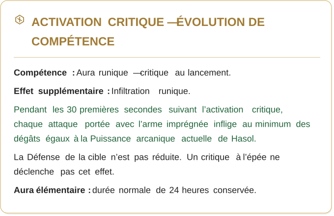
  </picture>
  

    
Version textuelle de la fenêtre

  
<svg class="lit-window__icon" viewBox="0 0 24 24" aria-hidden="true" focusable="false"><path d="m12 3 8 5v8l-8 5-8-5V8Z M12 7v10 M8 10l8 4"/></svg>ACTIVATION CRITIQUE — ÉVOLUTION DE COMPÉTENCE

  
<strong>Compétence :</strong> Aura runique — critique au lancement.

  
<strong>Effet supplémentaire :</strong> Infiltration runique.

  
Pendant les 30 premières secondes suivant l’activation critique, chaque attaque portée avec l’arme imprégnée inflige au minimum des dégâts égaux à la Puissance arcanique actuelle de Hasol.

  
La Défense de la cible n’est pas réduite. Un critique à l’épée ne déclenche pas cet effet.

  
<strong>Aura élémentaire :</strong> durée normale de 24 heures conservée.

  

Hasol resta figée.

Elle relut la fenêtre.

Puis une seconde fois.

— Maître Orven…

Sa voix tremblait légèrement.

Orven s’approcha.

— Qu’est-ce qui se passe ?

— Mon sort…

Elle lui montra la notification.

Le maître artisan parcourut les informations.

Son expression changea immédiatement.

— Un coup critique à l’activation ?

Hasol acquiesça.

— Oui !

Orven relut la description.

Puis il releva brusquement la tête.

— Le mannequin renforcé. Maintenant !

Hasol sursauta.

— Quoi ?

— Tu as trente secondes depuis l’activation. Ne les passe pas à me regarder !

Elle comprit.

Elle se précipita vers la cible.

L’épée brillait d’une énergie inhabituelle.

L’aura élémentaire était toujours présente, mais des caractères supplémentaires parcouraient brièvement le fil du métal.

Hasol prit position devant le mannequin.

Puis frappa.

La lame heurta sa protection.

Elle connaissait parfaitement cette sensation.

Lors des essais précédents, la résistance du mannequin avait absorbé presque toute la puissance du coup.

Mais cette fois, la fenêtre de dégâts afficha une valeur nettement supérieure.

Hasol ouvrit de grands yeux.

Le nombre correspondait exactement à sa Puissance arcanique actuelle.

— C’est…

— Encore ! lança Orven.

Elle frappa une seconde fois.

Le résultat se répéta.

La cible opposait toujours la même Défense.

Pourtant, les dégâts ne descendaient pas sous le seuil indiqué par sa nouvelle compétence.

Orven examinait les mesures avec une attention intense.

— Continue !

Hasol frappa de nouveau.

Puis encore une fois.

Chaque coup produisait cet effet inhabituel.

Une force que la protection du mannequin ne parvenait pas à réduire en dessous du minimum imposé par la magie.

Hasol sentait son cœur battre à toute vitesse.

Elle n’avait jamais vu quelque chose de semblable.

Puis, brusquement, les inscriptions supplémentaires disparurent.

La lame conserva son aura élémentaire.

Mais la vibration particulière qui l’entourait s’éteignit.

Hasol frappa une dernière fois.

Le résultat redevint semblable à ceux des essais précédents.

La Défense du mannequin absorba de nouveau l’essentiel du coup.

Elle recula.

Son souffle était court.

— C’est terminé…

Orven consulta les mesures.

Puis hocha lentement la tête.

— Trente secondes.

Hasol contempla son épée.

L’aura brillait toujours.

Mais la propriété extraordinaire avait disparu.

Elle regarda la fenêtre de compétence.

— Donc… ce pouvoir n’apparaît que si Aura runique réussit une activation critique.

Orven acquiesça.

— Et non lorsque tu réalises un coup critique avec l’épée.

Hasol hocha la tête.

Cette distinction était essentielle.

Un combattant pouvait multiplier les coups d’épée pendant un affrontement.

Mais elle ne pouvait pas multiplier aussi facilement les activations d’Aura runique.

Chaque tentative demandait deux cents Mana.

Chaque tentative détruisait une rune.

Et rien ne garantissait qu’un nouveau coup critique se produirait.

Orven observa les données une dernière fois.

— Tu comprends ce que cela signifie ?

Hasol acquiesça lentement.

— Si je déclenche cet effet au bon moment, je pourrais infliger des dégâts à un adversaire que je ne parviendrais normalement pas à blesser suffisamment.

— Oui.

Il marqua une pause.

— Mais il ne dure que trente secondes. Et tu ne peux pas compter sur son déclenchement.

Hasol regarda la lame.

— Je sais.

Orven referma son carnet.

— C’est un pouvoir remarquable.

Puis il ajouta :

— Et potentiellement ruineux.

Hasol éclata de rire.

— Vous trouvez toujours une manière de me rappeler le prix des choses !

— C’est mon travail.

Elle sourit.

Puis son regard revint vers la fenêtre.

Infiltration runique.

Elle avait commencé la semaine avec quelques runes destinées au recyclage et un pouvoir qu’elle connaissait à peine.

Elle avait dépensé du Mana, sacrifié des pierres et consacré plusieurs soirées à comprendre ce qu’elle pouvait faire.

Et maintenant, sa compétence venait de révéler une possibilité inattendue.

Elle sentit une joie immense lui monter à la poitrine.

Puis, presque aussitôt, une petite frustration.

— C’est dommage…

Orven tourna la tête.

— Quoi donc ?

Hasol montra le mannequin.

— J’ai enfin obtenu un coup critique à l’activation… et j’ai utilisé presque tout l’effet ici.

Orven la contempla.

Puis il éclata de rire.

Hasol rougit.

— Quoi ?

— Tu viens de découvrir une évolution extraordinaire de ta compétence, et tu te plains déjà de l’avoir gaspillée ?

Elle baissa les yeux.

— Dit comme ça…

Le maître artisan secoua la tête, amusé.

— Tu auras d’autres occasions de combattre.

Il désigna l’épée.

— Pour le moment, tu sais que cet effet existe. Et tu as compris ses limites.

Hasol acquiesça.

Orven reprit :

— Une connaissance acquise sans mettre ta vie en danger n’est jamais complètement gaspillée.

Elle resta silencieuse.

Puis un sourire apparut sur son visage.

— Vous avez raison.

Il sourit à son tour.

— Cela arrive.

Hasol éclata de rire.

En quittant le terrain d’entraînement, Hasol s’arrêta quelques instants devant les portes de l’atelier.

La nuit était tombée.

Quelques lanternes éclairaient la rue.

Elle contempla les deux épées qu’elle transportait.

L’une portait encore l’aura de Terre que Zio avait fait appliquer pour un mois.

L’autre venait de recevoir sa propre magie.

Deux chemins différents pour imprégner une arme d’énergie élémentaire.

Deux possibilités qui n’avaient ni les mêmes coûts ni les mêmes avantages.

Hasol sourit.

Elle n’avait pas encore trouvé la meilleure manière d’utiliser Aura runique pendant une véritable chasse.

Mais elle commençait à comprendre que son pouvoir ne remplacerait pas systématiquement le travail des autres artisans.

Il lui offrirait surtout des choix.

Et elle avait désormais envie d’apprendre à les faire correctement.

## VII. La carte de Yoon

Le lendemain matin, Yoon attendait déjà près des portes de la capitale.

Elle tenait une petite carte roulée entre ses doigts.

Lorsqu’elle aperçut Hasol, elle leva joyeusement le bras.

— Hasol !

La jeune femme s’approcha.

— Bonjour !

Yoon la contempla avec attention.

— Tu as l’air fatiguée.

Hasol eut un rire embarrassé.

— J’ai beaucoup travaillé cette semaine.

— Tu t’es reposée, au moins ?

— Oui.

Yoon plissa les yeux.

— Vraiment ?

Hasol hésita.

Puis sourit.

— Un peu.

La jeune Sage croisa les bras.

— Hasol…

— Mais j’ai une bonne nouvelle !

Le visage de Yoon changea immédiatement.

— Quoi ?

Hasol lui raconta l’évolution de son Aura runique.

Elle expliqua les essais, le coup critique survenu au moment de l’activation et les trente secondes d’Infiltration runique.

Yoon l’écouta sans l’interrompre.

Puis elle resta immobile.

— Attends.

Hasol sourit.

— Oui ?

— Tu veux dire que pendant trente secondes, même une Défense très élevée ne peut pas réduire les dégâts de ton arme en dessous de ta Puissance arcanique ?

— Exactement.

Les yeux de Yoon s’agrandirent.

— Mais c’est incroyable !

Puis elle réfléchit.

— Enfin… si tu obtiens le coup critique.

Hasol acquiesça.

— Oui.

— Et tu dois sacrifier une rune à chaque activation.

— Oui.

Yoon resta silencieuse.

Puis elle leva les yeux vers Hasol.

— Donc on ne peut pas construire toute notre stratégie autour de ça.

Hasol sourit.

— C’est aussi ce que m’a dit Orven.

Yoon hocha la tête avec sérieux.

— Alors il faudra l’utiliser comme une possibilité supplémentaire. Pas comme quelque chose dont on dépend.

Hasol sentit une petite chaleur lui monter dans la poitrine.

Quelques jours plus tôt, Yoon aurait peut-être simplement célébré la puissance de la compétence.

Aujourd’hui, elle réfléchissait déjà à ses limites.

Elles apprenaient toutes les deux.

— Et toi ? demanda Hasol. Comment s’est passée ta semaine ?

Le visage de Yoon s’illumina.

— Oh ! J’ai plein de choses à te raconter !

Elle commença immédiatement à décrire ses entraînements à l’Académie.

Le déplacement de ses cercles.

Les exercices de coordination.

Les remarques de son professeur.

Puis elle déroula sa carte.

— Et j’ai trouvé quelque chose !

Hasol se pencha.

Yoon avait tracé plusieurs itinéraires dans le bois des Crocs Gris.

Une zone était entourée d’un cercle.

— Là.

Elle désigna un passage rocheux.

— J’ai étudié les cartes utilisées par l’Académie. Il y a un chemin étroit entre deux formations de pierre.

Hasol observa le dessin.

— Tu penses qu’on pourrait s’y battre ?

— Oui.

Yoon releva les yeux.

— Les loups ne pourraient pas nous encercler aussi facilement que dans la forêt.

Hasol étudia le passage.

— Et si nous devons reculer ?

La jeune Sage sourit.

— Il y a une sortie derrière.

Elle lui montra le sentier.

Hasol acquiesça.

— C’est intéressant.

Yoon sembla ravie.

— Tu vois !

Mais Hasol continua à examiner la carte.

— Il faudra tout de même vérifier le terrain avant de s’y engager. Les cartes ne montrent pas forcément les racines, les pierres tombées ou les passages obstrués.

Yoon acquiesça immédiatement.

— Bien sûr.

Elle rangea la carte.

Puis ajouta :

— Au fait, j’ai aussi apporté le petit déjeuner.

Hasol cligna des yeux.

— Quoi ?

Yoon ouvrit sa sacoche.

Elle en sortit plusieurs petits pains.

Hasol éclata de rire.

— Encore ?

— Quoi ?

— Tu emportes toujours autant de nourriture ?

Yoon redressa le menton.

— Une bonne préparation commence par un bon repas.

Hasol rit de plus belle.

— Zio doit vraiment s’amuser avec toi.

— Il ne comprend rien à l’importance des provisions.

Elles se mirent en route en partageant les petits pains.

La forêt les attendait.

Et cette fois, aucune des deux ne comptait s’y aventurer sans réfléchir.

## VIII. Le passage étroit

Les premiers combats de la matinée se déroulèrent sans difficulté majeure.

Hasol et Yoon affrontèrent plusieurs loups gris de niveau cinq.

Leur coordination s’était améliorée.

Hasol annonçait ses déplacements.

Yoon surveillait les angles morts.

Et lorsqu’elles décidaient de poser Chant runique, elles choisissaient d’abord un endroit qui leur permettait de conserver une ligne de retraite.

L’aura de Terre offerte par Zio était toujours active sur l’épée de Hasol.

Elle n’avait aucune raison de la remplacer.

Sa nouvelle compétence lui permettait de créer d’autres auras, mais chaque activation détruisait une rune et consommait une part importante de sa réserve de Mana.

Pour cette chasse, l’enchantement du forgeron suffisait.

Yoon semblait partager son avis.

— On garde tes runes pour les situations où on en aura vraiment besoin, déclara-t-elle après leur deuxième combat.

Hasol sourit.

— Exactement.

Elles poursuivirent leur route.

Le passage rocheux se trouvait plus loin dans le bois.

Deux masses de pierre se dressaient de chaque côté d’un sentier étroit, laissant entre elles un espace suffisamment large pour qu’une personne armée d’une épée puisse combattre.

Au-delà, le chemin s’élargissait de nouveau.

Hasol observa attentivement les alentours.

Les rochers étaient couverts de mousse.

Plusieurs petites pierres jonchaient le sol.

Une racine traversait le sentier à proximité de l’entrée.

Elle s’accroupit pour l’examiner.

— Il faudra faire attention ici.

Yoon s’approcha.

— À la racine ?

— Oui. Si nous devons reculer rapidement, elle pourrait nous faire trébucher.

La jeune Sage acquiesça.

Elle sortit sa carte.

Puis compara les lieux avec son dessin.

— Le passage est un peu plus étroit que je l’imaginais.

Hasol regarda les rochers.

— Mais il pourrait nous aider.

Elle réfléchit quelques instants.

Puis demanda :

— Où placerais-tu ton cercle ?

Yoon examina le terrain.

Elle désigna l’arrière du passage.

— Ici. Comme ça, tu peux reculer pour recevoir les soins. Et moi, je peux rester derrière cette pierre sans perdre ma ligne de vue.

Hasol observa la position.

Puis acquiesça.

— Ça me semble bien.

Elles vérifièrent leur sortie.

Retirèrent quelques petites pierres qui auraient pu gêner leurs déplacements.

Puis prirent le temps de repérer les endroits où elles pourraient se mettre à l’abri.

Yoon sourit.

— Zio serait fier de nous.

Hasol eut un petit rire.

— Il trouverait sûrement encore quelque chose à corriger.

— Évidemment.

La jeune Sage soupira.

— Il trouverait un défaut même à un terrain parfaitement vide.

Hasol éclata de rire.

Puis un bruit retentit entre les arbres.

Les deux jeunes filles se figèrent.

Un grondement.

Puis un second.

Hasol dégaina lentement.

Trois silhouettes apparurent à l’entrée du sentier.

Des loups gris.

Mais ils étaient plus grands que ceux qu’elles avaient affrontés le matin.

Leur fourrure était plus sombre.

Leurs épaules plus larges.

Hasol activa l’identification habituelle.

Les niveaux apparurent.

  <picture class="lit-window__github-picture">
    <source media="(max-width: 600px)" srcset="assets/fenetres/051-mobile.svg">
    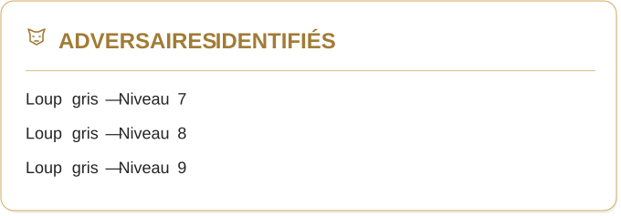
  </picture>
  

    
Version textuelle de la fenêtre

  
<svg class="lit-window__icon" viewBox="0 0 24 24" aria-hidden="true" focusable="false"><path d="M5 10 3 4l7 3h4l7-3-2 6v7l-7 4-7-4Z M8 12h1 M15 12h1 M10 17h4"/></svg>ADVERSAIRES IDENTIFIÉS

  
Loup gris — Niveau 7

  
Loup gris — Niveau 8

  
Loup gris — Niveau 9

  

Yoon inspira brusquement.

— Trois…

Hasol sentit son cœur accélérer.

Le plus grand loup avançait légèrement derrière les deux autres.

Son regard restait fixé sur elles.

Elle resserra sa prise sur la poignée de son épée.

— Yoon.

— Oui ?

— On reste sur le plan.

La jeune Sage acquiesça.

— D’accord.

Hasol prit une inspiration.

Puis elle se plaça à l’entrée du passage.

Yoon recula jusqu’à la position prévue.

Les loups approchaient.

Le premier grondait sourdement.

Le deuxième cherchait déjà un chemin sur le côté.

Mais les rochers limitaient ses mouvements.

Hasol sentit une petite satisfaction.

Ça fonctionne.

Elle leva son épée.

La lumière brun doré de l’aura de Terre se déploya sur la lame.

— Prête ?

Derrière elle, Yoon répondit :

— Prête !

— Alors allons-y.

Le loup de niveau sept attaqua le premier.

Il bondit vers Hasol.

Elle se décala et frappa son flanc.

La lame imprégnée de Terre traversa sa fourrure.

L’animal poussa un cri.

Mais contrairement aux loups de niveau cinq, il ne s’effondra pas.

Il pivota immédiatement.

Hasol recula d’un pas.

— Résonance runique !

Les inscriptions de Yoon enveloppèrent ses runes.

Hasol sentit leur puissance augmenter.

Elle para une nouvelle attaque.

Puis frappa.

Le loup recula.

Mais le deuxième avançait déjà derrière lui.

Hasol remarqua sa position.

Elle aurait pu poursuivre le premier.

Peut-être même l’achever immédiatement.

Mais elle se souvint de la dernière chasse.

De la branche.

De Yoon qui tombait.

Elle recula volontairement.

Le premier loup tenta de la poursuivre.

Mais le passage était trop étroit pour que les deux animaux attaquent facilement de front.

Le second dut ralentir.

— Maintenant ! lança Hasol.

Une Vague runique frappa le premier loup.

Les dégâts furent modestes.

Mais ils s’ajoutèrent aux blessures déjà infligées.

Hasol profita de l’ouverture pour avancer.

Son épée décrivit un mouvement court.

La lumière de Terre brilla.

Le loup de niveau sept s’effondra.

— Un ! s’exclama Yoon.

Hasol eut presque envie de rire.

Mais le deuxième loup bondissait déjà.

— Reste concentrée !

— Je le suis !

Le niveau huit se jeta contre sa garde.

Le choc fut nettement plus puissant.

Hasol recula.

Ses bottes glissèrent légèrement sur la terre.

Elle réussit à repousser l’animal, mais sentit une douleur sourde remonter dans son bras.

Sa blessure récente était presque guérie.

Pourtant, le souvenir de la morsure sembla traverser son corps.

Elle serra les dents.

Yoon remarqua son mouvement.

— Hasol ?

— Ça va !

La jeune Sage ne discuta pas.

Elle leva la main.

— Chant runique !

Un cercle vert apparut à l’endroit prévu.

Les écritures se déployèrent au sol.

Hasol recula dans la zone.

Quelques secondes plus tard, une impulsion de soin lui rendit une partie de ses PV.

Le loup avança.

Elle le repoussa.

Puis se décala pour éviter ses crocs.

Une nouvelle Vague runique le frappa au flanc.

L’animal détourna brièvement son attention vers la source de l’attaque.

Hasol réagit immédiatement.

— Yoon, ne bouge pas !

Elle avança.

Sa lame atteignit l’épaule du loup.

L’animal tenta de se retourner.

Mais les rochers gênaient son mouvement.

Hasol frappa de nouveau.

L’aura de Terre illumina le passage.

Le loup de niveau huit s’effondra.

Elle recula aussitôt.

Son souffle était rapide.

Deux monstres vaincus.

Il en restait un.

Le plus dangereux.

Le loup de niveau neuf s’avança lentement.

Il avait observé les premiers affrontements.

Hasol le vit examiner le passage.

Puis les rochers.

Puis Yoon derrière elle.

La jeune femme sentit une inquiétude lui serrer la poitrine.

Ce loup était plus expérimenté que les autres.

Il ne semblait pas vouloir se précipiter.

Yoon parla doucement derrière elle.

— Hasol…

— Je sais.

Le loup avançait toujours.

Hasol resserra sa prise sur l’épée.

— On ne change rien. Il doit venir vers nous.

Yoon acquiesça.

Le monstre s’arrêta.

Puis bondit brusquement.

Hasol para.

Le choc fut violent.

Elle sentit ses bras trembler.

Le loup recula immédiatement.

Puis revint à l’attaque.

Hasol dut céder du terrain.

Elle recula dans le cercle de soin.

Une nouvelle impulsion traversa son corps.

Le loup s’arrêta juste devant le passage.

Il gronda.

Hasol comprit qu’il cherchait un angle d’attaque.

Elle observa les rochers.

Puis le sol.

Il y avait une petite différence de hauteur sur sa droite.

Pas suffisante pour permettre à un loup de contourner complètement le passage.

Mais assez pour lui donner un meilleur appui.

Il va passer par là.

Hasol pivota légèrement.

Le loup bondit.

Elle avait anticipé son mouvement.

Sa lame remonta.

L’aura de Terre atteignit son flanc.

L’animal poussa un cri.

Mais son élan le porta jusqu’à elle.

Hasol fut projetée contre le rocher.

La douleur lui coupa le souffle.

Son épée glissa légèrement dans sa main.

— Hasol !

Yoon leva le bras.

Une Vague runique atteignit le loup.

La petite attaque ne possédait aucun pouvoir particulier pour immobiliser l’adversaire.

Mais elle lui infligea des dégâts supplémentaires, attirant son attention pendant un bref instant.

La créature tourna la tête.

Hasol profita immédiatement de cette seconde.

Elle se dégagea du rocher.

Puis recula.

— Je vais bien !

Sa voix était un peu trop aiguë pour paraître convaincante.

Yoon n’insista pas.

Elle gardait les yeux fixés sur le monstre.

Hasol reprit sa position.

Le loup approchait de nouveau.

Mais cette fois, elle ne regardait plus uniquement ses crocs.

Elle observait ses appuis.

Ses épaules.

La manière dont il déplaçait son poids avant chaque bond.

Elle inspira.

Anticiper.

Le loup s’élança.

Hasol se déplaça une fraction de seconde plus tôt.

La créature passa près d’elle.

Sa lame atteignit le côté de son cou.

Le loup poussa un cri.

Mais resta debout.

Yoon lança une nouvelle Vague runique.

Hasol recula immédiatement pour dégager la trajectoire.

L’onde lumineuse atteignit sa cible.

Puis le loup bondit encore.

Cette fois, Hasol le reçut avec son épée déjà placée.

Elle détourna son attaque.

Puis frappa.

Une lumière brun doré éclata au point d’impact.

La lame pénétra profondément dans le flanc du monstre.

L’animal chancela.

Hasol avança d’un pas.

Puis porta un dernier coup.

Le loup de niveau neuf s’effondra.

Le silence revint.

Hasol resta immobile.

Sa respiration était rapide.

Ses bras tremblaient.

Elle attendit quelques secondes avant de rengainer son épée.

Derrière elle, Yoon ne bougeait pas non plus.

Puis une petite voix s’éleva.

— Hasol ?

Elle tourna la tête.

— Oui ?

Yoon regarda les trois loups étendus dans le passage.

Puis son visage s’illumina.

— On a réussi…

Hasol resta silencieuse une seconde.

Elle regarda les monstres.

Puis les rochers.

Puis sa partenaire.

Un sourire immense apparut sur son visage.

— Oui !

Yoon poussa un cri de joie.

Elle se précipita vers Hasol avant de s’arrêter brusquement.

— Attends ! Ton bras !

Hasol éclata de rire.

— Ça va !

— Tu es sûre ?

— Oui !

Yoon la contempla avec suspicion.

Puis finit par sourire.

— Alors…

Elle tendit les bras.

Hasol rit et la serra doucement contre elle.

Pendant quelques secondes, elles restèrent ainsi au milieu du passage rocheux, avec le cercle de soin qui continuait à briller derrière elles.

Elles n’avaient pas remporté un combat extraordinaire.

Elles n’avaient pas vaincu un boss.

Elles n’étaient pas devenues des chasseuses célèbres.

Mais elles avaient affronté trois adversaires plus dangereux que ceux de leurs premières sorties.

Et elles avaient gagné.

  <picture class="lit-window__github-picture">
    <source media="(max-width: 600px)" srcset="assets/fenetres/052-mobile.svg">
    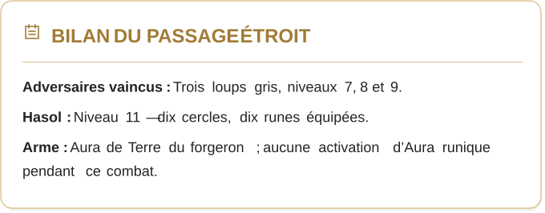
  </picture>
  

    
Version textuelle de la fenêtre

  
<svg class="lit-window__icon" viewBox="0 0 24 24" aria-hidden="true" focusable="false"><path d="M4 5h16v15H4Z M8 3v4 M16 3v4 M8 11h8 M8 15h8"/></svg>BILAN DU PASSAGE ÉTROIT

  
<strong>Adversaires vaincus :</strong> Trois loups gris, niveaux 7, 8 et 9.

  
<strong>Hasol :</strong> Niveau 11 — dix cercles, dix runes équipées.

  
<strong>Arme :</strong> Aura de Terre du forgeron ; aucune activation d’Aura runique pendant ce combat.

  

Ensemble.

## IX. Un même objectif

Elles s’installèrent un peu plus tard sur un petit promontoire rocheux, à distance du passage.

Le ciel commençait doucement à se couvrir.

Yoon sortit sa gourde.

Puis plusieurs petits pains.

Hasol éclata de rire.

— Tu en as encore ?

La jeune Sage leva le menton.

— Je t’avais dit que j’étais bien préparée.

— Je commence à le croire.

Yoon lui tendit un morceau de pain.

Hasol le prit avec gratitude.

Elles mangèrent en silence pendant quelques minutes.

Le vent faisait doucement bouger les feuilles autour d’elles.

Au loin, un oiseau lança un cri bref.

Puis le calme revint.

Hasol contempla son épée.

L’aura de Terre brillait faiblement le long de la lame.

Elle repensa au forgeron.

À Zio.

À la somme qu’il avait dépensée pour elle.

Puis aux runes qu’elle avait sacrifiées pendant la semaine.

À l’évolution de sa compétence.

Et enfin au combat qu’elles venaient de remporter.

— Yoon ?

La jeune Sage tourna la tête.

— Oui ?

Hasol hésita.

— Je suis contente qu’on ait formé une équipe.

Yoon cligna des yeux.

Puis son visage s’illumina.

— Moi aussi !

Elle réfléchit quelques secondes.

— Tu sais, cette semaine, j’ai parlé de nos chasses à une amie de l’Académie.

— Ah bon ?

— Oui. Samia.

Hasol sourit.

— Et qu’est-ce qu’elle en a pensé ?

Yoon regarda le ciel.

— Elle m’a dit que j’avais enfin trouvé une équipe dans laquelle j’avais envie de m’investir.

Hasol resta silencieuse.

Yoon poursuivit :

— Au début, je pensais surtout que ce serait amusant de combattre avec une autre classe runique.

Elle eut un petit rire.

— Je crois que je ne m’étais pas rendu compte de tout ce qu’il faudrait apprendre.

Hasol acquiesça.

— Moi non plus.

Yoon contempla le passage rocheux.

— Mais j’aime bien ça.

Elle se tourna vers Hasol.

— J’aime bien chercher des solutions avec toi.

Hasol sourit doucement.

— Moi aussi.

La jeune Sage reprit :

— On ne fait pas exactement les mêmes choses pendant la semaine.

— Non.

— Toi, tu travailles chez Orven. Tu apprends à améliorer les runes et à utiliser ta nouvelle compétence.

Elle désigna sa propre sacoche.

— Moi, je vais à l’Académie. J’apprends à mieux contrôler mes sorts et à combattre avec les autres.

Hasol acquiesça.

Yoon sourit.

— Mais quand on se retrouve, tout ce qu’on a appris peut nous servir.

Hasol contempla son épée.

Puis le petit carnet qui dépassait de sa sacoche.

Elle avait passé trois années à poursuivre son rêve de chasseuse presque seule.

Maintenant, elle avait un travail qui lui plaisait.

Un maître artisan qui lui accordait progressivement sa confiance.

Une nouvelle compétence.

Et une partenaire qui souhaitait avancer à ses côtés.

Tout cela ne faisait pas disparaître ses difficultés.

Sa classe coûtait toujours vingt points.

Ses progrès demandaient toujours des efforts considérables.

Elle ne possédait toujours aucun véritable sort offensif direct.

Et son Aura runique, aussi prometteuse soit-elle, ne pouvait pas être utilisée sans réfléchir à ses ressources.

Mais, pour la première fois, elle n’avait plus l’impression de courir derrière les autres.

Elle avançait.

À son rythme.

Sur un chemin qu’elle commençait enfin à comprendre.

Hasol sourit.

— Tu sais quoi ?

Yoon releva la tête.

— Quoi ?

— La semaine prochaine, je vais demander à Orven de me montrer comment mieux évaluer les runes destinées au recyclage.

Les yeux de Yoon brillèrent.

— Pour ton Aura runique ?

— Oui. Mais aussi parce que je veux comprendre ce que je peux réellement en faire.

Yoon sourit.

— Et moi, je vais continuer à travailler mes placements à l’Académie.

Elle réfléchit.

Puis ajouta :

— Et ma précision avec Vague runique !

Hasol rit.

— Ça me semble une bonne idée.

Yoon leva joyeusement son petit pain.

— Alors à notre prochaine chasse !

Hasol regarda le morceau de pain qu’elle tenait.

Puis celui de Yoon.

Elle éclata de rire.

— Tu veux vraiment trinquer avec du pain ?

— Pourquoi pas ?

Hasol secoua la tête, amusée.

Puis leva son morceau.

Les deux petits pains s’entrechoquèrent doucement.

— À notre prochaine chasse, répondit-elle.

Sur le chemin du retour, les deux jeunes filles continuèrent à discuter.

Yoon racontait déjà les exercices qu’elle comptait essayer.

Hasol lui parlait de ses expériences avec Aura runique et des précautions nécessaires pour économiser ses runes.

Parfois, elles n’étaient pas d’accord.

Yoon imaginait des stratégies audacieuses.

Hasol lui rappelait les limites de leurs compétences.

Puis Hasol proposait une autre possibilité.

Et Yoon trouvait immédiatement une manière de l’améliorer.

Leurs idées se mélangeaient.

Se corrigeaient.

Devenaient progressivement quelque chose qu’aucune des deux n’aurait imaginé seule.

Lorsqu’elles aperçurent les remparts de la capitale, le soleil commençait à descendre derrière les collines.

Yoon accéléra légèrement.

— Hasol !

— Oui ?

— Tu crois qu’on sera fortes, un jour ?

Hasol contempla un instant les portes de la ville.

Elle repensa à la jeune fille qu’elle avait été à l’Académie.

À celle qui n’avait jamais trouvé sa place dans une équipe.

À celle qui avait continué à frapper des slimes alors que les autres progressaient sans elle.

Puis elle regarda Yoon.

Sa partenaire marchait près d’elle, le visage tourné vers la lumière du soir.

Hasol sourit.

— Je ne sais pas à quel point nous deviendrons fortes.

Yoon pencha la tête.

— Mais ?

La jeune femme rit doucement.

— Mais je sais qu’on peut devenir meilleures qu’hier.

Yoon resta silencieuse.

Puis un sourire apparut sur son visage.

— Ça me va !

Elle reprit sa marche.

Hasol l’accompagna.

À la reprise de la semaine, elles retrouveraient leurs occupations respectives.

L’une retournerait à l’Académie.

L’autre reprendrait sa place à l’atelier.

Elles passeraient leurs journées à apprendre des choses différentes, auprès de personnes différentes.

Mais lorsqu’elles se retrouveraient, elles continueraient à avancer vers le même rêve.

Et pour Hasol, qui avait longtemps cru devoir poursuivre ce rêve toute seule, cela changeait déjà beaucoup de choses.

**Fin du chapitre 6 — Deux chemins, un même objectif**

---

# Chapitre 7 — Le talent d’une légende

## I. Un investissement pour l’avenir

— Quatre pièces…

Hasol tourna une nouvelle fois la page du catalogue.

— Évidemment. Il fallait que ce soit quatre.

— Tu comptes négocier avec le papier ?

Elle releva la tête.

Orven venait d’arriver derrière elle, une tasse fumante à la main.

— Bonjour, Maître Orven !

— Bonjour. Alors, quel malheur te pousse à menacer mon catalogue de si bon matin ?

Hasol lui montra la page.

— L’ensemble Arcanique.

Le maître artisan ajusta ses lunettes.

— Ah.

Il observa les caractéristiques.

— Je comprends mieux ta tête.

Hasol avait passé une partie de la soirée précédente à réfléchir aux possibilités offertes par Infiltration runique.

Depuis sa découverte, une idée ne la quittait plus : augmenter sa Puissance arcanique lui permettrait à la fois de renforcer les dégâts garantis par son pouvoir et d’améliorer ses chances de l’activer de manière critique.

L’ensemble Arcanique semblait parfaitement adapté.

  <picture class="lit-window__github-picture">
    <source media="(max-width: 600px)" srcset="assets/fenetres/053-mobile.svg">
    
  </picture>
  

    
Version textuelle de la fenêtre

  
<svg class="lit-window__icon" viewBox="0 0 24 24" aria-hidden="true" focusable="false"><path d="m12 3 8 9-8 9-8-9Z M8 12h8 M12 8v8"/></svg>ENSEMBLE ARCANIQUE

  
<strong>Condition :</strong> 4 pièces équipées.

  
Bonus d’ensemble : +1 200 Puissance arcanique.

  
Deux ou trois pièces : aucun bonus d’ensemble.

  

Avec les règles de calcul des critiques, ce bonus représentait à lui seul quinze points supplémentaires de taux critique, auxquels s’ajoutaient les cinq pour cent de base.

Et il augmentait également ses dégâts critiques.

  <picture class="lit-window__github-picture">
    <source media="(max-width: 600px)" srcset="assets/fenetres/054-mobile.svg">
    
  </picture>
  

    
Version textuelle de la fenêtre

  
<svg class="lit-window__icon" viewBox="0 0 24 24" aria-hidden="true" focusable="false"><path d="M4 5h16v15H4Z M8 3v4 M16 3v4 M8 11h8 M8 15h8"/></svg>PUISSANCE ARCANIQUE ET CRITIQUES

  
<strong>CC (%) :</strong> 5 + (Puissance arcanique effective / 80) + Bonus CC

  
<strong>DCC (%) :</strong> 150 + (Puissance arcanique effective / 100) + Bonus DCC

  
À 100 % de CC ou davantage, une action éligible est toujours critique, sans surcritique.

  

Le problème était ailleurs.

— Les runes Arcanique (grades et rangs : À DÉFINIR) sont vraiment aussi rares ? demanda-t-elle.

— Davantage que tu ne l’imagines.

Orven posa sa tasse.

— Elles sont très recherchées, notamment par les mages et les chasseurs qui utilisent des compétences liées à leur Puissance arcanique. Et comme il en faut quatre pour activer l’ensemble, les acheteurs ont rarement envie de s’arrêter à une seule.

Hasol contempla le prix indiqué.

Puis elle referma lentement le catalogue.

— Je vois…

Orven sourit.

— Alors ? Tu abandonnes ?

Elle releva immédiatement la tête.

— Non !

Il éclata de rire.

— Je m’en doutais.

Hasol réfléchit.

— Je voudrais commencer par deux runes Arcanique (grades et rangs : À DÉFINIR) ayant la Puissance arcanique en caractéristique principale.

— Deux ne suffiront pas à activer l’ensemble.

— Je sais. Mais leurs caractéristiques principales seront déjà utiles.

Elle lui montra sa composition actuelle.

Quatre Fatal (grades actuels : À DÉFINIR ; 6★ ou 3★ selon la pièce).

Quatre Gardien (grades actuels : À DÉFINIR ; 6★ ou 3★ selon la pièce).

Deux Énergie (grades actuels : À DÉFINIR ; 3★).

— Je pourrais remplacer deux Gardien (grades actuels : À DÉFINIR ; 3★) offertes par ma mère, expliqua-t-elle. Je conserverais celle de mon père et une autre, donc un bonus Gardien resterait actif.

Orven observa les emplacements.

— Tu perdrais cependant ton second bonus Gardien et une partie de ta Défense.

— Oui.

Elle hésita.

— Mais si je veux exploiter Infiltration runique, il faudra bien commencer quelque part.

Le maître artisan réfléchit quelques instants.

Puis acquiesça.

— Le raisonnement se tient. À condition de ne pas oublier qu’un ennemi mort rapidement est certes moins dangereux, mais qu’un ennemi encore vivant peut te tuer avant que tu aies eu l’occasion d’utiliser ton joli calcul.

Hasol sourit.

— Je n’oublierai pas.

— Bien.

Il referma le catalogue.

— Alors il ne te reste qu’un problème.

Elle baissa les yeux vers les prix.

— L’argent.

— Exactement.

Orven lui adressa un sourire parfaitement innocent.

— Et, par un heureux hasard, j’ai une montagne de commandes qui n’attendent que toi.

Hasol éclata de rire.

— Vous trouvez toujours un moyen de me faire travailler davantage !

— C’est un talent que j’entretiens depuis vingt-cinq ans.

Il désigna son établi.

— Allez, au travail. Les runes Arcanique (grades et rangs : À DÉFINIR) ne vont pas tomber du ciel.

Hasol rangea le catalogue.

Son objectif était fixé.

Elle n’avait pas encore les moyens de l’atteindre.

Mais elle savait désormais dans quelle direction avancer.

## II. Quelque chose ne colle pas

L’atelier retrouva rapidement son agitation habituelle.

Les premières commandes de la matinée concernaient plusieurs runes communes et peu communes. Certaines devaient être améliorées jusqu’à +3, d’autres nécessitaient simplement un contrôle avant d’être rendues à leurs propriétaires.

Hasol travaillait avec sérieux.

Elle lisait soigneusement chaque fiche, préparait les pierres de mana nécessaires et vérifiait les instructions avant de commencer.

Orven supervisait les opérations depuis son propre établi.

Depuis quelque temps, il lui confiait davantage de commandes.

Elle avait encore besoin de conseils, particulièrement lorsqu’une amélioration présentait des risques inhabituels, mais son travail devenait suffisamment régulier pour qu’il puisse lui laisser davantage d’autonomie.

Ce matin-là, Hasol venait de terminer une nouvelle rune lorsqu’elle entendit Orven l’appeler.

— Hasol.

Elle releva la tête.

— Oui ?

— Viens voir.

Elle posa ses outils.

— Il y a un problème ?

Orven observait son registre avec une expression étrange.

— Peut-être.

Hasol s’approcha.

Le maître artisan désigna une série de résultats.

— Tu as bien noté toutes tes tentatives ?

Elle fronça les sourcils.

— Bien sûr.

— Y compris les échecs ?

— Évidemment !

Orven leva les yeux vers elle.

Hasol croisa les bras.

— Vous m’avez appris à ne jamais les oublier !

Il sourit légèrement.

— C’est vrai.

Puis son regard revint vers les chiffres.

— Alors c’est encore plus intéressant.

Hasol se pencha sur le registre.

Elle reconnaissait plusieurs commandes réalisées durant les derniers jours.

Une rune Énergie (grade et rang : À DÉFINIR).

Deux Fatal (grade et rang : À DÉFINIR).

Plusieurs pièces ordinaires confiées à l’atelier pour des améliorations simples.

— Qu’est-ce qui vous intrigue ?

Orven tourna une page.

— Le nombre d’échecs.

Hasol observa les colonnes.

Elle avait effectivement réussi une proportion importante de ses tentatives.

Mais cela ne lui paraissait pas particulièrement surprenant.

— C’est grâce à Bénédiction runique, probablement.

Le maître artisan releva les yeux.

— Tu m’as déjà parlé de ce passif.

— Oui.

— Il augmente tes chances de réussite.

Elle acquiesça.

— C’est ce qui est indiqué.

Orven se frotta la barbe.

— Mais de combien ?

Hasol ouvrit la bouche.

Puis la referma.

Elle n’en savait rien.

La description de sa compétence ne fournissait aucune valeur précise.

Et jusqu’à présent, elle n’avait jamais pris le temps de mesurer son avantage.

— Je ne sais pas, admit-elle.

Orven tourna une nouvelle page.

— Moi non plus.

Il resta silencieux quelques secondes.

Puis il se redressa.

— Nous allons changer ça.

L’après-midi, Orven sortit plusieurs anciens registres.

Hasol le regarda disposer les livres sur son bureau.

Certains étaient si épais qu’elle se demanda comment il avait réussi à les conserver en aussi bon état.

— Vous gardez vraiment tous vos résultats ?

— Bien sûr.

— Depuis combien de temps ?

Orven réfléchit.

— Suffisamment longtemps pour savoir que les registres sont moins trompeurs que les souvenirs.

Il désigna une pile.

— Et suffisamment longtemps pour regretter de ne pas avoir commencé encore plus tôt.

Hasol sourit.

Le maître artisan sélectionna plusieurs séries d’améliorations réalisées dans des conditions comparables.

Il lui expliqua comment éviter les conclusions hâtives.

Comparer une rune facile à améliorer avec une autre particulièrement difficile n’aurait aucun intérêt.

Il fallait tenir compte du niveau de renforcement, des conditions de travail et des ressources utilisées.

— Ce que nous voulons mesurer, expliqua-t-il, ce n’est pas si tu es plus chanceuse un jour donné.

Il posa deux fiches côte à côte.

— C’est si, à difficulté comparable, tes chances d’échec sont réellement différentes.

Hasol acquiesça.

Orven lui demanda ensuite de préparer des lots de contrôle.

Ils travaillèrent à tour de rôle, sur des séries équivalentes.

Les pierres de mana furent comptées.

Les tentatives consignées.

Chaque réussite et chaque échec figurèrent dans le registre.

Lorsque Hasol eut trop consommé de Mana, ils s’arrêtèrent.

Elle profita de la pause pour manger un morceau de pain.

Orven, lui, continua ses calculs.

— Vous devriez manger aussi, lui fit-elle remarquer.

— Je mange.

Hasol regarda sa tasse.

— Ce n’est pas de la nourriture.

— C’est une excellente boisson.

— Maître Orven…

Il leva les yeux.

— Tu commences à ressembler à ta mère.

Hasol éclata de rire.

— Elle vous dirait exactement la même chose !

— J’en suis certain. C’est pour cela que je ne lui parle pas de mes repas.

Elle secoua la tête, amusée.

Puis retourna à ses fiches.

Les vérifications ne furent pas terminées en une journée.

Orven reprit les données des commandes antérieures et compléta les séries de contrôle.

Il vérifia les conditions de chaque comparaison.

Écarta les résultats qui ne pouvaient pas être rapprochés correctement.

Puis recommença ses calculs.

Hasol le voyait parfois froncer les sourcils devant son registre.

D’autres fois, il hochait lentement la tête.

Mais il refusait toujours de lui donner une conclusion.

— Vous avez découvert quelque chose ? demanda-t-elle finalement.

Orven regarda ses chiffres.

— J’ai découvert que je déteste les résultats qui me donnent envie de vérifier trois fois mes additions.

Hasol éclata de rire.

— C’est bon signe ?

— Je ne sais pas encore.

Il referma son registre.

— Mais nous approchons d’une réponse.

## III. La première anomalie

Le lendemain, Orven demanda à Hasol de s’asseoir devant son bureau.

Deux séries de résultats étaient disposées devant lui.

— Regarde ces chiffres.

Hasol se pencha.

Chaque série comprenait quatre-vingts tentatives comparables, sélectionnées parmi les essais et les commandes déjà consignés.

Elle parcourut les colonnes.

La première appartenait à Orven.

La seconde à Hasol.

— Vous avez eu vingt échecs, remarqua-t-elle.

— Exact.

Elle regarda l’autre série.

— Et moi… quatorze ?

Orven acquiesça.

Hasol sourit.

— J’ai donc six échecs de moins !

— Oui. Mais ce qui m’intéresse surtout, c’est ce que représentent ces six échecs.

Il prit une feuille.

— Vingt échecs sur quatre-vingts tentatives, cela donne un taux d’échec de vingt-cinq pour cent.

Hasol suivit son calcul.

— D’accord.

— Quatorze sur quatre-vingts, cela donne dix-sept virgule cinq pour cent.

Il posa son crayon.

— La différence est de sept virgule cinq points de pourcentage.

Hasol acquiesça.

Orven poursuivit :

— Mais si nous comparons cette différence à mon taux d’échec initial, cela représente une réduction relative de trente pour cent.

La jeune femme cligna des yeux.

— Trente pour cent ?

— Environ, oui.

Il tapota les registres.

— Les autres séries ne produisent pas toutes exactement le même chiffre. Mais la tendance revient suffisamment régulièrement pour que je la prenne au sérieux.

Hasol contempla les résultats.

— Donc… j’ai trente pour cent de chances de réussir en plus ?

Orven secoua immédiatement la tête.

— Non. Ce n’est pas la même chose.

Il reprit son crayon.

— Imaginons qu’un artisan ait normalement trente pour cent de chances d’échouer.

Il écrivit les chiffres.

— Une réduction relative de trente pour cent fait passer ce risque de trente à vingt et un pour cent.

Hasol observa l’opération.

— Ah…

— Ce n’est pas une suppression de trente points de pourcentage. Tu peux toujours échouer.

Il désigna les quatorze échecs de sa propre série.

— Et tu échoues effectivement.

Hasol acquiesça.

— Je comprends.

  <picture class="lit-window__github-picture">
    <source media="(max-width: 600px)" srcset="assets/fenetres/055-mobile.svg">
    
  </picture>
  

    
Version textuelle de la fenêtre

  
<svg class="lit-window__icon" viewBox="0 0 24 24" aria-hidden="true" focusable="false"><path d="M4 5h16v15H4Z M8 3v4 M16 3v4 M8 11h8 M8 15h8"/></svg>COMPARAISON DES SÉRIES D’AMÉLIORATION

  
<strong>Orven :</strong> 20 échecs / 80 tentatives — 25 %.

  
<strong>Hasol :</strong> 14 échecs / 80 tentatives — 17,5 %.

  
<strong>Écart :</strong> 7,5 points de pourcentage ; réduction relative de 30 % des échecs.

  
Résultats de séries comparables, pas une réussite garantie.

  

Orven resta silencieux quelques instants.

Puis il s’adossa à sa chaise.

— Mais cela reste un avantage considérable.

Elle releva les yeux.

Le maître artisan contempla les registres.

— Tu sais combien de pierres de mana un atelier utilise au cours d’une année ?

Hasol réfléchit.

— Beaucoup ?

Orven éclata de rire.

— Beaucoup, oui.

Il se pencha vers elle.

— Chaque tentative ratée représente des ressources consommées sans progression. Sur une petite commande, le coût reste supportable.

Il désigna un coffret verrouillé.

— Mais lorsque les matériaux deviennent rares et que les niveaux d’amélioration augmentent, quelques échecs supplémentaires peuvent représenter des sommes importantes.

Hasol baissa les yeux vers ses mains.

— Alors Bénédiction runique…

— Est bien plus précieuse que je ne le pensais.

Orven la contempla.

Puis un sourire apparut sur son visage.

— Hasol, tu es une apprentie qui possède des chances de réussite dont beaucoup d’artisans expérimentés rêveraient.

Elle sentit ses joues chauffer.

— Pourtant, je fais encore beaucoup d’erreurs…

— Des erreurs de débutante, oui.

Orven haussa les épaules.

— Tu lis parfois trop vite. Tu oublies encore de vérifier certaines consignes. Et tu as cette déplorable habitude de vouloir continuer à travailler lorsque ton cerveau réclame une pause.

Hasol baissa les yeux.

— Je sais…

— Mais ces défauts se corrigent avec l’expérience.

Il désigna les registres.

— Ton avantage, lui, ne s’apprend pas.

Hasol resta silencieuse.

Pour la première fois, elle pouvait donner une valeur concrète à l’un des pouvoirs qui lui avaient été accordés lors de sa Révélation.

Un pouvoir qu’elle avait possédé pendant toutes ses années d’Académie.

Un pouvoir que personne n’avait réellement pris le temps de comprendre.

Elle sentit une étrange émotion lui serrer la poitrine.

Puis elle sourit.

— Alors… je peux vraiment devenir une bonne artisane ?

Orven la regarda avec une expression presque offensée.

— Une bonne artisane ?

Hasol se figea.

— J’ai dit quelque chose de mal ?

Il éclata de rire.

— Non, Hasol.

Il secoua la tête.

— Mais je commence à penser que tu pourrais devenir bien davantage.

Orven allait refermer le registre lorsqu’une autre annotation attira son attention.

Il s’immobilisa.

Puis reprit la dernière fiche.

Hasol remarqua immédiatement le changement.

— Maître ?

Il ne répondit pas.

Il ouvrit une autre page.

Puis une troisième.

Son expression redevint sérieuse.

Hasol se pencha.

— Il y a un autre problème ?

Orven leva lentement les yeux.

— Peut-être.

Elle soupira.

— Vous dites souvent ça, en ce moment.

Il ne sourit même pas.

— Hasol, va chercher le registre des valeurs obtenues lors des améliorations.

Elle cligna des yeux.

— Celui des caractéristiques ?

— Oui.

Il regarda de nouveau les chiffres.

— Je crois que nous n’avons pas terminé.

## IV. Le second secret

Hasol déposa le registre sur le bureau.

Orven l’ouvrit immédiatement.

Il parcourut plusieurs pages, revenant parfois en arrière pour comparer deux améliorations.

Puis il prit une feuille et commença à relever certaines valeurs.

Hasol l’observait sans comprendre.

— Qu’est-ce que vous cherchez ?

— Les gains de caractéristiques.

— Pourquoi ?

Orven désigna une amélioration réussie.

— Tu sais qu’une caractéristique dont l’augmentation est variable ne gagne pas toujours la même valeur.

Hasol acquiesça.

— Oui.

Selon le type de rune et le palier concerné, le renforcement pouvait produire un gain plus ou moins important dans les limites autorisées.

Une réussite ne garantissait pas automatiquement le meilleur résultat possible.

— Regarde celle-ci, poursuivit Orven.

Il lui montra une rune qu’elle avait améliorée quelques jours auparavant.

Une caractéristique avait bénéficié d’un renforcement.

Hasol lut la valeur.

— Elle a atteint le maximum possible pour ce palier.

— Exactement.

Il tourna la page.

— Et celle-ci ?

Elle examina le résultat.

— Le maximum aussi.

Orven ne répondit pas.

Il passa à une autre amélioration.

Puis une autre.

Hasol commença à comprendre ce qui l’intriguait.

— Attendez…

Elle se pencha davantage.

Plusieurs gains obtenus par ses améliorations atteignaient la limite supérieure de leur plage possible.

Elle avait déjà remarqué de bons résultats.

Mais elle les avait attribués à la chance.

Après tout, obtenir une valeur maximale était possible.

Ce n’était pas un événement impossible.

Seulement…

— Il y en a beaucoup, murmura-t-elle.

Orven acquiesça lentement.

— Beaucoup trop pour que je sois à l’aise avec l’idée de ne pas vérifier.

Il reprit ses propres registres.

Puis compara les résultats.

La différence était frappante.

Chez Orven, les gains variables se répartissaient entre plusieurs valeurs possibles.

Certains étaient faibles.

D’autres moyens.

Quelques-uns atteignaient leur maximum.

Chez Hasol, les valeurs maximales revenaient avec une fréquence étonnante.

Pas toujours.

Il existait des résultats inférieurs.

Mais les meilleurs gains apparaissaient si souvent qu’ils avaient fini par remplir les colonnes.

Orven resta silencieux un long moment.

Puis il demanda :

— Hasol, lorsque tu améliores une rune, est-ce que tu ressens quelque chose de particulier au moment où une caractéristique progresse ?

Elle réfléchit.

— Pas vraiment.

— Tu ne choisis pas la valeur ?

— Non.

— Tu ne vois pas les possibilités avant la tentative ?

— Non plus.

Elle hésita.

— Pourquoi ?

Orven posa son crayon.

— Parce que tu sembles obtenir très fréquemment la valeur maximale autorisée lorsqu’un renforcement variable se produit.

Hasol ouvrit de grands yeux.

— Vraiment ?

— Regarde.

Il plaça deux fiches devant elle.

La première présentait une série d’améliorations ordinaires.

La seconde, plusieurs renforcements réalisés par Hasol.

Les résultats ne laissaient aucun doute sur ce qu’il avait observé.

Hasol contempla les chiffres.

Puis releva lentement la tête.

— C’est… encore Bénédiction runique ?

Orven croisa les bras.

— C’est une possibilité sérieuse.

Il réfléchit quelques secondes.

— Mais je ne vais pas annoncer que ton passif possède une seconde propriété simplement parce que plusieurs résultats me plaisent.

Hasol acquiesça.

— Il faut vérifier.

— Exactement.

Il se leva.

— Préparons quelques runes d’essai.

Cette fois, Orven ne cherchait pas seulement à compter les réussites.

Il voulait examiner ce qui se produisait après une réussite, lorsqu’un renforcement à valeur variable était effectivement déclenché.

Il prépara les fiches correspondantes.

Pour chaque rune, il indiqua la plage de valeurs autorisées.

Hasol l’observa vérifier les inscriptions.

— Et si l’amélioration échoue ?

— Nous noterons l’échec, comme d’habitude.

Il désigna la colonne suivante.

— Mais nous n’inscrirons un gain de caractéristique que lorsqu’il se produit réellement.

Elle acquiesça.

Orven poursuivit :

— Il faut distinguer deux choses : réussir l’amélioration et obtenir une bonne valeur lors d’un renforcement.

Hasol prit la première rune.

— Compris.

La tentative réussit.

Mais aucun gain variable n’était prévu à cette étape.

Orven nota simplement la réussite.

Ils poursuivirent.

Une autre tentative échoua.

La pierre de mana fut consommée.

Hasol soupira.

Orven leva un sourcil.

— Tu vois ? Ton passif n’a toujours pas décidé de supprimer les échecs.

Elle sourit.

— Dommage.

— Je serais au chômage si c’était le cas.

Hasol éclata de rire.

Puis elle prépara une nouvelle tentative.

Cette fois, l’amélioration réussit et un renforcement variable se produisit.

Les inscriptions lumineuses parcoururent la rune.

Une caractéristique augmenta.

Orven consulta immédiatement la valeur obtenue.

Il s’immobilisa.

— Maximum.

Hasol releva les yeux.

— Encore ?

— Encore.

Il nota le résultat.

Puis ils poursuivirent.

Une autre réussite déclencha un nouveau renforcement.

La valeur fut inférieure au maximum.

Orven l’inscrivit sans commentaire.

Puis une amélioration suivante produisit un gain variable.

Maximum.

Plus tard, un autre.

Maximum également.

Hasol sentit son enthousiasme grandir.

À mesure que les essais et les anciens relevés étaient rapprochés, la tendance devenait de plus en plus difficile à ignorer.

Les bonnes valeurs n’étaient pas simplement un peu plus fréquentes.

Elles semblaient apparaître très souvent, comme si les tirages favorables étaient naturellement attirés vers leur limite supérieure.

Les vérifications occupèrent plusieurs séances.

Orven refusait de tirer une conclusion définitive à partir de quelques coups de chance.

Il voulait également éviter une erreur simple : ne retenir dans sa mémoire que les améliorations extraordinaires.

Ils consignèrent donc toutes les valeurs pertinentes.

Les maximales.

Les intermédiaires.

Les faibles.

Sans écarter les résultats décevants.

Lorsque Hasol revint le dernier jour, Orven l’attendait devant son bureau.

Les registres étaient ouverts.

Il avait cette expression particulière qu’elle commençait à connaître.

Celle qu’il prenait lorsqu’une idée le passionnait suffisamment pour lui faire oublier l’heure.

— Maître ?

Il releva les yeux.

— Assieds-toi.

Hasol s’exécuta.

Orven joignit les mains.

— Nous avons donc deux observations distinctes.

Il leva un doigt.

— Premièrement, tu sembles subir environ trente pour cent d’échecs en moins, en relatif, sur les séries comparables.

Hasol acquiesça.

Il leva un second doigt.

— Deuxièmement, lorsqu’une amélioration réussie produit un gain variable de caractéristique, ce gain atteint très fréquemment le maximum possible.

Elle resta silencieuse.

Orven poursuivit :

— Les deux phénomènes ne sont pas identiques.

Il désigna les fiches.

— Le premier te permet d’économiser des ressources en évitant davantage d’échecs.

Puis il posa la main sur un coffret contenant une rune améliorée.

— Le second te permet d’obtenir, plus souvent que prévu, des résultats de meilleure qualité.

Hasol contempla la pierre.

Elle commençait à comprendre ce que cela impliquait.

— Donc deux artisans pourraient réussir la même amélioration…

— … et ne pas obtenir un gain de caractéristique aussi élevé, termina Orven.

Il acquiesça.

— Exactement.

Hasol réfléchit.

— Mais je ne peux pas choisir quelle caractéristique sera renforcée.

— Non.

— Et je ne peux pas garantir le maximum ?

— Non plus.

Il lui adressa un sourire.

— Ce serait beaucoup trop simple.

Hasol rit doucement.

Orven reprit son sérieux.

— Mais lorsque les meilleures valeurs reviennent aussi souvent, la qualité moyenne des résultats peut devenir remarquable.

Elle baissa les yeux.

— Même sur des runes ordinaires ?

— Oui.

Il marqua une pause.

— Et sur des runes rares ou très coûteuses, la différence pourrait représenter une valeur considérable.

Hasol sentit son cœur accélérer.

Orven la contempla longuement.

Puis il murmura :

— Voilà donc ce que cache ta Bénédiction runique…

Elle releva la tête.

— Vous pensez vraiment que les deux effets viennent de mon passif ?

— C’est l’explication la plus cohérente pour le moment.

Il croisa les bras.

— Mais nous continuerons à vérifier. Je ne veux pas inventer une fréquence exacte à partir de données encore limitées.

  <picture class="lit-window__github-picture">
    <source media="(max-width: 600px)" srcset="assets/fenetres/056-mobile.svg">
    
  </picture>
  

    
Version textuelle de la fenêtre

  
<svg class="lit-window__icon" viewBox="0 0 24 24" aria-hidden="true" focusable="false"><path d="m12 3 8 5v8l-8 5-8-5V8Z M12 7v10 M8 10l8 4"/></svg>BÉNÉDICTION RUNIQUE — OBSERVATIONS

  
Passive

  
<strong>Réussite :</strong> Environ 30 % d’échecs en moins relativement aux séries comparables d’Orven.

  
<strong>Qualité :</strong> Maximum très fréquent lors d’un renforcement variable effectivement déclenché après une réussite.

  
Maximum non garanti, fréquence exacte non fixée ; ni choix de la caractéristique, ni dépassement des limites de la rune.

  

Hasol acquiesça.

Orven sourit.

— Une chose est certaine, en revanche.

— Laquelle ?

Il posa doucement le registre devant elle.

— Tu ne possèdes pas seulement un talent pour réussir les améliorations.

Il désigna les valeurs maximales.

— Tu possèdes aussi un talent pour les réussir particulièrement bien.

Hasol resta immobile.

Pendant trois années, sa classe légendaire avait surtout été une source de déception.

Maintenant, elle découvrait qu’un pouvoir qu’elle croyait presque inutile pouvait transformer la manière dont elle travaillerait toute sa vie.

Ses yeux commencèrent à picoter.

Elle baissa rapidement la tête.

Orven remarqua son expression.

Il attendit quelques instants.

Puis reprit :

— Attention, cela ne fait pas de toi une grande artisane du jour au lendemain.

Hasol eut un petit rire.

— Je sais…

— Tu dois encore apprendre à reconnaître les bonnes runes, à choisir les améliorations raisonnables, à gérer tes ressources et à savoir quand t’arrêter.

Elle acquiesça.

Orven sourit.

— Mais tu as quelque chose de rare entre les mains.

Il posa doucement une main sur son épaule.

— Hasol, tu es un prodige.

Cette fois, elle ne trouva rien à répondre.

Elle resta silencieuse.

Puis murmura :

— Merci, maître.

Orven retira sa main.

— Ne me remercie pas encore.

Elle releva les yeux.

Un sourire malicieux apparut sur le visage du vieil artisan.

— Avec un talent pareil, je compte bien te donner énormément de travail.

Hasol éclata de rire.

Et les larmes qu’elle avait essayé de retenir se mêlèrent à son sourire.

## V. Une lettre pour le Griffon d’Argent

Le lendemain, Hasol trouva Orven installé derrière son bureau.

Il rédigeait une lettre.

Une véritable lettre commerciale, soigneusement présentée, avec le sceau de l’atelier posé près de l’encrier.

Elle posa sa sacoche.

— Bonjour, maître !

— Bonjour, Hasol.

Il termina une phrase.

Puis relut ce qu’il venait d’écrire.

Hasol enfila son tablier.

— Vous préparez une nouvelle commande ?

— Pas exactement.

Elle s’approcha.

— Ah ?

Orven replia la feuille.

Puis leva les yeux vers elle.

— Tu connais le Griffon d’Argent ?

Hasol se figea.

— La guilde ?

— Oui.

— Bien sûr !

Elle ouvrit de grands yeux.

— Vous travaillez avec eux ?

Orven sourit.

— Depuis plusieurs années.

Hasol savait que le Griffon d’Argent comptait parmi les grandes guildes de la capitale.

À l’Académie, plusieurs étudiants en parlaient avec admiration.

Ses chasseurs participaient à des missions dangereuses, et son équipement avait la réputation d’être particulièrement bien entretenu.

— Ils ont actuellement besoin d’artisans supplémentaires, expliqua Orven.

Hasol pencha la tête.

— Pourtant, ils doivent déjà en avoir beaucoup.

— Ils en ont d’excellents.

Le maître artisan posa la lettre sur son bureau.

— Mais leurs meilleurs spécialistes s’occupent de commandes complexes. Et les équipements ordinaires continuent à s’accumuler.

Il désigna plusieurs fiches.

— Beaucoup de leurs membres ont besoin d’améliorer des runes jusqu’à +3 ou +6, sans pour autant monopoliser leurs artisans les plus expérimentés.

Hasol acquiesça.

— Je comprends.

Orven poussa doucement l’enveloppe vers elle.

— Je vais leur proposer tes services.

Elle resta immobile.

— Pardon ?

— Je vais leur proposer tes services.

Hasol ouvrit la bouche.

La referma.

Puis regarda la lettre.

— Mais… je suis apprentie !

— Je sais.

— Je n’ai jamais travaillé pour une grande guilde !

— Je sais aussi.

— Et si je fais une erreur ?

Orven croisa les bras.

— Alors tu la reconnaîtras, tu la consigneras et tu apprendras à ne pas la reproduire.

Hasol baissa les yeux.

Le maître artisan poursuivit :

— Je ne vais pas leur demander de te confier leurs pièces les plus précieuses. Je vais leur proposer de commencer par des commandes adaptées à ton expérience.

Il marqua une pause.

— Et je superviserai les premières.

Elle contempla l’enveloppe.

— Vous êtes vraiment prêt à engager votre réputation pour moi ?

Orven resta silencieux un instant.

Puis il répondit :

— Hasol, tu as montré que tu savais travailler sérieusement.

Il désigna les registres.

— Tu suis les procédures. Tu notes tes échecs. Tu acceptes les remarques. Et tu possèdes un avantage remarquable dans l’amélioration des runes.

Il sourit.

— Je ne vois aucune raison de cacher indéfiniment ton talent derrière mon comptoir.

Hasol sentit une chaleur lui monter dans la poitrine.

— Mais votre réputation…

— Ma réputation ne vaut pas grand-chose si je suis incapable de reconnaître une bonne apprentie.

Il prit son sceau.

Puis ajouta, avec un sourire :

— Et si le Griffon d’Argent refuse, nous continuerons à travailler ici. Il reste suffisamment de clients pour remplir mes journées.

Hasol eut un petit rire.

— Vous dites ça comme si ce n’était pas important.

Orven posa le sceau sur la lettre.

— C’est important.

Il releva les yeux.

— Mais ce n’est pas une question de vie ou de mort. Et certainement pas un jugement sur ta valeur.

Hasol resta silencieuse.

Puis acquiesça.

— D’accord.

Il referma l’enveloppe.

— Bien.

Puis il désigna l’établi.

— Maintenant, au travail.

Hasol éclata de rire.

— Vous n’avez même pas attendu que je vous remercie !

— Tu me remercieras en préparant correctement ces trois commandes.

Elle sourit.

— Oui, maître !

La réponse du Griffon d’Argent arriva quelques jours plus tard.

La guilde acceptait de recevoir Hasol pour une épreuve pratique.

Lorsqu’Orven lui annonça la nouvelle, elle resta si longtemps silencieuse qu’il finit par lever les yeux.

— Hasol ?

Elle déglutit.

— Oui ?

— Tu as entendu ?

Elle acquiesça.

— Oui…

— Alors pourquoi me regardes-tu comme si je venais de t’annoncer que tu allais combattre un dragon ?

Hasol eut un rire nerveux.

— Parce que ça me paraît presque aussi impressionnant !

Orven éclata de rire.

— Rassure-toi. Les artisans du Griffon d’Argent mordent beaucoup moins souvent que les dragons.

Il réfléchit.

Puis ajouta :

— Enfin, la plupart.

Hasol lui lança un regard horrifié.

Orven rit de plus belle.

## VI. Derrière l’emblème d’argent

Le siège du Griffon d’Argent se dressait dans un quartier animé de la capitale.

L’emblème de la guilde dominait les grandes portes d’entrée.

Ses ailes déployées semblaient presque briller sous la lumière du matin.

Hasol s’arrêta quelques instants sur le parvis.

Des chasseurs entraient et sortaient du bâtiment.

Certains portaient des armures imposantes.

D’autres transportaient des arcs, des lances ou de longs bâtons ornés de pierres magiques.

Elle reconnut plusieurs types d’équipement qu’elle n’avait vus jusque-là que dans les catalogues de l’Académie.

— Impressionnée ? demanda Orven.

Hasol acquiesça.

— Un peu.

— C’est un beau bâtiment.

Il contempla les portes.

— Mais les runes ne deviennent pas plus faciles à améliorer parce qu’on travaille dedans.

Elle lui lança un regard.

Il sourit.

— Je pensais que cela pourrait te rassurer.

Hasol éclata de rire.

— Un peu, oui.

— Alors allons-y.

Une responsable de l’atelier de la guilde les accueillit dans une salle réservée aux améliorations.

Plusieurs établis occupaient la pièce.

Des coffrets verrouillés étaient disposés contre les murs.

Des registres parfaitement alignés reposaient sur une grande table.

L’endroit sentait la pierre de mana, le cuir des tabliers neufs et le métal soigneusement entretenu.

Hasol reconnut immédiatement cette atmosphère particulière des lieux où l’on manipulait des objets coûteux.

La responsable salua Orven.

— Maître Orven. Cela faisait longtemps.

— Trop longtemps.

Elle se tourna vers Hasol.

— C’est donc votre apprentie ?

— Hasol Shun.

La jeune femme s’inclina.

— Enchantée.

La responsable l’observa attentivement.

— Vous êtes jeune.

Hasol rougit légèrement.

— Oui…

Orven sourit.

— Et très appliquée.

La femme consulta la lettre.

— Vous mentionnez des résultats particulièrement intéressants.

— Exact.

— Mais vous ne détaillez pas leur origine.

Orven ne sembla pas surpris.

— Je préfère que vous jugiez son travail directement.

La responsable acquiesça.

— C’est précisément ce que nous allons faire.

Elle conduisit Hasol jusqu’à un établi.

Plusieurs runes d’essai y étaient disposées.

Leurs caractéristiques, leurs niveaux actuels et les améliorations attendues figuraient sur des fiches séparées.

— Nous ne demandons pas une perfection impossible, expliqua la responsable. Les tentatives peuvent échouer.

Hasol acquiesça.

— Compris.

— En revanche, chaque ressource consommée doit être consignée. Chaque résultat doit être vérifiable. Et aucune modification ne doit être effectuée sans autorisation.

— Oui.

La femme la contempla.

— Vous semblez habituée à ces règles.

Hasol sourit timidement.

— Maître Orven me les répète tous les jours.

Le maître artisan leva les yeux au ciel.

— Parce qu’elle trouve encore le moyen de les oublier lorsqu’elle est trop fatiguée.

Hasol lui lança un regard.

La responsable esquissa un sourire.

— Alors nous allons voir ce qu’elle sait faire lorsqu’elle est reposée.

La première rune ne posa pas de difficulté majeure.

Hasol vérifia ses caractéristiques.

Prépara les ressources nécessaires.

Puis commença l’amélioration.

La tentative réussit.

Elle nota le résultat.

La suivante échoua.

La pierre de mana fut consommée sans progression.

Hasol consigna immédiatement l’échec.

Un artisan qui observait la séance depuis le fond de la pièce croisa les bras.

— Pour l’instant, rien de particulier.

Orven ne répondit pas.

Hasol non plus.

Elle reprit son travail.

Une nouvelle réussite.

Puis une autre.

Lorsque la rune atteignit un palier déclenchant un renforcement variable, les inscriptions lumineuses se réorganisèrent.

Une caractéristique secondaire progressa.

Hasol consulta la valeur obtenue.

Elle reconnut immédiatement le résultat.

La limite supérieure.

Elle sourit légèrement.

Puis inscrivit la valeur.

La responsable s’approcha.

Elle observa la rune.

Puis la fiche.

— C’est un très bon renforcement.

Hasol acquiesça.

— Oui.

L’artisan sceptique se pencha à son tour.

— La valeur maximale.

Il haussa les épaules.

— Cela arrive.

Orven sourit.

— Bien sûr.

Il ne dit rien de plus.

Hasol poursuivit.

La rune suivante nécessita plusieurs tentatives.

L’une échoua.

Une autre réussit.

Puis une amélioration déclencha un nouveau renforcement variable.

Hasol lut la valeur.

Elle resta immobile une fraction de seconde.

Encore.

Le maximum possible.

Elle nota soigneusement le résultat.

La responsable revint examiner la rune.

Cette fois, elle resta silencieuse un peu plus longtemps.

L’artisan s’approcha.

— Encore une valeur maximale ?

Hasol acquiesça.

— Oui.

Il observa la rune.

Puis le registre.

— Intéressant.

Orven conservait une expression parfaitement calme.

Mais Hasol remarqua qu’il s’amusait beaucoup.

Les essais se poursuivirent.

Certaines améliorations échouèrent.

D’autres réussirent sans déclencher de gain variable.

Et parmi les renforcements obtenus, toutes les valeurs ne furent pas maximales.

Hasol ne pouvait toujours ni choisir la caractéristique renforcée ni imposer le meilleur résultat.

Pourtant, les gains particulièrement élevés revenaient assez souvent pour attirer l’attention des observateurs.

La responsable consulta plusieurs fiches.

Puis demanda :

— Est-ce votre manière habituelle de travailler ?

Hasol releva la tête.

— Pardon ?

— Vos gains de caractéristiques sont remarquablement favorables sur cette série.

Hasol hésita.

Elle savait désormais ce qu’Orven soupçonnait.

Mais il lui avait recommandé de ne pas divulguer inutilement les détails de son passif.

— Je suis contente des résultats, répondit-elle simplement.

La responsable la contempla.

Puis reporta son attention sur le registre.

Elle ne sembla pas entièrement satisfaite de la réponse.

Mais elle ne posa pas davantage de questions.

Enfin, Hasol atteignit la dernière amélioration prévue.

Une rune devait être portée jusqu’à +6.

Elle vérifia les ressources restantes.

Puis prit une inspiration.

La magie se déploya.

La pierre de mana se consuma.

Les inscriptions brillèrent un instant.

Hasol retint son souffle.

  <picture class="lit-window__github-picture">
    <source media="(max-width: 600px)" srcset="assets/fenetres/057-mobile.svg">
    
  </picture>
  

    
Version textuelle de la fenêtre

  
<svg class="lit-window__icon" viewBox="0 0 24 24" aria-hidden="true" focusable="false"><circle cx="12" cy="12" r="9"/><path d="m8 12 3 3 5-6"/></svg>AMÉLIORATION RÉUSSIE

  
<strong>Rune d’épreuve :</strong> Ensemble, grade et rang en étoiles : À DÉFINIR.

  
<strong>Niveau atteint :</strong> +6

  
Commande du Griffon d’Argent — rune distincte de l’équipement personnel d’Hasol.

  

Elle expira.

Puis nota le résultat.

La responsable s’approcha pour vérifier la rune.

Elle parcourut les inscriptions.

Contrôla le registre.

Puis se tourna vers Orven.

— Votre apprentie travaille proprement.

Le maître artisan sourit.

— Je le sais.

L’artisan sceptique croisa les bras.

— Une seule épreuve ne permet pas de conclure à un talent exceptionnel.

La responsable acquiesça.

— C’est exact.

Hasol sentit son enthousiasme diminuer.

Mais la femme poursuivit :

— En revanche, ses résultats justifient de lui confier plusieurs commandes supplémentaires.

La jeune femme releva brusquement la tête.

— Vraiment ?

La responsable sourit légèrement.

— À condition qu’elle continue à suivre les procédures avec la même rigueur.

Hasol s’inclina.

— Je ferai de mon mieux !

Orven posa une main sur son épaule.

— Je n’en doute pas.

Dans la rue, Hasol marcha plusieurs minutes sans parler.

Orven la regardait du coin de l’œil.

Puis il demanda :

— Alors ?

Elle tourna la tête.

— Alors quoi ?

— Toujours aussi impressionnée par leur bâtiment ?

Hasol éclata de rire.

— Un peu !

— Bien.

Il sourit.

— Mais maintenant, ils connaissent aussi ton travail.

Elle baissa les yeux.

Puis murmura :

— Merci de m’avoir recommandée.

Orven haussa les épaules.

— Je n’ai fait qu’ouvrir une porte.

Il la regarda.

— C’est toi qui as travaillé derrière.

Hasol sentit une chaleur agréable lui monter dans la poitrine.

Elle sourit.

Puis Orven ajouta :

— Et maintenant, nous allons devoir discuter de tes prochains horaires.

Son sourire se figea.

— Déjà ?

— Bien sûr.

Il sortit son carnet.

— Je ne vais pas laisser une grande guilde désorganiser mon atelier simplement parce qu’elle a découvert que mon apprentie était compétente.

Hasol éclata de rire.

— Vous pensez vraiment à tout !

— J’essaie.

Il referma son carnet.

— Sauf à mes repas, paraît-il.

Elle rit encore.

## VII. Le travail d’une légendaire

Les journées suivantes furent particulièrement chargées.

Hasol partageait désormais son temps entre l’atelier d’Orven et les commandes que le Griffon d’Argent acceptait de lui confier.

Elle ne manipulait pas les équipements les plus prestigieux de la guilde.

Les artisans expérimentés continuaient à s’occuper des pièces difficiles ou particulièrement coûteuses.

Mais les améliorations ordinaires représentaient déjà une quantité importante de travail.

Et Hasol découvrit rapidement que les commandes d’une grande guilde possédaient leurs propres difficultés.

Il ne suffisait pas d’améliorer une rune.

Il fallait respecter les délais.

Préparer les ressources.

Identifier les lots.

Vérifier les consignes.

Et parfois expliquer à un responsable pourquoi une amélioration avait nécessité davantage de tentatives que prévu.

Un après-midi, un employé vint récupérer plusieurs coffrets.

Il consulta le registre.

Puis observa Hasol.

— Vous avez terminé tout le lot ?

Elle acquiesça.

— Oui.

— Déjà ?

Hasol sourit timidement.

— J’ai commencé tôt.

Il parcourut les résultats.

Puis s’arrêta sur les gains de caractéristiques.

— Ces valeurs sont excellentes.

Elle sentit ses joues chauffer.

— Merci.

L’employé observa une rune.

— Vous avez obtenu le maximum sur plusieurs renforcements.

Hasol acquiesça.

— J’ai eu de bons résultats.

Il referma le coffret.

— Nos chasseurs vont être contents.

Puis il s’éloigna.

Hasol resta quelques instants immobile.

Nos chasseurs vont être contents.

Elle sourit.

Pendant trois ans, elle avait rêvé de combattre aux côtés de personnes comme celles du Griffon d’Argent.

Aujourd’hui, elle contribuait à améliorer leur équipement.

Ce n’était pas exactement la vie qu’elle avait imaginée.

Mais elle commençait à en découvrir la valeur.

En fin de journée, Orven vérifiait avec elle les comptes des commandes terminées.

Les résultats étaient encourageants.

Hasol économisait effectivement davantage de ressources sur les améliorations comparables.

Et les gains de caractéristiques particulièrement élevés donnaient une qualité appréciable à plusieurs pièces.

Mais Orven refusait de laisser les compliments lui monter à la tête.

— Ne commence pas à penser que chaque rune que tu touches deviendra exceptionnelle.

Hasol sourit.

— Je sais.

— Tu échoues encore.

— Oui.

— Tu ne choisis pas les caractéristiques renforcées.

— Oui.

— Et même tes meilleurs résultats restent limités par la qualité initiale des runes.

Elle acquiesça.

— Je comprends.

Orven referma le registre.

— Bien.

Puis il sourit.

— Alors tu peux être fière de ton travail.

Hasol cligna des yeux.

— Ah ?

Il leva un sourcil.

— Quoi ?

— Vous venez de me faire un compliment sans ajouter immédiatement une nouvelle consigne.

Le maître artisan sembla réfléchir.

Puis il se redressa.

— Tu as raison. C’était une erreur.

Hasol éclata de rire.

— Maître Orven !

— Demain, commence par ranger l’étagère du fond.

Elle rit de plus belle.

Mais derrière les plaisanteries, une réalité nouvelle s’installait.

Le Griffon d’Argent avait demandé à poursuivre leur collaboration.

Orven commençait à lui confier des tâches plus exigeantes.

Et chaque nouvelle rémunération rapprochait Hasol de son objectif.

Les runes Arcanique (grades et rangs : À DÉFINIR) n’étaient plus seulement des pierres trop coûteuses dans un catalogue.

Elles devenaient quelque chose qu’elle pouvait réellement espérer acquérir.

Le soir, en rentrant chez elle, Hasol retrouva sa mère dans le salon.

Celle-ci releva immédiatement les yeux.

— Tu as encore travaillé tard.

Hasol sourit.

— Un peu.

Sa mère observa ses épaules fatiguées.

Puis son sac.

— Tu manges correctement ?

— Oui, maman.

— Et tu dors ?

Hasol hésita.

Sa mère croisa les bras.

— Hasol.

La jeune femme éclata de rire.

— Je dors !

— Suffisamment ?

Elle sourit timidement.

— J’essaie.

Sa mère soupira.

Puis lui fit signe de s’asseoir.

— Viens. J’ai gardé quelque chose pour toi.

Hasol découvrit une assiette encore tiède sur la table.

Elle sentit immédiatement son estomac protester.

Sa mère sourit.

— Je me doutais que tu n’avais pas mangé.

Hasol baissa les yeux.

— J’allais le faire…

— Bien sûr.

Elle commença à manger.

Puis raconta sa journée.

Les commandes du Griffon d’Argent.

Les remarques des employés.

Les gains de caractéristiques particulièrement élevés.

Et la découverte qu’Orven avait faite à propos de Bénédiction runique.

Sa mère l’écouta attentivement.

Lorsqu’elle eut terminé, la femme resta silencieuse quelques instants.

Puis elle sourit.

— Je suis heureuse que tu aies trouvé un endroit où ton travail est reconnu.

Hasol baissa les yeux vers son assiette.

— Moi aussi.

Sa mère posa doucement une main sur la sienne.

— Mais n’oublie pas que tu n’as pas besoin de prouver ta valeur à tout le monde chaque jour.

Hasol resta silencieuse.

Elle savait que sa mère ne parlait pas uniquement de l’atelier.

Pendant longtemps, elle avait eu l’impression de devoir rattraper quelque chose.

Ses années perdues à l’Académie.

Les attentes de son père.

Le regard des autres étudiants.

Et maintenant qu’elle progressait enfin, elle avait parfois peur de s’arrêter.

Comme si le moindre repos pouvait lui faire perdre tout ce qu’elle venait de gagner.

Elle serra doucement les doigts de sa mère.

— Je vais faire attention.

La femme sourit.

— Je l’espère.

Puis elle ajouta :

— Et demain, tu rentres à une heure raisonnable.

Hasol éclata de rire.

— D’accord !

## VIII. Deux runes pour commencer

Le moment arriva finalement où Hasol put envisager son premier achat.

Orven lui présenta deux offres de fournisseurs.

Elles concernaient des runes Arcanique (grades et rangs : À DÉFINIR) dont la caractéristique principale était la Puissance arcanique.

Les deux pièces avaient été vérifiées.

Elles appartenaient bien à l’ensemble recherché.

Mais leur qualité restait modeste par rapport aux exemplaires les plus prestigieux du marché.

Leur prix, lui, ne paraissait pas particulièrement modeste.

Hasol contempla les chiffres.

Puis regarda Orven.

— C’est vraiment le prix normal ?

Le maître artisan acquiesça.

— Pour ces pièces, oui.

Elle relut la première ligne.

Puis la seconde.

— Et vous êtes sûr qu’ils n’ont pas ajouté un chiffre par erreur ?

Orven éclata de rire.

— Je suis sûr.

Hasol soupira.

Le maître artisan s’assit en face d’elle.

— Tu n’es pas obligée de les acheter immédiatement.

Elle contempla les fiches.

— Je sais.

— Tes runes actuelles fonctionnent encore correctement.

— Oui.

Il poursuivit :

— Et tu ne bénéficieras pas du bonus Arcanique tant que tu n’auras pas réuni quatre pièces.

Hasol acquiesça.

Puis elle releva les yeux.

— Mais leurs caractéristiques principales augmenteront déjà ma Puissance arcanique.

Orven sourit.

— Exactement.

Elle hésita.

— Et si je continue à travailler pour le Griffon d’Argent, je pourrai économiser pour les deux autres.

Le maître artisan hocha la tête.

— C’est possible.

Hasol reprit les fiches.

Elle savait que cet achat réduirait considérablement ses économies.

Mais elle avait mis de côté les ressources nécessaires aux améliorations qu’elle jugeait prioritaires.

Elle ne comptait pas tout dépenser sans réfléchir.

Elle prit une inspiration.

— Je voudrais les acheter.

Orven l’observa attentivement.

— Tu es certaine ?

Hasol acquiesça.

— Oui.

Il sourit.

— Alors nous allons vérifier une dernière fois les comptes.

Les deux runes arrivèrent à l’atelier dans de petits coffrets scellés.

Hasol les contempla avec fascination.

Leurs inscriptions étaient différentes de celles de ses Fatal (grades actuels : À DÉFINIR ; 6★ ou 3★ selon la pièce) et Gardien (grades actuels : À DÉFINIR ; 6★ ou 3★ selon la pièce).

Des lignes fines parcouraient leur surface, formant des motifs qui semblaient se prolonger lorsqu’on les observait sous différents angles.

Elle en prit une délicatement.

La pierre était légèrement tiède.

  <picture class="lit-window__github-picture">
    <source media="(max-width: 600px)" srcset="assets/fenetres/058-mobile.svg">
    
  </picture>
  

    
Version textuelle de la fenêtre

  
<svg class="lit-window__icon" viewBox="0 0 24 24" aria-hidden="true" focusable="false"><path d="m12 3 8 9-8 9-8-9Z M8 12h8 M12 8v8"/></svg>RUNE ARCANIQUE

  
<strong>Ensemble :</strong> Arcanique — <strong>Grade et rang :</strong> À DÉFINIR.

  
Caractéristique principale : Puissance arcanique.

  
Valeurs et caractéristiques secondaires : À DÉFINIR.

  

Hasol sourit.

— Elles sont magnifiques.

Orven regarda les coffrets.

— Elles sont surtout très chères.

Elle éclata de rire.

— Vous n’arrêterez jamais de me le rappeler ?

— Certainement pas.

Il désigna les pierres.

— Je veux que tu te souviennes du prix chaque fois que tu envisageras une amélioration inutile.

Hasol sourit.

— D’accord.

Le soir, elle disposa ses dix runes devant elle.

Elle prit le temps d’examiner chaque pièce.

Ses quatre Fatal (grades actuels : À DÉFINIR ; 6★ ou 3★ selon la pièce).

Ses quatre Gardien (grades actuels : À DÉFINIR ; 6★ ou 3★ selon la pièce).

Ses deux Énergie (grades actuels : À DÉFINIR ; 3★).

Parmi elles se trouvaient toujours les deux runes offertes par son père.

Une Fatal rare, bleue, six étoiles, +6.

Une Gardien rare (bleue), 6★, +6.

Elle les contempla avec une affection particulière.

Elle ne les retirerait pas.

Pas maintenant.

Peut-être jamais, si elle pouvait l’éviter.

Puis elle sélectionna deux Gardien (grades actuels : À DÉFINIR ; 3★) que sa mère lui avait offertes.

Elle les observa longuement.

Ces runes l’avaient aidée lors de ses premières chasses.

Elles avaient renforcé une Défense dont elle avait cruellement besoin.

Et elle ne pouvait pas oublier le jour où un loup lui avait planté ses crocs dans l’avant-bras.

Hasol effleura l’une des pierres.

— Merci…

Elle les retira doucement de leurs emplacements.

Puis les plaça dans un coffret.

Elle ne les vendrait pas.

Elle ne les détruirait pas pour alimenter Aura runique.

Elles resteraient précieusement conservées.

Hasol prit ensuite les deux runes Arcanique (grades et rangs : À DÉFINIR).

Elle inspira.

Puis les équipa.

Ses cercles de mana s’illuminèrent doucement.

Une sensation nouvelle parcourut son corps.

Elle consulta son interface.

  <picture class="lit-window__github-picture">
    <source media="(max-width: 600px)" srcset="assets/fenetres/059-mobile.svg">
    
  </picture>
  

    
Version textuelle de la fenêtre

  
<svg class="lit-window__icon" viewBox="0 0 24 24" aria-hidden="true" focusable="false"><path d="M4 5h16v15H4Z M8 3v4 M16 3v4 M8 11h8 M8 15h8"/></svg>ÉQUIPEMENT RUNIQUE

  
<strong>Runes équipées :</strong> 10 / 10

  
<strong>Composition :</strong> 4 Fatal ; 2 Gardien ; 2 Énergie ; 2 Arcanique.

  
<strong>Origines :</strong> Deux cadeaux paternels rares (bleus), 6★, +6 ; six runes maternelles 3★ ; deux Arcanique de grades et rangs À DÉFINIR.

  
<strong>Ensembles :</strong> Fatal, Gardien et Énergie actifs ; Arcanique 2 / 4 — inactif.

  

Les bonus Fatal, Gardien et Énergie encore réunis restaient actifs.

En revanche, elle avait perdu le second bonus Gardien.

Sa Défense avait donc diminué.

Mais les caractéristiques principales des deux nouvelles runes augmentaient désormais sa Puissance arcanique.

Hasol observa ses statistiques.

Son taux critique avait progressé.

Ses dégâts critiques également.

Et le minimum de dégâts qu’Infiltration runique pourrait garantir devenait plus intéressant.

Un sourire apparut sur son visage.

Puis elle baissa les yeux vers la dernière ligne.

Ensemble Arcanique : 2/4 pièces — bonus inactif

Hasol soupira.

— Encore deux…

Elle contempla les runes.

Puis sourit de nouveau.

Ce n’était pas grave.

Elle avait enfin commencé.

## IX. La valeur d’une amélioration

Les jours suivants, Hasol consacra une partie de ses revenus et de ses ressources à son propre équipement.

Orven l’aida à établir un ordre de priorité.

Il ne s’agissait pas de renforcer toutes les runes sans distinction.

Chaque tentative coûtait du Mana.

Des pierres de mana.

Et parfois plusieurs essais pour obtenir une seule réussite.

Même avec son avantage, Hasol ne pouvait pas se permettre de gaspiller ses économies.

Orven lui demanda donc de justifier chaque choix.

— Pourquoi commencer par celle-ci ?

Hasol désigna l’une des nouvelles Arcanique (grades et rangs : À DÉFINIR).

— Parce que sa caractéristique principale augmente ma Puissance arcanique.

— Et pourquoi est-ce si important ?

— Cela améliore mon taux critique, mes dégâts critiques et le minimum garanti par Infiltration runique.

Orven acquiesça.

— Bien.

Il désigna ensuite une Fatal (grades actuels : À DÉFINIR ; 6★ ou 3★ selon la pièce).

— Et celle-là ?

Hasol réfléchit.

— Je dois aussi conserver une Attaque suffisante. Je ne peux pas compter uniquement sur un effet qui ne se déclenche pas à chaque activation.

Le maître artisan sourit.

— Exact.

Puis il montra une Gardien (grades actuels : À DÉFINIR ; 6★ ou 3★ selon la pièce).

— Et celle-ci ?

Hasol hésita.

— Pour compenser une partie de la Défense perdue lorsque j’ai changé d’équipement.

Orven hocha la tête.

— Voilà.

Il croisa les bras.

— Ton objectif n’est pas d’obtenir une seule statistique spectaculaire.

Hasol acquiesça.

— C’est de construire un équipement que je peux réellement utiliser.

— Exactement.

Les améliorations occupèrent plusieurs séances.

Hasol travailla avec la même rigueur que pour les commandes du Griffon d’Argent.

Elle préparait les ressources.

Vérifiait les caractéristiques.

Puis lançait les tentatives.

Certaines réussissaient rapidement.

D’autres échouaient.

Mais les succès étaient souvent remarquables.

Lorsqu’un renforcement variable était déclenché, Hasol voyait régulièrement apparaître la meilleure valeur possible.

La première fois, elle poussa un petit cri de joie.

La deuxième, elle se contenta d’un sourire.

Puis, après plusieurs gains particulièrement favorables, elle se tourna vers Orven.

— Maître…

Il observa la rune.

Puis la valeur obtenue.

— Maximum ?

Elle acquiesça.

Orven soupira.

— Tu commences à me rendre jaloux.

Hasol éclata de rire.

— Vous avez beaucoup plus d’expérience que moi !

— Heureusement.

Il croisa les bras.

— Sinon, je finirais par te demander de me donner des leçons.

Elle rit encore.

Puis il reprit son sérieux.

— Attention, Hasol. Ne confonds pas la qualité de tes gains avec ta maîtrise technique.

Elle acquiesça.

— Je sais.

— Tu ne choisis toujours pas les caractéristiques renforcées.

— Oui.

— Et les valeurs restent limitées par ce que la rune peut réellement obtenir.

— Compris.

Orven sourit.

— Mais je dois reconnaître que le résultat est impressionnant.

Hasol contempla sa rune.

Elle commençait à comprendre ce que ce second avantage caché signifiait pour son avenir.

En améliorant ses propres runes, elle pouvait obtenir plus souvent les meilleures valeurs possibles.

Mais elle pourrait également offrir ce résultat à des clients.

Et sur des équipements particulièrement recherchés, cela pourrait faire une différence énorme.

Elle sentit son cœur accélérer.

Puis son regard revint vers Orven.

— Maître ?

— Hmm ?

— Vous croyez qu’un jour, je pourrais améliorer des runes vraiment exceptionnelles ?

Le maître artisan resta silencieux.

Puis il sourit.

— Si tu continues à apprendre, oui.

Elle baissa légèrement les yeux.

Il poursuivit :

— Mais ne te précipite pas. Une rune rare et coûteuse ne pardonne pas facilement les erreurs de préparation.

Hasol acquiesça.

— Je sais.

Orven reprit son carnet.

— Et avant d’améliorer les trésors des autres, commence par terminer les tiens.

Elle éclata de rire.

— Oui, maître !

Le programme d’amélioration se poursuivit jusqu’à ce que Hasol atteigne son objectif.

Certaines runes étaient déjà améliorées lorsqu’elle avait commencé.

Les deux cadeaux paternels, notamment, étaient toujours à +6 et n’avaient pas été modifiés.

D’autres progressèrent grâce aux ressources qu’elle avait économisées.

Elle accorda une attention particulière à ses nouvelles Arcanique (grades et rangs : À DÉFINIR) et aux Fatal (grades actuels : À DÉFINIR ; 6★ ou 3★ selon la pièce) qui soutenaient son combat à l’épée.

Elle conserva aussi suffisamment de ressources pour renforcer les pièces nécessaires à sa survie.

Lorsqu’elle termina, elle disposa ses dix runes devant Orven.

Le maître artisan examina les fiches.

Puis les pierres.

Il compta une première fois.

Puis hocha lentement la tête.

— Très bien.

Hasol retint son souffle.

— C’est bon ?

— Oui.

Il lui montra le bilan.

  <picture class="lit-window__github-picture">
    <source media="(max-width: 600px)" srcset="assets/fenetres/060-mobile.svg">
    
  </picture>
  

    
Version textuelle de la fenêtre

  
<svg class="lit-window__icon" viewBox="0 0 24 24" aria-hidden="true" focusable="false"><path d="M4 5h16v15H4Z M8 3v4 M16 3v4 M8 11h8 M8 15h8"/></svg>ÉQUIPEMENT D’HASOL — BILAN

  
<strong>Runes équipées :</strong> 10 / 10 — <strong>Cercles :</strong> 10

  
<strong>Améliorations :</strong> 6 runes +6 ; 4 runes +3.

  
<strong>Composition :</strong> 4 Fatal ; 2 Gardien ; 2 Énergie ; 2 Arcanique.

  
<strong>Arcanique :</strong> 2 / 4 — bonus inactif.

  
<strong>Cadeaux paternels :</strong> Fatal et Gardien rares (bleues), 6★, +6 — inchangées.

  
<strong>Autres pièces :</strong> Six maternelles 3★, grades actuels À DÉFINIR ; deux Arcanique, grades et rangs À DÉFINIR.

  

Hasol contempla les chiffres.

Elle avait encore beaucoup de chemin à parcourir.

Mais son équipement venait de franchir une étape importante.

Orven examina une dernière fois les gains obtenus.

Puis secoua la tête avec un sourire.

— Décidément…

Hasol le regarda.

— Quoi ?

— Certains de ces renforcements sont excellents.

Elle sourit timidement.

— J’ai eu de la chance.

Le maître artisan leva immédiatement un doigt.

— Non.

Elle cligna des yeux.

Orven désigna les registres.

— Une fois, c’est de la chance.

Il posa la main sur les fiches.

— Quand cela se reproduit aussi fréquemment, on commence à parler d’un avantage.

Hasol resta silencieuse.

Puis son regard descendit vers ses runes.

Elle avait longtemps rêvé d’un pouvoir capable de la rendre utile au combat.

Aujourd’hui, elle découvrait que sa classe lui offrait aussi quelque chose de différent.

La possibilité de transformer des ressources modestes en équipements d’une qualité inhabituelle.

Et cette capacité pourrait lui permettre de financer des améliorations auxquelles elle n’aurait jamais eu accès autrement.

Hasol sourit doucement.

— Merci, Maître Orven.

Il haussa les épaules.

— Tu as payé tes ressources et effectué ton travail.

Elle secoua la tête.

— Ce n’est pas seulement pour ça.

Le maître artisan resta silencieux.

Hasol contempla ses runes.

— Quand je suis arrivée ici, je pensais surtout trouver un moyen de gagner de l’argent.

Elle sourit faiblement.

— Je ne savais même pas si j’étais capable de devenir une bonne apprentie.

Orven l’observa attentivement.

— Et maintenant ?

Elle releva la tête.

— Maintenant, j’ai envie de devenir une grande artisane.

Le vieil homme resta silencieux quelques secondes.

Puis un sourire apparut lentement sur son visage.

— Voilà une ambition qui me plaît davantage.

Hasol éclata de rire.

Orven lui tapota doucement l’épaule.

— Alors continue à travailler.

Elle acquiesça.

— Oui, maître.

Il récupéra sa tasse.

Puis ajouta :

— Et continue à faire tes comptes. Le talent ne dispense pas de payer les pierres de mana.

Hasol rit de plus belle.

— Je savais que vous alliez dire quelque chose comme ça !

## X. Les progrès ne se mesurent pas tous en chiffres

Ce soir-là, Hasol retourna sur le terrain d’entraînement.

Son épée portait toujours l’aura de Terre que Zio lui avait offerte.

Elle n’avait aucune raison de remplacer cet enchantement par Aura runique pour un simple essai.

Chaque activation de sa nouvelle compétence détruisait définitivement une rune et consommait deux cents Mana.

Il fallait réserver ce pouvoir aux situations qui le justifiaient.

Hasol vérifia son équipement.

Puis se plaça devant le mannequin simulant un guerrier ordinaire de niveau dix.

Elle connaissait cet adversaire.

Au début, elle n’avait tenu que quarante-deux secondes.

Lors de son essai suivant, elle avait atteint une minute et dix-huit secondes.

Mais ce n’était pas seulement le temps qui l’intéressait.

Elle voulait savoir ce qu’elle était désormais capable de faire.

Elle conserva les mêmes règles.

La simulation s’arrêterait immédiatement à la troisième touche reçue.

Hasol inspira.

Puis lança l’exercice.

Le mannequin avança.

Elle se déplaça.

Sa lame rencontra celle de l’adversaire.

Le choc lui parut différent.

Elle avait gagné en puissance.

Son équipement lui permettait de mieux soutenir certains mouvements.

Mais elle sentit aussi immédiatement que sa Défense n’était plus tout à fait la même.

Elle avait perdu une partie de ses anciens bonus Gardien.

Elle devait en tenir compte.

Le mannequin attaqua.

Hasol se décala.

Puis riposta.

Sa lame atteignit le flanc de l’adversaire.

Une première touche.

Elle sourit.

Mais le mannequin revint aussitôt.

Elle recula.

Observa ses appuis.

Puis évita une nouvelle attaque.

Depuis les leçons de Zio, elle essayait de regarder davantage que l’arme de son adversaire.

Ses épaules.

Ses hanches.

Le mouvement de ses pieds.

Tout ce qui pouvait annoncer une attaque avant qu’elle ne soit lancée.

Le mannequin feinta.

Hasol réagit trop tard.

Une première touche atteignit son épaule.

Elle recula.

Puis reprit immédiatement sa garde.

Ne pas se précipiter.

L’adversaire avança.

Elle attendit.

Puis détourna sa lame.

Une deuxième touche portée.

Hasol sentit son cœur accélérer.

Elle commençait à comprendre.

Ses nouvelles runes ne lui avaient pas simplement donné davantage de puissance.

Elles lui permettaient surtout de mieux exploiter les gestes qu’elle avait répétés pendant des semaines.

Le mannequin revint à l’attaque.

Elle évita un premier coup.

Mais le second atteignit son flanc.

Deuxième touche reçue.

Hasol serra les dents.

Puis se repositionna.

Elle n’avait plus droit à l’erreur.

L’adversaire leva son arme.

Elle reconnut le mouvement.

Un balayage suivi d’une frappe descendante.

La dernière fois, ce genre d’enchaînement l’avait fait tomber.

Cette fois, elle anticipa.

Elle se déplaça avant que le balayage ne commence.

Puis avança.

Sa lame atteignit le mannequin une troisième fois.

Hasol sentit un sourire immense apparaître sur son visage.

Trois touches.

Elle en avait porté trois.

Mais l’adversaire n’était pas vaincu.

Il pivota.

Puis engagea un nouvel échange.

Hasol tenta de conserver son avantage.

Elle réussit à détourner une attaque.

Puis une autre.

Mais sa concentration commençait à faiblir.

Le mannequin changea brusquement de rythme.

Elle réagit trop tard.

La troisième touche adverse l’atteignit.

La simulation s’arrêta immédiatement.

Hasol recula, essoufflée.

Puis contempla le chronomètre.

Elle avait de nouveau perdu.

Mais elle avait tenu plus longtemps que lors de ses premiers essais, et porté davantage de coups.

Elle nota soigneusement le résultat.

  <picture class="lit-window__github-picture">
    <source media="(max-width: 600px)" srcset="assets/fenetres/061-mobile.svg">
    
  </picture>
  

    
Version textuelle de la fenêtre

  
<svg class="lit-window__icon" viewBox="0 0 24 24" aria-hidden="true" focusable="false"><circle cx="12" cy="12" r="9"/><circle cx="12" cy="12" r="4"/><path d="M12 1v4 M12 19v4 M1 12h4 M19 12h4"/></svg>EXERCICE TERMINÉ

  
<strong>Adversaire simulé :</strong> Guerrier ordinaire — Niveau 10.

  
<strong>Touches portées :</strong> 3 — <strong>Touches reçues :</strong> 3.

  
<strong>Arrêt :</strong> Troisième touche reçue — défaite.

  
Durée supérieure aux essais précédents.

  

Puis regarda le mannequin.

Un petit sourire apparut sur son visage.

— Je progresse…

Elle repensa aux milliers de slimes qu’elle avait éliminés pendant ses années d’Académie.

Aux journées où elle rentrait sans avoir l’impression d’avoir appris quoi que ce soit.

Aux trois années pendant lesquelles son niveau avait si peu augmenté.

Aujourd’hui, elle pouvait mesurer ses progrès autrement.

Dans ses déplacements.

Dans sa capacité à anticiper.

Dans ses décisions.

Et dans la manière dont elle avait appris à exploiter ses runes.

Hasol rangea son carnet.

Puis s’inclina légèrement devant le mannequin.

— À la prochaine.

Lorsqu’elle rentra chez elle, sa mère était assise près de la cheminée.

Elle leva les yeux en entendant la porte.

— Hasol ?

— Oui, maman ?

La femme observa sa tenue.

Puis son visage fatigué.

— Tu reviens de l’entraînement ?

Hasol acquiesça.

— Oui.

Sa mère soupira.

— Tu sais que tu n’es pas obligée de travailler toute la journée et de t’entraîner tous les soirs ?

La jeune femme sourit.

— Je sais.

Elle s’assit près d’elle.

Puis sortit un petit coffret.

À l’intérieur reposaient les deux anciennes runes Gardien (grades actuels : À DÉFINIR ; 3★) qu’elle avait retirées de son équipement.

Sa mère les reconnut immédiatement.

— Ce sont celles que je t’avais offertes.

Hasol acquiesça.

— Oui.

Elle lui expliqua son changement d’équipement.

Les deux nouvelles Arcanique (grades et rangs : À DÉFINIR).

Le bonus qu’elle espérait obtenir lorsqu’elle posséderait quatre pièces.

Et les améliorations qu’elle avait réalisées grâce à ses revenus.

Sa mère l’écouta attentivement.

Puis prit doucement l’une des anciennes Gardien (grade actuel : À DÉFINIR ; 3★).

— Tu n’as pas voulu les vendre ?

Hasol secoua la tête.

— Non.

Elle sourit.

— Elles sont importantes pour moi.

Sa mère resta silencieuse.

Puis posa une main sur la sienne.

— Hasol, je t’ai donné ces runes pour qu’elles t’aident à avancer.

La jeune femme releva les yeux.

— Je sais.

— Si tu dois les remplacer pour progresser, tu n’as pas à te sentir coupable.

Hasol baissa légèrement la tête.

Sa mère sourit.

— Cela ne changera jamais la raison pour laquelle je te les ai offertes.

Hasol sentit sa gorge se serrer.

Elle se rapprocha et posa doucement sa tête contre l’épaule de sa mère.

— Merci, maman.

La femme passa un bras autour d’elle.

Pendant quelques instants, elles restèrent ainsi près du feu.

Puis sa mère demanda :

— Et ton bras ?

Hasol soupira.

— Maman…

— Montre-moi.

La jeune femme éclata de rire.

Puis obéit.

Sa mère examina soigneusement l’ancienne morsure.

La guérison était satisfaisante, mais elle lui rappela de ne pas ignorer les douleurs qui pourraient apparaître après un effort important.

Hasol acquiesça.

Puis récupéra son coffret.

En se levant, elle remarqua une silhouette dans l’encadrement de la porte.

Son père.

Il observait le petit coffret qu’elle tenait.

Pendant un instant, Hasol ne sut pas quoi dire.

— Bonsoir, père.

Il acquiesça.

— Bonsoir, Hasol.

Son regard descendit vers sa tenue.

— Tu rentres de l’atelier ?

— De l’entraînement, cette fois.

Il sembla hésiter.

Puis demanda :

— Tout se passe bien chez Orven ?

Hasol sentit son cœur accélérer.

— Oui. Très bien.

Elle serra légèrement le coffret contre elle.

— Je travaille même pour le Griffon d’Argent maintenant.

Son père releva brusquement les yeux.

— Le Griffon d’Argent ?

Elle acquiesça.

— Maître Orven m’a recommandée.

Il resta silencieux.

Puis demanda :

— Ils te confient des commandes ?

— Oui. Des améliorations adaptées à mon expérience.

Son père contempla un instant le coffret.

Puis son visage.

— C’est une grande responsabilité.

Hasol acquiesça.

— Je sais.

Un silence s’installa.

Elle aurait aimé qu’il lui pose davantage de questions.

Qu’il demande comment elle avait obtenu cette chance.

Qu’il s’intéresse aux résultats de ses améliorations.

Mais les mots ne vinrent pas.

Son père semblait lui aussi chercher quelque chose à dire.

Finalement, il acquiesça.

— Continue à travailler sérieusement.

Hasol baissa légèrement les yeux.

— Oui.

Il hésita encore.

Puis ajouta, plus doucement :

— Et repose-toi aussi, ma princesse.

Hasol se figea.

Le surnom lui serra soudain la poitrine.

Elle l’avait déjà entendu récemment, sans parvenir à retrouver la proximité d’autrefois.

Lorsqu’elle releva la tête, son père s’éloignait déjà dans le couloir.

Elle resta immobile.

Puis murmura :

— Bonne nuit, papa…

Il était trop loin pour l’entendre.

Mais elle avait eu besoin de le dire.

## XI. Le prochain samedi

Le lendemain, Hasol arriva à l’atelier avec un sourire qu’Orven remarqua immédiatement.

— Ah.

Elle cligna des yeux.

— Quoi ?

— Cette expression.

Hasol sourit davantage.

— Quelle expression ?

— Celle que tu prends lorsque tu prépares quelque chose qui va probablement me donner des cheveux blancs.

Elle éclata de rire.

— Je vais simplement chasser demain !

Orven ferma les yeux.

— Évidemment.

Il posa sa tasse.

— Avec Yoon ?

Hasol acquiesça.

— Oui.

— Dans le bois des Crocs Gris ?

— Oui.

Il l’observa.

Puis son regard descendit vers son équipement.

— Tu as bien compris que tes nouvelles runes ne te rendent pas invincible ?

Hasol sourit.

— Oui, maître.

— Et que tu as perdu une partie de tes anciens bonus défensifs ?

— Oui.

— Et qu’un bon résultat d’amélioration ne te protège pas d’une mauvaise décision pendant un combat ?

— Oui !

Orven leva un sourcil.

Hasol éclata de rire.

— Je vous promets de faire attention.

Le maître artisan secoua la tête.

— Je préfère que tu me promettes de réfléchir.

Elle sourit.

— Alors je réfléchirai.

Il acquiesça.

— Bien.

Puis il récupéra une fiche.

— Dans ce cas, terminons cette commande. Les loups peuvent attendre demain.

En fin d’après-midi, Yoon passa devant l’atelier.

Hasol l’aperçut à travers la fenêtre.

La jeune Sage agitait joyeusement la main.

Elle portait une petite sacoche dont dépassait un paquet soigneusement enveloppé.

Orven suivit le regard de son apprentie.

— C’est ta partenaire ?

Hasol sourit.

— Oui !

Il observa Yoon.

Puis la sacoche.

— Elle apporte de quoi manger ?

Hasol éclata de rire.

— Probablement !

Orven secoua la tête.

— Au moins, il y en a une qui pense aux repas.

Hasol lui lança un regard faussement offensé.

— Moi aussi, j’y pense !

— Souvent après les avoir oubliés.

Elle rit encore.

Puis se dépêcha de terminer son rangement.

Yoon l’attendait près de la porte.

— Hasol !

— Bonjour !

La jeune Sage la contempla.

Puis sourit.

— Tu as meilleure mine que la dernière fois.

Hasol cligna des yeux.

— Vraiment ?

— Oui.

Yoon leva un doigt.

— Ça veut dire que tu as dormi ?

Hasol éclata de rire.

— Oui !

— Suffisamment ?

— Yoon !

La jeune Sage rit à son tour.

Puis elle lui tendit le petit paquet.

— Tiens.

Hasol l’ouvrit.

Deux pâtisseries.

Elle secoua la tête.

— Tu es incroyable.

Yoon prit un air parfaitement sérieux.

— Une bonne équipe doit toujours posséder des réserves.

Hasol rit.

Puis elles s’installèrent près de la fontaine.

Hasol lui raconta les dernières nouvelles.

La découverte des deux avantages de Bénédiction runique.

Les résultats obtenus à l’atelier.

Le Griffon d’Argent.

Et enfin, ses nouvelles runes Arcanique (grades et rangs : À DÉFINIR).

Yoon écouta avec des yeux de plus en plus grands.

— Attends…

Hasol sourit.

— Oui ?

— Tu veux dire qu’en plus de réussir plus souvent tes améliorations, tu obtiens très fréquemment les meilleures valeurs possibles quand une caractéristique progresse ?

Hasol acquiesça.

Yoon resta silencieuse.

Puis elle posa lentement sa pâtisserie.

— Hasol…

— Quoi ?

— C’est complètement injuste.

La jeune femme se figea.

— Pardon ?

Yoon éclata de rire.

— Pour les autres artisans !

Hasol rit à son tour.

— Ce n’est pas aussi simple ! Je peux toujours échouer, et je ne choisis pas les caractéristiques améliorées.

— Je sais.

Yoon sourit.

— Mais c’est quand même extraordinaire.

Hasol baissa légèrement les yeux.

— Peut-être…

La jeune Sage lui donna un petit coup de coude.

— Arrête de dire peut-être.

Hasol releva la tête.

Yoon poursuivit :

— Tu as travaillé pendant des années sans que personne comprenne vraiment ce que ta classe pouvait faire.

Elle sourit.

— Maintenant, tu commences enfin à le découvrir.

Hasol resta silencieuse.

Puis un sourire apparut doucement sur son visage.

— Oui.

Yoon reprit sa pâtisserie.

— Et demain, nous allons voir ce que tes nouvelles runes changent pendant une chasse.

Hasol acquiesça.

— Oui.

La jeune Sage plissa les yeux.

— Mais tu ne vas pas foncer au milieu des loups simplement parce que tu as augmenté ta Puissance arcanique.

Hasol ouvrit de grands yeux.

— Je ne fais pas ça !

Yoon la contempla.

Un silence passa.

Puis les deux jeunes filles éclatèrent de rire.

— D’accord, admit Hasol. Peut-être un tout petit peu.

— Un tout petit peu, oui.

Elles continuèrent à discuter.

Yoon lui raconta ses exercices à l’Académie.

Les placements qu’elle avait travaillés.

Les remarques de ses professeurs.

Et quelques plaisanteries de Samia qui l’avaient particulièrement agacée.

Hasol lui parla de ses nouvelles commandes.

De ses projets d’amélioration.

Et des deux runes Arcanique (grades et rangs : À DÉFINIR) qu’elle espérait encore pouvoir acheter un jour.

Puis elles commencèrent à préparer leur prochaine chasse.

Sans précipitation.

En tenant compte de leurs forces et de leurs limites.

Lorsque Hasol rentra chez elle, le soleil descendait derrière les remparts.

Elle prépara soigneusement ses affaires.

Vérifia son épée.

Les potions qu’elle emporterait.

Les provisions.

Puis ses dix runes.

Six étaient désormais améliorées jusqu’à +6.

Quatre jusqu’à +3.

Deux appartenaient à l’ensemble Arcanique.

Son taux critique avait augmenté.

Sa Puissance arcanique aussi.

Mais elle savait qu’il lui restait encore beaucoup à apprendre.

Aura runique coûtait toujours deux cents Mana et détruisait toujours une rune par activation.

Infiltration runique dépendait toujours d’un critique au moment où elle lançait cette compétence.

Et même avec ses nouveaux équipements, Hasol ne pouvait pas compter sur un pouvoir qui ne se déclenchait pas à chaque fois.

Elle contempla son épée.

Puis son carnet.

Elle avait commencé son apprentissage chez Orven pour gagner un peu d’argent.

Aujourd’hui, une grande guilde lui confiait des commandes.

Son maître venait de découvrir deux avantages exceptionnels dans sa Bénédiction runique.

Et elle commençait à construire un équipement réellement adapté à sa classe.

Pour la première fois, elle n’avait pas seulement l’impression de posséder un potentiel légendaire.

Elle avait l’impression de savoir comment le développer.

Hasol sourit.

Puis ouvrit son carnet.

Elle nota quelques mots sous les résultats de son dernier entraînement :

Continuer à progresser.

Elle hésita.

Puis ajouta :

Sans oublier pourquoi.

Elle contempla la phrase.

Demain, elle retrouverait Yoon.

Elles retourneraient dans le bois des Crocs Gris.

Et cette fois, elle découvrirait ce que ses dix runes améliorées lui permettaient vraiment d’accomplir.

**Fin du chapitre 7 — Le talent d’une légende**

---

# Chapitre 8 — La puissance des dix runes

## I. Un samedi qui commence bien

— Tu es en retard.

Hasol s’arrêta net.

Yoon se tenait près de la porte orientale de la capitale, les bras croisés, avec une expression sévère qui ne trompait absolument personne.

— Je ne suis pas en retard !

— Trois minutes.

— Trois minutes ?

— Trois minutes et peut-être quelques secondes.

Hasol contempla son amie.

— Tu as vraiment compté ?

Yoon détourna les yeux.

— Ce n’est pas la question.

Hasol remarqua alors la petite sacoche suspendue à son épaule.

Elle sourit.

— Tu as encore apporté des pâtisseries ?

La jeune Sage se redressa.

— Naturellement.

— Combien ?

— Suffisamment.

— Yoon…

— Il vaut mieux prévoir trop que pas assez !

Hasol éclata de rire.

— Un jour, tu vas finir par venir chasser avec une charrette.

Yoon sembla réfléchir sérieusement.

— Ce serait pratique pour transporter les provisions.

— Je plaisantais !

— Moi aussi.

Un silence passa.

Puis les deux jeunes filles se mirent à rire.

Hasol ajusta sa sacoche et vérifia une dernière fois son épée.

La lame portait toujours l’aura de Terre que Zio lui avait offerte. Le mois d’enchantement n’était pas terminé, et la lueur brun doré parcourait doucement le métal lorsqu’elle le sortait de son fourreau.

Yoon remarqua son geste.

— Tu as tout vérifié ?

— Deux fois.

— Tes potions ?

— Oui.

— Ton équipement ?

— Oui.

— Ton bras ?

Hasol soupira.

— Yoon…

La jeune Sage leva un doigt.

— Ton bras ?

— Il va très bien !

— Montre.

Hasol la contempla.

— Tu deviens exactement comme ma mère.

Yoon parut très satisfaite.

— Alors c’est que je pose les bonnes questions.

Hasol lui montra son avant-bras.

La morsure reçue lors de leur première chasse avait guéri. Il restait une marque discrète, encore sensible lorsqu’elle appuyait dessus, mais les soins de sa mère avaient fait leur travail.

Yoon l’examina quelques instants.

Puis elle acquiesça.

— Très bien.

Hasol secoua la tête avec un sourire.

— Est-ce qu’on peut partir, maintenant ?

— Oui !

Yoon ouvrit sa sacoche.

— Mais d’abord…

Hasol ferma les yeux.

— Non.

— Quoi ?

— On vient à peine d’arriver.

— Justement ! Il faut bien commencer la journée.

Elle lui tendit un petit pain encore tiède.

Hasol le regarda.

Puis regarda Yoon.

La jeune Sage attendait avec un sourire parfaitement innocent.

Hasol finit par accepter.

— Tu es impossible.

— Et pourtant, tu continues de chasser avec moi.

Elles franchirent les portes de la capitale en mangeant.

Le chemin qui menait au bois des Crocs Gris leur était devenu familier.

La route traversait d’abord des champs cultivés, puis descendait vers des prairies où quelques troupeaux paissaient sous la surveillance de leurs gardiens.

Plus loin, les arbres commençaient à se rapprocher.

Hasol aimait ce moment.

La ville disparaissait progressivement derrière elles.

Les bruits des marchands et des charrettes cédaient la place au vent, aux oiseaux et au bruissement des feuilles.

C’était comme entrer dans un autre monde.

Un monde où personne ne lui demandait ce qu’une classe légendaire était censée accomplir.

Un monde où elle pouvait simplement essayer de devenir meilleure.

— Alors ? demanda Yoon.

Hasol tourna la tête.

— Alors quoi ?

La jeune Sage désigna sa sacoche.

— Tu comptes me raconter tes nouvelles runes ou je dois deviner ?

Hasol sourit.

— Je t’en ai parlé.

— Tu m’as parlé de leur achat. Pas de ce que ça donne une fois équipées !

Elle prit un air indigné.

— C’est complètement différent.

Hasol rit doucement.

Puis elle ouvrit son interface.

Elle ne révéla que les informations qu’elle souhaitait partager.

  <picture class="lit-window__github-picture">
    <source media="(max-width: 600px)" srcset="assets/fenetres/062-mobile.svg">
    
  </picture>
  

    
Version textuelle de la fenêtre

  
<svg class="lit-window__icon" viewBox="0 0 24 24" aria-hidden="true" focusable="false"><path d="M4 5h16v15H4Z M8 3v4 M16 3v4 M8 11h8 M8 15h8"/></svg>ÉQUIPEMENT RUNIQUE PARTAGÉ

  
<strong>Runes équipées :</strong> 10 / 10.

  
<strong>Composition :</strong> 4 Fatal ; 2 Gardien ; 2 Énergie ; 2 Arcanique.

  
<strong>Améliorations :</strong> 6 runes +6 ; 4 runes +3.

  
<strong>Origines :</strong> Deux paternelles rares (bleues), 6★, +6 ; six maternelles 3★, grades actuels À DÉFINIR ; deux Arcanique, grades et rangs À DÉFINIR.

  
<strong>Arcanique :</strong> 2 / 4 — bonus inactif.

  

Yoon parcourut les informations.

— C’est impressionnant…

Hasol sentit ses joues chauffer.

— Il m’a fallu beaucoup de travail.

— Je n’en doute pas.

La jeune Sage regarda les deux nouvelles runes.

— Et elles augmentent vraiment ta Puissance arcanique ?

Hasol acquiesça.

— Oui. Pas autant que lorsque j’aurai les quatre pièces, évidemment. Mais leurs caractéristiques principales sont déjà utiles.

Yoon réfléchit.

— Donc ton taux critique a augmenté.

— Exactement.

— Et tes dégâts critiques aussi.

Hasol sourit.

— Oui.

— Et le minimum de dégâts d’Infiltration runique.

— Tu as bien retenu !

Yoon redressa fièrement le menton.

— Je suis une excellente élève.

Hasol eut un petit rire.

Puis son expression se fit plus sérieuse.

— Mais j’ai perdu une partie de ma Défense.

Elle désigna les emplacements Gardien.

— J’ai retiré deux runes. Mon équipement est désormais beaucoup plus orienté vers les dégâts.

Yoon acquiesça lentement.

— Donc tu dois éviter davantage les coups.

— Oui.

La jeune Sage la contempla.

Puis leva un doigt.

— Alors pas question de faire l’héroïne aujourd’hui.

Hasol sourit.

— Promis.

Yoon plissa les yeux.

— Je veux un vrai promis.

— C’est un vrai promis !

— Avec réflexion avant l’action ?

Hasol éclata de rire.

— Tu as vraiment trop écouté ton frère.

— Il faut bien que ses conseils servent à quelque chose.

Les deux amies continuèrent leur route.

Mais derrière leurs plaisanteries, Hasol sentait une excitation inhabituelle.

Elle avait travaillé toute la semaine pour améliorer ses runes.

Elle avait dépensé une grande partie de ses économies.

Et elle avait pris une décision importante en sacrifiant une partie de sa protection pour augmenter sa capacité à infliger des dégâts.

Aujourd’hui, elle allait enfin découvrir ce que ce choix changeait réellement.

## II. Les mêmes loups, une autre chasseuse

Le premier loup apparut peu après leur entrée dans le bois.

Un jeune loup gris de niveau cinq.

Hasol l’aperçut entre deux buissons.

Il avançait lentement, le museau près du sol.

Elle leva la main pour signaler sa présence à Yoon.

La jeune Sage s’arrêta immédiatement.

— Un seul ? murmura-t-elle.

Hasol observa les alentours.

— Pour l’instant.

Elle attendit quelques secondes.

Aucun autre mouvement.

Pas de grondement dans les fourrés.

Pas de silhouette dissimulée derrière les arbres.

Elle regarda Yoon.

— Je vais essayer de l’affronter sans Résonance runique.

La jeune Sage pencha la tête.

— Tu veux mesurer la différence ?

— Oui.

Yoon acquiesça.

— D’accord. Je reste prête.

Hasol dégaina.

L’aura de Terre brilla doucement le long de la lame.

Le loup leva immédiatement la tête.

Ses oreilles se dressèrent.

Un grondement monta de sa gorge.

Puis il bondit.

Hasol ne recula pas immédiatement.

Elle observa son mouvement.

L’épaule gauche.

L’appui de la patte avant.

La direction de son museau.

Il va attaquer à droite.

Elle pivota.

Les crocs passèrent près de sa hanche.

Hasol frappa.

Sa lame atteignit le flanc du loup.

L’animal poussa un cri et retomba lourdement.

La blessure était nette.

Plus importante que celles qu’elle infligeait lors de ses premières chasses.

Mais le monstre se redressa.

Hasol reprit sa garde.

Le loup chargea de nouveau.

Elle évita sa trajectoire.

Puis riposta.

Cette fois, au moment où sa lame atteignit l’animal, une notification traversa brièvement son champ de vision.

  <picture class="lit-window__github-picture">
    <source media="(max-width: 600px)" srcset="assets/fenetres/063-mobile.svg">
    
  </picture>
  

    
Version textuelle de la fenêtre

  
<svg class="lit-window__icon" viewBox="0 0 24 24" aria-hidden="true" focusable="false"><path d="m5 19 14-14 M14 4h6v6 M3 16l5 5 M5 5l5 5 M14 14l5 5"/></svg>COUP CRITIQUE

  
<strong>Action :</strong> Attaque à l’épée.

  
Aucune activation d’Aura runique ; Infiltration runique non déclenchée.

  

Le choc fut sensiblement plus violent.

La blessure s’ouvrit davantage.

Le loup s’effondra et ne se releva pas.

Hasol resta immobile une seconde.

Puis abaissa lentement son épée.

— Oh…

Derrière elle, Yoon avait ouvert de grands yeux.

— Tu as vu ça ?

Hasol acquiesça.

— Oui.

La jeune Sage s’approcha.

— Ton deuxième coup était beaucoup plus puissant !

Hasol observa sa lame.

La lumière de l’aura de Terre restait identique.

Aucun nouvel effet ne s’était déclenché.

Aucune rune n’avait été sacrifiée.

Elle n’avait pas utilisé Aura runique.

— C’était un coup critique à l’épée, répondit-elle.

Yoon sourit.

— Grâce à ton nouveau taux critique ?

— En partie. Ma Puissance arcanique augmente mes chances d’en obtenir, et elle améliore aussi les dégâts lorsque le critique se produit.

Hasol contempla le loup vaincu.

Son Attaque restait importante pour les dégâts ordinaires de son épée.

Mais sa Puissance arcanique influençait désormais beaucoup plus directement l’efficacité de ses coups, grâce au système critique.

C’était précisément ce qu’elle avait recherché en modifiant son équipement.

Yoon regarda l’animal.

Puis Hasol.

— Tu l’as vaincu beaucoup plus rapidement qu’avant.

Hasol sourit.

— Oui.

Elle hésita.

— Mais j’ai eu un critique. Il ne faut pas croire que chaque coup sera aussi puissant.

Yoon acquiesça immédiatement.

— Je sais.

Puis elle ajouta avec un sourire :

— Mais quand même… c’était impressionnant !

Hasol sentit une chaleur agréable lui monter aux joues.

— Merci.

Elles poursuivirent leur chasse.

Un peu plus loin, deux autres loups de niveau cinq apparurent près d’un petit ruisseau.

Cette fois, Hasol et Yoon décidèrent de combattre ensemble.

La jeune Sage se plaça légèrement en retrait.

Hasol observa les deux animaux.

Le premier avançait directement.

Le second cherchait à s’écarter pour attaquer sur le côté.

— Celui de gauche va essayer de te contourner, prévint Yoon.

— Je vois.

Hasol recula de quelques pas pour se rapprocher d’un arbre.

Le tronc empêchait les loups d’accéder facilement à son flanc.

Le premier bondit.

Elle détourna sa trajectoire et frappa.

Un coup ordinaire.

La blessure fut réelle, mais beaucoup moins importante que celle de son précédent critique.

Le deuxième loup tenta de profiter de l’ouverture.

— Vague runique !

Une petite onde lumineuse atteignit son épaule.

L’attaque ne possédait pas suffisamment de puissance pour l’abattre.

Mais elle lui infligea des dégâts et détourna brièvement son attention.

Hasol profita de cet instant.

Elle pivota.

Puis frappa.

Le loup recula.

Le premier revenait déjà.

Hasol se repositionna immédiatement.

Elle ne chercha pas à poursuivre l’animal blessé.

C’était précisément ce genre de décision qui avait permis aux loups de la surprendre pendant leur première chasse.

Cette fois, elle conserva une position qui lui permettait de voir les deux adversaires.

Yoon resta derrière elle.

Une nouvelle Vague runique frappa l’un des loups lorsqu’une trajectoire libre se présenta.

Hasol avança.

Son épée atteignit le premier.

Puis elle recula avant que le second ne puisse attaquer.

Les échanges se poursuivirent encore quelques instants.

Enfin, les deux animaux tombèrent.

Hasol expira longuement.

Yoon s’approcha.

— Trois loups.

— Oui.

— Et aucune blessure !

Hasol sourit.

— Pour le moment.

La jeune Sage lui lança un regard.

— Tu pourrais simplement me laisser être contente ?

Hasol éclata de rire.

— Pardon !

Yoon sourit.

Puis elle désigna les animaux.

— On a vraiment progressé.

Hasol contempla les trois loups.

Quelques semaines auparavant, des créatures semblables lui avaient infligé des blessures sérieuses.

Aujourd’hui, elle parvenait à mieux contrôler leurs mouvements.

Ses nouvelles runes lui permettaient de les vaincre plus efficacement.

Et surtout, elle n’avait plus besoin de combattre comme si chaque adversaire représentait une urgence absolue.

Elle pouvait observer.

Choisir.

Attendre.

Puis frapper.

Hasol sourit.

— Oui.

Elle rengaina son épée.

— On a progressé.

## III. Le revers de la puissance

Le combat suivant fut moins agréable.

Les deux jeunes filles rencontrèrent un loup gris de niveau sept près d’un sentier couvert de racines.

L’animal était plus massif que les précédents.

Son pelage portait plusieurs cicatrices anciennes.

Hasol reconnut immédiatement la différence.

— On reste prudentes.

Yoon acquiesça.

Le loup bondit sans avertissement.

Hasol réussit à détourner sa première attaque.

Mais l’animal pivota beaucoup plus rapidement que prévu.

Elle tenta de reculer.

Son pied heurta une petite racine.

L’espace d’une fraction de seconde, son équilibre se rompit.

Le loup en profita.

Une patte griffue atteignit son flanc.

Hasol sentit une douleur vive traverser son corps.

Elle recula brusquement.

— Hasol !

La jeune Sage leva la main.

— Chant runique !

Un cercle vert apparut au sol, légèrement en retrait.

Hasol se déplaça vers la zone de soin.

Le loup la poursuivit.

Elle para une nouvelle attaque.

Puis se repositionna pour l’empêcher de dépasser sa garde.

Quelques secondes plus tard, une première impulsion de soin parcourut son corps.

La sensation apaisa légèrement la douleur.

Mais la blessure ne disparut pas.

Hasol serra les dents.

Elle regarda brièvement ses PV.

La perte était plus importante que ce qu’elle avait espéré pour une attaque aussi courte.

Ma Défense…

Elle connaissait déjà la réponse.

Les deux runes Gardien (grades actuels : À DÉFINIR ; 3★) retirées lui manquaient.

Son nouvel équipement lui permettait de frapper plus fort et d’obtenir de meilleurs critiques.

Mais lorsqu’un ennemi parvenait à l’atteindre, elle supportait moins bien les dégâts.

Le loup chargea de nouveau.

Hasol inspira.

Ne pas recommencer.

Elle déplaça son pied hors des racines.

Puis observa la trajectoire de l’animal.

Lorsqu’il bondit, elle pivota.

Sa lame atteignit son épaule.

Le loup poussa un cri.

Mais il resta debout.

Yoon attendit que Hasol dégage sa ligne de tir.

Puis lança une Vague runique.

L’onde frappa l’animal.

Hasol profita du mouvement pour avancer.

Elle porta deux coups rapides.

Le premier fut ordinaire.

Le second atteignit une zone déjà blessée.

Le loup chancela.

Puis s’effondra après un dernier échange.

Hasol recula immédiatement.

Elle attendit quelques secondes, son épée toujours levée.

L’animal ne bougea plus.

Alors seulement, elle rengaina.

— Montre-moi.

Hasol soupira.

— Yoon…

— Montre-moi.

La jeune Sage avait exactement le même ton que sa mère.

Hasol souleva légèrement le bord de sa tunique.

Les griffes avaient laissé plusieurs marques sur son flanc.

La blessure n’était pas profonde, mais elle était suffisamment douloureuse pour rendre certains mouvements désagréables.

Yoon fronça les sourcils.

— C’est plus sérieux que je le pensais.

— Ce n’est pas très grave.

— Je n’ai pas dit que c’était très grave.

Elle désigna une zone dégagée.

— Assieds-toi.

Hasol obéit.

Yoon plaça soigneusement son cercle de soin.

Puis resta à proximité pendant que les impulsions successives restauraient progressivement une partie des PV perdus.

Le soin de Chant runique dépendait des PV maximums de Yoon.

Chaque impulsion rendait dix pour cent de cette valeur aux alliés présents dans la zone.

Ce n’était donc pas un pouvoir capable de restaurer instantanément les blessures importantes de Hasol.

Mais les soins réguliers lui permettaient de récupérer sans consommer immédiatement une potion.

Hasol observa son amie.

— Tu es devenue très autoritaire.

Yoon leva les yeux.

— Tu préfères que je te laisse saigner ?

— Non !

— Alors ne te plains pas.

Hasol sourit.

Puis baissa les yeux vers son équipement.

— Tu avais raison, ce matin.

Yoon pencha la tête.

— À propos de quoi ?

— Je dois vraiment faire attention à ma Défense.

La jeune Sage acquiesça.

— Tu as perdu une partie de tes bonus Gardien.

— Oui.

Hasol contempla ses mains.

— J’ai gagné beaucoup de potentiel offensif. Mais je ne peux plus me permettre les mêmes erreurs.

Yoon réfléchit.

Puis elle s’assit à côté d’elle.

— Alors nous allons changer notre manière de combattre.

Hasol releva la tête.

— Comment ?

— Tu dois éviter de recevoir les coups.

Elle marqua une pause.

Puis sourit.

— Et moi, je dois mieux t’aider à ne pas les recevoir.

Hasol la contempla.

Puis éclata de rire.

— Dit comme ça, ça paraît très simple !

— Je n’ai pas dit que ce serait facile.

Yoon lui adressa un sourire.

— Mais c’est justement pour ça qu’on s’entraîne.

Hasol sentit une chaleur agréable lui monter dans la poitrine.

Elle acquiesça.

— Oui.

Elles restèrent quelques minutes dans la zone de soin.

Puis Hasol se releva prudemment.

Elle testa ses mouvements.

La douleur avait suffisamment diminué pour qu’elle puisse marcher et se défendre correctement.

Mais elle ne comptait pas l’ignorer.

— On devrait peut-être commencer à rentrer, proposa-t-elle.

Yoon sembla surprise.

Puis sourit.

— Tu proposes de rentrer avant d’être complètement épuisée ?

Hasol leva les yeux au ciel.

— Je vais finir par regretter de t’avoir rencontrée.

— Trop tard. Nous sommes officiellement en équipe.

Elles rirent.

Puis reprirent le sentier.

## IV. Le silence du bois

Ce fut Yoon qui remarqua la première anomalie.

— Hasol.

La jeune femme s’arrêta.

— Oui ?

La jeune Sage observait les arbres.

— Tu n’entends rien ?

Hasol tendit l’oreille.

Au début, elle ne remarqua rien de particulier.

Le vent soufflait doucement dans les branches.

Quelques feuilles frottaient les unes contre les autres.

Mais quelque chose manquait.

Les oiseaux.

Depuis leur entrée dans le bois, leurs cris avaient accompagné presque constamment leur progression.

Maintenant, ils s’étaient tus.

Hasol fronça les sourcils.

— C’est étrange.

Yoon acquiesça.

Elles continuèrent à marcher plus lentement.

Quelques mètres plus loin, Hasol remarqua des marques sur le tronc d’un arbre.

De longues griffures traversaient l’écorce.

Elle s’approcha.

Les sillons étaient profonds.

Beaucoup plus hauts que ceux qu’aurait laissés un loup ordinaire.

Yoon s’arrêta à côté d’elle.

— Qu’est-ce qui a fait ça ?

Hasol examina les marques.

— Je ne sais pas.

Elle regarda le sol.

Plusieurs empreintes étaient visibles dans une zone de terre humide.

De grandes pattes.

Des griffes profondément imprimées.

Elle plaça sa main près de l’une des traces.

Son expression changea.

— Yoon…

La jeune Sage se pencha.

Puis ouvrit de grands yeux.

— Elles sont énormes.

Hasol acquiesça.

Elle observa les alentours.

Un buisson avait été écrasé.

Plus loin, des traces de lutte marquaient la terre.

Quelques touffes de fourrure grise étaient accrochées aux branches basses.

Yoon serra légèrement les doigts autour de son bâton.

— Tu penses qu’il y a un monstre plus puissant dans le secteur ?

Hasol regarda les empreintes.

Puis les arbres.

— Oui.

Elle se redressa.

— Et je pense qu’on devrait partir.

Yoon la contempla.

Puis acquiesça immédiatement.

— D’accord.

Hasol lui lança un petit regard surpris.

— Tu ne veux pas savoir ce que c’est ?

— Si.

Yoon observa les traces.

Puis sourit faiblement.

— Mais je préfère le découvrir en restant en vie.

Hasol eut un rire nerveux.

— Moi aussi.

Elles firent demi-tour.

Le chemin du retour traversait une petite vallée boisée.

Sur la gauche, le terrain descendait vers le lit presque asséché d’un ruisseau.

Sur la droite, plusieurs rochers formaient une pente irrégulière.

Hasol avançait en gardant une main près de son épée.

Yoon marchait légèrement derrière elle.

Aucune ne parlait.

Puis un bruit retentit.

Un craquement sec.

Hasol s’immobilisa.

Yoon fit de même.

Une silhouette grise traversa brusquement les fourrés devant elles.

Hasol posa immédiatement la main sur la poignée de son arme.

Un loup gris de niveau cinq apparut sur le sentier.

Mais il ne les attaqua pas.

L’animal courait.

Ses oreilles étaient rabattues contre son crâne.

Il ne leur accorda qu’un bref regard avant de disparaître entre les arbres.

Yoon le suivit des yeux.

— Il… fuyait ?

Hasol sentit un frisson lui parcourir le dos.

— Oui.

Le silence revint.

Puis elles entendirent un grondement.

Bas.

Profond.

Beaucoup plus grave que ceux des loups qu’elles avaient affrontés.

Hasol dégaina lentement.

Entre deux troncs, une ombre se déplaça.

Une masse de fourrure sombre apparut.

Puis une tête immense.

Deux yeux ambrés se fixèrent sur elles.

Hasol sentit son cœur se serrer.

Le monstre s’avança.

Il dépassait largement la taille des autres loups.

Ses épaules étaient massives.

Sa fourrure grise, presque noire sur le dos, portait plusieurs cicatrices anciennes.

Ses crocs brillaient entre ses babines retroussées.

Une fenêtre apparut.

  <picture class="lit-window__github-picture">
    <source media="(max-width: 600px)" srcset="assets/fenetres/064-mobile.svg">
    
  </picture>
  

    
Version textuelle de la fenêtre

  
<svg class="lit-window__icon" viewBox="0 0 24 24" aria-hidden="true" focusable="false"><path d="M5 10 3 4l7 3h4l7-3-2 6v7l-7 4-7-4Z M8 12h1 M15 12h1 M10 17h4"/></svg>MONSTRE IDENTIFIÉ

  
<strong>Loup alpha — Niveau 12</strong>

  

Hasol resta immobile.

Douze…

Un niveau de plus qu’elle.

Mais l’écart entre cet animal et les loups ordinaires était immédiatement visible.

Il ne s’agissait pas simplement d’un loup légèrement plus fort.

C’était un prédateur capable de dominer les autres créatures de son territoire.

Yoon inspira brusquement.

— Hasol…

La jeune femme ne détourna pas les yeux.

— Je vois.

Le loup alpha avança d’un pas.

Ses griffes s’enfoncèrent dans la terre.

Hasol sentit sa gorge se serrer.

Elle aurait préféré éviter ce combat.

Sa blessure récente n’était pas totalement oubliée.

Son équipement privilégiait désormais les dégâts à la protection.

Et Yoon n’avait pas la puissance nécessaire pour affronter directement une créature de ce niveau.

Mais le monstre bloquait le sentier.

Derrière elles, la vallée était encombrée de racines et de pierres.

Si elles fuyaient sur un terrain découvert, l’alpha pouvait probablement les rattraper avant qu’elles atteignent la sortie du bois.

Hasol recula lentement.

Le loup s’arrêta.

Puis avança de nouveau.

Yoon regarda les rochers.

Puis le lit du ruisseau.

Son expression changea.

— Hasol.

— Oui ?

— À droite. Entre les deux grosses pierres.

Hasol jeta un bref regard.

Deux blocs rocheux encadraient une portion étroite du terrain.

Un vieux tronc tombé limitait les mouvements sur l’un des côtés.

Plus loin, le sol remontait vers un passage permettant de quitter la vallée.

— Si on reste là, murmura Yoon, il aura moins de place pour tourner autour de nous.

Hasol observa rapidement le terrain.

Le passage n’était pas parfait.

Mais il leur offrait une meilleure position que le sentier ouvert.

Elle acquiesça.

— On recule doucement.

Yoon hocha la tête.

Elles commencèrent à se déplacer.

L’alpha les observa.

Puis il bondit.

— Maintenant ! cria Hasol.

Elles se précipitèrent vers les rochers.

Le loup les poursuivit.

Et la chasse se transforma brusquement en combat pour leur survie.

## V. Un adversaire différent

Hasol atteignit la première le passage entre les rochers.

Elle pivota.

Le loup alpha arrivait déjà.

Elle leva son épée.

L’animal bondit.

Le choc fut brutal.

Hasol détourna sa gueule avec la lame, mais l’épaule du monstre heurta sa garde.

Elle recula violemment.

Ses bottes glissèrent dans la terre.

Le souffle lui manqua.

Quelle puissance…

Le loup revint immédiatement.

Hasol se décala.

Une patte griffue passa près de son visage.

Elle riposta.

Sa lame atteignit l’épaule de l’animal.

La blessure fut réelle.

Mais bien moins profonde que celles qu’elle infligeait aux loups de niveau cinq.

L’alpha recula de quelques pas.

Puis gronda.

Hasol sentit ses bras trembler.

Elle venait de comprendre une chose.

Ce combat n’aurait rien à voir avec les précédents.

— Chant runique !

Derrière elle, Yoon venait de placer un cercle de soin dans la partie la plus abritée du passage.

La lumière verte se déploya au sol.

Hasol recula légèrement pour pouvoir en bénéficier.

L’alpha l’observa.

Puis bondit de nouveau.

Elle tenta de dévier sa trajectoire.

Mais l’animal modifia son angle au dernier instant.

Ses griffes atteignirent le côté de Hasol.

Une douleur violente traversa son flanc.

Elle poussa un cri étouffé.

Puis recula précipitamment.

Ses PV chutèrent nettement.

Yoon ouvrit de grands yeux.

— Hasol !

— Ça va !

La jeune femme serra les dents.

Non. Ça ne va pas.

La douleur était bien plus importante que lors des premiers combats.

Son équipement lui permettait de produire davantage de dégâts.

Mais sa Défense réduite rendait chaque erreur particulièrement dangereuse.

Elle devait cesser d’essayer de répondre à la force de l’alpha par la sienne.

Ce monstre était plus lourd.

Plus puissant.

Et beaucoup plus expérimenté qu’elle ne l’avait imaginé.

Le loup s’avança lentement.

Hasol inspira.

Puis recula jusqu’à la limite de la zone de soin.

Une impulsion verte parcourut son corps.

Une petite partie de ses PV revint.

La douleur diminua légèrement.

Mais elle savait que cela ne suffirait pas à compenser plusieurs attaques semblables.

Il faut que j’évite les coups.

Le loup bondit.

Cette fois, elle se déplaça avant qu’il ne termine son élan.

Sa lame frappa son flanc.

Un coup ordinaire.

L’animal poussa un grondement.

Puis pivota brutalement.

Hasol recula juste à temps.

Les crocs claquèrent à quelques centimètres de son bras.

Elle sentit son cœur battre contre ses côtes.

— Yoon !

— Oui !

— Ne reste pas directement derrière moi. Il est trop rapide !

La jeune Sage acquiesça.

Elle se déplaça près du rocher, tout en conservant une ligne de vue sur le combat.

Le loup hésita.

Son regard passa de Hasol à Yoon.

Puis revint sur l’épée entourée de Terre.

Hasol resserra les doigts autour de la poignée.

Il observe.

La créature cherchait une ouverture.

Comme les loups de niveau sept, huit et neuf qu’elles avaient affrontés dans le passage étroit.

Mais l’alpha semblait beaucoup plus capable d’adapter ses mouvements à leurs réactions.

Il n’attaquait pas aveuglément.

Il attendait.

Choisissait.

Puis frappait avec une force qui ne leur laissait presque aucune marge d’erreur.

Hasol sentit une goutte de sueur couler le long de sa tempe.

On ne gagnera pas en échangeant simplement des coups.

Il leur fallait un plan.

Et rapidement.

## VI. Une décision à deux

— Hasol !

La jeune femme recula d’un pas.

— Oui ?

— Regarde sa patte avant gauche !

Hasol cligna des yeux.

Elle observa le loup.

Une blessure marquait son épaule.

La même qu’elle avait atteinte lors de son premier coup.

L’animal continuait à s’appuyer dessus.

Mais son mouvement n’était plus tout à fait régulier.

Yoon reprit :

— Quand il tourne de ce côté, il ralentit !

Hasol observa.

Le loup pivota légèrement.

Effectivement, son épaule blessée semblait gêner son mouvement.

Pas suffisamment pour le rendre incapable de combattre.

Mais assez pour créer une différence.

Une petite différence.

Hasol sentit une idée se former.

— Yoon, tu peux te déplacer derrière le rocher ?

La jeune Sage regarda l’endroit indiqué.

— Oui.

— Il faut qu’il continue à me regarder.

Yoon acquiesça.

Puis elle hésita.

— Tu veux l’attirer vers le passage le plus étroit ?

Hasol sourit malgré la tension.

— Exactement.

La jeune Sage observa le terrain.

Puis secoua légèrement la tête.

— Attends. Pas encore.

Hasol fronça les sourcils.

— Pourquoi ?

Yoon désigna le sol.

Une zone de terre meuble se trouvait juste devant elles.

Si Hasol reculait directement, ses appuis risquaient de glisser.

La jeune femme regarda ses pieds.

Puis le rocher voisin.

Elle comprit immédiatement.

— Tu as raison.

Elles échangèrent un bref regard.

Puis se repositionnèrent.

Le loup alpha gronda.

Il s’avança.

Hasol leva son épée.

— Viens…

La créature bondit.

Cette fois, elle recula vers la partie ferme du terrain.

Elle dévia l’attaque.

Puis pivota pour conserver le passage derrière elle.

Le loup tenta de la poursuivre.

Mais ses épaules massives gênaient ses mouvements entre les rochers.

Hasol frappa.

Sa lame atteignit le côté de son cou.

Le coup ne fut pas critique.

Il infligea des dégâts ordinaires, auxquels s’ajoutait l’effet de l’aura de Terre déjà présente sur son arme.

L’alpha poussa un grondement de douleur.

Puis se dégagea brutalement.

Hasol recula immédiatement.

Le loup frappa le sol de ses pattes.

Une pluie de terre et de petits cailloux jaillit autour d’elles.

Yoon protégea son visage.

Hasol abaissa brièvement la tête.

Puis elle vit le monstre repartir à l’attaque.

Il ne va pas abandonner.

Elle para.

La force du choc remonta jusqu’à ses épaules.

Son bras blessé quelques semaines plus tôt protesta.

Mais cette fois, elle conserva son équilibre.

Elle avait placé ses pieds plus largement.

Son poids était réparti correctement.

Et au lieu d’essayer d’arrêter toute la force de l’alpha, elle avait détourné une partie de son élan.

Les griffes glissèrent le long de sa garde.

Le loup passa sur le côté.

Hasol recula d’un pas.

Puis reprit immédiatement sa position.

Elle avait réussi.

Elle venait de bloquer une attaque qui, quelques semaines auparavant, l’aurait probablement projetée au sol.

Un sourire traversa brièvement son visage.

Mais elle n’eut pas le temps de s’en réjouir.

L’alpha pivota.

Il avait aperçu Yoon.

Et cette fois, il se dirigeait vers elle.

— Yoon !

La jeune Sage avait déjà remarqué le mouvement.

Elle quitta immédiatement la position où se trouvait son cercle de soin.

Le loup bondit vers le rocher.

Ses griffes raclèrent la pierre à l’endroit où Yoon se tenait quelques instants plus tôt.

Elle recula.

Puis se déplaça vers l’ouverture qu’elles avaient repérée avant le combat.

Le monstre pivota.

Hasol sentit son cœur se serrer.

La même image lui traversa l’esprit.

Yoon au sol.

Le loup qui bondit.

Son propre bras entre les crocs.

Mais cette fois, sa partenaire n’était pas tombée.

Elle avait vu le danger.

Elle se déplaçait.

Elle cherchait déjà une nouvelle position.

Hasol comprit qu’elle n’avait pas besoin de se jeter désespérément entre elles pour la sauver.

Elle avait besoin d’agir correctement.

Elle prit appui sur le sol ferme.

Puis s’élança vers le flanc de l’alpha.

Son épée frappa l’épaule déjà blessée.

L’animal poussa un cri.

Il détourna immédiatement son attention.

Hasol recula avant qu’il puisse se retourner complètement.

— Par ici !

Le loup pivota vers elle.

Yoon avait gagné de l’espace.

Hasol sentit une bouffée de soulagement.

Cette fois, elle avait protégé son amie sans offrir son bras à l’adversaire.

Et Yoon avait réussi à se mettre en sécurité sans attendre qu’on vienne la chercher.

Elles progressaient vraiment.

## VII. La résonance

Le combat se prolongeait.

Hasol sentait la fatigue s’accumuler dans ses jambes.

Son flanc était douloureux.

Son souffle devenait plus difficile à contrôler.

Et les blessures du loup alpha, bien que réelles, ne suffisaient toujours pas à l’abattre.

La créature conservait une force redoutable.

Yoon observait attentivement les échanges.

Elle avait utilisé plusieurs Vagues runiques lorsque sa ligne de tir était dégagée.

Leur puissance restait modeste.

Mais elles contribuaient à épuiser progressivement l’adversaire.

Elle surveillait également ses réserves de Mana.

Elle ne pouvait pas se permettre de multiplier les sorts inutilement, surtout tant que Hasol risquait d’avoir encore besoin de soins.

L’alpha recula de quelques pas.

Puis se plaça face à Hasol.

Son épaule gauche saignait.

Sa respiration était plus lourde.

Mais ses yeux restaient fixés sur sa proie avec une intensité inquiétante.

Yoon sentit que quelque chose changeait.

Le monstre semblait hésiter.

Non pas parce qu’il avait peur.

Mais parce qu’il cherchait une nouvelle manière d’atteindre ses adversaires.

Elle regarda Hasol.

Puis le passage.

Puis le rocher derrière lequel elle pouvait se déplacer.

Une idée lui vint.

— Hasol !

— Oui ?

— Tiens encore un échange !

La jeune femme ne comprit pas immédiatement.

Mais elle acquiesça.

— D’accord !

Le loup bondit.

Hasol détourna son attaque.

Puis recula.

La créature la poursuivit.

Mais elle conserva suffisamment de distance pour éviter ses crocs.

Yoon attendit.

Une seconde.

Puis une autre.

Lorsque l’alpha se retrouva engagé face à Hasol, elle leva la main.

— Résonance runique !

Les inscriptions lumineuses se déployèrent autour de son amie.

Hasol sentit immédiatement le changement.

Les caractéristiques principales de ses runes furent amplifiées.

L’Attaque de ses Fatal (grades actuels : À DÉFINIR ; 6★ ou 3★ selon la pièce) augmenta.

La Puissance arcanique des deux Arcanique (grades et rangs : À DÉFINIR) également.

Ses autres principales équipées bénéficièrent du même effet selon leur nature.

Mais les caractéristiques secondaires et les bonus d’ensemble restèrent inchangés.

  <picture class="lit-window__github-picture">
    <source media="(max-width: 600px)" srcset="assets/fenetres/065-mobile.svg">
    
  </picture>
  

    
Version textuelle de la fenêtre

  
<svg class="lit-window__icon" viewBox="0 0 24 24" aria-hidden="true" focusable="false"><circle cx="12" cy="12" r="9"/><path d="M12 6v6l4 3"/></svg>RÉSONANCE RUNIQUE — EFFET TEMPORAIRE

  
<strong>Yoon cible Hasol.</strong>

  
Caractéristiques principales des runes équipées amplifiées.

  
Secondaires et bonus d’ensemble inchangés.

  

Hasol sentit une énergie nouvelle parcourir son équipement.

Elle connaissait déjà cette sensation.

Pourtant, cette fois, elle comprit immédiatement ce que cela impliquait.

Sa Puissance arcanique effective venait d’augmenter.

Son taux critique aussi.

Et ses dégâts critiques.

Yoon leva les yeux.

— Maintenant !

Hasol avança.

Le loup tenta de pivoter vers elle.

Mais son épaule blessée ralentit le mouvement.

Hasol frappa.

Sa lame atteignit le flanc de l’animal.

Le coup fut ordinaire.

Mais les dégâts étaient déjà meilleurs grâce à l’amplification de son Attaque et à son équipement amélioré.

L’alpha recula en grondant.

Hasol ne le poursuivit pas immédiatement.

Elle observa ses appuis.

Puis changea légèrement d’angle.

La créature tenta de se tourner pour lui faire face.

Trop lentement.

Hasol prit appui.

Et frappa de nouveau.

Une notification traversa son champ de vision.

  <picture class="lit-window__github-picture">
    <source media="(max-width: 600px)" srcset="assets/fenetres/066-mobile.svg">
    
  </picture>
  

    
Version textuelle de la fenêtre

  
<svg class="lit-window__icon" viewBox="0 0 24 24" aria-hidden="true" focusable="false"><path d="m5 19 14-14 M14 4h6v6 M3 16l5 5 M5 5l5 5 M14 14l5 5"/></svg>COUP CRITIQUE

  
<strong>Action :</strong> Attaque à l’épée — distincte du critique d’activation d’Aura runique.

  

La lame pénétra beaucoup plus profondément dans le flanc du loup.

L’animal poussa un hurlement.

Hasol sentit immédiatement la différence.

Ce n’était pas Infiltration runique.

Elle n’avait pas lancé Aura runique.

Aucune rune n’avait été détruite.

Il s’agissait simplement d’un coup critique porté avec son épée.

Mais son taux critique augmenté lui avait donné davantage de chances de l’obtenir.

Et ses dégâts critiques renforcés avaient rendu l’impact considérablement plus dangereux.

Le loup recula brutalement.

Une trace sombre marquait son flanc.

Hasol sentit son cœur s’emballer.

Ça fonctionne.

Ses investissements.

Ses deux nouvelles runes Arcanique (grades et rangs : À DÉFINIR).

Ses améliorations jusqu’à +6.

Tout cela lui permettait de produire des coups bien plus dangereux qu’auparavant.

Le résultat était enfin visible.

Et pourtant, l’alpha ne tomba pas.

Il poussa un grondement si profond que Hasol sentit presque la vibration dans sa poitrine.

Puis il bondit.

Hasol n’eut pas le temps de reculer complètement.

Le loup la heurta de plein fouet.

Elle leva son épée pour protéger son visage.

Mais la masse de l’animal la repoussa contre le rocher.

Une douleur fulgurante traversa son épaule.

L’air quitta ses poumons.

Elle sentit ses jambes céder.

— Hasol !

La voix de Yoon sembla venir de très loin.

Derrière elle, la jeune Sage commença l’incantation de Vague runique.

Le loup ouvrit la gueule.

Ses crocs apparurent juste devant elle.

Hasol serra les dents.

Elle plaça sa lame entre le museau de l’animal et son corps.

La pression fut terrible.

Ses bras tremblèrent.

Le monstre poussait.

Elle sentait son épaule protester contre la pierre.

Je ne tiendrai pas longtemps.

Elle essaya de pivoter.

Impossible.

Ses pieds glissaient.

Le loup rapprocha sa gueule.

Hasol sentit la peur lui serrer la gorge.

Yoon acheva les cinq secondes d’incantation de Vague runique. Puis sa voix retentit.

— Hasol, baisse-toi !

Elle reconnut immédiatement Yoon.

Hasol plia brusquement les genoux.

Une Vague runique passa au-dessus de son épaule et atteignit le museau de l’alpha.

L’attaque ne le projeta pas en arrière.

Elle n’avait pas cette puissance.

Mais elle lui infligea une douleur suffisante pour lui faire détourner la tête un instant.

Hasol exploita immédiatement l’ouverture.

Elle pivota sous sa propre garde.

Puis se dégagea sur le côté.

Le loup heurta le rocher à sa place.

Hasol recula de plusieurs pas.

Son souffle était irrégulier.

Son épaule lui faisait horriblement mal.

Mais elle était libre.

Yoon se précipita vers elle, sans quitter le monstre des yeux.

— Tu peux encore bouger ?

Hasol acquiesça difficilement.

— Oui…

— Tu es sûre ?

— Oui.

Elle inspira.

Puis ajouta :

— Mais pas très bien.

Yoon regarda son amie.

Son expression était inquiète.

Mais elle ne paniquait pas.

— Alors on ne recommence pas ça.

Hasol eut un rire douloureux.

— Je suis d’accord.

La jeune Sage observa le terrain.

Puis l’alpha.

— Il commence à fatiguer.

Hasol suivit son regard.

Le monstre respirait lourdement.

Son épaule et son flanc saignaient.

Il se tenait toujours debout.

Mais ses mouvements étaient moins fluides.

Yoon reprit :

— On n’a pas besoin de le vaincre d’un seul coup.

Hasol releva les yeux.

La jeune Sage la contempla.

— On doit juste continuer à le forcer à utiliser son côté blessé.

Hasol réfléchit.

Puis un sourire apparut lentement sur son visage.

— Tu as raison.

Elle reprit son épée.

— On va le faire tourner.

Yoon acquiesça.

— Ensemble.

## VIII. Une ouverture

L’alpha semblait hésiter à attaquer de nouveau.

Il observait les deux jeunes filles.

Ses flancs se soulevaient rapidement.

Hasol ressentait elle aussi la fatigue.

Sa blessure au flanc s’était réveillée lorsqu’elle avait heurté le rocher.

Son épaule était douloureuse.

Et elle savait que quelques attaques supplémentaires pourraient suffire à la mettre hors de combat.

Elle jeta un regard vers Yoon.

Sa partenaire était pâle.

Mais déterminée.

Le cercle de soin brillait encore derrière les rochers.

Il n’était plus possible d’y rester continuellement sans risquer de se faire enfermer.

Hasol savait qu’elles ne pouvaient pas simplement attendre que les soins compensent tous les dégâts.

Elles devaient terminer le combat.

Ou trouver une occasion de fuir.

L’alpha avança lentement.

Hasol prit une inspiration.

Elle n’avait pas besoin d’infliger immédiatement un coup décisif.

Elle avait besoin de provoquer un mouvement précis.

Elle se déplaça vers la gauche.

Le loup pivota pour lui faire face.

Son épaule blessée le gêna.

Il ralentit.

Hasol fit un pas supplémentaire.

L’alpha gronda.

Puis bondit.

Elle recula vers le passage entre les rochers.

Le loup la poursuivit.

Mais sa masse rendait le changement de direction difficile.

Hasol se décala au dernier moment.

La créature passa près d’elle.

Ses griffes frappèrent la terre.

Elle tenta de pivoter.

Trop lentement.

Hasol atteignit sa patte blessée.

Le loup poussa un cri.

Puis recula brusquement.

— Bien ! lança Yoon.

Hasol expira.

— Encore !

Elles recommencèrent.

Yoon se déplaçait suffisamment pour attirer occasionnellement l’attention du monstre, sans se placer directement dans sa trajectoire.

Lorsqu’une ligne de tir se libérait et que le moment le justifiait, elle lançait une Vague runique.

Hasol utilisait ces instants pour avancer ou se repositionner.

Parfois, elle frappait.

Parfois, elle choisissait simplement d’éviter l’attaque suivante.

Tous ses coups n’étaient pas critiques.

La plupart restaient des attaques ordinaires.

Mais grâce à son équipement, chacune représentait désormais une menace suffisante pour obliger l’alpha à réagir.

Et lorsque le monstre devait tourner sur son côté blessé, ses mouvements devenaient progressivement plus difficiles.

Le loup alpha tenta soudain une dernière charge.

Il ne visa pas Hasol.

Il se dirigea directement vers Yoon.

La jeune Sage sentit son cœur se serrer.

Mais elle avait déjà observé sa trajectoire.

Elle ne chercha pas à rester près de son cercle de soin.

Elle recula vers le passage qu’elles avaient repéré.

Puis cria :

— Hasol, à droite !

Hasol comprit.

Le loup traversa l’espace entre les rochers.

Il était beaucoup plus massif que les autres loups.

Son corps passa difficilement.

Yoon s’écarta juste assez pour éviter sa gueule.

Mais le monstre ne pouvait pas tourner immédiatement.

Hasol se trouvait déjà sur son flanc.

Elle leva son épée.

Puis hésita une fraction de seconde.

Elle se souvenait de ses erreurs.

De la morsure reçue en protégeant Yoon.

Des blessures subies lorsqu’elle s’était précipitée.

Pas trop près.

Elle attendit que la créature engage son mouvement.

Puis frappa l’épaule blessée.

Le loup poussa un hurlement.

Il pivota violemment.

Hasol recula.

Cette fois, elle n’essaya pas d’achever immédiatement son adversaire.

Elle conserva sa distance.

Le loup avança.

Puis chancela.

Ses pattes semblaient avoir du mal à supporter son poids.

Yoon leva la main.

Une nouvelle Vague runique atteignit son flanc.

L’animal tourna la tête.

Hasol vit l’ouverture.

Elle prit appui sur le sol ferme.

Son épée se leva.

Puis s’abattit.

La lame entourée de Terre atteignit une zone déjà profondément blessée, près du cou du monstre.

Le choc fut terrible.

L’alpha tenta de se redresser.

Ses griffes raclèrent la pierre.

Il poussa un dernier grondement.

Puis son corps immense s’effondra.

Le silence revint.

Hasol resta immobile.

Son épée tremblait entre ses mains.

Elle fixait le loup.

Une seconde passa.

Puis une autre.

L’animal ne bougea plus.

Une notification apparut.

  <picture class="lit-window__github-picture">
    <source media="(max-width: 600px)" srcset="assets/fenetres/067-mobile.svg">
    
  </picture>
  

    
Version textuelle de la fenêtre

  
<svg class="lit-window__icon" viewBox="0 0 24 24" aria-hidden="true" focusable="false"><path d="m5 19 14-14 M14 4h6v6 M3 16l5 5 M5 5l5 5 M14 14l5 5"/></svg>ÉLIMINATION CONFIRMÉE

  
<strong>Loup alpha — Niveau 12</strong>

  
Expérience obtenue.

  

Hasol lut les mots.

Puis releva lentement les yeux vers Yoon.

La jeune Sage la regardait.

Elle semblait aussi incapable de parler.

Hasol ouvrit la bouche.

La referma.

Puis murmura :

— On a réussi…

Yoon cligna des yeux.

Son regard descendit vers le loup.

Puis revint vers Hasol.

Un sourire immense apparut sur son visage.

— On a réussi !

Hasol sentit un rire nerveux lui échapper.

Puis elle se mit à rire pour de bon.

Yoon s’approcha précipitamment.

— On a vraiment réussi !

Elle leva les bras.

Puis s’arrêta net.

Son regard venait de tomber sur l’épaule de Hasol.

— Attends !

Hasol cligna des yeux.

— Quoi ?

— Ne bouge pas !

La jeune Sage la rejoignit.

— Tu es blessée !

Hasol contempla son épaule.

Puis son flanc.

Elle sourit faiblement.

— Oui…

Yoon poussa un soupir exaspéré.

— Tu pourrais au moins avoir l’air inquiète !

Hasol éclata de rire.

Puis grimaça aussitôt.

— Aïe !

— Voilà !

La jeune Sage secoua la tête.

— C’est exactement pour ça que je te dis de ne pas rire !

Hasol tenta de reprendre son sérieux.

Ce qui ne fit qu’aggraver les choses.

Yoon finit par sourire malgré elle.

Puis elle posa doucement une main sur son bras.

— Viens.

Elle désigna la zone de soin.

— On va s’occuper de toi.

Hasol acquiesça.

Cette fois, elle n’essaya pas de protester.

## IX. Après la peur

Elles s’installèrent dans un endroit abrité, à distance du corps de l’alpha.

Yoon vérifia que les alentours étaient suffisamment calmes avant de concentrer son attention sur les blessures de Hasol.

La jeune femme s’assit avec précaution.

Son épaule lui faisait toujours mal.

Le choc contre le rocher avait laissé une douleur profonde, et son flanc portait plusieurs marques de griffes.

Yoon plaça son cercle de soin.

La lumière verte se déploya doucement sous leurs pieds.

— Tu vas rester là quelques minutes.

Hasol acquiesça.

— D’accord.

La jeune Sage la regarda avec surprise.

— Tu ne discutes pas ?

Hasol sourit faiblement.

— J’ai compris que ça ne servait à rien.

Yoon eut un petit rire.

Puis elle sortit des bandes propres de sa sacoche.

Hasol les contempla.

— Tu avais aussi prévu ça ?

— Évidemment.

— Et quoi d’autre ?

Yoon réfléchit.

— De l’eau, des provisions, des bandages, une petite couverture…

Hasol leva un sourcil.

— Tu es sûre que tu n’as pas une tente là-dedans ?

— Non.

La jeune Sage marqua une pause.

Puis ajouta :

— Mais j’y ai pensé.

Hasol éclata de rire.

Elle le regretta immédiatement.

Une douleur traversa son flanc.

— Aïe…

Yoon leva les yeux au ciel.

— Incorrigible.

Les impulsions de Chant runique restaurèrent progressivement une partie des PV de Hasol.

La douleur diminua.

Mais son épaule restait sensible et son corps avait besoin de repos.

Yoon le savait.

Les soins runiques ne remplaçaient pas automatiquement une véritable récupération après un combat aussi violent.

Elle termina de protéger les blessures qui nécessitaient un bandage.

Puis s’assit à côté de son amie.

Pendant quelques instants, elles restèrent silencieuses.

Le vent soufflait doucement entre les arbres.

Au loin, un oiseau recommença à chanter.

Hasol leva les yeux.

Le bois semblait retrouver lentement ses bruits habituels.

Yoon suivit son regard.

Puis murmura :

— J’ai vraiment eu peur.

Hasol tourna la tête.

La jeune Sage observait ses mains.

— Quand il t’a plaquée contre le rocher…

Elle s’interrompit.

Hasol ne répondit pas immédiatement.

Puis elle murmura :

— Moi aussi.

Yoon releva les yeux.

— Vraiment ?

Hasol lui adressa un petit sourire.

— J’ai cru qu’il allait me broyer.

Elle regarda son épée.

— Pendant un instant, je ne savais plus comment me dégager.

Yoon resta silencieuse.

Puis elle serra légèrement ses mains.

— Je voulais t’aider, mais j’avais peur de te toucher avec Vague runique.

Hasol acquiesça.

— Tu as attendu le bon moment.

— J’ai failli attendre trop longtemps.

— Peut-être.

Hasol contempla son amie.

Puis elle ajouta :

— Mais tu as réussi.

Yoon baissa les yeux.

Hasol poursuivit :

— Et tu as aussi évité ses attaques toute seule.

La jeune Sage releva la tête.

— Grâce à tes conseils.

Hasol sourit.

— Grâce à ton entraînement.

Yoon resta silencieuse.

Puis un sourire apparut lentement sur son visage.

— Et grâce à ceux de Zio.

Hasol éclata d’un petit rire.

— Il va être insupportable quand il apprendra ça.

— Complètement.

Elles rirent doucement.

Puis Yoon reprit son sérieux.

— Tu sais, je pensais que tes nouvelles runes allaient surtout nous permettre de tuer les loups plus vite.

Hasol acquiesça.

— Moi aussi.

Elle contempla son flanc bandé.

— Et c’est vrai.

Elle réfléchit.

— Mais j’ai oublié à quel point perdre de la Défense pouvait être dangereux.

Yoon hocha la tête.

— Tu infliges plus de dégâts, mais tu dois éviter davantage les coups.

— Oui.

Hasol posa sa main sur son épée.

Elle se souvenait du critique qui avait profondément blessé l’alpha.

La puissance du coup avait été impressionnante.

Mais juste après, elle avait presque été écrasée contre un rocher.

Une attaque extraordinaire n’avait pas suffi à la protéger.

Elle regarda Yoon.

— Je crois que j’ai compris quelque chose.

La jeune Sage pencha la tête.

— Quoi ?

Hasol réfléchit quelques instants.

— Je ne peux pas simplement chercher à faire toujours plus de dégâts.

Elle désigna son épée.

— Je dois apprendre à créer les occasions de les infliger.

Yoon resta silencieuse.

Puis elle sourit.

— C’est exactement ce qu’on a fait à la fin.

Hasol acquiesça.

— Oui.

Elle repensa à leur stratégie.

Au côté blessé de l’alpha.

Aux déplacements que Yoon avait repérés.

À la manière dont elles avaient utilisé les rochers.

Et au moment où Résonance runique avait renforcé son équipement.

Ce n’était pas seulement une question de statistiques.

C’était la manière dont elles avaient appris à les exploiter.

Yoon posa doucement son épaule contre celle de Hasol, du côté qui n’était pas blessé.

— On forme une bonne équipe.

Hasol sourit.

— Oui.

La jeune Sage leva les yeux vers les arbres.

Puis ajouta :

— Mais la prochaine fois, on pourrait essayer de vaincre un monstre un peu moins terrifiant.

Hasol rit doucement.

— Ça me va.

— Et sans te faire écraser contre un rocher.

— Ça me va aussi.

— Et sans déchirer ta tunique.

Hasol regarda son vêtement.

Une longue déchirure traversait le tissu sur le côté.

Elle soupira.

— Ma mère va encore me faire la morale.

Yoon prit un air pensif.

— Je pourrais essayer de lui expliquer que c’est la faute du loup.

Hasol la contempla.

— Tu crois vraiment que ça fonctionnera ?

Yoon hésita.

Puis secoua la tête.

— Non.

Les deux jeunes filles éclatèrent de rire.

## X. Le chemin du retour

Elles quittèrent le bois plus tard que prévu.

Hasol marchait lentement.

Son épaule était encore douloureuse, et Yoon refusait catégoriquement qu’elle porte autre chose que son équipement habituel.

À plusieurs reprises, la jeune Sage ralentit volontairement pour rester à ses côtés.

Hasol le remarqua.

— Tu n’es pas obligée de marcher aussi doucement.

— Je sais.

— Alors pourquoi tu le fais ?

Yoon lui adressa un sourire.

— Parce que j’en ai envie.

Hasol resta silencieuse.

Puis sourit à son tour.

Elles continuèrent à marcher.

Le soleil commençait à descendre derrière les arbres.

La lumière traversait les branches et dessinait de longues ombres sur le sentier.

Hasol contempla le paysage.

Quelques semaines auparavant, elle avait quitté ce même bois avec un bras mordu et la certitude d’avoir commis une erreur terrible.

Aujourd’hui, elle rentrait blessée de nouveau.

Mais quelque chose avait changé.

Elle ne s’était pas simplement jetée devant Yoon pour la protéger.

Elle avait appris à lui faire confiance.

À l’écouter.

À accepter ses décisions.

Et lorsque l’alpha avait tenté d’attaquer sa partenaire, elles avaient réussi à réagir ensemble.

Hasol sourit doucement.

Yoon remarqua son expression.

— Quoi ?

— Rien.

— Hasol…

Elle rit.

— Je réfléchissais.

— À quoi ?

Hasol hésita.

Puis répondit :

— À la première fois qu’on a chassé ensemble.

Yoon baissa légèrement les yeux.

Elle n’avait pas oublié non plus.

— Tu t’étais fait mordre…

— Oui.

Hasol regarda son bras.

Puis son épaule.

— Je crois que les loups ont quelque chose contre moi.

Yoon éclata de rire.

— Ou alors tu leur donnes trop d’occasions de te blesser !

Hasol prit un air offensé.

— C’est injuste !

— Un tout petit peu.

Elles rirent.

Puis Yoon reprit plus doucement :

— Mais aujourd’hui, c’était différent.

Hasol tourna la tête.

La jeune Sage sourit.

— Tu m’as fait confiance.

Hasol resta silencieuse.

Puis acquiesça.

— Oui.

Yoon baissa légèrement les yeux.

— Ça m’a fait plaisir.

Hasol sentit une chaleur agréable lui monter dans la poitrine.

— Tu sais, Yoon…

Elle hésita.

— Je crois que je n’aurais pas réussi sans toi.

La jeune Sage releva brusquement la tête.

— Évidemment !

Hasol cligna des yeux.

Puis éclata de rire.

— Tu pourrais au moins faire semblant d’être modeste !

Yoon redressa fièrement le menton.

— Je suis une Sage runique extrêmement compétente.

— Naturellement.

— Et une excellente stratège.

— Bien sûr.

— Et je possède toujours les meilleures provisions.

Hasol leva les yeux au ciel.

— Ça, je ne peux pas le nier.

Yoon éclata de rire.

Puis elle ouvrit sa sacoche.

— D’ailleurs…

Hasol s’arrêta net.

— Non.

— Quoi ?

— Tu ne vas pas encore sortir de la nourriture ?

La jeune Sage lui montra un petit paquet.

Hasol resta bouche bée.

— Mais comment est-ce possible ?

Yoon sourit triomphalement.

— Je te l’avais dit. Une bonne préparation…

— … commence par un bon repas, termina Hasol.

Elles éclatèrent de rire.

Les remparts de la capitale apparurent enfin.

Hasol ressentit une immense fatigue en les apercevant.

Elle était heureuse de rentrer.

Heureuse d’avoir survécu.

Et heureuse, surtout, de pouvoir partager cette victoire avec quelqu’un.

Yoon ralentit.

— Hasol ?

— Oui ?

— Tu crois que Zio sera fier de nous ?

Hasol réfléchit.

Puis sourit.

— Oui.

La jeune Sage sembla satisfaite.

Mais Hasol ajouta :

— Après nous avoir fait la morale pendant une heure.

Yoon poussa un soupir dramatique.

— C’est exactement ce que je crains.

Elles échangèrent un regard.

Puis reprirent leur marche.

Lorsque Hasol rentra chez elle, sa mère remarqua immédiatement son état.

Elle contempla le bandage.

Puis la tunique déchirée.

Puis le visage fatigué de sa fille.

— Hasol…

La jeune femme sourit timidement.

— Bonsoir, maman.

Sa mère ferma lentement les yeux.

— Qu’est-ce qui s’est passé ?

Hasol hésita.

— Alors…

Elle jeta un regard vers Yoon, qui l’avait accompagnée jusqu’à la maison pour s’assurer qu’elle serait correctement soignée.

La jeune Sage détourna immédiatement les yeux.

Traîtresse, pensa Hasol avec amusement.

Puis elle reprit :

— Nous avons rencontré un loup un peu plus fort que prévu.

Sa mère ouvrit les yeux.

— Un peu ?

Hasol se racla la gorge.

— Niveau douze.

Un silence s’installa.

Sa mère la contempla.

Puis elle regarda Yoon.

La jeune Sage baissa la tête.

— Nous avons essayé de faire attention…

La femme soupira.

Puis fit signe à Hasol de s’asseoir.

— Montre-moi tes blessures.

Hasol obéit.

Sa mère examina soigneusement son épaule et son flanc.

Elle ne parla pas pendant plusieurs minutes.

Hasol sentit son inquiétude grandir.

Puis sa mère leva les yeux.

— Tu as eu beaucoup de chance.

La jeune femme acquiesça.

— Je sais.

Sa mère resta silencieuse.

Puis demanda :

— Et vous avez vraiment réussi à vaincre cet alpha ?

Hasol regarda Yoon.

La jeune Sage lui adressa un petit sourire.

Hasol acquiesça.

— Oui.

Sa mère contempla les deux jeunes filles.

Puis son expression s’adoucit.

— Alors vous avez beaucoup progressé.

Hasol sentit ses joues chauffer.

— Merci, maman.

La femme reprit immédiatement son ton sérieux.

— Cela ne signifie pas que tu peux recommencer demain.

Hasol éclata de rire.

Puis grimaça.

— Aïe…

Sa mère leva les yeux au ciel.

Yoon étouffa un rire derrière sa main.

— Je vous avais dit qu’elle ne devait pas rire.

Hasol lui lança un regard.

— Yoon !

Sa mère sourit.

— Je vois que tu as trouvé quelqu’un de raisonnable pour t’accompagner.

Yoon se redressa fièrement.

— J’essaie !

Hasol soupira.

— Je suis entourée…

Les deux autres éclatèrent de rire.

Et, malgré la douleur et la fatigue, Hasol se sentit profondément heureuse.

## XI. La véritable puissance

Plus tard dans la soirée, Hasol se retrouva seule dans sa chambre.

Sa mère avait terminé les soins nécessaires et lui avait ordonné de se reposer.

Yoon était rentrée chez elle après lui avoir promis de revenir la voir le lendemain.

Hasol s’assit doucement sur son lit.

Son équipement reposait devant elle.

Dix runes.

Six améliorées jusqu’à +6.

Quatre jusqu’à +3.

Quatre Fatal (grades actuels : À DÉFINIR ; 6★ ou 3★ selon la pièce).

Deux Gardien (grades actuels : À DÉFINIR ; 6★ ou 3★ selon la pièce).

Deux Énergie (grades actuels : À DÉFINIR ; 3★).

Deux Arcanique (grades et rangs : À DÉFINIR).

Elle contempla les petites pierres lumineuses.

Quelques semaines auparavant, ces runes représentaient surtout des chiffres.

De l’Attaque.

De la Défense.

Des PV.

Du Mana.

De la Puissance arcanique.

Elle avait appris à reconnaître leurs valeurs.

À comprendre leurs ensembles.

À calculer les gains qu’elles pouvaient apporter.

Mais aujourd’hui, elle avait vu ce que ces chiffres signifiaient réellement.

Une attaque ordinaire pouvait devenir suffisamment puissante pour obliger un adversaire à reculer.

Un coup critique à l’épée pouvait infliger une blessure bien plus importante, sans nécessiter aucun sort offensif.

Une Défense insuffisante pouvait transformer une erreur de placement en blessure sérieuse.

Et quelques points de Puissance arcanique supplémentaires pouvaient influencer bien davantage qu’un simple nombre dans sa fiche.

Hasol effleura l’une de ses nouvelles runes Arcanique (grades et rangs : À DÉFINIR).

Elle sourit.

L’ensemble restait incomplet.

Deux pièces sur quatre.

Le bonus de mille deux cents points de Puissance arcanique demeurait hors de sa portée.

Mais elle avait commencé à avancer vers cet objectif.

Et elle savait désormais que cette voie pouvait réellement transformer son efficacité au combat.

Pourtant, ce n’était pas ce qui occupait le plus ses pensées.

Elle revoyait l’alpha.

Son immense gueule.

Ses griffes.

La force de ses attaques.

Puis Yoon.

Sa voix.

Ses avertissements.

Le moment où elle avait repéré l’épaule blessée.

Celui où elle avait lancé Résonance runique au bon instant.

Et enfin leur dernière manœuvre, lorsque le loup avait été contraint de tourner sur son côté affaibli.

Hasol comprit quelque chose.

Elle avait longtemps cru que devenir forte signifiait posséder suffisamment de puissance pour vaincre un ennemi par elle-même.

Mais aujourd’hui, elle avait découvert une force différente.

Celle qui permettait de reconnaître ses limites.

De faire confiance à quelqu’un d’autre.

Et de construire une victoire à partir de deux manières de combattre qui se complétaient.

Elle contempla son épée.

Pendant trois années à l’Académie, elle n’avait pas réussi à obtenir le moindre sort offensif.

Elle avait été moquée.

Rejetée.

Puis expulsée.

Elle se souvenait encore des regards lorsqu’elle avait annoncé son niveau neuf.

De la honte qu’elle avait ressentie.

De cette impression d’avoir déçu tout le monde.

Hasol ferma doucement les yeux.

Puis les rouvrit.

Aujourd’hui, elle était toujours une Arcaniste runique.

Elle ne possédait toujours pas le sort offensif direct qu’elle avait tant espéré autrefois.

Mais elle avait vaincu un loup alpha de niveau douze avec Yoon.

Pas parce qu’elle avait soudainement reçu une compétence miraculeuse capable de résoudre tous ses problèmes.

Pas parce que ses dix runes la rendaient invincible.

Mais parce qu’elle avait appris à utiliser ce qu’elle possédait.

Et parce qu’elle n’était plus seule.

Un sourire apparut lentement sur son visage.

Elle ouvrit son carnet.

Puis nota les observations de la journée.

Les coups critiques de l’épée bénéficient bien du taux critique et des dégâts critiques augmentés par la Puissance arcanique.

L’amplification des caractéristiques principales par Résonance runique renforce cette synergie.

La perte de Défense reste dangereuse. Ne pas chercher à compenser une mauvaise position par la puissance offensive.

Elle s’arrêta.

Puis ajouta :

Yoon a repéré les ouvertures que je n’avais pas vues.

Hasol contempla cette dernière phrase.

Puis elle sourit.

Elle prit son crayon et écrivit encore quelques mots.

Penser ensemble avant de frapper.

Elle referma son carnet.

Demain, elle retournerait peut-être sur ses calculs.

Elle chercherait comment améliorer ses runes.

Comment gagner davantage de ressources.

Comment augmenter encore sa Puissance arcanique et son taux critique.

Elle continuerait à apprendre auprès d’Orven.

Yoon poursuivrait ses entraînements à l’Académie.

Et lorsqu’elles se retrouveraient, elles mettraient leurs progrès en commun.

Hasol éteignit sa lampe.

Dans l’obscurité, la faible lumière de ses runes brillait encore sur la table.

Elle contempla un instant ces dix petites pierres qui avaient changé sa vie.

Puis ferma les yeux.

Ce soir-là, elle ne s’endormit pas en rêvant d’une compétence qu’elle ne possédait pas.

Elle s’endormit en pensant à tout ce qu’elle pouvait encore accomplir avec celles qu’elle avait déjà.

**Fin du chapitre 8 — La puissance des dix runes**

---

# Chapitre 9 — Douze cercles

## I. Des goûts de luxe

— Non.

Hasol s'immobilisa devant le comptoir.

— Mais je n'ai encore rien demandé !

Maître Orven leva tranquillement les yeux de son registre.

— Tu es entrée dans mon atelier avec un catalogue sous le bras, tu souris depuis dix minutes et tu examines les pages réservées aux ensembles les plus coûteux. Je préfère prendre les devants.

Hasol pinça les lèvres.

— Vous pourriez au moins m'écouter.

— Je t'écoute.

Elle tourna le catalogue vers lui.

— J'ai beaucoup réfléchi depuis notre combat contre le loup alpha.

Le sourire d'Orven s'effaça légèrement.

Il avait vu les blessures de son apprentie quelques jours plus tôt. Son épaule avait nécessité du repos, et sa mère lui avait expressément interdit de reprendre les chasses avant d'être suffisamment rétablie.

— J'espère bien, répondit-il.

Hasol désigna une page.

— Mes nouvelles runes Arcanique (grades et rangs : À DÉFINIR) ont augmenté ma Puissance arcanique. Et comme elle influence mon taux critique et mes dégâts critiques, même mes attaques ordinaires à l'épée sont devenues beaucoup plus dangereuses.

— C'est exact.

— Mais j'ai perdu une partie de ma Défense.

— Ce que je t'avais signalé.

— Oui, maître.

Il sourit.

— Continue.

Hasol posa un doigt sur une illustration.

**Ensemble Vitesse — 4 pièces**

*Bonus d'ensemble : +30 % de Vitesse.*

— Je voudrais améliorer ma mobilité.

Orven regarda la page.

Puis il regarda Hasol.

Puis il revint à la page.

Un silence passa.

— Hasol.

— Oui ?

— Tu as vraiment des goûts de luxe.

Elle éclata de rire.

— Pourquoi ?

— Pourquoi ?

Le vieil artisan leva les yeux au plafond.

— Tu viens à peine d'acheter deux runes Arcanique (grades et rangs : À DÉFINIR) qui coûtent une petite fortune, et voilà que tu t'intéresses au set Vitesse !

— Mais il serait très utile !

— Je n'en doute pas !

Il tapota le catalogue.

— Il est tout aussi cher que l'Arcanique !

Hasol sourit timidement.

— J'avais remarqué…

— Naturellement. Tu as un talent remarquable pour repérer les runes les plus coûteuses du marché.

— Ce n'est pas ma faute si elles sont intéressantes !

Orven éclata de rire.

— Voilà une phrase que les marchands adorent entendre.

Hasol se pencha vers lui.

— Écoutez. Contre l'alpha, j'ai compris que je ne pouvais pas simplement compter sur mes dégâts. Si j'avais été plus rapide, j'aurais pu éviter certaines attaques plutôt que de les bloquer.

Le maître artisan retrouva son sérieux.

— C'est vrai.

— Et avec suffisamment de Vitesse, je pourrais aussi contourner mes adversaires.

Elle désigna un dessin dans le catalogue.

— Passer sur leurs flancs, les prendre à revers, exploiter les moments où ils sont incapables de se retourner…

Orven acquiesça lentement.

— Tu veux devenir une combattante qui privilégie les esquives plutôt que l'encaissement.

— Exactement !

— Et utiliser tes déplacements pour créer davantage d'occasions de frapper.

Hasol sourit.

— Oui !

Le vieil artisan contempla la page.

Puis referma doucement le catalogue.

— Ton raisonnement est excellent.

Hasol ouvrit de grands yeux.

— Vraiment ?

— Oui.

Il marqua une pause.

— Malheureusement, un excellent raisonnement ne rend pas les runes moins chères.

Elle soupira.

— Je sais…

Orven croisa les bras.

— Et tu n'as toujours que dix cercles. Tous tes emplacements sont occupés.

Hasol acquiesça.

— Justement. Je compte régler ce problème.

Le maître artisan leva un sourcil.

— Ah ?

Elle lui adressa un sourire.

— Croissance runique.

Orven resta silencieux.

Puis il soupira.

— Combien de monstres comptes-tu chasser ?

— Beaucoup.

— Voilà une réponse qui ne me rassure absolument pas.

Hasol rit doucement.

— Cette fois, je vais me concentrer sur les loups de niveau cinq. Je suis devenue suffisamment forte pour les vaincre sans prendre autant de risques qu'avant.

Le maître artisan réfléchit.

— Tu comptes donc privilégier des adversaires plus faibles pour accumuler les éliminations.

— Oui.

— C'est raisonnable.

Hasol sourit triomphalement.

— Vous voyez !

Orven leva un doigt.

— À condition de ne pas confondre une chasse répétitive avec une promenade sans danger.

Elle acquiesça.

— Je ferai attention.

— Et à condition de ne pas travailler jusqu'à l'épuisement.

Hasol détourna légèrement les yeux.

Orven plissa les paupières.

— Hasol…

— Oui ?

— Tu pensais déjà passer tes nuits dans les bois, n'est-ce pas ?

Elle lui adressa un sourire innocent.

— Pas toutes les nuits…

Le maître artisan éclata de rire.

— Incorrigible !

***

Orven se leva et se dirigea vers son bureau.

— D'ailleurs, en parlant de travail, j'ai quelque chose pour toi.

Hasol releva immédiatement la tête.

Le vieil artisan ouvrit un tiroir et en sortit plusieurs enveloppes portant un sceau argenté.

Un griffon aux ailes déployées y était gravé.

Hasol reconnut immédiatement l'emblème.

— Le Griffon d'Argent ?

— Exactement.

Orven lui tendit la première lettre.

— Ils sont particulièrement satisfaits de tes dernières commandes.

Hasol ouvrit de grands yeux.

— Vraiment ?

— Tes améliorations leur ont permis d'économiser beaucoup de ressources. Et plusieurs runes ont obtenu d'excellents renforcements de caractéristiques.

Il sourit.

— Apparemment, certains de leurs combattants ont été particulièrement heureux de récupérer leur équipement.

Hasol sentit ses joues chauffer.

— C'est formidable !

Orven acquiesça.

— Et ce n'est pas tout.

Il lui tendit les autres enveloppes.

— Ils souhaitent te confier de nouvelles missions.

Hasol les ouvrit.

Plusieurs lots de runes devaient être améliorés jusqu'à +6.

Certaines commandes concernaient des pièces destinées à de jeunes membres de la guilde.

D'autres étaient réservées à des aventuriers plus expérimentés.

Chaque mission précisait les quantités, les délais et la rémunération.

Hasol parcourut les documents.

Puis son regard s'arrêta sur les montants.

— Oh…

Orven éclata de rire.

— Voilà. Je vois que tu as trouvé la partie intéressante.

Elle releva les yeux.

— Ils paient vraiment aussi bien ?

— Le Griffon d'Argent possède des moyens considérables.

Il tapota l'une des lettres.

— Et lorsqu'un artisan permet à une grande guilde d'économiser des pierres de mana tout en produisant d'excellents résultats, elle a tout intérêt à bien le rémunérer.

Hasol contempla les chiffres.

Depuis qu'Orven l'avait recommandée auprès de la guilde, ses revenus avaient considérablement augmenté.

Elle gagnait déjà correctement sa vie grâce à l'atelier.

Mais les commissions du Griffon d'Argent lui permettaient désormais d'envisager des investissements qu'elle aurait autrefois jugés totalement irréalistes.

Le vieil artisan reprit :

— Attention. Ces commandes sont bien rémunérées parce qu'elles sont importantes. Les délais devront être respectés et les runes passeront les mêmes contrôles que les précédentes.

Hasol acquiesça.

— Je comprends.

— Et je ne veux pas que tu acceptes plus de travail que tu ne peux en accomplir sérieusement.

Elle baissa légèrement les yeux.

— Oui, maître.

Orven sourit.

— Mais si tu continues ainsi, tu pourrais devenir une artisane très recherchée.

Hasol resta silencieuse.

Une artisane recherchée.

Quelques mois auparavant, elle venait à peine de quitter l'Académie après trois années d'échecs.

Et maintenant, une grande guilde souhaitait lui confier régulièrement son équipement.

Elle ressentit une chaleur agréable dans la poitrine.

— Alors je vais faire de mon mieux.

Orven acquiesça.

Puis son regard revint vers le catalogue abandonné sur le comptoir.

— Cela dit, je comprends mieux ton intérêt pour les ensembles aussi coûteux.

Hasol pencha la tête.

— Ah ?

— Tu commences à gagner suffisamment pour pouvoir envisager des achats dont beaucoup d'apprentis n'oseraient même pas rêver.

Il marqua une pause.

— Mais entre l'Arcanique, le set Vitesse et tes améliorations, je me demande si même le Griffon d'Argent possède assez de missions pour satisfaire tes ambitions.

Hasol éclata de rire.

— Maître Orven !

— Quoi ? Je m'inquiète pour leur trésorerie !

Elle rit de plus belle.

Puis récupéra son catalogue.

— En attendant, je voudrais améliorer certaines de mes runes jusqu'à +9.

Orven ferma lentement les yeux.

— Évidemment.

— Quoi ?

— Rien. Je viens simplement de comprendre que tu as déjà dépensé dans ta tête l'argent que la guilde ne t'a pas encore versé.

Hasol sourit timidement.

— Pas entièrement…

Il la contempla.

Un silence passa.

Puis ils éclatèrent tous les deux de rire.

— Très bien, finit-il par répondre. Nous allons organiser tes nouvelles missions. Ensuite, nous regarderons ce que tu peux consacrer à tes propres runes sans finir ruinée.

Hasol acquiesça vivement.

— Oui, maître !

Orven ouvrit son registre.

— Au moins, avec tes goûts de luxe, je ne risque pas de manquer de travail à te donner.

***

## II. Le prix du palier +9

Les jours suivants furent consacrés aux nouvelles commandes du Griffon d'Argent.

Hasol travaillait aux côtés d'Orven, examinant les runes une à une avant de commencer les améliorations.

Chaque pièce était enregistrée.

Chaque tentative consignée.

Les ressources consommées étaient vérifiées.

Les résultats étaient comparés aux attentes de la guilde.

Orven insistait particulièrement sur la précision des registres.

— Un artisan ne doit jamais compter uniquement sur son talent, lui répétait-il. Il doit aussi être capable d'expliquer ce qu'il a fait.

Hasol prenait ces paroles très au sérieux.

Elle connaissait désormais les avantages de Bénédiction runique.

Son taux d'échec était sensiblement inférieur à celui d'Orven, même si la différence ne garantissait jamais une réussite.

Et lorsqu'une amélioration réussie provoquait un renforcement variable de caractéristique, elle obtenait très souvent la valeur maximale autorisée.

Mais ce second phénomène restait imparfaitement compris.

Il ne se produisait pas à chaque amélioration.

Et il n'autorisait jamais une rune à dépasser ses limites naturelles.

Hasol continuait donc à travailler avec méthode.

Une rune après l'autre.

Une tentative après l'autre.

Certaines réussissaient.

D'autres échouaient.

Orven notait tout.

Et lorsque les premiers lots furent terminés, les contrôles confirmèrent l'excellente qualité du travail.

Quelques jours plus tard, une nouvelle enveloppe arriva du Griffon d'Argent.

Elle contenait le règlement des missions achevées et la confirmation que d'autres commandes seraient disponibles.

Hasol contempla la somme.

Puis leva les yeux vers Orven.

— Je crois que je peux enfin commencer mes améliorations personnelles.

Le vieil artisan lui adressa un sourire.

— Je me demandais combien de temps tu tiendrais avant de me le demander.

***

Hasol commença par ses deux runes Énergie (grades actuels : À DÉFINIR ; 3★).

Elle les utilisait depuis que sa mère lui avait permis de compléter ses dix premiers emplacements.

Elles contribuaient à sa réserve de PV et lui apportaient le bonus d'ensemble Énergie.

Toutes deux avaient déjà été améliorées.

Mais Hasol voulait désormais les porter jusqu'à +9.

Orven disposa les ressources sur l'établi.

— Tu es certaine de vouloir investir autant dans ces deux pièces ?

Hasol acquiesça.

— Oui.

Il examina les fiches.

— Très bien. Mais souviens-toi que les échecs deviennent coûteux.

— Je sais.

— Et ta Bénédiction ne garantit pas la réussite.

— Je sais aussi.

Il la contempla.

— Tu as réponse à tout aujourd'hui.

Hasol sourit.

— C'est parce que vous m'avez bien enseigné.

Orven éclata de rire.

— Flatteuse.

Elle prit la première rune.

Les inscriptions lumineuses se déployèrent autour de ses doigts.

Une pierre de mana se consuma.

  <picture class="lit-window__github-picture">
    <source media="(max-width: 600px)" srcset="assets/fenetres/068-mobile.svg">
    
  </picture>
  

    
Version textuelle de la fenêtre

  
<svg class="lit-window__icon" viewBox="0 0 24 24" aria-hidden="true" focusable="false"><circle cx="12" cy="12" r="9"/><path d="m8 12 3 3 5-6"/></svg>AMÉLIORATION RÉUSSIE

  
<strong>Rune :</strong> Énergie maternelle, 3★ — grade actuel et étape exacte : À DÉFINIR.

  
Pierres de mana consommées et Mana personnel dépensé.

  

Hasol sourit.

Elle prépara la tentative suivante.

Cette fois, la lumière vacilla.

  <picture class="lit-window__github-picture">
    <source media="(max-width: 600px)" srcset="assets/fenetres/069-mobile.svg">
    
  </picture>
  

    
Version textuelle de la fenêtre

  
<svg class="lit-window__icon" viewBox="0 0 24 24" aria-hidden="true" focusable="false"><circle cx="12" cy="12" r="9"/><path d="m8 8 8 8 M16 8l-8 8"/></svg>AMÉLIORATION ÉCHOUÉE

  
<strong>Rune :</strong> Énergie maternelle, 3★ — grade actuel et étape exacte : À DÉFINIR.

  
Aucune progression ; ressources engagées consommées.

  

Elle soupira.

Orven nota la dépense.

— Voilà pourquoi on ne calcule jamais le prix d'une amélioration en supposant que toutes les tentatives réussiront.

Hasol acquiesça.

Puis recommença.

Les heures passèrent.

Certaines tentatives réussirent rapidement.

D'autres exigèrent davantage de ressources.

Mais à la fin de la séance, la première rune avait atteint le palier recherché.

  <picture class="lit-window__github-picture">
    <source media="(max-width: 600px)" srcset="assets/fenetres/070-mobile.svg">
    
  </picture>
  

    
Version textuelle de la fenêtre

  
<svg class="lit-window__icon" viewBox="0 0 24 24" aria-hidden="true" focusable="false"><circle cx="12" cy="12" r="9"/><path d="m8 12 3 3 5-6"/></svg>PALIER ATTEINT

  
<strong>Rune :</strong> Énergie épique (violette), 3★.

  
<strong>Amélioration :</strong> +9

  
Principale renforcée et troisième secondaire présente.

  

Hasol contempla la pierre.

Un sourire immense apparut sur son visage.

— Une !

Orven sourit.

— Il reste la seconde.

***

Les travaux se poursuivirent plusieurs jours.

Hasol amena sa deuxième rune Énergie épique (violette), 3★ à +9.

Elle investit également dans certaines de ses Fatal (grades actuels : À DÉFINIR ; 6★ ou 3★ selon la pièce), notamment l'une des pièces maternelles les plus intéressantes pour son potentiel offensif.

Orven lui conseilla de ne pas chercher à améliorer toutes ses runes simultanément.

Même avec ses nouveaux revenus, les ressources nécessaires auraient été considérables.

Hasol accepta de procéder par étapes.

Elle savait désormais que son argent devait servir plusieurs objectifs.

L'amélioration de son équipement actuel.

L'achat de nouvelles runes.

Et, à plus long terme, l'acquisition de l'ensemble Vitesse.

Lorsque sa dernière rune sélectionnée atteignit +9, elle resta longtemps à contempler son équipement.

Ses statistiques avaient encore progressé.

Elle possédait davantage de potentiel offensif.

Ses PV avaient également bénéficié des améliorations apportées aux Énergie épiques (violettes), 3★.

Et surtout, elle se sentait désormais beaucoup mieux préparée pour ses prochaines chasses.

Orven examina les fiches.

Puis acquiesça.

— Voilà qui devrait te permettre d'affronter des loups de niveau cinq sans avoir besoin d'aller chercher des ennuis auprès de leurs chefs.

Hasol sourit.

— C'est exactement le but.

— Et tu ne comptes pas t'en prendre à un autre alpha ?

— Non !

— Bien.

Il referma le registre.

— Alors repose-toi avant de partir.

Hasol acquiesça.

Mais ses yeux brillaient déjà d'impatience.

***

## III. Les premières escouades de l'Académie

— Aujourd'hui, vous ne combattrez pas individuellement.

Yoon releva immédiatement la tête.

Une vingtaine d'étudiants étaient rassemblés sur le terrain d'entraînement de l'Académie.

Certains portaient des armures légères.

D'autres tenaient des épées, des bâtons ou des arcs.

À côté d'elle, Samia Claire vérifiait la corde de son arme.

— Enfin, murmura la jeune archère.

Yoon tourna la tête.

— Enfin quoi ?

Samia sourit.

— Des affrontements en groupe ! Je commençais à en avoir assez des mannequins.

Yoon rit doucement.

— Tu disais déjà ça la semaine dernière.

— Et je maintiens ma position.

L'instructrice reprit :

— Vous allez commencer des exercices de chasse en petites escouades. Vous affronterez de véritables monstres dans des zones contrôlées, avec une surveillance adaptée à vos niveaux.

Un murmure enthousiaste parcourut les rangs.

— Attention. Ce n'est pas une compétition pour savoir qui éliminera le plus de créatures.

Elle posa les mains derrière son dos.

— Je veux voir votre capacité à communiquer, à respecter les rôles de chacun et à maintenir une formation cohérente.

Son regard parcourut les étudiants.

— Un combattant qui obtient trois éliminations mais abandonne ses partenaires en danger aura échoué à l'exercice.

Yoon sentit un sourire apparaître sur son visage.

Ces paroles lui rappelaient immédiatement les leçons de Zio.

*Anticiper. Ne pas simplement réagir.*

Et ses chasses avec Hasol.

La première morsure.

Le passage étroit.

Puis le combat contre l'alpha.

Elle avait déjà appris qu'une bonne stratégie pouvait faire la différence entre une victoire et une catastrophe.

Samia lui donna un petit coup de coude.

— Tu souris.

Yoon tourna la tête.

— Et alors ?

La jeune archère prit un air innocent.

— Rien. Je me demande simplement à qui tu penses.

Yoon rougit légèrement.

— À personne !

Samia éclata de rire.

— Bien sûr.

***

Yoon fut placée dans une escouade temporaire avec Samia et deux autres étudiants.

L'un d'eux était spécialisé dans le combat rapproché.

L'autre possédait quelques compétences de soutien.

Leur première mission était simple en apparence : éliminer plusieurs monstres dans une zone boisée, puis revenir présenter leurs décisions à l'instructrice.

Samia semblait ravie.

— Enfin de véritables adversaires !

Yoon lui lança un regard.

— Essaie de ne pas leur annoncer notre présence avant qu'on les ait repérés.

Samia ouvrit de grands yeux.

— Je suis parfaitement discrète.

Une branche craqua sous sa botte.

Yoon baissa les yeux.

Puis releva lentement la tête.

Samia suivit son regard.

Un silence passa.

— Cette branche m'a attaquée, déclara l'archère.

Yoon éclata de rire.

***

Leur premier affrontement fut beaucoup moins élégant que prévu.

Trois monstres surgirent près d'une clairière.

Le combattant de première ligne avança trop rapidement.

Samia tenta de tirer, mais son partenaire lui masquait sa cible.

Le quatrième étudiant recula dans la mauvaise direction.

Yoon vit immédiatement les deux monstres qui cherchaient à contourner leur formation.

— Sur la gauche ! cria-t-elle.

Personne ne réagit assez vite.

Un monstre s'élança vers Samia.

La jeune archère recula précipitamment.

Yoon leva la main.

— Vague runique !

Une onde lumineuse frappa la créature.

L'attaque ne l'abattit pas, mais elle lui fit perdre suffisamment de temps pour que Samia se dégage.

— Merci !

— Place-toi derrière l'arbre !

Samia obéit.

Yoon se tourna vers les deux autres.

— Revenez au centre ! On ne peut pas combattre chacun de notre côté !

Le combattant de première ligne hésita.

Puis se repositionna.

Les monstres chargèrent de nouveau.

Cette fois, Samia disposait d'un angle de tir dégagé.

Une flèche atteignit le premier adversaire.

Le combattant intercepta le second.

Yoon attendit une ouverture.

Puis lança une nouvelle Vague runique.

Après plusieurs échanges désordonnés, les monstres furent finalement vaincus.

Samia abaissa son arc.

Puis poussa un long soupir.

— Eh bien…

Yoon la contempla.

— Quoi ?

La jeune archère sourit faiblement.

— Je crois que les mannequins me manquent déjà.

Yoon éclata de rire.

***

Lors de leur deuxième affrontement, le groupe se montra plus organisé.

Le combattant resta au centre.

Samia chercha une position offrant une ligne de tir claire.

Le quatrième étudiant surveilla les mouvements sur leur flanc.

Yoon, elle, tenta de garder une vue d'ensemble.

Lorsqu'un monstre réussit à blesser le combattant de première ligne, elle plaça Chant runique dans une zone suffisamment protégée.

Le cercle vert apparut au sol.

Une première impulsion de soin parcourut l'étudiant.

Puis une seconde.

Yoon observa ses réserves de Mana.

Elle ne pouvait pas maintenir ses compétences indéfiniment.

Mais les soins permettaient à son compagnon de reprendre le combat dans de meilleures conditions.

Finalement, le dernier monstre tomba.

Le groupe revint à l'Académie fatigué, mais satisfait.

***

L'instructrice leur demanda ce qui avait mal fonctionné.

Le combattant reconnut s'être trop avancé.

Samia admit avoir perdu plusieurs occasions de tirer.

Le quatrième élève expliqua avoir paniqué lors de la première attaque.

Yoon réfléchit.

Puis ajouta :

— Nous n'avions pas décidé où nous replier si notre formation était brisée.

L'instructrice acquiesça.

— Exactement.

Elle observa la jeune Sage.

— Tu as déjà combattu en équipe ?

Yoon sourit timidement.

— Un peu.

Samia leva immédiatement la main.

— Elle chasse avec une amie tous les week-ends !

— Samia !

L'instructrice sourit.

— C'est une bonne chose.

Puis elle reprit son sérieux.

— Mais travailler dans une escouade plus nombreuse exige d'autres habitudes. Vous devez apprendre à communiquer clairement et à coordonner plusieurs lignes d'attaque.

Yoon acquiesça.

Avec Hasol, elles avaient développé une complicité particulière.

Elles savaient souvent ce que l'autre allait faire simplement en observant ses mouvements.

Mais dans une escouade de quatre personnes, elle devait expliquer davantage ses intentions.

Donner des indications claires.

Prévoir les déplacements de plusieurs compagnons.

Et surtout, ne pas supposer que les autres comprendraient automatiquement ses décisions.

L'instructrice conclut :

— Vous recommencerez la semaine prochaine.

Samia sourit largement.

— Excellent !

Yoon leva un sourcil.

— Je croyais que les mannequins te manquaient.

La jeune archère haussa les épaules.

— J'ai changé d'avis.

Yoon rit doucement.

Elle commençait à comprendre que l'Académie allait lui offrir bien davantage que des niveaux supplémentaires.

Elle allait lui apprendre à devenir une Sage runique capable de soutenir tout un groupe.

***

## IV. La patience des loups

Hasol quitta la capitale tôt le matin.

Elle avait retrouvé suffisamment de mobilité dans son épaule pour reprendre les chasses, et sa mère avait fini par accepter, après lui avoir fait promettre une longue série de précautions.

Son objectif était précis.

**Les loups de niveau cinq.**

Pas les alphas.

Pas les meutes les plus dangereuses.

Seulement des adversaires qu'elle connaissait suffisamment pour les affronter de manière répétée.

Dans sa sacoche se trouvaient des potions, de l'eau, des provisions et un petit carnet.

Elle l'ouvrit sur le chemin.

En haut de la première page, elle avait écrit :

*Croissance runique — prochaines éliminations admissibles.*

Le compteur avait déjà commencé à progresser depuis l'obtention de sa compétence au niveau dix.

Les monstres qu'elle avait personnellement achevés lors de ses chasses précédentes y figuraient.

Elle ne repartait donc pas de zéro.

Mais il lui restait encore plusieurs centaines d'éliminations à réaliser avant le prochain millier.

Hasol contempla le nombre.

Puis sourit.

— Après huit mille slimes, je peux bien supporter quelques loups supplémentaires.

Elle réfléchit.

— Enfin… je préférerais quand même qu'ils soient moins nombreux que les slimes.

***

Le premier loup apparut près d'un ruisseau.

Un animal de niveau cinq.

Hasol l'observa quelques instants.

Puis dégaina.

La lumière de Terre qui entourait encore son épée brillait faiblement.

L'enchantement temporaire offert par Zio approchait de sa fin, mais il restait actif pour cette première période de chasse.

Le loup bondit.

Hasol pivota.

Sa lame atteignit son flanc.

L'animal recula.

Puis attaqua de nouveau.

Cette fois, elle anticipa son mouvement.

Elle frappa au moment où ses pattes touchaient le sol.

**Coup critique !**

Le loup s'effondra.

Hasol abaissa son épée.

Elle consulta son interface.

L'élimination avait été comptabilisée.

Elle sourit.

— Un de plus.

***

La journée se poursuivit.

Hasol constata immédiatement les bénéfices de ses améliorations à +9.

Certaines attaques étaient suffisamment puissantes pour vaincre un loup très rapidement.

Et lorsqu'un critique se produisait, les blessures infligées étaient particulièrement importantes.

Mais elle refusait de se laisser griser.

Elle avait encore en mémoire l'alpha.

Son épaule écrasée contre le rocher.

Ses PV qui chutaient.

La sensation de ses bras incapables de retenir la gueule du monstre.

Elle savait désormais qu'une puissance offensive élevée ne rendait pas invulnérable.

Alors elle choisissait ses affrontements.

Un loup isolé.

Parfois deux, si le terrain lui permettait d'empêcher leur encerclement.

Jamais une meute entière sans nécessité.

Lorsqu'un adversaire reculait vers une zone inconnue, elle renonçait à le poursuivre.

Lorsqu'une pente était trop glissante, elle changeait d'itinéraire.

Et lorsqu'elle était fatiguée, elle s'arrêtait.

Du moins, elle essayait.

***

À la fin de la première journée, Hasol s'assit contre un arbre.

Ses jambes lui faisaient mal.

Ses doigts étaient douloureux à force de serrer son épée.

Et malgré sa puissance accrue, elle avait dû rester concentrée pendant chaque affrontement.

Elle consulta son carnet.

Le résultat était encourageant.

Mais lorsqu'elle le compara au millier nécessaire pour le prochain cercle, son enthousiasme diminua légèrement.

— C'est long…

Elle contempla ses mains.

Vaincre un adversaire de niveau cinq n'était plus particulièrement difficile.

En éliminer des centaines représentait une tout autre épreuve.

Il fallait les trouver.

Marcher.

Attendre.

Combattre.

Vérifier les environs.

Puis recommencer.

Encore.

Et encore.

Hasol referma son carnet.

Elle avait déjà connu ce genre de travail.

Pendant trois ans, elle avait affronté des milliers de slimes sans comprendre à quoi cela pourrait servir.

Aujourd'hui, la situation était différente.

Chaque élimination la rapprochait d'un cercle supplémentaire.

Et chaque cercle pouvait lui permettre d'équiper une nouvelle rune.

Hasol sourit.

— Je peux le faire.

Puis elle se releva.

Il était temps de rentrer.

***

Les semaines suivantes s'organisèrent autour d'un rythme exigeant.

Hasol continuait à travailler chez Orven.

Elle réalisait de nouvelles commandes pour le Griffon d'Argent.

Elle s'entraînait à l'épée.

Et lorsqu'elle disposait d'une journée suffisamment libre, elle partait chasser seule.

Elle ne pouvait pas se permettre d'abandonner son activité d'artisane.

Ses améliorations coûtaient cher.

Les nouvelles runes Arcanique (grades et rangs : À DÉFINIR) qu'elle convoitait représentaient une dépense importante.

Et son projet d'obtenir un ensemble Vitesse demanderait encore davantage d'argent.

Les missions du Griffon d'Argent lui permettaient donc de financer sa progression.

Mais elles lui imposaient également de gérer son temps.

Orven surveillait particulièrement cet aspect.

Lorsqu'elle arrivait trop fatiguée à l'atelier, il lui confiait des tâches moins exigeantes.

Et lorsqu'elle tentait de prolonger une journée déjà longue, il la renvoyait parfois chez elle.

Hasol protestait.

Orven répondait simplement :

— Une artisane épuisée finit par commettre des erreurs.

Elle finissait toujours par reconnaître qu'il avait raison.

Même si cela ne lui plaisait pas.

***

Au fil des semaines, ses gestes devinrent plus précis.

Elle reconnaissait désormais les mouvements des loups presque instinctivement.

Le poids reporté sur les pattes arrière.

La position des oreilles.

La manière dont un animal baissait la tête avant de bondir.

Elle apprit à frapper lorsqu'un adversaire se réceptionnait.

À conserver suffisamment d'espace pour pivoter.

À utiliser les arbres pour empêcher les loups de l'encercler.

Et surtout, à ne pas poursuivre inutilement une créature blessée.

Ses statistiques progressaient avec les niveaux qu'elle gagnait.

Mais sa technique, elle aussi, évoluait.

Hasol comprit peu à peu que le set Vitesse ne serait pas une solution magique.

Il lui permettrait de bouger plus rapidement.

Mais encore fallait-il savoir où aller.

Et quand.

***

Un matin, en dégainant son épée, elle remarqua que la lueur brun doré avait disparu.

L'aura de Terre offerte par Zio venait d'arriver au terme de sa durée.

Hasol contempla la lame.

Puis sourit légèrement.

Elle aurait pu envisager d'activer Aura runique elle-même.

Mais le coût de deux cents points de Mana et le sacrifice définitif d'une rune rendaient cette option bien trop précieuse pour des loups de niveau cinq qu'elle pouvait déjà vaincre sans enchantement.

Elle rengaina son épée.

— Pas besoin.

Ce jour-là, elle poursuivit sa chasse avec une lame ordinaire.

Ses coups critiques continuaient pourtant à infliger des dégâts considérables.

C'était la meilleure preuve que sa progression offensive ne dépendait pas de l'aura temporaire de Zio.

***

## V. Celle qui avance plus vite

— Niveau treize !

Hasol releva brusquement la tête.

Yoon se tenait devant elle avec un sourire immense.

Elles venaient de se retrouver près de leur fontaine habituelle, un samedi matin.

La jeune Sage avait ouvert son interface avant même de s'asseoir.

Hasol contempla la fenêtre.

— Déjà ?

Yoon acquiesça vivement.

— Hier !

— Mais tu étais encore niveau onze il n'y a pas si longtemps !

La jeune Sage rit doucement.

— Nos exercices en groupe deviennent de plus en plus intéressants.

Elle s'assit à côté de Hasol.

— Et nous rencontrons maintenant des monstres un peu plus puissants.

Hasol sourit.

— C'est formidable !

Yoon acquiesça.

Puis pencha la tête.

— Et toi ?

Hasol ouvrit son interface.

  <picture class="lit-window__github-picture">
    <source media="(max-width: 600px)" srcset="assets/fenetres/071-mobile.svg">
    
  </picture>
  

    
Version textuelle de la fenêtre

  
<svg class="lit-window__icon" viewBox="0 0 24 24" aria-hidden="true" focusable="false"><circle cx="12" cy="8" r="4"/><path d="M4 21v-2a8 6 0 0 1 16 0v2"/></svg>STATUT D’HASOL SHUN

  
<strong>Niveau :</strong> 12

  

La jeune Sage sourit.

— Tu as progressé aussi !

Hasol acquiesça.

— Oui…

Elle hésita.

Puis ajouta :

— Mais moins vite que toi.

Yoon la contempla quelques instants.

— Hasol…

— Quoi ?

— Tu ne vas pas recommencer à comparer nos niveaux ?

La jeune femme détourna légèrement les yeux.

— Non…

Yoon croisa les bras.

Un silence passa.

Puis Hasol soupira.

— Peut-être un peu.

La jeune Sage éclata de rire.

— Je le savais !

Hasol sourit timidement.

Yoon posa une main sur son bras.

— Nos classes ne progressent pas au même rythme.

— Je sais.

— Et je participe maintenant à plusieurs affrontements de monstres chaque semaine à l'Académie.

Hasol acquiesça.

Elle était sincèrement heureuse pour son amie.

Mais une petite partie d'elle refusait de se laisser distancer.

Pendant trois ans, elle avait regardé les autres étudiants gagner des niveaux alors qu'elle progressait à peine.

Elle connaissait trop bien cette sensation.

Celle d'être abandonnée loin derrière.

Elle ne voulait plus la revivre.

Pas même avec Yoon.

Hasol serra doucement les poings.

— Je vais te rattraper.

Yoon cligna des yeux.

Puis un sourire amusé apparut sur son visage.

— Ah oui ?

— Oui !

La jeune Sage redressa fièrement le menton.

— Dans ce cas, il va falloir travailler dur.

Hasol prit un air offensé.

— Je travaille déjà dur !

— Alors encore plus dur.

— Tu es cruelle !

Yoon éclata de rire.

Puis elle reprit plus doucement :

— Mais j'espère bien que tu me rattraperas.

Hasol releva les yeux.

La jeune Sage sourit.

— Ce serait encore plus amusant si nous devenions toutes les deux très fortes.

Hasol resta silencieuse.

Puis acquiesça.

— Oui.

***

Le soir même, après leur entraînement commun, Hasol rentra chez elle.

Elle s'assit sur son lit.

Puis ouvrit son interface.

Elle observa son niveau.

Puis son compteur de Croissance runique.

Elle savait parfaitement que Yoon ne cherchait pas à la surpasser.

Ce n'était pas une véritable rivalité.

Mais la progression de son amie réveillait en elle une détermination ancienne.

Une volonté presque douloureuse.

Celle de ne plus jamais regarder les autres avancer pendant qu'elle restait immobile.

Hasol ferma lentement les yeux.

Puis murmura :

— Je ne me laisserai plus distancer.

Elle rouvrit les yeux.

Et sourit.

— Même si je dois affronter encore mille loups.

***

## VI. Mille

Le jour où Hasol atteignit le premier nouveau millier, une pluie fine tombait sur le bois des Crocs Gris.

Elle avançait entre les arbres, sa cape humide collée à ses épaules.

Elle avait déjà passé une bonne partie de la matinée à chasser.

Son compteur approchait enfin du palier attendu.

Elle s'arrêta près d'un vieux tronc.

Puis ouvrit son interface.

  <picture class="lit-window__github-picture">
    <source media="(max-width: 600px)" srcset="assets/fenetres/072-mobile.svg">
    
  </picture>
  

    
Version textuelle de la fenêtre

  
<svg class="lit-window__icon" viewBox="0 0 24 24" aria-hidden="true" focusable="false"><path d="M5 20V11 M12 20V4 M19 20v-6 M3 20h18"/></svg>CROISSANCE RUNIQUE

  
<strong>Progression cumulée depuis le huitième palier :</strong> 999 / 1 000 éliminations admissibles, reliquat antérieur inclus.

  

<!-- Raccord validé par l'auteur : le compteur inclut le reliquat des huit premiers paliers, dont la valeur isolée reste inconnue. Aucun ancien millier recompté. -->

Hasol resta immobile.

Puis un sourire immense apparut sur son visage.

— Enfin…

Elle referma la fenêtre.

Il ne lui manquait plus qu'une élimination.

Une seule.

Après toutes ces journées.

Tous ces déplacements.

Tous ces combats répétés.

Elle sentit son cœur accélérer.

Un bruissement retentit entre les buissons.

Hasol tourna la tête.

Un loup gris apparut.

  <picture class="lit-window__github-picture">
    <source media="(max-width: 600px)" srcset="assets/fenetres/073-mobile.svg">
    
  </picture>
  

    
Version textuelle de la fenêtre

  
<svg class="lit-window__icon" viewBox="0 0 24 24" aria-hidden="true" focusable="false"><path d="M5 10 3 4l7 3h4l7-3-2 6v7l-7 4-7-4Z M8 12h1 M15 12h1 M10 17h4"/></svg>MONSTRE IDENTIFIÉ

  
<strong>Loup gris — Niveau 5</strong>

  

Elle contempla l'animal.

Puis sourit.

— Désolée, mais aujourd'hui, tu es particulièrement important.

Le loup gronda.

Puis bondit.

Hasol se déplaça sur le côté.

Sa lame atteignit son épaule.

L'animal recula.

Puis tenta de l'attaquer de nouveau.

Hasol observa son mouvement.

Elle attendit le moment où ses pattes quittèrent le sol.

Puis pivota.

Son épée frappa.

  <picture class="lit-window__github-picture">
    <source media="(max-width: 600px)" srcset="assets/fenetres/074-mobile.svg">
    
  </picture>
  

    
Version textuelle de la fenêtre

  
<svg class="lit-window__icon" viewBox="0 0 24 24" aria-hidden="true" focusable="false"><path d="m5 19 14-14 M14 4h6v6 M3 16l5 5 M5 5l5 5 M14 14l5 5"/></svg>COUP CRITIQUE

  
Attaque à l’épée.

  

Le loup s'effondra.

Le silence revint.

Hasol resta immobile.

Une seconde passa.

Puis une notification apparut.

  <picture class="lit-window__github-picture">
    <source media="(max-width: 600px)" srcset="assets/fenetres/075-mobile.svg">
    
  </picture>
  

    
Version textuelle de la fenêtre

  
<svg class="lit-window__icon" viewBox="0 0 24 24" aria-hidden="true" focusable="false"><path d="M5 20V11 M12 20V4 M19 20v-6 M3 20h18"/></svg>CROISSANCE RUNIQUE — PALIER ATTEINT

  
<strong>Progression cumulée depuis le huitième palier :</strong> 1 000 éliminations admissibles, reliquat antérieur inclus.

  
Nouveau cercle de mana et nouvel emplacement runique obtenus.

  
<strong>Cercles :</strong> 10 → 11.

  

Hasol ouvrit de grands yeux.

Puis éclata de rire.

— Oui !

Elle leva les bras.

La pluie continuait de tomber.

Ses vêtements étaient trempés.

Ses jambes étaient fatiguées.

Mais elle n'en avait plus rien à faire.

Un nouveau cercle venait de s'éveiller.

Elle ferma les yeux.

Et sentit cette structure magique familière se former à l'intérieur d'elle.

Un onzième cercle.

Une nouvelle possibilité.

Un nouvel emplacement qui attendait désormais sa rune.

Hasol contempla son interface.

Puis murmura :

— Encore un…

Elle repensa aux milliers de slimes éliminés pendant ses années d'Académie.

À cette progression si lente qu'elle lui avait parfois semblé absurde.

Aujourd'hui, ce même travail répétitif lui offrait quelque chose qu'aucun cours n'aurait pu lui donner.

Elle sourit.

Puis referma sa fenêtre.

Il était temps de rentrer.

***

Lorsqu'elle entra dans l'atelier d'Orven, trempée jusqu'aux os, le maître artisan leva lentement les yeux.

Il contempla ses cheveux humides.

Ses bottes boueuses.

Puis son sourire.

— Je suppose que tu as une excellente raison de transformer mon atelier en marécage.

Hasol éclata de rire.

— Maître !

— Hmm ?

Elle leva fièrement la main.

Onze cercles apparurent autour d'elle.

Orven resta immobile.

Puis ses yeux s'agrandirent.

— Oh…

Hasol sourit.

— J'ai réussi !

Le maître artisan contempla les cercles.

Il les compta.

Puis recommença.

Enfin, il se laissa retomber sur sa chaise.

— Onze…

Hasol acquiesça vivement.

— Onze !

Orven resta silencieux quelques secondes.

Puis un sourire apparut sur son visage.

— Incroyable.

Hasol sentit une chaleur agréable lui monter dans la poitrine.

— Merci !

Il se redressa.

— Et combien de loups as-tu dû tuer ?

Hasol lui montra son carnet.

Orven parcourut les pages.

Les dates.

Les itinéraires.

Les éliminations.

Puis il referma le petit livre.

— Tu es vraiment obstinée.

Hasol sourit.

— Je sais.

Le maître artisan soupira.

— Bon. Puisque tu as désormais onze emplacements…

Il ouvrit un tiroir.

Et en sortit deux petites fiches.

Hasol se figea.

— Ce sont…

Orven sourit.

— Les runes Arcanique (grades : À DÉFINIR ; 2★) dont nous avions parlé.

***

## VII. Quatre Arcanique

Les deux runes étaient arrivées chez l'un des fournisseurs habituels d'Orven quelques jours auparavant.

Elles étaient modestes comparées aux pièces les plus prestigieuses de l'ensemble Arcanique.

Toutes deux possédaient deux étoiles.

Mais leurs caractéristiques principales correspondaient exactement à ce que recherchait Hasol.

  <picture class="lit-window__github-picture">
    <source media="(max-width: 600px)" srcset="assets/fenetres/076-mobile.svg">
    
  </picture>
  

    
Version textuelle de la fenêtre

  
<svg class="lit-window__icon" viewBox="0 0 24 24" aria-hidden="true" focusable="false"><path d="m12 3 8 9-8 9-8-9Z M8 12h8 M12 8v8"/></svg>DEUX NOUVELLES RUNES ARCANIQUE

  
<strong>Rang :</strong> 2★ chacune — <strong>Grades :</strong> À DÉFINIR.

  
<strong>Amélioration :</strong> +6 chacune.

  
Caractéristique principale : Puissance arcanique.

  
Valeurs et secondaires : À DÉFINIR.

  

Hasol contempla les fiches.

— Elles sont déjà à +6…

Orven acquiesça.

— Et elles coûtent beaucoup moins cher que les pièces de meilleure qualité.

Elle parcourut les montants.

Puis grimaça.

— Beaucoup moins cher…

Le maître artisan éclata de rire.

— Tout est relatif avec l'Arcanique.

Hasol soupira.

Puis reprit son examen.

Ces deux runes n'étaient pas parfaites.

Mais elles avaient exactement ce dont elle avait besoin.

La Puissance arcanique en caractéristique principale.

Et surtout, elles lui permettraient de compléter un ensemble de quatre pièces.

Hasol regarda son équipement.

Elle portait toujours :

- quatre Fatal (grades actuels : À DÉFINIR ; 6★ ou 3★ selon la pièce) ;
- deux Gardien (grades actuels : À DÉFINIR ; 6★ ou 3★ selon la pièce) ;
- deux Énergie épiques (violettes), 3★ ;
- deux Arcanique (grades et rangs : À DÉFINIR).

Dix runes.

Onze emplacements disponibles depuis quelques heures.

Elle réfléchit.

Puis désigna les nouvelles pierres.

— Je vais retirer mes deux Énergie épiques (violettes), 3★.

Orven releva les yeux.

— Les deux +9 ?

Hasol acquiesça.

— Oui.

Le maître artisan resta silencieux.

— Tu viens pourtant de dépenser beaucoup de ressources pour les améliorer.

Hasol sourit.

— Je sais.

Elle effleura l'une des pierres.

— Mais je crois qu'elles pourront être encore plus utiles à quelqu'un d'autre.

Orven pencha légèrement la tête.

— À quelqu'un d'autre ?

Hasol lui adressa un sourire mystérieux.

— Vous verrez.

Le maître artisan la contempla.

Puis soupira.

— Chaque fois que tu souris comme ça, je sens arriver une dépense supplémentaire.

Hasol éclata de rire.

***

Grâce aux rémunérations des nouvelles missions du Griffon d'Argent, Hasol disposait de suffisamment d'économies pour acheter les deux runes.

La transaction fut rapidement conclue.

Le soir même, elle s'installa dans sa chambre.

Elle disposa son équipement devant elle.

Puis retira ses deux Énergie épiques (violettes), 3★ +9.

Les pierres brillèrent doucement dans ses mains.

Hasol les contempla un instant.

Elles l'avaient accompagnée pendant une grande partie de ses premières chasses.

Et leurs améliorations récentes les avaient rendues particulièrement précieuses.

Elle les déposa soigneusement dans un coffret.

Puis prit les deux nouvelles Arcanique (grades : À DÉFINIR ; 2★).

La première occupa l'emplacement libéré par une Énergie épique (violette), 3★.

La seconde prit la place de l'autre.

Les inscriptions lumineuses se déployèrent autour de ses cercles.

Une notification apparut.

  <picture class="lit-window__github-picture">
    <source media="(max-width: 600px)" srcset="assets/fenetres/077-mobile.svg">
    
  </picture>
  

    
Version textuelle de la fenêtre

  
<svg class="lit-window__icon" viewBox="0 0 24 24" aria-hidden="true" focusable="false"><circle cx="12" cy="12" r="9"/><path d="m8 12 3 3 5-6"/></svg>ENSEMBLE ARCANIQUE ACTIVÉ

  
<strong>Pièces équipées :</strong> 4 / 4.

  
Bonus d’ensemble : Puissance arcanique +1 200.

  

Hasol cessa de respirer.

Pendant un instant, elle resta simplement immobile.

Puis elle ouvrit sa fiche.

La différence était considérable.

Les caractéristiques principales de ses quatre Arcanique (grades : À DÉFINIR ; deux rangs À DÉFINIR et deux 2★) lui apportaient déjà de la Puissance arcanique.

Mais le bonus d'ensemble venait d'ajouter mille deux cents points supplémentaires.

Elle consulta son taux critique.

Puis ses dégâts critiques.

Ses yeux s'agrandirent.

Rien que le bonus d'ensemble représentait quinze points de pourcentage supplémentaires pour son taux critique.

Et douze points de pourcentage supplémentaires pour ses dégâts critiques.

À cela s'ajoutait toute la Puissance arcanique fournie par ses runes et ses caractéristiques naturelles.

Hasol sentit son cœur battre plus vite.

— Incroyable…

Ses attaques ordinaires à l'épée restaient dépendantes de son Attaque et des défenses adverses.

Mais elles avaient désormais bien davantage de chances de devenir critiques.

Et lorsqu'un critique survenait, son multiplicateur de dégâts était plus élevé.

Elle pensa également à Infiltration runique.

Si elle activait un jour Aura runique avec un succès critique, le minimum de dégâts garanti pendant la courte durée d'Infiltration serait lui aussi considérablement renforcé par sa nouvelle Puissance arcanique.

Ce n'était pas un effet qui s'activait simplement parce qu'un coup d'épée était critique.

Mais cette possibilité rendait ses quatre Arcanique (grades : À DÉFINIR ; deux rangs À DÉFINIR et deux 2★) encore plus intéressantes.

Hasol contempla les pierres.

Puis éclata d'un rire incrédule.

— Ça fonctionne vraiment…

***

Il restait encore une chose à faire.

Elle avait retiré deux Énergie épiques (violettes), 3★.

Puis équipé deux Arcanique (grades : À DÉFINIR ; 2★).

Elle utilisait donc toujours dix emplacements sur onze.

Hasol ouvrit son inventaire.

À l'intérieur se trouvaient les deux runes Gardien (grades actuels : À DÉFINIR ; 3★) maternelles qu'elle avait retirées lors de ses précédents changements d'équipement.

Elle choisit l'une d'elles.

Puis l'équipa sur son onzième cercle.

Une lumière douce traversa la pierre.

Hasol contempla sa nouvelle configuration.

  <picture class="lit-window__github-picture">
    <source media="(max-width: 600px)" srcset="assets/fenetres/078-mobile.svg">
    
  </picture>
  

    
Version textuelle de la fenêtre

  
<svg class="lit-window__icon" viewBox="0 0 24 24" aria-hidden="true" focusable="false"><path d="M4 5h16v15H4Z M8 3v4 M16 3v4 M8 11h8 M8 15h8"/></svg>HASOL SHUN — ONZE CERCLES

  
<strong>Runes équipées :</strong> 11 / 11.

  
<strong>Fatal :</strong> 4 — ensemble actif.

  
<strong>Arcanique :</strong> 4 — ensemble actif.

  
<strong>Gardien :</strong> 3 — une paire active ; <strong>Énergie :</strong> 0.

  
<strong>Origines :</strong> Deux paternelles rares (bleues), 6★, +6 ; cinq maternelles 3★, grades actuels À DÉFINIR ; deux premières Arcanique, grades et rangs À DÉFINIR ; deux nouvelles Arcanique, 2★, grades À DÉFINIR.

  

La rune Gardien bleue six étoiles +6 offerte par son père restait équipée.

Hasol effleura doucement sa surface.

Elle savait que cette pierre possédait une valeur considérable.

Mais ce n'était pas seulement pour ses caractéristiques qu'elle la conservait.

Son père la lui avait offerte le jour de sa Révélation.

À une époque où il croyait encore qu'elle deviendrait une grande magicienne.

Hasol sourit légèrement.

— Je l'ai toujours, papa.

Elle contempla la pierre.

Puis referma doucement son interface.

Son nouvel équipement était beaucoup plus offensif.

Elle avait perdu le bonus de PV de l'ensemble Énergie, ainsi que les caractéristiques des deux runes retirées.

Mais elle avait récupéré une Gardien (grade actuel : À DÉFINIR ; 3★) supplémentaire, et les trois pièces défensives conservaient leur utilité.

Ce n'était pas encore l'équilibre qu'elle recherchait.

Elle le savait.

L'ensemble Vitesse restait son objectif.

Mais elle venait de franchir une étape considérable.

Et les deux runes Énergie épiques (violettes), 3★ qu'elle avait retirées n'allaient pas rester longtemps dans son inventaire.

***

## VIII. Un cadeau qui ne se rembourse pas

Le samedi suivant, Yoon retrouva Hasol dans une petite cour d'entraînement.

Elle venait de terminer une nouvelle semaine d'exercices à l'Académie.

Ses affrontements en groupe devenaient progressivement plus difficiles.

Les monstres étaient plus résistants.

Les formations plus exigeantes.

Et elle commençait à comprendre qu'une Sage runique pouvait devenir l'un des éléments les plus importants d'une escouade.

Hasol lui montra son onzième cercle.

Yoon resta bouche bée.

— Tu as réussi !

Hasol sourit.

— Oui !

La jeune Sage s'approcha.

Elle contempla les cercles.

Puis éclata de rire.

— Onze…

Hasol acquiesça.

— Et ce n'est pas tout.

Yoon pencha la tête.

— Quoi ?

Hasol ouvrit son interface.

Puis lui montra son nouvel équipement.

La jeune Sage examina les quatre Arcanique (grades : À DÉFINIR ; deux rangs À DÉFINIR et deux 2★).

Ses yeux s'agrandirent.

— Attends…

Elle relut les informations.

— Tu as complété l'ensemble ?

Hasol sourit fièrement.

— Oui.

— Avec les deux nouvelles runes dont tu m'avais parlé ?

— Exactement.

Yoon contempla le bonus.

Puis poussa un petit cri.

— Mille deux cents points de Puissance arcanique !

Hasol acquiesça vivement.

— Oui !

La jeune Sage resta silencieuse quelques secondes.

Puis elle se mit à rire.

— Tu vas devenir absolument terrifiante avec ton épée.

Hasol rougit légèrement.

— J'espère surtout devenir plus efficace.

Yoon sourit.

— Je crois que c'est déjà le cas.

Puis elle remarqua quelque chose.

— Mais… tu n'as plus tes runes Énergie épiques (violettes), 3★.

Hasol sourit.

— Justement.

Elle ouvrit son inventaire.

Puis sortit un petit coffret.

Yoon pencha la tête.

— Qu'est-ce que c'est ?

Hasol l'ouvrit.

Deux pierres lumineuses reposaient à l'intérieur.

La jeune Sage les reconnut immédiatement.

— Tes anciennes Énergie épiques (violettes), 3★ ?

Hasol acquiesça.

— Oui.

Yoon examina les inscriptions.

Puis ouvrit de grands yeux.

— Elles sont à +9 ?

— Les deux.

La jeune Sage releva la tête.

— Mais… tu as dépensé beaucoup de ressources pour les améliorer !

Hasol sourit.

— C'est vrai.

Puis elle lui tendit le coffret.

— Elles sont pour toi.

***

Yoon ne bougea pas.

Elle contempla les deux pierres.

Puis Hasol.

— Pardon ?

— Je te les donne.

La jeune Sage secoua immédiatement la tête.

— Non.

Hasol cligna des yeux.

— Non ?

— Hasol, elles sont beaucoup trop chères !

— Je sais.

— Tu les as améliorées jusqu'à +9 !

— Je sais aussi.

— Et tu as travaillé pendant des semaines pour payer tout ça !

Hasol sourit doucement.

— Yoon.

La jeune Sage s'interrompit.

— Oui ?

— Tu m'as expliqué que Chant runique soigne en fonction de tes PV maximums.

Yoon acquiesça lentement.

— Oui…

— Chaque impulsion restaure dix pour cent de tes PV maximums.

— Exactement.

Hasol désigna les deux runes.

— Avec deux Énergie épiques (violettes), 3★ équipées, tu bénéficieras de quinze pour cent de PV supplémentaires grâce au bonus d'ensemble.

Yoon contempla les pierres.

Puis son expression changea.

Elle commençait à comprendre.

Hasol poursuivit :

— Donc tes soins deviendront plus puissants.

La jeune Sage ouvrit de grands yeux.

— Puisque mes PV maximums augmenteront…

— Exactement !

Hasol sourit.

— Tes impulsions soigneront davantage. Et tu bénéficieras aussi des caractéristiques propres de ces runes.

Yoon regarda les pierres.

Puis Hasol.

— Mais toi, tu perds tes PV.

Hasol acquiesça.

— Oui.

— Et tu n'as déjà plus autant de Défense qu'avant.

— C'est vrai.

Hasol réfléchit.

Puis ajouta :

— Mais maintenant, mes quatre Arcanique (grades : À DÉFINIR ; deux rangs À DÉFINIR et deux 2★) sont équipées. Je peux infliger davantage de dégâts et terminer plus rapidement les combats.

Elle sourit.

— Et si nous chassons ensemble, je préfère que tu puisses mieux nous soigner.

Yoon resta silencieuse.

Ses yeux commencèrent à briller légèrement.

— Hasol…

La jeune femme lui tendit de nouveau le coffret.

— Prends-les.

Yoon contempla les deux pierres.

Puis finit par les accepter.

— Merci.

Sa voix était devenue plus douce.

Hasol sourit.

— De rien.

Mais la jeune Sage ne semblait pas satisfaite.

Elle ouvrit immédiatement son inventaire.

Puis fit apparaître deux runes.

Hasol les reconnut.

C'étaient les deux pièces que Yoon utilisait jusque-là.

Celles qu'elle avait elle-même améliorées jusqu'à +6.

— Alors prends les miennes, déclara Yoon.

Hasol cligna des yeux.

— Quoi ?

— Mes deux anciennes runes.

Elle les lui tendit.

— Elles ne valent pas autant que les tiennes, mais je ne peux pas accepter un cadeau pareil sans rien te donner en retour.

Hasol les contempla.

Puis releva les yeux.

— Non.

Yoon resta immobile.

— Non ?

Hasol sourit.

— Garde-les.

— Mais…

— Yoon.

La jeune Sage s'interrompit.

Hasol lui adressa un sourire chaleureux.

— **Tu les porteras quand tu auras quatre cercles.**

Yoon baissa les yeux vers ses deux runes +6, de grades et de rangs en étoiles À DÉFINIR.

Elle ne possédait encore que deux emplacements équipables.
<!-- Réserve documentaire CERCLES-YOON : Deux emplacements au moment du cadeau est un état raconté dans cette version, pas une courbe de progression extrapolée depuis les huit cercles de référence au niveau 60. Voir lore/audit_chapitres_5_9.md. -->

Accepter les Énergie épiques (violettes), 3★ signifiait donc retirer ses anciennes pierres.

Mais cela ne voulait pas dire qu'elle devait s'en séparer définitivement.

Hasol poursuivit :

— Tu as passé du temps à les améliorer. Elles t'ont accompagnée pendant tes entraînements.

Elle désigna les pierres.

— Ce serait dommage de les perdre simplement parce que tu ne peux pas encore toutes les équiper.

Yoon resta silencieuse.

Puis murmura :

— Tu penses vraiment que j'aurai quatre cercles un jour ?

Hasol sourit.

— Je ne sais pas quand tu les obtiendras.

Elle marqua une pause.

— Mais je sais que tu continueras à progresser.

La jeune Sage contempla ses anciennes runes.

Puis un sourire apparut lentement sur son visage.

— D'accord.

Elle les rangea soigneusement dans son inventaire.

Puis releva les yeux.

— Mais je te préviens.

Hasol pencha la tête.

— Quoi ?

— Je compte bien te faire un cadeau aussi beau un jour.

Hasol éclata de rire.

— Tu n'es pas obligée !

Yoon sourit.

— Je sais.

Puis elle ajouta :

— Mais j'en ai envie.

***

Yoon retira ses deux anciennes runes +6, de grades et de rangs en étoiles À DÉFINIR.

Elle les rangea avec précaution.

Puis équipa les deux Énergie épiques (violettes), 3★ +9 offertes par Hasol.

Une lumière douce parcourut ses cercles.

Une notification apparut.

  <picture class="lit-window__github-picture">
    <source media="(max-width: 600px)" srcset="assets/fenetres/079-mobile.svg">
    
  </picture>
  

    
Version textuelle de la fenêtre

  
<svg class="lit-window__icon" viewBox="0 0 24 24" aria-hidden="true" focusable="false"><circle cx="12" cy="12" r="9"/><path d="m8 12 3 3 5-6"/></svg>ENSEMBLE ÉNERGIE ACTIVÉ — YOON

  
<strong>Runes :</strong> Deux Énergie épiques (violettes), 3★, +9, offertes par Hasol.

  
<strong>Pièces équipées :</strong> 2 / 2.

  
Bonus d’ensemble : PV maximums +15 %.

  
<strong>Anciennes runes :</strong> Conservées dans l’inventaire à +6 ; grades et rangs À DÉFINIR.

  

Yoon contempla sa fiche.

Puis ouvrit de grands yeux.

— Oh…

Hasol sourit.

— Alors ?

— Mes PV ont vraiment augmenté !

Elle examina les autres caractéristiques apportées par les deux pierres.

Puis releva la tête.

— Et mes soins seront meilleurs !

Hasol acquiesça.

— Nous pourrons vérifier ça à l'entraînement.

La jeune Sage contempla encore les runes.

Puis sourit.

— Je crois que Samia va devenir folle quand elle les verra.

Hasol rit doucement.

— Pourquoi ?

— Parce que je vais lui expliquer pendant des heures à quel point elles sont utiles !

Hasol éclata de rire.

— Pauvre Samia…

Yoon redressa fièrement le menton.

— Elle survivra.

***

Quelques jours plus tard, Orven remarqua immédiatement le changement dans les registres d'équipement de Hasol.

Il releva les yeux.

— Tu as donc donné tes deux Énergie épiques (violettes), 3★ +9 à Yoon ?

Hasol acquiesça.

— Oui.

Le maître artisan contempla son apprentie.

Puis les fiches.

Puis son apprentie de nouveau.

— Les deux ?

— Oui.

— Celles que tu viens de payer très cher pour améliorer ?

Hasol sourit timidement.

— Oui…

Orven ferma lentement les yeux.

— Hasol.

Elle baissa légèrement la tête.

— Oui, maître ?

— Tu possèdes vraiment des goûts de luxe.

Hasol cligna des yeux.

Puis éclata de rire.

— Encore ?

— Même tes cadeaux coûtent une fortune !

Elle rit de plus belle.

Orven soupira.

Puis son expression s'adoucit.

— Tu as une raison précise, j'imagine ?

Hasol lui expliqua le fonctionnement de Chant runique.

Les PV maximums de Yoon.

Le bonus d'ensemble Énergie.

Et les difficultés que sa partenaire rencontrait parfois pendant ses exercices en groupe.

Le vieil artisan l'écouta attentivement.

Puis acquiesça.

— Je comprends.

Hasol releva les yeux.

— Vous n'êtes pas fâché ?

Orven sourit.

— Ce sont tes runes.

Il marqua une pause.

— Et tu as fait un choix réfléchi.

Elle sourit.

Puis il désigna son nouvel équipement.

— Tu as remplacé les deux Énergie épiques (violettes), 3★ par des Arcanique (grades : À DÉFINIR ; 2★) et utilisé ton onzième emplacement pour récupérer une Gardien (grade actuel : À DÉFINIR ; 3★).

Hasol acquiesça.

— Oui.

— C'est un changement intéressant.

Il examina la fiche.

— Mais il faudra surveiller tes PV. Tu as gagné énormément de potentiel offensif, sans pour autant devenir invulnérable.

Hasol sourit.

— Je sais.

Orven haussa un sourcil.

— Et tu comptes toujours obtenir le set Vitesse ?

— Évidemment !

Le vieil artisan éclata de rire.

— Alors je vais continuer à demander au Griffon d'Argent de nous envoyer des missions. Avec toi, même les meilleures rémunérations semblent disparaître en un clin d'œil.

***

## IX. Le temps des progrès

Les mois suivants furent particulièrement intenses.

Hasol alternait les journées à l'atelier, les commandes du Griffon d'Argent, les entraînements et les chasses.

Ses revenus augmentaient progressivement.

Mais ses dépenses aussi.

Les améliorations à haut niveau exigeaient toujours davantage de ressources.

Et les runes les plus intéressantes restaient coûteuses, même pour une artisane qui commençait à être reconnue.

Orven lui rappelait régulièrement de conserver une réserve d'argent.

Hasol essayait.

Avec un succès variable.

Un jour, alors qu'elle examinait de nouvelles offres de runes Vitesse, le maître artisan se pencha par-dessus son épaule.

— Encore ?

Hasol sursauta.

— Maître !

Orven contempla les prix.

Puis soupira.

— À ce rythme, tu finiras par posséder douze cercles et une bourse complètement vide.

Hasol sourit.

— Mais avec beaucoup de bonnes runes !

Le vieil artisan la regarda.

Puis éclata de rire.

— Incorrigible.

***

À l'Académie, Yoon poursuivait ses affrontements en groupe.

Son escouade temporaire avait gagné en coordination.

Samia commençait à mieux anticiper les déplacements des ennemis.

Le combattant de première ligne gérait davantage ses appuis.

Et Yoon était devenue plus attentive aux positions de chacun.

Elle ne se contentait plus d'attendre qu'un compagnon soit blessé.

Elle essayait de prévoir les moments où les soins seraient nécessaires.

Elle préparait les zones de Chant runique de manière à ne pas exposer ses alliés.

Et elle utilisait Résonance runique lorsqu'un compagnon pouvait réellement profiter du renforcement de ses caractéristiques principales.

Ses deux Énergie épiques (violettes), 3★ +9 s'avéraient particulièrement utiles.

Le bonus de PV maximum améliorait la quantité restaurée par chaque impulsion de Chant runique.

La différence devint rapidement visible pendant les exercices.

Les soins n'étaient pas miraculeux.

Ils consommaient toujours du Mana.

Et ils ne permettaient pas de compenser indéfiniment de graves erreurs tactiques.

Mais Yoon pouvait désormais soutenir plus efficacement plusieurs compagnons.

***

Un jour, après un exercice particulièrement difficile, Samia s'approcha d'elle.

— Je maintiens ce que j'ai dit.

Yoon releva les yeux.

— À propos de quoi ?

— Ton amie Hasol est complètement folle.

La jeune Sage cligna des yeux.

Puis éclata de rire.

— Pourquoi ?

Samia désigna les deux runes Énergie épiques (violettes), 3★.

— Parce qu'elle t'a donné ça !

Yoon sourit.

— Elles sont très utiles.

— Très utiles ?

Samia leva les bras.

— Tu viens de nous éviter une retraite anticipée grâce à tes soins !

Yoon rit doucement.

— Tu exagères.

— Pas du tout !

La jeune archère croisa les bras.

Puis son expression s'adoucit.

— Mais je comprends pourquoi tu tiens autant à elle.

Yoon resta silencieuse.

Puis sourit.

— C'est ma meilleure amie.

Samia acquiesça.

— Ça se voit.

Elle réfléchit.

Puis ajouta :

— D'ailleurs, il faudra que tu me la présentes correctement un jour.

Yoon sourit.

— Avec plaisir.

Samia reprit immédiatement :

— Et je veux savoir comment elle améliore ses runes aussi bien.

Yoon éclata de rire.

— Je m'en doutais !

***

Les exercices de groupe permirent à Yoon d'accumuler de l'expérience à un rythme soutenu.

Sa classe rare progressait rapidement.

Et l'Académie lui donnait régulièrement accès à des affrontements adaptés à son niveau.

Les niveaux se succédèrent.

Quatorze.

Seize.

Dix-huit.

Puis dix-neuf.

Yoon devenait de plus en plus compétente.

Mais elle découvrait aussi les limites de ses capacités actuelles.

Elle pouvait soigner.

Elle pouvait renforcer temporairement les caractéristiques principales des runes équipées par ses alliés.

Elle pouvait infliger des dégâts modestes avec Vague runique.

Mais lorsqu'une formation était menacée par plusieurs monstres rapides, il lui manquait encore un véritable moyen de contrôler leurs déplacements.

Cette faiblesse devint particulièrement évidente au cours d'un exercice.

Plusieurs créatures surgirent simultanément sur les flancs de son groupe.

Samia dut reculer précipitamment.

Le combattant de première ligne ne pouvait pas bloquer tous les passages.

Et Yoon dépensa une quantité importante de Mana pour maintenir ses compagnons en état de combattre.

Ils réussirent finalement à vaincre les monstres.

Mais de justesse.

Le soir, Yoon resta longtemps à réfléchir.

Elle aurait voulu ralentir les adversaires.

Les empêcher d'atteindre Samia.

Donner davantage de temps à ses compagnons pour se repositionner.

Elle ne savait pas encore comment faire.

Puis, quelques jours plus tard, lors d'un nouvel exercice difficile, une notification apparut.

  <picture class="lit-window__github-picture">
    <source media="(max-width: 600px)" srcset="assets/fenetres/080-mobile.svg">
    
  </picture>
  

    
Version textuelle de la fenêtre

  
<svg class="lit-window__icon" viewBox="0 0 24 24" aria-hidden="true" focusable="false"><path d="M12 21V4 M5 11l7-7 7 7 M5 20h14"/></svg>NIVEAU SUPÉRIEUR — YOON NOTOS

  
<strong>Niveau atteint :</strong> 20.

  
<strong>Nouvelle compétence :</strong> Domaine des Entraves Runiques.

  
Cercle violet d’écritures runiques au sol : ralentit les ennemis sans les immobiliser, alliés épargnés.

  
Consommation de Mana pour le maintien ; résistance partielle des adversaires puissants.

  

Yoon resta immobile.

Puis ouvrit de grands yeux.

***

Le pouvoir se manifesta sous la forme d'un cercle violet lumineux tracé au sol.

Des inscriptions runiques apparurent à l'intérieur de la zone.

Lorsque les monstres y pénétrèrent, leurs mouvements ralentirent.

Pas au point de les immobiliser complètement.

Mais suffisamment pour transformer la situation.

Samia décocha une flèche.

Puis une seconde.

Le combattant de première ligne réussit à intercepter un adversaire qui aurait normalement contourné sa position.

Yoon sentit sa réserve de Mana diminuer.

Elle comprit immédiatement que le Domaine devait être entretenu.

Il ne pouvait pas rester actif gratuitement.

Et elle constata également que certains monstres plus puissants résistaient partiellement à son effet.

Mais pour l'instant, le ralentissement offrait à ses compagnons une occasion précieuse.

— Yoon ! cria Samia.

La jeune Sage releva la tête.

— Oui ?

— Qu'est-ce que c'est que ce truc extraordinaire ?

Yoon éclata de rire.

— Ma nouvelle compétence !

Samia sourit largement.

— Alors je l'adore déjà !

Yoon maintint le Domaine aussi longtemps que nécessaire.

Puis le désactiva lorsque le groupe fut hors de danger.

Elle dut s'appuyer contre un arbre pour reprendre son souffle.

Le coût en Mana était important.

Mais son sourire ne disparaissait pas.

Elle venait d'obtenir exactement le type de compétence qui lui avait manqué.

Un moyen de protéger ses compagnons en contrôlant les déplacements ennemis.

Et elle avait déjà hâte de le montrer à Hasol.

***

## X. Ne pas rester derrière

— Niveau vingt-deux !

Hasol contempla Yoon.

La jeune Sage avait annoncé sa progression avec un sourire triomphant.

Elles étaient assises près de leur fontaine habituelle.

Hasol venait de lui raconter ses dernières améliorations.

Yoon, elle, avait longuement parlé de Domaine des Entraves Runiques.

La nouvelle compétence fascinait Hasol.

Elle imaginait déjà les possibilités qu'un tel contrôle pourrait leur offrir pendant leurs prochaines chasses communes.

Mais lorsque Yoon annonça son niveau, Hasol ressentit malgré elle une petite pointe de frustration.

Elle consulta sa propre fiche.

Son niveau était inférieur.

Encore.

Yoon remarqua immédiatement son expression.

— Hasol.

La jeune femme releva les yeux.

— Quoi ?

— Tu fais encore cette tête.

Hasol soupira.

— Quelle tête ?

Yoon sourit.

— Celle que tu fais quand je monte de niveau.

Hasol détourna les yeux.

— Je suis contente pour toi !

— Je sais.

La jeune Sage se rapprocha.

— Mais tu es frustrée.

Hasol resta silencieuse.

Puis acquiesça.

— Un peu.

Yoon lui adressa un sourire.

— Pourquoi ?

Hasol réfléchit longtemps avant de répondre.

— Parce que j'ai déjà passé trois ans à regarder les autres progresser pendant que je restais derrière.

Le sourire de Yoon s'effaça.

Hasol poursuivit :

— Je sais que nos classes ne fonctionnent pas de la même manière. Je sais que tu peux gagner des niveaux plus rapidement.

Elle contempla ses mains.

— Mais je n'ai plus envie de vivre ça.

Yoon resta silencieuse.

Puis prit doucement sa main.

— Hasol…

La jeune femme releva les yeux.

— Tu sais que tu n'as pas besoin d'avoir un niveau supérieur au mien pour être forte ?

Hasol sourit faiblement.

— Je sais.

— Et tu sais que je suis heureuse chaque fois que tu progresses ?

Elle acquiesça.

— Oui.

Yoon sourit.

— Alors pourquoi tu te mets autant de pression ?

Hasol réfléchit.

Puis éclata d'un petit rire.

— Parce que je suis têtue.

La jeune Sage resta immobile.

Puis éclata de rire.

— Ah ! Ça, je le savais déjà !

Hasol rit avec elle.

Puis son expression se fit plus déterminée.

— Mais je ne vais pas arrêter.

Yoon pencha la tête.

— De chasser ?

— Oui.

Hasol sourit.

— Je veux devenir assez forte pour me battre à tes côtés sans avoir l'impression de te ralentir.

La jeune Sage la contempla.

Puis serra doucement sa main.

— Tu ne me ralentis pas.

Hasol baissa les yeux.

Yoon poursuivit :

— Tu m'as appris à anticiper. À utiliser le terrain. À faire confiance à quelqu'un pendant un combat.

Elle sourit.

— Et maintenant, tu m'as donné des runes qui rendent mes soins beaucoup plus efficaces.

Hasol releva les yeux.

— C'est différent.

— Peut-être.

Yoon haussa les épaules.

— Mais ce n'est pas moins important.

Un silence passa.

Puis Hasol sourit.

— Je vais quand même essayer de te rattraper.

Yoon éclata de rire.

— Très bien !

Elle releva fièrement le menton.

— Mais sache que je compte bien continuer à progresser.

Hasol sourit.

— Moi aussi.

Les deux amies se regardèrent.

Puis éclatèrent de rire.

***

La volonté de Hasol ne diminua pas.

Au contraire.

Elle continua à travailler.

À chasser.

À s'entraîner.

Mais elle apprit aussi, parfois difficilement, à ne pas dépasser ses limites.

Un soir, après une journée particulièrement éprouvante, elle s'endormit presque sur le registre d'Orven.

Le maître artisan la contempla quelques instants.

Puis referma doucement le livre.

— Hasol.

Elle sursauta.

— Oui !

— Rentre chez toi.

Elle cligna des yeux.

— Mais il reste…

— Demain.

— Je peux encore…

— Non.

Hasol baissa les yeux.

Orven soupira.

Puis ajouta plus doucement :

— Tu as un talent exceptionnel, mais tu restes humaine.

Elle resta silencieuse.

— Et même tes onze cercles ne peuvent pas remplacer une bonne nuit de sommeil.

Hasol sourit faiblement.

— Je sais.

Orven lui adressa un regard sévère.

— Alors comporte-toi comme quelqu'un qui le sait.

Elle éclata d'un petit rire.

— D'accord.

Puis elle récupéra son sac.

Avant de quitter l'atelier, elle se retourna.

— Maître ?

— Hmm ?

— Merci.

Il leva les yeux.

— De quoi ?

Hasol sourit.

— De ne pas me laisser faire n'importe quoi.

Orven resta silencieux.

Puis un sourire apparut sur son visage.

— Quelqu'un doit bien s'en charger.

Elle rit doucement.

Puis rentra se reposer.

***

## XI. Le second millier

Les mois passèrent.

La pluie céda progressivement la place aux matinées plus froides.

Puis le bois des Crocs Gris changea encore de couleur.

Hasol continuait à chasser.

Toujours les mêmes loups de niveau cinq.

Toujours les mêmes parcours qu'elle adaptait selon la saison, les déplacements des meutes et les dangers du terrain.

Mais elle ne combattait plus de la même manière.

Ses attaques étaient plus précises.

Ses mouvements plus économes.

Et elle avait appris à exploiter bien davantage sa Vitesse naturelle.

Elle ne possédait toujours pas l'ensemble Vitesse.

Mais elle comprenait désormais que cette statistique ne suffirait pas à elle seule.

Il fallait savoir où se déplacer.

À quel moment.

Et pourquoi.

***

Un matin, elle aperçut deux loups près d'un petit ravin.

Les animaux semblaient s'être séparés du reste de leur meute.

Hasol observa le terrain.

Puis se déplaça silencieusement vers une zone légèrement surélevée.

Elle ne voulait pas les affronter simultanément.

Elle attira donc le premier vers un passage étroit.

Le loup bondit.

Hasol pivota.

Sa lame atteignit son flanc.

Le monstre recula.

Puis tenta de revenir à l'attaque.

Elle attendit qu'il engage son mouvement.

Puis frappa.

  <picture class="lit-window__github-picture">
    <source media="(max-width: 600px)" srcset="assets/fenetres/081-mobile.svg">
    
  </picture>
  

    
Version textuelle de la fenêtre

  
<svg class="lit-window__icon" viewBox="0 0 24 24" aria-hidden="true" focusable="false"><path d="m5 19 14-14 M14 4h6v6 M3 16l5 5 M5 5l5 5 M14 14l5 5"/></svg>COUP CRITIQUE

  
Attaque à l’épée.

  

Le loup s'effondra.

Hasol se repositionna immédiatement.

Le deuxième animal approchait.

Il bondit sans attendre.

Hasol recula sur le côté.

Puis utilisa le petit dénivelé pour passer hors de sa trajectoire.

Le loup se réceptionna maladroitement.

Elle frappa.

Une attaque ordinaire.

Puis une seconde.

Le monstre s'effondra à son tour.

Hasol expira.

Elle contempla les deux animaux.

Puis sourit.

Quelques mois auparavant, elle aurait probablement tenté de les affronter directement.

Aujourd'hui, elle avait séparé les adversaires et contrôlé leurs mouvements.

Elle commençait réellement à combattre autrement.

***

Son expérience avait également progressé.

Au fil des chasses, elle avait gagné plusieurs niveaux.

Sa classe légendaire continuait d'exiger beaucoup d'expérience.

Et même si elle combattait régulièrement, Yoon conservait une avance importante.

Mais Hasol ne se décourageait pas.

Elle savait désormais que ses cercles représentaient une forme de progression différente.

L'expérience lui permettait de développer ses caractéristiques naturelles.

Croissance runique lui donnait accès à davantage d'emplacements.

Et son talent d'artisane lui permettait d'exploiter ces emplacements avec des runes de plus en plus puissantes.

Ces trois voies se complétaient.

Hasol consulta son interface.

  <picture class="lit-window__github-picture">
    <source media="(max-width: 600px)" srcset="assets/fenetres/082-mobile.svg">
    
  </picture>
  

    
Version textuelle de la fenêtre

  
<svg class="lit-window__icon" viewBox="0 0 24 24" aria-hidden="true" focusable="false"><circle cx="12" cy="8" r="4"/><path d="M4 21v-2a8 6 0 0 1 16 0v2"/></svg>STATUT D’HASOL SHUN

  
<strong>Niveau :</strong> 19

  

Elle sourit.

Un seul niveau la séparait du niveau vingt.

Mais elle savait également qu'en franchissant ce seuil, les monstres de niveau cinq ne seraient plus admissibles à Croissance runique.

Elle devait donc obtenir son douzième cercle avant de devoir changer de terrain de chasse.

Hasol ouvrit son compteur.

  <picture class="lit-window__github-picture">
    <source media="(max-width: 600px)" srcset="assets/fenetres/083-mobile.svg">
    
  </picture>
  

    
Version textuelle de la fenêtre

  
<svg class="lit-window__icon" viewBox="0 0 24 24" aria-hidden="true" focusable="false"><path d="M5 20V11 M12 20V4 M19 20v-6 M3 20h18"/></svg>CROISSANCE RUNIQUE

  
<strong>Progression cumulée depuis le huitième palier :</strong> 1 998 / 2 000 éliminations admissibles, reliquat antérieur inclus.

  

<!-- Raccord validé par l'auteur : suivi cumulatif après le huitième palier, reliquat inclus ; le neuvième millier n'est pas récompensé une deuxième fois. -->

Elle resta immobile.

Puis un sourire immense apparut sur son visage.

— Plus que deux…

***

Le premier loup apparut près d'une clairière.

Un animal de niveau cinq.

Hasol l'observa quelques instants.

Puis dégaina.

Le monstre bondit.

Elle se déplaça.

Sa lame atteignit son flanc.

Le loup recula.

Puis tenta de revenir à l'attaque.

Hasol pivota.

Un second coup termina le combat.

Elle consulta son compteur.

  <picture class="lit-window__github-picture">
    <source media="(max-width: 600px)" srcset="assets/fenetres/084-mobile.svg">
    
  </picture>
  

    
Version textuelle de la fenêtre

  
<svg class="lit-window__icon" viewBox="0 0 24 24" aria-hidden="true" focusable="false"><path d="M5 20V11 M12 20V4 M19 20v-6 M3 20h18"/></svg>CROISSANCE RUNIQUE

  
<strong>Progression cumulée depuis le huitième palier :</strong> 1 999 / 2 000, reliquat antérieur inclus.

  

Hasol sentit son cœur accélérer.

— Encore un…

Elle observa les alentours.

Puis reprit sa route.

Quelques minutes plus tard, elle repéra une nouvelle silhouette grise entre les arbres.

Un loup de niveau cinq.

Hasol s'arrêta.

Le monstre leva immédiatement la tête.

Ses oreilles se dressèrent.

Puis il gronda.

Hasol contempla l'animal.

Un sourire apparut lentement sur son visage.

Elle repensa aux milliers de slimes qu'elle avait éliminés autrefois.

À son passage au niveau dix.

À la découverte de Croissance runique.

Puis à son onzième cercle.

Et maintenant…

Elle serra doucement la poignée de son épée.

— Allons-y.

Le loup bondit.

Hasol pivota.

Elle évita sa gueule.

Puis frappa.

  <picture class="lit-window__github-picture">
    <source media="(max-width: 600px)" srcset="assets/fenetres/085-mobile.svg">
    
  </picture>
  

    
Version textuelle de la fenêtre

  
<svg class="lit-window__icon" viewBox="0 0 24 24" aria-hidden="true" focusable="false"><path d="m5 19 14-14 M14 4h6v6 M3 16l5 5 M5 5l5 5 M14 14l5 5"/></svg>COUP CRITIQUE

  
Attaque à l’épée.

  

Le monstre s'effondra.

Une notification apparut immédiatement.

  <picture class="lit-window__github-picture">
    <source media="(max-width: 600px)" srcset="assets/fenetres/086-mobile.svg">
    
  </picture>
  

    
Version textuelle de la fenêtre

  
<svg class="lit-window__icon" viewBox="0 0 24 24" aria-hidden="true" focusable="false"><path d="M5 20V11 M12 20V4 M19 20v-6 M3 20h18"/></svg>CROISSANCE RUNIQUE — PALIER ATTEINT

  
<strong>Progression cumulée depuis le huitième palier :</strong> 2 000 éliminations admissibles, reliquat antérieur inclus.

  
Nouveau cercle de mana et nouvel emplacement runique obtenus.

  
<strong>Cercles :</strong> 11 → 12.

  

Hasol resta immobile.

Puis elle ferma lentement les yeux.

Une nouvelle structure magique se forma à l'intérieur d'elle.

Un douzième cercle.

Elle sentit l'énergie circuler entre les cercles déjà présents.

Puis le nouvel emplacement se stabilisa.

Lorsqu'elle rouvrit les yeux, douze cercles lumineux flottaient autour d'elle.

Hasol les contempla.

Un.

Deux.

Trois.

Elle les compta tous.

Jusqu'au dernier.

Puis un rire lui échappa.

Un rire immense.

Incontrôlable.

Elle leva les bras.

— Douze !

Sa voix résonna entre les arbres.

Quelques oiseaux s'envolèrent.

Hasol éclata de rire encore plus fort.

— J'ai réussi !

Elle resta quelques instants à contempler ses cercles.

Puis s'assit au pied d'un arbre.

Ses jambes tremblaient légèrement.

Mais son sourire ne disparaissait pas.

Elle avait réussi.

Deux mille éliminations supplémentaires.

Des mois de chasses.

Des centaines de kilomètres parcourus.

Des blessures.

Des journées difficiles.

Et des milliers de gestes répétés.

Tout cela venait enfin de prendre forme.

Elle possédait douze cercles de mana.

Douze emplacements runiques.

Hasol contempla ses mains.

Puis murmura :

— Encore une fois…

Elle sourit.

— Tout ce travail n'était pas inutile.

***

## XII. Douze pierres pour une légende

Lorsque Hasol rentra chez elle, sa mère était en train de ranger plusieurs coffrets.

La femme leva les yeux.

— Tu es déjà rentrée ?

Hasol sourit.

— Oui.

Sa mère l'observa.

Puis remarqua immédiatement son expression.

— Qu'est-ce qui s'est passé ?

Hasol ne répondit pas.

Elle leva simplement la main.

Un cercle apparut.

Puis un deuxième.

Un troisième.

Et les suivants.

Sa mère resta immobile.

Puis ouvrit de grands yeux.

— Hasol…

La jeune femme sourit.

— Douze.

Sa mère se leva lentement.

Elle contempla les cercles.

Puis sa fille.

— Douze…

Hasol acquiesça vivement.

— J'ai réussi !

Sa mère resta silencieuse quelques secondes.

Puis elle s'approcha et la prit dans ses bras.

Hasol se figea de surprise.

Avant de lui rendre son étreinte.

— Maman…

La femme serra doucement sa fille.

— Je suis fière de toi.

Hasol sentit sa gorge se serrer.

Elle ferma les yeux.

Puis murmura :

— Merci.

Elles restèrent ainsi pendant quelques instants.

Puis sa mère se recula.

Elle contempla les cercles.

Puis sourit.

— Alors tu vas encore avoir besoin d'une rune.

Hasol éclata de rire.

— Oui !

Sa mère réfléchit.

— Une nouvelle Arcanique ?

Hasol secoua la tête.

— Non. Mon ensemble est terminé.

— Une Vitesse, alors ?

Hasol soupira.

— Pas encore.

Sa mère sourit.

— Trop chère ?

Hasol leva les yeux au ciel.

— Tout le monde se moque de mes goûts !

Sa mère éclata de rire.

Puis Hasol ouvrit son sac.

Elle en sortit un petit coffret.

À l'intérieur reposait une ancienne rune Gardien (grade actuel : À DÉFINIR ; 3★).

La dernière des deux runes maternelles qu'elle avait retirées de son équipement pour faire de la place aux premières Arcanique (grades et rangs : À DÉFINIR).

Sa mère la reconnut immédiatement.

— Tu l'as conservée.

Hasol acquiesça.

— Bien sûr.

Elle sourit.

— Et je pense qu'elle peut encore m'être utile.

***

Le soir, Hasol équipa sa douzième rune.

Les inscriptions lumineuses se déployèrent autour de ses cercles.

Son équipement était désormais composé de :

  <picture class="lit-window__github-picture">
    <source media="(max-width: 600px)" srcset="assets/fenetres/087-mobile.svg">
    
  </picture>
  

    
Version textuelle de la fenêtre

  
<svg class="lit-window__icon" viewBox="0 0 24 24" aria-hidden="true" focusable="false"><path d="M4 5h16v15H4Z M8 3v4 M16 3v4 M8 11h8 M8 15h8"/></svg>HASOL SHUN — ÉQUIPEMENT RUNIQUE

  
<strong>Classe :</strong> Arcaniste runique — Légendaire.

  
<strong>Niveau :</strong> 19 — <strong>Cercles :</strong> 12 — <strong>Runes équipées :</strong> 12 / 12.

  
<strong>Fatal :</strong> 4 — Attaque +35 %.

  
<strong>Arcanique :</strong> 4 — Puissance arcanique +1 200.

  
<strong>Gardien :</strong> 4 — deux paires, Défense +15 % +15 % = +30 %.

  
<strong>Origines :</strong> Deux paternelles rares (bleues), 6★, +6 ; six maternelles 3★, grades actuels À DÉFINIR ; deux premières Arcanique, grades et rangs À DÉFINIR ; deux nouvelles Arcanique, 2★, grades À DÉFINIR.

  

La rune Gardien bleue six étoiles +6 offerte par son père restait équipée.

Les trois autres Gardien (grades actuels : À DÉFINIR ; 3★) provenaient de sa mère.

Les deux Énergie épiques (violettes), 3★ +9 étaient désormais entre les mains de Yoon.

Et ses quatre Arcanique (grades : À DÉFINIR ; deux rangs À DÉFINIR et deux 2★) lui apportaient toujours leur extraordinaire bonus de Puissance arcanique.

Hasol contempla son équipement.

Il était différent de celui qu'elle avait imaginé quelques mois auparavant.

Elle voulait devenir plus rapide.

Plus mobile.

Capable de contourner ses adversaires et de frapper avant qu'ils puissent réagir.

Pour l'instant, elle n'avait pas encore les moyens de compléter un ensemble Vitesse.

Mais elle disposait désormais d'une puissance offensive considérable et de plusieurs bonus Gardien pour améliorer sa protection.

Elle sourit.

Ce n'était pas son équipement définitif.

Seulement une étape supplémentaire.

Et elle avait appris une chose importante.

Chaque rune pouvait être remplacée.

Chaque ensemble pouvait être réorganisé.

Mais les cercles qu'elle gagnait lui ouvraient des possibilités durables.

Hasol referma son interface.

Puis contempla ses douze cercles.

Elle se souvenait encore de la jeune fille qui n'en possédait que deux.

Celle qui regardait ses camarades lancer des sorts sans parvenir à les imiter.

Celle qui avait passé trois années à tuer des slimes.

Celle que l'Académie avait finalement renvoyée.

Hasol sourit doucement.

— Douze…

Elle n'aurait jamais imaginé atteindre un tel nombre.

Et pourtant, elle savait désormais qu'elle pouvait encore aller plus loin.

***

## XIII. Deux progressions, un même avenir

Quelques jours plus tard, Hasol retrouva Yoon près de leur fontaine habituelle.

La jeune Sage l'attendait déjà.

Lorsqu'elle aperçut son amie, elle agita joyeusement la main.

— Hasol !

La jeune femme s'approcha.

— Bonjour !

Yoon sourit largement.

— J'ai quelque chose à t'annoncer !

Hasol éclata de rire.

— Moi aussi !

Elles se contemplèrent.

Puis Yoon leva un doigt.

— Je commence !

Hasol prit un air faussement contrarié.

— Pourquoi toi ?

— Parce que je suis arrivée la première.

— Ça n'a aucun rapport !

— Bien sûr que si.

Hasol éclata de rire.

— D'accord. Vas-y.

Yoon ouvrit fièrement son interface.

  <picture class="lit-window__github-picture">
    <source media="(max-width: 600px)" srcset="assets/fenetres/088-mobile.svg">
    
  </picture>
  

    
Version textuelle de la fenêtre

  
<svg class="lit-window__icon" viewBox="0 0 24 24" aria-hidden="true" focusable="false"><circle cx="12" cy="8" r="4"/><path d="M4 21v-2a8 6 0 0 1 16 0v2"/></svg>YOON NOTOS — SAGE RUNIQUE

  
<strong>Niveau :</strong> 24

  

Hasol ouvrit de grands yeux.

— Vingt-quatre ?

La jeune Sage acquiesça vivement.

— Oui !

Hasol resta silencieuse quelques secondes.

Puis un sourire immense apparut sur son visage.

— Félicitations !

Yoon éclata de rire.

— Merci !

Hasol contempla son amie.

Elle avait progressé de manière impressionnante.

Ses exercices en groupe.

Ses chasses.

Sa nouvelle compétence.

Et les mois de travail à l'Académie avaient porté leurs fruits.

Elle était devenue une Sage runique beaucoup plus expérimentée.

Hasol sentit une petite pointe de frustration.

Mais elle ne la repoussa pas.

Elle la transforma immédiatement en détermination.

— Je vais devoir travailler encore davantage.

Yoon éclata de rire.

— Je savais que tu allais dire ça !

Hasol sourit.

Puis la jeune Sage pencha la tête.

— Et toi ? Qu'est-ce que tu voulais m'annoncer ?

Hasol leva lentement la main.

Un cercle apparut.

Puis un deuxième.

Un troisième.

Et les suivants.

Yoon les contempla.

Au bout d'un moment, son sourire disparut de surprise.

Elle recommença à compter.

Puis ouvrit brusquement de grands yeux.

— Attends…

Hasol sourit.

— Oui ?

— Douze ?

Elle acquiesça.

Yoon resta immobile.

Puis se leva brusquement.

— DOUZE ?!

Hasol éclata de rire.

— Oui !

La jeune Sage s'approcha.

Elle contempla les cercles.

Puis son amie.

— Tu as vraiment obtenu ton douzième cercle ?

Hasol acquiesça.

— Oui.

Yoon resta silencieuse quelques secondes.

Puis elle poussa un cri de joie et serra Hasol dans ses bras.

— C'est incroyable !

Hasol éclata de rire.

— Yoon !

La jeune Sage la relâcha.

Puis contempla encore les cercles.

— Douze…

Elle secoua la tête.

— Tu es complètement folle.

Hasol sourit.

— On me le dit souvent.

Yoon éclata de rire.

Puis elle remarqua quelque chose.

— Et ton niveau ?

Hasol ouvrit sa fiche.

  <picture class="lit-window__github-picture">
    <source media="(max-width: 600px)" srcset="assets/fenetres/089-mobile.svg">
    
  </picture>
  

    
Version textuelle de la fenêtre

  
<svg class="lit-window__icon" viewBox="0 0 24 24" aria-hidden="true" focusable="false"><circle cx="12" cy="8" r="4"/><path d="M4 21v-2a8 6 0 0 1 16 0v2"/></svg>HASOL SHUN — ARCANISTE RUNIQUE

  
<strong>Niveau :</strong> 19

  

Yoon contempla le chiffre.

Puis sourit.

— Tu approches du niveau vingt.

Hasol acquiesça.

— Oui.

La jeune Sage pencha la tête.

— Tu comptes encore chasser les loups de niveau cinq ?

Hasol secoua la tête.

— Pas éternellement. Dès que j'atteindrai le niveau vingt, ils ne compteront plus pour Croissance runique.

Yoon acquiesça.

— Donc il faudra affronter des monstres plus puissants.

— Oui.

Hasol contempla son épée.

Puis ses douze cercles.

— Mais je suis prête à commencer à chercher de nouveaux adversaires.

Yoon sourit.

— Alors il faudra qu'on prépare ça ensemble.

Hasol releva les yeux.

— Évidemment !

La jeune Sage rit.

Puis elle ouvrit sa sacoche.

— Bon. Maintenant…

Hasol ferma les yeux.

— Des pâtisseries ?

Yoon éclata de rire.

— Naturellement !

Elle lui tendit un petit paquet.

Hasol le prit avec un sourire.

Puis elles s'assirent près de la fontaine.

***

La conversation se poursuivit longtemps.

Yoon raconta ses derniers exercices à l'Académie.

Les progrès de Samia.

Les stratégies qu'elle avait développées avec son groupe.

Et les possibilités offertes par Domaine des Entraves Runiques.

Hasol lui parla de ses deux mille éliminations supplémentaires.

Du onzième cercle.

Puis du douzième.

De ses quatre Arcanique (grades : À DÉFINIR ; deux rangs À DÉFINIR et deux 2★).

Et de son projet toujours intact d'obtenir un jour l'ensemble Vitesse.

Yoon l'écouta avec enthousiasme.

Puis elle regarda les deux runes Énergie épiques (violettes), 3★ +9 qu'elle portait désormais.

— Tu sais…

Hasol tourna la tête.

— Hmm ?

La jeune Sage sourit.

— Je les utilise toujours.

Hasol suivit son regard.

Puis sourit.

— Je m'en doute.

Yoon effleura doucement l'une des pierres.

— Elles m'ont beaucoup aidée pendant les exercices.

Hasol acquiesça.

— Tant mieux.

La jeune Sage resta silencieuse quelques instants.

Puis ajouta :

— Et j'ai toujours mes deux anciennes runes +6, de grades et de rangs en étoiles À DÉFINIR.

Hasol sourit.

— J'espère bien.

Yoon leva les yeux.

— Je n'ai pas oublié ce que tu m'as dit.

Hasol pencha la tête.

— Quoi ?

La jeune Sage lui adressa un sourire déterminé.

— Que je les porterai quand j'aurai quatre cercles.

Hasol acquiesça.

— Oui.

Yoon contempla ses mains.

Puis sourit.

— Alors je vais continuer à progresser, moi aussi.

Hasol éclata de rire.

— Tu ne comptes donc pas me laisser te rattraper ?

La jeune Sage redressa fièrement le menton.

— Certainement pas !

Hasol sourit.

— Parfait.

Yoon pencha la tête.

— Parfait ?

— Oui.

Hasol contempla son amie.

Puis ajouta :

— Comme ça, j'aurai toujours une raison de travailler davantage.

Yoon éclata de rire.

— Tu es vraiment incorrigible !

Hasol rit avec elle.

Puis son expression s'adoucit.

— Mais je suis heureuse que tu progresses aussi vite.

Yoon sourit.

— Moi aussi, je suis heureuse pour toi.

Elles restèrent silencieuses quelques instants.

Autour d'elles, la capitale poursuivait sa vie.

Les marchands appelaient leurs clients.

Les passants traversaient la place.

Une petite fille courait derrière son frère près de la fontaine.

Hasol observa la scène.

Pendant longtemps, elle avait cru que progresser signifiait rattraper les autres.

Atteindre leur niveau.

Puis les dépasser.

Aujourd'hui, elle ressentait encore cette envie.

Cette volonté presque brûlante de ne plus rester derrière.

Mais elle commençait à comprendre autre chose.

Yoon n'était pas une adversaire qu'elle devait vaincre.

Elle était une personne avec qui elle voulait avancer.

Et plus elles deviendraient fortes, plus elles pourraient accomplir de choses ensemble.

Hasol sourit.

Elle venait d'obtenir son douzième cercle.

Yoon avait atteint le niveau vingt-quatre et découvert une nouvelle compétence de contrôle.

Leurs chemins étaient différents.

Leurs rythmes aussi.

Mais leur objectif restait le même.

Devenir suffisamment fortes pour affronter les dangers qui les attendaient.

Et surtout, pouvoir compter l'une sur l'autre.

Hasol prit une bouchée de pâtisserie.

Puis tourna la tête vers Yoon.

— Tu sais quoi ?

— Hmm ?

— Je vais finir par te rattraper.

La jeune Sage éclata de rire.

— Alors dépêche-toi !

Hasol sourit largement.

Et les deux amies continuèrent à discuter, sans savoir encore quelles rencontres les attendaient lors de leurs prochaines chasses.

---

**Fin du chapitre 9 — Douze cercles**

---

# Chapitre 10 — Ceux qui riaient autrefois

## I. Les voix du passé

— Encore une fois !

Hasol se déporta sur sa gauche.

Le loup gris bondit aussitôt, les mâchoires ouvertes, mais ne rencontra que le vide. Profitant de son élan, elle pivota sur son pied d’appui et frappa le flanc de l’animal.

La créature poussa un glapissement avant de s’effondrer parmi les feuilles mortes.

Hasol recula d’un pas, son épée toujours levée.

Le loup ne bougea plus.

— Cette fois, c’était mieux ! lança Yoon.

Hasol lui adressa un sourire victorieux.

— Tu as vu ? Je n’ai même pas eu besoin de tes Entraves !

— J’ai surtout vu que tu as enfin cessé d’essayer de bloquer des attaques que tu pourrais éviter.

— Tu ne pourrais pas simplement me féliciter ?

Yoon prit un air songeur.

— Je pourrais.

Hasol attendit.

— Mais ce serait moins amusant.

— Yoon !

Le rire de son amie résonna entre les arbres.

Hasol finit par rire elle aussi. Elle essuya sa lame avant de la rengainer, puis s’étira avec précaution.

La matinée s’était bien déroulée. Elles avaient choisi une zone du Bois des Crocs Gris où les monstres étaient suffisamment dangereux pour les obliger à rester attentives, sans pour autant s’aventurer dans les secteurs les plus profonds de la forêt.

Depuis qu’elle disposait de douze cercles runiques, Hasol sentait une différence considérable dans sa manière de combattre. Ses ensembles Fatal, Arcanique et Gardien lui donnaient la force nécessaire pour affronter des adversaires qui l’auraient autrefois obligée à fuir.

Mais sa puissance ne réglait pas tout.

Un coup mal anticipé restait dangereux. Un mauvais appui pouvait lui faire perdre l’équilibre. Et une épée, aussi bien maniée soit-elle, ne compensait pas toujours la vitesse d’un adversaire.

C’était précisément ce qu’elle était venue travailler.

— Tu sais ce qu’il me faudrait ? demanda-t-elle.

Yoon soupira sans même se retourner.

— Des runes Vitesse.

Hasol s’immobilisa.

— Comment tu as deviné ?

— Parce que tu m’en parles depuis trois jours.

— Seulement trois ?

— Hasol.

— D’accord, d’accord !

Elle reprit son sac et rejoignit son amie.

— Mais sérieusement, une bonne rune Vitesse pourrait être intéressante.

— Tu as déjà tous tes emplacements occupés.

— Justement. Il faudrait que je réfléchisse à ce que je pourrais remplacer.

Yoon secoua la tête avec amusement.

— Tu vas encore passer des heures devant ton carnet.

— C’est une activité parfaitement respectable.

— Je n’ai jamais dit le contraire.

Hasol lui lança un regard soupçonneux.

— Tu le pensais très fort.

La Sage éclata de rire.

Elles reprirent leur marche sur un sentier étroit, bordé de fougères et de grands arbres dont les branches se rejoignaient au-dessus de leurs têtes.

Après quelques minutes, Yoon déplia le plan qu’elles avaient préparé avant leur départ.

— Nous pourrions rentrer par le nord. Il reste un petit secteur de chasse sur le chemin.

Hasol jeta un coup d’œil à la carte.

— Celui près des vieux rochers ?

— Oui.

— D’accord.

Yoon replia le document.

— Et ensuite, nous pourrions passer au Griffon d’Argent. Ils ont peut-être reçu de nouvelles candidatures.

Hasol fit une grimace.

— J’espère.

La recherche d’un troisième membre se révélait plus difficile qu’elle ne l’avait imaginé.

Certains chasseurs exigeaient une équipe déjà capable d’enchaîner les donjons les plus rentables. D’autres n’étaient disponibles qu’à des horaires incompatibles avec les cours de Yoon.

Et quelques-uns avaient manifestement changé d’avis après avoir appris qu’Hasol ne possédait aucune compétence offensive directe.

— Nous finirons par trouver, assura Yoon.

Hasol sourit.

— Je sais.

Un peu plus loin, des voix leur parvinrent.

Elles ralentirent.

Trois chasseurs approchaient par le sentier opposé.

Le premier, un guerrier de grande taille, marchait en gesticulant. Un archer suivait à ses côtés. Le troisième, légèrement en retrait, consultait un registre tout en avançant.

Hasol reconnut immédiatement le mage.

Ses cheveux sombres retombaient légèrement sur ses lunettes. Il portait une robe de combat gris foncé et semblait tellement absorbé par sa lecture qu’il ne regardait presque pas où il posait les pieds.

Son cœur se serra.

Ray…

Elle s’arrêta.

— Hasol ?

Yoon suivit son regard.

Le guerrier venait lui aussi de la reconnaître.

Un large sourire apparut sur son visage.

— Eh bien ! Si ce n’est pas Hasol Shun !

Il accéléra le pas.

Hasol le reconnut alors à son tour.

L’un de ses anciens camarades de l’Académie.

L’un de ceux qui avaient trouvé ses difficultés particulièrement divertissantes.

— Bonjour, répondit-elle.

Le jeune homme baissa les yeux vers son épée.

— Tu continues donc à combattre avec ça ?

— Oui.

— Toujours pas de sort offensif ?

Hasol sentit ses doigts se contracter.

La question était posée avec un sourire parfaitement familier.

Celui qui précédait généralement une moquerie.

— Non.

Le guerrier échangea un regard avec l’archer.

— Décidément, certaines choses ne changent jamais !

L’autre eut un petit rire.

Hasol détourna les yeux.

Pendant une seconde, elle revit les couloirs de l’Académie.

Les élèves rassemblés autour de son carnet d’entraînement.

Les pages couvertes de notes qu’ils avaient lues à haute voix.

Et les rires.

Surtout les rires.

— Nous sommes en pleine chasse, dit-elle. Nous allons continuer notre chemin.

Le guerrier sembla surpris par la fermeté de sa réponse.

— Allons, ne sois pas comme ça ! Tu pourrais au moins nous raconter comment tu t’en sors.

Yoon s’avança légèrement.

— Très bien, jusqu’à présent.

Il tourna les yeux vers elle.

— Et tu es ?

— Yoon Notos.

Le sourire du guerrier se figea un instant.

— Notos ? Comme Zio Notos ?

— C’est mon frère.

L’archer se redressa discrètement.

Hasol aurait presque pu sourire.

À l’Académie, les élèves qui ne craignaient pas de se moquer d’elle étaient souvent beaucoup moins désinvoltes en présence de Zio.

Ray avait enfin relevé la tête de son registre.

Lorsqu’il aperçut Hasol, il s’immobilisa.

— Hasol ?

Elle soutint son regard.

— Bonjour, Ray.

Il referma lentement son livre.

— Ça fait longtemps.

— Oui.

Un silence s’installa.

Ray ajusta ses lunettes.

— Vous chassez ensemble ?

— Depuis quelque temps, répondit Yoon.

— Je vois.

Il sembla vouloir ajouter quelque chose.

Puis son regard glissa vers l’épée d’Hasol.

Elle n’aimait pas cette expression.

Elle lui rappelait trop les années pendant lesquelles il avait commencé à éviter de lui parler devant les autres.

Le guerrier rompit le silence.

— Nous, nous avons une vraie mission. Un groupe de loups aurait attaqué plusieurs chasseurs près des rochers du nord.

Yoon fronça les sourcils.

— Des loups gris ?

Ray rouvrit immédiatement son registre.

— Les témoignages ne sont pas assez précis. Certains parlent d’un alpha particulièrement grand. Un chasseur affirme avoir vu des cicatrices sur son dos et son museau.

— Et son niveau ? demanda Hasol.

— Inconnu, répondit Ray.

Le guerrier leva les yeux au ciel.

— Ce qui ne veut pas dire qu’il est dangereux.

— Ça ne veut pas dire non plus qu’il ne l’est pas, répliqua le mage.

L’archer intervint :

— Nous avons déjà affronté des loups plus puissants que ceux de cette région.

Ray tourna les yeux vers lui.

— Pas un alpha élite, si c’est bien de cela qu’il s’agit.

Le guerrier soupira.

— Tu réfléchis toujours trop, Ray.

Hasol connaissait cette phrase.

Elle l’avait entendue des dizaines de fois pendant leur enfance.

Et autrefois, c’était elle qui prenait la défense de son ami.

Elle observa un instant les trois chasseurs.

— Vous devriez vérifier avant d’attaquer.

Le guerrier ricana.

— Tu t’inquiètes pour nous ?

— Je vous donne un conseil.

— C’est nouveau, ça.

Hasol leva les yeux vers lui.

— Écoute-le ou non. C’est ton choix.

Il ouvrit la bouche, surpris.

Mais Yoon était déjà venue se placer à côté d’elle.

— Nous avons encore du chemin. Bonne chasse.

Ray referma son registre.

— À vous aussi.

Hasol lui adressa un bref signe de tête.

Puis elle dépassa les trois jeunes hommes.

Alors qu’elle s’éloignait, elle entendit le guerrier murmurer quelque chose.

L’archer éclata de rire.

Elle ne distingua pas les mots.

Elle n’en avait pas besoin.

Yoon attendit qu’elles aient franchi plusieurs dizaines de pas.

— C’était lui ?

Hasol acquiesça.

— Ray.

— Ton ami d’enfance ?

— Oui.

La Sage regarda un instant derrière elles.

— Il avait l’air mal à l’aise.

Hasol eut un sourire sans joie.

— Il était déjà comme ça, à la fin de l’Académie.

Elle marcha quelques instants en silence.

Puis reprit :

— Quand nous étions enfants, il n’arrêtait pas de parler. Il lisait énormément, tu sais. Il connaissait les noms de monstres dont je n’avais même jamais entendu parler.

Yoon sourit.

— Ça devait te plaire.

— Énormément.

Hasol baissa les yeux vers ses bottes.

— Nous voulions devenir chasseurs ensemble.

Elle se souvenait encore des après-midi passés dans les jardins de leurs familles, à imaginer leurs futures expéditions.

Ray dessinait des plans de donjons.

Elle inventait des stratégies absurdes.

Ils finissaient souvent par se disputer sur la meilleure manière de vaincre un dragon.

Ces souvenirs avaient longtemps été heureux.

À présent, ils lui laissaient une impression amère.

— Les autres ne me connaissaient pas vraiment, murmura-t-elle.

Yoon tourna la tête.

— Comment ça ?

— Ceux qui se moquaient de moi à l’Académie… Ils voyaient seulement une fille avec une classe légendaire incapable de lancer un sort offensif.

Hasol serra légèrement les mains.

— Ray connaissait mes efforts. Il savait combien j’avais travaillé pour devenir chasseuse.

Elle inspira lentement.

— Et pourtant, il a ri avec eux.

Yoon ne répondit pas immédiatement.

Puis elle posa doucement une main sur son épaule.

— Tu n’as pas à lui pardonner simplement parce que vous étiez amis.

Hasol releva les yeux.

La Sage lui adressa un sourire.

— Et tu n’es pas obligée de laisser leur comportement gâcher notre journée.

Hasol resta silencieuse quelques secondes.

Puis un petit sourire apparut sur son visage.

— Tu as raison.

Elle regarda le sentier.

— Nous étions venues nous entraîner.

— Exactement.

— Alors nous allons continuer.

Yoon acquiesça.

Elles reprirent leur marche.

Un peu plus loin, une détonation retentit entre les arbres.

Les deux jeunes femmes s’immobilisèrent.

Une seconde explosion suivit.

Puis un cri.

— RAY ! ATTENTION !

Hasol tourna brusquement la tête.

Le cri venait du nord.

Une lumière orangée apparut brièvement au-dessus des branches.

Puis un hurlement retentit.

Grave.

Puissant.

Si différent de ceux des loups qu’elles avaient affrontés depuis le matin qu’Hasol sentit un frisson lui parcourir le dos.

Yoon avait déjà rangé sa carte.

— C’est dans leur direction.

Hasol dégaina son épée.

Elle n’hésita qu’un instant.

Puis regarda son amie.

— On va voir.

Yoon acquiesça.

— Ensemble.

Elles se mirent à courir.

## II. L’alpha aux cicatrices

L’odeur de bois brûlé leur parvint avant qu’elles atteignent la clairière.

Un arbre fumait encore près du sentier. Des branches brisées jonchaient le sol, parmi lesquelles se mêlaient des traces de pas et de profondes empreintes de griffes.

Hasol ralentit derrière un rocher.

Yoon arriva à sa hauteur.

Elles découvrirent la même scène.

L’archer gisait contre un tronc, une main pressée sur sa jambe ensanglantée. Le guerrier tentait de le protéger, mais sa garde était hésitante et son épée tremblait.

Ray se tenait quelques pas devant eux.

Sa robe de mage gris foncé était déchirée à l’épaule. Une coupure au front avait laissé une traînée de sang sur ses lunettes.

Face à lui se dressait un loup gigantesque.

Son pelage presque noir était parcouru de cicatrices. Une partie de son oreille gauche avait disparu, et une ancienne blessure déformait légèrement son museau.

Il avançait lentement.

Comme s’il savait que ses proies ne pouvaient plus lui échapper.

Hasol concentra son regard.

  <picture class="lit-window__github-picture">
    <source media="(max-width: 600px)" srcset="assets/fenetres/092-mobile.svg">
    
  </picture>
  

    
Version textuelle de la fenêtre

  
<svg class="lit-window__icon" viewBox="0 0 24 24" aria-hidden="true" focusable="false"><path d="M5 10 3 4l7 3h4l7-3-2 6v7l-7 4-7-4Z M8 12h1 M15 12h1 M10 17h4"/></svg>MONSTRE IDENTIFIÉ

  <h3>Loup alpha élite</h3>
  
<strong>Niveau :</strong> 26

  
<strong>Catégorie :</strong> Élite

  

— Niveau vingt-six…, murmura-t-elle.

Yoon observa les blessés.

— Ils ne pourront pas fuir sans aide.

Dans la clairière, Ray leva les mains.

— Boule de feu !

Une sphère incandescente frappa le poitrail de l’alpha.

L’explosion souleva de la poussière.

Mais lorsqu’il ressortit de la fumée, l’animal avançait toujours.

Ray recula.

De faibles flammes apparurent entre ses doigts, puis disparurent.

— Ray ! hurla le guerrier. Fais quelque chose !

— Je n’ai presque plus de Mana !

Le loup fléchit les pattes.

Hasol comprit qu’il allait bondir.

Elle se tourna vers Yoon.

— Tu peux le ralentir ?

— Oui. Mais il résistera probablement à une partie de l’effet.

— Ça suffira pour commencer.

Yoon lui saisit brièvement le bras.

— Hasol, il est beaucoup plus fort que les monstres de ce matin.

La jeune femme observa l’alpha.

Elle avait peur.

Pas cette inquiétude familière qui précédait un combat ordinaire.

Une peur véritable, qui lui nouait l’estomac et rendait sa respiration trop courte.

Mais les trois chasseurs n’avaient aucune chance de s’échapper seuls.

Elle regarda son amie.

— Nous ne pouvons pas les abandonner.

Yoon suivit son regard.

Puis acquiesça.

— Alors on commence par sauver les blessés.

Hasol serra la poignée de son épée.

— Je vais détourner son attention.

La Sage prit une inspiration.

Puis leva les mains.

— Domaine des Entraves Runiques !

Un cercle violet se déploya sur le sol de la clairière.

Des inscriptions lumineuses apparurent sous les pattes du loup.

Il bondit.

Son élan ralentit brutalement.

Pas suffisamment pour l’immobiliser, mais assez pour que Ray puisse se jeter sur le côté.

Les mâchoires du monstre se refermèrent sur le vide.

— Baisse-toi !

Hasol surgit entre les arbres.

Elle dépassa Ray, frappa le flanc du loup et recula aussitôt.

L’aura de Terre qui enveloppait sa lame accompagna le choc.

L’alpha poussa un grondement furieux.

Il pivota vers elle.

Sa patte s’abattit.

Hasol se déporta juste à temps.

Une gerbe de terre jaillit là où elle se trouvait une seconde plus tôt.

— Yoon ! Les blessés !

— Compris !

La Sage contourna le combat.

Ray, encore au sol, fixait Hasol avec stupéfaction.

— Hasol… ?

Elle n’eut pas le temps de répondre.

Le loup attaqua de nouveau.

Hasol recula, cherchant à conserver suffisamment d’espace pour manœuvrer.

Son adversaire était immense.

Mais surtout, il était rapide.

Bien trop rapide pour qu’elle puisse simplement compter sur sa puissance.

— Ray ! appela Yoon.

Le mage sursauta.

— Oui ?

— Aide-moi à déplacer ton compagnon !

Il se releva aussitôt.

Avec le guerrier, ils soulevèrent l’archer et le transportèrent derrière un gros tronc renversé.

Yoon posa les mains au sol.

— Chant runique !

Un cercle vert apparut autour d’eux.

Les premières pulsations commencèrent à restaurer leurs forces.

Mais le sang continuait de s’écouler de la jambe de l’archer.

La Sage se pencha sur la blessure, resserra le bandage de fortune et vérifia qu’il restait conscient.

— Il lui faudra des soins plus complets en ville.

Ray acquiesça.

Puis son regard retourna vers la clairière.

Hasol venait de frapper l’alpha à l’épaule.

Elle se replia aussitôt, évitant de justesse une morsure.

Ray ajusta ses lunettes.

Il connaissait ses difficultés.

Il avait assisté à ses entraînements.

Il l’avait vue échouer à lancer le moindre sort offensif pendant des années.

Et maintenant, elle affrontait un monstre qui avait presque tué trois chasseurs de son groupe.

— Comment est-ce qu’elle…

— Elle s’est entraînée, répondit Yoon.

Ray tourna la tête.

La Sage ne le regardait pas.

Elle surveillait Hasol.

— Beaucoup, ajouta-t-elle.

Le mage baissa les yeux.

Puis observa de nouveau le combat.

L’alpha comprenait peu à peu ce qui le gênait.

Chaque fois qu’il traversait le cercle violet, ses mouvements perdaient une partie de leur vitesse.

Mais il commençait à adapter ses attaques.

Au lieu de charger droit devant lui, il tentait d’obliger Hasol à reculer vers les arbres.

Elle para une frappe de patte.

Le choc lui traversa les poignets.

Elle recula de plusieurs pas.

Je ne pourrai pas tenir comme ça très longtemps.

Le loup gronda.

Hasol contourna son flanc gauche.

Elle attendit qu’il pivote, puis frappa sa patte arrière.

Sa lame ouvrit une entaille.

L’animal poussa un hurlement.

Mais au lieu de reculer, il bondit brutalement de côté.

Hasol tenta d’esquiver.

Son talon glissa sur une racine.

L’épaule du monstre la heurta de plein fouet.

Elle fut projetée contre un arbre.

La douleur lui coupa le souffle.

Son épée faillit lui échapper.

— HASOL !

Yoon se retourna.

Le Domaine vacilla brièvement.

L’alpha fonça vers son amie.

Hasol tenta de se relever.

Son dos lui faisait mal.

Et son bras gauche refusait presque de répondre.

Le loup ouvrit la gueule.

Yoon leva les mains.

— Vague runique !

Les inscriptions lumineuses commencèrent à se rassembler.

Il lui fallait cinq secondes pour achever l’incantation.

Cinq secondes qui parurent interminables.

Hasol chercha un appui.

Le monstre approchait.

L’onde de Lumière jaillit enfin.

Elle frappa le museau de l’alpha.

Les dégâts furent modestes, mais l’attaque détourna suffisamment son attention.

Hasol roula sur le côté.

Les mâchoires se refermèrent contre l’écorce.

Elle se redressa péniblement.

— Merci !

Yoon paraissait pâle.

— Tu es blessée ?

— Un peu !

La Sage la regarda avec inquiétude.

— Hasol…

— Je peux continuer !

Elle reprit sa garde.

Son épaule la lançait.

Et elle sentait le sang couler le long de son avant-bras.

Mais elle pouvait encore tenir son épée.

Le loup recula de quelques pas.

Puis son regard se porta vers Yoon.

Hasol comprit aussitôt.

Il cherchait celle qui ralentissait ses mouvements.

— Yoon ! Attention !

L’alpha changea brutalement de direction.

Il fonça vers la Sage.

Hasol se lança à sa poursuite.

Trop tard.

Yoon dut reculer derrière le tronc renversé.

Ray se plaça instinctivement devant les blessés.

De faibles flammes apparurent dans sa paume.

Mais elles vacillèrent.

Il ne lui restait presque rien.

L’alpha s’arrêta à quelques pas.

Hasol revint sur son flanc et frappa de nouveau sa patte blessée.

L’animal se retourna vers elle.

Ray remarqua alors quelque chose.

La patte arrière gauche du monstre tremblait.

Chaque fois qu’il tournait dans cette direction, son corps accusait un léger retard.

Ray connaissait ce mouvement.

Il avait lu une description similaire dans un traité consacré aux grands prédateurs.

— Hasol !

Elle tourna brièvement la tête.

— Quoi ?

— Sa patte arrière gauche !

— Je l’ai déjà blessée !

— Je sais ! Mais il évite de s’appuyer dessus quand il tourne !

Hasol observa le monstre.

Ray poursuivit :

— Si tu l’obliges à changer brusquement de direction, il perdra son équilibre !

La jeune femme regarda les arbres.

Deux grands troncs formaient un passage étroit au bord de la clairière.

Elle comprit.

— Yoon !

La Sage suivit son regard.

Puis elle aperçut le passage.

— Tu veux l’attirer là-bas ?

Hasol acquiesça.

— Oui.

Elle tourna les yeux vers Ray.

— Tu peux encore lancer un sort ?

Le mage examina rapidement ses réserves.

— Un seul Trait incandescent, probablement.

— Alors garde-le.

— Pour quand ?

Hasol désigna les arbres.

— Quand je te le dirai.

Ray acquiesça.

Il ne discuta pas.

Yoon resserra son Domaine autour de la zone où se trouvait l’alpha.

L’effort lui coûta une quantité de Mana qu’elle ne pourrait pas maintenir longtemps.

Elle le savait.

Hasol aussi.

Il ne leur restait qu’une véritable occasion.

Hasol avança vers le monstre.

Son épaule lui faisait mal à chaque mouvement.

Mais elle conserva son épée devant elle.

— Viens.

L’alpha dévoila ses crocs.

Elle recula lentement vers les arbres.

Le loup la suivit.

Puis il bondit.

Hasol s’engagea dans le passage.

Ses bottes glissèrent sur les feuilles humides.

Elle dut ralentir pour ne pas perdre l’équilibre.

Le monstre approchait.

Encore un pas.

Puis deux.

Il entra entre les troncs.

— Maintenant !

Yoon concentra son Domaine.

Les inscriptions violettes brillèrent sous les pattes du loup.

Hasol se déporta brusquement vers la gauche.

L’animal tenta de la suivre.

Mais l’espace était trop étroit pour son corps massif.

Il força sur sa patte blessée.

Son arrière-train se déroba légèrement.

— Ray !

— Trait incandescent !

Une ligne de feu traversa la clairière.

Elle frappa le flanc de l’alpha.

Le monstre hurla.

Hasol s’élança.

— Yoon !

— Résonance runique !

Une lumière parcourut les cercles d’Hasol.

Les caractéristiques principales de ses runes furent temporairement renforcées.

Elle sentit sa prise se raffermir.

Ses appuis devinrent plus sûrs.

Et la lame qu’elle leva semblait répondre avec une précision nouvelle.

Elle frappa la patte arrière gauche.

L’alpha s’affaissa.

Puis il redressa la tête avec une violence désespérée.

Son corps heurta Hasol.

Elle fut projetée contre l’un des troncs.

Une douleur fulgurante traversa son dos.

Ses jambes cédèrent.

Le monstre pivota vers elle.

Sa gueule s’ouvrit.

Hasol vit les crocs approcher.

Elle n’aurait pas le temps de lever son épée.

Un instant, tout sembla ralentir.

Le souffle chaud de l’animal.

La terre humide sous sa main.

Les cris de Yoon.

Et la patte blessée, qui tremblait sous le poids du monstre.

Il ne peut pas tourner correctement.

Au lieu de chercher à parer, Hasol se laissa tomber sur le côté.

Les crocs se refermèrent à quelques centimètres de son visage.

L’alpha tenta de corriger son mouvement.

Sa patte arrière céda.

Son corps bascula.

Hasol roula sur le sol.

Puis se redressa sur un genou.

L’ouverture était là.

Sous la mâchoire.

Elle serra la poignée de son épée à deux mains.

Rassembla ce qui lui restait de force.

Et frappa.

La lame pénétra profondément.

L’alpha poussa un dernier hurlement.

Son corps se contracta.

Il tenta encore de se relever.

Puis s’effondra lourdement dans la terre.

Hasol recula immédiatement.

Elle resta en garde.

Une seconde passa.

Puis une autre.

Le monstre ne bougea plus.

  <picture class="lit-window__github-picture">
    <source media="(max-width: 600px)" srcset="assets/fenetres/093-mobile.svg">
    
  </picture>
  

    
Version textuelle de la fenêtre

  
<svg class="lit-window__icon" viewBox="0 0 24 24" aria-hidden="true" focusable="false"><path d="m5 19 14-14 M14 4h6v6 M3 16l5 5 M5 5l5 5 M14 14l5 5"/></svg>ENNEMI VAINCU

  <h3>Loup alpha élite — Niveau 26</h3>
  
<strong>Coup fatal :</strong> Hasol Shun

  
<strong>Expérience :</strong> Acquise

  

Hasol contempla le corps de l’animal.

Ses mains tremblaient.

Son épée lui semblait soudain terriblement lourde.

Elle voulut faire un pas.

Ses jambes refusèrent de la porter.

Elle s’assit brutalement sur le sol.

— Hasol !

Yoon accourut.

Elle tomba à genoux devant son amie.

— Regarde-moi.

Hasol leva les yeux.

— Je vais bien…

La Sage observa son bras ensanglanté.

Puis son épaule.

— Tu es blessée.

— Je sais.

Hasol eut un petit rire nerveux.

Mais celui-ci s’interrompit presque aussitôt.

Elle contempla le loup.

— J’ai vraiment cru…

Sa voix se brisa.

Elle prit une inspiration.

— J’ai cru qu’il allait me tuer.

Yoon resta immobile.

Puis elle posa doucement une main sur la sienne.

— Moi aussi.

Pendant quelques instants, elles restèrent silencieuses.

Ray s’approcha, suivi du guerrier.

Le mage regarda Hasol.

Puis le monstre.

Il semblait chercher ses mots.

— Tu nous as sauvés.

Hasol baissa les yeux vers son épée.

Elle n’avait pas envie de parler des années d’Académie.

Ni des rires.

Ni du carnet.

Pas maintenant.

— Nous vous avons aidés, répondit-elle simplement.

Ray regarda Yoon.

La Sage s’était déjà relevée pour vérifier l’état de l’archer.

Il baissa légèrement la tête.

— Merci.

Hasol acquiesça.

Puis une chaleur étrange se répandit dans sa poitrine.

Elle se figea.

Ses cercles de mana vibrèrent.

Une lumière turquoise apparut autour d’elle.

Et une nouvelle fenêtre s’ouvrit devant ses yeux.

## III. Le vingtième niveau

Hasol reconnut immédiatement cette sensation.

Une chaleur familière parcourait ses cercles, suivie d’un étrange frémissement dans ses bras et ses jambes.

Elle leva les yeux.

  <picture class="lit-window__github-picture">
    <source media="(max-width: 600px)" srcset="assets/fenetres/094-mobile.svg">
    
  </picture>
  

    
Version textuelle de la fenêtre

  
<svg class="lit-window__icon" viewBox="0 0 24 24" aria-hidden="true" focusable="false"><path d="M12 21V4 M5 11l7-7 7 7 M5 20h14"/></svg>NIVEAU SUPÉRIEUR

  <h3>Hasol Shun</h3>
  
<strong>Classe :</strong> Arcaniste runique

  
<strong>Rareté :</strong> Légendaire

  

  
<strong>Ancien niveau :</strong> 19

  
<strong>Nouveau niveau :</strong> 20

  

Elle resta un instant sans voix.

Puis se tourna vers Yoon.

— Je suis niveau vingt.

La Sage s’immobilisa.

— Vraiment ?

Hasol acquiesça.

Un grand sourire apparut sur son visage.

— Vingt !

Yoon poussa un cri de joie.

Elle fit un pas pour prendre son amie dans ses bras, puis s’arrêta en apercevant son bras blessé.

— Je vais attendre que tu sois soignée.

Hasol éclata de rire.

— Bonne idée !

Une seconde fenêtre apparut.

Cette fois, la lumière était différente.

De fines inscriptions turquoise se déployèrent devant ses yeux.

  <picture class="lit-window__github-picture">
    <source media="(max-width: 600px)" srcset="assets/fenetres/095-mobile.svg">
    
  </picture>
  

    
Version textuelle de la fenêtre

  
<svg class="lit-window__icon" viewBox="0 0 24 24" aria-hidden="true" focusable="false"><path d="m12 3 8 5v8l-8 5-8-5V8Z M12 7v10 M8 10l8 4"/></svg>NOUVELLE COMPÉTENCE DÉBLOQUÉE

  <h3>Œil runique</h3>
  
<strong>Classe :</strong> Arcaniste runique

  
<strong>Type :</strong> Passive

  

  

  
Révèle le résultat final exact d'une rune à +15, à condition que l'hôte réalise personnellement les améliorations restantes.

  
Permet de connaître les caractéristiques secondaires obtenues, les renforcements qui leur seront attribués et leurs valeurs finales.

  
Lorsque quatre caractéristiques secondaires sont présentes, l'ordre exact des renforcements intermédiaires peut demeurer indéterminé.

  
Ne garantit pas la réussite des tentatives d'amélioration.

  

  

Hasol relut la description.

Une fois.

Puis une deuxième.

Son sourire s’effaça progressivement, remplacé par une expression stupéfaite.

— Oh…

Yoon pencha la tête.

— Qu’est-ce qu’il y a ?

— Je viens d’obtenir une compétence.

— Laquelle ?

Hasol tourna les yeux vers elle.

— Œil runique.

La Sage attendit qu’elle poursuive.

Mais Hasol était déjà en train de relire les informations.

Le résultat final exact…

Si elle comprenait correctement, elle pourrait examiner une rune et connaître ce qu’elle deviendrait à +15 entre ses mains.

Pas simplement les caractéristiques qu’elle possédait déjà.

Celles qu’elle obtiendrait plus tard.

Et les valeurs finales de chacune.

Son cœur accéléra.

— Yoon…

— Oui ?

— Je crois que je viens de recevoir quelque chose d’extraordinaire.

La Sage sourit.

— Tu me raconteras quand nous serons sorties de cette forêt.

Hasol regarda son bras.

Puis les deux chasseurs blessés.

Elle rougit légèrement.

— Oui. Tu as raison.

Yoon lui prit délicatement le poignet.

— D’abord, on s’occupe de toi.

La jeune Sage vérifia sa blessure et lui appliqua un pansement propre. Elle aurait préféré prolonger les soins, mais ses réserves de Mana avaient déjà beaucoup souffert du combat.

Hasol grimaça lorsque le tissu toucha sa peau.

— Aïe !

— Tu vois ? Tu n’es pas invincible.

— Je n’ai jamais dit que je l’étais !

— Tu agis parfois comme si tu l’avais oublié.

Hasol détourna les yeux.

Cette fois, elle ne trouva rien à répondre.

Ray revint quelques minutes plus tard.

Il tenait une petite pierre bleue dans sa main.

— Hasol ?

Elle releva la tête.

— Oui ?

Le mage lui tendit la pierre.

— Le loup a laissé une rune.

Hasol la contempla.

Une rune.

Bleue.

Son attention se réveilla immédiatement.

Ray poursuivit :

— Tu as porté le coup fatal. Et sans votre intervention, nous serions probablement morts.

Il baissa légèrement la main.

— Je pense qu’elle doit te revenir.

Hasol hésita.

Elle regarda Yoon.

La Sage lui adressa un sourire.

— Prends-la. Nous avons déjà suffisamment gagné aujourd’hui.

Hasol accepta finalement la pierre.

Une fenêtre apparut.

  <picture class="lit-window__github-picture">
    <source media="(max-width: 600px)" srcset="assets/fenetres/096-mobile.svg">
    
  </picture>
  

    
Version textuelle de la fenêtre

  
<svg class="lit-window__icon" viewBox="0 0 24 24" aria-hidden="true" focusable="false"><path d="m12 3 8 9-8 9-8-9Z M8 12h8 M12 8v8"/></svg>RUNE IDENTIFIÉE

  <h3>Rune Vitesse</h3>
  
<strong>Grade :</strong> Rare — Bleue

  
<strong>Rang :</strong> ★★★

  
<strong>Amélioration :</strong> +0

  

  
<strong>Caractéristique principale :</strong> Vitesse +3

  
<strong>Caractéristiques secondaires :</strong>

  <ul>
    <li>Attaque +8 %</li>
    <li>Puissance arcanique +60</li>
  </ul>
  

Hasol se figea.

— Une Vitesse…

Yoon se pencha.

— Celle que tu cherchais ?

Hasol acquiesça vivement.

— Oui !

Elle contempla les deux secondaires.

Attaque.

Puissance arcanique.

Une combinaison particulièrement intéressante.

— Et ses caractéristiques sont excellentes !

La Sage sourit.

— Alors cette journée n’aura pas été entièrement mauvaise.

Hasol allait répondre lorsqu’une étrange lumière traversa la pierre.

Elle cligna des yeux.

De fines inscriptions turquoise apparurent autour de la rune.

Puis une seconde lecture se superposa à la première.

Cette fois, ce n’était pas son état actuel qu’elle voyait.

C’était la rune achevée.

Améliorée jusqu’à +15.

Des lignes indiquaient les futures secondaires, leurs valeurs et les renforcements qu’elles recevraient si Hasol réalisait personnellement toutes les améliorations.

Elle faisait tourner la pierre entre ses doigts.

Les informations ne changeaient pas.

Hasol sentit son souffle se raccourcir.

Ce n’est donc pas seulement une description…

Elle pouvait réellement voir le résultat final.

Elle ferma les yeux.

Puis les rouvrit.

Les mêmes inscriptions étaient toujours là.

— Incroyable…

Yoon l’observait avec curiosité.

— Qu’est-ce que tu vois ?

Hasol releva les yeux.

Elle aurait voulu tout expliquer.

Les caractéristiques.

Les améliorations.

Les possibilités immenses qui venaient de s’ouvrir devant elle.

Mais Ray et ses compagnons étaient toujours présents.

Hasol hésita.

Puis répondit :

— Je crois que j’ai compris à quoi sert ma nouvelle compétence.

Yoon suivit son regard vers les autres chasseurs.

Elle comprit qu’Hasol préférait en parler plus tard.

— Alors tu me raconteras ça en rentrant.

Hasol acquiesça.

Elle rangea soigneusement la rune dans sa sacoche.

Ray observait leur conversation, mais ne posa aucune question.

Il sembla plutôt soulagé lorsque Yoon proposa de prendre le chemin du retour.

L’archer avait besoin de soins.

Le guerrier boitait légèrement.

Et Hasol savait qu’elle serait incapable de reprendre un combat sérieux.

Ils quittèrent donc la clairière sans tarder.

Le trajet fut lent.

Ray et son compagnon soutenaient l’archer blessé.

Yoon surveillait régulièrement son état.

Hasol marchait légèrement en retrait, son épée rangée et le bras enveloppé d’un bandage.

À plusieurs reprises, Ray sembla vouloir lui parler.

Il ouvrit la bouche.

Puis la referma.

Finalement, à l’approche de la route principale, il ralentit pour marcher à sa hauteur.

— Hasol.

Elle tourna la tête.

— Oui ?

Le mage ajusta ses lunettes.

— Merci.

Elle lui adressa un bref regard.

— Tu me l’as déjà dit.

— Je sais.

Il hésita.

— Mais je voulais aussi te parler de…

Hasol sentit immédiatement ce qu’il allait dire.

Elle s’arrêta.

— Pas aujourd’hui, Ray.

Le mage releva les yeux.

Hasol prit une inspiration.

— Je suis épuisée. J’ai mal partout. Et nous venons à peine de sortir vivants de cette forêt.

Elle le contempla.

— Je ne veux pas parler de l’Académie maintenant.

Ray resta silencieux.

Puis il acquiesça.

— D’accord.

Il n’insista pas.

Hasol reprit sa marche.

Elle lui en fut reconnaissante.

Pour la première fois depuis longtemps, elle n’avait pas envie de répondre à son ancien ami par la colère.

Mais elle n’était pas prête à lui accorder autre chose.

Pas encore.

## IV. Le secret d’Iseria

Le lendemain matin, Hasol descendit au salon familial avec son carnet sous le bras.

Son avant-bras était encore bandé et son épaule restait douloureuse, mais elle avait beaucoup mieux dormi qu’elle ne l’aurait cru.

Iseria se trouvait près de la fenêtre.

Elle portait une longue robe de style elfique, confectionnée dans une étoffe claire dont les broderies délicates reflétaient la lumière du matin. Le soin apporté à sa tenue contrastait avec la simplicité du petit livre qu’elle tenait entre les mains.

Elle releva immédiatement les yeux en entendant sa fille entrer.

— Bonjour, ma chérie.

— Bonjour, maman !

Iseria posa son livre.

— Comment va ton bras ?

— Beaucoup mieux.

— Et ton épaule ?

Hasol hésita une fraction de seconde.

Sa mère le remarqua aussitôt.

— Hasol.

— Elle me fait encore un peu mal.

Iseria lui désigna le fauteuil près d’elle.

— Viens t’asseoir.

Hasol obéit.

Sa mère examina doucement son bras, puis posa une main près de son épaule.

Une faible lueur couleur de terre se forma autour de ses doigts.

La douleur diminua progressivement.

Hasol expira avec soulagement.

— Merci.

— Le soin aidera, mais tu vas encore devoir te reposer.

— Je sais.

Iseria leva un sourcil.

— Tu le sais vraiment ?

Hasol sourit avec embarras.

— Oui, maman.

Sa mère lui rendit son sourire, puis la contempla plus attentivement.

— Tu as l’air de bonne humeur.

— J’ai une bonne raison.

— Je t’écoute.

Hasol se redressa.

— Je suis passée niveau vingt !

Iseria ouvrit de grands yeux.

— Vraiment ?

Hasol acquiesça vivement.

Sa mère lui prit les mains.

— Félicitations, ma chérie !

Elle l’embrassa sur le front.

Hasol sourit largement.

— Merci !

Puis elle ajouta, incapable de contenir davantage son enthousiasme :

— Et j’ai obtenu une nouvelle compétence !

Iseria pencha légèrement la tête.

— Laquelle ?

— Œil runique.

Hasol ouvrit son interface et lui montra la description.

Sa mère la lut attentivement.

Son expression changea peu à peu.

— Le résultat final d’une rune…

Elle releva les yeux.

— Tu peux réellement voir cela ?

Hasol acquiesça.

— Je l’ai essayé sur une rune que nous avons obtenue hier.

Elle sortit la pierre bleue de sa sacoche.

Iseria l’examina.

— Une Vitesse rare, bleue, trois étoiles, avec deux bonnes secondaires…

— Exactement !

Hasol sourit.

— Et mon Œil me montre ce qu’elle deviendra à +15 si c’est moi qui l’améliore.

Sa mère prit quelques instants pour réfléchir.

— C’est une capacité remarquable.

— Je sais !

Hasol ramena ses jambes sous son fauteuil, puis se pencha vers elle.

— Mais je me pose une question.

Iseria sourit.

— Seulement une ?

— Maman !

Elle rit doucement.

— Vas-y.

Hasol ouvrit son carnet.

— Ma rune Vitesse rare, bleue, trois étoiles, possède deux secondaires. Je peux voir celles qui apparaîtront plus tard, et je connais le résultat final.

Elle marqua une pause.

— Mais je voudrais essayer avec une rune qui possède déjà quatre secondaires.

Iseria réfléchit.

— Une rune légendaire ?

Hasol acquiesça.

— Oui.

Elle referma légèrement son carnet.

— Je sais bien que ce n’est pas le genre de chose qu’on trouve facilement…

Sa mère resta silencieuse quelques secondes.

Puis demanda :

— Pourquoi veux-tu en examiner une ?

Hasol réfléchit avant de répondre.

— Parce qu’avec quatre secondaires présentes, les améliorations ne font plus apparaître de nouvelles caractéristiques.

Elle leva les yeux.

— Elles renforcent celles qui existent déjà.

Iseria acquiesça.

— Et tu veux voir si ton Œil peut identifier ces renforcements ?

— Exactement !

Hasol lui adressa un sourire enthousiaste.

— Je pourrais peut-être savoir à l’avance ce qui arrivera à chaque palier.

Sa mère regarda un instant le jardin.

Puis elle se leva.

— Attends ici.

Hasol cligna des yeux.

— Pourquoi ?

Iseria lui adressa un petit sourire mystérieux.

— Parce que j’ai peut-être quelque chose qui t’intéressera.

Elle quitta le salon.

Hasol resta immobile.

Peut-être ?

Elle contempla la porte.

Puis son carnet.

Elle savait que sa famille possédait plusieurs belles runes. Ses parents lui en avaient déjà offert, et elle connaissait la valeur des cadeaux qu’ils lui avaient faits.

Mais une rune légendaire…

C’était autre chose.

Une rune orange possédait déjà quatre secondaires dès son obtention.

Même avec un petit nombre d’étoiles, elle représentait une pièce particulièrement recherchée.

Et sa mère venait de parler comme si elle pouvait simplement aller en chercher une dans une armoire.

Hasol attendit avec une curiosité grandissante.

Quelques minutes plus tard, Iseria revint avec un coffret de bois sombre.

Elle le posa sur la table.

Puis l’ouvrit.

Une lumière orangée se refléta sur les parois intérieures.

Hasol se pencha.

Ses yeux s’agrandirent.

À l’intérieur reposait une rune d’un orange profond, dont les inscriptions semblaient former plusieurs couches de motifs lumineux.

— Maman…

Iseria prit délicatement la pierre.

— Tiens.

Hasol la reçut entre ses mains.

Elle concentra immédiatement son regard.

  <picture class="lit-window__github-picture">
    <source media="(max-width: 600px)" srcset="assets/fenetres/097-mobile.svg">
    
  </picture>
  

    
Version textuelle de la fenêtre

  
<svg class="lit-window__icon" viewBox="0 0 24 24" aria-hidden="true" focusable="false"><path d="m12 3 8 9-8 9-8-9Z M8 12h8 M12 8v8"/></svg>RUNE IDENTIFIÉE

  <h3>Rune Énergie</h3>
  
<strong>Grade :</strong> Légendaire — Orange

  
<strong>Rang :</strong> ★★★★

  
<strong>Amélioration actuelle :</strong> +9

  

  
<strong>Caractéristiques secondaires présentes :</strong> 4 / 4

  
<strong>Principale :</strong> PV +25 %

  
<strong>Puissance arcanique secondaire :</strong> +60

  
<strong>Vitesse secondaire :</strong> +4

  
<strong>Défense secondaire :</strong> +30

  
<strong>Mana secondaire :</strong> +20

  

Hasol resta bouche bée.

Elle relut les informations.

Puis releva lentement les yeux.

— Maman…

Iseria lui adressa un sourire innocent.

— Oui ?

— C’est une rune Énergie légendaire, orange, quatre étoiles.

— En effet.

— Quatre étoiles.

— Tu sais toujours compter, à ce que je vois.

Hasol baissa de nouveau les yeux.

Puis les releva brusquement.

— ELLE EST À +9 ?!

Iseria sursauta légèrement.

— Hasol ! Inutile de crier !

— Mais… mais…

La jeune femme contempla la pierre.

Elle connaissait parfaitement le coût des améliorations.

Une rune Énergie légendaire, orange, quatre étoiles, représentait déjà un objet exceptionnel.

Mais celle-ci avait subi neuf améliorations réussies.

Neuf !

En comptant les tentatives ratées et les ressources nécessaires, cela pouvait représenter une dépense considérable.

Hasol regarda sa mère avec une incrédulité totale.

— Depuis quand tu possèdes une rune pareille ?

Iseria sourit.

— Depuis quelque temps.

— Quelque temps ?

— Oui.

— Mais…

Hasol chercha ses mots.

— Pourquoi tu ne m’en as jamais parlé ?

Sa mère pencha légèrement la tête.

— Tu ne me l’avais jamais demandé.

Hasol resta silencieuse.

Puis ouvrit la bouche.

La referma.

Et éclata finalement de rire.

— Ce n’est pas juste !

Iseria rit avec elle.

Hasol contempla de nouveau la rune.

— Elle est magnifique…

Cette fois, sa voix avait retrouvé son calme.

Elle fit lentement tourner la pierre entre ses doigts.

Les inscriptions orangées semblaient presque vivantes.

Iseria l’observait avec tendresse.

— Tu voulais examiner une rune avec quatre secondaires.

Hasol acquiesça.

— Oui, mais je pensais que nous devrions en chercher une à l’atelier.

Elle releva les yeux.

— Pas que tu allais me sortir une rune Énergie légendaire, orange, quatre étoiles, déjà améliorée à +9 !

Iseria eut un petit rire.

Puis son expression devint légèrement plus sérieuse.

— Je peux te la prêter.

Hasol se figea.

— Vraiment ?

— Oui.

Sa mère leva un doigt.

— Mais à une condition.

— Laquelle ?

— Tu ne l’améliores pas.

Hasol acquiesça immédiatement.

— Promis.

— Pas même une seule tentative.

— Je te le promets.

Iseria poursuivit :

— Tu peux l’examiner. Tu peux la montrer à Orven. Mais je veux qu’elle me revienne exactement dans cet état.

Hasol regarda de nouveau la pierre.

Puis le visage de sa mère.

— Bien sûr.

Elle connaissait suffisamment la valeur d’une telle rune pour comprendre cette prudence.

Iseria prit le coffret.

Elle le rapprocha de sa fille.

— Alors elle est à toi pour tes observations.

Hasol sourit largement.

— Merci, maman !

Elle se pencha pour l’embrasser sur la joue.

Puis plaça soigneusement la pierre dans son coffret.

Iseria la regarda faire.

— Tu vas courir chez Orven, je suppose.

Hasol s’immobilisa.

Puis lui adressa un sourire coupable.

— Je pensais justement…

Sa mère éclata de rire.

— Naturellement.

Elle lui toucha doucement le bras bandé.

— Mais tu ne passeras pas toute la journée à travailler.

— D’accord.

— Et tu me rendras la rune dès que tu auras terminé tes observations.

Hasol acquiesça.

— Je te le promets.

Iseria lui caressa les cheveux.

— Alors profite de ta découverte.

Hasol referma délicatement le coffret.

Son cœur battait déjà plus vite.

Elle avait mille questions.

Et pour la première fois, elle possédait un moyen de chercher les réponses.

## V. Ce que l’Œil ne voit pas

— Non.

Hasol s’arrêta sur le seuil de l’atelier.

— Mais je n’ai encore rien demandé !

Orven leva les yeux de son établi.

— Tu arrives avec cette expression, tu portes encore un bandage, et tu tiens un coffret que tu protèges comme s’il contenait la couronne impériale.

Il reposa son outil.

— Je préfère prendre les devants.

Hasol gonfla les joues.

— Vous pourriez au moins me laisser entrer.

Le maître artisan soupira.

Puis un sourire apparut sur son visage.

— Entre, petite impatiente.

Hasol s’avança aussitôt.

Elle posa son carnet sur l’établi, puis le coffret à côté.

Orven observa l’objet.

— Qu’est-ce que tu m’apportes ?

— Une rune.

— Je m’en doutais.

— Mais pas n’importe laquelle.

Il leva un sourcil.

Hasol ouvrit délicatement le coffret.

La lumière orangée se refléta sur les outils.

Orven se figea.

Il posa lentement le petit cristal qu’il examinait.

Puis se pencha.

— Une rune Énergie légendaire, orange, quatre étoiles ?

Hasol acquiesça avec enthousiasme.

— Oui !

Il examina les inscriptions.

— Quatre étoiles…

Son regard s’arrêta sur le niveau d’amélioration.

— Et +9 ?

Hasol sourit largement.

— Exactement !

Orven releva les yeux.

— Où as-tu trouvé ça ?

— C’est maman qui me l’a prêtée.

Le maître artisan resta silencieux plusieurs secondes.

Puis il contempla de nouveau la rune.

— Iseria possède une pièce pareille…

Il ne termina pas sa phrase.

Hasol se pencha vers lui.

— Vous aussi, vous êtes surpris ?

Orven lui lança un regard.

— Hasol, la plupart des artisans seraient ravis d’avoir simplement l’occasion d’examiner une rune orange quatre étoiles. Alors une pièce déjà améliorée à +9…

Il secoua la tête.

— Oui, je suis surpris.

Hasol éclata de rire.

— Je me sentais moins seule !

Orven sourit.

Puis il désigna son bandage.

— Avant de commencer, comment va ton bras ?

— Beaucoup mieux.

— Et ton épaule ?

Hasol hésita.

Le maître artisan ferma les yeux.

— Je vois.

— Mais maman m’a soignée !

— Ça ne signifie pas que tu peux passer la journée à épuiser tes réserves de Mana.

Hasol soupira.

— Vous êtes tous contre moi.

— Nous sommes surtout favorables à ce que tu gardes l’usage de tes deux bras.

Elle ne put s’empêcher de rire.

Orven lui indiqua une chaise.

— Assieds-toi. Et explique-moi pourquoi ta mère t’a confié cette merveille.

Hasol commença par raconter le combat contre le loup alpha.

Orven l’interrompit plusieurs fois.

Pas pour lui demander combien d’expérience elle avait gagnée.

Mais pour savoir si elle avait consulté un soigneur, si Yoon était sortie indemne du combat et combien de temps s’était écoulé avant qu’elle puisse de nouveau utiliser normalement son épaule.

Hasol finit par protester.

— Maître, je suis déjà rentrée vivante !

— Et j’aimerais que tu continues à le faire.

Elle baissa les yeux.

Orven attendit quelques secondes.

Puis ajouta plus doucement :

— Je sais que tu veux progresser. Mais tu dois apprendre à reconnaître les dangers que tes runes ne suffisent pas à effacer.

Hasol acquiesça.

— Je ferai attention.

Il la contempla encore un instant.

Puis hocha la tête.

— Bien. Continue.

Elle lui annonça alors son passage au niveau vingt.

Le maître artisan sourit.

— Félicitations.

Hasol se redressa.

— Et j’ai obtenu une nouvelle compétence.

— Ah ?

— Œil runique.

Orven posa immédiatement sa plume.

Hasol lui expliqua son fonctionnement.

Plus elle parlait, plus le sourire du maître artisan disparaissait.

Lorsqu’elle termina, il resta silencieux.

— Tu es certaine d’avoir bien compris ?

Hasol acquiesça.

— Je pense.

— Tu peux voir le résultat final à +15 ?

— Oui.

— Les caractéristiques secondaires qui apparaîtront ?

— Oui.

— Et leurs valeurs ?

— Oui !

Orven repoussa lentement sa chaise.

Puis se leva.

Il fit quelques pas dans l’atelier.

S’arrêta devant une étagère.

Et revint.

Hasol le suivait des yeux.

— Maître ?

Il la regarda.

— Tu comprends ce que cela représenterait pour un artisan ?

Elle sourit.

— C’est justement ce que je voulais vous montrer !

Orven contempla la rune Énergie légendaire, orange, quatre étoiles.

Puis sembla se raviser.

— Nous n’allons pas commencer avec celle-ci.

Hasol acquiesça immédiatement.

— J’ai promis à maman de ne pas l’améliorer.

— Excellente promesse.

Le maître artisan fouilla dans un tiroir.

Il en sortit une petite rune Énergie commune, blanche, une étoile, qu’il posa sur l’établi.

— Nous allons commencer avec une pierre sans grande valeur.

Hasol se pencha.

C’était une rune Énergie commune, une étoile, encore à +0.

Elle ne possédait aucune secondaire.

— Regarde-la avec ton Œil.

Hasol concentra son attention.

La lumière turquoise apparut.

Elle découvrit aussitôt une projection à +15.

Plusieurs caractéristiques étaient visibles.

Et parmi elles, une ligne attira particulièrement son attention.

— Mana, annonça-t-elle.

Orven fronça les sourcils.

— Quoi ?

— Sa première secondaire sera du Mana.

Le maître artisan examina la pierre.

— Elle n’en possède aucune actuellement.

— Je sais.

Hasol lui adressa un sourire.

— Mais je vois celle qui apparaîtra à +3.

Orven resta silencieux.

Puis il prit son carnet.

— Très bien. Nous allons vérifier.

Il plaça quelques pierres de mana sur l’établi.

Puis tendit la rune à Hasol.

— C’est toi qui vas l’améliorer.

Elle releva les yeux.

— Moi ?

— Ta compétence décrit ce qui se produira lorsque tu réaliseras personnellement les améliorations. Si je le fais à ta place, nous risquons de ne pas tester la bonne chose.

Hasol acquiesça vivement.

— D’accord !

Elle prit la rune.

La première tentative réussit.

Puis la deuxième.

Lorsque Hasol essaya d’atteindre +3, les inscriptions vacillèrent.

La lumière disparut.

Échec.

Elle grimaça.

— Ah…

Orven nota les ressources consommées.

— Ton Œil ne t’a pas promis de réussir.

— Je sais.

Hasol inspira profondément.

Puis recommença.

Cette fois, la rune se stabilisa.

Une nouvelle inscription apparut.

Sa couleur pâle se teinta d’un léger vert.

  <picture class="lit-window__github-picture">
    <source media="(max-width: 600px)" srcset="assets/fenetres/098-mobile.svg">
    
  </picture>
  

    
Version textuelle de la fenêtre

  
<svg class="lit-window__icon" viewBox="0 0 24 24" aria-hidden="true" focusable="false"><circle cx="12" cy="12" r="9"/><path d="m8 12 3 3 5-6"/></svg>AMÉLIORATION RÉUSSIE

  <h3>Rune Énergie — 1★</h3>
  
<strong>Amélioration :</strong> +3

  
<strong>Grade actuel :</strong> Peu commun — Vert

  

  
<strong>Nouvelle caractéristique secondaire :</strong> Mana +10

  

Hasol leva immédiatement les yeux.

— Vous avez vu ?

Orven contemplait la pierre.

— Mana.

Il relut les notes qu’il avait prises avant l’amélioration.

Puis examina de nouveau la rune.

— Tu l’avais annoncé.

Hasol acquiesça avec enthousiasme.

— Oui !

Le maître artisan resta silencieux quelques secondes.

Puis sourit lentement.

— Voilà qui devient extrêmement intéressant.

Il posa la rune sur l’établi.

— Nous n’avons vérifié que son premier palier. Mais tu connaissais déjà cette secondaire avant qu’elle existe.

Hasol regarda la pierre avec émerveillement.

Elle connaissait depuis longtemps le plaisir de voir une amélioration réussir.

Cette fois, la satisfaction était différente.

Elle avait su.

Avant même de dépenser ses ressources, elle avait su ce qu’elle obtiendrait.

Orven lui adressa un regard attentif.

— Imagine ce que cela signifie.

Hasol sourit.

— Nous pourrions éviter d’améliorer les runes qui ne donneront pas les caractéristiques recherchées.

— Exactement.

Il désigna la petite pierre verte.

— Et choisir beaucoup plus facilement celles qui méritent qu’on investisse dans leurs améliorations.

Hasol contempla sa propre rune Vitesse rare, bleue, trois étoiles, qu’elle avait sortie à côté de son carnet.

— Je pourrais comparer plusieurs runes avant de décider laquelle améliorer.

Orven acquiesça.

— Mais n’oublie pas une chose.

Elle releva les yeux.

— Laquelle ?

— Une rune exceptionnelle à +15 peut rester très coûteuse à obtenir. Ton Œil ne supprime ni les échecs ni la dépense.

Hasol sourit.

— Je crois que je viens d’en avoir un rappel.

Elle désigna les pierres de mana consommées par sa tentative ratée.

Orven eut un petit rire.

Puis son regard se posa sur le coffret orange.

— Maintenant, nous allons pouvoir examiner le véritable sujet de ta visite.

Hasol ouvrit le coffret.

Elle en sortit la rune prêtée par sa mère et la posa délicatement sur un tissu propre.

Orven s’installa à côté d’elle.

— Quatre secondaires déjà présentes, observa-t-il.

Hasol acquiesça.

— Oui.

— Et trois paliers de renforcement déjà franchis.

Elle examina les inscriptions.

+3.

+6.

+9.

La rune avait déjà reçu ses trois premières améliorations secondaires.

Les deux prochains paliers importants seraient +12 et +15.

Orven lui montra la pierre.

— Que vois-tu ?

Hasol concentra son attention.

L’Œil runique réagit immédiatement.

Une lumière turquoise parcourut les inscriptions orangées.

Puis la projection apparut.

Hasol découvrit les caractéristiques finales de la rune.

Elle les parcourut attentivement.

Son regard s’arrêta sur la Puissance arcanique secondaire.

Actuellement, elle apportait +60.

À +15, elle atteindrait +140.

Hasol fronça légèrement les sourcils.

Elle examina les renforcements annoncés.

Deux gains restaient à venir.

L’un de +20.

L’autre de +60.

Tous deux concernaient la Puissance arcanique.

Elle leva les yeux.

— Maître Orven…

— Oui ?

— Je sais ce qu’elle deviendra à +15.

Le maître artisan rapprocha son carnet.

— Raconte-moi.

Hasol lui montra les informations.

— Sa Puissance arcanique secondaire est actuellement à +60.

Orven acquiesça.

— Et ensuite ?

— Elle recevra deux renforcements supplémentaires.

— Lesquels ?

— Un de +20 et un de +60.

Elle sourit.

— À +15, elle aura donc +140 en Puissance arcanique secondaire.

Orven nota soigneusement les valeurs.

Puis releva les yeux.

— Tu connais les deux gains futurs ?

— Oui.

— Et tu es certaine du résultat final ?

Hasol consulta de nouveau son Œil.

Les valeurs étaient toujours identiques.

— Oui.

Le maître artisan resta silencieux quelques instants.

Puis il prit une feuille blanche.

Il y traça trois lignes.

+9 — +12 — +15

Il écrivit la valeur actuelle sur la première.

Puissance arcanique : +60

Puis plaça la plume devant Hasol.

— Très bien.

Il désigna la deuxième ligne.

— Combien aura-t-elle à +12 ?

Hasol ouvrit la bouche.

Puis s’arrêta.

Elle regarda la rune.

La projection à +15 restait parfaitement claire.

Puissance arcanique : +140.

Les deux renforcements futurs étaient visibles.

+20.

+60.

Mais lorsqu’elle chercha à identifier celui qui arriverait en premier, les indications ne lui permirent pas de trancher.

Elle fronça les sourcils.

Orven attendit.

Hasol concentra davantage son attention.

Les inscriptions turquoise brillèrent.

Elle tenta d’isoler le palier +12.

Rien.

Les valeurs finales restaient inchangées.

Mais la compétence ne lui donnait aucune certitude sur l’ordre dans lequel les deux gains se produiraient.

— Attendez…

Elle ferma les yeux.

Puis les rouvrit.

Elle essaya de nouveau.

Toujours rien.

Orven observa son expression.

— Un problème ?

Hasol baissa lentement les yeux vers la feuille.

— Je…

Elle hésita.

Puis murmura :

— Je ne sais pas.

Le maître artisan ne sembla pas déçu.

Au contraire, il se pencha légèrement.

— Explique-moi.

Hasol désigna la rune.

— Je sais que sa Puissance arcanique atteindra +140 à +15.

— Oui.

— Et je sais qu’elle recevra un renforcement de +20 et un autre de +60.

Elle marqua une pause.

— Mais je ne peux pas déterminer lequel arrivera à +12.

Orven contempla sa feuille.

Puis écrivit deux possibilités.

Dans la première, il plaça le gain de +20 au palier +12.

Dans la seconde, celui de +60.

  <picture class="lit-window__github-picture">
    <source media="(max-width: 600px)" srcset="assets/fenetres/099-mobile.svg">
    
  </picture>
  

    
Version textuelle de la fenêtre

  
<svg class="lit-window__icon" viewBox="0 0 24 24" aria-hidden="true" focusable="false"><path d="m12 3 8 9-8 9-8-9Z M8 12h8 M12 8v8"/></svg>ŒIL RUNIQUE — ANALYSE PERSONNELLE

  <h3>Rune Énergie — Légendaire (orange), 4★</h3>
  
<strong>État actuel :</strong> +9

  
<strong>État final analysé :</strong> +15

  
<strong>Condition :</strong> Améliorations restantes effectuées personnellement par Hasol Shun.

  

  
<strong>Puissance arcanique secondaire actuelle :</strong> +60

  
<strong>Renforcements restants :</strong> +20 et +60

  
<strong>Puissance arcanique secondaire finale :</strong> +140

  

  

  
<strong>Palier +12 :</strong> +80 ou +120 — ordre indéterminé.

  
<strong>Palier +15 :</strong> +140 — résultat final déterminé.

  
<strong>Réussite des tentatives :</strong> Non garantie.

  

  
<strong>Principale :</strong> PV +43 %

  
<strong>Vitesse secondaire :</strong> +4

  
<strong>Défense secondaire :</strong> +30

  
<strong>Mana secondaire :</strong> +20

  

Hasol regarda la feuille.

Puis la rune.

Elle comprenait enfin.

— Je connais la destination…

Orven acquiesça.

— Mais pas nécessairement le chemin.

La jeune femme contempla les deux possibilités.

Si le renforcement de +20 arrivait en premier, la secondaire passerait à +80 au niveau +12.

Si celui de +60 arrivait d’abord, elle atteindrait +120.

Dans les deux cas, elle terminerait à +140.

Hasol sourit lentement.

— C’est donc ça…

Elle releva les yeux.

— Quand les quatre secondaires sont déjà présentes, je peux connaître leurs valeurs finales sans toujours pouvoir déterminer les renforcements intermédiaires dans le bon ordre.

Orven acquiesça.

— Voilà une limite importante.

Il désigna le palier +12.

— Si tu avais besoin que cette rune possède précisément +120 de Puissance arcanique à +12, tu ne pourrais pas le garantir.

Hasol réfléchit.

Puis secoua la tête.

— Non.

— En revanche, si ton objectif est de l’amener à +15…

— Alors je connais son résultat final.

Orven sourit.

— Exactement.

Hasol contempla la pierre orange.

Cette découverte l’intriguait.

Mais elle ne la décevait pas.

Sa compétence lui révélait déjà quelque chose que les artisans recherchaient pendant des années : la possibilité de sélectionner leurs meilleures runes avant d’investir dans leurs améliorations.

Simplement, elle ne pouvait pas toujours prévoir leur état à chaque étape.

Et les échecs restaient une réalité.

Orven reprit son carnet.

— Nous devrons faire d’autres essais.

Hasol acquiesça.

— Avec des runes qui nous appartiennent.

Il lui adressa un sourire approbateur.

— Très bonne précision.

Elle regarda la rune prêtée par sa mère.

— Je lui ai promis de ne pas l’améliorer.

— Alors nous ne l’améliorerons pas.

Le maître artisan prit délicatement le tissu pour aider Hasol à remettre la pierre dans son coffret.

— Et nous éviterons de dépenser une fortune simplement pour découvrir laquelle de ces deux valeurs arriverait en premier.

Hasol éclata de rire.

— Je préfère aussi !

Orven referma le coffret.

Puis le lui tendit.

— Tu peux être fière de ta découverte.

Hasol releva les yeux.

— Vous croyez ?

Le maître artisan la contempla.

— Cette compétence pourrait transformer ta manière de travailler.

Il posa une main sur son épaule valide.

— Mais je veux surtout que tu comprennes quelque chose.

Hasol l’écouta attentivement.

— Tu n’es pas devenue une artisane digne d’intérêt hier, en atteignant le niveau vingt.

Elle resta immobile.

Orven poursuivit :

— Tu as passé des années à apprendre, à échouer, à recommencer. Tu sais déjà reconnaître les bonnes runes, estimer les coûts, conseiller les clients et accepter que certaines améliorations ne valent pas les ressources dépensées.

Un sourire chaleureux apparut sur son visage.

— Ton Œil te permettra d’aller beaucoup plus loin. Mais il ne remplace pas tout ce que tu as appris.

Hasol sentit ses joues chauffer.

Elle baissa légèrement la tête.

— Merci, maître Orven.

— Et maintenant, rentre te reposer.

Elle leva brusquement les yeux.

— Mais…

Orven désigna son bandage.

— Hasol.

Elle soupira.

Puis sourit.

— D’accord.

Le maître artisan retourna à son établi.

— Et rapporte-moi ton carnet quand tu auras recopié nos observations.

— Promis !

Hasol récupéra ses affaires.

Puis quitta l’atelier.

Dans sa sacoche, la rune Énergie légendaire, orange, quatre étoiles, reposait intacte.

Elle la rendrait à sa mère dès qu’elle aurait terminé de recopier leurs notes.

Et, pour la première fois depuis longtemps, elle avait presque davantage envie d’étudier ses runes que de les améliorer.

## VI. La proposition de Ray

Quelques jours plus tard, Hasol terminait une commande au Griffon d’Argent lorsqu’un employé vint la chercher.

— Mademoiselle Shun ?

Elle releva les yeux de son établi.

— Oui ?

— Un visiteur souhaite vous rencontrer.

— Qui donc ?

— Ray Corvus.

Hasol s’immobilisa.

Elle posa lentement son outil.

— Ray ?

L’employé acquiesça.

— Il vous attend dans le petit salon.

Hasol regarda la rune qu’elle venait de terminer.

Puis son carnet.

Elle avait encore du travail.

Mais la présence de Ray au Griffon d’Argent ne pouvait certainement pas être un hasard.

— D’accord, répondit-elle. J’arrive.

Ray se tenait près d’une fenêtre.

Il portait une chemise sombre et un pantalon soigneusement ajusté, sans sa robe de mage habituelle.

Lorsqu’il aperçut Hasol, il se redressa.

— Bonjour.

— Bonjour.

Un silence s’installa.

Hasol s’assit en face de lui.

— Tu voulais me voir ?

Ray acquiesça.

Puis sortit une enveloppe de sa sacoche.

Elle reconnut immédiatement le sceau de la famille Corvus.

— Qu’est-ce que c’est ?

— Une lettre de mes parents.

Hasol fronça les sourcils.

— Pour moi ?

— Oui.

Elle prit l’enveloppe.

Le message commençait par des remerciements.

La famille Corvus avait appris les circonstances du sauvetage de Ray.

Elle exprimait sa reconnaissance envers Hasol et Yoon, rappelait les relations anciennes entre leurs familles et se déclarait profondément redevable.

Puis venait une proposition.

Hasol relut le dernier paragraphe.

Une fois.

Puis une seconde.

Elle releva brusquement la tête.

— Quoi ?

Ray ajusta ses lunettes.

— Je suppose que tu as terminé.

Hasol brandit la lettre.

— Tes parents veulent que tu rejoignes mon équipe ?

— Ils veulent que je te propose mon aide.

— C’est presque pareil !

Ray hésita.

— Pas exactement.

Hasol croisa les bras.

— Explique-moi.

Le mage prit une inspiration.

— Mes parents ont appris que tu cherchais un troisième membre.

— Comment ?

— Par les relations entre nos familles et le Griffon d’Argent, probablement. Je n’ai pas demandé comment ils l’avaient su.

Hasol soupira.

Elle aurait préféré que ses difficultés à compléter son équipe circulent moins facilement.

Ray poursuivit :

— Ils considèrent que je dois faire davantage que te remercier.

— Je ne t’ai pas sauvé pour obtenir quelque chose.

— Je sais.

— Alors pourquoi te demandent-ils de rejoindre mon équipe ?

Ray baissa légèrement les yeux.

— Parce qu’ils estiment que c’est une manière concrète de rembourser notre dette.

Hasol le contempla.

— Et si je refuse ?

— Alors je leur dirai que tu as refusé.

— Et toi ?

Il releva la tête.

— Moi ?

Hasol posa la lettre sur la table.

— Est-ce que tu veux réellement travailler avec nous ?

Ray resta silencieux.

Puis répondit :

— Oui.

La franchise de sa réponse la surprit.

Elle plissa légèrement les yeux.

— Parce que tes parents te l’ont demandé ?

— C’est pour cette raison que je suis venu te voir.

Hasol attendit.

Le mage poursuivit :

— Mais j’ai aussi réfléchi au combat contre l’alpha.

Il regarda ses mains.

— Vous avez réussi à faire ce que nous n’avions pas réussi à faire à trois.

Hasol ne répondit pas.

— Et j’ai compris que le nombre de chasseurs ne suffit pas.

Ray releva les yeux.

— Nous étions mal préparés. Nous n’avons pas suffisamment écouté les avertissements. Et quand les choses ont mal tourné, nous avons agi chacun de notre côté.

Il marqua une pause.

— Vous, vous saviez quoi faire ensemble.

Hasol réfléchit.

C’était vrai.

Yoon et elle avaient appris à reconnaître leurs intentions réciproques, parfois sans avoir besoin de terminer une phrase.

Mais elles avaient aussi commis des erreurs.

Et sans l’observation de Ray sur la patte blessée de l’alpha, leur victoire aurait été beaucoup moins certaine.

— Tu nous as aidées pendant le combat, reconnut-elle.

Ray acquiesça légèrement.

— J’ai fait ce que je pouvais.

Il hésita.

Puis ajouta :

— Et je pense que je pourrais vous être utile.

Hasol contempla son ancien ami.

Ses compétences de mage de feu leur apporteraient une véritable capacité offensive à distance.

Son niveau vingt-deux lui permettrait de participer à leurs prochaines expéditions.

Et ses connaissances sur les monstres étaient un avantage qu’elle ne pouvait pas ignorer.

Mais il y avait autre chose.

Quelque chose que ses parents ne pouvaient pas régler avec une lettre.

— Ray.

— Oui ?

Hasol prit une inspiration.

— Avant de parler de mon équipe, je voudrais que tu comprennes une chose.

Il redressa légèrement le dos.

— Je t’écoute.

Elle baissa les yeux vers la lettre.

Puis les releva.

— Je n’ai pas oublié l’Académie.

Ray se figea.

Hasol poursuivit :

— Je n’ai pas oublié les moqueries. Ni mon carnet. Ni les fois où les autres venaient me provoquer simplement pour me voir échouer.

Sa voix se fit plus basse.

— Et je n’ai pas oublié que tu as ri avec eux.

Le mage détourna les yeux.

Pendant quelques secondes, on n’entendit que les bruits lointains du Griffon d’Argent.

Puis Ray murmura :

— Je sais.

Hasol sentit sa gorge se serrer.

— Tu étais mon ami.

Elle s’interrompit.

Ce mot lui faisait encore mal.

Ray resta silencieux.

Hasol poursuivit :

— Les autres ne savaient pas ce que je voulais devenir. Ils ne connaissaient pas toutes les heures que je passais à m’entraîner.

Elle le regarda.

— Toi, tu le savais.

Ray baissa la tête.

— Oui.

— Alors pourquoi ?

Il serra les doigts sur ses genoux.

Un long silence passa.

Puis il répondit :

— Parce que j’ai eu peur.

Hasol fronça les sourcils.

Ray inspira difficilement.

— J’avais peur que les autres commencent à se moquer de moi aussi si je prenais ta défense.

Il releva les yeux.

— Alors j’ai fait comme eux.

Hasol resta immobile.

— Tu as préféré rire avec eux ?

— Oui.

Le mot tomba sans détour.

Ray poursuivit :

— Et quand j’ai compris ce que j’avais fait, je ne savais plus comment revenir vers toi.

Hasol sentit une colère ancienne remonter.

— Tu aurais pu commencer par t’excuser.

— Je sais.

— Ou simplement m’adresser la parole.

Il baissa la tête.

— Je sais aussi.

Hasol détourna les yeux.

Elle avait imaginé cette conversation pendant des années.

Parfois, elle se voyait lui reprocher chaque humiliation.

Parfois, elle s’imaginait lui montrer à quel point elle avait progressé.

Mais maintenant qu’ils se trouvaient enfin face à face, elle ne ressentait aucune satisfaction.

Seulement une tristesse tenace.

Ray prit une inspiration.

— Je suis désolé, Hasol.

Elle ferma brièvement les yeux.

Puis les rouvrit.

— Je t’ai entendu.

Le mage releva légèrement la tête.

Hasol poursuivit :

— Mais ça ne veut pas dire que je t’ai pardonné.

Ray acquiesça.

— Je comprends.

Elle resta silencieuse quelques instants.

Puis reprit :

— Je dois en discuter avec Yoon.

— Bien sûr.

— Et si nous acceptons, ce sera une période d’essai.

Ray redressa la tête.

— D’accord.

Hasol croisa les bras.

— Je ne te promets pas que nous redeviendrons amis.

Le mage resta silencieux.

Puis répondit doucement :

— Je ne te demande pas cette promesse.

Hasol le contempla quelques secondes.

Elle aurait voulu savoir s’il était sincère.

Mais elle savait qu’aucune phrase prononcée dans ce salon ne pouvait lui apporter cette certitude.

Il faudrait du temps.

Et des actes.

— Alors je te donnerai notre réponse après en avoir parlé avec Yoon.

Ray acquiesça.

— Merci de m’avoir écouté.

Hasol reprit l’enveloppe.

— À bientôt, Ray.

Il se leva.

Puis s’inclina légèrement avant de quitter la pièce.

Lorsqu’elle se retrouva seule, Hasol resta longtemps assise.

Son regard se posa sur la lettre.

Puis sur ses mains.

Elles ne tremblaient plus.

Elle s’en étonna.

Le soir même, elle retrouva Yoon près de leur fontaine habituelle.

La Sage avait apporté un petit sachet de pâtisseries.

Mais lorsqu’elle aperçut l’expression d’Hasol, elle posa immédiatement le paquet entre elles.

— Qu’est-ce qui se passe ?

Hasol lui tendit la lettre.

Yoon la lut attentivement.

Puis releva les yeux.

— Ray veut rejoindre notre équipe ?

— Ses parents veulent qu’il nous aide.

La Sage contempla de nouveau la lettre.

— Et lui ?

Hasol hésita.

— Il dit qu’il veut essayer.

Yoon replia soigneusement le document.

Puis le lui rendit.

— Qu’est-ce que tu en penses ?

Hasol soupira.

— Je ne sais pas.

Elle fixa les reflets de la fontaine.

— Sur le plan pratique, c’est une bonne proposition.

Yoon acquiesça.

— Un mage de feu niveau vingt-deux nous serait utile.

— Il possède aussi beaucoup de connaissances.

Hasol sourit légèrement.

— Il a toujours passé plus de temps que moi dans les livres.

— Et il nous manque toujours un troisième membre.

— Oui.

Un silence s’installa.

Yoon prit une pâtisserie.

Puis la reposa sans y toucher.

— Mais ce n’est pas seulement une question de compétences, n’est-ce pas ?

Hasol baissa les yeux.

— Non.

La Sage attendit.

Hasol finit par raconter leur conversation.

Les excuses.

La peur de Ray.

Son aveu.

Et les années qu’elle ne pouvait pas simplement effacer.

Yoon l’écouta sans l’interrompre.

Puis elle demanda :

— Est-ce que tu veux lui laisser une chance ?

Hasol réfléchit longtemps.

— Je crois que oui.

Elle releva les yeux.

— Mais je ne suis pas certaine de pouvoir lui faire confiance.

Yoon acquiesça.

— Alors nous n’allons pas lui demander de nous prouver sa valeur avec une promesse.

Hasol pencha la tête.

— Comment ça ?

La Sage sourit.

— Nous allons voir comment il se comporte en mission.

Hasol resta silencieuse.

Yoon poursuivit :

— Nous préparons nos expéditions ensemble. Nous fixons des règles. Et si son comportement pose problème, nous arrêtons l’essai.

Hasol réfléchit.

C’était simple.

Peut-être même trop simple pour une situation qu’elle avait rendue si compliquée dans son esprit.

— Ça ne te dérange pas ?

Yoon secoua la tête.

— Je n’ai aucune raison de refuser d’essayer avec un mage compétent.

Elle marqua une pause.

— Tant qu’il te respecte.

Hasol sentit un sourire apparaître sur ses lèvres.

— Tu es vraiment une bonne amie.

Yoon redressa fièrement le menton.

— Je sais.

Hasol éclata de rire.

Cette fois, elle prit enfin une pâtisserie.

Yoon sourit.

— Alors ?

Hasol contempla l’eau de la fontaine.

Puis acquiesça.

— Nous allons faire un essai.

Elle mordit dans sa pâtisserie.

Et, pour la première fois depuis la visite de Ray, elle sentit son esprit s’apaiser.

## VII. Trois noms sur un registre

Ray arriva au Griffon d’Argent le lendemain matin.

Il portait des vêtements ordinaires et une sacoche de cuir dans laquelle dépassait le coin d’un livre.

Hasol le remarqua immédiatement.

Évidemment qu’il a apporté un livre.

Cette pensée lui arracha un sourire involontaire.

Yoon se tenait près du comptoir des inscriptions.

Lorsqu’elle aperçut Ray, elle lui adressa un signe de tête.

— Bonjour.

— Bonjour.

Ray regarda Hasol.

— Tu as pris une décision ?

Elle acquiesça.

— Oui.

Le mage se redressa légèrement.

Hasol prit une inspiration.

— Nous acceptons de faire un essai.

Ray resta immobile.

Puis son visage se détendit.

— Merci.

— Attends, je n’ai pas terminé.

Il reprit immédiatement son sérieux.

Yoon retint un sourire.

Hasol posa un document sur le comptoir.

— D’abord, nous préparons nos missions ensemble.

Ray acquiesça.

— D’accord.

— Ensuite, nous devons être honnêtes sur nos limites. Si tu manques de Mana, tu nous le dis. Si Yoon ne peut plus maintenir son Domaine, elle nous prévient. Et si je suis blessée…

— Tu nous le dis aussi, termina Yoon.

Hasol lui lança un regard.

La Sage croisa les bras.

— Surtout toi.

Ray parut hésiter.

Puis il ajusta ses lunettes.

— Je trouve cette règle raisonnable.

Hasol le contempla.

— Toi aussi ?

— Oui.

Yoon éclata de rire.

— Deux contre une.

Hasol soupira.

— Je commence à regretter ma décision.

Mais son sourire la trahissait.

Ray sembla vouloir sourire lui aussi.

Il se retint.

Hasol reprit son sérieux.

— Enfin, je veux être claire sur une chose.

Le mage releva les yeux.

Elle soutint son regard.

— Ce qui s’est passé à l’Académie ne disparaîtra pas simplement parce que nous combattons ensemble.

Ray acquiesça.

— Je comprends.

— Je ne sais pas encore si je peux te faire confiance.

Il resta silencieux.

Hasol poursuivit :

— Mais je suis prête à voir comment nous pouvons travailler tous les trois.

Elle marqua une pause.

— Si ça ne fonctionne pas, nous arrêterons l’essai.

Ray prit quelques secondes pour réfléchir.

Puis acquiesça.

— Ça me convient.

Yoon lui tendit le document.

— Alors nous sommes d’accord.

Il le parcourut attentivement.

Hasol remarqua qu’il lisait même les petites lignes au bas de la page.

Elle sentit une pointe d’amusement.

— Tu vérifies que nous n’avons pas caché quelque chose ?

Ray leva les yeux.

— Non.

Puis, après une seconde :

— Mais il est préférable de lire un document avant de le signer.

Hasol éclata de rire.

— Tu n’as vraiment pas changé !

Le mage sembla légèrement surpris.

Mais il sourit à son tour.

L’employée chargée des inscriptions examina les trois dossiers.

— Hasol Shun, Arcaniste runique, classe légendaire.

Elle vérifia la première fiche.

— Vingt points.

Hasol acquiesça.

L’employée passa à la suivante.

— Yoon Notos, Sage runique, classe rare.

Elle nota dix points supplémentaires.

Puis regarda Ray.

— Ray Corvus, Mage de feu, classe commune.

Le jeune homme acquiesça.

— Cinq points.

L’employée effectua rapidement l’addition.

Puis leva les yeux.

— Vous êtes trois membres, pour un total de trente-cinq points. Votre composition respecte les limites d’inscription.

Hasol sentit son cœur accélérer.

Enfin.

Après toutes ces recherches, elles avaient un troisième membre.

L’employée leur présenta le registre.

— Il me faut vos signatures.

Hasol signa la première.

Yoon ajouta son nom.

Puis Ray prit la plume.

Il resta un bref instant immobile devant la page.

Hasol le remarqua.

— Un problème ?

Ray secoua la tête.

— Non.

Il regarda les deux jeunes femmes.

— Je voulais simplement vous remercier de m’accorder cet essai.

Hasol acquiesça.

— Nous verrons comment ça se passe.

Le mage lui adressa un petit sourire.

Puis signa.

La fenêtre de confirmation apparut devant eux.

  <picture class="lit-window__github-picture">
    <source media="(max-width: 600px)" srcset="assets/fenetres/100-mobile.svg">
    
  </picture>
  

    
Version textuelle de la fenêtre

  
<svg class="lit-window__icon" viewBox="0 0 24 24" aria-hidden="true" focusable="false"><circle cx="9" cy="8" r="3"/><path d="M3 20v-3a6 5 0 0 1 12 0v3 M17 5a3 3 0 0 1 0 6 M18 14a5 5 0 0 1 3 5v1"/></svg>ÉQUIPE ACTUALISÉE

  <h3>Composition provisoire</h3>
  
<strong>Hasol Shun :</strong> Arcaniste runique — Légendaire — 20 points

  
<strong>Yoon Notos :</strong> Sage runique — Rare — 10 points

  
<strong>Ray Corvus :</strong> Mage de feu — Commun — 5 points

  

  
<strong>Membres :</strong> 3 / 5

  
<strong>Points de classe :</strong> 35 / 50

  
Condition de nombre de membres pour accéder aux donjons remplie.

  

Hasol contempla longuement les trois noms.

Elle avait rêvé pendant des années d’entrer dans les donjons.

Pas pour les observer derrière une barrière.

Pas pour se contenter de lire les récits des autres chasseurs.

Pour les explorer elle-même.

Et désormais, le nombre de membres ne serait plus un obstacle.

Yoon sembla deviner ses pensées.

— Nous n’allons pas entrer dans un donjon cet après-midi.

Hasol tourna brusquement la tête.

— Mais je n’ai rien dit !

— Tu le pensais.

— Tu ne peux pas le savoir.

La Sage désigna son bras.

— Et tu n’es pas encore complètement remise.

Hasol soupira.

Ray intervint avec précaution.

— Nous pourrions commencer par étudier les donjons auxquels notre équipe a accès.

Yoon lui adressa un sourire approbateur.

— Excellente idée.

Hasol les contempla.

— Vous allez déjà vous mettre d’accord contre moi ?

Ray sembla réfléchir très sérieusement.

— Ce n’était pas mon intention.

Yoon éclata de rire.

Hasol secoua la tête.

— Très bien. Étudions les donjons.

Elle allait proposer de rejoindre une table lorsqu’elle remarqua que Ray n’avait pas refermé sa sacoche.

Il semblait chercher quelque chose.

— Qu’est-ce qu’il y a ?

Le mage releva les yeux.

— J’ai encore un objet à te remettre.

Hasol fronça les sourcils.

— À moi ?

Ray acquiesça.

Il sortit un petit coffret.

Puis le posa sur le comptoir.

— Mes parents souhaitent également te remercier pour le sauvetage.

Hasol baissa les yeux.

— Ray, ce n’était pas nécessaire.

— Je le sais.

Il poussa doucement le coffret vers elle.

— Mais ils ont pensé que cet objet pourrait t’être utile.

Hasol hésita.

Puis l’ouvrit.

À l’intérieur reposait un anneau argenté.

De fines inscriptions runiques parcouraient sa surface.

Elle le prit délicatement.

Une fenêtre apparut devant ses yeux.

  <picture class="lit-window__github-picture">
    <source media="(max-width: 600px)" srcset="assets/fenetres/101-mobile.svg">
    
  </picture>
  

    
Version textuelle de la fenêtre

  
<svg class="lit-window__icon" viewBox="0 0 24 24" aria-hidden="true" focusable="false"><path d="M4 5h16v15H4Z M8 3v4 M16 3v4 M8 11h8 M8 15h8"/></svg>OBJET IDENTIFIÉ

  <h3>Anneau runique</h3>
  
<strong>Type :</strong> Accessoire

  
<strong>Fonction :</strong> Inventaire spécialisé réservé aux runes.

  
Permet de conserver des runes séparément des autres objets de l'inventaire.

  

Hasol resta bouche bée.

— Un Anneau runique…

Elle fit doucement tourner l’objet entre ses doigts.

— Il possède un espace de stockage réservé aux runes ?

Ray acquiesça.

— Oui. J’ai pensé que tu pourrais t’en servir pour ton travail à l’atelier.

Hasol contempla de nouveau les inscriptions.

Jusqu’à présent, elle devait constamment séparer ses runes de combat, les commandes de ses clients et les pierres qu’elle souhaitait améliorer.

Un espace spécialisé lui permettrait de mieux organiser tout cela.

Son visage s’éclaira.

— C’est formidable !

Yoon sourit.

— Tu vas pouvoir ranger tes runes pendant des heures.

— Ce n’est pas drôle !

La Sage leva un sourcil.

Hasol hésita.

Puis admit :

— Enfin… si, un peu.

Elle regarda Ray.

— Merci.

Le mage acquiesça.

— Je suis content que ça te plaise.

Hasol baissa de nouveau les yeux vers l’anneau.

Puis un sourire malicieux apparut sur son visage.

Elle releva lentement la tête.

— Dis donc, Ray…

Il ajusta ses lunettes.

— Oui ?

Hasol leva la bague entre deux doigts.

— Tu viens de me proposer de rejoindre mon équipe.

— Oui.

— Et maintenant, tu m’offres un anneau.

Yoon tourna brusquement les yeux vers elle.

La Sage sembla comprendre immédiatement.

Un sourire se dessina sur ses lèvres.

Hasol poursuivit, d’un ton parfaitement sérieux :

— Tu ne serais pas en train de me demander en mariage ?

Ray se figea.

Complètement.

Ses yeux noirs s’agrandirent derrière ses lunettes.

— Quoi ?

Hasol inclina légèrement la tête.

— Une proposition importante. Un anneau. Nos familles qui se connaissent depuis longtemps…

Elle fit mine de réfléchir.

— C’est tout de même suspect.

Ray se redressa si brusquement que sa chaise racla le sol.

— Non !

Yoon porta une main à sa bouche.

Hasol retint difficilement un rire.

Mais Ray semblait véritablement paniqué.

— Ce n’est absolument pas une demande en mariage !

Il ajusta précipitamment ses lunettes.

— Mes parents ont choisi cet objet parce qu’ils connaissent ton travail sur les runes !

Hasol baissa les yeux, les épaules secouées par un rire silencieux.

Ray poursuivit :

— Il n’y a aucune intention matrimoniale derrière ce cadeau !

Yoon ne tenait plus.

Elle éclata de rire.

— Ray…

Mais il continuait.

— Et même si nos familles entretiennent des relations commerciales depuis longtemps, personne ne m’a demandé de te faire une proposition de ce genre !

Hasol commençait à avoir les larmes aux yeux.

— Ray !

Il s’interrompit.

Elle éclata franchement de rire.

— Je plaisantais !

Le mage la contempla.

Puis regarda l’anneau.

Puis Hasol.

Un long silence passa.

— Ah.

Yoon dut s’appuyer contre le comptoir.

Hasol riait tellement qu’elle avait du mal à reprendre son souffle.

Ray baissa lentement la tête.

— Je vois.

Il ajusta ses lunettes une dernière fois.

— C’était une plaisanterie assez convaincante.

Cela fit repartir Yoon de plus belle.

Hasol essuya une larme au coin de son œil.

— Pardon !

Ray la regarda.

Puis, à sa grande surprise, un petit sourire apparut finalement sur son visage.

— Je vais essayer de m’en souvenir.

Hasol rit encore.

Pendant quelques secondes, la gêne qui accompagnait leurs échanges depuis la forêt sembla s’effacer.

Elle se souvenait d’autres moments comme celui-ci.

Des après-midi passés à plaisanter.

Des discussions interminables.

Des rires qui ne blessaient personne.

Cette fois, pourtant, elle ne chercha pas à retrouver exactement ce qu’ils avaient perdu.

Elle se contenta de profiter de l’instant.

Puis elle glissa l’anneau à son doigt.

L’objet s’ajusta confortablement.

Une nouvelle section apparut dans son inventaire.

Hasol y transféra quelques pierres runiques qu’elle transportait dans sa sacoche.

Le rangement fonctionnait parfaitement.

Son sourire s’élargit.

— Oh…

Yoon ferma les yeux.

— Nous l’avons perdue.

Ray pencha la tête.

— Pardon ?

La Sage désigna Hasol.

— Quand elle découvre un nouvel objet runique, plus rien d’autre n’existe pendant quelques minutes.

Hasol releva brusquement la tête.

— Je vous entends !

Yoon éclata de rire.

Même Ray eut un petit rire discret.

Hasol secoua la tête.

Puis contempla ses deux compagnons.

— Bon. Je suppose que nous pouvons examiner ces rapports de donjon.

Ray parut immédiatement retrouver son assurance.

— Justement, j’en ai apporté plusieurs.

Il ouvrit sa sacoche.

En sortit un premier registre.

Puis une carte.

Puis deux autres documents.

Et enfin un petit livre rempli de marque-pages.

Hasol le contempla.

— Tu as apporté tout ça ?

Ray acquiesça.

— Je voulais comparer les informations disponibles avant notre première expédition.

Yoon prit la carte avec intérêt.

— C’est une bonne idée.

Hasol observa son ancien ami.

Il avait exactement la même expression que lorsqu’ils étaient enfants et qu’il venait lui expliquer une nouvelle découverte.

Cette concentration particulière.

Cette manière d’oublier presque tout ce qui l’entourait dès qu’un sujet l’intéressait.

Elle sourit.

— Tu n’as vraiment pas changé sur ce point.

Ray releva les yeux.

Un sourire discret apparut sur son visage.

— J’aime toujours lire.

— J’avais remarqué.

Yoon s’installa à la table.

— Bon. Montre-nous ce que tu as trouvé.

Ray ouvrit son premier registre.

Hasol tira une chaise.

Puis se pencha vers la carte.

Ils passèrent une bonne partie de la matinée à examiner les possibilités qui s’offraient à leur nouvelle équipe.

Et, pendant quelque temps, Hasol cessa de penser à l’Académie.

Elle écoutait Yoon discuter des soins et des contrôles possibles.

Ray expliquait les comportements connus de certains monstres.

Elle-même examinait les avantages et les faiblesses de leur composition.

Ils n’étaient pas encore des compagnons capables de se comprendre d’un regard.

Il leur faudrait du temps.

Mais ils avaient commencé.

Lorsque la réunion prit fin, Hasol rangea ses documents.

Puis elle aperçut le petit coffret sombre au fond de sa sacoche.

La rune de sa mère.

Elle avait terminé de recopier les observations réalisées avec Orven et n’avait plus besoin de la conserver.

Iseria lui avait confié un objet exceptionnel.

Il était temps de le lui rendre.

— Je vais rentrer, annonça-t-elle.

Yoon releva les yeux.

— Déjà ?

Hasol acquiesça.

— J’ai quelque chose à rapporter à maman.

La Sage sourit.

— La rune Énergie légendaire, orange, quatre étoiles ?

— Oui.

— Alors ne la fais pas attendre davantage.

Ray referma son registre.

— À bientôt, Hasol.

Elle tourna la tête.

— À bientôt, Ray.

Puis elle regarda Yoon.

— Et toi, tu ne passes pas ton après-midi entier à travailler !

La Sage ouvrit de grands yeux.

— C’est toi qui me dis ça ?

Hasol éclata de rire.

Puis quitta le Griffon d’Argent.

## VIII. La promesse tenue

Iseria se trouvait dans le salon lorsque Hasol rentra.

Elle portait une robe de style elfique aux manches finement brodées, et lisait près de la fenêtre ouverte sur le jardin.

Lorsqu’elle aperçut sa fille, elle posa son livre.

— Bonjour, ma chérie.

— Bonjour, maman.

Hasol s’approcha.

Puis sortit le petit coffret sombre de sa sacoche.

— Je viens te rendre quelque chose.

Iseria sourit immédiatement.

— Tu as terminé tes observations ?

Hasol acquiesça.

— Oui.

Elle lui tendit le coffret.

Sa mère l’ouvrit.

La rune Énergie légendaire, orange, quatre étoiles, reposait toujours sur son tissu protecteur.

Iseria la prit délicatement.

Puis examina ses inscriptions.

Une petite fenêtre apparut devant elle.

Elle sourit.

— Toujours à +9.

Hasol redressa fièrement le menton.

— Comme promis !

Iseria éclata de rire.

— Je n’en doutais pas.

Elle replaça la rune dans son coffret.

Puis le posa sur la table.

— Alors ? Qu’as-tu découvert ?

Hasol s’assit immédiatement à côté d’elle.

— Beaucoup de choses !

Elle sortit son carnet.

Puis lui raconta la séance avec Orven.

L’essai sur une rune Énergie commune, blanche, une étoile, devenue peu commune, verte, à +3.

La secondaire de Mana apparue exactement comme prévu.

Et enfin l’analyse de la rune Énergie légendaire, orange, quatre étoiles.

Iseria écouta attentivement.

Hasol lui montra la feuille sur laquelle Orven avait tracé les deux possibilités de renforcement.

— Regarde.

Elle désigna la première ligne.

— À +9, ta rune possède +60 Puissance arcanique en secondaire.

Sa mère acquiesça.

— Oui.

— Et si je réalisais personnellement les améliorations restantes jusqu’à +15, elle atteindrait +140.

Iseria examina les chiffres.

— Une belle progression.

— Exactement !

Hasol sourit.

— Mais ce qui est intéressant, c’est que mon Œil me montre deux renforcements futurs : un de +20 et un de +60.

Elle posa son doigt sur le palier +12.

— Et pourtant, je ne peux pas savoir lequel arriverait en premier.

Iseria fronça légèrement les sourcils.

— Tu connais donc le résultat final, mais pas nécessairement celui de l’amélioration intermédiaire ?

— C’est ça !

Hasol lui montra les deux possibilités.

— À +12, elle pourrait avoir +80 ou +120. Mais à +15, elle atteindrait +140 dans les deux cas.

Sa mère réfléchit quelques instants.

Puis sourit.

— Cela reste une compétence extraordinaire.

Hasol acquiesça vivement.

— Je sais !

Elle referma doucement son carnet.

— Maître Orven pense que nous pourrons sélectionner les meilleures runes avant de dépenser nos ressources.

Iseria lui adressa un regard tendre.

— Je crois qu’il a raison.

Hasol contempla un instant le coffret.

Puis demanda :

— Maman…

— Oui ?

Elle hésita.

— Tu ne veux vraiment pas me dire depuis quand tu possèdes une rune pareille ?

Iseria leva légèrement un sourcil.

— Tu es encore curieuse ?

— Évidemment !

Sa mère rit doucement.

— Je la possède depuis longtemps, ma chérie.

Hasol attendit.

Iseria reprit son livre.

La jeune femme ouvrit de grands yeux.

— C’est tout ?

— Pour le moment.

— Maman !

Iseria éclata de rire.

Hasol soupira théâtralement.

Puis sourit à son tour.

Elle savait qu’elle n’obtiendrait rien de plus aujourd’hui.

Et, après tout, sa mère avait bien le droit de conserver quelques secrets.

La rune était revenue intacte entre ses mains.

Hasol avait tenu sa promesse.

C’était l’essentiel.

Iseria s’apprêtait à reprendre sa lecture lorsqu’elle remarqua quelque chose.

Son regard se posa sur la main d’Hasol.

— Tiens…

Hasol releva les yeux.

— Quoi ?

Sa mère désigna son doigt.

— Tu portes un nouvel anneau.

Hasol baissa les yeux.

L’Anneau runique brillait doucement à sa main.

— Ah !

Elle sourit.

— Oui.

Iseria examina les gravures.

— Un Anneau runique ?

— Exactement !

— Tu l’as acheté ?

— Non.

Sa mère pencha légèrement la tête.

— On te l’a offert ?

Hasol acquiesça.

— Oui.

Iseria sourit.

— Et qui donc ?

Hasol répondit naturellement :

— Ray.

Le sourire de sa mère se figea légèrement.

— Ray Corvus ?

— Oui.

Iseria contempla l’anneau.

Puis sa fille.

— Je ne savais pas que vous aviez repris contact.

Hasol sentit son sourire s’adoucir.

— C’est récent.

Elle hésita.

Puis ajouta :

— En fait… j’ai quelque chose à t’annoncer.

Sa mère referma doucement son livre.

— Je t’écoute.

Hasol prit une inspiration.

— Ray a rejoint notre équipe.

Iseria resta silencieuse.

— Votre équipe ?

Hasol acquiesça.

— Oui.

Elle poursuivit rapidement :

— Enfin, pour une période d’essai. Yoon et moi avons discuté de sa proposition, et nous avons décidé de lui laisser une chance.

Iseria contempla sa fille avec attention.

— Je vois.

Hasol baissa légèrement les yeux.

Elle savait ce que sa mère allait demander.

La question arriva presque aussitôt.

— Et tu lui as pardonné ?

Hasol secoua lentement la tête.

— Non.

Iseria ne sembla pas surprise.

Sa fille poursuivit :

— Il s’est excusé.

Elle marqua une pause.

— Cette fois, il a vraiment parlé de ce qui s’était passé à l’Académie.

Iseria l’écoutait en silence.

— Mais je ne peux pas faire comme si tout ça n’avait jamais existé.

Sa mère posa doucement une main sur la sienne.

— Bien sûr que non.

Hasol releva les yeux.

Iseria lui adressa un sourire.

— Tu as été profondément blessée par ce qui s’est passé.

La jeune femme acquiesça.

— Oui.

— Et tu n’as aucune obligation de lui pardonner simplement parce qu’il regrette maintenant son comportement.

Hasol sentit une étrange chaleur lui monter dans la poitrine.

Elle baissa les yeux vers leurs mains.

Puis murmura :

— C’est aussi ce que Yoon m’a dit.

Iseria eut un petit rire.

— Alors elle me semble être une jeune femme pleine de bon sens.

Hasol sourit.

— Elle va être insupportable si je lui raconte ça.

Sa mère rit avec elle.

Puis reprit plus doucement :

— Et qu’est-ce qui t’a fait accepter ?

Hasol réfléchit.

— Plusieurs choses.

Elle regarda l’anneau.

— Ray est un bon mage. Il possède des attaques de feu à distance et beaucoup de connaissances sur les monstres.

Elle releva les yeux.

— Et maintenant que nous sommes trois, nous pouvons enfin entrer dans les donjons.

Iseria acquiesça.

— Je comprends.

Hasol poursuivit :

— Mais ce n’est pas seulement pour ça.

Elle contempla un instant le jardin.

— Pendant le combat contre le loup alpha, Ray nous a aidées. Sans ce qu’il avait remarqué sur la patte blessée du monstre, je ne sais pas si nous aurions réussi à le vaincre.

Elle baissa les yeux.

— Et quand il est venu me parler, il n’a pas cherché à prétendre que rien ne s’était passé.

Iseria resta silencieuse.

Hasol poursuivit :

— Je ne sais pas si nous redeviendrons amis.

Elle sourit légèrement.

— Mais je crois que nous pouvons essayer de travailler ensemble.

Sa mère lui caressa doucement la main.

— Alors tu as pris ta décision pour de bonnes raisons.

Hasol releva les yeux.

— Tu n’es pas inquiète ?

Iseria sourit.

— Si.

La jeune femme cligna des yeux.

Sa mère poursuivit :

— Je m’inquiète toujours un peu pour toi.

Elle posa doucement une main sur sa joue.

— Mais je sais aussi que tu ne peux pas passer ta vie à éviter toutes les personnes qui t’ont un jour fait souffrir.

Hasol resta immobile.

Iseria ajouta :

— Ce qui compte, c’est que tu puisses choisir toi-même celles que tu veux laisser revenir dans ta vie.

Un petit silence s’installa.

Puis Hasol sourit.

— Merci, maman.

Sa mère l’embrassa doucement sur le front.

— De rien, ma chérie.

Quelques instants plus tard, Iseria regarda de nouveau l’Anneau runique.

Un sourire amusé apparut sur son visage.

— Et c’est Ray qui t’a offert ça ?

Hasol acquiesça.

— Oui.

Sa mère pencha légèrement la tête.

— Un anneau, vraiment ?

Hasol se figea.

Puis éclata de rire.

— Maman !

Iseria la regarda avec une innocence parfaitement feinte.

— Quoi donc ?

— Ne commence pas !

— Je n’ai rien dit.

Hasol riait de plus belle.

— C’est exactement ce que j’ai dit à Ray !

Iseria sembla intriguée.

— Vraiment ?

Hasol lui raconta alors sa plaisanterie.

La demande en mariage imaginaire.

La panique de Ray.

Ses explications interminables.

Et surtout, son insistance à préciser qu’il n’existait absolument aucune intention matrimoniale derrière le cadeau.

Iseria éclata de rire.

Elle dut poser une main sur son livre pour reprendre son souffle.

— Le pauvre garçon !

Hasol riait avec elle.

— Tu aurais dû voir sa tête !

Sa mère essuya une larme au coin de son œil.

— Je l’imagine très bien.

Elles rirent encore quelques instants.

Puis Iseria reprit son sérieux.

— Alors, cette nouvelle équipe… Vous avez déjà prévu quelque chose ?

Hasol redressa immédiatement la tête.

— Nous avons commencé à examiner les donjons disponibles !

Sa mère leva un sourcil.

— Et ton bras ?

Hasol se figea.

— Ah…

Iseria croisa les mains.

— Hasol.

— Nous n’avons encore rien décidé !

— Tant mieux.

La jeune femme soupira.

— Yoon m’a déjà fait exactement la même remarque.

Iseria sourit.

— Voilà qui confirme mon excellente opinion d’elle.

Hasol leva les yeux au ciel.

— Vous allez vraiment vous entendre toutes les deux.

Sa mère éclata de rire.

Puis elle reprit :

— Prends le temps de guérir correctement. Une équipe ne devient pas bonne en courant vers son premier donjon.

Hasol réfléchit quelques instants.

Puis acquiesça.

— Je sais.

Elle sourit.

— Et cette fois, j’ai vraiment envie que nous soyons prêts.

Iseria la contempla avec tendresse.

— Alors commence par te reposer.

Hasol se leva.

— D’accord.

Elle rangea son carnet dans sa sacoche.

Puis jeta un dernier regard vers le coffret sombre posé sur la table.

La rune Énergie légendaire, orange, quatre étoiles, avait retrouvé sa propriétaire.

Intacte.

À +9.

Avec son secret de +12 toujours irrésolu.

Hasol sourit.

Elle n’avait pas encore tout compris de son Œil runique.

Mais elle savait déjà qu’elle consacrerait beaucoup de temps à en découvrir les possibilités.

Elle salua sa mère, puis quitta le salon.

Dans sa chambre, Hasol s’assit près de la fenêtre.

La fin d’après-midi baignait la capitale d’une lumière dorée.

Elle ouvrit son interface.

Son Anneau runique contenait désormais plusieurs pierres qu’elle souhaitait conserver à part.

Parmi elles reposait la rune Vitesse rare, bleue, trois étoiles, obtenue sur le loup alpha.

Hasol la sélectionna.

Les inscriptions turquoise de son Œil réapparurent.

Elle contempla une nouvelle fois les caractéristiques qui seraient les siennes à +15.

Puis elle ferma la fenêtre.

Elle aurait encore besoin de pierres de mana, d’entraînement et de longues heures d’amélioration pour atteindre ce résultat.

Mais cette fois, elle savait exactement ce qu’elle cherchait.

Elle ouvrit ensuite le registre de son équipe.

Trois noms apparurent.

Hasol Shun.

Yoon Notos.

Ray Corvus.

Elle resta quelques instants à les contempler.

Il fut un temps où elle aurait donné n’importe quoi pour que le troisième nom apparaisse à côté du sien.

Puis il y avait eu l’Académie.

Les moqueries.

Le silence de Ray.

Et les années pendant lesquelles elle avait appris à ne plus compter sur lui.

Aujourd’hui, ce nom figurait de nouveau près du sien.

Mais ce n’était plus la petite fille qui rêvait d’explorer les donjons avec son ami d’enfance.

Elle avait grandi.

Elle avait rencontré Yoon.

Elle avait trouvé sa voie dans l’artisanat runique.

Et elle avait commencé à construire quelque chose qui lui appartenait.

Hasol passa doucement un doigt sur les trois noms.

Elle ne savait pas encore si Ray parviendrait à regagner sa confiance.

Elle ne savait pas non plus quelles difficultés les attendaient dans leur premier donjon.

Mais, pour la première fois, elle pouvait envisager ces questions sans sentir son passé lui serrer la gorge.

Elle avait choisi de lui laisser une place dans l’équipe.

Pas de lui rendre immédiatement celle qu’il avait occupée dans son cœur.

Cette différence comptait.

Hasol referma son interface.

Puis ouvrit son carnet.

Une page entière était consacrée aux observations faites avec Orven.

Au bas de celle-ci, elle avait écrit une phrase qu’elle relut avec un sourire :

Connaître le résultat final ne signifie pas connaître tout le chemin.

Elle contempla ces mots quelques instants.

Ils s’appliquaient à ses runes.

Mais peut-être pas uniquement.

Hasol prit sa plume.

Puis, sur la page suivante, elle inscrivit trois noms.

En dessous, elle traça une ligne.

Première expédition — Préparatifs.

Un sourire déterminé apparut sur son visage.

Il était temps de découvrir ce qu’ils pourraient accomplir ensemble.

---

**Fin du chapitre 10 — Ceux qui riaient autrefois**

---

# Chapitre 11 — Le dernier départ

## I. La première expédition

Hasol avait étalé une dizaine de runes sur son bureau.

Certaines étaient communes, blanches, d’autres peu communes, vertes (rangs : À DÉFINIR). Aucune ne possédait de caractéristiques particulièrement recherchées, mais elles représentaient toutes quelque chose de précieux à ses yeux.

Du travail.

Des heures passées à trier les pierres de l’atelier d’Orven, à examiner leurs inscriptions et à séparer celles qui méritaient une seconde évaluation de celles destinées au recyclage.

Grâce à leur arrangement, elle avait pu acquérir ces dernières à leur valeur de récupération, parfois en compensant une partie du prix par du travail supplémentaire.

Elle avait économisé.

Compté.

Et recommencé le lendemain.

Aucune de ces runes ne lui avait été offerte.

Elle les avait gagnées à la sueur de son front.

Hasol en prit une entre ses doigts.

Une petite pierre blanche, une étoile, dont la lumière pâle semblait presque hésitante.

Elle pouvait encore se souvenir du moment où elle l’avait sortie d’une caisse de récupération.

Orven avait vérifié ses conclusions, puis inscrit sa valeur dans le registre.

Ce n’était pas une rune remarquable.

Mais elle avait appartenu à quelqu’un, coûté des ressources et conservait suffisamment de valeur pour qu’un recycleur accepte de l’acheter.

Hasol sourit légèrement.

— Tu vas servir à quelque chose de bien, toi.

Elle déposa la pierre dans son Anneau runique.

Puis y transféra le reste de sa réserve.

Dix runes.

Dix activations possibles de son Aura runique, à condition de disposer du Mana nécessaire.

Elle vérifia ensuite son équipement.

Douze cercles.

Douze runes équipées.

Ses ensembles Fatal, Arcanique et Gardien étaient toujours en place. Elle n’avait pas encore décidé comment intégrer la rune Vitesse rare, bleue, trois étoiles, obtenue sur le loup alpha.

Son Œil runique lui avait montré ce qu’elle pourrait devenir à +15, mais elle souhaitait encore réfléchir avant de consacrer ses ressources à son amélioration.

D’autant que la journée qui l’attendait n’était pas ordinaire.

Hasol referma son interface.

Puis regarda son épée.

Aujourd’hui, elle allait enfin entrer dans un donjon avec sa propre équipe.

— Tu es en retard.

Hasol s’arrêta devant l’entrée du Griffon d’Argent.

Yoon l’attendait près du portail, les bras croisés.

Ses cheveux violets aux reflets rosés étaient soigneusement attachés, et sa tenue de combat ne comportait aucun ornement susceptible de gêner ses déplacements.

À côté d’elle, Ray consultait un registre.

Hasol regarda le ciel.

Puis Yoon.

— Je suis à l’heure !

— Tu es arrivée après moi.

— Ce n’est pas la même chose !

La Sage éclata de rire.

Ray leva brièvement les yeux.

— Nous avions prévu de nous retrouver avant le départ, pas à une heure précise au-delà de laquelle l’expédition serait annulée.

Hasol lui adressa un sourire triomphant.

— Merci, Ray !

Yoon le fixa.

— Tu prends déjà son parti ?

Le mage ajusta ses lunettes.

— Je précisais simplement les conditions de notre rendez-vous.

Hasol éclata de rire.

— Je crois que je vais beaucoup aimer avoir un troisième membre.

Yoon leva les yeux au ciel.

Mais elle souriait.

Ray referma son registre.

— Nous devrions partir. Le trajet prendra une bonne partie de la matinée si nous marchons.

Hasol acquiesça.

Ils avaient consacré plusieurs jours à préparer cette expédition.

La guilde leur avait présenté plusieurs donjons accessibles à une équipe de leur composition.

Hasol aurait volontiers choisi le plus difficile.

Yoon avait immédiatement refusé.

Ray avait approuvé.

Et elle avait découvert qu’être la seule personne à posséder une classe légendaire ne donnait aucun droit particulier lors des décisions collectives.

Elle s’en était plainte pendant presque tout le dîner.

Mais elle avait fini par reconnaître que ses compagnons avaient raison.

Le combat contre le loup alpha ne prouvait pas qu’ils savaient fonctionner comme une véritable équipe.

Ils avaient survécu.

Ils avaient gagné.

Mais ils avaient également commis des erreurs qui auraient pu leur coûter la vie.

Cette fois, Hasol voulait faire mieux.

— Allons-y ! annonça-t-elle.

L’entrée du donjon ressemblait à une profonde fissure ouverte dans une colline rocheuse.

Des marches irrégulières descendaient dans l’obscurité.

À l’intérieur, de petits cristaux incrustés dans les parois diffusaient une lumière froide.

Hasol s’arrêta devant les premières marches.

Son cœur battait un peu plus vite.

Elle avait attendu ce moment pendant des années.

Lorsqu’elle était enfant, elle imaginait les donjons comme des palais oubliés, remplis de trésors extraordinaires et de monstres légendaires.

La réalité qui s’étendait devant elle était beaucoup moins impressionnante.

Des pierres humides.

Un courant d’air froid.

Et une odeur de terre ancienne.

Pourtant, elle trouvait cette entrée magnifique.

— Hasol ?

Elle tourna la tête.

Yoon l’observait avec un sourire.

— Tu es heureuse ?

La jeune femme acquiesça.

— Énormément.

Ray consulta les dernières lignes de son registre.

— Avant d’entrer, nous devrions vérifier nos réserves de Mana.

— Bonne idée, répondit Yoon.

Hasol ouvrit son Anneau runique.

Elle en sortit la petite pierre blanche sélectionnée le matin même.

Ray remarqua son geste.

— Tu comptes utiliser Aura runique ?

— Oui.

Hasol contempla la rune.

Elle en connaissait parfaitement le coût.

Deux cents points de Mana.

Une rune définitivement détruite.

Et une imprégnation élémentaire pouvant durer jusqu’à vingt-quatre heures.

Elle préférait effectuer l’activation avant d’entrer, afin de pouvoir récupérer autant d’énergie que possible avant les premiers combats.

— Tu as préparé ta réserve ? demanda Yoon.

Hasol acquiesça.

— Une dizaine de runes.

La Sage sourit.

— Toutes obtenues chez Orven ?

— Oui.

Hasol regarda la pierre.

— Ça m’a demandé beaucoup de travail.

Elle hésita.

— C’est étrange. Même quand je sais que je les ai acquises pour les sacrifier, j’ai toujours un peu de mal à les détruire.

Ray observa la rune.

— Je suppose que tu connais trop bien leur valeur pour les considérer comme de simples consommables.

Hasol releva les yeux.

La remarque la surprit.

Puis elle sourit.

— Exactement.

Elle posa la rune contre son épée.

Ferma les yeux.

Et concentra son Mana.

— Aura runique.

Les inscriptions de la pierre s’illuminèrent.

Hasol choisit la Terre.

Une partie de ses réserves se vida brusquement.

La rune se fissura.

Puis sa lumière se dispersa en fines particules, qui s’éteignirent autour de la lame.

La pierre avait disparu.

À sa place, une aura élémentaire enveloppait désormais l’acier.

Hasol examina le résultat.

L’activation avait réussi.

Elle ne s’était pas accompagnée d’Infiltration runique.

Ce serait donc une imprégnation ordinaire.

Cela lui convenait parfaitement.

Elle rengaina son épée.

— Voilà.

Yoon lui adressa un sourire.

— Alors faisons en sorte que cette rune ait été bien utilisée.

Hasol acquiesça.

— C’est exactement mon intention.

Ils attendirent encore un moment, le temps qu’elle récupère une partie de son Mana, puis descendirent les marches.

— Attendez.

Hasol leva une main.

Ses deux compagnons s’arrêtèrent.

Un grattement provenait du couloir devant eux.

Puis un autre.

Ray consulta rapidement le plan.

— Nous approchons d’une salle où plusieurs groupes de rôdeurs des galeries ont été signalés.

Hasol tendit l’oreille.

Un froissement lui parvint.

Puis deux yeux pâles apparurent dans l’obscurité.

Quatre créatures émergèrent lentement du passage.

Leurs corps allongés étaient recouverts d’une peau grise et épaisse. Leurs pattes se terminaient par des griffes recourbées, et leurs museaux frôlaient presque le sol.

Hasol se plaça devant ses compagnons.

— Quatre.

Yoon observa la largeur du passage.

— Nous ferions mieux de reculer jusqu’à la salle précédente.

Ray acquiesça.

— Ils se déplacent rapidement dans les couloirs étroits. Je pourrais les toucher avec Souffle ardent lorsqu’ils seront regroupés.

Hasol examina le terrain.

Puis désigna la paroi de droite.

— D’accord. Mais je me décalerai par là avant que tu attaques.

Ray releva les yeux.

— Compris.

Ils reculèrent lentement.

La première créature releva soudain la tête.

Puis poussa un cri rauque.

Les quatre rôdeurs bondirent.

— Maintenant !

Hasol recula vers l’élargissement.

Yoon leva les mains.

— Domaine des Entraves Runiques !

Un cercle violet se déploya sous les monstres.

Leurs mouvements ralentirent immédiatement.

Hasol se déporta vers la droite.

— Ray !

— Souffle ardent !

Une vague de flammes traversa le passage.

Les deux premières créatures furent frappées de plein fouet.

La troisième recula.

Mais la quatrième bondit contre la paroi et parvint à contourner la zone enflammée.

Hasol frappa le premier rôdeur.

L’aura de Terre enveloppant son épée renforça son attaque élémentaire.

La créature s’effondra.

Elle pivota aussitôt vers la deuxième.

Mais un cri retentit derrière elle.

— Ray ! Attention !

Hasol se retourna.

Le quatrième rôdeur avait réussi à contourner les flammes.

Il bondissait vers le mage.

Ray tenta de reculer.

Son talon heurta une pierre.

Il perdit l’équilibre.

Yoon commença immédiatement son incantation.

— Vague runique !

La lumière se rassembla autour de sa main.

Pendant les cinq secondes nécessaires au sort, Ray eut juste le temps de se protéger derrière un rocher.

L’onde frappa enfin le monstre.

Les dégâts furent modestes.

Mais l’attaque le déséquilibra.

Hasol revint sur ses pas et frappa son flanc.

Le rôdeur s’effondra.

Elle se retourna aussitôt.

Les deux dernières créatures approchaient.

— Hasol, à gauche ! lança Yoon.

Elle pivota.

Sa lame rencontra les griffes du premier rôdeur.

Le choc la fit reculer d’un pas.

Ray s’était relevé.

Il leva une main.

— Boule de feu !

— Attends ! cria Hasol.

Trop tard.

La sphère incandescente frappa le rocher près de la créature.

L’explosion souleva des éclats de pierre.

Hasol dut lever un bras pour protéger son visage.

Le monstre, lui, avait reculé juste assez pour éviter l’essentiel de l’attaque.

— Ray !

Le mage baissa immédiatement la main.

— Pardon !

Yoon resserra son Domaine.

Les deux rôdeurs se retrouvèrent ralentis au centre de la salle.

Hasol reprit sa position.

Elle évita les griffes du premier.

Puis frappa.

La créature s’effondra.

Ray attendit qu’elle se dégage.

— À gauche, Boule de feu !

Cette fois, Hasol se déporta immédiatement.

La sphère frappa le dernier rôdeur.

Le choc le repoussa contre la paroi.

Hasol l’acheva quelques instants plus tard.

Puis le silence revint.

— Bon.

Hasol abaissa son épée.

Yoon dissipa son Domaine.

Ray repoussa ses lunettes sur son nez.

Pendant quelques secondes, aucun des trois ne parla.

Puis Hasol regarda les éclats de pierre dispersés dans la salle.

— Nous avons du travail.

Ray baissa légèrement les yeux.

— Je n’aurais pas dû lancer ce sort alors que tu étais encore dans sa trajectoire.

— Non.

Hasol prit une inspiration.

— Mais je n’aurais pas dû m’avancer autant après ta première attaque.

Yoon acquiesça.

— Et j’ai placé mon Domaine trop loin devant. J’ai mis trop de temps à ralentir celui qui avait contourné les flammes.

Ray réfléchit.

Puis ouvrit son registre.

— Nous devrions modifier notre formation.

Hasol le regarda.

— Tu as déjà une idée ?

— Plusieurs.

Il dessina rapidement un petit plan.

Hasol se pencha.

Une croix figurait près de l’entrée du passage.

Un cercle un peu plus loin.

Et un triangle derrière les deux autres.

Elle fronça les sourcils.

— Pourquoi suis-je une croix ?

Ray ajusta ses lunettes.

— Parce que tu occupes le point de contact principal.

— Et Yoon ?

— Le cercle.

Hasol leva les yeux.

— Et toi, tu es un triangle ?

— Oui.

Elle contempla le dessin.

Puis le mage.

— Pourquoi tu as droit à un triangle ?

Ray resta immobile.

Yoon éclata de rire.

Le mage regarda son registre.

Puis répondit très sérieusement :

— Je peux vous représenter toutes les deux par des triangles, si tu préfères.

Hasol ne put s’empêcher de rire.

— Non, ça ira.

Elle reprit son sérieux.

Puis examina les positions qu’il avait proposées.

Ray n’avait pas entièrement tort.

Ils devaient surtout apprendre à annoncer leurs intentions avant que les monstres ne les obligent à improviser.

Les combats suivants furent loin d’être parfaits.

Hasol dut parfois renoncer à une ouverture pour laisser Ray lancer un sort.

Yoon apprit à conserver une partie de son Domaine autour de leur position de repli.

Et Ray découvrit qu’économiser son Mana pendant les premiers échanges pouvait être plus utile que de chercher à infliger immédiatement le maximum de dégâts.

Lorsqu’ils rencontrèrent un nouveau groupe de rôdeurs, ils s’arrêtèrent pour examiner le terrain.

Cette fois, personne ne se précipita.

Hasol attira les monstres.

Yoon plaça ses Entraves.

Ray attendit que les créatures soient regroupées.

— À gauche, Souffle ardent !

Hasol se déporta.

Les flammes traversèrent la salle.

Elle profita de l’ouverture.

Un premier rôdeur tomba.

Puis un second.

Le dernier tenta de contourner le mage.

Mais Yoon avait conservé une zone de ralentissement derrière eux.

La créature perdit suffisamment de vitesse pour qu’Hasol puisse l’intercepter.

Quelques instants plus tard, la salle était sécurisée.

La jeune femme abaissa son épée.

Puis regarda ses compagnons.

— Voilà !

Yoon sourit.

— Beaucoup mieux.

Ray acquiesça.

— Nous commençons à comprendre nos positions.

Hasol contempla son arme.

L’aura de Terre brillait encore autour de la lame.

Elle repensa à la petite rune commune, blanche, une étoile, sacrifiée devant l’entrée.

Aux heures de travail nécessaires pour l’obtenir.

Et à ce qu’elle venait de leur permettre d’accomplir.

Un sourire apparut sur son visage.

La pierre avait été bien utilisée.

Lorsqu’ils ressortirent du donjon, le soleil commençait à descendre vers les collines.

Hasol s’arrêta devant l’entrée.

Elle inspira profondément.

L’air frais lui sembla merveilleux après les heures passées sous terre.

— Nous avons réussi.

Yoon sourit.

— Oui.

Ray consulta son registre.

— Nous n’avons pas exploré les galeries les plus profondes.

Hasol tourna lentement la tête.

— Ray.

Il releva les yeux.

— Oui ?

— Nous avons réussi.

Le mage resta silencieux une seconde.

Puis referma son registre.

Un petit sourire apparut sur son visage.

— Oui.

Hasol contempla ses compagnons.

Ils n’avaient pas réalisé une expédition exceptionnelle.

Ils n’avaient pas découvert de trésor fabuleux ni vaincu un boss particulièrement redoutable.

Mais ils étaient entrés ensemble.

Ils avaient commis des erreurs.

Appris à les corriger.

Et quitté le donjon tous les trois.

Pour une première expédition, cela lui suffisait.

Yoon ajusta sa sacoche.

— Et maintenant, nous rentrons.

Hasol ouvrit la bouche.

La Sage la devança.

— Sans détour par une zone de chasse.

— Mais je n’ai rien dit !

Ray repoussa ses lunettes.

— Tu regardais le sentier qui mène aux bois.

Hasol contempla ses deux compagnons.

Puis soupira.

— Vous allez devenir insupportables.

Ils éclatèrent de rire.

Elle finit par sourire.

Et reprit le chemin de la capitale à leurs côtés.

## II. Les jours sans Yoon

Yoon retourna à l’Académie dès le début de la semaine suivante.

Ses derniers mois de formation exigeaient de plus en plus de travail, et ses horaires laissaient peu de place aux expéditions.

Elle continuait à rejoindre Hasol pendant les week-ends et les vacances.

Mais les autres jours, la jeune Arcaniste devait organiser autrement son temps.

Ray, lui, avait déjà terminé ses études.

Il était beaucoup plus disponible.

Un matin, il vint retrouver Hasol au Griffon d’Argent.

Elle terminait une commande lorsqu’un employé l’avertit de sa présence.

Quelques minutes plus tard, elle le rejoignit dans le petit salon.

— Bonjour, Ray.

— Bonjour.

Il sortit une carte de sa sacoche.

Hasol soupira.

— Tu ne vas pas me proposer un nouveau donjon sans Yoon ?

— Non.

Il déplia le document.

— Une zone de chasse ordinaire.

Hasol examina le secteur.

Il se trouvait à l’est de la capitale.

— Tu veux que nous y allions tous les deux ?

Ray acquiesça.

— Nous pourrions continuer à nous entraîner pendant que Yoon termine l’Académie.

Hasol réfléchit.

Elle n’avait aucune raison de refuser.

Pourtant, l’idée de passer une journée entière avec Ray sans son amie à leurs côtés lui paraissait étrange.

Au cours de leurs expéditions à trois, Yoon avait souvent facilité les conversations.

Elle plaisantait.

Intervenait lorsqu’un silence devenait gênant.

Et savait changer de sujet lorsque Hasol se refermait.

Sans elle, les choses seraient différentes.

Ray sembla remarquer son hésitation.

Il replia légèrement la carte.

— Si tu préfères attendre…

— Non.

Hasol l’interrompit presque aussitôt.

Puis elle prit une inspiration.

— Je veux bien essayer.

Il releva les yeux.

— Vraiment ?

Elle acquiesça.

— Mais nous restons dans les secteurs où deux chasseurs peuvent intervenir sans prendre de risques inconsidérés.

Ray sourit.

— C’était prévu.

Hasol regarda une dernière fois la carte.

— Alors demain matin.

La première journée fut maladroite.

Ray lui parla longuement des créatures signalées dans la région.

Hasol l’écouta.

Puis ils marchèrent pendant plusieurs minutes sans rien dire.

Par moments, elle avait envie de lui raconter quelque chose.

Une nouvelle commande confiée par Orven.

Une remarque amusante de Yoon.

Une difficulté rencontrée avec son Œil runique.

Mais elle se retenait.

Elle ne savait pas encore quels sujets pouvaient redevenir naturels entre eux.

De son côté, Ray semblait craindre de dire quelque chose qui réveillerait leurs anciens souvenirs.

Le résultat fut un silence particulièrement pesant.

Hasol accueillit presque avec soulagement l’apparition de leur premier groupe de monstres.

Combattre était plus simple.

Au moins, ils savaient ce qu’ils avaient à faire.

Les deux premiers affrontements se déroulèrent correctement.

Puis, lors du troisième, Ray annonça :

— Je vais lancer une Boule de feu sur la créature de gauche, lorsqu’elle aura dépassé le rocher, à condition que tu restes suffisamment éloignée de…

— Ray !

Il s’interrompit immédiatement.

Hasol le contempla.

— Tu peux simplement dire : « À gauche, Boule de feu. »

Le mage réfléchit.

— Tu m’avais demandé d’annoncer mes attaques.

— Oui, mais pas de me raconter toute leur histoire !

Il ajusta ses lunettes.

— Je suppose qu’il faut trouver un équilibre.

Hasol resta silencieuse une seconde.

Puis un rire lui échappa.

— Oui.

Ray sourit légèrement.

Ils reprirent la chasse.

Et, pour la première fois depuis longtemps, le silence entre eux ne lui sembla pas entièrement désagréable.

Leurs sorties devinrent peu à peu une habitude.

Au début, Hasol comptait les heures.

Elle vérifiait souvent la position du soleil, puis se demandait s’ils avaient suffisamment avancé pour rentrer.

Mais les semaines passèrent.

Et elle cessa progressivement d’y penser.

Ray connaissait bien les comportements des monstres, même si ses livres ne lui donnaient pas toujours raison.

Un après-midi, il affirma avec assurance qu’un groupe de bêtes cuirassées prendrait la fuite si leur chef était suffisamment blessé.

Hasol attaqua le chef.

Les trois autres créatures lui foncèrent immédiatement dessus.

— RAY !

— Je vois !

Le mage lança précipitamment Souffle ardent.

Hasol évita les flammes et se dégagea du groupe.

Ils parvinrent à remporter le combat.

Mais lorsqu’ils eurent repris leur souffle, elle le contempla avec une expression faussement sévère.

— Elles devaient fuir ?

Ray ajusta ses lunettes.

— Selon les rapports, oui.

Hasol désigna les créatures vaincues.

— Tu devrais leur montrer ces rapports. Elles ne semblent pas les avoir lus.

Ray resta immobile une seconde.

Puis un rire lui échappa.

Un vrai rire.

Hasol en fut presque surprise.

Il avait exactement la même façon de rire que lorsqu’ils étaient enfants.

Elle détourna légèrement les yeux.

Puis sourit à son tour.

Ce souvenir-là, au moins, n’avait pas besoin de lui faire mal.

Un matin, Ray la retrouva près de l’entrée des bois alors qu’elle préparait son épée.

Hasol venait de sortir une rune de son Anneau runique.

Il observa la pierre entre ses doigts.

— Encore une de celles que tu as obtenues chez Orven ?

Elle acquiesça.

— Oui.

— Tu en as utilisé beaucoup depuis notre premier donjon ?

Hasol fit mentalement le compte.

— Quelques-unes. J’essaie de ne pas les sacrifier pour les chasses les plus simples.

Ray contempla son épée.

— Je comprends.

Il hésita.

Puis demanda :

— Tu regrettes parfois de les utiliser ?

Hasol examina la rune.

— Non.

Elle réfléchit.

— Enfin… pas exactement.

Le mage attendit.

— Je les ai gagnées en travaillant. J’ai passé des heures à trier des pierres pour pouvoir les obtenir.

Elle releva les yeux.

— Même si je les ai réservées à mon Aura, je sais ce qu’elles représentent.

Ray acquiesça.

— Alors il faut faire en sorte que chaque activation en vaille la peine.

Hasol sourit.

— Exactement.

Elle rangea finalement la rune.

Le secteur qu’ils avaient choisi ce matin-là ne justifiait pas une dépense pareille.

Ray suivit son geste.

Puis dit :

— Nous pourrions aussi économiser davantage mes sorts les plus coûteux.

Hasol tourna brusquement la tête.

— Tu viens de reconnaître qu’il t’arrive de gaspiller du Mana ?

Le mage ajusta ses lunettes.

— J’ai dit « économiser davantage ».

Elle éclata de rire.

— Je vais noter cette journée !

Ray sourit malgré lui.

Ils se mirent en marche.

Leurs conversations devenaient plus naturelles.

Hasol apprenait à reconnaître les moments où Ray approchait de ses limites.

Lui commençait à savoir quand elle pouvait achever un adversaire sans son aide.

Et lorsqu’ils commettaient une erreur, ils cherchaient désormais à la comprendre plutôt qu’à désigner un responsable.

Cela ne signifiait pas qu’Hasol avait oublié l’Académie.

Elle acceptait ses conseils.

Répondait à ses plaisanteries.

Mais ne lui confiait pas encore toutes ses inquiétudes.

Ray semblait le comprendre.

Il ne lui demandait plus de répondre à ses excuses.

Et cette retenue rendait leur relation plus facile à supporter.

Un après-midi, après avoir vaincu une créature près d’un ancien chemin forestier, Hasol sentit une chaleur familière parcourir ses cercles.

Elle s’immobilisa.

Ray se retourna.

— Hasol ?

Elle leva une main.

Une fenêtre venait d’apparaître.

  <picture class="lit-window__github-picture">
    <source media="(max-width: 600px)" srcset="assets/fenetres/102-mobile.svg">
    
  </picture>
  

    
Version textuelle de la fenêtre

  
<svg class="lit-window__icon" viewBox="0 0 24 24" aria-hidden="true" focusable="false"><path d="M12 21V4 M5 11l7-7 7 7 M5 20h14"/></svg>NIVEAU SUPÉRIEUR

  
<strong>Personnage :</strong> Hasol Shun — Arcaniste runique

  
<strong>Niveau :</strong> 20 → 21

  

Hasol sourit largement.

— Niveau vingt et un !

Ray lui rendit son sourire.

— Félicitations.

— Merci !

Elle allait refermer la notification lorsqu’une seconde apparut.

De petites inscriptions turquoise se dessinèrent brièvement autour de l’Anneau runique qu’elle portait au doigt.

Hasol se figea.

  <picture class="lit-window__github-picture">
    <source media="(max-width: 600px)" srcset="assets/fenetres/103-mobile.svg">
    
  </picture>
  

    
Version textuelle de la fenêtre

  
<svg class="lit-window__icon" viewBox="0 0 24 24" aria-hidden="true" focusable="false"><path d="m12 3 8 5v8l-8 5-8-5V8Z M12 7v10 M8 10l8 4"/></svg>NOUVELLE COMPÉTENCE

  
<strong>Nom :</strong> Aimant runique

  
<strong>Type :</strong> Compétence passive

  
<strong>Effet :</strong> Les chances d’obtention de runes sont améliorées.

  

Elle cligna des yeux.

Puis baissa les yeux vers son anneau.

— Oh…

Ray pencha la tête.

— Qu’est-ce qu’il y a ?

Hasol relut les informations.

Puis sourit.

— Une nouvelle compétence.

— Encore ?

Elle éclata de rire.

— C’est aussi ce que je me suis dit !

Elle contempla la description.

Aucun chiffre n’y était indiqué.

Elle ne pouvait donc pas savoir dans quelle mesure ses chances d’obtenir des runes allaient augmenter.

Il lui faudrait beaucoup de chasses pour déterminer si ce changement était réellement significatif.

Hasol pensa immédiatement à Orven.

Son maître voudrait certainement comparer leurs trouvailles, tenir des registres et vérifier qu’ils ne tiraient pas de conclusions à partir de quelques journées favorables.

Elle connaissait déjà le discours qu’il lui ferait.

Cette pensée la fit sourire.

Ray regarda le chemin du retour.

— Nous devrions rentrer avant la nuit.

Hasol releva les yeux.

Puis acquiesça.

— Oui.

Elle referma ses fenêtres.

Cette fois, elle ne demanda pas à prolonger la chasse.

Elle avait déjà suffisamment de choses auxquelles réfléchir.

Les mois suivants furent bien remplis.

Ray continua de progresser pendant leurs nombreuses sorties.

Sa classe commune lui demandait moins d’expérience que celle d’Hasol, dont la progression légendaire restait plus exigeante.

Il franchit plusieurs niveaux.

Et ses nouvelles compétences lui permirent d’envisager des stratégies plus variées.

Lorsqu’il atteignit le niveau trente, il obtint Mur de flammes.

Il voulut immédiatement essayer cette technique.

Hasol insista pour qu’ils choisissent un endroit suffisamment dégagé, à l’écart des arbres et des voyageurs.

Ray lui donna raison.

La première tentative produisit une barrière de feu beaucoup plus large qu’il ne l’avait prévu.

Hasol dut reculer brusquement.

— Ray !

Le mage abaissa immédiatement les mains.

— Pardon !

La chaleur de la barrière se dissipait lentement.

Hasol contempla la zone brûlée.

— Tu aurais pu me prévenir que ce serait aussi grand !

Ray ajusta ses lunettes.

— Je n’avais pas encore pu mesurer ses dimensions en situation réelle.

Elle le fixa.

— Et tu voulais les découvrir pendant que j’étais devant toi ?

Il resta silencieux.

Puis répondit :

— C’était une mauvaise idée.

Hasol soupira.

— Bon. Nous allons recommencer.

Il releva les yeux.

— Tu acceptes ?

— Bien sûr.

Elle désigna le terrain.

— Mais cette fois, nous allons marquer nos positions avant que tu lances ton sort.

Ray acquiesça.

Ils passèrent une grande partie de l’après-midi à travailler.

Lorsque le soleil commença à descendre, Hasol savait déjà mieux se placer pour laisser Ray dresser sa barrière sans la mettre en danger.

Ce n’était qu’un début.

Mais ils progressaient.

Et lorsque Yoon les rejoignait le week-end, leur trio semblait chaque fois un peu plus efficace.

## III. La valeur d’un nom

— Celle-ci, non.

Orven leva les yeux de son registre.

— Pourquoi ?

Hasol posa délicatement la rune sur un tissu propre.

— Son propriétaire souhaite surtout améliorer sa mobilité. Mais si je réalise les améliorations restantes, les renforcements qu’il recherche ne seront pas suffisants pour justifier la dépense.

Le maître artisan examina les notes qu’elle lui tendait.

— Et les autres caractéristiques ?

— Correctes. Certaines sont même intéressantes. Seulement, elles ne correspondent pas aux besoins de ce chasseur.

Orven contempla la pierre.

— Alors que proposes-tu ?

Hasol réfléchit.

— Je lui conseillerais de la conserver pour un autre équipement. Ou de chercher une rune mieux adaptée avant d’investir davantage.

— Et s’il insiste ?

Elle releva les yeux.

— Nous lui expliquerons le coût et les limites du résultat. Ensuite, ce sera à lui de décider.

Orven sourit.

— Bien.

Hasol sentit un petit soulagement.

Depuis l’obtention de son Œil runique, les exercices de son maître avaient changé.

Il ne lui demandait plus seulement d’identifier une bonne rune.

Il voulait qu’elle explique pourquoi une pierre pouvait être intéressante pour un chasseur et inutile pour un autre.

Il lui demandait d’évaluer les dépenses nécessaires.

De prendre en compte les échecs.

Et de se souvenir qu’un client ne possédait pas forcément les ressources permettant d’atteindre +15.

Hasol avait découvert qu’une rune au résultat final exceptionnel pouvait parfois représenter un très mauvais investissement pour quelqu’un qui n’avait pas les moyens de l’améliorer.

Son Œil ne supprimait aucune de ces difficultés.

Il lui permettait simplement de savoir où il était raisonnable d’aller.

Orven prit la fiche suivante.

— Et celle-là ?

Hasol examina la rune.

Sa lumière turquoise apparut presque immédiatement.

Elle parcourut les informations de sa projection, puis compara les caractéristiques finales avec les besoins inscrits sur le registre.

Un sourire se dessina sur son visage.

— Celle-ci, en revanche, est beaucoup plus intéressante.

Orven lui tendit sa plume.

— Alors explique-moi pourquoi.

Le travail de Hasol commença à attirer davantage l’attention.

Pas au point de remplir son atelier de nobles ou de marchands fortunés.

Mais certains chasseurs du Griffon d’Argent revenaient désormais la consulter après une première commande.

D’autres demandaient à Orven si son apprentie pouvait examiner leurs runes.

Hasol prenait ces demandes très au sérieux.

Elle passait parfois plusieurs heures sur un dossier, même lorsqu’elle savait qu’elle n’aurait pas grand-chose à gagner.

Un matin, Orven découvrit qu’elle avait terminé une analyse particulièrement détaillée.

Il parcourut les pages.

Puis releva les yeux.

— Combien vas-tu facturer ce travail ?

Hasol cligna des yeux.

— L’analyse ?

— Oui.

Elle réfléchit.

— Je ne sais pas encore.

Le maître artisan ferma lentement son registre.

— Hasol.

Elle reconnut immédiatement son ton.

— Oui, maître ?

— Tu as passé presque une journée entière à examiner ces pierres.

— Je sais.

— Tu as comparé leurs caractéristiques, étudié les améliorations possibles et préparé des recommandations.

Elle acquiesça.

— Oui.

Orven posa un doigt sur le dossier.

— Alors ce travail a une valeur.

Hasol regarda les feuilles.

— Même si je conseille au client de ne pas améliorer sa rune ?

— Surtout dans ce cas.

Il sourit.

— Si ton travail lui permet d’éviter une dépense inutile, tu lui rends un véritable service.

Hasol resta silencieuse quelques secondes.

Puis acquiesça lentement.

Elle n’avait jamais envisagé les choses de cette manière.

Jusqu’à présent, elle associait surtout sa rémunération à une amélioration réussie.

Une rune remise au client.

Un résultat visible.

Un travail terminé.

Mais ce qu’elle faisait maintenant pouvait avoir de la valeur avant même qu’une seule pierre de mana soit consommée.

Orven lui tendit une feuille vierge.

— Alors recommence ton devis.

Hasol sourit.

— Oui, maître !

Quelques semaines plus tard, un chasseur revint à l’atelier avec une rune récemment acquise.

Hasol le reconnut immédiatement.

Elle lui avait précédemment déconseillé de poursuivre l’amélioration d’une pierre dont le résultat final aurait été peu adapté à son équipement.

Il avait longuement hésité avant de suivre son avis.

Cette fois, il posa une autre rune sur son établi.

— Mademoiselle Shun ?

Hasol leva les yeux.

— Bonjour.

L’homme sourit.

— Je crois avoir trouvé ce que je cherchais.

Elle examina la pierre.

Sa principale était intéressante.

Ses secondaires également.

Elle activa son Œil.

La projection confirma rapidement son impression.

— Elle possède une belle progression.

Le chasseur parut soulagé.

— Alors j’aimerais vous en confier l’amélioration.

Hasol releva les yeux.

— À moi ?

— Oui.

Elle resta immobile.

— Personnellement ?

L’homme sembla surpris.

— Bien sûr.

Hasol regarda Orven.

Son maître travaillait quelques pas plus loin.

Il n’avait pas levé les yeux.

Mais elle remarqua le petit sourire au coin de ses lèvres.

Elle se retourna vers le client.

— Dans ce cas, nous allons commencer par établir un devis.

Ils discutèrent longtemps.

Des ressources nécessaires.

Du budget disponible.

Et du niveau d’amélioration auquel il serait raisonnable de s’arrêter si les tentatives devenaient trop coûteuses.

Hasol n’oublia pas de prévoir les échecs.

Elle précisa également que les conclusions de son analyse concernaient les améliorations qu’elle réaliserait personnellement.

Le chasseur accepta.

Lorsqu’il repartit, elle resta quelques instants immobile derrière son établi.

Puis se tourna vers Orven.

— Maître…

— Oui ?

— Il est revenu pour moi.

Orven posa son outil.

— Je l’ai entendu.

— Il aurait pu choisir quelqu’un d’autre.

— Certainement.

Hasol contempla la porte.

Elle avait déjà reçu des paiements.

Elle avait réalisé de belles améliorations.

Mais cette fois, un client était revenu parce qu’il avait confiance en son jugement.

Cette sensation était nouvelle.

Et merveilleuse.

Orven l’observa.

Puis demanda :

— Tu sais ce que cela signifie ?

Hasol réfléchit.

— Que je commence à avoir de bons clients ?

Il eut un petit rire.

— Aussi.

Puis il reprit :

— Que tu commences à construire ta réputation.

Hasol baissa les yeux vers son registre.

Elle n’était pas devenue une artisane célèbre.

Elle ne possédait pas une fortune.

Et elle avait encore beaucoup à apprendre.

Mais quelques personnes commençaient à rechercher personnellement son travail.

C’était peu.

Et c’était immense.

Ce soir-là, Hasol alla trouver son père.

Armin Shun travaillait dans son bureau, derrière une grande table couverte de registres et de correspondances commerciales.

Il portait une tenue d’affaires soigneusement ajustée. Plusieurs lettres reposaient près d’un coffret contenant ses sceaux.

Lorsqu’elle frappa, il leva les yeux.

— Entre.

Hasol ouvrit la porte.

— Bonsoir, papa.

Un sourire apparut sur son visage.

— Bonsoir, ma princesse.

Elle sentit une chaleur familière dans sa poitrine.

Ce surnom lui rappelait les années où elle courait le rejoindre pour lui montrer chacune de ses découvertes.

— Tu as un moment ?

— Bien sûr.

Il repoussa son registre.

— Qu’est-ce qui t’amène ?

Hasol lui tendit une feuille.

— J’aurais besoin de ton avis sur un contrat.

Armin examina le document.

Son regard parcourut les premières lignes.

Puis il désigna une clause.

— Pourquoi acceptes-tu que ton paiement dépende entièrement de la remise de la rune terminée ?

Hasol pencha la tête.

— Parce que le client doit pouvoir vérifier le résultat.

— Pour l’amélioration, certainement.

Il posa un doigt sur le début du contrat.

— Mais tu as déjà réalisé une analyse préalable. Ce service devrait être rémunéré indépendamment de la suite.

Hasol réfléchit.

— Même si le client renonce finalement ?

— Surtout dans ce cas.

Armin prit une plume.

— Sinon, tu risques de passer plusieurs journées à fournir des conseils sans être payée pour ton travail.

Hasol contempla la feuille.

— Maître Orven m’a dit presque la même chose.

Son père sourit.

— Alors il t’enseigne bien son métier.

Elle s’installa en face de lui.

Ils passèrent une bonne partie de la soirée à revoir le contrat.

Armin lui expliqua plusieurs subtilités des acomptes, des délais et des engagements commerciaux.

Hasol posait tant de questions qu’il finit par rire.

— Tu veux devenir marchande maintenant ?

Elle secoua vivement la tête.

— Non !

Puis elle réfléchit.

— Mais une artisane qui comprend ses contrats, ce serait utile.

— Très utile.

Son père lui rendit le document.

— Tu apprends vite.

Hasol sentit ses joues chauffer.

— Merci, papa.

Armin retourna la dernière page.

Son regard s’arrêta sur le sceau du Griffon d’Argent.

Son sourire disparut.

Hasol le remarqua immédiatement.

Elle aurait voulu lui demander pourquoi ce nom semblait toujours le contrarier.

Mais la soirée avait été si agréable qu’elle n’osa pas.

Elle préféra reprendre le contrat.

— Je vais demander qu’on ajoute cette clause.

Armin acquiesça.

— C’est une bonne décision.

Hasol se leva.

— Bonne nuit, papa.

Il lui adressa un dernier sourire.

— Bonne nuit, ma princesse.

Elle quitta le bureau avec le sentiment que quelque chose s’était enfin rapproché entre eux.

Ce soir-là, elle s’endormit heureuse.

## IV. La quatrième place

— J’en ai assez.

Hasol releva les yeux de son assiette.

Yoon venait de déposer son registre sur la table d’une petite auberge proche de l’Académie.

La Sage portait une tenue de ville confortable, mais ses cheveux étaient encore attachés comme pendant ses exercices.

— Assez de quoi ? demanda Hasol.

— Des simulations.

Hasol retint un sourire.

— Tu m’as dit qu’elles se passaient bien.

— Elles se passent très bien !

Yoon leva les yeux au ciel.

— Mais cela n’empêche pas les instructeurs de nous demander de recommencer les mêmes manœuvres dix fois.

— Seulement dix ?

— Hasol.

La jeune Arcaniste éclata de rire.

Yoon finit par sourire elle aussi.

Puis son expression redevint sérieuse.

Elle contempla son registre.

— J’ai hâte que ce soit terminé.

Hasol acquiesça.

— Tu y es presque.

— Je sais.

La Sage hésita.

Puis demanda :

— Tu chasses toujours autant avec Ray ?

Hasol posa sa fourchette.

— Oui. Nous avons trouvé quelques secteurs intéressants.

Yoon baissa légèrement les yeux.

— Je vois.

Hasol remarqua le changement dans sa voix.

— Qu’est-ce qu’il y a ?

Son amie joua un instant avec le bord de sa serviette.

— Parfois, j’ai l’impression que vous avancez pendant que je reste coincée à l’Académie.

Hasol se figea.

— Yoon…

La Sage poursuivit :

— Vous avez vos habitudes. Vos stratégies. Et moi, je ne peux vous rejoindre que les week-ends ou pendant les vacances.

Hasol réfléchit.

Puis posa doucement une main sur la sienne.

— Tu sais ce que Ray et moi avons découvert ?

Yoon releva les yeux.

— Quoi ?

— Que nous sommes beaucoup moins efficaces sans toi.

La Sage sembla surprise.

Hasol sourit.

— C’est vrai.

Elle poursuivit :

— Nous avons appris à mieux combattre ensemble, mais nous n’avons ni tes Entraves, ni tes soins, ni ta manière de comprendre les déplacements.

Elle marqua une pause.

— Et surtout, il nous manque quelqu’un pour nous empêcher de faire des bêtises.

Yoon éclata de rire.

— Ça, je veux bien le croire.

Hasol rit avec elle.

Puis reprit plus doucement :

— Tu n’as pas à courir pour rattraper notre équipe. Tu en fais déjà partie.

Yoon resta silencieuse.

Puis lui adressa un sourire.

— Merci.

Hasol serra brièvement sa main.

— Termine tes études. Nous t’attendons.

Le jour de la cérémonie arriva enfin.

Hasol avait choisi une jolie tenue de ville et pris soin d’attacher ses longs cheveux brun sombre.

Ray l’accompagnait.

Il portait des vêtements ordinaires, plus élégants que sa robe de mage habituelle.

Lorsqu’ils arrivèrent devant l’Académie, plusieurs groupes d’étudiants discutaient sur les marches.

Hasol reconnut quelques visages.

Certains la regardèrent avec curiosité.

D’autres détournèrent les yeux.

Elle n’éprouva pas le besoin de leur parler.

Elle était venue pour Yoon.

Une légère agitation se produisit près de l’entrée.

Plusieurs étudiants se retournèrent.

Puis Hasol aperçut Zio Notos.

Il ne portait pas son armure.

Ses vêtements ordinaires ne parvenaient pourtant pas à dissimuler sa silhouette athlétique ni cette présence tranquille qu’elle avait remarquée dès leur première rencontre.

Quelques étudiants le saluèrent en passant.

Il leur répondit poliment avant de rejoindre Hasol.

— Bonjour.

Elle lui rendit son sourire.

— Bonjour, Zio.

Son regard passa vers Ray.

Les deux hommes échangèrent un salut.

Hasol sentit une brève gêne.

Zio connaissait parfaitement le comportement de Ray à l’Académie.

Il avait été celui qui avait récupéré son carnet lorsque plusieurs élèves s’en étaient emparés.

Mais il ne fit aucune remarque.

— Yoon vous a également demandé de venir en avance ? demanda-t-il.

Hasol acquiesça.

— Elle nous a surtout interdit d’arriver en retard.

Zio eut un petit rire.

— Ça lui ressemble.

Ils entrèrent ensemble.

Lorsque le nom de Yoon retentit dans la grande salle, Hasol applaudit avec tant d’enthousiasme que plusieurs personnes se retournèrent.

La jeune Sage monta recevoir son attestation.

Ses cheveux violets aux reflets rosés avaient été soigneusement coiffés pour l’occasion.

Hasol se leva presque de son siège.

— YOON !

Ray sursauta.

Zio éclata de rire.

Sur l’estrade, Yoon rougit légèrement.

Puis elle adressa un grand sourire à son amie.

Hasol agita la main.

Elle se rassit seulement lorsque Ray lui fit remarquer que plusieurs personnes derrière elle ne pouvaient plus voir.

La cérémonie se poursuivit.

Pour une fois, Hasol ne se plaignit pas des discours trop longs.

Elle était trop heureuse.

Yoon avait terminé.

Les dernières évaluations.

Les longues journées d’entraînement.

Les périodes pendant lesquelles elles ne pouvaient presque pas se retrouver.

Tout cela appartenait désormais au passé.

À la sortie, Yoon se précipita vers eux.

— Alors ?

Hasol ouvrit de grands yeux.

— Alors quoi ?

— Comment vous m’avez trouvée ?

Hasol prit un air très sérieux.

— Acceptable.

Yoon se figea.

Puis lui donna une petite tape sur le bras.

— Hasol !

La jeune femme éclata de rire.

— Tu étais formidable !

Yoon la serra immédiatement dans ses bras.

Puis elle se tourna vers Zio.

Son frère lui ouvrit les bras.

— Félicitations.

Elle le serra longuement contre elle.

— Merci.

Il lui ébouriffa légèrement les cheveux.

— Tu as bien travaillé.

— Je ne suis plus une petite fille !

Zio sourit.

— Je n’ai jamais dit le contraire.

Hasol rit en les regardant.

Un peu plus tard, ils s’éloignèrent de la foule pour rejoindre un jardin plus calme.

Yoon s’installa sur le rebord d’une fontaine.

Puis leva les yeux vers son frère.

— Bon.

Zio pencha la tête.

— Bon ?

Elle croisa les bras.

— Maintenant, tu peux leur en parler.

Hasol regarda alternativement le frère et la sœur.

— Nous parler de quoi ?

Yoon sourit mystérieusement.

Zio prit une inspiration.

Puis se tourna vers Hasol et Ray.

— J’aimerais vous proposer quelque chose.

Hasol se redressa.

— Je t’écoute.

— Mes engagements auprès de mon ancienne équipe sont maintenant terminés.

La jeune femme cligna des yeux.

Zio poursuivit :

— Et puisque Yoon a achevé sa formation, j’aimerais rejoindre votre groupe.

Un silence suivit.

Hasol le contempla.

— Tu veux…

Elle s’interrompit.

Puis recommença :

— Tu veux rejoindre notre équipe ?

Zio acquiesça.

— Si vous acceptez.

Yoon ne parvenait manifestement plus à contenir son sourire.

Hasol regarda de nouveau le Gardien.

— Mais tu es beaucoup plus expérimenté que nous !

Zio eut un petit rire.

— Cela ne m’empêche pas de vouloir combattre avec vous.

Ray réfléchit.

— Tu sais que nous apprenons encore à travailler ensemble ?

— Oui.

— Et que nous faisons encore des erreurs de coordination ?

— Je m’en doute.

Zio sourit.

— Toutes les équipes doivent apprendre à se connaître.

Hasol baissa légèrement les yeux.

Elle se souvenait du jour où Zio les avait sauvées dans la forêt.

De son grand bouclier.

De son calme.

Et de la manière dont il leur avait appris à anticiper les dangers au lieu de simplement réagir aux attaques.

L’idée de pouvoir continuer à apprendre à ses côtés la réjouissait.

Mais elle avait une inquiétude.

— Zio ?

— Oui ?

Hasol prit une inspiration.

— Si tu nous rejoins, je ne veux pas que tu sois obligé de prendre toutes les décisions simplement parce que tu es le plus expérimenté.

Yoon sourit immédiatement.

Zio resta silencieux un instant.

Puis répondit :

— Ce n’était pas mon intention.

Hasol poursuivit :

— J’aimerais que nous puissions discuter de nos stratégies. Même quand je ne suis pas d’accord avec toi.

Le Gardien sourit.

— C’est justement ce que j’attends de mes compagnons.

Hasol sentit sa gêne disparaître.

— Alors je suis d’accord !

Yoon leva les bras.

— Moi aussi !

Ray acquiesça.

— Je n’ai aucune objection.

Zio les contempla.

Puis un sourire chaleureux apparut sur son visage.

— Merci.

Au Griffon d’Argent, l’employée chargée des inscriptions examina leurs dossiers.

Elle ajouta officiellement le nom de Zio à leur registre.

Puis confirma la nouvelle composition.

  <picture class="lit-window__github-picture">
    <source media="(max-width: 600px)" srcset="assets/fenetres/104-mobile.svg">
    
  </picture>
  

    
Version textuelle de la fenêtre

  
<svg class="lit-window__icon" viewBox="0 0 24 24" aria-hidden="true" focusable="false"><circle cx="9" cy="8" r="3"/><path d="M3 20v-3a6 5 0 0 1 12 0v3 M17 5a3 3 0 0 1 0 6 M18 14a5 5 0 0 1 3 5v1"/></svg>ÉQUIPE ACTUALISÉE

  
<strong>Composition :</strong> Officielle

  
<strong>Hasol Shun :</strong> Arcaniste runique, légendaire — 20 points

  
<strong>Yoon Notos :</strong> Sage runique, rare — 10 points

  
<strong>Ray Corvus :</strong> Mage de feu, commun — 5 points

  
<strong>Zio Notos :</strong> Gardien, rare — 10 points

  
<strong>Membres :</strong> 4 / 5

  
<strong>Points :</strong> 45 / 50

  

Hasol contempla les quatre noms.

Un sourire grandit sur son visage.

— Nous sommes vraiment quatre…

Yoon lui donna un petit coup de coude.

— Tu réalises ?

Hasol acquiesça.

— Oui.

Elle releva les yeux vers ses compagnons.

Ray discutait déjà avec Zio des formations possibles.

Yoon observait le registre avec fierté.

Et elle-même se tenait au milieu d’eux.

Il fut un temps où elle avait eu peur de ne jamais trouver trois personnes disposées à l’accompagner dans un donjon.

Aujourd’hui, elle n’avait plus besoin de les chercher.

Elle devait simplement apprendre à avancer avec elles.

Leur premier entraînement à quatre eut lieu quelques jours plus tard.

Zio avait revêtu son armure complète.

Son grand bouclier formait une protection rassurante entre ses compagnons et les créatures qu’ils affrontaient.

Mais Hasol découvrit rapidement qu’avoir un Gardien expérimenté ne rendait pas leur coordination automatique.

Lors du premier combat, elle tenta de contourner un adversaire au moment même où Zio utilisait Heurt du Gardien.

La créature fut repoussée.

Hasol dut interrompre son attaque pour éviter de se retrouver dans la trajectoire du bouclier.

— Pardon ! lança-t-elle.

Zio retrouva immédiatement son équilibre.

— Ce n’est rien. Reprends sur la droite.

Ray attendit qu’elle se dégage, puis lança une Boule de feu sur une autre cible.

Yoon ralentit les dernières créatures avec son Domaine.

Le combat s’acheva rapidement.

Mais Zio fit signe à ses compagnons de s’arrêter.

— Nous devons revoir nos positions.

Hasol acquiesça.

— Je me suis trop approchée de ton bouclier.

— Oui. Mais j’aurais aussi dû annoncer mon mouvement.

Elle releva les yeux.

Zio poursuivit :

— Je ne connais pas encore suffisamment tes habitudes.

Hasol sourit légèrement.

— Tu aurais pu simplement me demander de rester derrière toi.

Il eut un petit rire.

— Tu aurais accepté ?

Elle réfléchit.

Puis grimaça.

— Probablement pas.

Yoon éclata de rire.

Zio sourit.

— Alors nous allons trouver une manière de combattre qui nous convienne à tous les deux.

Ils recommencèrent.

Puis encore une fois.

À la fin de l’après-midi, Hasol parvenait déjà à profiter des ouvertures créées par le bouclier de Zio sans gêner ses déplacements.

Lorsqu’ils quittèrent le terrain, elle marcha quelques instants à ses côtés.

— Zio ?

Il tourna la tête.

— Oui ?

Elle hésita.

— Est-ce que ça te dérange vraiment si je discute tes stratégies ?

Zio la contempla avec surprise.

Puis sourit.

— Pas du tout.

— Même quand j’ai tort ?

— Surtout quand tu as tort. Ce sera plus facile de t’expliquer pourquoi.

Hasol ouvrit de grands yeux.

Puis lui donna une petite tape sur le bras.

— Tu es terrible !

Zio rit.

Elle sourit avec lui.

Pour la première fois, elle ne voyait plus seulement le Gardien qui l’avait autrefois défendue à l’Académie.

Elle commençait à découvrir l’homme avec lequel elle allait désormais combattre.

## V. Les choses ordinaires

Le soir de leur premier entraînement à quatre, Hasol rentra plus tard qu’elle ne l’avait prévu.

Elle s’attendait à trouver la salle à manger presque vide.

Mais lorsqu’elle franchit la porte, ses deux parents étaient encore à table.

Iseria portait une longue robe de style elfique, confectionnée dans une étoffe précieuse aux broderies délicates.

Armin, toujours vêtu de ses habits d’affaires, venait de poser un registre à côté de son assiette.

Hasol s’arrêta sur le seuil.

— Je ne suis pas trop en retard ?

Sa mère releva les yeux.

— Pas du tout, ma chérie. Nous allions commencer.

— Tant mieux !

Hasol rejoignit sa place.

Son père la contempla.

— Tu reviens de la chasse ?

— D’un entraînement.

Elle sourit.

— Nous étions quatre !

Armin leva légèrement la tête.

— Quatre ?

Hasol acquiesça avec enthousiasme.

— Zio nous a rejoints !

Iseria sourit immédiatement.

— Le frère de Yoon ?

— Oui !

Hasol leur raconta la cérémonie de fin d’études, l’inscription de Zio au Griffon d’Argent et leur première séance d’entraînement ensemble.

Sa mère l’écoutait avec intérêt.

Armin sembla plus attentif lorsqu’elle expliqua que Zio combattait avec un grand bouclier.

— C’est un Gardien expérimenté, si je me souviens bien.

Hasol acquiesça.

— Très expérimenté !

Elle réfléchit.

— Et beaucoup plus patient que je l’imaginais.

Iseria eut un petit rire.

— Parce que tu as discuté ses décisions ?

— Un peu.

Armin sourit.

— Un peu ?

Hasol baissa les yeux.

— Plusieurs fois.

Son père éclata de rire.

Elle releva la tête avec une expression indignée.

— Papa !

— Je n’ai rien dit, ma princesse.

Mais il souriait encore.

Hasol sentit une chaleur agréable lui monter dans la poitrine.

Cela faisait longtemps qu’elle n’avait pas entendu son père rire aussi naturellement lorsqu’elle racontait ses entraînements.

Elle poursuivit avec enthousiasme.

Elle leur expliqua comment Zio avait dû modifier sa manière de manier son bouclier pour lui laisser davantage d’espace.

Comment Ray apprenait à prévoir les déplacements de ses compagnons.

Et comment Yoon semblait désormais considérer que son rôle consistait aussi à empêcher tout le monde de prendre des décisions absurdes.

Iseria éclata de rire.

— Je comprends de mieux en mieux pourquoi vous vous entendez si bien.

— Maman !

Armin sourit.

Puis demanda :

— Et toi, qu’apportes-tu à cette équipe ?

Hasol resta silencieuse quelques instants.

— Je combats au corps à corps, répondit-elle finalement.

Elle réfléchit.

— Je peux aussi imprégner nos armes, examiner nos runes et nous aider à préparer nos expéditions.

Armin acquiesça.

— Ce sont des qualités utiles.

Hasol releva les yeux.

Son père poursuivit :

— Mais j’imagine que tu apprends également autre chose avec eux.

Elle hésita.

Puis sourit.

— À écouter.

Iseria leva un sourcil.

— Vraiment ?

Hasol ouvrit la bouche.

Puis se mit à rire.

— J’essaie !

Armin rit avec elle.

— C’est déjà un bon début.

Après le repas, Hasol resta quelques minutes pour aider sa mère.

Armin se leva pour rejoindre son bureau.

Il s’arrêta pourtant près de la porte.

— Hasol ?

Elle tourna la tête.

— Oui ?

Il hésita.

Puis demanda :

— Tu te souviens de la petite épée que je t’avais offerte lorsque tu avais dix ans ?

Hasol sourit immédiatement.

— Bien sûr !

Elle reposa le plat qu’elle tenait.

— Je l’ai encore.

Son père sembla surpris.

— Vraiment ?

— Évidemment !

Elle eut un rire incrédule.

— Tu croyais que j’allais m’en débarrasser ?

Armin sourit.

— Tu possèdes maintenant des armes beaucoup plus intéressantes.

Hasol secoua la tête.

— Ce n’est pas pareil.

Elle se souvenait parfaitement du jour où il lui avait offert cette première épée d’entraînement.

Elle avait immédiatement voulu lui montrer tous les mouvements appris avec son instructeur.

Puis elle avait trébuché.

Et son père l’avait aidée à se relever.

— Tu avais ri quand je suis tombée, lui rappela-t-elle.

Armin eut un petit rire.

— Tu t’étais relevée avec une expression tellement sérieuse…

— Parce que je voulais recommencer !

— Je sais.

Il la contempla quelques secondes.

Puis ajouta :

— Tu as toujours été déterminée.

Hasol sourit.

— C’est toi qui m’as appris à ne pas abandonner.

Une expression difficile à déchiffrer traversa le visage de son père.

Il baissa légèrement les yeux.

Puis lui adressa un sourire.

— J’espère t’avoir aussi appris à réfléchir avant de te lancer tête baissée.

Hasol éclata de rire.

— Ça, Yoon s’en occupe maintenant.

Armin rit avec elle.

Puis il lui souhaita bonne nuit.

Hasol le regarda quitter la pièce.

Pendant quelques instants, elle resta immobile, un sourire aux lèvres.

Iseria s’approcha.

— Tu es heureuse ?

Hasol acquiesça.

— Oui.

Elle regarda la porte.

— J’ai l’impression que papa commence enfin à accepter ma vie de chasseuse.

Sa mère lui caressa doucement les cheveux.

— Il t’aime beaucoup.

Hasol sourit.

— Je sais.

Elle le savait vraiment.

Et ce soir-là, cette certitude lui suffisait.

## VI. Ce qu’il refusait de dire

La dispute éclata deux jours plus tard.

Hasol rentrait du Griffon d’Argent, où elle avait terminé une commande particulièrement délicate.

Le client était satisfait.

Orven également.

Elle avait même reçu une nouvelle demande d’analyse pour la semaine suivante.

Elle entra donc dans la maison avec l’intention de raconter sa journée à ses parents.

Mais lorsqu’elle atteignit le salon, elle découvrit Armin debout près de la fenêtre.

Plusieurs documents reposaient sur une table.

Il se retourna.

— Hasol.

Elle sourit.

— Bonsoir, papa.

Il ne lui rendit pas son sourire.

— Nous devons parler.

Hasol ralentit.

— D’accord.

Elle posa sa sacoche.

— Qu’est-ce qu’il y a ?

Armin désigna les documents.

— J’ai appris que tu acceptais désormais des commandes personnelles pour le Griffon d’Argent.

Hasol sentit sa bonne humeur s’effacer.

— Oui.

Elle hésita.

Puis ajouta :

— Je t’en ai parlé la semaine dernière.

— Je sais.

Armin prit une inspiration.

— Je veux que tu cesses de travailler pour cette guilde.

Hasol resta immobile.

Elle le regarda.

Puis les documents.

— Quoi ?

— Je veux que tu mettes fin à ta collaboration avec le Griffon d’Argent.

Le silence tomba.

Hasol sentit une inquiétude désagréable lui serrer la poitrine.

— Pourquoi ?

Armin détourna brièvement les yeux.

— Parce que je te le demande.

Elle fronça les sourcils.

— Ce n’est pas une raison.

Son père se raidit.

— Hasol.

Elle fit un pas vers lui.

— Papa, je travaille avec eux depuis des mois.

Il ne répondit pas.

— Maître Orven m’a recommandée. Ils m’ont confié des commandes alors que je commençais à peine à travailler pour de vrais chasseurs.

Elle serra les doigts.

— J’ai passé tellement de temps à apprendre.

Armin baissa les yeux vers les documents.

— Je le sais.

— Alors pourquoi veux-tu que j’arrête ?

Il garda le silence.

Hasol sentit sa frustration grandir.

— Est-ce qu’il s’est passé quelque chose ?

Son père releva les yeux.

— Comment ça ?

— Est-ce que la guilde s’est plainte de mon travail ?

— Non.

— Est-ce que maître Orven a un problème avec eux ?

— Pas à ma connaissance.

Elle écarta les mains.

— Alors quoi ?

Armin passa une main sur son visage.

— Tu pourrais travailler ailleurs.

Hasol le contempla avec incrédulité.

— Ailleurs ?

— Oui.

— Mais je commence à peine à avoir des clients qui demandent personnellement mon travail !

Sa voix monta malgré elle.

— Je ne peux pas simplement abandonner tout ce que j’ai construit !

— Tu ne perdras pas tes compétences en changeant de clients.

Hasol resta bouche bée.

Puis secoua la tête.

— Ce n’est pas ce que je veux dire.

Elle chercha ses mots.

— Les gens commencent à me faire confiance. J’ai enfin l’impression d’être à ma place.

Armin détourna les yeux.

— Je peux t’aider à trouver d’autres contrats.

Hasol sentit sa colère se réveiller.

— Tu veux donc que j’abandonne le travail que j’ai obtenu moi-même pour que tu m’en trouves un autre ?

— Ce n’est pas ce que j’ai dit.

— C’est pourtant ce que tu proposes !

Son père inspira profondément.

— Hasol, écoute-moi.

— Je t’écoute, papa !

Elle tenta de maîtriser sa voix.

— Je te demande simplement de m’expliquer.

Armin resta silencieux.

Hasol attendit.

Il finit par répondre :

— Il y a des choses que tu ne connais pas.

Elle se redressa.

— Quelles choses ?

— Je ne souhaite pas en parler.

Elle sentit son estomac se contracter.

— Mais tu veux que je quitte mon travail ?

— Oui.

— Sans savoir pourquoi ?

Son père ne répondit pas.

Hasol sentit une boule se former dans sa gorge.

— Comment est-ce que je suis censée accepter ça ?

Armin posa les mains sur le dossier d’un fauteuil.

— Je suis ton père, Hasol.

Elle ressentit une douleur sourde dans la poitrine.

— Je sais.

— Alors je te demande de me faire confiance.

Hasol baissa les yeux.

Pendant une seconde, elle se revit enfant.

Assise à côté de lui pendant qu’il lui expliquait les raretés des runes.

Écoutant ses histoires de voyage.

Convaincue qu’il connaissait les réponses à toutes ses questions.

Puis elle pensa aux années passées à l’Académie.

Aux regards déçus.

Aux efforts qui semblaient ne jamais suffire.

Et à ce travail qu’elle avait enfin commencé à construire par elle-même.

Elle releva les yeux.

— Je te fais confiance.

Sa voix était plus basse.

— Mais ça ne veut pas dire que je dois t’obéir sans comprendre.

Armin se raidit.

— Hasol.

— Je ne suis plus une petite fille.

Il détourna la tête.

— Je le sais.

— Alors parle-moi comme à une adulte.

Le silence revint.

Elle attendit encore.

Mais son père ne répondit pas.

Hasol sentit ses yeux la brûler.

— Est-ce que tu as honte de moi ?

Armin releva brusquement la tête.

— Quoi ?

Elle inspira difficilement.

— Est-ce que tu as honte que ta fille travaille pour le Griffon d’Argent ?

— Bien sûr que non !

Sa réponse avait été immédiate.

Hasol resta silencieuse.

Armin s’approcha.

— Je n’ai jamais eu honte de toi.

Il la regarda droit dans les yeux.

— Jamais.

Pendant un instant, elle voulut croire que tout allait s’arranger.

Que cette assurance suffirait à dissiper son inquiétude.

Puis elle demanda :

— Alors pourquoi ?

Son père détourna le regard.

Le silence qui suivit lui sembla interminable.

Finalement, Armin répondit :

— Je ne peux pas te donner l’explication que tu attends.

Hasol recula légèrement.

Elle ne comprenait pas.

Et il ne voulait pas l’aider à comprendre.

— Dans ce cas, murmura-t-elle, je ne peux pas accepter.

Armin se redressa.

— Hasol.

Elle secoua la tête.

— Non, papa.

Ses yeux se remplirent de larmes.

— Je ne vais pas quitter le Griffon d’Argent.

Le visage de son père se durcit.

— Je te demande de réfléchir sérieusement.

— C’est ce que je fais !

Sa voix se brisa.

— J’ai passé trois années à l’Académie à essayer de prouver que je pouvais devenir quelqu’un !

Elle essuya rapidement ses joues.

— Pendant trois ans, j’ai eu l’impression d’être inutile.

Armin sembla vouloir parler.

Mais elle poursuivit :

— Et maintenant que je commence enfin à réussir quelque chose, tu voudrais que j’abandonne sans même me donner une raison !

— Je ne te demande pas d’abandonner l’artisanat.

— Tu me demandes d’abandonner ce que j’ai construit !

Son père inspira longuement.

Puis déclara :

— Je refuse que tu continues à travailler pour cette guilde.

Hasol le contempla.

Elle avait espéré qu’il comprendrait.

Qu’il finirait par lui dire ce qui le préoccupait.

Mais il invoquait simplement son autorité.

Elle sentit une colère nouvelle remplacer ses larmes.

— Alors je continuerai malgré ton refus.

Un silence brutal tomba.

Armin resta immobile.

Puis demanda :

— Tu es prête à désobéir à ton père pour le Griffon d’Argent ?

Hasol secoua vivement la tête.

— Ce n’est pas pour le Griffon d’Argent !

Elle fit un pas en arrière.

— C’est pour moi !

Sa voix tremblait.

— Pourquoi tu n’arrives pas à comprendre ?

Son père resta silencieux.

Hasol poursuivit, plus doucement :

— Tu m’as toujours dit de travailler dur pour atteindre mes rêves.

Elle baissa les yeux.

— Et maintenant que je commence à y arriver, j’ai l’impression que tu voudrais que j’arrête.

Armin serra les mâchoires.

— Ce n’est pas ce que je veux.

— Alors qu’est-ce que tu veux ?

Il détourna la tête.

— Que tu me fasses confiance.

Hasol sentit quelque chose se briser en elle.

— Tu n’as même pas assez confiance en moi pour me dire la vérité.

Il releva les yeux.

— Ce n’est pas juste.

Elle acquiesça faiblement.

— Peut-être.

Puis elle prit sa sacoche.

— Mais c’est ce que je ressens.

Armin fit un pas vers elle.

— Ma princesse…

Le surnom lui fit plus mal que tout le reste.

Hasol s’immobilisa.

Pendant quelques secondes, elle ne put plus bouger.

Elle aurait voulu qu’il la prenne dans ses bras.

Qu’il lui explique.

Qu’il lui dise qu’ils trouveraient une solution.

Mais elle savait que, s’il répétait simplement son interdiction, elle se remettrait à crier.

Elle secoua lentement la tête.

— Je ne veux plus en parler.

Puis elle quitta le salon.

Dans sa chambre, Hasol posa sa sacoche au pied de son lit.

Ses mains tremblaient.

Elle s’assit.

Puis les larmes vinrent.

Elle repensa au dîner.

Au sourire de son père.

À cette conversation pendant laquelle il lui avait expliqué comment mieux rédiger ses contrats.

Elle avait cru qu’il commençait à accepter sa vie.

Et maintenant, elle ne comprenait plus rien.

Elle aurait voulu retourner le voir.

Lui demander une dernière fois ce qui le dérangeait tant.

Mais elle avait peur de découvrir qu’il refuserait encore.

Au bout d’un moment, des pas résonnèrent dans le couloir.

Ils ralentirent devant sa porte.

Hasol releva la tête.

Elle attendit.

Personne ne frappa.

Puis les pas s’éloignèrent.

Elle fixa longtemps la poignée.

Une partie d’elle espéra qu’il reviendrait.

Elle aurait peut-être ouvert.

Elle aurait peut-être trouvé le courage de recommencer leur conversation.

Mais le couloir resta silencieux.

Hasol finit par se glisser sous sa couverture.

Elle essuya ses joues.

— Nous en reparlerons demain, murmura-t-elle.

Elle le pensait sincèrement.

Ils avaient encore tant de choses à se dire.

Et, dans son esprit, ils avaient tout le temps nécessaire pour les dire.

## VII. Le matin où elle resta à la fenêtre

Le lendemain, Hasol descendit prendre son petit déjeuner plus tard que d’habitude.

Elle avait mal dormi.

Ses yeux la brûlaient encore, et elle avait passé une bonne partie de la nuit à refaire la dispute dans sa tête.

Par moments, elle imaginait une réponse différente.

Une phrase qui aurait permis à son père de comprendre.

Puis elle se souvenait de son refus de s’expliquer.

Et sa colère revenait.

Iseria était déjà installée dans la salle à manger.

Elle portait une robe de style elfique aux manches finement brodées, mais semblait moins attentive que d’ordinaire à ce qui l’entourait.

Lorsqu’elle aperçut sa fille, elle lui adressa un sourire.

— Bonjour, ma chérie.

— Bonjour, maman.

Hasol s’assit.

Son regard se posa sur la chaise de son père.

Vide.

— Papa est déjà parti travailler ?

Iseria acquiesça.

— Il avait plusieurs préparatifs à terminer.

Hasol prit sa tasse.

Elle resta silencieuse.

Sa mère l’observa quelques instants.

— Tu veux me raconter ce qui s’est passé hier ?

La jeune femme baissa les yeux.

Elle savait qu’Iseria avait probablement entendu une partie de leur dispute.

— Il veut que je quitte le Griffon d’Argent.

Iseria ne répondit pas immédiatement.

Hasol poursuivit :

— Et il refuse toujours de me dire pourquoi.

Sa voix se durcit légèrement.

— Je ne comprends pas.

Elle releva les yeux vers sa mère.

— Tu trouves ça normal ?

Iseria resta silencieuse un instant.

Puis répondit doucement :

— Je comprends que tu sois blessée.

Hasol posa sa tasse.

— J’ai travaillé tellement dur…

— Je le sais.

Sa mère prit sa main.

— Et je suis fière de toi.

Hasol sentit sa gorge se serrer.

— Alors pourquoi papa ne peut-il pas simplement me laisser continuer ?

Iseria baissa un instant les yeux.

Puis elle releva la tête.

— Je ne veux pas parler à sa place.

Hasol détourna le regard.

Ce n’était pas la réponse qu’elle espérait.

Sa mère poursuivit :

— Tu as le droit de vouloir comprendre. Et tu as aussi le droit de prendre des décisions sur ton travail.

Hasol acquiesça lentement.

Iseria lui caressa doucement la main.

— Seulement, ne laisse pas votre colère décider de tout ce que vous vous direz ensuite.

La jeune femme contempla sa tasse.

Puis murmura :

— Je sais.

Elle prit une inspiration.

— Je lui reparlerai quand je serai calmée.

Sa mère lui adressa un sourire.

— Ce serait bien.

Dans l’après-midi, Hasol apprit que son père devait partir en voyage commercial.

Le déplacement était prévu depuis plusieurs semaines.

Des partenaires l’attendaient loin de la capitale, et certaines négociations nécessitaient sa présence.

Ce n’était pas son premier voyage.

Depuis son enfance, Hasol avait vu Armin quitter régulièrement la maison avec ses registres, ses lettres et ses coffrets soigneusement fermés.

Il revenait parfois quelques jours plus tard.

Parfois plusieurs semaines.

Il lui rapportait alors des anecdotes sur les villes qu’il avait traversées, les personnes rencontrées et les marchandises extraordinaires qu’il avait pu observer.

Lorsqu’elle était petite, Hasol attendait toujours ses histoires avec impatience.

Elle s’installait près de lui, posait d’innombrables questions et finissait généralement par lui demander pourquoi elle ne pouvait pas l’accompagner.

Cette fois, l’annonce de son départ lui procura surtout un profond malaise.

Ils ne s’étaient pas reparlé depuis leur dispute.

Et le voyage approchait.

Le soir, Hasol aperçut son père dans le hall.

Il vérifiait le contenu de plusieurs bagages tandis que des employés attendaient ses instructions.

Elle s’arrêta au pied de l’escalier.

Armin leva les yeux.

Leurs regards se croisèrent.

Pendant quelques secondes, aucun des deux ne parla.

Hasol ouvrit légèrement la bouche.

Elle aurait pu lui demander si ses préparatifs se déroulaient bien.

Ou s’il avait besoin d’aide.

Elle aurait pu lui dire qu’elle regrettait certains des mots prononcés la veille.

Mais elle se souvenait encore de son refus.

Je ne peux pas te donner l’explication que tu attends.

Elle baissa les yeux.

Armin sembla vouloir parler.

Puis l’un de ses employés lui présenta un registre à signer.

Il détourna la tête.

Hasol remonta les escaliers.

Elle entendit son père reprendre ses instructions.

Sa voix était calme.

Professionnelle.

Comme si leur dispute n’avait jamais eu lieu.

Cela la blessa plus qu’elle ne l’aurait voulu.

Le lendemain matin, Hasol se réveilla au bruit des roues dans la cour.

Elle resta immobile quelques instants.

Puis se redressa.

Le soleil n’avait pas encore complètement émergé derrière les toits de la capitale.

Elle s’approcha de la fenêtre.

Le véhicule de voyage attendait devant la maison.

Des bagages avaient été chargés.

Deux employés vérifiaient les dernières affaires.

Armin se tenait près de la portière.

Il portait une tenue de voyage adaptée à ses obligations commerciales.

Iseria était à ses côtés.

Ils parlaient doucement.

Hasol ne pouvait pas entendre leurs mots.

Elle posa une main contre la vitre.

Elle aurait pu descendre.

Il lui aurait suffi d’enfiler ses chaussures et de courir dans l’escalier.

Elle aurait encore eu le temps de lui souhaiter bon voyage.

De lui demander de faire attention.

Ou simplement de le serrer dans ses bras.

Mais sa colère était toujours là.

Et avec elle, la douleur de voir son père refuser de lui expliquer ce qui le préoccupait tant.

Je lui parlerai quand il reviendra.

Cette pensée lui parut raisonnable.

Ils auraient tous les deux eu le temps de se calmer.

Il rentrerait avec de nouvelles histoires.

Et ils pourraient reprendre leur conversation autrement.

Peut-être qu’Armin accepterait enfin de lui expliquer son hostilité envers le Griffon d’Argent.

Peut-être qu’elle trouverait elle-même de meilleurs mots.

Dans la cour, son père embrassa Iseria.

Puis il recula d’un pas.

Avant de monter, il leva les yeux vers la façade de la maison.

Son regard parcourut les fenêtres.

Hasol se figea.

Pendant un instant, elle eut l’impression qu’il regardait directement sa chambre.

Elle aurait pu lever la main.

Elle ne le fit pas.

Armin attendit encore quelques secondes.

Puis il monta dans le véhicule.

La portière se referma.

Les roues se mirent en mouvement.

Hasol regarda le convoi disparaître au bout de l’allée.

Elle resta longtemps devant la fenêtre.

Puis murmura :

— Quand tu reviendras, papa…

Elle ne termina pas sa phrase.

Elle se contenta de retourner vers son lit.

À ses yeux, ce n’était qu’un voyage de plus.

Une absence comme il y en avait déjà eu tant d’autres.

Elle ignorait qu’elle venait de regarder son père partir pour la dernière fois.

## VIII. La nouvelle

Les premiers jours passèrent presque normalement.

Hasol continua à travailler chez Orven.

Elle retrouva ses compagnons pour quelques entraînements.

Et lorsqu’elle rentrait à la maison, elle s’attendait parfois à entendre la voix de son père depuis le bureau.

Elle se rappelait alors qu’il était en voyage.

Cela lui procurait une étrange sensation.

Elle lui en voulait encore.

Mais elle commençait déjà à regretter leur dernière conversation.

Un soir, elle trouva sur son bureau la copie du contrat qu’il avait corrigé quelques jours avant leur dispute.

Ses annotations occupaient plusieurs lignes.

L’écriture était nette.

Précise.

Hasol passa doucement un doigt sur l’une des corrections.

Puis referma le document.

— Nous en reparlerons quand tu rentreras.

Elle le rangea dans un tiroir.

Les nouvelles du voyage arrivèrent avec les délais habituels des longues routes commerciales.

Une première correspondance confirma que les affaires prévues avaient commencé.

La lettre était destinée aux activités de la maison Shun.

Hasol n’y trouva aucun message personnel.

Elle en fut déçue.

Puis s’en voulut de l’être.

Après tout, elle ne lui avait rien écrit non plus.

Elle avait commencé plusieurs lettres.

Dans l’une, elle lui racontait leur entraînement à quatre.

Dans une autre, elle lui parlait d’une commande difficile qu’elle avait terminée.

Mais chaque fois qu’elle approchait de leur dispute, ses mots devenaient maladroits.

Elle finissait par reposer la plume.

Ce sera plus simple quand il sera revenu.

Elle s’était habituée à cette idée.

Puis, un matin, un messager arriva à la maison.

Hasol se trouvait dans sa chambre lorsqu’elle entendit des voix dans le hall.

Elle n’y prêta d’abord aucune attention.

Des employés et des partenaires commerciaux venaient régulièrement rencontrer sa famille.

Mais, quelques instants plus tard, le bruit d’un objet tombant sur le sol la fit sursauter.

Elle leva les yeux.

Puis entendit sa mère.

— Non…

Le mot était à peine audible.

Hasol se leva.

Elle s’approcha de la porte.

Un silence inhabituel régnait dans la maison.

Puis Iseria parla de nouveau.

— Vous êtes certain ?

Hasol sentit une inquiétude lui serrer la poitrine.

Elle ouvrit la porte.

Descendit quelques marches.

Puis s’arrêta.

Dans le hall, un homme vêtu d’une tenue de voyage se tenait près de l’entrée.

Il avait retiré son couvre-chef et gardait les yeux baissés.

Iseria était devant lui.

Une lettre ouverte tremblait entre ses mains.

Hasol ne l’avait jamais vue ainsi.

Sa mère, d’ordinaire si attentive à chacun de ses gestes, semblait avoir oublié jusqu’à la manière de se tenir.

— Maman ?

Iseria ne répondit pas.

Hasol descendit les dernières marches.

— Qu’est-ce qui se passe ?

Le messager tourna brièvement les yeux vers elle.

Puis les baissa de nouveau.

Hasol regarda sa mère.

— Maman ?

Iseria leva lentement la tête.

Son visage avait perdu toute couleur.

Elle ouvrit la bouche.

Aucun son n’en sortit.

Hasol sentit son cœur accélérer.

— Qu’est-ce qu’il y a ?

Sa mère tendit une main vers elle.

Hasol s’approcha immédiatement.

Iseria lui prit les doigts.

Ils étaient glacés.

— Hasol…

Sa voix se brisa.

La jeune femme contempla la lettre.

Elle aperçut le nom de son père.

Puis quelques lignes.

Des formules officielles.

Un sceau.

Et un mot qu’elle ne comprit pas immédiatement.

Décès.

Elle fronça les sourcils.

Son regard remonta vers le début du message.

Puis redescendit.

Elle relut la phrase.

Une fois.

Puis une deuxième.

Elle connaissait tous les mots.

Mais ils ne formaient aucun sens.

— Non.

Sa voix était à peine audible.

Iseria serra sa main.

Hasol releva les yeux.

— Non, maman.

Elle secoua la tête.

— Il y a une erreur.

Le messager baissa davantage la tête.

Hasol se tourna vers lui.

— Il y a une erreur, n’est-ce pas ?

L’homme ne répondit pas immédiatement.

Puis il déclara d’une voix basse :

— Je suis profondément désolé.

Elle sentit le sol se dérober sous ses pieds.

— Non.

Son regard retourna vers la lettre.

Elle chercha une explication.

Une phrase indiquant que son père était blessé.

Qu’il avait dû interrompre son voyage.

Qu’il se trouvait quelque part et qu’on allait bientôt le ramener.

Mais le message confirmait seulement qu’Armin Shun était mort au cours de son déplacement commercial.

Les circonstances précises n’y étaient pas détaillées.

Hasol releva les yeux vers le messager.

— Comment ?

Sa voix tremblait.

— Comment est-ce arrivé ?

L’homme baissa la tête.

— Je n’ai pas reçu de rapport complet, mademoiselle.

Hasol resta immobile.

— Mais vous savez qu’il est mort ?

Le messager hésita.

Puis acquiesça.

— La nouvelle a été confirmée.

Hasol le contempla.

Elle aurait voulu qu’il retire ses mots.

Qu’il avoue s’être trompé de destinataire.

Qu’il leur explique qu’une autre famille portait le même nom.

Mais il resta silencieux.

Iseria lâcha soudain la lettre.

Le papier glissa sur le sol.

Puis ses jambes semblèrent céder.

Hasol eut juste le temps de la retenir.

— Maman !

Elle l’aida à s’asseoir dans le fauteuil le plus proche.

Iseria porta une main à sa bouche.

Des larmes roulaient déjà sur ses joues.

Hasol s’agenouilla devant elle.

— Maman…

Sa mère la regarda.

Elle semblait vouloir dire quelque chose.

Mais aucun mot ne venait.

Puis elle attira brusquement sa fille contre elle.

Hasol sentit ses bras se refermer autour de ses épaules.

Iseria se mit à pleurer.

Pas discrètement.

Pas comme lorsqu’une mauvaise nouvelle venait simplement troubler une journée.

Elle pleurait avec une douleur si profonde qu’Hasol ne l’avait jamais entendue dans sa voix.

La jeune femme resta d’abord immobile.

Elle regardait par-dessus l’épaule de sa mère.

La lettre reposait au sol.

À quelques pas de là, les employés de la maison s’étaient arrêtés.

Personne ne semblait savoir quoi faire.

Hasol ouvrit la bouche.

— Papa…

Le mot se brisa.

Elle sentit enfin les larmes venir.

— Papa…

Elle enfouit son visage contre sa mère.

Et se mit à pleurer à son tour.

Plus tard, Hasol ne parvint pas à se souvenir de la manière dont elles avaient quitté le hall.

Elle savait seulement qu’elle se trouvait maintenant dans le salon.

Iseria était assise à côté d’elle.

La lettre reposait sur la table.

Une employée avait apporté du thé.

Personne n’y avait touché.

Hasol fixait le document.

Elle attendait presque qu’une nouvelle ligne y apparaisse.

Une correction.

Une annonce.

N’importe quoi qui rendrait les mots moins définitifs.

Mais le papier restait immobile.

Elle finit par murmurer :

— Il devait rentrer.

Iseria tourna la tête.

Hasol continua :

— Il devait rentrer, maman.

Sa voix se brisa.

— Nous devions encore parler.

Sa mère ferma les yeux.

Une nouvelle larme glissa sur sa joue.

Hasol baissa la tête.

— Je lui ai dit des choses horribles.

Iseria lui prit la main.

La jeune femme poursuivit :

— Je lui ai dit qu’il ne me faisait pas confiance.

Elle inspira difficilement.

— Et je ne suis même pas descendue lui dire au revoir.

Elle revit la fenêtre de sa chambre.

Le véhicule dans la cour.

Son père levant les yeux vers la maison.

Elle se souvenait parfaitement de cet instant.

La lumière du matin.

Les roues sur les pavés.

Et sa propre main posée contre la vitre.

Elle aurait pu l’appeler.

Il aurait certainement levé la tête.

Elle aurait pu courir jusqu’à lui.

Mais elle était restée là.

— Je l’ai regardé partir, murmura-t-elle.

Ses larmes recommencèrent à couler.

— Je l’ai regardé partir sans rien dire.

Iseria passa doucement un bras autour d’elle.

Hasol secoua la tête.

— Je pensais qu’il reviendrait.

Sa mère la serra davantage.

— Moi aussi, ma chérie.

Ce fut cette réponse qui lui fit le plus mal.

Maman aussi.

Elle avait attendu son retour.

Préparé les jours qui suivraient.

Imaginé qu’ils reprendraient leurs habitudes.

Et maintenant, aucune de ces journées n’existerait.

Hasol se blottit contre elle.

Pendant longtemps, elles restèrent enlacées.

Elles ne trouvèrent rien d’autre à se dire.

## IX. Une victoire au goût amer

La maison Shun avait changé de visage.

Les conversations se faisaient à voix basse.

Les employés marchaient avec précaution dans les couloirs.

Les affaires commerciales d’Armin devaient être provisoirement confiées à ses collaborateurs.

Des lettres arrivaient chaque jour.

Des condoléances.

Des témoignages de reconnaissance.

Des demandes concernant les engagements qu’il avait laissés derrière lui.

Hasol trouvait cela insupportable.

La maison continuait à fonctionner.

Les repas étaient préparés.

Les portes s’ouvraient.

Les visiteurs entraient et repartaient.

Et pourtant, son père était mort.

Elle ne comprenait pas comment le monde pouvait continuer à avancer.

Ce matin-là, un marchand était venu présenter ses condoléances.

Il avait longuement raconté la générosité d’Armin.

Son honnêteté.

La confiance qu’il inspirait à ses partenaires.

Puis, en quittant le salon, il avait posé une main sur l’épaule d’Hasol.

— Votre père aurait été fier de vous, mademoiselle Shun.

Elle avait acquiescé.

Poliment.

Sans répondre.

Mais dès qu’il avait quitté la maison, elle était montée dans sa chambre.

Elle avait fermé la porte.

Et serré les poings jusqu’à sentir ses ongles s’enfoncer dans ses paumes.

Il aurait été fier de vous.

Comment pouvait-il le savoir ?

Il ignorait leur dispute.

Il ignorait qu’elle n’était pas descendue lui dire au revoir.

Il ignorait à quel point elle avait espéré pouvoir montrer à son père qu’elle était devenue une véritable chasseuse.

Hasol contempla son épée.

Elle reposait contre le mur, près de son bureau.

Son regard glissa vers son carnet d’entraînement.

Les anciennes pages étaient remplies de résultats.

Des défaites.

Des erreurs.

Des notes prises avec une application presque douloureuse.

Elle se souvenait parfaitement de ce que cela lui avait coûté.

Les années passées à l’Académie.

Les moqueries.

Les exercices ratés.

Puis les premiers combats dans le Bois des Crocs Gris.

Les leçons de Zio.

Les chasses avec Yoon.

Les entraînements avec Ray.

Tout ce chemin.

Hasol sentit une colère immense monter dans sa poitrine.

Contre les circonstances.

Contre le silence de son père.

Contre les mots qu’elle lui avait adressés.

Contre elle-même.

Elle ne voulait plus rester assise.

Elle ne voulait plus entendre de condoléances.

Elle ne voulait plus regarder la porte du bureau en espérant absurdement que son père allait en sortir.

Elle voulait frapper quelque chose.

Elle prit son épée.

Et quitta la maison.

Lorsqu’elle arriva devant les salles d’entraînement de l’Académie, elle s’arrêta.

Elle connaissait parfaitement cet endroit.

Les grandes portes.

Le guichet réservé aux chasseurs indépendants.

Le couloir qui menait aux salles de simulation.

Elle était revenue ici peu après sa radiation.

À cette époque, elle avait encore du mal à supporter le regard des anciens élèves.

Elle avait pourtant payé son accès.

Puis choisi un mannequin de combat simulant un guerrier ordinaire de niveau dix.

Quarante-deux secondes.

C’était le temps qu’elle avait tenu lors de son premier essai.

Une touche portée.

Trois reçues.

Une défaite.

Elle avait recommencé le lendemain.

Soixante-dix-huit secondes.

Une nouvelle défaite.

Mais elle avait progressé.

Et cette progression lui avait suffi pour continuer.

Hasol contempla les portes.

Cette fois, elle ne venait pas gagner quelques secondes supplémentaires.

Elle avait besoin de se battre.

De sentir son corps bouger.

De remplacer, ne serait-ce que quelques instants, cette douleur qui lui déchirait la poitrine par une fatigue qu’elle saurait comprendre.

Elle entra.

L’employé du guichet encaissa son paiement.

Il lui indiqua une salle disponible.

Hasol parcourut le couloir.

Puis poussa la porte.

L’odeur familière du cuir usé et du bois frappé lui parvint immédiatement.

Elle reconnut le banc contre le mur.

Une ancienne éraflure sur le sol.

Et le carré de lumière qui traversait la pièce depuis les fenêtres hautes.

Au centre se dressait un mannequin de combat animé.

Hasol resta immobile.

Pendant quelques secondes, elle revit la jeune fille qu’elle avait été.

Celle qui venait tout juste de quitter l’Académie.

Qui avait reçu les huit runes de sa mère.

Et qui s’était imaginé que ses nouvelles caractéristiques suffiraient peut-être à transformer immédiatement ses défaites en victoires.

Quarante-deux secondes plus tard, elle avait découvert que la puissance ne remplaçait pas l’expérience.

Hasol s’approcha du panneau de commande.

Elle sélectionna le type d’adversaire.

Puis son niveau.

  <picture class="lit-window__github-picture">
    <source media="(max-width: 600px)" srcset="assets/fenetres/105-mobile.svg">
    
  </picture>
  

    
Version textuelle de la fenêtre

  
<svg class="lit-window__icon" viewBox="0 0 24 24" aria-hidden="true" focusable="false"><circle cx="12" cy="12" r="9"/><circle cx="12" cy="12" r="4"/><path d="M12 1v4 M12 19v4 M1 12h4 M19 12h4"/></svg>EXERCICE D’ENTRAÎNEMENT

  
<strong>Adversaire simulé :</strong> Guerrier — Classe rare

  
<strong>Niveau :</strong> 20

  
<strong>Condition de défaite :</strong> 3 touches reçues

  
<strong>Condition de victoire :</strong> Neutralisation de l’adversaire

  
<strong>État :</strong> Simulation prête.

  

Hasol contempla les réglages.

Un guerrier rare.

Niveau vingt.

Bien plus dangereux que le mannequin de ses premiers essais.

Elle aurait pu choisir un adversaire plus facile.

Le même guerrier ordinaire de niveau dix.

Elle aurait certainement pu le vaincre maintenant.

Mais elle n’en avait aucune envie.

Elle voulait mesurer tout ce qui avait changé.

Hasol vérifia ses douze runes équipées.

Puis dégaina son épée.

Elle n’activa pas Aura runique.

Ce combat ne justifiait pas de sacrifier l’une des pierres qu’elle avait si difficilement gagnées chez Orven.

Elle utiliserait son équipement.

Sa force.

Et tout ce qu’elle avait appris.

Elle se plaça devant le mannequin.

— Commencer.

La construction s’anima.

Son bras mécanique se leva.

Puis elle avança.

Hasol ne lui laissa pas le temps de préparer sa première attaque.

Elle bondit en avant et frappa.

Le mannequin para.

Le choc fit vibrer sa lame.

Elle enchaîna immédiatement.

Un coup à gauche.

Puis à droite.

La construction recula d’un pas.

Hasol sentit une satisfaction violente lui traverser la poitrine.

Elle continua.

Un troisième coup.

Puis un quatrième.

Le mannequin pivota brusquement.

Son épée d’entraînement frappa l’épaule d’Hasol.

Une impulsion lumineuse signala la touche.

Première touche reçue.

La jeune femme recula.

Elle serra les dents.

— Ce n’est rien !

Elle attaqua de nouveau.

Plus vite.

Plus fort.

Le mannequin bloqua sa première frappe.

Puis la seconde.

Lorsqu’elle tenta de contourner sa garde, il changea brusquement d’appui.

Hasol reconnut le mouvement trop tard.

Une lame de bois passa devant son visage.

Elle recula précipitamment.

Le mannequin poursuivit son attaque.

Hasol para.

Le choc remonta jusqu’à son épaule.

Elle repoussa la lame adverse.

Puis frappa en retour.

Cette fois, elle atteignit le flanc de la construction.

Une lumière apparut sur son armure simulée.

La touche avait été validée.

Hasol ne sourit pas.

Elle continua.

Dans son esprit, elle revoyait le visage de son père.

Son expression lorsqu’il avait découvert le sceau du Griffon d’Argent sur son contrat.

Sa voix lorsqu’il lui avait demandé d’abandonner la guilde.

Je refuse que tu continues à travailler pour eux.

Hasol serra la poignée de son épée.

— Pourquoi ?!

Elle frappa.

Le mannequin détourna sa lame.

— Pourquoi tu ne voulais pas me le dire ?!

Une autre attaque.

La construction recula.

Hasol avança sans lui laisser de répit.

— J’avais tellement travaillé !

Elle engagea tout son poids dans une frappe descendante.

Le mannequin pivota.

Sa contre-attaque atteignit Hasol au flanc.

Deuxième touche reçue.

Elle recula brutalement.

Sa respiration était trop rapide.

Ses doigts lui faisaient mal.

Le mannequin, lui, continuait à avancer.

Hasol leva de nouveau son épée.

Il ne lui restait plus qu’une touche avant la défaite.

Un coup.

Et elle perdrait.

Encore.

Elle sentit une nouvelle vague de colère.

Elle voulut attaquer immédiatement.

Mais le mannequin préparait déjà une feinte.

Son épaule bougea.

Puis son pied arrière glissa légèrement sur le sol.

Hasol reconnut l’enchaînement.

Elle l’avait déjà vu.

Lors de ses premiers entraînements.

Et plusieurs fois depuis.

Elle se souvenait des mots de Zio.

De ses conseils sur les appuis.

Sur la nécessité d’observer l’ensemble du corps adverse plutôt que de suivre uniquement son arme.

Elle se souvenait de Yoon lui répétant de ne pas se précipiter.

Et de Ray lui montrant qu’une faiblesse pouvait devenir une ouverture lorsqu’on savait attendre.

Hasol inspira profondément.

Elle cessa d’avancer.

Le mannequin leva son épée.

Cette fois, elle ne recula pas trop tôt.

Elle attendit.

La lame descendit.

Hasol se déporta d’un pas.

Le coup passa devant elle.

La construction tenta immédiatement d’enchaîner avec un balayage.

Mais elle l’avait anticipé.

Elle déplaça son pied avant que l’attaque ne commence.

Puis avança.

Sa lame frappa le mannequin au côté.

Une touche.

Elle pivota.

Une deuxième.

Le guerrier simulé leva son arme.

Hasol ne chercha pas à opposer sa force à la sienne.

Elle détourna son attaque, passa sur son flanc et frappa à nouveau.

La construction vacilla.

Son système de combat tenta de rétablir sa garde.

Hasol vit l’ouverture.

Elle aurait pu s’y jeter.

Quelques mois plus tôt, c’est ce qu’elle aurait fait.

Elle aurait frappé trop vite.

Se serait déséquilibrée.

Et la troisième touche adverse aurait mis fin à l’exercice.

Mais cette fois, elle attendit.

Le mannequin lança une attaque rapide vers son épaule.

Hasol pivota.

La lame passa à côté d’elle.

Elle avait désormais l’espace nécessaire.

Elle engagea son dernier mouvement.

Son épée frappa le point de neutralisation de la construction.

Une lumière rouge parcourut les inscriptions du mannequin.

Puis ses membres s’immobilisèrent.

Hasol recula immédiatement.

Elle conserva sa garde.

Une seconde passa.

Puis une autre.

Le mannequin ne bougea plus.

Une fenêtre apparut devant elle.

  <picture class="lit-window__github-picture">
    <source media="(max-width: 600px)" srcset="assets/fenetres/106-mobile.svg">
    
  </picture>
  

    
Version textuelle de la fenêtre

  
<svg class="lit-window__icon" viewBox="0 0 24 24" aria-hidden="true" focusable="false"><circle cx="12" cy="12" r="9"/><circle cx="12" cy="12" r="4"/><path d="M12 1v4 M12 19v4 M1 12h4 M19 12h4"/></svg>EXERCICE TERMINÉ

  
<strong>Adversaire simulé :</strong> Guerrier rare — Niveau 20

  
<strong>Statut :</strong> Victoire

  
<strong>Touches reçues :</strong> 2 / 3

  
<strong>Adversaire :</strong> Neutralisé

  
<strong>Résultat :</strong> Victoire

  

Hasol contempla la notification.

Elle l’avait fait.

Un guerrier rare de niveau vingt.

Et elle avait gagné.

Elle attendit.

Elle attendit que la joie arrive.

Cette joie qu’elle avait si souvent imaginée pendant ses années à l’Académie.

La satisfaction de prouver qu’elle était devenue forte.

La fierté de mesurer le chemin parcouru.

Mais rien ne vint.

Seulement une immense fatigue.

Elle baissa lentement son épée.

Puis regarda le mannequin immobile.

C’était le même type de construction qui l’avait projetée au sol lorsqu’elle était incapable de tenir plus d’une minute.

À cette époque, elle aurait donné n’importe quoi pour remporter une seule victoire.

Aujourd’hui, elle venait de vaincre un adversaire bien plus puissant.

Et cela ne changeait rien.

Son père était toujours mort.

Hasol sentit sa gorge se serrer.

Elle aurait voulu courir à la maison.

Ouvrir la porte de son bureau sans même prendre le temps de frapper.

— Papa ! Tu ne devineras jamais !

Elle imaginait déjà son père lever les yeux de son registre.

Lui adresser ce sourire légèrement amusé.

Et demander :

— Eh bien, qu’arrive-t-il à ma princesse ?

Elle lui aurait raconté le combat.

Le niveau du mannequin.

Sa classe rare.

Les deux touches reçues.

Elle aurait peut-être exagéré quelques mouvements.

Il aurait ri.

Puis elle lui aurait montré le résultat enregistré dans son carnet.

Et il aurait peut-être posé une main sur sa tête en lui disant qu’elle avait bien travaillé.

Hasol sentit une larme rouler sur sa joue.

Elle baissa les yeux vers son épée.

— J’ai gagné, papa…

Sa voix semblait minuscule dans la salle silencieuse.

Elle essaya de sourire.

— Tu te souviens ? Je n’arrivais même pas à battre celui de niveau dix…

Ses lèvres tremblèrent.

Elle releva les yeux vers le mannequin.

— Maintenant, je peux vaincre un guerrier rare de niveau vingt.

Elle attendit encore.

Comme si quelqu’un allait répondre.

Mais il n’y eut que le silence.

Hasol sentit ses jambes faiblir.

Elle s’assit lentement sur le banc où elle avait autrefois consigné ses défaites.

Cette fois, elle ne sortit pas son carnet.

Elle contempla simplement son épée posée sur ses genoux.

Son père l’avait vue tomber tant de fois.

Il l’avait aidée à se relever après des entraînements ratés.

Il l’avait encouragée pendant les années où elle ne parvenait pas à comprendre les pouvoirs de sa classe.

Il lui avait offert ses premières runes précieuses.

Il lui avait dit qu’il serait fier d’elle, quelle que soit la classe reçue.

Et maintenant qu’elle aurait tant aimé lui montrer tout le chemin parcouru…

Il n’était plus là pour la voir.

— Je voulais te montrer…

Sa voix se brisa.

Elle porta une main à ses yeux.

— Je voulais tellement te montrer, papa…

Les larmes vinrent.

Hasol se pencha en avant, les coudes sur les genoux.

Elle avait imaginé cette victoire pendant des années.

Elle aurait dû être heureuse.

Elle avait tout fait pour devenir la chasseuse dont elle rêvait.

Elle avait travaillé.

Chassé.

Souffert.

Échoué.

Et recommencé.

Elle avait fini par gagner.

Mais il n’y avait personne à qui courir annoncer la nouvelle en l’appelant « papa ».

Hasol resta longtemps assise.

La construction demeurait immobile au centre de la salle.

La fenêtre de victoire s’effaça lentement.

Lorsqu’elle parvint enfin à se relever, elle rangea son épée.

Puis elle se tourna une dernière fois vers le mannequin.

Autrefois, elle quittait cet endroit en se promettant de revenir plus forte.

Aujourd’hui, elle avait tenu cette promesse.

Cela aurait dû suffire.

Mais elle aurait échangé cette victoire contre une seule occasion de revoir le sourire de son père.

Hasol essuya ses joues.

Puis quitta la salle.

Elle n’avait plus envie de combattre.

Elle voulait rentrer.

Et, pour la première fois depuis l’annonce de sa mort, elle avait surtout envie de serrer sa mère dans ses bras.

## X. Ceux qui restent

Iseria était assise près de la fenêtre lorsque Hasol rentra.

Elle portait une robe de style elfique aux broderies délicates.

Un livre reposait ouvert sur ses genoux.

Mais elle ne lisait pas.

Hasol resta quelques instants sur le seuil.

Sa mère releva les yeux.

— Ma chérie ?

La jeune femme voulut répondre.

Elle n’y parvint pas.

Iseria aperçut son épée.

Puis ses joues encore humides.

Elle referma doucement son livre.

— Viens.

Hasol traversa le salon.

Sa mère lui ouvrit les bras.

Elle s’y précipita.

Et se remit à pleurer.

Iseria la serra contre elle.

Pendant un long moment, elle ne lui posa aucune question.

Elle se contenta de lui caresser les cheveux.

Puis Hasol murmura :

— J’ai gagné.

Sa mère baissa légèrement la tête.

— Quoi donc ?

Hasol prit une inspiration tremblante.

— Je suis retournée à l’Académie.

Elle essuya ses joues.

— Dans la salle où je m’entraînais après ma radiation.

Iseria resta silencieuse.

Hasol poursuivit :

— J’ai choisi un guerrier rare de niveau vingt.

Sa mère releva les yeux.

— Niveau vingt ?

Hasol acquiesça.

— Oui.

Elle essaya de sourire.

— Et je l’ai battu.

Iseria la contempla.

Une expression de fierté traversa son visage.

— Hasol…

Mais la jeune femme secoua la tête.

— Je pensais que je serais heureuse.

Sa voix se brisa.

— Je voulais tellement réussir ça…

Elle regarda ses mains.

— Et quand j’ai gagné, je n’ai pensé qu’à papa.

Iseria l’attira de nouveau contre elle.

Hasol enfouit son visage dans ses cheveux.

— Je voulais lui raconter.

Sa mère ferma les yeux.

— Je sais, ma chérie.

— Il aurait posé mille questions…

Un petit rire tremblant lui échappa.

— Il aurait voulu savoir si j’avais utilisé mes runes correctement.

Iseria sourit à travers ses larmes.

— Probablement.

Hasol poursuivit :

— Et il m’aurait sûrement demandé si j’avais réfléchi avant d’attaquer.

Cette fois, sa mère eut un petit rire.

— Certainement.

Hasol releva les yeux.

Elles se contemplèrent quelques secondes.

Puis Hasol se mit à pleurer de nouveau.

— Il me manque tellement…

Iseria lui caressa doucement la joue.

— À moi aussi.

Elles restèrent enlacées jusqu’à ce que le jour commence à décliner.

Yoon vint la voir le lendemain.

Elle n’apporta ni carte ni registre.

Seulement un petit paquet de pâtisseries qu’elle posa sur la table.

Hasol le contempla.

— Tu essaies de m’acheter avec de la nourriture ?

La Sage sourit légèrement.

— Ça fonctionne d’habitude.

Un petit rire échappa à Hasol.

Puis son sourire s’effaça.

Yoon vint s’asseoir à côté d’elle.

Pendant quelques minutes, elles restèrent silencieuses.

Enfin, Hasol murmura :

— Je suis retournée au mannequin.

La Sage tourna la tête.

— Celui de tes premiers entraînements ?

Hasol acquiesça.

— J’ai gagné.

Yoon la contempla.

Puis elle lui adressa un sourire triste.

— Tu as beaucoup progressé.

Hasol baissa les yeux.

— Je sais.

Un silence suivit.

Puis elle ajouta :

— Mais je n’ai même pas pu lui montrer.

Yoon lui prit doucement la main.

Hasol contempla leurs doigts.

— Je pensais qu’il serait toujours là quand je deviendrais plus forte.

La Sage ne répondit pas immédiatement.

Puis elle murmura :

— Je crois qu’il y a beaucoup de choses qu’on imagine pouvoir raconter plus tard.

Hasol releva les yeux.

Yoon serra légèrement sa main.

— Tu n’as pas besoin d’être heureuse de cette victoire aujourd’hui.

La jeune femme baissa la tête.

Puis elle se rapprocha.

Yoon l’accueillit contre son épaule.

Elles restèrent ainsi longtemps.

Ray vint quelques jours plus tard.

Il portait des vêtements ordinaires et tenait une lettre de condoléances de sa famille.

Hasol le reçut dans le salon.

Il semblait beaucoup moins assuré que lorsqu’il expliquait les comportements des monstres.

— Mes parents m’ont demandé de te remettre ceci.

Hasol prit l’enveloppe.

— Merci.

Ray ajusta ses lunettes.

Puis baissa la main.

Il resta silencieux.

Hasol attendit quelques secondes.

— Tu peux t’asseoir.

Il obéit.

Un long silence s’installa.

Puis Ray murmura :

— Je ne sais pas quoi te dire.

Hasol contempla la lettre.

— Moi non plus.

Il acquiesça.

Pour une fois, il ne chercha pas à remplir le silence avec des explications.

Il n’avait pas apporté de livre.

Ni de carte.

Il ne lui proposait pas de sortir chasser pour penser à autre chose.

Il était simplement venu.

Ray finit par demander :

— Est-ce qu’il y a quelque chose que je peux faire ?

Hasol réfléchit.

Puis répondit :

— Pas maintenant.

Il acquiesça.

— D’accord.

Elle baissa les yeux vers l’enveloppe.

Puis ajouta :

— Merci d’être venu.

Ray lui adressa un petit sourire triste.

— Je voulais être là.

Hasol conserva ces mots en mémoire.

Elle ne savait toujours pas ce qu’il adviendrait de leur ancienne amitié.

Ce jour-là, elle n’avait pas besoin de le décider.

Orven lui envoya un message pour lui annoncer que les commandes de l’atelier seraient prises en charge pendant son absence.

Hasol voulut d’abord protester.

Elle avait accepté des travaux.

Des clients l’attendaient.

Et elle détestait l’idée de laisser à son maître une charge supplémentaire.

Mais lorsqu’elle se présenta à l’atelier quelques jours plus tard, Orven posa immédiatement son outil.

Il vint à sa rencontre.

— Hasol.

Elle baissa la tête.

— Bonjour, maître.

Il la contempla quelques instants.

Puis demanda :

— Comment vas-tu ?

Elle ouvrit la bouche.

Elle aurait pu répondre qu’elle allait bien.

Elle connaissait parfaitement cette formule.

Elle l’avait répétée chaque fois qu’elle s’était blessée à la chasse et qu’elle ne voulait pas inquiéter ses compagnons.

Mais devant Orven, les mots ne vinrent pas.

Elle secoua la tête.

— Je ne sais pas.

Le maître artisan resta silencieux.

Puis il lui désigna une chaise.

Hasol s’assit.

Elle regarda les établis.

Les outils.

Les pierres de mana rangées dans leurs compartiments.

Tout était exactement comme avant.

Orven prit place en face d’elle.

— Les commandes sont sous contrôle.

Hasol baissa les yeux.

— Je suis désolée…

— Pourquoi ?

— Je vous laisse tout le travail.

Il secoua la tête.

— Tu n’as pas à t’excuser.

Elle serra les doigts.

— Mais les clients…

— Les clients attendront, ou nous trouverons une solution avec eux.

Hasol releva les yeux.

Orven poursuivit :

— Tu as toujours travaillé sérieusement. Personne ici ne l’a oublié.

Sa voix se fit plus douce.

— Pour l’instant, occupe-toi de ta mère. Et de toi.

Hasol sentit ses yeux la brûler.

— Merci, maître.

Il acquiesça.

Puis se leva.

— Tu veux rester un moment ?

Elle regarda l’établi qu’elle utilisait habituellement.

Elle n’avait pas envie de travailler.

Pas vraiment.

Mais elle n’avait pas non plus envie de rentrer immédiatement.

— Oui, murmura-t-elle.

Orven lui adressa un sourire discret.

— Alors reste.

Il retourna à son poste.

Hasol s’assit devant son établi.

Elle ne toucha à aucune rune.

Pendant presque une heure, elle se contenta d’observer son maître travailler.

Le bruit régulier des outils remplissait la pièce.

Et, pour la première fois depuis l’annonce de la mort d’Armin, elle parvint à rester quelques instants sans revoir mentalement la lettre du messager.

Zio vint lui parler après la cérémonie d’adieu organisée pour son père.

Hasol était sortie dans le jardin, incapable de supporter plus longtemps les condoléances.

Les visiteurs avaient été nombreux.

Des marchands.

Des partenaires.

Des employés qui connaissaient Armin depuis des années.

Chacun avait une histoire à raconter.

Une qualité à rappeler.

Un souvenir à partager.

Hasol avait essayé de les écouter.

Mais à mesure que les heures passaient, elle avait commencé à sentir leur affection comme un poids supplémentaire.

Tous parlaient de son père au passé.

Elle n’y arrivait pas.

Elle se tenait maintenant près d’un grand arbre, à l’écart de la maison.

Le ciel s’assombrissait lentement.

Elle entendit des pas derrière elle.

— Hasol ?

Elle se retourna.

Zio s’était arrêté à quelques pas.

Il portait des vêtements sobres, adaptés à la cérémonie.

Sans son armure, il paraissait moins imposant.

Mais son regard conservait cette douceur tranquille qu’elle lui connaissait.

— Je peux rester un moment ? demanda-t-il.

Hasol acquiesça.

— Oui.

Il vint se placer à côté d’elle.

Pendant plusieurs minutes, ils contemplèrent le jardin en silence.

Puis Hasol murmura :

— Tout le monde dit qu’il était quelqu’un de bien.

Zio tourna légèrement la tête.

Elle regardait le sol.

— Ils racontent ses voyages. Ses affaires. Les gens qu’il a aidés.

Sa voix trembla.

— Je le savais déjà, tout ça.

Zio resta silencieux.

Hasol poursuivit :

— Et pourtant, je n’ai pas réussi à lui parler avant son départ.

Elle sentit une larme glisser sur sa joue.

— J’aurais pu.

Elle se tourna vers lui.

— Je l’ai vu depuis ma fenêtre.

Sa voix se brisa.

— J’aurais pu descendre.

Zio ne chercha pas immédiatement à répondre.

Il regarda les arbres.

Puis demanda doucement :

— Est-ce que tu savais que ce serait votre dernière occasion de parler ?

Hasol secoua la tête.

— Non.

— Alors tu as pris ta décision en pensant qu’il reviendrait.

Elle baissa les yeux.

— Oui.

Le Gardien resta silencieux quelques instants.

Puis ajouta :

— Je ne peux pas te dire ce que tu aurais ressenti si tu étais descendue.

Hasol le regarda.

— Ni ce qu’il aurait répondu.

Il poursuivit :

— Mais je crois que tu essaies de juger cette journée avec ce que tu sais maintenant.

Hasol resta immobile.

Elle n’avait jamais pensé aux choses ainsi.

Cela ne faisait pas disparaître ses regrets.

Mais les mots de Zio lui permirent, pendant quelques secondes, de respirer un peu plus librement.

Elle essuya ses joues.

— J’étais tellement en colère.

Il acquiesça.

— Je sais.

— Et je le suis encore.

Hasol regarda la maison.

— Je ne comprends toujours pas pourquoi il voulait que je quitte le Griffon d’Argent.

Zio ne répondit pas.

Elle poursuivit :

— Même maintenant, je trouve ça injuste.

Sa voix devint plus basse.

— Et après, je me sens horrible de penser ça.

Le Gardien tourna les yeux vers elle.

— Tu n’as pas besoin de résoudre votre dispute pour continuer à l’aimer.

Hasol sentit ses lèvres trembler.

Elle baissa la tête.

Zio ne fit pas un geste de plus.

Il resta simplement à côté d’elle.

Après un moment, elle se rapprocha légèrement.

Son épaule frôla la sienne.

Il ne bougea pas.

Ils contemplèrent ensemble le jardin jusqu’à ce que les premières lumières s’allument dans la maison.

Les jours suivants furent difficiles.

Parfois, Hasol se réveillait en oubliant pendant quelques secondes ce qui s’était passé.

Elle se demandait si son père était revenu de voyage.

Puis elle se souvenait.

Et la douleur revenait avec une violence presque physique.

D’autres fois, elle passait une bonne partie de la matinée à travailler dans son carnet.

Puis s’arrêtait brusquement en remarquant une annotation qu’elle aurait voulu montrer à Armin.

Elle avait encore mille questions à lui poser.

Des questions commerciales.

Des souvenirs d’enfance.

Et cette dernière question, celle qu’elle ne pourrait désormais plus lui adresser.

Pourquoi le Griffon d’Argent ?

Elle n’avait aucune réponse.

Elle n’essaya pas d’en inventer une.

Chaque fois qu’elle approchait du bureau de son père, elle se souvenait de leur dernière soirée agréable.

Du contrat qu’il avait corrigé.

De sa plume posée sur le papier.

Et de son sourire.

Elle préférait conserver ces souvenirs intacts.

Un soir, Hasol remonta dans sa chambre.

Elle ouvrit le tiroir de son bureau.

Puis en sortit le contrat qu’Armin avait corrigé avant leur dispute.

Les annotations de son père occupaient encore plusieurs lignes.

Elle les contempla longtemps.

Son regard glissa ensuite vers son équipement.

Parmi ses douze runes figuraient toujours les deux pierres bleues qu’il lui avait offertes le soir de sa Révélation.

Une Fatal rare, six étoiles, améliorée à +6.

Et une Gardien rare, six étoiles, elle aussi à +6.

Hasol observa leurs inscriptions.

Elle se souvenait du coffret qu’Armin lui avait tendu.

Du soin avec lequel il avait choisi ces cadeaux.

Et de sa manière de lui expliquer qu’elle pourrait trouver sa propre voie, même si elle ne ressemblait pas à celle des autres chasseurs.

Aujourd’hui, ces deux runes faisaient toujours partie de son équipement.

Elle effleura leurs représentations lumineuses.

Puis referma son interface.

Sur une étagère, un autre coffret attira son regard.

Elle s’approcha.

L’ouvrit.

À l’intérieur reposait sa première épée d’entraînement.

Celle qu’il lui avait offerte lorsqu’elle avait dix ans.

La poignée était désormais trop petite pour sa main.

La lame portait les traces de nombreux exercices.

Hasol la prit délicatement.

Elle se souvenait de cette journée.

De sa joie lorsqu’elle avait ouvert le coffret.

De sa course dans le jardin.

Et de sa chute, quelques instants plus tard.

Elle revoyait son père lui tendre la main.

Puis lui demander :

— Tu veux réessayer, ma princesse ?

Hasol sentit ses yeux se remplir de larmes.

Elle contempla la petite épée.

Puis la posa doucement à côté de celle qu’elle utilisait aujourd’hui.

Deux armes.

Deux époques de sa vie.

La première lui avait été offerte par son père.

La seconde avait accompagné les combats qui lui avaient permis de devenir la chasseuse qu’elle rêvait d’être.

Elle aurait tant voulu pouvoir lui montrer les deux côte à côte.

Lui raconter sa victoire contre le mannequin.

Lui parler de ses progrès.

Lui demander son avis sur les prochaines expéditions.

Mais aucun de ces moments ne serait possible.

Hasol s’assit près de son bureau.

Elle reprit le contrat annoté par Armin.

Puis le glissa soigneusement dans son carnet, entre deux pages consacrées à ses projets.

Elle n’essaya pas de travailler.

Elle resta simplement assise, les mains posées sur la couverture.

Au bout d’un moment, elle murmura :

— J’ai gagné, papa.

Sa voix tremblait.

Elle regarda les deux épées.

— Tu te souviens de toutes les fois où je suis tombée ?

Une larme glissa sur sa joue.

— Cette fois, je me suis relevée.

Elle essaya de sourire.

— J’ai même réussi à gagner.

Le silence lui répondit.

Hasol baissa les yeux.

— Mais j’aurais tellement voulu que tu sois là…

Elle serra son carnet contre elle.

Dehors, les lumières de la capitale brillaient toujours.

Le monde poursuivait sa route.

Les chasseurs entraient dans les donjons.

Les artisans amélioraient leurs runes.

Et quelque part, dans les salles d’entraînement de l’Académie, un mannequin attendait déjà son prochain adversaire.

Hasol avait enfin remporté la victoire dont elle rêvait autrefois.

Elle savait maintenant qu’elle était capable de devenir plus forte.

Mais cette force ne lui permettrait pas de revoir son père.

Elle ne pouvait pas reprendre leur dernière conversation.

Ni descendre cet escalier qu’elle avait refusé de descendre le matin de son départ.

Et, pour la première fois, elle comprit qu’il existait des pertes que ni les niveaux, ni les compétences, ni les runes ne pouvaient réparer.

Hasol ferma les yeux.

Puis, dans le silence de sa chambre, elle se permit de pleurer encore.

---

**Fin du chapitre 11 — Le dernier départ**

---

# Chapitre 12 — La légende prend sa place

## I. Les registres d’Armin

— Cette somme ne correspond pas à celle du contrat.

L’homme assis en face d’Hasol releva les yeux.

— Pardon, mademoiselle Shun ?

Hasol posa deux documents côte à côte.

— Sur le premier, la livraison est prévue en trois lots. Sur le second, vous facturez la totalité des frais de transport dès le premier envoi.

Elle désigna une ligne.

— Pourtant, notre accord prévoit un règlement proportionnel aux marchandises effectivement livrées.

Le représentant du fournisseur examina les feuilles.

Il fronça les sourcils.

— C’est certainement une erreur de transcription.

Hasol acquiesça poliment.

— C’est possible.

Elle lui tendit la plume.

— Dans ce cas, nous pouvons la corriger avant de signer.

L’homme resta silencieux une seconde.

Puis prit la plume.

Hasol attendit qu’il termine.

Lorsqu’il lui rendit le document, elle vérifia les modifications, compara les deux montants et apposa enfin sa signature.

— Merci. Notre intendant vous confirmera la réception du prochain lot.

L’homme s’inclina légèrement.

— Votre père avait l’habitude de régler ce genre de détail beaucoup plus rapidement.

Hasol sentit ses doigts se contracter.

Elle conserva néanmoins son sourire.

— J’imagine qu’il avait aussi beaucoup plus d’expérience que moi.

Le représentant sembla réaliser sa maladresse.

— Je ne voulais pas…

— Ce n’est rien.

Elle se leva.

— Bonne journée.

Lorsqu’il eut quitté le bureau, Hasol attendit que ses pas disparaissent dans le couloir.

Puis elle se laissa retomber dans son fauteuil.

— Plus rapidement…

Elle contempla les documents étalés devant elle.

Il lui avait fallu presque toute la matinée pour vérifier un contrat qui n’aurait probablement occupé son père que quelques minutes.

Elle prit le premier registre.

Puis le second.

Et découvrit qu’elle avait encore oublié de noter le changement de date dans le livre des livraisons.

— Évidemment.

Hasol soupira.

Elle tendit la main vers l’encrier.

Puis s’arrêta.

Sur le coin du bureau se trouvait un petit morceau de papier, couvert de l’écriture d’Armin.

Ne jamais confondre un accord verbal avec une obligation écrite.

Il avait noté cette phrase des années auparavant.

Hasol l’avait retrouvée parmi les documents commerciaux lorsqu’elle avait commencé à reprendre certaines de ses tâches.

Elle la relisait presque chaque jour.

Parfois parce qu’elle lui était utile.

Parfois simplement pour revoir son écriture.

Ce matin-là, elle resta longtemps à la contempler.

Puis reprit sa plume.

La mort d’Armin n’avait pas mis fin aux activités de la maison Shun.

Des marchandises continuaient d’arriver.

Des fournisseurs réclamaient leurs règlements.

Des clients attendaient leurs livraisons.

Les employés expérimentés de son père avaient repris une grande partie des affaires courantes, et Iseria avait conservé un regard attentif sur les décisions les plus importantes.

Mais une maison commerçante ne pouvait pas vivre éternellement sur les habitudes de celui qui l’avait dirigée.

Certaines décisions exigeaient désormais une nouvelle signature.

D’autres demandaient qu’on compare les offres, qu’on renégocie un prix ou qu’on décide de poursuivre une relation commerciale.

Au début, Hasol avait simplement voulu aider.

Vérifier quelques documents.

Répondre à une lettre.

Assister à une réunion pour que sa mère n’ait pas à s’en charger seule.

Puis elle avait découvert le nombre de personnes qui dépendaient de ces activités.

Les employés de la maison.

Les transporteurs.

Les fournisseurs.

Les familles qui vivaient du travail accompli dans les entrepôts et les bureaux.

Elle n’avait pas voulu abandonner tout cela.

Pas après avoir vu son père y consacrer tant d’années.

Elle avait donc accepté de reprendre une partie de ses responsabilités.

Pas l’ensemble du commerce familial.

Elle n’en avait ni l’expérience ni le temps.

Mais suffisamment pour que les journées commencent à lui paraître beaucoup trop courtes.

— Tu es encore ici ?

Hasol releva les yeux.

Iseria se tenait dans l’encadrement de la porte.

Elle portait une longue robe de style elfique, confectionnée dans une étoffe sombre dont les broderies argentées reflétaient doucement la lumière des lampes.

Depuis la mort d’Armin, elle avait conservé son élégance habituelle.

Mais Hasol remarquait désormais les moments où sa mère semblait plus fatiguée.

Les silences qui s’attardaient.

Les regards qu’elle adressait parfois au fauteuil vide du salon.

— Je termine un dossier, répondit-elle.

Iseria regarda la pile de registres.

— Tu m’as dit la même chose avant le dîner.

Hasol sourit avec embarras.

— C’est un dossier un peu compliqué.

Sa mère s’approcha.

Elle posa une main sur les documents.

Puis regarda sa fille.

— Tu sais que tu n’es pas obligée de reprendre tout le travail de ton père ?

Hasol baissa les yeux.

— Je sais.

— Nos employés connaissent leur métier. Et je peux m’occuper de certaines décisions.

— Je sais aussi.

Iseria s’assit en face d’elle.

— Alors pourquoi es-tu encore dans ce bureau ?

Hasol contempla les registres.

Elle aurait pu répondre qu’une livraison attendait sa validation.

Ou qu’elle devait vérifier les comptes du mois.

Tout cela était vrai.

Mais ce n’était pas l’essentiel.

Elle effleura le petit papier couvert de l’écriture d’Armin.

— Parce qu’il aurait voulu que ses affaires continuent.

Iseria resta silencieuse.

Hasol poursuivit :

— Je ne veux pas que tout ce qu’il a construit s’arrête simplement parce qu’il n’est plus là.

Sa mère baissa un instant les yeux.

Puis elle lui prit doucement la main.

— Son travail ne disparaîtra pas, Hasol.

La jeune femme sentit sa gorge se serrer.

Iseria poursuivit :

— Mais il ne t’aurait pas demandé de renoncer à ta propre vie pour le préserver.

Hasol contempla sa mère.

Pendant une seconde, elle revit leur dernière dispute.

Le Griffon d’Argent.

Le refus de son père de lui expliquer son hostilité envers la guilde.

Et cette colère qu’elle ne parvenait toujours pas à oublier.

Elle détourna les yeux.

— Je ne veux pas renoncer à ma vie.

Sa voix était basse.

— Je veux simplement réussir à faire les deux.

Iseria la regarda avec tendresse.

— Alors il faudra aussi apprendre à te reposer.

Hasol eut un petit rire.

— Vous vous êtes tous donné le mot ?

— Tous ?

— Toi. Orven. Yoon. Et même Zio.

Sa mère sourit.

— Voilà qui me rassure.

Hasol soupira théâtralement.

Mais lorsqu’Iseria lui tendit la main, elle posa enfin sa plume.

— D’accord.

Elle ferma le registre.

— J’arrête pour ce soir.

Sa mère se leva.

— Bien.

Hasol la rejoignit près de la porte.

Avant de sortir, elle jeta un dernier regard au bureau de son père.

La lampe éclairait encore le petit papier posé près de l’encrier.

Elle résista à l’envie de retourner le ranger.

Puis suivit sa mère.

Les semaines suivantes, Hasol découvrit qu’une journée pouvait contenir beaucoup trop d’obligations.

Le matin, elle assistait parfois aux réunions commerciales de la maison Shun.

L’après-midi, elle retrouvait Orven à l’atelier ou travaillait pour le Griffon d’Argent.

Et lorsqu’un créneau se libérait enfin, elle prenait son équipement et partait chasser.

Elle rentrait souvent après le coucher du soleil.

Mangeait rapidement.

Puis ouvrait un registre ou son carnet de runes.

Un soir, elle s’endormit devant une page consacrée à ses prochaines améliorations.

Le lendemain matin, elle découvrit une marque d’encre sur sa joue.

Iseria éclata de rire en la voyant descendre.

Hasol ne comprit pas immédiatement pourquoi.

Puis sa mère lui tendit un miroir.

— Oh…

Elle regarda la tache.

Puis son reflet.

— Voilà qui explique pourquoi la domestique me regardait bizarrement.

Iseria rit de plus belle.

Hasol finit par rire avec elle.

Mais ce soir-là, lorsqu’elle ouvrit son interface, son sourire s’effaça.

Son niveau n’avait toujours pas changé.

Elle contempla la barre de progression.

Puis son calendrier.

Ray avait prévu une nouvelle chasse.

Yoon voulait travailler ses compétences.

Zio leur avait proposé un entraînement plus difficile.

Et elle avait déjà trois réunions commerciales inscrites dans les prochains jours.

Hasol referma lentement son interface.

Autrefois, elle aurait simplement trouvé un moyen de chasser davantage.

Une heure avant le lever du soleil.

Deux heures après le coucher.

Un jour de repos supprimé.

Elle avait passé des mois à vivre ainsi, déterminée à compenser les exigences extraordinaires de sa classe légendaire.

Mais aujourd’hui, ce n’était plus aussi simple.

Et cette réalité commençait à lui peser.

## II. Celle qui ne voulait pas rester derrière

— Tu vas finir par user le sol.

Hasol s’immobilisa.

Zio se tenait près de l’entrée du terrain d’entraînement.

Il avait retiré son casque et posé son bouclier contre un arbre.

La jeune femme baissa les yeux.

Elle venait de recommencer le même enchaînement à l’épée pour la huitième fois.

— Je travaille mes déplacements.

— Je vois ça.

Zio s’approcha.

— Mais tu commences à ralentir.

Hasol se redressa.

— Je peux encore continuer.

Le Gardien contempla son visage.

Puis son bras légèrement tremblant.

— Je n’en doute pas.

Elle sourit.

— Alors nous pouvons reprendre ?

— Après une pause.

Hasol ouvrit la bouche.

Zio leva un doigt.

— Ce n’est pas une négociation.

Elle le fixa.

Puis éclata de rire.

— Tu commences à parler comme Yoon !

— Elle m’a donné quelques conseils.

Hasol soupira.

— Trahison familiale.

Zio sourit.

Mais il ne reprit pas son bouclier.

Hasol finit par accepter la gourde qu’il lui tendait.

Elle s’assit sur un banc.

Puis contempla le terrain vide.

Au bout d’un moment, elle demanda :

— Tu as gagné combien de niveaux depuis que tu nous as rejoints ?

Zio tourna la tête.

— Pourquoi ?

— Je suis curieuse.

Il lui répondit.

Hasol resta silencieuse.

C’était davantage que ce qu’elle avait espéré.

Pas une progression incompréhensible pour un chasseur aussi expérimenté.

Mais suffisamment pour rendre leur écart encore plus visible.

Elle regarda sa propre interface.

Puis la referma.

Zio l’observa.

— Quelque chose te tracasse ?

Hasol hésita.

— J’ai l’impression de ne plus avancer.

— Ce n’est pas vrai.

Elle baissa les yeux.

— Pas aussi vite que vous.

Zio resta silencieux.

Hasol poursuivit :

— Avant, je pouvais passer presque toutes mes journées à chasser. Quand je rentrais, j’étais épuisée, mais je savais que j’avais progressé.

Elle contempla ses mains.

— Maintenant, je peux passer une journée entière à vérifier des contrats et terminer exactement au même niveau que le matin.

Le Gardien s’assit à côté d’elle.

— Et pendant cette journée, qu’as-tu accompli ?

Hasol fronça les sourcils.

— Comment ça ?

— Tu as vérifié des contrats ?

— Oui.

— Tu as évité des erreurs ?

Elle réfléchit.

— Quelques-unes.

— Tu as pris des décisions pour les activités de ta famille ?

— Oui.

Zio acquiesça.

— Alors tu n’as pas passé une journée à ne rien faire.

Hasol détourna les yeux.

— Je sais.

Elle inspira.

— Mais ça ne m’aide pas à vous rattraper.

Le Gardien ne répondit pas immédiatement.

Il regarda le terrain.

Puis demanda :

— Pourquoi tiens-tu tellement à nous rattraper ?

Hasol serra légèrement les doigts.

La réponse lui semblait évidente.

Pour ne pas être inutile.

Pour ne pas ralentir ses compagnons.

Pour ne plus jamais revivre ses années d’Académie.

Mais lorsqu’elle essaya de le dire, les mots lui parurent soudain moins simples.

— Parce que je veux pouvoir combattre à vos côtés.

Zio tourna la tête.

— Tu le fais déjà.

— Oui, mais…

Elle hésita.

— Vous finirez par affronter des monstres que je ne pourrai plus suivre.

Il la contempla.

— Tu crois vraiment que nous allons simplement te laisser derrière ?

Hasol ne répondit pas.

Zio posa les avant-bras sur ses genoux.

— Hasol, nous avons tous des responsabilités différentes.

Il désigna son bouclier.

— Mon rôle est de nous protéger. Ray apporte des attaques à distance. Yoon contrôle le terrain et nous soigne.

Puis il la regarda.

— Et toi, tu fais beaucoup plus que combattre avec ton épée.

Hasol baissa les yeux.

— Mes runes…

— Tes runes. Tes améliorations. La préparation de nos équipements.

Il sourit.

— Et toutes les idées que tu apportes lorsque nous préparons une expédition.

La jeune femme resta silencieuse.

Zio poursuivit :

— Je comprends que tu veuilles progresser. Mais nous ne t’avons pas demandé de porter toute l’équipe sur tes épaules.

Hasol sentit une chaleur lui monter dans la poitrine.

Elle sourit faiblement.

— Tu dis ça parce que tu es gentil.

Zio éclata de rire.

— Je dis ça parce que c’est vrai.

Puis il se leva et reprit son bouclier.

— Et maintenant, tu as terminé ta pause ?

Hasol redressa immédiatement la tête.

— Oui !

Il sourit.

— Alors montre-moi cet enchaînement une dernière fois.

Elle se leva.

Puis dégaina son épée.

Cette fois, elle prit le temps de respirer avant d’attaquer.

Quelques jours plus tard, Hasol retrouva Yoon et Ray au Griffon d’Argent.

Les deux chasseurs avaient terminé une chasse sans elle.

Hasol les accueillit avec enthousiasme.

— Alors ? Comment ça s’est passé ?

Yoon sourit.

— Très bien.

Ray ouvrit son registre.

— Nous avons rencontré plusieurs groupes de monstres intéressants. Et Yoon a atteint un nouveau niveau.

Hasol se tourna immédiatement vers son amie.

— Vraiment ?

La Sage acquiesça.

— Oui !

Hasol la serra dans ses bras.

— Félicitations !

Yoon éclata de rire.

— Merci !

Puis Ray ajouta :

— J’ai également progressé.

Hasol se retourna.

— Toi aussi ?

Il acquiesça.

Elle lui adressa un sourire sincère.

— Félicitations, Ray.

— Merci.

Mais lorsqu’ils commencèrent à discuter de leurs prochaines expéditions, Hasol sentit quelque chose se refermer dans sa poitrine.

Tous avançaient.

Ray.

Yoon.

Zio.

Et elle passait une partie de ses journées derrière les registres commerciaux de son père.

Elle aurait voulu être heureuse sans réserve pour ses compagnons.

Elle l’était.

Mais la frustration restait là.

Yoon sembla le remarquer.

— Hasol ?

Elle releva les yeux.

— Oui ?

— Tu sais que tu n’es pas obligée de nous rattraper immédiatement ?

Hasol baissa les yeux vers son interface.

— Avant, j’y arrivais presque.

Ray referma son registre.

— Ta classe demande davantage d’expérience que les nôtres.

— Je sais !

Sa réponse avait été plus sèche qu’elle ne l’avait voulu.

Elle inspira.

— Pardon.

Un silence s’installa.

Puis elle poursuivit :

— Avant, je pouvais chasser toute la journée. Je rentrais, je dormais, et je recommençais le lendemain.

Elle regarda ses compagnons.

— Maintenant, quand je ne suis pas chez Orven, je dois m’occuper des contrats de papa. Il y a toujours un fournisseur à contacter, une livraison à vérifier ou une décision à prendre.

Sa voix se fit plus basse.

— Et chaque fois que je pars plusieurs jours, j’ai l’impression de laisser maman seule avec une partie du travail.

Yoon lui prit doucement la main.

Hasol secoua la tête.

— Je ne veux pas arrêter de chasser.

— Personne ne te le demande, répondit son amie.

— Je sais. Mais je ne veux pas non plus devenir celle que vous devez attendre.

Ray réfléchit quelques instants.

Puis répondit :

— Tu ne nous ralentis pas autant que tu le crois.

Hasol releva les yeux.

Le mage poursuivit :

— Tes runes rendent nos combats plus efficaces. Tu contribues à notre progression même les jours où tu ne viens pas chasser.

Elle resta silencieuse.

Yoon sourit.

— Et si tu veux mon avis, nous devrions surtout arrêter de comparer nos niveaux comme s’ils résumaient tout ce que nous savons faire.

Hasol eut un petit rire.

— Ça ressemble à une phrase d’instructeur.

— C’est une excellente phrase d’instructeur.

Ray ajusta ses lunettes.

— Elle n’est pas fausse.

Hasol contempla ses deux compagnons.

Puis sourit.

— D’accord.

Elle prit une inspiration.

— Mais je vais quand même continuer à essayer de vous rattraper.

Yoon ferma les yeux.

— Évidemment.

Ray eut un petit rire.

Hasol rit avec eux.

Pourtant, lorsqu’elle rentra ce soir-là, elle ouvrit encore son calendrier.

Elle déplaça une réunion.

Confia un contrôle de livraison à l’intendant.

Puis libéra une matinée pour la chasse.

Elle savait qu’elle devait apprendre à déléguer.

Mais elle n’avait aucune intention de renoncer à progresser.

Pas après tout ce qu’il lui avait fallu pour devenir chasseuse.

## III. La limite des quatre

Le donjon avait été choisi pour une raison simple.

Il leur permettrait de tester leur formation complète contre des adversaires plus exigeants que ceux de leurs entraînements habituels.

Zio en avait étudié les rapports.

Ray avait comparé plusieurs relevés.

Yoon avait préparé ses ressources de soin.

Et Hasol avait consacré une soirée entière à vérifier l’équipement de ses compagnons.

Ils n’entraient donc pas sans préparation.

Mais ils ignoraient encore une chose essentielle.

— Je n’aime pas cette salle.

Hasol s’arrêta devant une grande ouverture.

Le passage débouchait sur une chambre circulaire creusée dans une roche sombre.

Quatre piliers entouraient un espace central.

Des inscriptions anciennes recouvraient le sol, presque entièrement dissimulées sous une couche de poussière.

Au fond, une silhouette massive se tenait immobile.

Elle ressemblait à une armure de pierre, haute de plusieurs mètres, dont les membres étaient reliés par d’épais joints métalliques.

Une faible lumière rouge brillait au fond de son casque.

Hasol concentra son regard.

  <picture class="lit-window__github-picture">
    <source media="(max-width: 600px)" srcset="assets/fenetres/107-mobile.svg">
    
  </picture>
  

    
Version textuelle de la fenêtre

  
<svg class="lit-window__icon" viewBox="0 0 24 24" aria-hidden="true" focusable="false"><path d="M5 10 3 4l7 3h4l7-3-2 6v7l-7 4-7-4Z M8 12h1 M15 12h1 M10 17h4"/></svg>MONSTRE IDENTIFIÉ

  
<strong>Nom :</strong> Sentinelle des pierres scellées

  
<strong>Catégorie :</strong> Boss de donjon

  
<strong>Niveau :</strong> 32

  

Elle inspira lentement.

— Niveau trente-deux.

Ray ajusta ses lunettes.

— Plus élevé que ce que les premiers rapports laissaient supposer.

Yoon observa la salle.

— Nous pouvons encore revenir en arrière.

Zio prit quelques instants pour étudier les lieux.

— Nous allons d’abord préparer notre approche.

Il désigna les piliers.

— Hasol, tu restes près de moi. Ray, garde une ligne de tir dégagée. Yoon, place ton Domaine de manière à protéger notre repli.

La Sage acquiesça.

Hasol dégaina son épée.

Elle avait activé Aura runique plus tôt dans la journée en sacrifiant l’une des runes gagnées chez Orven.

Une aura de Terre enveloppait toujours sa lame.

Elle jeta un regard aux inscriptions présentes sur le sol.

— Vous pensez qu’elles servent à quelque chose ?

Ray se pencha.

— Probablement un ancien dispositif du donjon.

— Un piège ?

Le mage hésita.

— Possible. Mais je ne reconnais pas ces symboles.

Hasol activa instinctivement son Œil runique.

Elle contempla les inscriptions.

Rien ne se produisit.

Sa compétence lui permettait d’analyser le potentiel des runes d’équipement, pas de comprendre tous les mécanismes gravés dans la pierre.

Elle referma sa fenêtre.

— Je ne peux pas les identifier non plus.

Zio leva son bouclier.

— Alors nous avancerons avec prudence. Au moindre problème, nous nous replions.

Les trois autres acquiescèrent.

Ils entrèrent dans la salle.

La Sentinelle s’anima lorsque Zio franchit le cercle central.

Un grondement profond traversa les murs.

Les yeux rouges de la créature s’illuminèrent.

Elle souleva une arme massive.

— Formation ! lança Zio.

Hasol se plaça sur son flanc.

Ray recula près d’un pilier.

Yoon leva les mains.

— Domaine des Entraves Runiques !

Un cercle violet se déploya sous la Sentinelle.

La créature ralentit.

Mais elle continua à avancer.

Zio encaissa sa première attaque derrière son bouclier.

Le choc résonna dans toute la salle.

Hasol profita de l’ouverture.

Elle frappa le genou de pierre.

Sa lame ouvrit une entaille dans l’articulation.

— Il subit des dégâts ! cria-t-elle.

— Continue ! répondit Zio.

Ray leva la main.

— Trait incandescent !

Une ligne de feu frappa la créature à l’épaule.

Des éclats de pierre se détachèrent.

La Sentinelle vacilla.

Puis elle posa brutalement un pied au sol.

Les inscriptions de la chambre s’illuminèrent.

Un grondement sourd traversa les piliers.

Hasol se retourna.

— Qu’est-ce que…

Quatre formes se dressèrent sur le sol.

D’abord de simples amas de poussière.

Puis des corps d’argile, armés de griffes sombres.

Des créatures plus petites venaient d’apparaître autour du boss.

  <picture class="lit-window__github-picture">
    <source media="(max-width: 600px)" srcset="assets/fenetres/108-mobile.svg">
    
  </picture>
  

    
Version textuelle de la fenêtre

  
<svg class="lit-window__icon" viewBox="0 0 24 24" aria-hidden="true" focusable="false"><path d="M5 10 3 4l7 3h4l7-3-2 6v7l-7 4-7-4Z M8 12h1 M15 12h1 M10 17h4"/></svg>ENNEMIS IDENTIFIÉS

  
<strong>Nom :</strong> Serviteurs d’argile

  
<strong>Niveau :</strong> 11

  
<strong>Nombre observé :</strong> 4

  

Ray ouvrit de grands yeux.

— Des invocations ?

Zio leva son bouclier.

— Hasol, protège Yoon !

Elle pivota immédiatement.

Le premier serviteur bondit vers la Sage.

Hasol l’intercepta.

Une frappe suffit à le repousser.

Elle enchaîna.

La créature s’effondra.

La seconde approcha.

Elle l’acheva également.

Yoon renforça son Domaine.

Les deux derniers serviteurs ralentirent.

Ray en élimina un avec une petite attaque de feu.

Hasol détruisit le dernier.

Puis elle se retourna vers le boss.

— C’est bon !

Mais au même instant, les inscriptions brillèrent de nouveau.

Quatre autres formes apparurent.

Hasol se figea.

— Encore ?

Zio repoussa l’arme de la Sentinelle.

— Ne perdez pas votre formation !

Les nouveaux serviteurs se précipitèrent vers eux.

Hasol se retrouva obligée de reculer pour défendre Ray.

Yoon tenta de ralentir les créatures tout en maintenant son Domaine sur le boss.

La Sentinelle profita de l’ouverture.

Son arme s’abattit sur Zio.

Le Gardien para.

Le choc le força à poser un genou au sol.

Hasol voulut intervenir.

Mais deux serviteurs lui barrèrent la route.

Elle serra les dents.

— Laissez-moi passer !

Son épée frappa la première créature.

Puis la seconde.

Elles s’effondrèrent.

Lorsqu’elle releva la tête, quatre nouvelles invocations se formaient près des piliers.

Les minutes suivantes devinrent un cauchemar.

Hasol avait déjà perdu le compte des serviteurs détruits.

Ils n’étaient pas puissants individuellement.

Des monstres de niveau onze représentaient des adversaires relativement faibles pour leur équipe.

Mais leur nombre changeait tout.

Chaque fois qu’un groupe disparaissait, un autre finissait par surgir.

Ils attaquaient de plusieurs directions.

Bloquaient les passages.

Et obligeaient Hasol à quitter le boss pour défendre ses compagnons.

— Ray ! À droite !

Le mage lança une Boule de feu.

Trois serviteurs furent projetés contre un pilier.

Mais il commençait à manquer de Mana.

Son souffle devenait plus court.

Il baissa la main.

— Je ne pourrai pas continuer longtemps !

Yoon avait posé un Chant runique près de leur position.

Le cercle vert pulsait régulièrement, soulageant les blessures de ceux qui restaient dans sa zone.

Mais son Mana diminuait lui aussi.

— Je dois arrêter de maintenir les Entraves ! annonça-t-elle.

Zio contempla les serviteurs qui approchaient.

Puis la Sentinelle.

— Ray, utilise Mur de flammes pour nous ouvrir un passage !

Le mage releva les yeux.

— Vers où ?

— L’entrée !

Hasol tourna brusquement la tête.

— On abandonne ?

Zio para un nouveau coup du boss.

La pierre se fissura sous ses bottes.

— Nous ne pouvons pas continuer comme ça !

Hasol regarda les invocations.

Puis les inscriptions.

Elle commençait à comprendre.

— Ce sont les piliers…

Ray suivit son regard.

— Ils réagissent lorsque le boss frappe le sol.

Une nouvelle pulsation traversa la chambre.

D’autres serviteurs apparurent.

Yoon recula.

— Il y a un mécanisme qui les fait revenir !

Hasol sentit sa colère monter.

Si elle pouvait simplement atteindre l’un des piliers…

Elle se précipita vers le plus proche.

— Hasol ! cria Zio.

Elle contourna un serviteur.

Puis un autre.

Sa lame frappa la base du pilier.

Des éclats de pierre volèrent.

Mais les inscriptions continuèrent à briller.

Elle frappa de nouveau.

Rien.

— Ça ne fonctionne pas !

Un grondement retentit derrière elle.

La Sentinelle venait de se retourner.

Son arme s’abattit.

Hasol esquiva de justesse.

Le choc détruisit une partie du sol.

Elle recula précipitamment.

Deux serviteurs surgirent entre elle et ses compagnons.

Yoon leva la main.

— Hasol, reviens !

La jeune femme tenta de passer.

Mais la Sentinelle approchait.

Zio chargea.

— Heurt du Gardien !

Son bouclier frappa le boss.

La créature fut repoussée de plusieurs pas.

Le Gardien se plaça devant Hasol.

— On sort. Maintenant.

Elle voulut protester.

Puis elle vit son visage.

Une coupure saignait au-dessus de sa tempe.

Son bras gauche tremblait sous le poids du bouclier.

Ray était presque épuisé.

Yoon avait pâli.

Et derrière eux, de nouveaux serviteurs sortaient encore du sol.

Hasol sentit sa gorge se serrer.

— D’accord.

Ray leva ses deux mains.

— Mur de flammes !

Une barrière ardente se dressa entre les serviteurs et l’entrée.

Hasol revint près de Yoon.

Zio recula le dernier, son bouclier levé face au boss.

Ils traversèrent le passage.

La Sentinelle tenta de les poursuivre.

Mais son corps massif ne pouvait pas se déplacer aussi rapidement dans le couloir étroit.

Zio attendit que les autres soient suffisamment loin.

Puis se replia à son tour.

Ils coururent jusqu’à une galerie où les grondements finirent par s’estomper.

Là seulement, ils s’arrêtèrent.

Hasol posa une main contre la paroi.

Elle respirait difficilement.

Son bras lui faisait mal.

Son épée portait plusieurs éraflures.

Mais elle était surtout furieuse.

— Nous aurions pu gagner !

Yoon se laissa glisser sur un rocher.

— Hasol…

— Le boss subissait nos attaques ! J’ai réussi à endommager son genou !

Zio posa son bouclier contre le mur.

— Oui.

La jeune femme se tourna vers lui.

— Alors pourquoi sommes-nous partis ?

Le Gardien l’observa calmement.

— Parce que nous étions en train de perdre.

Hasol resta silencieuse.

Zio poursuivit :

— Nous ne manquions pas de puissance. Nous ne pouvions simplement pas combattre le boss et éliminer ses invocations sans fin en même temps.

Ray ajusta ses lunettes.

— Elles semblaient provenir du mécanisme de la salle.

Yoon acquiesça.

— Et plus nous dépensions de Mana à les éliminer, moins il nous en restait pour le boss.

Hasol baissa les yeux.

Elle ouvrit son interface.

Les éliminations de serviteurs avaient bien été enregistrées.

Mais les gains d’expérience semblaient faibles pour leur nombre.

Elle referma la fenêtre.

Même sur ce point, le combat avait été décevant.

Elle serra les poings.

— Si j’avais été plus forte…

— Non, répondit Zio.

Elle releva immédiatement la tête.

Le Gardien poursuivit :

— Même si tu avais eu plusieurs niveaux supplémentaires, le problème serait resté le même.

Il désigna la direction de la salle.

— Tant que ce mécanisme fonctionne, nous devons affronter un nombre d’ennemis que nous ne parvenons pas à maîtriser.

Hasol resta silencieuse.

Zio reprit :

— Nous avons besoin de quelqu’un capable d’identifier et de désactiver les pièges.

Ray acquiesça.

— Un spécialiste de l’exploration.

Yoon releva les yeux.

— Une Ranger ?

Zio sourit légèrement.

— Ce serait un excellent choix.

Hasol contempla ses compagnons.

Ils avaient essayé de vaincre le problème par la force.

Elle avait même frappé l’un des piliers en espérant interrompre le mécanisme.

Mais personne ne savait réellement ce qui déclenchait les invocations.

Ni comment y mettre fin.

Elle finit par acquiescer.

— Alors trouvons une Ranger.

Yoon redressa brusquement la tête.

— Attendez…

Hasol tourna les yeux.

La Sage souriait déjà.

— Je crois que je connais quelqu’un.

## IV. Samia Claire

— Non.

Yoon fronça les sourcils.

— Non ?

Samia Claire croisa les bras.

— Je te connais.

Les deux jeunes femmes se trouvaient à une table d’une petite auberge proche de l’Académie.

Samia avait posé son arc contre le mur. Ses longs cheveux blonds encadraient un visage aux yeux bleus particulièrement vifs.

Elle portait une tenue de ville élégante, différente de son équipement de chasse, mais conservait à la ceinture une petite sacoche d’outils.

Yoon la contempla avec un air faussement innocent.

— Qu’est-ce que tu veux dire ?

Samia se pencha.

— Quand tu m’invites à déjeuner sans me dire pourquoi, c’est généralement parce que tu veux me demander quelque chose.

La Sage éclata de rire.

— Ce n’est pas vrai !

— La dernière fois, tu voulais mes notes sur les mécanismes de verrouillage.

— Elles étaient très utiles.

— Et la fois d’avant, tu m’as demandé de t’aider à préparer un exercice de repérage.

Yoon sourit.

— Tu étais excellente.

Samia leva les yeux au ciel.

— Voilà. Tu recommences.

Puis elle prit une gorgée de sa boisson.

— Bon. Qu’est-ce qu’il te faut ?

Yoon posa lentement son verre.

— Une cinquième membre.

Samia s’immobilisa.

Elle releva les yeux.

— Pour ton équipe ?

— Oui.

La Ranger réfléchit.

— Celle avec Hasol Shun ?

Yoon acquiesça.

— Oui.

— L’Arcaniste runique légendaire ?

— Exactement.

Samia sourit.

— Tu m’avais déjà beaucoup parlé d’elle.

Yoon se redressa.

— Nous avons affronté un boss de donjon.

— Félicitations.

— Et nous avons dû fuir.

Samia reposa sa tasse.

— Ah.

Son expression changea.

Yoon lui raconta les événements.

La Sentinelle.

Les invocations.

Les piliers.

Et cette salle dont ils n’avaient pas réussi à comprendre le fonctionnement.

Samia l’écouta sans l’interrompre.

Lorsque Yoon termina, la Ranger se pencha sur le croquis qu’elle venait de tracer.

— Quatre piliers ?

— Oui.

— Et les monstres apparaissaient toujours après l’activation des inscriptions ?

— C’est ce que nous avons observé.

Samia réfléchit.

— Vous n’avez pas essayé d’interrompre le circuit ?

Yoon soupira.

— Hasol a frappé l’un des piliers.

La Ranger releva brusquement la tête.

— Elle a fait quoi ?

Yoon eut un sourire embarrassé.

— Elle a essayé de le détruire.

Samia ferma les yeux.

Puis posa une main sur son front.

— Les combattants…

Yoon éclata de rire.

— C’est pour ça que je suis venue te voir !

Samia contempla de nouveau le croquis.

— Difficile de savoir sans examiner la salle.

Elle désigna l’un des piliers.

— Mais si les apparitions dépendent d’un mécanisme, il doit bien exister un moyen de l’interrompre. Parfois, ce qui paraît être le dispositif principal n’est qu’un élément alimenté par une commande dissimulée ailleurs.

Yoon acquiesça.

— C’est ce que nous espérons.

La Ranger la regarda.

— Tu veux donc que je vous accompagne ?

— Oui. Et pas seulement pour une sortie.

Samia cligna des yeux.

Yoon poursuivit :

— Nous avons encore une place dans notre équipe. Et cinq points disponibles.

La Ranger baissa les yeux vers son arc.

— Je suppose qu’il vous faut quelqu’un pour les pièges et les coffres.

— Oui.

Yoon sourit.

— Mais aussi quelqu’un avec qui nous aurons envie de passer nos journées.

Samia releva les yeux.

La Sage poursuivit :

— Je sais comment tu travailles. Et je sais que tu ne te contentes pas de tirer quelques flèches avant d’attendre que les autres terminent le combat.

Un petit sourire apparut sur le visage de Samia.

— Tu as donc remarqué mes immenses qualités.

Yoon éclata de rire.

— Certaines.

La Ranger réfléchit.

Puis demanda :

— Qui fait partie de votre équipe, exactement ?

— Hasol, bien sûr. Moi. Ray Corvus, un mage de feu.

Samia acquiesça.

— Et le quatrième ?

— Mon frère.

La Ranger se figea.

— Ton frère ?

Yoon sourit.

— Zio.

Samia posa immédiatement sa tasse.

— Zio Notos ?

La Sage cligna des yeux.

— Oui…

— Le Gardien ?

— Oui.

— Celui qui était toujours entouré d’étudiants quand il revenait à l’Académie ?

Yoon éclata de rire.

— Combien de frères crois-tu que j’ai ?

Samia redressa le dos.

— J’accepte.

Yoon resta bouche bée.

— Quoi ?

— J’accepte.

— Mais je n’ai pas encore terminé !

Samia sourit largement.

— Tu aurais dû commencer par cette information.

Yoon la fixa.

Puis éclata de rire.

— Samia !

La Ranger prit un air innocent.

— Quoi ?

— Tu ne vas pas me faire croire que tu acceptes uniquement parce que Zio est dans l’équipe !

Samia réfléchit avec un sérieux exagéré.

— Bien sûr que non.

Elle marqua une pause.

— Mais reconnais que c’est un argument très convaincant.

Yoon secoua la tête en riant.

Samia finit par reprendre son sérieux.

— Plus sérieusement, j’aimerais examiner ce donjon.

Elle baissa les yeux vers le croquis.

— J’ai passé des années à apprendre à repérer des mécanismes que les autres chasseurs ne voient pas. Et, depuis la fin de l’Académie, on me propose surtout de vérifier des portes ou d’ouvrir des coffres pendant que les autres discutent des combats.

Elle releva les yeux.

— Je voudrais participer aux décisions, moi aussi.

Yoon sourit.

— Alors tu devrais bien t’entendre avec nous.

Samia croisa les bras.

— Et il faudra que tu me présentes correctement ton frère.

La Sage leva les yeux au ciel.

— Évidemment.

La rencontre eut lieu le lendemain au Griffon d’Argent.

Hasol arriva la première.

Elle avait préparé un dossier détaillé sur le donjon et les observations réalisées pendant leur échec.

Lorsqu’elle aperçut Samia à côté de Yoon, elle s’approcha avec un sourire.

— Bonjour.

La Ranger lui rendit son sourire.

— Hasol Shun ?

— Oui.

— Samia Claire.

Elle lui tendit la main.

Hasol la serra.

— Yoon m’a beaucoup parlé de toi.

Samia sourit.

— Elle m’a aussi beaucoup parlé de toi.

Puis elle ajouta :

— Je crois qu’elle sous-estime le nombre de fois où elle prononce ton nom.

Yoon ouvrit de grands yeux.

— Samia !

Hasol éclata de rire.

Ray arriva quelques instants plus tard.

Samia le salua poliment, puis lui posa immédiatement plusieurs questions sur les inscriptions observées dans le donjon.

Le mage ouvrit son registre.

Ils commencèrent à discuter.

Hasol remarqua rapidement quelque chose.

Samia n’essayait pas simplement de deviner à quoi ressemblait le piège.

Elle demandait où les monstres étaient apparus.

À quel moment les inscriptions avaient brillé.

Si la lumière des piliers changeait lorsque le boss frappait le sol.

Et surtout, si quelqu’un avait examiné les murs situés derrière les colonnes.

Ray finit par lever les yeux.

— Nous ne l’avons pas fait.

Samia acquiesça.

— Alors nous avons déjà une piste à vérifier.

Hasol sourit.

Elle commençait à comprendre pourquoi Yoon avait pensé à elle.

Puis une voix retentit derrière eux.

— Bonjour.

Zio venait d’arriver.

Il portait une tenue de ville simple, sans son armure habituelle.

Samia se redressa immédiatement.

Hasol remarqua qu’elle avait soudain cessé de parler.

Yoon leva les yeux au ciel avec un sourire.

— Zio, je te présente Samia Claire.

Le Gardien s’approcha.

— Enchanté.

Samia lui tendit la main.

— Enchantée également.

Zio la serra poliment.

— Yoon m’a parlé de tes compétences.

La Ranger sembla très satisfaite.

— J’espère pouvoir vous être utile.

— Nous aurons certainement besoin de ton expérience.

Samia sourit plus largement.

Puis elle regarda Hasol.

— Alors, quand commençons-nous ?

Hasol éclata de rire.

— Tu es toujours aussi pressée ?

Yoon intervint immédiatement :

— Oui.

Samia lui donna une petite tape sur le bras.

— Tu pourrais au moins me laisser répondre !

Ils rirent tous ensemble.

Pour la première fois depuis leur fuite, Hasol sentit son inquiétude diminuer.

Elle n’avait pas encore la certitude qu’ils pourraient vaincre la Sentinelle.

Mais ils étaient désormais en train de chercher une solution différente.

Pas simplement un adversaire moins dangereux.

Ni quelques niveaux supplémentaires.

Une véritable manière de comprendre le problème.

L’employée du Griffon d’Argent examina les cinq dossiers.

Puis ajouta le nom de Samia au registre.

  <picture class="lit-window__github-picture">
    <source media="(max-width: 600px)" srcset="assets/fenetres/109-mobile.svg">
    
  </picture>
  

    
Version textuelle de la fenêtre

  
<svg class="lit-window__icon" viewBox="0 0 24 24" aria-hidden="true" focusable="false"><circle cx="9" cy="8" r="3"/><path d="M3 20v-3a6 5 0 0 1 12 0v3 M17 5a3 3 0 0 1 0 6 M18 14a5 5 0 0 1 3 5v1"/></svg>ÉQUIPE ACTUALISÉE

  
<strong>Hasol Shun :</strong> Arcaniste runique, légendaire — 20 points

  
<strong>Yoon Notos :</strong> Sage runique, rare — 10 points

  
<strong>Ray Corvus :</strong> Mage de feu, commun — 5 points

  
<strong>Zio Notos :</strong> Gardien, rare — 10 points

  
<strong>Samia Claire :</strong> Ranger, commune — 5 points

  
<strong>Membres :</strong> 5 / 5

  
<strong>Points de classe :</strong> 50 / 50

  
<strong>État :</strong> Composition complète.

  

Hasol contempla les cinq noms.

Elle sentit un sourire apparaître sur son visage.

Ils n’avaient plus de place disponible.

Et surtout, ils n’en cherchaient plus.

Samia examina le registre.

— Voilà. Je fais officiellement partie de l’équipe.

Yoon lui adressa un grand sourire.

— Bienvenue !

Ray acquiesça.

— Bienvenue, Samia.

Zio lui tendit la main.

— Nous sommes heureux de te compter parmi nous.

Samia la serra.

— Merci.

Hasol observa ses quatre compagnons.

Puis elle tendit la main à son tour.

— Bienvenue dans l’équipe.

Samia sourit.

— Merci, Hasol.

Elle baissa les yeux vers le dossier du donjon.

Puis ajouta :

— Maintenant, expliquez-moi pourquoi quatre chasseurs expérimentés ont pensé qu’il était judicieux de frapper un mécanisme inconnu avec une épée.

Hasol se figea.

Yoon éclata de rire.

Ray baissa les yeux vers son registre.

Zio porta une main à son front pour dissimuler un sourire.

Hasol gonfla les joues.

— Je commence à regretter notre recrutement !

Samia rit de plus belle.

Et, pour la première fois, les cinq membres de l’équipe se mirent à discuter autour de la même table.

## V. La seconde tentative

— Tu as changé de rune ?

Hasol releva les yeux.

Samia examinait son épée.

— Non. J’ai simplement activé mon Aura.

Une lumière de Terre enveloppait la lame.

La Ranger la contempla avec intérêt.

— Tu peux imprégner ton arme sans passer par un artisan spécialisé ?

Hasol acquiesça.

— Oui. Mais chaque activation détruit une rune.

Samia ouvrit de grands yeux.

— Définitivement ?

— Définitivement.

La Ranger regarda de nouveau l’arme.

— Voilà qui doit revenir cher.

Hasol sourit.

— C’est pour ça que je travaille autant.

Elle lui expliqua brièvement l’arrangement conclu avec Orven.

Le tri des pierres.

Leur valeur de récupération.

Les journées supplémentaires nécessaires pour constituer sa réserve.

Samia l’écouta avec attention.

Puis acquiesça.

— Donc tu transformes une partie de ton travail d’artisane en ressources de combat.

Hasol sourit plus largement.

— Exactement !

La Ranger réfléchit.

— C’est une manière très intéressante d’utiliser ta classe.

Hasol sentit ses joues chauffer.

— Merci.

Derrière elles, Ray ajustait son équipement.

Yoon vérifiait ses réserves de soin.

Zio observait les derniers préparatifs.

Ils avaient consacré plusieurs jours à comprendre les informations rapportées de leur première expédition.

Samia leur avait demandé de refaire le plan de la salle.

De dessiner la position des piliers.

De préciser l’endroit où chaque groupe de monstres était apparu.

Puis elle leur avait fait répéter leurs observations jusqu’à ce qu’ils soient certains de ne pas confondre ce qu’ils avaient vu avec ce qu’ils supposaient.

Hasol avait découvert qu’une spécialiste des pièges pouvait être au moins aussi méticuleuse qu’Orven.

Et beaucoup moins patiente lorsque quelqu’un répondait approximativement.

— Tu es sûre que le troisième groupe est apparu à gauche du pilier ? lui avait demandé Samia.

— Je crois.

— Tu crois ou tu l’as vu ?

Hasol avait réfléchi.

— Je l’ai vu après son apparition.

Samia avait souri.

— Voilà. Ce n’est pas la même chose.

Ray avait approuvé.

Hasol lui avait lancé un regard noir.

Mais elle avait retenu la leçon.

Avant de retourner au donjon, Samia avait également insisté pour qu’ils réalisent plusieurs exercices ensemble.

Elle était très à l’aise avec son arc.

Ses tirs étaient précis.

Mais Hasol remarqua qu’elle ne possédait pas la même puissance offensive que Ray.

Sa classe était commune, et son niveau légèrement inférieur à celui de Yoon.

En revanche, elle savait remarquablement bien observer le terrain.

Lors du premier exercice, elle repéra un fil dissimulé entre deux rochers alors que les quatre autres chasseurs étaient déjà passés devant.

Hasol s’immobilisa lorsqu’elle le lui montra.

— Comment tu as vu ça ?

Samia sourit.

— La poussière.

Hasol baissa les yeux.

— La poussière ?

— Elle s’accumule partout autour, sauf à cet endroit. Quelque chose l’a déplacée régulièrement.

La Ranger désigna la pierre voisine.

— Et le fil est trop tendu pour être une simple toile.

Hasol contempla le mécanisme.

Puis activa son Œil runique.

Aucune information supplémentaire n’apparut.

Elle fronça les sourcils.

Samia remarqua son expression.

— Un problème ?

— Non.

Hasol se pencha.

— J’essayais simplement de comprendre comment tu avais repéré ça.

La Ranger lui adressa un sourire.

— Alors regarde bien.

Elle sortit un petit outil de sa sacoche.

Puis montra à Hasol comment vérifier la tension du fil sans le toucher directement.

La jeune Arcaniste observa avec une attention presque enfantine.

Samia éclata de rire.

— Tu aimes vraiment apprendre de nouvelles choses.

Hasol releva les yeux.

— Évidemment !

— Même quand il ne s’agit pas de runes ?

La jeune femme sourit.

— Surtout quand je découvre quelque chose que je ne sais pas encore faire.

Samia sembla apprécier cette réponse.

Elle poursuivit sa démonstration.

Mais Hasol comprit rapidement qu’il lui faudrait beaucoup plus qu’une après-midi pour acquérir une compétence comparable.

Ce n’était pas une question de connaître un geste.

Il fallait apprendre à observer.

À reconnaître des indices.

À comprendre comment les mécanismes étaient conçus.

Et surtout à accepter qu’un piège puisse se trouver là où personne ne pensait à regarder.

Le jour du retour au donjon, Samia imposa une dernière règle.

— Personne ne touche à un pilier sans me prévenir.

Hasol ouvrit la bouche.

La Ranger leva immédiatement un doigt.

— Surtout toi.

Yoon éclata de rire.

Ray détourna les yeux pour dissimuler un sourire.

Zio observa le plafond avec un intérêt suspect.

Hasol gonfla les joues.

— Vous n’allez jamais me laisser oublier ça ?

Samia réfléchit.

— Pas avant que nous soyons sortis vivants.

Hasol soupira.

Puis sourit.

— D’accord.

Zio leva son bouclier.

— Alors nous pouvons entrer.

Cette fois, ils étaient cinq.

Et ils avaient un plan.

## VI. Le piège des pierres scellées

Le donjon leur parut presque familier.

Ils connaissaient les premiers couloirs.

Les passages étroits.

Les salles où ils avaient rencontré des monstres lors de leur précédente expédition.

Mais Samia leur imposa un rythme plus lent.

À plusieurs reprises, elle demanda au groupe de s’arrêter.

Elle examinait une portion de mur.

Un morceau de dallage.

Ou une fissure qui paraissait parfaitement ordinaire.

Hasol commença à comprendre combien de choses elle aurait pu manquer en avançant simplement avec son épée dégainée.

Au bout d’un moment, Ray demanda :

— Tu penses que tous ces détails sont dangereux ?

Samia secoua la tête.

— Non.

Elle désigna une dalle.

— Mais je préfère vérifier quelque chose d’inoffensif plutôt que découvrir trop tard qu’il aurait fallu le faire.

Ray acquiesça.

Hasol sourit.

Elle et lui vont finir par s’entendre parfaitement.

Lorsqu’ils atteignirent la salle de la Sentinelle, Samia leur demanda de rester en retrait.

Elle s’agenouilla près de l’entrée.

Puis examina les inscriptions visibles sous la poussière.

Hasol attendit à quelques pas.

La Ranger prit plusieurs minutes pour observer le sol.

Puis elle se releva.

— Je commence à comprendre.

Ray s’approcha.

— Tu reconnais le mécanisme ?

— Pas entièrement.

Samia désigna les piliers.

— Mais regardez leurs bases.

Les cinq chasseurs suivirent son indication.

De fines rainures couraient entre les colonnes.

Elles convergeaient vers le centre de la salle.

Hasol fronça les sourcils.

— Ce sont les inscriptions qui s’illuminaient pendant notre combat.

— Probablement.

Samia poursuivit :

— Mais il manque une partie du circuit.

Elle désigna l’arrière du pilier le plus éloigné.

— Une ligne disparaît derrière cette paroi. Je veux voir où elle mène.

Zio observa la Sentinelle immobile.

— Nous ne pourrons pas atteindre cet endroit sans entrer dans sa zone.

Samia acquiesça.

— Je sais.

Elle se tourna vers ses compagnons.

— Alors il faudra que vous l’occupiez.

Ray ajusta ses lunettes.

— Et les invocations ?

— Elles risquent de commencer dès que le mécanisme sera activé.

Samia hésita.

Puis ajouta :

— Je ne peux pas vous promettre de le désactiver immédiatement.

Hasol lui adressa un sourire.

— Nous ne te demandons pas un miracle.

La Ranger releva les yeux.

— Vraiment ?

— Non.

Hasol prit une inspiration.

— Nous te demandons simplement de faire ce que nous ne savons pas faire.

Samia la contempla quelques secondes.

Puis sourit.

— Alors je vais faire de mon mieux.

Zio entra le premier.

La Sentinelle s’anima presque aussitôt.

Ses yeux rouges s’illuminèrent.

Elle souleva son arme.

— Formation ! lança le Gardien.

Hasol se plaça à sa droite.

Ray recula vers une position offrant une ligne de tir dégagée.

Yoon posa son Domaine des Entraves Runiques.

La Sentinelle avança.

Zio encaissa sa première attaque.

Le choc résonna contre son bouclier.

Hasol frappa l’articulation du genou qu’elle avait déjà endommagée lors de leur première rencontre.

La lame ouvrit une nouvelle entaille dans la pierre.

Le boss vacilla.

Puis il posa brutalement un pied au sol.

Les inscriptions s’illuminèrent.

Quatre serviteurs d’argile apparurent.

— Ça recommence ! lança Ray.

Hasol se retourna.

— Je m’en occupe !

Elle intercepta les deux premiers.

Zio continua de retenir le boss.

Yoon ralentit les autres créatures.

Samia profita de leur attention détournée pour longer la paroi.

Elle se déplaçait rapidement, mais sans précipitation.

Son regard cherchait les rainures au sol.

Les traces de poussière.

Et les petites différences de couleur dans la pierre.

Elle atteignit l’arrière du premier pilier.

Puis s’immobilisa.

— Ray !

Le mage releva les yeux.

— Oui ?

— J’ai besoin d’une lumière !

Une petite flamme apparut dans sa main.

Il l’envoya éclairer l’espace derrière la colonne sans chercher à frapper quoi que ce soit.

Samia examina les inscriptions.

Puis fronça les sourcils.

— Ce n’est pas ça…

Une nouvelle pulsation traversa le sol.

Quatre autres serviteurs apparurent.

Hasol serra les dents.

— Samia ?

— Je cherche !

La Ranger recula légèrement.

Elle compara les rainures.

Puis leva les yeux vers le mur.

Quelque chose lui parut étrange.

Une petite portion de pierre était plus propre que le reste.

Comme si un panneau avait déjà été déplacé.

Elle s’approcha.

Puis passa doucement les doigts sur le bord.

Une séparation presque invisible apparut sous la poussière.

Samia sourit.

— Ah…

Elle sortit un petit outil.

Puis l’inséra dans la fente.

Le panneau résista.

Elle changea d’angle.

Essaya de nouveau.

Une petite vibration parcourut la pierre.

Samia retira immédiatement son outil.

— Non, pas comme ça.

Elle recula.

Puis examina les inscriptions.

Il y avait une seconde rainure.

Plus étroite.

Presque entièrement dissimulée derrière la première.

Elle comprit qu’en forçant le panneau, elle risquait de déclencher un autre mécanisme.

— Hasol !

La jeune Arcaniste venait d’abattre un serviteur.

— Quoi ?

— Il y a bien une commande derrière ce mur, mais elle est protégée !

Hasol évita une attaque.

— Tu peux l’ouvrir ?

— Oui, je pense ! Mais il me faut du temps !

La jeune femme regarda le boss.

Puis Zio.

Le Gardien tenait encore sa position.

Mais son bouclier portait déjà plusieurs marques profondes.

Ray avait consommé une partie de son Mana.

Et Yoon devait alterner ses zones pour éviter que les serviteurs ne les encerclent.

Hasol prit une inspiration.

— On va te donner ce temps !

Les minutes suivantes furent éprouvantes.

Les serviteurs continuaient d’apparaître.

Chaque groupe éliminé semblait rapidement remplacé.

Mais cette fois, les cinq chasseurs connaissaient leur véritable objectif.

Ils ne cherchaient pas à tuer toutes les invocations pour gagner.

Ils cherchaient à empêcher les invocations d’atteindre Samia.

Zio restait face au boss.

Hasol défendait l’espace entre les piliers.

Ray utilisait ses flammes pour couper les trajectoires les plus dangereuses.

Et Yoon posait ses cercles de ralentissement là où les serviteurs risquaient de contourner leur formation.

Samia travaillait toujours sur le mécanisme.

Ses doigts allaient vite.

Mais son visage était parfaitement concentré.

Elle avait retiré une petite plaque.

Puis une seconde.

Derrière elles apparaissait un assemblage de pièces mobiles et de rainures runiques.

Elle examina leur disposition.

Puis murmura :

— Voilà le véritable problème…

Le panneau extérieur n’était pas la commande.

C’était une protection.

Le mécanisme d’invocation se trouvait derrière.

Pour l’interrompre, il fallait d’abord libérer une petite pièce maintenue sous tension.

Samia sortit un outil plus fin.

Elle l’inséra délicatement.

Puis attendit.

Une faible lumière parcourut les rainures.

Elle fronça les sourcils.

— Pas encore…

Derrière elle, un serviteur bondit brusquement.

Samia se retourna.

Elle n’avait pas le temps de reprendre son arc.

— Attention ! cria Yoon.

Hasol surgit.

Sa lame frappa la créature.

L’argile se dispersa sur le sol.

— Continue ! lança-t-elle.

Samia acquiesça.

Puis se replongea dans son travail.

Hasol reprit sa position.

Elle sentait ses bras devenir lourds.

Son Aura brillait toujours.

Mais chaque nouvel adversaire exigeait un mouvement.

Une attaque.

Une parade.

Et elle commençait à manquer de souffle.

Zio repoussa un nouveau coup de la Sentinelle.

— Ray ! Nous avons besoin de ta barrière !

Le mage leva les mains.

— Mur de flammes !

Une épaisse ligne de feu traversa une partie de la salle.

Elle sépara temporairement plusieurs serviteurs du groupe.

Mais Ray recula aussitôt.

Il avait presque épuisé son Mana.

— Je ne pourrai pas recommencer !

Hasol serra les dents.

— Samia !

La Ranger avait enfin glissé son outil sous la pièce centrale.

Elle la souleva légèrement.

La lumière du mécanisme vacilla.

Puis un petit claquement retentit.

Samia retint son souffle.

Une dernière inscription brilla sous ses doigts.

Elle tourna la pièce.

Un grondement sourd parcourut le mur.

Puis les lignes lumineuses commencèrent à s’éteindre.

D’abord derrière le panneau.

Puis sur le pilier.

Et enfin sur le sol de la salle.

Samia recula brusquement.

— C’EST FAIT !

Hasol se retourna.

— Vraiment ?

La Ranger leva les yeux.

— Le circuit est interrompu !

Un silence étrange suivit.

Le boss était toujours debout.

Les serviteurs déjà invoqués continuaient de combattre.

Mais aucune nouvelle créature n’apparaissait.

Hasol regarda les inscriptions éteintes.

Puis ses compagnons.

Un sourire immense apparut sur son visage.

— Elle a réussi !

Yoon éclata de joie.

— Samia !

La Ranger sourit.

Mais son expression redevint sérieuse presque aussitôt.

— Le piège est désactivé. Pas le boss !

Zio leva son bouclier.

— Alors terminons ce que nous avons commencé !

Le combat changea immédiatement.

Les serviteurs restants furent éliminés les uns après les autres.

Cette fois, aucun nouveau groupe ne vint les remplacer.

La salle retrouva enfin son espace.

Hasol put rejoindre Zio.

Ray avait presque épuisé ses réserves, mais il conservait suffisamment de Mana pour quelques attaques soigneusement choisies.

Yoon déplaça son Domaine sous la Sentinelle.

Puis activa Résonance runique sur Hasol.

Les principales de ses runes bénéficièrent temporairement du renforcement de la Sage.

Hasol sentit ses appuis se raffermir.

Son épée lui sembla plus légère.

Elle fixa le genou endommagé du boss.

— Zio !

Le Gardien comprit immédiatement.

Il détourna une attaque de la Sentinelle.

Hasol s’élança.

Elle frappa l’articulation.

La pierre se fissura davantage.

Le boss vacilla.

Ray leva une dernière fois la main.

— Trait incandescent !

La ligne de feu atteignit la jointure abîmée.

La Sentinelle posa un genou au sol.

Mais elle n’était pas vaincue.

Son bras massif se souleva brusquement.

Zio tenta de parer.

Le coup le repoussa de plusieurs pas.

Hasol se retrouva seule devant le boss.

Elle sentit une peur glaciale lui traverser la poitrine.

L’arme de pierre descendait vers elle.

Elle aurait pu reculer.

Mais elle remarqua que l’articulation du genou endommagé ne supportait plus correctement le poids de la créature.

Pas encore…

Hasol attendit.

Une fraction de seconde.

Puis elle se déporta vers la droite.

L’arme frappa le sol.

La Sentinelle tenta de se redresser.

Son genou céda.

Hasol s’élança.

— Maintenant !

Zio revint à sa hauteur.

Son bouclier frappa le flanc du boss et l’empêcha de reprendre son équilibre.

Une flèche de Samia atteignit une jointure découverte.

Yoon renforça ses Entraves.

La Sentinelle vacilla.

Hasol vit l’ouverture.

Elle serra son épée à deux mains.

Puis frappa de toutes ses forces.

Sa lame pénétra profondément dans l’articulation fissurée.

La Sentinelle se contracta.

Elle tenta de lever son arme une dernière fois.

Puis la lumière rouge de son casque vacilla.

Ses membres se figèrent.

Un grondement parcourut son corps.

Et la masse de pierre s’effondra lourdement sur le sol.

Hasol recula aussitôt.

Elle resta en garde.

Une seconde passa.

Puis une autre.

La Sentinelle ne bougea plus.

  <picture class="lit-window__github-picture">
    <source media="(max-width: 600px)" srcset="assets/fenetres/110-mobile.svg">
    
  </picture>
  

    
Version textuelle de la fenêtre

  
<svg class="lit-window__icon" viewBox="0 0 24 24" aria-hidden="true" focusable="false"><path d="m5 19 14-14 M14 4h6v6 M3 16l5 5 M5 5l5 5 M14 14l5 5"/></svg>BOSS VAINCU

  
<strong>Nom :</strong> Sentinelle des pierres scellées — Niveau 32

  
<strong>Coup fatal :</strong> Hasol Shun

  
<strong>Expérience :</strong> Acquise.

  

Hasol contempla la notification.

Puis elle regarda ses compagnons.

— Nous avons gagné…

Yoon s’approcha en courant.

— Oui !

La Sage la serra dans ses bras.

Hasol éclata de rire.

— Yoon ! Mon bras !

— Pardon !

Elle recula précipitamment.

Hasol sourit.

Ray vint les rejoindre, les jambes encore légèrement tremblantes.

Zio posa enfin son bouclier.

Samia sortit de derrière le pilier.

Elle observait le boss vaincu avec un mélange de surprise et de satisfaction.

Hasol s’approcha d’elle.

— Samia.

La Ranger tourna la tête.

— Oui ?

Hasol lui adressa un sourire immense.

— Sans toi, nous serions encore en train d’affronter ces serviteurs.

Samia regarda les inscriptions désormais éteintes.

Puis le boss.

— Et sans vous, je n’aurais jamais pu atteindre la commande.

Yoon sourit.

— Voilà qui ressemble à une vraie victoire d’équipe.

Zio acquiesça.

— C’en est une.

Ils restèrent un moment silencieux.

Puis Samia désigna un petit coffre apparu près des ruines du boss.

— Bon.

Hasol tourna la tête.

— Quoi ?

La Ranger sourit.

— Maintenant que nous avons terminé de risquer notre vie, est-ce que je peux enfin faire mon travail préféré ?

Yoon éclata de rire.

— Ouvrir les coffres ?

— Exactement.

Samia s’approcha.

Elle examina soigneusement le couvercle.

Puis la serrure.

Elle vérifia qu’aucun mécanisme dangereux ne restait actif.

Enfin, elle sortit ses outils.

Hasol se pencha immédiatement à côté d’elle.

— Tu peux me montrer comment tu fais ?

Samia leva les yeux.

— Maintenant ?

— Oui !

La Ranger la contempla.

Puis éclata de rire.

— Hasol, tu viens de combattre un boss niveau trente-deux.

Elle désigna le coffre.

— Et tu veux déjà une leçon ?

Hasol sourit.

— Évidemment.

Samia secoua la tête avec amusement.

— Très bien. Mais nous commencerons par les bases, un jour où tu ne seras pas épuisée.

Hasol acquiesça.

— Promis !

La Ranger poursuivit son travail.

Quelques instants plus tard, la serrure céda.

Le coffre s’ouvrit.

À l’intérieur reposaient des ressources et plusieurs pierres runiques.

Ray se pencha pour les examiner.

Yoon sourit.

Zio observa les alentours une dernière fois.

Hasol, elle, regardait surtout Samia.

Elle venait de comprendre quelque chose.

Son Œil runique lui donnait une connaissance extraordinaire des runes.

Mais il existait encore bien des domaines qu’elle ne maîtrisait pas.

Et elle avait maintenant une nouvelle personne auprès de qui apprendre.

Sur le chemin du retour, Samia marcha à côté d’Hasol.

— Tu sais, demanda-t-elle, j’ai cru que vous alliez me dire de rester derrière vous pendant tout le combat.

Hasol tourna la tête.

— Pourquoi ?

La Ranger haussa les épaules.

— C’est ce que font certaines équipes. Elles recrutent une spécialiste des pièges, puis lui demandent d’attendre qu’on lui dise quelle serrure ouvrir.

Hasol réfléchit.

— Ça me paraît étrange.

Samia sourit.

— À moi aussi.

Elle regarda le sentier.

— Je ne veux pas simplement être celle qu’on appelle quand une porte refuse de s’ouvrir.

Hasol acquiesça.

— Alors ça tombe bien.

Samia tourna les yeux vers elle.

La jeune Arcaniste sourit.

— Nous avons besoin de quelqu’un qui nous aide à prendre de bonnes décisions.

La Ranger resta silencieuse quelques instants.

Puis un sourire sincère apparut sur son visage.

— Je crois que je vais me plaire dans cette équipe.

Derrière elles, Yoon discutait avec Ray des ressources obtenues.

Zio marchait légèrement en retrait, son bouclier rangé mais son attention toujours portée sur les alentours.

Hasol contempla ses compagnons.

Ils étaient cinq.

Cette fois, réellement cinq.

Et elle comprenait enfin pourquoi leur première défaite avait été nécessaire.

Ils n’avaient pas seulement manqué de puissance.

Ils avaient manqué d’un regard différent.

## VII. Ce que chacun apporte

Le retour à la capitale se fit dans une bonne humeur qu’Hasol n’avait pas connue depuis longtemps.

Ray expliquait déjà comment il aurait pu économiser davantage de Mana pendant le combat. Yoon lui répondait qu’il avait surtout tendance à sous-estimer le nombre de sorts qu’il lançait lorsqu’il était inquiet.

Samia, elle, racontait comment elle avait découvert le véritable mécanisme.

— Le panneau extérieur était conçu pour attirer l’attention, expliqua-t-elle. Si j’avais essayé de le forcer, j’aurais probablement déclenché une autre sécurité.

Hasol ouvrit de grands yeux.

— Il y avait un deuxième piège ?

— Oui.

— Et tu l’as évité ?

Samia sourit.

— C’est un peu mon métier.

Hasol contempla la Ranger avec admiration.

— Tu devras m’apprendre à reconnaître ce genre de chose.

Samia eut un petit rire.

— Tu veux vraiment apprendre ?

— Évidemment !

— Alors prépare-toi à passer beaucoup de temps à examiner des pierres, des serrures et des mécanismes parfaitement ordinaires.

Hasol sourit.

— Ça ressemble beaucoup à mon travail chez Orven.

— Dans ce cas, nous devrions bien nous entendre.

Yoon les regarda toutes les deux.

— Je sens que je vais bientôt devoir vous arracher à vos recherches pour vous faire manger.

Zio éclata de rire.

— Ce ne serait pas la première fois.

Hasol gonfla les joues.

— Vous exagérez !

Mais personne ne sembla la croire.

Ils s’arrêtèrent dans une auberge avant de se séparer.

Samia posa son arc près de la table, puis s’installa à côté de Yoon.

Ray commença à sortir son registre.

Hasol lui posa immédiatement une main dessus.

— Non.

Le mage releva les yeux.

— Pardon ?

— Pas de rapport de mission pendant le repas.

Ray regarda son livre.

Puis Hasol.

— Je voulais simplement noter quelques observations avant de les oublier.

Yoon soupira.

— Ray…

— Elles sont importantes.

Samia se pencha.

— Alors donne-moi ta plume. Je vais les noter.

Ray sembla soulagé.

Il la lui tendit.

Samia prit le registre, le referma et le posa derrière elle.

— Voilà. C’est noté.

Un silence suivit.

Puis Hasol éclata de rire.

Ray contempla son registre avec une expression presque blessée.

— Ce n’est pas exactement ce que j’avais en tête.

Zio rit à son tour.

Même Ray finit par sourire.

Ils commandèrent de quoi manger.

Puis discutèrent de tout autre chose.

Samia raconta une histoire de l’Académie qui fit rougir Yoon.

Zio se défendit d’avoir oublié un anniversaire familial, avant que sa sœur lui rappelle qu’il s’était présenté avec son cadeau deux jours plus tard.

Ray expliqua qu’il avait récemment acheté un livre dont il possédait déjà un exemplaire.

Hasol le regarda.

— Tu as acheté deux fois le même livre ?

— Les couvertures étaient différentes.

Elle éclata de rire.

— Ray !

— Je n’avais pas vérifié le titre.

Samia porta une main à son front.

— Je commence à comprendre pourquoi vous aviez besoin de quelqu’un pour repérer les pièges.

Le rire reprit autour de la table.

Hasol contempla ses compagnons.

Pendant un instant, elle pensa à son père.

Il aurait certainement aimé entendre le récit de leur victoire.

Elle imagina sa réaction lorsqu’elle lui aurait expliqué comment Samia avait interrompu les invocations.

Puis elle se souvint qu’elle ne pourrait jamais le lui raconter.

La douleur revint.

Moins brutale qu’autrefois.

Mais toujours présente.

Hasol baissa légèrement les yeux.

Yoon le remarqua.

Elle posa doucement une main près de la sienne, sans interrompre la conversation des autres.

Hasol lui adressa un petit sourire.

Puis elle reprit son repas.

Ce soir-là, elle comprit quelque chose qu’elle n’aurait pas su expliquer quelques mois auparavant.

Elle pouvait être heureuse.

Et son père pouvait continuer à lui manquer.

Les deux sentiments n’étaient pas obligés de s’effacer l’un l’autre.

En rentrant, Hasol trouva Iseria dans le salon.

Sa mère avait ouvert un livre, mais son regard se portait surtout vers le jardin.

— Bonsoir, maman.

Iseria releva les yeux.

— Bonsoir, ma chérie.

Elle remarqua immédiatement l’expression de sa fille.

— Vous avez réussi ?

Hasol acquiesça.

Un grand sourire apparut sur son visage.

— Nous avons vaincu la Sentinelle !

Iseria referma son livre.

— Félicitations !

Hasol s’assit près d’elle.

Puis commença à raconter.

Le piège.

Les serviteurs.

Les efforts de ses compagnons.

Et surtout la manière dont Samia avait réussi à interrompre le mécanisme.

Iseria l’écouta attentivement.

Lorsqu’Hasol termina, sa mère sourit.

— Tu sembles beaucoup apprécier votre nouvelle compagne.

— Oui !

Hasol réfléchit.

— Elle voit des choses auxquelles je n’aurais jamais pensé.

Puis elle ajouta avec enthousiasme :

— Et elle est d’accord pour m’apprendre certaines bases de son métier.

Iseria leva un sourcil.

— Tu as encore trouvé quelque chose à étudier ?

Hasol éclata de rire.

— Je sais !

Sa mère sourit avec tendresse.

Puis elle posa une main sur celle de sa fille.

— Ton père aurait beaucoup aimé entendre cette histoire.

Hasol se figea légèrement.

Elle baissa les yeux.

Un silence s’installa.

Puis elle acquiesça.

— Je crois aussi.

Elle sentit sa gorge se serrer.

Mais, cette fois, elle réussit à poursuivre :

— Il aurait sûrement voulu que je lui explique le fonctionnement du piège.

Iseria eut un petit rire triste.

— Et tu aurais passé toute la soirée à lui faire des dessins.

Hasol sourit.

— Probablement.

Elles restèrent silencieuses quelques instants.

Puis sa mère reprit :

— Tu sais, tu peux continuer à me raconter tes aventures.

Hasol releva les yeux.

Iseria lui adressa un sourire chaleureux.

— Je ne connais pas autant de choses que ton père sur les négociations commerciales. Mais je suis tout à fait capable d’écouter ma fille parler de monstres et de runes.

Hasol éclata de rire.

Puis elle se pencha pour l’embrasser.

— Merci, maman.

Ce soir-là, elle resta longtemps auprès d’elle.

Et, pour la première fois depuis plusieurs semaines, elles parlèrent davantage de l’avenir que de ce qu’elles avaient perdu.

## VIII. Les années qui construisent

La victoire contre la Sentinelle ne transforma pas immédiatement leur équipe en groupe célèbre.

Le lendemain, Hasol se réveilla avec des courbatures.

Ray passa une partie de sa matinée à corriger les erreurs de son rapport.

Samia retourna examiner ses outils, dont l’un avait été endommagé par le mécanisme.

Yoon devait terminer plusieurs engagements personnels.

Et Zio leur rappela qu’une seule victoire ne suffisait pas pour se considérer prêts à affronter n’importe quel donjon.

La vie reprit.

Avec ses tâches ordinaires.

Ses difficultés.

Et ses journées qui ne se déroulaient jamais exactement comme prévu.

Mais quelque chose avait changé.

Ils étaient désormais cinq.

Et ils avaient appris ce que chacun pouvait apporter aux autres.

Les mois passèrent.

Leur équipe commença à explorer régulièrement de nouveaux donjons.

Certains furent relativement simples.

D’autres les obligèrent à modifier plusieurs fois leurs stratégies.

Une expédition se termina après seulement quelques salles, lorsque Yoon remarqua que les blessures de Zio nécessitaient davantage de soins que prévu.

Une autre les conduisit jusqu’à une salle verrouillée dont Samia mit presque une heure à comprendre le mécanisme.

Hasol passa toute cette heure à lui poser des questions.

À la fin, Samia lui tendit un outil.

— Tiens.

Hasol le prit avec surprise.

— Qu’est-ce que c’est ?

— Le premier instrument que tu devras apprendre à utiliser.

Hasol sourit immédiatement.

— Vraiment ?

— Oui.

Puis Samia ajouta :

— Mais pas maintenant. Tu es encore trop impatiente pour t’en servir correctement.

Hasol gonfla les joues.

— Je ne suis pas impatiente !

Yoon, qui se trouvait quelques pas derrière elles, éclata de rire.

— Bien sûr que non.

Hasol leva les yeux au ciel.

Mais elle rangea soigneusement l’outil.

Elle avait envie d’apprendre.

Et, pour une fois, elle acceptait que cela prenne du temps.

Les missions se multiplièrent.

Les niveaux de ses compagnons progressèrent.

Ray apprit à utiliser son Mur de flammes avec beaucoup plus de précision.

Yoon développa une maîtrise du terrain qui permettait parfois au groupe de traverser des situations difficiles sans subir une seule blessure importante.

Zio continuait à perfectionner ses techniques défensives.

Samia devint progressivement celle à qui tous demandaient conseil lorsqu’un passage leur paraissait suspect.

Et Hasol…

Hasol faisait de son mieux.

Elle chassait chaque fois qu’elle le pouvait.

Parfois très tôt le matin.

Parfois après une longue journée passée à l’atelier.

Elle acceptait les expéditions qui correspondaient à son calendrier, même lorsqu’elles l’obligeaient à préparer ses documents commerciaux la veille.

Mais elle ne pouvait plus consacrer toute sa vie à gagner de l’expérience.

La maison Shun avait besoin d’elle.

Ses clients aussi.

Et sa classe légendaire continuait à demander davantage d’expérience que celles de ses compagnons.

L’écart se creusa.

D’abord légèrement.

Puis suffisamment pour qu’elle ne puisse plus l’ignorer.

Un soir, Hasol resta seule dans son bureau après avoir terminé les comptes du mois.

Elle ouvrit son interface.

Puis examina sa progression.

Elle avait gagné de l’expérience depuis leur dernier donjon.

Beaucoup, même.

Mais elle savait que ses compagnons avaient progressé plus rapidement.

Elle contempla les chiffres.

Puis le registre commercial posé devant elle.

Pendant une seconde, une pensée désagréable lui traversa l’esprit.

Si je n’avais pas toutes ces responsabilités…

Elle s’interrompit.

Le petit papier couvert de l’écriture de son père reposait toujours près de l’encrier.

Hasol le prit.

Ne jamais confondre un accord verbal avec une obligation écrite.

Elle relut la phrase.

Puis regarda la pile de documents.

Son père lui avait enseigné beaucoup de choses.

Mais il ne lui avait jamais appris à devenir commerçante et chasseuse en même temps.

Ce choix, elle devait le construire elle-même.

Hasol posa doucement le papier.

Puis ouvrit un autre registre.

Celui de l’organisation des tâches.

Elle parcourut les dernières semaines.

Trop de décisions passaient encore par elle.

Des contrôles de livraison que l’intendant pouvait effectuer.

Des vérifications comptables que les employés maîtrisaient parfaitement.

Des échanges commerciaux pour lesquels sa présence n’était pas nécessaire.

Hasol resta longtemps à examiner les colonnes.

Puis prit sa plume.

Elle commença à répartir les responsabilités différemment.

Elle n’abandonnait pas les activités de son père.

Elle apprenait enfin à ne pas essayer de tout faire seule.

Le changement ne fut pas immédiat.

Au début, elle vérifiait presque systématiquement les décisions qu’elle venait de déléguer.

L’intendant finit par la regarder avec un amusement discret.

— Mademoiselle Shun, je vous assure que je peux contrôler une livraison sans que vous soyez présente.

Hasol rougit.

— Je sais.

— Vous avez vérifié les trois dernières.

— Je voulais simplement être certaine…

Il sourit.

— Votre père me faisait confiance pour ce genre de travail.

Hasol resta silencieuse.

Puis elle baissa les yeux vers le registre.

Cette remarque lui fit davantage d’effet que tous les arguments qu’on lui avait présentés.

Elle réfléchit.

Puis referma le document.

— Très bien.

L’intendant parut surpris.

Hasol lui tendit la feuille.

— Je vous laisse vous en charger.

Il s’inclina légèrement.

— Merci.

Lorsqu’il quitta le bureau, elle resta immobile.

Puis soupira.

— Voilà une décision que j’aurais dû prendre depuis longtemps.

Elle regarda son calendrier.

Pour la première fois depuis plusieurs semaines, une journée entière venait de se libérer.

Hasol sourit.

Elle connaissait déjà la personne à qui elle allait écrire.

Yoon reçut son message le lendemain.

J’ai enfin une journée libre. Tu es disponible pour une chasse ?

La réponse arriva rapidement.

Oui. Mais tu as pensé à te reposer ?

Hasol contempla les mots.

Puis éclata de rire.

Elle prit sa plume.

Je me reposerai après.

Quelques instants plus tard, une nouvelle réponse apparut.

Donc jamais.

Hasol rit de plus belle.

Elle se leva pour aller préparer son équipement.

Puis s’arrêta.

Elle regarda son lit.

Et les heures de sommeil qu’elle avait perdues au cours des derniers jours.

Elle hésita.

Puis reposa son sac.

Pour une fois, elle allait commencer par dormir.

## IX. La confiance a un prix

La réputation d’Hasol grandit d’abord lentement.

Un chasseur satisfait parla de son travail à un compagnon.

Un autre revint lui demander conseil pour une rune qu’il hésitait à améliorer.

Un officier du Griffon d’Argent lui confia plusieurs pierres destinées à l’équipement d’un groupe expérimenté.

Les premières commandes importantes furent supervisées par Orven.

Puis certaines lui furent confiées personnellement.

Hasol découvrit que ses analyses intéressaient autant que ses améliorations.

Grâce à son Œil runique, elle pouvait connaître le résultat final des pierres qu’elle améliorerait elle-même jusqu’à +15.

Mais elle prenait soin d’expliquer les limites de cette capacité.

Elle ne garantissait pas la réussite de chaque tentative.

Elle ne promettait pas de choisir les renforcements futurs.

Et elle ne prétendait pas pouvoir déterminer précisément tous les résultats intermédiaires.

Orven insistait pour que ces limites soient clairement établies dans les contrats.

Hasol avait fini par en comprendre toute l’importance.

Car plus les runes confiées à l’atelier étaient précieuses, plus les sommes engagées devenaient considérables.

Un jour, un marchand fortuné se présenta avec une rune légendaire, orange, de rang À DÉFINIR.

La pierre orange reposait dans un coffret dont le couvercle était couvert de motifs dorés.

Hasol l’examina avec attention.

Le propriétaire désirait une amélioration jusqu’à +15.

Il avait prévu une somme importante pour financer l’opération.

Mais lorsqu’elle activa son Œil, Hasol découvrit un résultat final décevant pour l’usage recherché.

Elle contempla la projection.

Puis referma sa fenêtre.

— Je ne vous conseillerais pas de poursuivre.

L’homme la regarda avec incrédulité.

— Pardon ?

Hasol posa doucement la pierre sur le tissu.

— Cette rune possède de belles caractéristiques. Mais son résultat final ne correspond pas à ce que vous recherchez.

Le marchand fronça les sourcils.

— Vous refusez la commande ?

— Je vous déconseille l’investissement.

Il contempla la pierre.

Puis le coffret.

— Savez-vous combien vaut cette rune ?

Hasol acquiesça.

— Oui.

— Alors vous comprenez que je ne peux pas simplement l’abandonner.

Elle sourit poliment.

— Je ne vous demande pas de l’abandonner.

Elle lui tendit ses notes.

— Je vous conseille de la réserver à quelqu’un qui pourra profiter de ses caractéristiques, ou de chercher une autre pierre pour votre propre équipement.

Le marchand parcourut le document.

Puis referma brusquement le dossier.

— Vous êtes bien jeune pour refuser une affaire aussi importante.

Hasol sentit ses joues chauffer.

Elle aurait autrefois été profondément blessée par cette remarque.

Mais elle se souvint d’Orven.

Et des longues heures passées à étudier les runes avant d’oser conseiller ses premiers clients.

Elle releva les yeux.

— Je préfère perdre une commande que vous faire dépenser une fortune pour un résultat qui ne vous conviendra pas.

L’homme resta silencieux.

Puis récupéra son coffret.

Il quitta l’atelier sans ajouter un mot.

Hasol le regarda partir.

Elle expira lentement.

— Je crois qu’il ne reviendra pas.

Derrière elle, Orven éclata de rire.

— Peut-être.

Elle se retourna.

— Vous trouvez ça drôle ?

Le maître artisan sourit.

— Je trouve surtout que tu as pris la bonne décision.

Hasol baissa les yeux vers le dossier.

— Il aurait pu nous rapporter beaucoup d’argent.

— Oui.

Orven s’approcha.

— Mais ton nom vaut davantage que le bénéfice d’une seule commande.

Elle le contempla.

Le maître artisan poursuivit :

— Si tu commences à vendre des améliorations que tu sais mal adaptées aux besoins de tes clients, tu perdras ce qui rend ton travail intéressant.

Hasol acquiesça lentement.

Elle rangea soigneusement ses notes.

Puis reprit son activité.

Le marchand revint trois semaines plus tard.

Cette fois, il apportait trois autres runes.

Hasol le reçut dans le même salon.

Il posa les coffrets devant elle.

Puis déclara :

— J’ai suivi votre conseil.

La jeune femme releva les yeux.

— Vraiment ?

— J’ai confié la première pierre à quelqu’un dont l’équipement correspondait mieux à ses caractéristiques.

Il désigna les trois nouvelles runes.

— Maintenant, j’aimerais savoir laquelle mérite que j’investisse.

Hasol resta silencieuse une seconde.

Puis sourit.

— Avec plaisir.

Cette commande fut l’une des plus importantes qu’elle avait reçues jusque-là.

L’amélioration exigea de nombreuses ressources.

Plusieurs tentatives échouèrent.

Il fallut s’arrêter à plusieurs reprises pour vérifier les dépenses et confirmer que le client souhaitait poursuivre.

Mais Hasol ne se précipita pas.

Elle connaissait le résultat final qu’elle cherchait à atteindre.

Et, lorsque la dernière amélioration réussit enfin, la rune correspondait à ce que son Œil lui avait montré.

Le marchand contempla la pierre.

Puis Hasol.

— Impressionnant.

Elle sourit.

— Merci.

Il referma son coffret.

— Je pense que vous entendrez de nouveau parler de moi.

Hasol s’inclina légèrement.

— Je serai ravie d’examiner vos prochaines runes.

Lorsqu’il partit, elle resta quelques secondes immobile.

Puis regarda Orven.

Le maître artisan lui adressa un sourire.

— Tu vois ?

Hasol éclata de rire.

— Oui.

Elle contempla le registre de la commande.

Pour la première fois, elle comprit vraiment ce qu’il lui avait dit.

La confiance pouvait coûter une affaire à court terme.

Mais elle pouvait aussi construire quelque chose de beaucoup plus durable.

Les années suivantes, cette réputation commença à dépasser le Griffon d’Argent.

D’autres guildes entendirent parler d’une jeune artisane capable de sélectionner des runes avec une précision inhabituelle.

Des marchands lui proposèrent des contrats.

Certains chasseurs acceptèrent d’attendre plusieurs semaines pour qu’elle puisse travailler personnellement sur leurs pierres.

D’autres lui demandèrent uniquement une analyse, puis revenaient plus tard lorsqu’ils avaient réuni les ressources nécessaires.

Hasol apprit à organiser ses commandes.

À refuser celles qu’elle ne pouvait pas traiter correctement.

À fixer des prix qui rémunéraient réellement son expertise.

Et à confier les tâches administratives à des employés compétents plutôt que de passer ses nuits à recopier les mêmes informations.

Sa collaboration avec Orven ne disparut pas.

Au contraire.

Ils continuaient à travailler ensemble, à comparer leurs observations et à discuter des runes les plus difficiles.

Mais le maître artisan finit par lui confier davantage d’autonomie.

Un matin, il lui tendit un registre.

— À partir d’aujourd’hui, tu vas gérer toi-même les commandes de cette catégorie.

Hasol ouvrit de grands yeux.

— Toutes ?

— Celles que tu accepteras.

Elle contempla le document.

Puis son maître.

— Vous êtes certain ?

Orven sourit.

— Tu vas bientôt me demander mon autorisation pour respirer ?

Hasol éclata de rire.

— Non !

— Alors accepte.

Elle prit le registre.

Puis baissa légèrement la tête.

— Merci, maître Orven.

Il lui posa une main sur l’épaule.

— Tu as mérité cette confiance.

Hasol sentit une chaleur lui monter dans la poitrine.

Elle avait encore beaucoup à apprendre.

Mais elle n’était plus seulement l’apprentie qui observait son maître travailler.

Elle commençait à prendre sa propre place.

## X. Vingt-cinq ans

Lorsque Hasol atteignit vingt-cinq ans, bien des choses avaient changé.

Elle ne vivait plus avec l’impression de devoir prouver chaque matin qu’elle méritait sa classe légendaire.

Elle savait ce qu’elle pouvait accomplir.

Elle connaissait aussi ses limites.

Et surtout, elle avait commencé à comprendre qu’une vie ne se résumait pas au niveau inscrit dans une fenêtre.

La maison Shun avait conservé ses activités commerciales.

Les employés les plus expérimentés continuaient à gérer les affaires courantes.

Iseria participait toujours aux décisions importantes.

Et Hasol avait progressivement pris la responsabilité des contrats qui demandaient une négociation plus délicate ou une connaissance particulière des matériaux et des runes.

Elle avait appris à reconnaître les partenaires fiables.

À refuser les propositions trop avantageuses pour être honnêtes.

Et à ne pas confondre la quantité de travail avec la qualité des décisions.

Parfois, elle s’entendait prononcer une phrase que son père répétait autrefois.

Elle s’interrompait alors.

Un sourire triste apparaissait sur ses lèvres.

Puis elle reprenait la conversation.

L’absence d’Armin n’avait pas disparu.

Elle avait simplement trouvé une place dans les journées qu’Hasol continuait de vivre.

À l’atelier, sa situation était devenue presque méconnaissable.

Les premières semaines où elle travaillait chez Orven, elle avait dû compter soigneusement ses pierres de mana.

Elle hésitait longuement avant d’acheter une rune destinée à son propre équipement.

Et la perte d’une petite pierre blanche pour Aura runique représentait un véritable sacrifice.

Désormais, ses revenus d’artisane, les contrats les plus importants et les bénéfices des activités commerciales qu’elle gérait lui avaient permis de constituer des réserves financières considérables.

Elle pouvait financer des améliorations dont elle n’aurait autrefois même pas osé envisager le coût.

Les runes de haut rang n’étaient plus systématiquement hors de portée.

Les tentatives jusqu’à +15 restaient coûteuses, mais elle disposait maintenant des moyens nécessaires pour les entreprendre lorsqu’elles étaient justifiées.

Cela ne signifiait pas qu’elle obtenait automatiquement toutes les runes dont elle rêvait.

Ni que les améliorations réussissaient à chaque fois.

Elle continuait à échouer.

À perdre des ressources.

À devoir parfois attendre avant d’atteindre le résultat prévu.

Mais l’argent n’était plus le même obstacle qu’à ses débuts.

Et cette liberté changeait profondément sa manière de travailler.

Un matin, Hasol se présenta à l’atelier avec plusieurs dossiers.

Un employé l’attendait déjà.

— Mademoiselle Shun, les représentants de la guilde du Cerf Blanc ont confirmé leur rendez-vous.

Hasol acquiesça.

— Très bien.

— Et un courrier est arrivé du Griffon d’Argent. Ils souhaitent vous confier une nouvelle série d’analyses.

Elle sourit.

— Ajoutez-les au registre. Je regarderai les délais avant de répondre.

L’employé acquiesça.

Puis consulta une autre feuille.

— Maître Orven aimerait également vous voir cet après-midi.

Hasol leva immédiatement les yeux.

— Il a trouvé une rune intéressante ?

L’employé hésita.

— Je crois qu’il souhaite surtout discuter d’une nouvelle méthode de classement.

Elle sourit plus largement.

— Encore mieux !

L’homme la contempla avec surprise.

Puis se retira.

Hasol posa ses dossiers sur son établi.

Elle ouvrit son Anneau runique.

Plusieurs pierres y reposaient.

Certaines étaient destinées à ses propres améliorations.

D’autres avaient été mises de côté pour ses compétences.

Elle possédait désormais des moyens suffisants pour reconstituer plus facilement sa réserve de runes sacrificielles.

Mais elle continuait à en contrôler la provenance et le coût.

Elle avait conservé l’habitude prise chez Orven.

Une rune gagnée grâce au travail n’était jamais entièrement insignifiante.

Même lorsque ses revenus étaient devenus importants.

Un peu plus tard, un jeune chasseur se présenta devant son atelier.

Il semblait nerveux.

Hasol le remarqua immédiatement.

— Bonjour.

Le jeune homme s’inclina maladroitement.

— Bonjour, mademoiselle Shun.

Elle lui adressa un sourire.

— Que puis-je faire pour vous ?

Il sortit une petite rune peu commune, verte, de rang À DÉFINIR, de sa sacoche.

Puis la posa sur le comptoir.

— J’aimerais savoir si elle mérite d’être améliorée.

Hasol examina la pierre.

Une rune modeste.

Peu commune.

De faible rang.

Elle n’avait rien de comparable aux pièces exceptionnelles que certains de ses clients lui confiaient désormais.

Mais elle se souvenait parfaitement du temps où une rune de cette valeur représentait un achat important.

Elle regarda le jeune chasseur.

— Quel équipement souhaitez-vous construire ?

Il sembla surpris.

— Vous voulez vraiment le savoir ?

Hasol sourit.

— Bien sûr.

Le jeune homme commença à expliquer ses objectifs.

Il parlait vite.

Hésitait parfois.

Puis revenait sur une information qu’il avait oubliée.

Hasol l’écouta attentivement.

Elle lui posa plusieurs questions.

Examina son budget.

Puis activa son Œil.

La projection apparut devant elle.

Elle prit quelques instants pour comparer les caractéristiques finales avec ce que le chasseur recherchait.

Enfin, elle releva les yeux.

— Je ne vous conseillerais pas de pousser cette rune jusqu’à +15.

Le jeune homme baissa immédiatement la tête.

— Ah…

Hasol poursuivit :

— Mais elle peut vous être utile pendant quelque temps.

Il releva les yeux.

Elle lui montra les caractéristiques actuelles.

— Si vous limitez les dépenses, elle peut remplir son rôle en attendant que vous trouviez une meilleure pierre.

Le chasseur sembla réfléchir.

Puis demanda :

— Vous accepteriez de me l’améliorer ?

Hasol contempla la rune.

Elle sourit.

— Bien sûr.

Le jeune homme ouvrit de grands yeux.

— Vraiment ?

— Oui.

— Mais je croyais que vous ne preniez plus que des commandes importantes !

Hasol éclata de rire.

— Qui vous a raconté ça ?

Il rougit.

— Tout le monde dit que vous travaillez pour des chasseurs très puissants.

Elle inclina légèrement la tête.

— Cela ne signifie pas que je ne peux pas aider quelqu’un qui débute.

Elle prit la fiche de commande.

— Nous allons simplement choisir un budget raisonnable.

Le chasseur sourit avec soulagement.

— Merci !

Hasol lui rendit son sourire.

Pendant qu’il remplissait le document, elle repensa à ses premières années.

Aux runes qu’elle ne pouvait pas acheter.

Aux heures passées chez Orven pour financer quelques améliorations.

Et à la joie qu’elle ressentait lorsqu’une pierre devenait enfin suffisamment intéressante pour prendre place dans son équipement.

Elle n’avait pas oublié cette Hasol-là.

Elle espérait ne jamais l’oublier.

Dans l’après-midi, Orven la retrouva près de son établi.

Il avait vieilli depuis leurs premières années de travail.

Quelques rides supplémentaires marquaient son visage.

Mais son regard conservait la même vivacité lorsqu’il examinait une rune intéressante.

Il posa un registre devant elle.

— Tu as encore accepté une petite commande ?

Hasol releva les yeux.

— Oui.

— Une rune peu commune, verte, de rang À DÉFINIR ?

— Oui.

Il la contempla.

Puis un sourire apparut sur son visage.

— Certains de tes clients dépensent plus en une journée que ce jeune chasseur en plusieurs mois.

Hasol acquiesça.

— Je sais.

— Alors pourquoi avoir accepté ?

Elle réfléchit.

Puis répondit :

— Parce que quelqu’un m’a donné ma chance quand je n’avais pas grand-chose.

Orven resta silencieux.

Hasol poursuivit :

— Et parce que cette rune a beaucoup de valeur pour lui, même si elle n’en a pas énormément sur le marché.

Le maître artisan la contempla quelques secondes.

Puis sourit.

— Bonne réponse.

Hasol éclata de rire.

— Vous me posez encore des questions comme à une apprentie !

— Et tu continues à y répondre.

— Je suppose que ça ne changera jamais.

Orven rit doucement.

Puis il ouvrit son registre.

— Maintenant, viens. J’ai quelque chose d’intéressant à te montrer.

Hasol se pencha immédiatement.

Il lui présenta une rune dont les caractéristiques étaient particulièrement inhabituelles.

Elle l’examina.

Puis activa son Œil.

Les inscriptions turquoise apparurent.

Hasol parcourut les informations.

Son regard s’illumina.

— Maître…

Orven sourit.

— Alors ?

Elle releva les yeux.

— Je crois que nous allons avoir besoin de beaucoup de pierres de mana.

Le maître artisan éclata de rire.

Et, pendant quelques instants, Hasol retrouva exactement le même enthousiasme que lorsqu’elle avait découvert sa première amélioration réussie.

## XI. La place d’une légende

Quelques jours après son vingt-cinquième anniversaire, Hasol retrouva ses compagnons au Griffon d’Argent.

Yoon arriva la première.

Elle avait conservé son sourire chaleureux et cette manière de comprendre l’humeur de son amie avant même qu’elle ouvre la bouche.

Ray la rejoignit peu après, un registre sous le bras.

Samia arriva avec son arc et sa sacoche d’outils.

Zio ferma la marche.

Ils s’installèrent autour de leur table habituelle.

Hasol les contempla.

Ils avaient changé.

Leurs niveaux avaient progressé.

Leur expérience aussi.

Ray n’était plus le mage hésitant qui avait presque épuisé son Mana contre un loup alpha.

Yoon avait développé une assurance nouvelle dans la manière d’organiser les soins et le contrôle du terrain.

Samia ne cherchait plus à prouver qu’elle méritait sa place parmi eux.

Elle l’avait gagnée depuis longtemps.

Et Zio continuait à leur apporter son expérience, tout en acceptant désormais presque naturellement que les autres contestent ses stratégies.

Hasol sourit.

Ils avaient parcouru beaucoup de chemin.

Ray posa son registre.

— J’ai comparé les derniers rapports de donjon.

Hasol leva les yeux au ciel.

— Nous venons à peine de nous asseoir !

Samia éclata de rire.

— Tu devrais pourtant savoir qu’il ne peut pas résister à un nouveau rapport.

Ray ajusta ses lunettes.

— J’ai simplement pensé que ces informations pourraient nous intéresser.

Yoon sourit.

— Et elles nous intéresseront.

Elle lui prit doucement le registre.

Puis le posa au milieu de la table.

— Après avoir mangé.

Ray soupira.

Hasol éclata de rire.

Zio secoua la tête avec amusement.

— Certaines choses ne changent jamais.

Ils commandèrent leur repas.

La conversation dériva vers les dernières expéditions.

Samia raconta comment elle avait dû interrompre un mécanisme particulièrement ancien pendant que Ray insistait pour en dessiner le fonctionnement.

Ray protesta.

— Mes observations étaient utiles.

— Elles l’auraient été davantage si tu avais attendu que nous soyons sortis du couloir.

Hasol rit de plus belle.

Zio évoqua un entraînement au cours duquel Yoon avait réussi à le ralentir suffisamment pour le surprendre.

La Sage redressa fièrement le menton.

— Je te l’avais dit. Tu comptes trop sur ton bouclier.

Son frère sourit.

— Et toi, tu comptes beaucoup sur le fait que je ne t’attaque jamais sérieusement.

Yoon ouvrit de grands yeux.

— Tu oses ?

Hasol éclata de rire.

Pendant un moment, ils oublièrent les niveaux.

Les commandes.

Les prochaines expéditions.

Et les responsabilités qui les attendaient le lendemain.

Ils étaient simplement cinq amis réunis autour d’une table.

Plus tard, lorsque le repas fut terminé, Ray ouvrit enfin son registre.

Il présenta plusieurs possibilités pour leur prochaine expédition.

L’une d’elles exigeait une préparation particulièrement importante.

Hasol examina les informations.

Puis consulta son calendrier.

Elle avait deux réunions commerciales prévues cette semaine-là.

Et plusieurs commandes d’amélioration importantes.

Autrefois, elle aurait essayé de tout déplacer pour partir immédiatement.

Cette fois, elle prit le temps de réfléchir.

— Je pourrai être disponible dans dix jours.

Ray releva les yeux.

— Pas avant ?

Hasol secoua la tête.

— J’ai quelques engagements que je ne peux pas repousser.

Yoon acquiesça.

— Dix jours me conviennent.

Samia réfléchit.

— À moi aussi. Ça me laissera le temps de vérifier les mécanismes signalés dans les rapports.

Zio consulta son propre calendrier.

— C’est possible pour moi.

Ray nota la date.

— Alors nous partirons dans dix jours.

Hasol contempla ses compagnons.

Une sensation étrange lui traversa la poitrine.

Elle avait longtemps eu peur de devenir celle que les autres devaient attendre.

Celle dont le niveau progresserait trop lentement.

Celle dont les responsabilités finiraient par gêner l’équipe.

Mais personne ne semblait considérer cette attente comme un problème.

Ils organisaient simplement leur mission.

En tenant compte de la vie de chacun.

Hasol baissa légèrement les yeux.

Puis sourit.

— Merci.

Yoon tourna la tête.

— Pourquoi ?

La jeune Arcaniste hésita.

Puis répondit :

— Pour votre patience.

Samia fronça les sourcils.

— Tu parles des dix jours ?

Hasol acquiesça.

La Ranger éclata de rire.

— Hasol, j’ai passé une heure à ouvrir un coffre pendant que tu me posais des questions. Je pense que nous pouvons attendre dix jours.

Ray eut un petit rire.

Zio sourit.

Yoon posa doucement une main sur celle d’Hasol.

— Nous sommes une équipe.

La jeune femme contempla ses quatre compagnons.

Puis acquiesça.

— Oui.

Elle sourit davantage.

— Nous sommes une équipe.

Ce soir-là, Hasol rentra plus tard que prévu.

Iseria se trouvait dans le salon.

Elle avait ouvert un livre près de la fenêtre, comme elle le faisait souvent.

Lorsqu’elle aperçut sa fille, elle lui adressa un sourire.

— Bonsoir, ma chérie.

— Bonsoir, maman.

Hasol s’assit près d’elle.

Iseria posa son livre.

— Vous avez passé une bonne journée ?

— Oui.

Elle sourit.

— Nous avons préparé notre prochaine expédition.

Sa mère acquiesça.

— Et ton travail ?

— Les commandes avancent bien.

Hasol hésita.

Puis ajouta :

— Maître Orven m’a encore confié une rune particulièrement intéressante.

Iseria eut un petit rire.

— Naturellement.

Hasol rit avec elle.

Puis son regard se posa sur le fauteuil de son père.

Il se trouvait toujours à la même place.

Près de la petite table où Armin aimait consulter ses registres après le dîner.

Hasol resta silencieuse quelques instants.

Iseria suivit son regard.

Elle ne dit rien.

La jeune femme finit par murmurer :

— Tu crois qu’il aurait été surpris ?

Sa mère tourna la tête.

— Par quoi ?

Hasol sourit tristement.

— Par tout ça.

Elle regarda ses mains.

— Les commandes. Les clients. L’argent que j’ai réussi à gagner.

Puis elle ajouta :

— Et le fait que je continue à chasser malgré tout.

Iseria la contempla avec tendresse.

— Je crois qu’il aurait eu beaucoup de questions.

Hasol eut un petit rire.

— Sur mes contrats ?

— Certainement.

Sa mère sourit.

— Et probablement aussi sur la manière dont tu organises tes journées.

Hasol éclata de rire.

— Il m’aurait demandé si je prenais suffisamment de repos.

— Sans aucun doute.

Le rire s’atténua.

Hasol contempla le fauteuil vide.

Puis elle murmura :

— J’aurais tellement voulu lui montrer ce que je suis devenue.

Iseria posa une main sur la sienne.

La jeune femme continua :

— Quand j’étais petite, je pensais qu’une classe légendaire ferait de moi quelqu’un d’extraordinaire.

Elle baissa les yeux.

— Puis j’ai passé des années à me demander pourquoi je ne pouvais pas faire ce que les autres faisaient si facilement.

Iseria l’écoutait en silence.

Hasol releva la tête.

— Maintenant, les gens viennent me voir parce qu’ils ont besoin de ce que je sais faire.

Un sourire fragile apparut sur ses lèvres.

— Et je crois que j’aime vraiment ma vie.

Sa mère lui rendit son sourire.

— Alors j’en suis heureuse.

Hasol sentit ses yeux la brûler.

Elle contempla une dernière fois le fauteuil de son père.

Puis murmura :

— Il me manque toujours.

Iseria serra doucement sa main.

— À moi aussi, ma chérie.

Elles restèrent silencieuses.

Puis Hasol posa sa tête contre l’épaule de sa mère.

Elle n’essaya pas de retenir les quelques larmes qui lui vinrent.

Mais lorsqu’elle releva enfin la tête, elle souriait.

Plus tard, dans sa chambre, Hasol ouvrit son carnet.

Sur une première page figuraient encore les comptes de ses premières chasses.

Quelques pièces gagnées difficilement.

Des pierres de mana achetées avec précaution.

Et les noms des runes qu’elle rêvait de posséder.

Elle tourna plusieurs pages.

Les calculs devenaient plus complexes.

Les commandes plus importantes.

Les montants plus élevés.

Puis venaient les notes consacrées à son Œil runique.

Les analyses effectuées avec Orven.

Les premières runes dont elle avait pu prévoir le résultat final.

Les essais réussis.

Les échecs.

Et les progrès qu’elle n’aurait jamais imaginé accomplir lorsqu’elle travaillait encore sur des runes blanches.

Hasol contempla toutes ces pages.

Pendant longtemps, elle avait cru que sa classe légendaire devait lui donner une puissance que tout le monde reconnaîtrait immédiatement.

Elle s’était trompée.

Sa légende n’était pas née d’un sort dévastateur.

Ni d’une victoire miraculeuse.

Elle s’était construite sur des journées ordinaires.

Des échecs recommencés.

Des runes étudiées une par une.

Des heures passées à l’atelier.

Des combats où elle avait accepté l’aide des autres.

Et des responsabilités qu’elle avait choisi de ne pas abandonner.

Elle n’était pas la chasseuse la plus avancée de son équipe.

Elle ne possédait toujours pas le sort offensif dont elle avait rêvé à l’Académie.

Mais elle savait désormais qu’elle n’avait pas besoin d’attendre ce pouvoir pour être quelqu’un.

Hasol sortit doucement son épée.

Elle contempla la lame.

Puis l’Anneau runique à son doigt.

Enfin, elle ouvrit son interface et observa les runes qui faisaient partie de son équipement.

Un jour, elle voulait toutes les porter à un niveau exceptionnel.

Elle en avait désormais les moyens.

Il lui restait à choisir soigneusement ses pierres, à réunir les ressources nécessaires et à effectuer les améliorations.

Elle savait que cela prendrait encore du temps.

Mais elle n’était plus pressée d’obtenir n’importe quel résultat.

Elle voulait construire quelque chose qui durerait.

Hasol referma son interface.

Puis rangea son épée.

Avant de se coucher, elle ouvrit une dernière fois le tiroir de son bureau.

À l’intérieur reposait le contrat qu’Armin avait corrigé avant leur dispute.

Elle le sortit.

Relut quelques lignes.

Puis sourit tristement.

— Je continue à apprendre, papa.

Elle replia soigneusement le document.

Et le rangea à sa place.

Dehors, les lumières de la capitale brillaient sous le ciel nocturne.

Hasol éteignit sa lampe.

Demain, elle aurait des clients à recevoir.

Des contrats à vérifier.

Des runes à examiner.

Et, dans dix jours, un nouveau donjon à explorer avec ses compagnons.

Elle avait encore beaucoup à accomplir.

Mais pour la première fois, elle ne se demandait plus quand sa véritable vie commencerait.

Elle était déjà en train de la vivre.

---

**Fin du chapitre 12 — La légende prend sa place**

---

# Chapitre 13 — Ce que nous construisons

## I. La place près de lui

Le neuvième jour, Hasol ferma son dernier dossier avant que l’employé ait terminé de lui expliquer ce qu’il restait à vérifier.

Il regarda le registre clos, puis les doigts qu’elle avait posés sur sa couverture.

— Vous partez demain, n’est-ce pas ?

— Oui. Mais je vous écoute.

— Je viens précisément vous dire que les confirmations sont arrivées. Vous n’avez plus besoin de rester.

Hasol retira sa main.

L’homme eut un sourire discret.

— Les doubles sont classés. Les décisions qui peuvent attendre attendront votre retour. Pour les autres, nous avons les consignes convenues avec madame Shun.

Elle éprouva cette petite résistance familière, l’envie de rouvrir le registre pour s’assurer une dernière fois que rien ne manquait. Puis elle regarda la pile de documents préparée par son employé. Les rubans étaient noués, les pièces jointes regroupées, les dates recopiées dans la marge.

— Merci. Je vais retrouver les autres.

Dans la rue, l’air sentait la pluie prochaine et la poussière chaude. Hasol marcha d’un bon pas jusqu’au Griffon d’Argent, sa jupe de ville gênant légèrement ses grandes enjambées. Elle avait choisi cette tenue pour recevoir les représentants d’un fournisseur ; demain, elle retrouverait ses vêtements de combat et ses bottes marquées par les chemins.

Elle entendit le rire de Samia avant d’atteindre leur table.

La Ranger se tenait près de Zio. Elle lui montrait quelque chose sur la paume, les doigts ouverts devant lui. Le Gardien avait incliné la tête pour regarder ; une courte mèche brune retombait sur son front. Il souriait.

Hasol ralentit.

— Il a fallu reprendre toute la fixation, expliquait Samia. Regarde, c’est là que l’ancien outil m’appuyait dans la main.

Zio examina la marque.

— Tu devrais le montrer à celui qui l’a réparé.

— Je l’ai fait. Il m’a répondu que je travaillais trop longtemps sans interruption.

— C’est possible aussi.

Samia lui donna un petit coup sur l’avant-bras.

— Tu pourrais être de mon côté.

— Je suis pour que tu conserves l’usage de ta main.

Hasol connaissait cette façon de répondre. Elle l’avait entendue après ses propres entraînements, lorsqu’elle prétendait pouvoir recommencer malgré ses poignets tremblants. Cela n’avait pourtant aucune raison de la gêner que Zio s’inquiète pour Samia.

Elle posa sa sacoche un peu trop fort sur la table.

Ray leva les yeux de sa carte.

— Bonjour. Une mauvaise nouvelle ?

— Non. Tout est prêt.

— Alors pourquoi cet air ? demanda Yoon.

— Quel air ?

Samia lui tira une chaise. Hasol la remercia, s’assit et s’intéressa avec application au tracé des galeries. Un siège restait libre près de Zio. Elle se demanda pourquoi elle ne l’avait pas pris, puis se reprocha aussitôt de s’être posé la question.

La réunion dura jusqu’à l’arrivée de la pluie. Samia compara les passages signalés par différents groupes, Ray distingua les observations récentes des descriptions plus anciennes et Yoon leur fit reprendre la portion du trajet qui servirait au repli. Hasol posa ses questions. Elle en avait de bonnes ; elle le savait à la manière dont ses compagnons prenaient le temps d’y répondre. Mais, deux fois, elle perdit le fil parce que Samia s’était tournée vers Zio avec un sourire.

Cela lui parut suffisamment absurde pour qu’elle s’interdise d’y penser davantage.

Au moment de partir, le Gardien aperçut sa sacoche gonflée de dossiers.

— Tu as terminé tes commandes ?

— Celles que je devais rendre avant notre départ. Le reste est organisé.

Il lui tendit son manteau.

— Alors tu pourras dormir cette nuit.

— C’était prévu.

— Je préfère demander.

Hasol prit le vêtement. Leurs doigts se frôlèrent sur le col humide.

Elle pensa à la main de Samia, ouverte sous le regard de Zio quelques instants plus tôt. Une irritation brève lui serra le ventre, suivie d’une honte immédiate.

— Hasol ?

— Merci.

Elle enfila son manteau trop vite, coinça sa manche dans la courroie de sa sacoche et dut se laisser aider. Zio dégagea le tissu sans commentaire. Hasol regarda ses mains plutôt que son visage.

Sur le chemin du retour, elle se convainquit qu’elle était simplement fatiguée.

## II. Les choses qu’on regarde

Le lendemain, Samia les arrêta devant une marche dont Hasol ne distinguait rien de particulier.

Le donjon s’enfonçait sous une succession de voûtes basses. L’eau suintait entre les pierres ; elle dessinait sur le sol des bandes sombres que leurs lumières rendaient presque luisantes. Zio occupait l’avant, en armure complète, mais il s’était écarté dès le signal de la Ranger.

— Le bord, dit Samia.

Hasol s’accroupit à une distance prudente.

— Il est plus clair.

— Où ?

Elle allait montrer le centre de la marche, puis observa mieux.

— Là. Sous la jointure.

Samia acquiesça.

— Maintenant, regarde la pierre au-dessus. Elle n’a pas la même usure. Nous n’allons pas mettre notre poids dessus avant d’avoir compris pourquoi.

Hasol recula pour lui laisser la place. Elle reconnaissait désormais certains indices grâce aux explications de Samia, aux exercices et aux erreurs corrigées.

La Ranger sortit ses outils. Hasol observa la manière dont elle s’installait, avec un appui stable et une main libre, puis détourna involontairement les yeux vers Zio.

Il surveillait le couloir. Derrière les plaques de son armure, elle entendait sa respiration régulière. Il déplaça son bouclier pour dégager un peu plus d’espace autour de Samia.

Hasol se força à regarder la marche.

— Si tu veux voir, approche par mon côté gauche, proposa la Ranger.

Elle obéit. Cette fois, elle s’appliqua réellement.

Il fallut du temps. Samia ne se contenta pas de rendre le passage praticable ; une fois son travail achevé, elle leur montra où poser les pieds et vérifia le déplacement de chacun. Lorsqu’ils reprirent leur progression, Hasol demeura près d’elle.

— Tu as vu tout de suite ?

— J’ai vu quelque chose qui ne me plaisait pas. Ce n’est pas exactement la même chose.

— Et après ?

— Après, j’ai vérifié.

La réponse lui rappela Orven. Hasol sourit.

Plus loin, une galerie déboucha dans une salle encombrée d’éboulis. Un frottement, puis un cri bref les avertirent. Des créatures basses sortirent entre les pierres, leurs griffes raclant le sol mouillé.

Zio leva son bouclier.

— Derrière moi. Samia, la droite ?

— Dégagée jusqu’à la colonne. Pas au-delà.

Yoon posa ses Entraves dans l’espace où les créatures se regroupaient. Les écritures violettes coururent entre les flaques. Hasol se plaça au flanc de Zio, attendit qu’un adversaire s’engage contre son bouclier et frappa à l’épée dans l’ouverture.

Une autre bête escalada l’éboulis.

— En hauteur ! annonça Samia.

Sa flèche atteignit la créature avant qu’elle puisse bondir sur Ray. Le mage s’était déjà tourné, mais il retint son sort. Hasol vit son regard suivre la trajectoire qui aurait traversé la place occupée par la Ranger.

— Je n’ai pas de ligne, prévint-il.

— Garde ta position, répondit Samia. Je me décale.

Elle bougea au moment où Zio refermait le passage devant un nouvel assaut. Hasol suivit son mouvement, recula elle aussi et laissa enfin Ray lancer un Trait incandescent sans menacer ses compagnons.

Le combat se prolongea suffisamment pour que le mage annonce qu’il devait ménager sa réserve. Yoon déplaça leur point de regroupement ; Hasol abandonna une poursuite pour revenir dans la formation. Elle eut le temps de voir Zio se déporter vers Samia, exposée près d’un amas de pierres.

L’inquiétude la saisit avant toute autre chose.

— Samia, recule !

La Ranger avait déjà pris appui. Elle glissa hors de portée, revint derrière le bouclier et reprit son arc.

Hasol intercepta la créature qui la suivait.

Lorsqu’ils purent enfin abaisser leurs armes, l’eau avait traversé le cuir de ses gants. Son épaule tirait, et un caillou s’était glissé dans sa botte. Samia examinait ses flèches avec une moue contrariée. Zio alla lui demander si elle avait été touchée.

Cette fois encore, Hasol éprouva le pincement qu’elle aurait préféré ne pas reconnaître.

Puis elle regarda Samia, qui releva vers elle un visage éclairé d’un sourire.

— Merci pour l’annonce. Je l’avais vue, mais je préfère t’entendre que découvrir trop tard qu’il y en avait une deuxième.

— Je n’étais pas certaine que tu puisses reculer.

— Moi non plus, au début.

La Ranger posa une main sur son bras, puis partit discuter avec Yoon du prochain passage. Hasol la suivit des yeux. Elle avait eu peur pour elle. Vraiment peur. Cette affection n’avait pas disparu parce qu’autre chose s’était mis à lui déplaire.

Cela rendait le problème beaucoup plus difficile à ranger dans une case commode.

À la halte, elle retira enfin le caillou de sa botte. Zio lui tendit sa gourde pendant qu’elle resserrait ses lacets.

— Tu as mal quelque part ?

Elle secoua la tête, puis corrigea :

— L’épaule est fatiguée. Rien qui m’empêche de rentrer.

— Nous allons prendre notre temps.

Il s’assit sur une pierre près d’elle. Le métal de son armure grinça doucement. Hasol but, sentit l’eau froide lui descendre dans la gorge et comprit soudain que ce qui l’avait blessée n’était pas l’attention qu’il portait aux autres.

Elle voulait une place différente dans cette attention.

Cette idée la troubla davantage que le combat.

## III. Un nom pour cela

Deux jours après leur retour, Hasol posa le mauvais registre devant Yoon.

La Sage parcourut les premières lignes.

— Je suis certaine que les frais de transport sont passionnants, mais je venais chercher tes disponibilités.

— Pardon.

Hasol récupéra le document, en ouvrit un autre, puis s’arrêta sous le regard de son amie.

Elles se trouvaient dans le salon spacieux de la maison Shun. La pluie du matin avait cessé ; par la fenêtre ouverte leur parvenait l’odeur humide du jardin. Yoon avait relevé ses cheveux violets aux reflets roses et portait une tunique souple sur une jupe claire. Elle s’était installée avec l’aisance de quelqu’un qui connaissait désormais les habitudes de la maison.

— Qu’est-ce qui se passe ?

— Rien.

Yoon attendit.

Hasol regarda les dossiers, puis repoussa l’ensemble de la pile.

— Est-ce que Samia aime ton frère ?

La Sage cligna des yeux. Elle posa lentement sa tasse.

— C’est donc ça.

Hasol sentit ses joues chauffer.

— Je posais seulement une question.

— Oui. Et tu as le droit de la lui poser. Je ne vais pas te raconter à sa place ce qu’elle m’a confié.

Hasol baissa la tête.

— Tu as raison.

Un silence passa. Yoon ne souriait plus avec malice. Elle s’était rapprochée sur le canapé.

— Pourquoi veux-tu le savoir ?

— Parce que je me comporte stupidement.

— Qu’est-ce que tu as fait ?

— Rien. C’est justement… Je n’ai rien fait, mais j’ai pensé des choses idiotes. À la réunion. Pendant la mission aussi.

Elle expliqua la chaise qu’elle n’avait pas prise, l’agacement en voyant Samia rire avec Zio et la honte qui avait suivi. Les mots sortirent par à-coups. Elle n’avait jamais eu de difficulté à défendre un avis sur une commande ; ici, chaque phrase lui semblait révéler quelque chose de plus embarrassant que la précédente.

Yoon l’écouta jusqu’au bout.

— Tu as été injuste avec elle ?

Hasol chercha dans ses souvenirs.

— Je ne crois pas. J’espère que non.

— Alors commence par ne pas l’être maintenant.

Elle acquiesça, les doigts serrés autour de sa tasse.

— Je l’aime beaucoup, tu sais.

— Je sais.

— Je ne veux pas qu’elle pense que…

— Hasol. Avant de décider ce que Samia pourrait penser, tu devrais peut-être comprendre ce que tu ressens, toi.

La jeune femme resta immobile.

Dans le jardin, quelqu’un déplaçait une échelle contre un mur. Le bruit lui parut extraordinairement net. Elle chercha une réponse qui lui permettrait encore de présenter tout cela comme un malaise sans importance.

Elle n’en trouva aucune.

— Je voudrais être avec lui, murmura-t-elle.

Yoon lui prit doucement la main.

— Pour les missions ?

Hasol releva les yeux. Son amie ne se moquait pas. Elle lui donnait simplement la possibilité d’être plus précise.

— Pas seulement. Quand il vient à l’atelier, je suis contente avant même de savoir pourquoi il est là. Je garde des choses à lui raconter. Et quand il repart…

Elle s’interrompit, surprise de la facilité avec laquelle les exemples venaient désormais.

— Quand il repart, j’aurais voulu qu’il reste.

La Sage serra ses doigts.

— Voilà une information plus utile que les frais de transport.

Hasol eut un rire nerveux.

— Je ne sais même pas depuis quand.

— Tu n’as pas besoin d’une date.

Elle réfléchit à Zio, à sa présence dans le jardin après les adieux à son père, aux entraînements, aux repas trop longs et aux discussions qui continuaient lorsqu’ils avaient déjà rangé les cartes. Elle n’avait pas vu un événement changer brusquement leur relation. Elle découvrait qu’elle avait commencé à attendre davantage de moments qui existaient déjà.

— Je suis jalouse, dit-elle enfin, avec une grimace.

— Oui, répondit Yoon sans cruauté. Maintenant que tu le sais, tu peux éviter de laisser cette jalousie décider à ta place.

Hasol souffla lentement.

— Et si lui ne ressent rien ?

Yoon ouvrit la bouche, puis sembla choisir ses mots.

— Je ne vais pas te faire une promesse en son nom.

— Je sais.

— En revanche, moi, je peux te dire quelque chose.

Hasol la regarda.

Un sourire reparut sur le visage de son amie.

— J’aimerais beaucoup que tu deviennes ma belle-sœur.

— Yoon !

— Tu voulais de la franchise.

Hasol cacha son visage dans sa main libre. Yoon rit, mais ne lâcha pas l’autre.

— Ce n’est pas un ordre, ajouta-t-elle. Ni une décision d’équipe. Je veux que vous soyez heureux, tous les deux. Et Samia aussi.

— Moi aussi.

Hasol le dit sans hésiter.

Cette certitude lui permit enfin de relever la tête.

## IV. La demande de Samia

Samia arriva à l’atelier avec une caisse, un rouleau de plans et une requête qui n’avait rien à voir avec Zio.

— Il me faut une table sur laquelle nous pourrons laisser le travail plusieurs jours.

Hasol l’aida à poser la caisse.

— Bonjour à toi aussi.

— Bonjour. Une table solide, si possible. Et où l’on ne viendra pas ranger les pièces parce qu’elles gênent une commande.

La Ranger ouvrit le couvercle. À l’intérieur reposaient des plaques de bois, des éléments de serrure et des morceaux de mécanismes manifestement mis hors d’usage. Elle les disposa avec soin sur un tissu.

— Je voudrais en faire des exercices. Pas seulement pour toi. J’ai vu des chasseurs traverser un couloir sans savoir ce que celui de devant avait vérifié. Ils s’arrêtent quand je m’arrête, mais personne ne sait ce qu’il faut annoncer s’il remarque quelque chose avant moi.

Hasol prit le plan qu’elle lui tendait.

— Tu veux leur apprendre à désamorcer ?

— Pas leur faire croire qu’ils savent. Leur apprendre à regarder et à s’arrêter serait déjà un bon début.

Samia montra un assemblage démonté.

— Je peux expliquer un mécanisme au milieu d’un donjon. Mais j’aimerais le faire sans qu’un monstre attende au bout du passage. Et sans que chaque erreur puisse blesser quelqu’un.

Hasol parcourut les croquis. Ils étaient nets, annotés de remarques très pratiques. Plusieurs pièces portaient des traces d’essais et de corrections.

— Tu travailles là-dessus depuis longtemps ?

— Assez pour savoir que je manque de place chez moi.

— Nous allons demander à Orven. Il y a peut-être moyen de réserver un coin après les livraisons.

Samia la regarda avec soulagement.

— Je ne te demande pas de payer tout mon matériel.

— Je ne te le proposais pas. Une table, c’est une table.

— Avec toi, on ne sait jamais. Tu pourrais décider qu’il faut améliorer les meubles jusqu’à un palier exceptionnel.

Hasol éclata de rire. Le rire lui fit du bien, puis la gêne revint. Elle posa le plan.

— Samia… Est-ce que nous pouvons parler d’autre chose, avant d’aller voir maître Orven ?

La Ranger referma sa caisse. Elle s’appuya contre l’établi.

— Oui.

Hasol inspira, se rappela les mots de Yoon et renonça à toute entrée prudente.

— Je crois que je suis amoureuse de Zio. Et j’ai été jalouse de toi.

Samia ne répondit pas immédiatement. Elle regarda Hasol avec attention, puis baissa les yeux vers une petite pièce qu’elle avait gardée dans la main.

— Je me demandais quand tu allais t’en apercevoir.

— Que j’étais jalouse ?

— Que tu l’aimais.

La jeune Arcaniste sentit ses joues s’embraser.

Samia fit tourner la pièce entre ses doigts.

— Oui, il m’a plu, dit-elle. Bien avant de vous rejoindre. Je le voyais à l’Académie. Il était beau, il avait l’air de toujours savoir quoi faire… Et quand Yoon m’a parlé de votre groupe, je n’ai pas été aussi détachée que je voulais le faire croire.

Elle eut un petit sourire.

— Je n’avais pas été très convaincante, de toute façon.

Hasol ouvrit la bouche, mais Samia leva la main.

— Laisse-moi finir. Au début, j’espérais qu’en passant du temps avec lui… Enfin, tu comprends.

Hasol acquiesça, la gorge nouée.

— Mais je vous ai vus ensemble. Pas seulement quand l’un de vous regarde ailleurs et que l’autre en profite. Quand vous discutez, quand tu contestes une idée et qu’il attend vraiment ta réponse. J’ai compris assez vite que je n’étais pas en train de manquer une occasion parce que je ne souriais pas assez fort.

La Ranger posa enfin la pièce.

— Ça m’a déçue. Un peu plus que je ne l’aurais dit à Yoon sur le moment. Puis c’est passé autrement. J’ai découvert le groupe, le travail, toi. J’aime être ici pour beaucoup plus de raisons que celles avec lesquelles j’étais arrivée.

Hasol regarda les plans étalés entre elles. Ils lui parurent soudain plus importants encore.

— Je ne voulais pas te blesser.

— Alors ne me présente pas tes excuses comme si tu m’avais pris quelque chose.

La voix de Samia resta douce.

— Il ne m’avait rien promis. Et toi non plus.

Hasol expira. Elle ignorait depuis combien de temps elle retenait son souffle.

— Tu es certaine que ça va ?

Samia eut une moue amusée.

— Je suis capable d’avoir été triste sans que tu aies à me surveiller pendant les dix prochaines années.

— D’accord.

— Et je suis capable de vouloir que ça marche entre vous.

Elles se sourirent, encore un peu maladroitement. Hasol fit le tour de l’établi pour la prendre dans ses bras. Samia la serra, puis s’écarta la première.

— Bien. Maintenant, allons négocier notre table.

— Notre table ?

— Tu croyais que j’allais te dispenser de travailler parce que nous avions parlé de tes sentiments ?

Hasol récupéra le rouleau de plans.

— Certainement pas.

La semaine suivante, elle trouva Samia et Zio dans la cour du Griffon d’Argent. La Ranger venait manifestement de terminer une phrase ; le Gardien avait l’air beaucoup moins assuré que devant leurs cartes de mission.

Hasol s'arrêta, incertaine.

Samia la salua naturellement, ramassa son arc et annonça qu’elle avait promis de retrouver Yoon. En passant près de Zio, elle lui donna un petit coup de coude.

— Et ne transforme pas ça en reconnaissance de terrain. Demande-lui simplement.

Puis elle s’éloigna.

Hasol regarda le Gardien.

— Me demander quoi ?

Zio se redressa.

— Si tu accepterais de dîner avec moi.

Il marqua une pause assez longue pour qu’elle entende la fontaine derrière eux.

— Sans les autres, précisa-t-il.

Hasol sentit son cœur accélérer.

— Oui.

Il eut l’air soulagé, puis un peu perdu.

— Ce soir ?

Elle sourit.

— Ce soir.

## V. Ce qu’il n’avait jamais dit

Hasol avait déjà mangé des dizaines de fois avec Zio. Elle découvrit ce soir-là qu’elle ne savait plus très bien où poser ses mains.

Elle avait choisi une robe souple, d’un bleu assourdi, et recommencé deux fois à attacher ses cheveux avant de renoncer à obtenir un résultat différent. Zio portait une tunique sombre aux manches simples. En le voyant se lever pour l’accueillir, sans bouclier ni sac de voyage, elle éprouva une joie presque intimidante.

Ils parlèrent d’abord de choses parfaitement familières.

De la table qu’Orven avait accepté de laisser à Samia certains jours. D’une correction apportée par Ray à un vieux rapport. Du pain servi trop chaud pour qu’Hasol puisse le rompre sans se brûler les doigts.

Zio lui passa le beurre, oublia qu’il venait de le faire et le lui proposa une seconde fois.

Elle baissa les yeux pour cacher son sourire.

— Tu n’es pas obligé de vérifier que je dispose de toutes mes ressources avant de commencer le repas.

Le Gardien resta une seconde immobile, puis rit.

— Je suis moins à l’aise que je ne l’avais espéré.

— Moi aussi.

Cet aveu changea quelque chose. Hasol réussit à prendre une bouchée. Zio posa enfin ses avant-bras sur la table au lieu de rester droit comme à un entretien.

Ils quittèrent l’auberge après le repas et marchèrent longtemps, en ralentissant chaque fois que la rue leur offrait un prétexte pour ne pas choisir immédiatement une direction. Des boutiques fermaient. Un homme rangeait des paniers sous un auvent ; l’odeur des fruits mûrs se mêlait à celle de la cire et de la fumée des cuisines.

Près d’un jardin tranquille, Zio lui demanda s’ils pouvaient s’asseoir.

Hasol acquiesça.

Le bois du banc avait gardé un peu de la chaleur du jour. Elle replia les mains sur ses genoux et attendit. Zio suivit du regard les derniers passants, puis se tourna vers elle.

— Je n’avais pas seulement envie de te proposer un dîner.

— Je m’en doutais.

Elle avait répondu trop vite. Il sourit, et elle rougit.

— Samia m’a dit que je compliquais les choses, reprit-il.

— C’est ce qu’elle nous dit souvent.

— Cette fois, elle avait raison.

Il inspira.

— Je suis amoureux de toi, Hasol. Et j’aimerais savoir si tu voudrais que nous essayions d’être ensemble autrement qu’en compagnons de mission.

Les mots étaient simples. Hasol les avait espérés depuis qu’il l’avait invitée. Pourtant, lorsqu’elle les entendit, elle sentit monter une émotion qui lui ôta toute réponse immédiate.

Zio baissa les yeux vers ses mains silencieuses.

— Tu n’es pas obligée de répondre maintenant.

Elle lui prit le poignet.

— Si. Enfin… Je veux répondre maintenant.

Il releva la tête.

Hasol eut un rire bref, embarrassé par ses propres mots.

— Moi aussi, je suis amoureuse de toi. Je viens seulement d’arrêter d’essayer de l’expliquer autrement.

Zio resta immobile une seconde. Elle le vit réellement comprendre ; son visage se détendit, son souffle changea. Cela la toucha plus encore que si tout lui avait semblé évident.

— Tu avais peur ? demanda-t-elle doucement.

Il rit sans détourner les yeux.

— Énormément.

— Toi ?

— Moi.

Elle regarda sa main qui entourait encore son poignet et la desserra un peu.

— Je croyais que quelqu’un d’aussi…

Elle chercha un mot. Zio l’attendit, et cela la fit rire.

— Que quelqu’un comme toi devait savoir.

— Savoir si tu m’aimes ?

Hasol acquiesça.

— Je sais tenir un bouclier, dit-il. Ça m’aide très peu pour deviner ce que tu ressens quand tu viens t’asseoir près de moi.

Elle rit avec lui. Ses doigts descendirent jusqu’à sa main.

Ils restèrent un moment sans chercher d’autres paroles. Puis Hasol posa la question qui lui vint, plus timidement qu’elle ne l’aurait voulu :

— Depuis quand ?

Zio observa leurs mains jointes.

— Ce n’est pas une réponse aussi simple que je l’aurais cru autrefois.

Elle attendit.

— Tu m’as plu dès tes premiers jours à l’Académie.

Hasol se tourna tout à fait vers lui.

— Dès mes premiers jours ?

— Oui. J’ai eu ce que je crois bien devoir appeler un coup de foudre.

Il sourit avec un embarras qu’elle ne lui connaissait pas.

— Je ne savais presque rien de toi. Je te voyais arriver avec tes livres et tes questions, puis recommencer les exercices alors que tu étais déjà épuisée. Je te trouvais belle. J’admirais cette obstination. Et je me racontais beaucoup de choses sur la personne que tu étais.

Hasol essaya de retrouver, dans ses souvenirs, quelque signe qu’elle aurait manqué. Il avait été pour elle l’étudiant plus âgé que les autres saluaient, puis celui qui lui avait rendu son carnet. Elle n’avait jamais imaginé qu’il l’avait remarquée si tôt.

— Pourquoi tu ne m’as rien dit ?

— Parce que je n’osais pas. Parce que je ne te connaissais pas réellement. Et ensuite…

Il prit le temps de chercher ses mots.

— Quand je t’ai défendue, tu venais d’être humiliée. Je ne voulais pas ajouter à cette journée l’obligation de comprendre ce que j’attendais de toi. Je n’avais pas à attendre quelque chose en échange.

Hasol sentit ses yeux la piquer. Elle revit le carnet rendu, le soulagement presque douloureux de pouvoir récupérer ses pages sans avoir à les arracher à quelqu’un.

— Je ne savais pas, murmura-t-elle.

— Je sais.

Zio passa doucement son pouce sur ses doigts.

— Mais je ne veux pas non plus te dire que j’aimais déjà tout de toi. Ce serait faux. J’étais surtout amoureux de ce que j’imaginais. Nous avons parlé davantage après. J’ai connu ta façon de rire, de te mettre en colère, de refuser de dormir quand tu crois qu’une commande ne peut pas attendre…

— Je fais des efforts.

— Je les ai remarqués.

Elle lui donna un petit coup d’épaule. Il sourit, puis reprit :

— J’ai appris à connaître quelqu’un qui ne correspondait pas toujours à ce que j’avais inventé. Heureusement. Tu es beaucoup plus intéressante. Et beaucoup plus difficile à convaincre.

Hasol rit malgré les larmes qui lui étaient venues.

— Le temps passé ensemble a changé ce que je ressentais, continua-t-il. Aujourd’hui, j’ai envie de savoir comment s’est passée ta journée, même quand nous n’avons aucun combat à préparer. J’ai envie que tu me racontes pourquoi un contrat t’a contrariée. Et que tu sois là quand c’est moi qui ne sais plus ce que je fais.

Elle regarda son visage. Il ne lui promettait pas de tout arranger. Elle ne se sentait pas appelée à devenir la personne qu’il avait imaginée dans une cour d’Académie.

— Tu aurais pu commencer par ça, souffla-t-elle.

— J’avais préparé d’autres phrases. Elles ne me paraissaient plus très bonnes une fois ici.

— Celle-là me plaît.

Hasol se rapprocha. Zio leva sa main libre vers sa joue, s’arrêta assez pour qu’elle puisse se détourner. Elle vint à sa rencontre.

Leur premier baiser fut hésitant. Hasol sourit au mauvais moment, effleura son nez, recula en riant et dut recommencer. Cette maladresse lui donna le courage qui lui manquait encore.

Lorsqu’ils quittèrent le banc, elle ne lâcha pas sa main.

Devant la maison Shun, ils trouvèrent plusieurs choses urgentes à se dire, puis d’autres moins urgentes. Enfin, Hasol dut reconnaître que les lumières s’éteignaient une à une derrière les fenêtres.

— À demain ? demanda Zio.

— À demain.

Elle monta l’escalier avec un sourire qu’elle ne tenta même pas de cacher.

Iseria la croisa sur le palier, vêtue d’une robe de style elfique dont les broderies pâles luisaient dans la lumière de la lampe.

Elle regarda sa fille, puis la porte du jardin.

— Tu as passé une bonne soirée ?

Hasol sentit son sourire grandir encore.

— Oui, maman.

Iseria lui caressa la joue.

— Alors tu me raconteras demain.

Pour une fois, Hasol avait envie de dormir afin que demain arrive plus vite.

## VI. Apprendre à rester

Leur première difficulté de couple fut un dîner qui refroidit.

Hasol avait promis de quitter l’atelier avant la fermeture. Une commande avait pris du retard ; elle avait voulu terminer la vérification des notes, puis répondre à une question, puis s’assurer qu’un courrier pouvait partir le lendemain. Lorsqu’elle se souvint enfin de l’heure, elle trouva Zio assis dans le salon, devant deux assiettes couvertes.

Il avait retiré son manteau. Une lampe éclairait le livre fermé près de sa main.

— Je suis désolée.

— Tu aurais pu m’avertir.

Hasol posa sa sacoche.

— Je pensais n’en avoir que pour quelques minutes.

— Au début, certainement.

Il n’avait pas élevé la voix. Cela lui ôta la possibilité commode de se défendre contre un reproche exagéré.

— Tu aurais dû commencer sans moi, dit-elle.

— J’aurais pu. Mais j’avais envie de manger avec toi. C’est ce que nous avions prévu.

Hasol regarda la seconde assiette. Elle ressentit une honte bien différente de celle de l’Académie : personne ne lui disait qu’elle n’était pas capable. Quelqu’un lui montrait qu’il l’avait attendue.

Elle tira sa chaise.

— Tu as raison.

Zio parut surpris. Elle eut un sourire las.

— Ne prends pas cet air. Je peux le dire.

— Je voulais seulement savoir si nous dînions encore ensemble.

— Oui. Si tu en as toujours envie.

Il poussa le plat vers elle.

Ils mangèrent tiède et parlèrent sans se disputer. Hasol lui expliqua ce qui l’avait retenue, puis comprit en l’écoutant raconter sa propre journée qu’elle n’avait pas encore pensé à la lui demander.

Elle le fit.

Zio parla d’un entraînement qui s’était moins bien passé qu’il ne l’espérait. Son geste défensif était resté trop prévisible ; il en était contrarié, et l’expression presque enfantine avec laquelle il reconnut avoir voulu recommencer encore plut à Hasol.

— Tu vois ? dit-elle.

— Je vois surtout le piège dans lequel je viens d’entrer.

— Je ne dirai rien.

Elle tendit la main au-dessus de la table.

— Sauf que je suis contente que tu me l’aies raconté.

Les jours suivants, ils apprirent à ne pas traiter leur relation comme un espace qui se remplirait tout seul entre deux obligations. Hasol prévint lorsqu’elle était retenue. Zio lui dit lorsqu’il avait envie de la voir, au lieu de lui proposer systématiquement une aide dont elle n’avait pas besoin. Il lui arriva de souhaiter une soirée tranquille alors qu’elle avait envie de rejoindre les autres ; ils découvrirent qu’on pouvait se séparer pour quelques heures sans que personne ait mal choisi.

Yoon accueillit l’annonce de leur couple avec une retenue qui ne dura que le temps d’une inspiration.

Elle prit Hasol dans ses bras, embrassa son frère sur la joue et déclara qu’elle avait fait preuve d’une patience admirable.

— Personne ne t’a demandé d’attendre, objecta Zio.

— C’est bien ce qui rend mon effort si remarquable.

Samia applaudit avec un sérieux exagéré. Ray ajusta ses lunettes, chercha manifestement une formule et finit par leur dire qu’il était heureux pour eux.

— Tu peux respirer, Ray, lui dit Hasol. Nous n’allons pas te demander un rapport.

Il sourit.

— J’aurais au moins eu quelque chose de précis à rédiger.

Le groupe ne changea pas de composition parce que deux de ses membres s’aimaient. Les premières sorties leur en fournirent des rappels très concrets. Lorsque Zio consacra trop d’attention au côté occupé par Hasol, Samia lui signala l’ouverture laissée ailleurs. Lorsqu’Hasol se retourna pour vérifier où il était au lieu d’annoncer un déplacement, Yoon lui demanda si elles devaient recommencer à travailler les bases.

Personne ne transforma ces erreurs en drame. Ils les corrigèrent.

À l’atelier aussi, la vie continuait. Hasol recevait ses clients, comparait leurs besoins aux analyses de l’Œil, établissait les budgets. Elle connaissait l’aisance financière qui lui permettait de ne plus compter chaque petite dépense, mais une journée passée à examiner des runes exigeait toujours son attention entière. Les pierres de mana et son Mana personnel se consommaient à chaque tentative ; l’échec faisait toujours partie du métier.

Un soir, Zio la trouva devant les registres d’une commande interrompue. Elle lui montra les dépenses engagées, sans sortir les pierres de leurs coffrets.

— Je sais où nous allons, expliqua-t-elle. Mais je dois demander au client s’il veut encore poursuivre maintenant. Je ne vais pas décider de son budget à sa place parce que je pourrais payer moi-même.

Zio tira une chaise.

— Tu veux que je relise ta lettre ?

— Tu vas comprendre ce que j’ai écrit ?

— Si ce n’est pas le cas, ton client risque d’avoir le même problème.

Elle lui tendit la feuille avec un sourire.

Il lut, posa des questions et lui fit supprimer une phrase trop longue. Hasol protesta, la relut à voix haute et se mit à rire avant d’en atteindre le bout.

Ils finirent la lettre ensemble. Ensuite, elle éteignit la lampe de l’établi.

Il restait du travail pour le lendemain. Elle savait exactement lequel.

Cela ne l’empêcha pas de rentrer avec lui.

## VII. Le travail des yeux

Les leçons de Samia occupèrent d’abord les matinées qu’Hasol parvenait à libérer. Puis elles trouvèrent une place plus régulière, assez modeste pour durer : une séance après certaines commandes, une autre avant une réunion, des observations en mission lorsqu’il était possible de s’arrêter sans gêner le groupe.

La table accordée par Orven devint reconnaissable au premier regard. Des panneaux démontables y attendaient sous une toile ; Samia exigeait que chaque pièce retrouve son compartiment, mais refusait qu’on modifie un assemblage préparé pour une leçon. Hasol apprit à ne plus poser ses dossiers sur le premier espace libre.

— Celui-ci est sûr, annonça-t-elle un matin.

Samia ne répondit pas.

Hasol avait posé la main au-dessus d’une planche percée de deux ouvertures. Elle la retira.

— Enfin… Je n’ai rien repéré.

— Voilà ce que tu sais. Montre-moi ce que tu as vérifié.

Il n’y avait rien de dangereux dans l’exercice. Hasol le savait, et cela n’empêcha pas sa contrariété lorsqu’elle découvrit qu’elle avait examiné la face visible sans réfléchir à ce qui pouvait se trouver dessous.

Samia lui fit reprendre le chemin de son regard. Pas ses conclusions : l’ordre des observations, le détail qui l’avait attirée, celui qu’elle avait écarté parce qu’il lui semblait banal.

— Tu cherches une réponse, lui dit-elle. Cherche d’abord ce que tu n’as pas regardé.

Hasol nota la remarque. Plus tard, elle la retrouva à côté d’une explication d’Orven sur un dossier incomplet. Les deux écritures se ressemblaient peu ; l’exigence, beaucoup.

La première année après ses vingt-cinq ans, elle reconnut davantage de choses. Cela ne la rendit pas rapidement compétente. Il lui arriva de désigner une fissure due au bois sec, de prendre une réparation ordinaire pour une commande dissimulée, de manquer un mécanisme qu’elle connaissait parce qu’il était présenté dans l’autre sens.

Samia ne la laissa pas confondre l’enthousiasme avec la maîtrise.

Mais elle ne l’empêcha jamais d’essayer sur les exercices préparés.

Lorsque la saison froide revint, Hasol avait les doigts rougis et un assemblage démonté devant elle. Samia travaillait de l’autre côté de la table à une nouvelle série de supports. Elle devait bientôt montrer ses exercices à d’autres chasseurs, et cette perspective la rendait inhabituellement silencieuse.

— Tu as peur qu’ils ne t’écoutent pas ? demanda Hasol.

La Ranger releva les yeux.

— J’ai peur de leur donner l’impression que c’est simple.

Hasol posa son outil.

— Tu pourrais commencer par me faire montrer la manière dont je m’y prenais au début.

Samia la regarda, puis un sourire lui échappa.

— Nous n’avons pas toute la journée.

— Très drôle.

— Mais… Oui. Pas pour les faire rire. Pour leur montrer une erreur qu’ils pourront reconnaître avant de la refaire.

Elles préparèrent la séance ensemble. Hasol écouta Samia reprendre ses explications, lui posa des questions, demanda où elle pouvait se placer pour que les autres voient ses mains. Le jour venu, elle demeura en retrait et regarda la Ranger occuper sa place devant les chasseurs réunis.

Samia ne parlait pas comme Orven. Elle avait sa façon de montrer un objet, de laisser quelqu’un répondre, puis de retourner le support pour révéler ce qu’il n’avait pas vu. Hasol sentit une fierté tranquille en l’entendant rire avec ceux qui venaient d’échouer à leur premier exercice.

Après leur départ, la Ranger s’assit par terre au milieu des caisses.

— Alors ?

Hasol s’assit près d’elle.

— Ils regardaient encore quand tu as arrêté de parler.

Samia baissa les yeux, puis sourit.

— C’est bon signe.

Au fil des mois, les séances continuèrent. Les projets de Samia prenaient du temps ; il arrivait qu’elle reporte leur rendez-vous, et Hasol apprit à attendre comme les autres attendaient ses commandes. Elles parlaient de leurs travaux, de Yoon, du repas qu’elles avaient oublié de prévoir. Zio n’avait pas disparu des conversations, mais il n’en était plus le centre embarrassant.

Hasol savait désormais qu’elle avait failli réduire son amie à une question qui la concernait elle seule.

Elle préférait de loin la connaître ainsi : les cheveux blonds mal retenus après une matinée de travail, une planche sous le bras, occupée à lui expliquer pourquoi son dessin était incompréhensible pour quelqu’un qui ne connaissait pas déjà la solution.

Un jour, dans un donjon où l’air froid lui faisait mal aux dents, elle s’arrêta avant le signal de Samia.

Le groupe avançait dans une galerie au sol sec. Devant elle, une portion de dallage paraissait presque trop nette.

Hasol leva la main.

— Attendez.

Zio s’immobilisa. Yoon s’arrêta derrière lui. Samia rejoignit Hasol sans sortir immédiatement ses outils.

— Qu’est-ce que tu as vu ?

Hasol allait désigner un joint. Mais au même instant, son regard changea.

Une perception différente se superposa aux pierres. Elle connaissait cette netteté intime : celle de l’Œil lorsqu’une rune cessait d’être seulement une surface gravée et lui livrait des informations qu’elle n’aurait pu lire autrement.

Cette fois, ce n’était pas une rune d’équipement.

Hasol retint son souffle. Elle n’avança pas.

  <picture class="lit-window__github-picture">
    <source media="(max-width: 600px)" srcset="assets/fenetres/C13-F01-mobile.svg">
    
  </picture>
  

    
Version textuelle de la fenêtre

  
<svg class="lit-window__icon" viewBox="0 0 24 24" aria-hidden="true" focusable="false"><path d="m12 3 8 5v8l-8 5-8-5V8Z M12 7v10 M8 10l8 4"/></svg>COMPÉTENCE AMÉLIORÉE

  <h3>Œil runique</h3>
  
<strong>Type :</strong> Compétence passive

  
<strong>Nouvel effet :</strong> Détection des pièges.

  
Les effets de lecture des runes sont conservés.

  

Elle lut la fenêtre, puis regarda de nouveau le sol. Son cœur battait avec une force presque ridicule dans le silence de la galerie.

— Il vient de changer, murmura-t-elle.

Samia tourna la tête vers elle.

— Ton Œil ?

Hasol acquiesça. Elle lui expliqua ce qu’elle voyait, en s’obligeant à distinguer la perception nouvelle de ses propres suppositions.

La Ranger l’écouta, puis s’agenouilla pour examiner le passage.

— Ne bouge pas encore.

Hasol resta où elle était. Détecter le piège ne lui avait donné aucun geste certain pour l’interrompre. Elle voyait ce qu’il fallait éviter ; elle ne savait pas encore comment rendre la voie sûre.

Samia travailla longtemps. Les autres surveillaient la galerie sans la presser. Hasol la regardait, partagée entre l’envie de bondir de joie et celle de comprendre chaque mouvement.

Lorsque la Ranger leur indiqua enfin le passage, elle attendit que chacun ait traversé pour rejoindre Hasol.

— Tu as bien fait de t’arrêter.

— J’ai failli avancer avant que…

— Mais tu ne l’as pas fait.

Samia sourit.

— Nous regarderons tout ça au calme en rentrant.

Hasol acquiesça. Elle aurait aimé la serrer dans ses bras, mais le couloir était étroit et Zio attendait encore son annonce pour repartir.

— C’est bon, dit-elle.

Le Gardien la regarda avec un sourire qu’elle connaissait bien. Celui qu’il avait lorsqu’il était heureux pour elle sans avoir besoin de parler à sa place.

Hasol lui rendit son sourire, puis reprit sa position.

## VIII. Ce qui s’ouvre

L’évolution de l’Œil ne fit pas disparaître la table de Samia.

Hasol y revint dès la semaine suivante avec ses observations. Elles comparèrent ce qu’elle avait perçu à ce que la Ranger avait réellement fait. Hasol conservait sa lecture des runes ; à l’atelier, ses analyses personnelles de résultats finaux ne s’étaient pas transformées en connaissance universelle de tous les objets. Dans les galeries, elle apprenait à communiquer clairement l’existence d’un danger sans lui attribuer un fonctionnement qu’elle ne comprenait pas encore.

Les coffres leur posèrent d’autres difficultés.

Au début, Hasol aurait volontiers consacré toutes leurs séances à la partie la plus spectaculaire. Samia lui fit plutôt démonter des serrures d’exercice, replacer des pièces, comparer ce qui bougeait à ce qui ne faisait que sembler mobile.

Hasol connaissait déjà les outils depuis longtemps. Elle apprit pourtant qu’on pouvait tenir correctement un instrument sans comprendre pourquoi on l’utilisait.

— Tu forces, dit Samia.

Hasol relâcha la pression.

— Ça ne bouge pas.

— Je sais.

— Alors…

— Recommence plus doucement.

Elle recommença. Le petit mécanisme glissa si légèrement qu’elle faillit ne pas le sentir.

Samia sourit avant qu’elle ait relevé la tête.

— Voilà.

Hasol resta penchée, attentive au bout de ses doigts.

Le temps passa de cette manière, par des découvertes trop petites pour mériter un récit de victoire et assez importantes pour lui donner envie de revenir. Une soirée, elle expliqua à Zio qu’elle avait enfin compris un exercice sur lequel elle butait depuis plusieurs séances. Il lui demanda de le lui montrer.

Elle installa le support devant lui. Il essaya, prit un air très sérieux et ne parvint à rien.

Hasol voulut lui expliquer immédiatement. Il leva les yeux.

— Attends. Laisse-moi chercher.

Elle referma la bouche et s’assit sur ses mains pour ne pas intervenir.

Au bout d’un moment, Zio tourna la tête vers elle.

— Je comprends mieux pourquoi Samia a parfois besoin de partir marcher après vos leçons.

Hasol lui lança le coussin qu’elle venait de prendre.

Ils riaient encore lorsqu’Iseria entra leur demander s’ils comptaient déplacer tous les meubles avant le dîner.

Hasol approchait désormais de ses vingt-huit ans. Leurs habitudes avaient trouvé une souplesse qu’elles n’avaient pas eue au début. Zio passait davantage de temps dans la maison ; elle connaissait le bruit de ses pas dans l’escalier, la manière dont il laissait sa tasse trop près du bord, son goût pour les matinées sans rendez-vous. Il savait qu’il fallait parfois lui demander de raconter le début d’une histoire plutôt que de commencer par sa conclusion technique.

Ils partaient toujours avec les autres. Certains retours étaient silencieux de fatigue. D’autres s’achevaient à une table où Ray essayait de terminer son rapport pendant que Samia lui déplaçait l’encrier.

Ce fut après l’un de ces retours, au cours d’une séance ordinaire avec la Ranger, que Main runique apparut.

Hasol travaillait sur un petit coffre réservé aux exercices, son mécanisme examiné au préalable avec Samia. La lumière de fin de journée descendait sur la table. Dans la pièce voisine, Orven discutait avec un employé de l’ordre des livraisons.

Elle avait retiré ses outils pour reprendre ses observations.

Une impulsion de Mana lui fit lever les yeux. Elle regarda sa main, puis la fenêtre qui venait d’apparaître.

  <picture class="lit-window__github-picture">
    <source media="(max-width: 600px)" srcset="assets/fenetres/C13-F02-mobile.svg">
    
  </picture>
  

    
Version textuelle de la fenêtre

  
<svg class="lit-window__icon" viewBox="0 0 24 24" aria-hidden="true" focusable="false"><path d="m12 3 8 5v8l-8 5-8-5V8Z M12 7v10 M8 10l8 4"/></svg>NOUVELLE COMPÉTENCE DÉBLOQUÉE

  <h3>Main runique</h3>
  
<strong>Type :</strong> Compétence active

  
<strong>Effet :</strong> Permet l’ouverture des coffres.

  

— Samia…

La Ranger s’approcha.

Hasol lui montra la notification. Samia la lut deux fois et repoussa une mèche blonde derrière son oreille.

— Bien. Tu n’as encore rien fait ?

Hasol secoua la tête.

— Je viens juste de la découvrir.

La Ranger dégagea la table, vérifia une nouvelle fois leur support et s’installa près d’elle.

— Alors nous allons commencer avec celui-ci. Et tu vas me raconter ce qui se passe, pas ce que tu voudrais que ça fasse.

Hasol sourit malgré l’émotion qui lui serrait la poitrine.

— Tu sais que tu ressembles beaucoup à maître Orven ?

— Tu veux que j’aille le chercher pour qu’il te fasse la même remarque ?

— Non, merci.

Elle se concentra. Cette fois, elle appela volontairement la compétence. Le Mana qu’elle engagea répondit au mouvement de sa main.

Le mécanisme émit un déclic.

Hasol ne tira pas aussitôt sur le couvercle. Elle regarda Samia. La Ranger vérifia le résultat avec elle, puis lui fit signe.

Le coffre s’ouvrit.

À l’intérieur, il n’y avait que les cales de bois qu’elles y avaient rangées pour empêcher les pièces de s’entrechoquer pendant le transport.

Hasol se mit à rire.

Samia sourit, les mains posées de chaque côté de l’objet.

— C’est donc lui que tu garderas en souvenir ?

— Ne te moque pas. Je pourrais.

Orven passa la tête par la porte.

— J’imagine que quelque chose a réussi.

Hasol lui raconta. L’artisan écouta, examina le coffre sans prétendre en savoir davantage que Samia et alla chercher de quoi noter leurs premières observations.

Ils ne passèrent pas la soirée à essayer d’ouvrir tout ce qui possédait une serrure. Hasol n’aurait d’ailleurs pas su expliquer jusqu’où ce nouveau pouvoir pouvait aller. Il leur fallait des essais, des supports vérifiés et le temps de distinguer ce qu’elle venait d’obtenir de ce qu’elle espérait déjà faire.

Avant de partir, elle aida Samia à ranger les outils.

— Tu sais, dit-elle, j’aimerais continuer.

La Ranger referma un compartiment.

— Je n’avais pas l’intention de te laisser croire que tu avais terminé.

— Je parlais aussi de tes séances. Pour les autres. Si tu as encore besoin de moi.

Samia releva les yeux.

— Oui. J’aurai besoin de quelqu’un qui se souvienne très bien de ce que ça fait de ne pas comprendre.

Hasol prit la dernière caisse.

— Sur ce point, je suis devenue très expérimentée.

Elles sortirent ensemble. Dans la rue, Zio les attendait avec un paquet de provisions et l’air prudent de quelqu’un qui ne savait pas s’il arrivait au milieu d’une discussion importante.

Samia aperçut le paquet.

— Dites-moi que vous avez prévu assez pour Yoon.

— Elle a choisi la moitié, répondit Zio.

— Alors nous sommes sauvés.

Hasol lui prit la main. Elle raconterait sa découverte pendant le repas.

Pour le moment, elle avait faim.

## IX. Une réponse sans témoin

La demande de Zio eut lieu dans le jardin, un matin où Hasol avait décidé de ne pas travailler avant midi.

Il avait apporté le petit déjeuner dehors. Elle s’en était d’abord inquiétée : la table était bancale, le vent risquait d’emporter les serviettes et elle ne retrouvait pas la confiture qu’elle avait demandée. Zio la lui montra près de son coude.

— Tu cherches déjà un problème à résoudre.

— La stabilité de la table est un vrai problème.

Il replia un morceau de bois sous le pied le plus court.

— Celui-ci est réglé.

Hasol posa sa tasse pour vérifier. Rien ne bougea. Elle lui adressa un sourire vaincu et se servit du pain.

Ils parlèrent de la journée. Zio avait un entraînement prévu plus tard ; elle devait voir sa mère pour les affaires de la maison, puis retrouver Orven. Il lui demanda si elle serait libre le soir. Elle répondit qu’elle l’espérait, puis corrigea :

— Oui. Je vais m’organiser.

Il sourit, mais ne reprit pas son repas.

Hasol s’en aperçut.

— Qu’est-ce qu’il y a ?

Zio posa sa tasse. Elle reconnut quelque chose dans son silence, une fragilité semblable à celle du banc, le soir où il lui avait déclaré son amour.

— J’aimerais t’épouser.

Hasol resta un instant avec son morceau de pain entre les doigts.

— Maintenant ?

Le visage de Zio changea.

Elle se mit à rire, posa précipitamment le pain et lui prit la main.

— Non, attends, je veux dire… Je ne pensais pas que tu allais me le demander pendant que je cherchais la confiture.

Il eut un souffle qui ressemblait à un rire.

— J’avais envisagé plusieurs moments. Ils étaient toujours interrompus par quelque chose.

Hasol regarda la table, les miettes sur sa manche, la tasse de Zio dont la vapeur montait encore. Il n’y avait personne pour les observer. Aucune décision du groupe ne les avait conduits là. Elle pouvait sentir ses propres doigts trembler autour des siens.

— Oui, dit-elle.

Il la regarda.

— Oui ?

— Je veux t’épouser.

Zio se leva pour la rejoindre. Elle se leva trop vite elle aussi, heurta la table du genou et renversa un peu de thé. Ils durent sauver la tasse avant de pouvoir s’embrasser.

Plus tard, elle raconterait cet incident comme si tout était de sa faute à lui. Pour le moment, elle riait contre son épaule et n’avait aucune envie de rétablir les responsabilités.

Ils s’assirent côte à côte, laissant le petit déjeuner refroidir.

— Je ne veux pas une cérémonie où je passerai mon temps à chercher ta place dans une foule, dit Hasol.

— Moi non plus.

— Et je ne veux pas inviter des gens parce qu’ils représentent un contrat important.

Zio acquiesça.

— Alors nous n’allons pas le faire.

La facilité avec laquelle ils pouvaient choisir lui sembla presque surprenante. Hasol avait assez d’argent pour organiser une réception dont on parlerait. Elle savait désormais que cela ne constituait pas une raison de la vouloir.

Lorsqu’elle en parla à Iseria, sa mère l’écouta en silence, puis lui demanda de recommencer depuis le début.

Hasol raconta la table, la confiture et le thé. Iseria rit avec elle. Puis elle lui prit le visage entre les mains et l’embrassa longuement sur le front.

— Je suis heureuse pour vous.

Hasol la serra contre elle.

Elle ne pensa à son père qu’un peu plus tard, en entrant dans le salon pour chercher une feuille. Le fauteuil était toujours là. Pendant un instant, elle sut exactement comment elle aurait couru jusqu’à lui, quelle phrase elle aurait prononcée et à quel endroit sa voix se serait mise à trembler.

Elle s’assit près de la fenêtre.

Iseria la trouva quelques minutes après.

— Il me manque, dit Hasol.

Sa mère s’installa près d’elle.

— Je sais.

— Je suis heureuse. Je ne veux pas…

— Tu n’as pas besoin de choisir.

Hasol regarda le fauteuil. Le temps n’avait pas résolu leur dispute. Elle ne savait toujours pas pourquoi Armin avait voulu qu’elle cesse de travailler avec le Griffon d’Argent. Elle ne lui inventa pas une approbation pour rendre cette journée plus facile.

Elle aurait simplement voulu son père.

Iseria lui passa un mouchoir. Hasol essuya ses yeux, puis demanda si sa mère accepterait de l’aider à choisir sa robe.

Le visage d’Iseria s’éclaira.

— Oui, ma chérie. Avec grand plaisir.

Les préparatifs prirent une place raisonnable dans des journées déjà pleines, ce qui n’empêcha pas Yoon d’avoir un avis sur presque tout. Samia lui rappela qu’un mariage intime n’exigeait pas de transformer le jardin en salle de réception. Ray proposa de vérifier que rien ne manquait et se retrouva chargé de quelques commissions très ordinaires.

Un après-midi, il rejoignit Hasol avec ce qu’on lui avait demandé. Il posa les paquets et contempla la liste, désormais entièrement rayée.

— Mes parents m’ont proposé de faire livrer davantage de choses, dit-il. J’ai refusé. Vous aviez déjà choisi.

Hasol leva les yeux vers lui.

— Merci.

Il acquiesça, puis rangea soigneusement la liste.

Elle le regarda faire.

— Tu n’étais pas obligé de passer l’après-midi dehors pour nous.

Ray sourit légèrement.

— Je le sais.

Hasol ne répondit pas tout de suite. Elle pensa au jeune homme qui lui avait apporté une lettre de sa famille au Griffon d’Argent, à la période d’essai, à tout ce qui avait suivi. Elle ne retrouvait pas exactement l’enfant avec lequel elle avait joué. Elle connaissait désormais l’ami qui venait de faire une course sous la pluie et refusait d’en tirer une promesse.

— Tu restes manger ? demanda-t-elle.

— Si je ne dérange pas.

— Tu peux demander à Zio. Il prépare quelque chose avec Yoon et je crois qu’ils ont besoin d’une personne capable de lire une consigne jusqu’au bout.

Ray ajusta ses lunettes avec un sérieux comique.

— Dans ce cas, mon intervention semble indispensable.

Hasol l’entendit se faire accueillir par la voix indignée de Yoon dans la pièce voisine.

Elle sourit et alla les rejoindre.

## X. Ce que nous construisons

Hasol avait vingt-huit ans lorsque Zio et elle se marièrent.

Le matin, elle se réveilla avant qu’on vienne la chercher. Pendant quelques instants, elle écouta la maison. Des portes se fermaient doucement ; quelqu’un descendait l’escalier en retenant ses pas. Une voix demanda où l’on avait posé les fleurs.

Elle sourit dans son oreiller.

Ce ne fut pas une journée sans maladresses. Un ruban manquait, puis fut retrouvé à l’endroit où Hasol l’avait elle-même rangé. Yoon arriva avec trop de choses dans les bras. Samia lui prit la moitié des paquets sans interrompre son récit d’un incident qui, à l’en croire, aurait pu être évité si Zio s’était contenté d’écouter.

— Il va bien ? demanda Hasol.

Yoon s’arrêta.

— Oui.

Elle regarda son amie, puis posa ses affaires.

— Il est nerveux. Comme toi.

— Je ne suis pas nerveuse.

Samia désigna les doigts qu’Hasol avait noués dans le drap.

— Bien sûr.

Elles rirent toutes les trois. Iseria entra peu après et les trouva occupées à déplacer une chaise dont personne n’avait besoin.

Sa robe de style elfique était claire, travaillée de broderies fines. Elle n’avait rien de la tenue qu’elle portait chaque jour, sinon cette élégance familière dans laquelle Hasol reconnaissait sa mère. Elle s’approcha et posa la main sur son épaule.

— Nous avons le temps.

Alors les choses ralentirent.

Hasol enfila sa robe, laissa Iseria ajuster une attache, demanda à Samia de vérifier qu’elle n’avait rien oublié derrière son dos. Yoon recula pour la regarder et, pour une fois, ne trouva rien à dire immédiatement.

— Quoi ? demanda Hasol.

La Sage secoua la tête, les yeux un peu brillants.

— Rien. Je suis contente.

Samia lui tendit un mouchoir avant qu’elle le réclame.

La cérémonie réunit leurs proches, sans foule de clients ni délégation venue représenter leurs contrats. Hasol entendit la voix d’Orven avant de le voir ; il expliquait à Ray que les préparatifs n’avaient pas besoin d’être contrôlés une dernière fois maintenant que chacun était déjà arrivé.

Puis elle aperçut Zio.

Il se tenait droit, dans ses vêtements de cérémonie, sans armure. Ses cheveux bruns étaient soigneusement coiffés, mais une courte mèche retombait encore sur son front. Hasol la regarda avec une tendresse si vive qu’elle oublia presque les personnes autour d’eux.

Il la vit venir.

Son sourire changea avant qu’il ait bougé.

Hasol sentit ses doigts se desserrer autour de ceux de sa mère.

Lorsqu’elle le rejoignit, Zio lui prit les mains. Elles étaient chaudes. Il inspira, et elle comprit qu’il avait dû attendre de la voir pour réussir à le faire aussi profondément.

— Bonjour, murmura-t-elle.

— Bonjour.

Elle eut envie de rire parce qu’ils n’avaient rien trouvé de mieux. Il sourit comme s’il venait d’y penser lui aussi.

Les paroles qu’ils échangèrent ensuite, Hasol les écouta réellement. Elle ne pensa ni à ce que les autres voyaient ni à ce qu’ils raconteraient. Elle regardait Zio et retrouvait dans sa voix l’homme qui lui avait avoué ne pas savoir comment lui proposer un dîner.

Quand vint son tour, elle sentit une larme lui descendre sur la joue.

— Je veux continuer à vivre avec toi, dit-elle. Pas seulement les jours où nous savons quoi faire. Les autres aussi.

Elle s’arrêta pour respirer. Zio attendit, ses pouces immobiles sur ses doigts.

— Je veux que tu puisses me dire ce qui te fait peur. Et je vais essayer de ne pas répondre immédiatement par un plan.

Un rire doux parcourut leurs proches. Hasol sourit sans quitter Zio des yeux.

— Je veux rentrer avec toi. Te retrouver. T’aimer dans toutes ces journées que nous n’avons pas encore vécues.

Zio baissa la tête une seconde. Lorsqu’il la releva, ses yeux étaient humides.

Hasol ne se souvint pas ensuite de chaque bruit autour d’eux. Elle garda le mouvement de ses mains, la chaleur de son visage quand il l’embrassa et le rire de Yoon qui tentait manifestement de pleurer avec discrétion.

Au repas, les conversations se croisèrent sans ordre. Orven raconta une arrivée d’Hasol à l’atelier, du temps où elle avait encore l’air de lui demander la permission avant de toucher une chaise. Elle protesta. Il lui rappela une question exacte, et elle dut reconnaître qu’il n’exagérait presque pas.

Ray parla de leurs plans d’aventures enfantins. Il choisit un souvenir heureux sans prétendre qu’aucune autre année n’avait existé. Hasol l’écouta, puis rectifia le rôle qu’il s’attribuait dans une expédition imaginaire où il avait manifestement oublié qu’elle avait dessiné presque toute la carte.

— Tes montagnes étaient au milieu de la mer, objecta-t-il.

— C’étaient des îles.

— Tu ne l’avais pas précisé.

— Tu ne m’avais pas demandé.

Le rire de sa mère lui parvint de l’autre côté de la table.

Hasol tourna la tête. Iseria lui adressa un sourire, un peu triste et profondément heureux. Elle le lui rendit.

L’absence de son père l’accompagna par instants. Elle ne remplit pas toute la journée. Hasol pensa à lui en voyant sa mère lever son verre, puis Zio lui demanda de lui passer un plat et elle revint au repas. Elle pouvait aimer ceux qui étaient là sans cesser d’aimer celui qui manquait.

Plus tard, Samia vint s’asseoir près d’elle, ses chaussures à la main.

— Je maintiens que nos bottes de marche sont beaucoup plus raisonnables.

Hasol regarda ses pieds.

— Tu peux les retirer, tu sais.

— C’est fait.

Elles rirent. La Ranger suivit un instant Zio des yeux, puis se tourna vers Hasol.

— Tu es heureuse ?

— Oui.

La réponse lui vint sans effort.

Samia lui serra la main.

— Bien.

Yoon les rejoignit presque aussitôt, réclama une place et s’assit en prenant beaucoup plus de précautions que la situation ne l’exigeait.

— Ma belle-sœur, dit-elle, comme pour vérifier le son des mots.

Hasol leva les yeux au ciel.

— Tu vas m’appeler comme ça longtemps ?

— Je ne sais pas encore.

Samia secoua la tête.

— Très longtemps.

La journée se termina sans discours supplémentaire. Des plats furent débarrassés, des chaises remises à leur place. Zio voulut aider à tout ranger ; Iseria le renvoya vers Hasol avec une douceur qui ne laissait aucune possibilité de négociation.

Ils s’éloignèrent enfin à deux, encore surpris de pouvoir le faire.

Les semaines qui suivirent apportèrent des changements beaucoup moins spectaculaires et auxquels Hasol s’attacha tout autant.

Une place faite aux affaires de Zio. Des vêtements mêlés sur un dossier de chaise. Deux habitudes de sommeil à accorder et un désaccord durable sur la nécessité d’ouvrir les fenêtres dès le matin.

Hasol découvrit que son mari savait laisser un livre exactement à l’endroit où elle avait prévu de poser un dossier. Zio découvrit qu’elle possédait une définition très personnelle du mot « rangé » lorsqu’un travail n’était pas tout à fait terminé.

Ils en parlèrent, parfois avec impatience, plus souvent en riant. Le mariage ne les avait rendus ni moins occupés ni immédiatement meilleurs à tout. Ils apprenaient simplement à vivre dans un espace où le lendemain de chacun concernait aussi l’autre.

Un soir, ils rentrèrent d’une expédition avec les vêtements encore imprégnés de l’odeur froide des galeries. Hasol avait mal aux jambes. Zio posa leurs sacs, retira les dernières pièces de son armure et resta quelques instants assis sans bouger.

— Tu comptes dormir ici ? demanda-t-elle.

— J’étudie cette possibilité.

Elle lui tendit la main. Il la prit et se leva avec une grimace.

Après s’être changés, ils mangèrent près de la fenêtre. Sur la table attendait un message de Samia : elle avait trouvé une façon plus claire de présenter un de ses exercices et voulait le leur montrer. Yoon avait ajouté quelques lignes au bas de la feuille, dont une remarque sur l’écriture de son amie. Ray avait déposé les observations de la mission suivante, sans exiger qu’on les lise le soir même.

Hasol rangea les documents au bord de la table.

— Demain, dit-elle.

Zio releva les yeux.

— Je n’avais rien demandé.

— Je m’en suis chargée toute seule.

Il sourit.

Ils ouvrirent la fenêtre malgré la fraîcheur. Des bruits de pas montaient de la rue, mêlés à une conversation indistincte. Hasol vint s’appuyer contre Zio. Il passa un bras autour d’elle et demanda comment elle voulait organiser sa journée du lendemain.

Elle lui raconta le rendez-vous avec sa mère, le travail à l’atelier, l’heure à laquelle elle espérait retrouver Samia. Puis elle lui posa la même question.

Ils en parlèrent longtemps, corrigeant un horaire, changeant une course de main, décidant de garder le repas du soir pour eux.

Lorsqu’ils allèrent enfin se coucher, Hasol laissa son carnet fermé.

Elle n’avait rien à y inscrire pour se rappeler cette journée.

Zio était près d’elle. Le lendemain les attendrait.

Elle éteignit la lampe et trouva sa main dans l’obscurité.

---

**Fin du chapitre 13 — Ce que nous construisons**
